# Data, Models, and Learning — 5살도 이해하는 정리노트

정방철 교수님 머신러닝기초 · 0909 수업 (Lecture01, MML 8장)

> `정리노트_0909_Data_Models_Learning.html`를 마크다운으로 옮겼어요. 그림은 `figures_0909/` 폴더의 SVG, 위젯은 대표 설정의 정적 그림으로 바꿨어요. 수식은 `$…$` / `$$…$$`라서 GitHub, Obsidian, Typora에서 보여요.

**목차**

- [0. 오늘의 목표와 세 가지 구성요소](#s0)
  - [오늘의 목표: 먼 산 보듯 큰 그림부터](#s0-targets)
  - [머신러닝의 세 구성요소와 빅데이터의 임계점](#s0-components)
- [1. 데이터: 벡터와 특징](#s1)
  - [데이터 표기: 볼드는 벡터, 괄호는 세트](#s1-notation)
  - [지도학습과 비지도학습(클러스터링)](#s1-supervised)
  - [데이터 = D차원 특징 벡터](#s1-vectors)
  - [더 나은 표현: PCA와 kernel](#s1-pca)
- [2. 모델: 수식, 그리고 귀납](#s2)
  - [모델 = 수식 (정답은 없다)](#s2-model-eq)
  - [오늘의 메인 레슨: 머신러닝은 귀납이다](#s2-induction)
  - [함수 모델 f: 공장에 들어가는 입장권](#s2-function)
  - [직선 피팅, 모델 크기, 손실 함수](#s2-fitting)
  - [확률 모델: 조건부 PDF와 MLE 맛보기](#s2-prob)
- [3. 러닝: 좋은 모델과 세 단계](#s3)
  - [좋은 모델 = unseen data에서 잘하는 모델](#s3-good-model)
  - [학습 알고리즘의 세 단계 (거꾸로 읽기)](#s3-three-phases)
  - [모델 선택과 하이퍼파라미터](#s3-hyperparam)
  - [파라미터 추정: 격자 탐색에서 gradient descent까지](#s3-estimation)
- [4. 한 장 요약 · 다음 시간 예고](#s4)
  - [한 장 치트시트](#s4-cheatsheet)
  - [다음 시간 예고 (아직 안 배움)](#s4-next)
  - [함께 보면 좋은 자료](#s4-links)

## 0. 오늘의 목표와 세 가지 구성요소

### 오늘의 목표: 먼 산 보듯 큰 그림부터

*0909 수업 · L01 s2–s4*

**쉽게 말하면**

오늘은 멀리 있는 산을 바라보듯, 기계가 배우는 길의 큰 그림만 봐요.

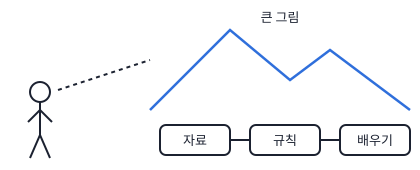

*자세한 길은 다음에 걷고, 오늘은 전체 지도만 그려요.*

**정확히 말하면**

이번 강의(Lecture 01, When Models Meet Data)의 목표(Targets)는 두 가지예요.

1. 데이터와 모델이 학습(러닝)에서 어떻게 상호작용하는지 이해하고, 학습을 경험적 리스크 최소화(empirical risk minimization, ERM)로 정식화해요. 곧 학습은 리스크를 최소화하는 과정이에요.
2. 모델을 확률적으로 해석하고, 그 파라미터를 Maximum Likelihood(ML)와 MAP(Maximum A Posteriori)로 추정해요.

모델은 결정론적 함수로 만들 수도 있지만, 요즘은 베이지안 접근, 곧 통계(확률) 모델을 많이 써요. 확률 모델의 파라미터 추정에 주로 쓰는 방법이 Maximum Likelihood와 MAP이에요.

로드맵(L01 s3–s4)의 앞 세 단계는 다음과 같아요.

- (1) Data, Models, and Learning: 이날(0909) 다룬 부분이에요.
- (2) Models as Functions: Empirical Risk Minimization
- (3) Models as Probabilistic Models: Parameter Estimation (ML and MAP)

(2)–(3)은 다음 주 월요일 수업에서 이어 갈 예정이에요. 이날은 세부 유도 없이 정의만 배우고, 파라미터가 어떤 과정을 거쳐 학습되는지 전체 흐름을 먼 산 보듯 훑어요.

MLE와 MAP의 정의·세부는 지난 학기 확률 수업의 "Statistical Inference" 챕터(약 2주 분량) 강의노트와 동영상으로 대신하고, 수업 중에도 필요한 만큼 리뷰해요.

**교수님 말씀**

뒷짐 지고 먼 산 바라보는 할아버지처럼, 파라미터가 학습되는 과정을 세부 대신 큰 그림으로 "먼 산 보듯이" 보자고 하셨어요(0909 03:19). 이 표현은 수업 중에 다시 나와요(0909 12:06).

MLE·MAP을 들어 본 적 있는지 손을 들어 보게 하신 뒤, 세부는 Statistical Inference 자료로 대신하자고 하셨어요.

> "갈음합시다, 일단." (0909 02:27)

**페이지 요약**

학습을 리스크 최소화로 보고, 확률 모델의 파라미터를 Maximum Likelihood와 MAP으로 추정하는 것이 이 강의의 목표예요.

*용어*

- **경험적 리스크 최소화(empirical risk minimization)** — 학습을 리스크를 최소화하는 문제로 정식화한 것
- **Maximum Likelihood(ML)** — 확률 모델의 파라미터를 추정하는 대표 방법
- **MAP(Maximum A Posteriori)** — 확률 모델의 파라미터를 추정하는 또 다른 대표 방법

---

### 머신러닝의 세 구성요소와 빅데이터의 임계점

*0909 수업 · L01 s5*

**쉽게 말하면**

기계가 똑똑해지려면 먼저 보고 배울 자료가 넉넉해야 해요.

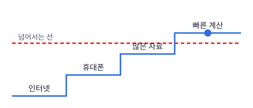

*한 칸씩 쌓이다가 어느 날 선을 훌쩍 넘었어요.*

**정확히 말하면**

머신러닝 시스템에는 항상 세 가지 주요 구성요소(three major components)가 있어요(L01 s5).

1. 데이터(Data): $\{(\mathbf{x}_1, y_1), \dots, (\mathbf{x}_n, y_n), \dots, (\mathbf{x}_N, y_N)\}$. 표기의 뜻은 [데이터 표기: 볼드는 벡터, 괄호는 세트](#s1-notation)에서 봐요.
2. 모델(Models): 결정론적 함수(deterministic function) 또는 확률 모델(probabilistic model). [모델 = 수식 (정답은 없다)](#s2-model-eq)으로 이어져요.
3. 러닝(Learning): 트레이닝(training)과 예측·추론(prediction/inference). [좋은 모델 = unseen data에서 잘하는 모델](#s3-good-model)으로 이어져요.

데이터는 첫 번째로 필요한 요소예요.

- 데이터 양이 적을수록 추측·추론(inference)의 정확도가 떨어지고 불확실성이 커져요.
- 머신러닝이 최근 크게 성장한 이유: 인터넷, 모바일 인터넷을 거쳐 빅데이터가 쌓였고, 이를 처리할 GPU·NPU 컴퓨팅 파워와 충분한 파라미터 튜닝이 더해져 임계점을 넘었어요.
- 성장은 선형이 아니라 계단식이에요. 조금씩 쌓이다가 어느 시점에 임계치를 넘으면 성능이 뛰어올라요.
- 성능이 안 나올 때 모델이나 러닝 알고리즘을 먼저 의심하기 쉽지만, 대부분은 데이터가 부족한 문제예요. 보지 못한 데이터(unseen data)를 추론할 만큼 데이터가 없으면 학습이 덜 되고 모델이 피팅되지 않아요.

**교수님 말씀**

이 수업을 여러 번 들은 학생은 데이터가 많아서 교수님 스타일을 예측할 수 있지만, 처음 듣는 학생은 오늘만 농담을 잘하는 건지 알 수 없어요. 데이터가 적으면 불확실성이 크다는 비유예요(0909 04:45).

인생은 선형으로 자라지 않고 계단식으로 자라요. 머신러닝도 어느 시점에 임계치를 넘었고, ChatGPT를 쓰며 "이 정도까지 해 준다고?" 하고 놀라는 느낌이 그 증거라고 하셨어요(0909 05:41, 06:29).

> "근데 대부분의 문제는 데이터가 부족한 거예요." (0909 07:07)

> "첫 번째 뭐가 필요하다? 데이터가 필요하다, 데이터." (0909 07:38)

**페이지 요약**

머신러닝은 데이터·모델·러닝 세 요소로 이루어지고, 성능 문제는 대부분 데이터가 부족한 데서 와요.

*핵심 식*

- 데이터셋

  $$
  \{(\mathbf{x}_1, y_1), \dots, (\mathbf{x}_n, y_n), \dots, (\mathbf{x}_N, y_N)\}
  $$

*용어*

- **세 구성요소(three major components)** — 데이터, 모델, 러닝
- **임계점** — 빅데이터와 GPU·NPU 컴퓨팅 파워가 쌓여 성능이 뛰어오른 지점

---

## 1. 데이터: 벡터와 특징

### 데이터 표기: 볼드는 벡터, 괄호는 세트

*0909 수업 · L01 s5*

**쉽게 말하면**

자료는 문제와 정답을 한 쌍씩 묶은 카드 묶음이에요.

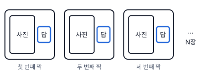

*카드가 많아질수록 더 잘 배울 수 있어요.*

**정확히 말하면**

교수님은 "수학은 언어"라며 L01 s5에 처음 나온 데이터 표기부터 풀어 주셨어요.

$$
\{(\mathbf{x}_1, y_1), \dots, (\mathbf{x}_n, y_n), \dots, (\mathbf{x}_N, y_N)\} = \{(\mathbf{x}_n, y_n)\}_{n=1}^{N}
$$

1. 관습(convention): 소문자 볼드체는 벡터예요. $\mathbf{x}_n$은 실수 여러 개로 이루어진 $n$번째 입력 벡터예요.
2. $y_n$은 볼드체가 아니므로 실수 하나예요.
3. 괄호 $(\mathbf{x}_n, y_n)$로 묶였다는 것은 둘이 짝, 곧 세트라는 뜻이에요.
4. 아래첨자 $n$은 $n$번째 세트이고, 세트는 모두 $N$개(대문자 N)예요.
5. 빅데이터를 수학으로 쓰면 $N \to \infty$예요.

입력은 보통 벡터 $\mathbf{x}$, 출력은 보통 숫자 하나 $y$로 써요. 신호 및 시스템에서 입력을 $x$, 출력을 $y$로 쓰는 것과 같은 관습이에요.

예: 개·고양이 분류에서 입력 사진은 (픽셀 수) × (RGB 세 값)만큼의 실수로 된 긴 벡터예요. 각 값은 양자화 비트로 표현돼요. 출력은 $y \in \{0, 1\}$이고, 0은 개, 1은 고양이예요.

**교수님 말씀**

$\mathbf{x}_1$과 $y_1$이 어떻게 다르냐는 질문에 한 학생이 "첫 번째 x"라고 답했어요. 아래첨자 1이 첫 번째 데이터라는 점은 맞다고 하셨어요. 다른 학생이 "볼드체요"라고 답해 정답이 됐어요 (0909 09:00).

> "사실 수학에서의 볼드체는 벡터라는 뜻이죠, 벡터." (0909 10:10)

convention은 관습이에요. 의학 드라마에서 의사끼리 쓰는 약어처럼, 전문가 집단이 관습으로 쓰는 용어가 있다고 하셨어요 (0909 10:24).

괄호로 묶인 세트는 런치 세트, 늘 붙어 앉는 짝꿍 같은 것이라고 하셨어요 (0909 11:45, 12:18).

> "저는 입력을 u, 출력을 t라고 하겠습니다. 여러분만 그렇게 하는 거야." (0909 13:46)

관습을 따르라는 뜻이에요.

**페이지 요약**

데이터는 입력 벡터와 출력 숫자를 한 세트로 묶은 것이 $N$개 모인 것이에요.

*핵심 식*

- 지도학습 데이터셋

  $$
  \{(\mathbf{x}_n, y_n)\}_{n=1}^{N}
  $$
- 빅데이터

  $$
  N \to \infty
  $$

*용어*

- **관습(convention)** — 전문가들이 약속처럼 쓰는 표기. 소문자 볼드체는 벡터
- **세트(짝)** — 괄호로 묶인 입력과 출력 한 쌍

---

### 지도학습과 비지도학습(클러스터링)

*0909 수업 · L01 s5–s6*

**쉽게 말하면**

이름표가 붙은 사진으로 배우면 선생님이 있는 공부, 이름표 없이 비슷한 것끼리 모으면 혼자 하는 정리예요.

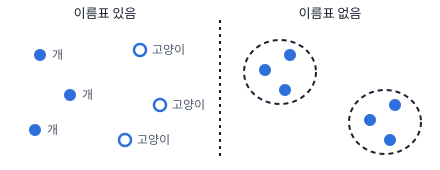

*오른쪽은 이름을 몰라도 가까운 것끼리 무리를 지어요.*

**정확히 말하면**

지도학습과 비지도학습의 정의는 지난 시간 내용을 다시 짚은 것이에요 (0909 14:58, 15:16).

- 지도학습(supervised learning): 데이터마다 라벨(label, 정답)이 있어요. 그래서 데이터가 $(\mathbf{x}_n, y_n)$ 세트로 주어져요. 슬라이드는 $y_n$을 label, target, response variable, annotation이라고도 불러요.

  $$
  \{(\mathbf{x}_n, y_n)\}_{n=1}^{N}
  $$
- 비지도학습(unsupervised learning): $y$ 없이 입력 데이터만 주어져요.

  $$
  \{\mathbf{x}_1, \dots, \mathbf{x}_N\}
  $$

비지도학습의 대표 알고리즘은 클러스터링(clustering)이에요. 라벨 없이 비슷한 것끼리 그룹으로 나눠요.

예: MBTI는 네 글자가 각각 두 가지라서 사람을 $2^4 = 16$개 그룹으로 나눠요. 그룹을 몇 개로 나눌지는 모델을 바꾸는 선택이에요. 이 이야기는 [모델 선택과 하이퍼파라미터](#s3-hyperparam)에서 이어져요.

**교수님 말씀**

비지도학습이면 $y_1$이 있어야 하느냐고 물으셨고, 한 학생이 없어야 한다는 취지로 답했어요 (0909 15:27).

MBTI로 사람을 16개 그룹으로 나누는 것이 클러스터링이라고 하셨어요 (0909 15:56–16:42).

**페이지 요약**

라벨이 있으면 지도학습, 없으면 비지도학습이고, 비지도학습의 대표는 클러스터링이에요.

*핵심 식*

- 지도학습 데이터

  $$
  \{(\mathbf{x}_n, y_n)\}_{n=1}^{N}
  $$
- 비지도학습 데이터

  $$
  \{\mathbf{x}_1, \dots, \mathbf{x}_N\}
  $$

*용어*

- **라벨(label)** — 데이터마다 붙은 정답
- **클러스터링(clustering)** — 라벨 없이 비슷한 것끼리 그룹으로 나누기

---

### 데이터 = D차원 특징 벡터

*0909 수업 · L01 s6*

**쉽게 말하면**

사진 한 장도 숫자를 길게 줄 세운 것이에요.

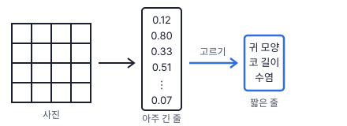

*쓸모 있는 숫자만 골라 짧게 만들면 배우기가 가벼워져요.*

**정확히 말하면**

L01 s6은 데이터가 $D$차원 실수 벡터로 주어진다고 가정해요.

$$
\mathbf{x}_n \in \mathbb{R}^D
$$

1. $\mathbb{R}^D$는 실수 $D$개로 이루어진 벡터들의 집합이에요.
2. $D = 3$이면 $\mathbf{x}_n = [x_n^{(1)}, x_n^{(2)}, x_n^{(3)}]^\top$이에요.
3. 일반적으로 $\mathbf{x}_n = [x_n^{(1)}, \dots, x_n^{(D)}]^\top$이에요. 아래첨자 $n$은 $n$번째 데이터, 위첨자 $(d)$는 그 안의 $d$번째 성분이에요.
4. 벡터는 열벡터로 정의하므로 가로로 쓸 때는 전치 $\top$를 붙여요.

각 성분 $x_n^{(d)}$를 특징(feature)이라고 해요. property, attribute라고도 하고, 슬라이드는 covariate라는 이름도 써요.

데이터와 특징은 달라요. 데이터는 가공하지 않은 raw data일 수도 있어요. 개·고양이를 가리는 데 고화질 사진의 실수 23만 개가 모두 필요하지는 않아요. 그래서 특징 추출(feature extraction)로 줄이고 압축한 특징 벡터(feature vector)를 이번 학기에는 "데이터"라고 불러요. raw data를 전부 넣는 것은 낭비예요.

특징은 과업을 잘 표현해야 해요. 픽셀을 무작위로 섞은 사진은 패턴이 없어 노이즈로만 보여요 (0909 27:18–28:03).

정리하면 "데이터가 주어졌다"는 실수 벡터 $\mathbf{x}_n \in \mathbb{R}^D$가 여러 개 주어졌다는 뜻이에요. 그 개수가 $N \to \infty$로 가면 빅데이터예요 (0909 35:12).

**교수님 말씀**

개·고양이 분류에 23만 개 실수로 된 고화질 사진 전체를 넣는 것은 낭비라고 하셨어요 (0909 30:54–31:55).

> "교수님이 그 수업 시간에 중요한 그 단어들은 붉은색으로 표시하는 습관이 있거든요." (0909 35:07)

슬라이드에서 빨간 글자로 표시된 단어를 눈여겨보라는 뜻이에요.

**페이지 요약**

데이터 하나는 특징 $D$개를 줄 세운 실수 벡터이고, raw data에서 특징 추출로 만들어요.

*핵심 식*

- D차원 데이터

  $$
  \mathbf{x}_n \in \mathbb{R}^D
  $$
- 성분 표기

  $$
  \mathbf{x}_n = [x_n^{(1)}, \dots, x_n^{(D)}]^\top
  $$

*용어*

- **특징(feature)** — 벡터의 한 성분. attribute, covariate라고도 해요
- **특징 추출(feature extraction)** — raw data를 과업에 맞게 줄이고 압축하기

---

### 더 나은 표현: PCA와 kernel

*0909 수업 · L01 s6*

**쉽게 말하면**

점들이 길게 늘어선 방향 하나만 봐도 대부분을 알 수 있어요.

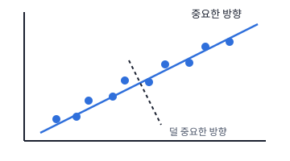

*그래서 숫자 두 개 대신 선 위의 자리 하나만 적어도 돼요.*

**정확히 말하면**

L01 s6은 데이터를 벡터로 더 잘 나타내는(better representation) 두 방향을 소개해요.

1. 저차원 근사(lower-dimensional approximation): 원래 특징 벡터를 더 적은 수의 성분으로 줄여요. 대표가 PCA예요.
2. 고차원 비선형 조합: feature map과 kernel로 원래 특징들을 비선형으로 조합해 더 높은 차원의 벡터를 만들어요.

PCA(Principal Component Analysis)는 이름 그대로 주요한(principal) 성분(component)만 분석(analysis)해요. 결정을 내리는 데 정말 중요한 성분만 체계적으로 골라 압축해요.

계산에는 선형대수의 SVD(특잇값 분해)나 EVD(고윳값 분해)를 써요. 이렇게 차원을 줄이는 일을 데이터 전처리(preprocessing), 또는 PCA를 이용한 특징 추출이라고 해요 (0909 32:22–34:21).

동기: 개인지 고양이인지는 0 아니면 1, 곧 1비트짜리 결정이에요. 이 결정에 실수 23만 개가 모두 필요하지는 않아요.

요즘은 딥러닝(autoencoder, CNN, DNN)도 이 압축과 특징 추출을 해요 (0909 34:25).

반대 방향으로, feature map과 kernel은 원래 특징 벡터를 더 높은 차원의 비선형 조합으로 늘려요 (0909 34:53). 선형 모델을 kernel로 2차·3차·로그·지수 꼴까지 넓히는 이야기는 [함수 모델 f: 공장에 들어가는 입장권](#s2-function)에서 이어져요.

**교수님 말씀**

"principal"이 무슨 뜻이냐고 물으셨고, 한 학생이 "주요하다", "component"는 "인자"라고 답했어요 (0909 32:50).

개·고양이를 가리는 1비트 결정에 23만 개 실수가 다 필요하냐는 질문으로 PCA가 왜 필요한지 설명하셨어요 (0909 33:12).

> "진짜 이 결정을 내리는 데 정말 중요한 컴포넌트는 뭘까?" (0909 33:24)

**페이지 요약**

PCA는 중요한 성분만 남겨 차원을 줄이고, feature map과 kernel은 비선형 조합으로 차원을 늘려요.

*용어*

- **PCA(Principal Component Analysis)** — 주요한 성분만 골라 압축하는 특징 추출. SVD나 EVD로 계산
- **저차원 근사(lower-dimensional approximation)** — 특징 벡터를 더 적은 성분으로 줄여 나타내기
- **feature map, kernel** — 특징을 비선형으로 조합해 더 높은 차원으로 옮기기

---

## 2. 모델: 수식, 그리고 귀납

### 모델 = 수식 (정답은 없다)

*0909 수업 · L01 s5*

**쉽게 말하면**

눈에 보이는 것 뒤에는 숨은 규칙이 있고, 그걸 짐작해 적어 두는 거예요.

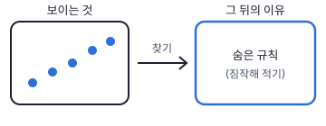

*점들이 왜 그렇게 찍혔는지 이유를 짐작해서 규칙으로 적어요.*

**정확히 말하면**

모델은 수학, 곧 수식이에요. RLC 회로를 2차 미분방정식으로 풀어 보는 것도 모델링이에요.

모델은 두 가지 꼴로 만들 수 있어요(L01 s5).

- **결정론적 함수(deterministic function)**: 데이터를 $F=ma$ 같은 법칙·공식으로 봐요. 예: $y=ax+b$(1차), $y=ax^2+bx+c$(2차), 지수·사인·로그 함수. 계수는 피팅해 봐야 알지만 "꼴"은 먼저 정해요.
- **확률 모델(probabilistic model)**: 관측에 노이즈가 낀다고 보고 불확실성을 모델에 넣어요. 자세한 내용은 [확률 모델: 조건부 PDF와 MLE 맛보기](#s2-prob)에서 다뤄요.

모델링은 데이터를 가장 잘 설명하는 수식을 만드는 일이고, 그 과정이 머신러닝이에요.

모델 셋업(model setup) 예: 입력이 $\mathbf{x}=(x_1,x_2,x_3)$일 때 데이터가

$$
y = 3x_1 + 5x_2 + 6x_3 + 0.6
$$

로 만들어진 것 같다고 정하는 거예요. 왜 그렇게 봤는지 합리적으로 설명하는 과정까지가 모델 셋업이에요.

모델에는 정답이 없어요. "내 과업에는 네 모델이 더 맞다"고는 말할 수 있어도 "네 모델은 틀렸다"고는 아무도 말할 수 없어요. 그래서 모델은 옳고 그름이 아니라 취사선택의 문제예요.

**교수님 말씀**

로맨스 영화 마지막 장면에서 남자 주인공이 웃으며 손을 흔들 때, 그 표정 뒤의 복잡한 감정을 읽어 내는 것처럼 데이터(겉으로 드러난 표정과 몸짓) 뒤의 기작을 찾는 게 데이터 사이언스라고 하셨어요 (0909 19:55).

> "학부생에서 대학원생으로 넘어가는 그 페이즈에서 가장 중요하게 생각해야 되는 게 모델링이에요." (0909 19:18)

> "이 데이터를 가장 잘 설명하는 수식을 만들어내는 과정이 머신러닝이에요." (0909 21:50)

모델을 정할 때는 근거를 대되 망설이지 말라고 하셨어요.

> "자신감 있게 뭘 해야 된다? 질러야 된다는 거야." (0909 23:54)

> "모델은 정답이 없어요." (0909 24:00)

**페이지 요약**

모델은 데이터를 가장 잘 설명하는 수식이고, 정답은 없어요.

*핵심 식*

- 모델 셋업 예

  $$
  y = 3x_1 + 5x_2 + 6x_3 + 0.6
  $$

*용어*

- **결정론적 함수(deterministic function)** — 입력이 같으면 출력이 하나로 정해지는 모델
- **확률 모델(probabilistic model)** — 노이즈와 불확실성을 넣은 모델

---

### 오늘의 메인 레슨: 머신러닝은 귀납이다

*0909 수업 · L01 s7*

**쉽게 말하면**

원리를 먼저 배우는 공부도 있지만, 기계가 배울 때는 점들부터 보고 규칙을 짐작해요.

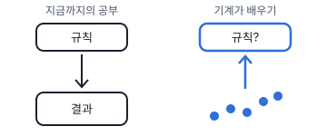

*왼쪽은 규칙에서 결과로, 오른쪽은 색칠된 점들에서 규칙으로 거꾸로 올라가요.*

**정확히 말하면**

지금까지 배운 공학은 **연역**(deductive)이었어요. 원리가 먼저 주어지고, 그 원리로 결과를 유도해요.

통신·신호처리가 대표 예예요. 시스템의 임펄스 응답(impulse response) $h(t)$와 입력 $x(t)$를 알면 출력을 예측해요.

$$
y(t) = x(t) * h(t)
$$

관측값이 이 예측과 다르면 "노이즈가 꼈나?" 하고 식에 노이즈를 더해 다시 모델링해요.

$$
y(t) = x(t) * h(t) + n(t)
$$

머신러닝은 **귀납**(inductive)이에요. 수식이 아니라 raw data가 먼저 주어지고, 그 데이터가 만들어진 과정을 스스로 짐작해요.

L01 s7 왼쪽 그래프에서 우리에게 주어진 것은 검은 선이 아니라 파란 점(데이터)이에요. 점 하나하나는 사실 $D$차원 벡터일 수도 있어요. 할 일은 이 점들을 가장 잘 설명하는 수식, 곧 $x$와 $y$의 관계를 찾는 거예요.

1. 점들을 봐요: $x$가 커지면 $y$도 일정하게 커져요.
2. 모델을 정해요: "선형 관계일 것이다."
3. 수식으로 써요: $y=\theta_1x+\theta_0$.
4. $\theta_0,\theta_1$을 최적화해요. 이게 학습이에요.

이 절차의 뒷부분은 [직선 피팅, 모델 크기, 손실 함수](#s2-fitting)에서 이어져요.

**교수님 말씀**

연역식 공부를 이렇게 흉내 내셨어요: "이 소자는 전류를 미분하면 전압이 나온다. 왜 그런지는 물리학과에 가서 배워라." (0909 22:08)

> "근데 머신러닝은 뭐다? 귀납적." (0909 22:34)

컨볼루션은 신호 및 시스템에서 "단언컨대 배웠어"라고 하셨어요 (0909 44:48).

> "오늘은 이게 진짜 메인 레슨이거든요. 머신러닝은 연역식이다, 귀납식이다? 귀납식." (0909 45:54)

주어진 게 파란 점이냐 검은 선이냐고 물으시자 한 학생이 "빨간색"이라고 농담으로 답했어요. 정답은 파란 점이에요 (0909 46:16).

> "머신러닝의 핵심은 이거예요. 파란색 점이 우리에게 주어졌다는 거예요." (0909 46:25)

**페이지 요약**

공학은 원리에서 결과로 가는 연역, 머신러닝은 데이터에서 규칙으로 가는 귀납이에요.

*핵심 식*

- 연역의 예(컨볼루션)

  $$
  y(t) = x(t) * h(t)
  $$

*용어*

- **연역(deductive)** — 원리를 먼저 주고 결과를 유도함
- **귀납(inductive)** — 데이터를 보고 그 뒤의 규칙을 짐작함

---

### 함수 모델 f: 공장에 들어가는 입장권

*0909 수업 · L01 s7*

**쉽게 말하면**

함수는 숫자 여러 개를 넣으면 숫자 하나를 내놓는 공장이에요.

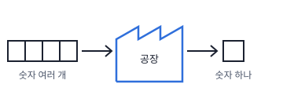

*정해진 칸 수만큼 숫자를 들고 와야 입장할 수 있고, 나올 때는 숫자 하나가 돼요.*

**정확히 말하면**

예측 모델을 결정론적 함수로 쓸 때의 표기예요(L01 s7).

$$
f: \mathbb{R}^D \to \mathbb{R}
$$

**칠판 유도 1: 표기의 뜻**

1. 함수는 공장이에요. 입력 $x$를 받아 출력 $y$를 내요: $y=f(x)$. 입력 쪽 집합이 정의역(domain)이에요.
2. $\mathbb{R}^D$는 실수 $D$개로 된 벡터예요. 곧 이 공장에 들어오려면 길이 $D$인 실수 벡터여야 해요.
3. 화살표 뒤 $\mathbb{R}$은 공역(codomain)이에요. 출력은 실수 하나예요. 실제로 나오는 값들의 집합은 치역(range)이에요.
4. 공장 이름은 $f$예요. 이 공장으로 데이터를 모델링(설명)하겠다는 뜻이에요.

**칠판 유도 2: 차원 검증**

$$
f(\mathbf{x}) = \boldsymbol{\theta}^\top \mathbf{x} + \theta_0
$$

1. $\mathbf{x}=[x_1,\dots,x_D]^\top\in\mathbb{R}^D$, $\boldsymbol{\theta}=[\theta_1,\dots,\theta_D]^\top$. 길이가 같아야 내적할 수 있어요.
2. 벡터는 열벡터로 정의하므로 $\boldsymbol{\theta}^\top=[\theta_1\ \cdots\ \theta_D]$는 누운 행벡터예요.
3. $\boldsymbol{\theta}^\top\mathbf{x}=\theta_1x_1+\cdots+\theta_Dx_D$는 내적이라 스칼라(실수 하나)예요.
4. 실수 $\theta_0$(바이어스, bias)를 더해도 실수예요. 따라서 $\boldsymbol{\theta}^\top \mathbf{x} + \theta_0\in\mathbb{R}$이고, $f: \mathbb{R}^D \to \mathbb{R}$과 차원이 맞아요.

$\boldsymbol{\theta}$와 $\theta_0$의 값은 나중에 최적화해요. 딥러닝에서 쓰는 gradient descent가 그 방법의 하나예요.

1차식의 예로 $y=ax+b$, 그리고 입력 $(x_1,x_2)$를 받는 평면의 방정식 $y=a_1x_1+a_2x_2+b$가 있어요. 데이터를 가장 잘 설명하는 $a_1,a_2,b$를 정하는 과정이 수학적으로 학습(러닝, 트레이닝)이에요.

선형으로 설명되는 데이터는 많아요. linear regression에서 배운 이론은 커널 함수로 2차·3차·로그·지수 식까지 넓힐 수 있고(kernel expansion), 그 바탕도 선형 방정식이에요.

**교수님 말씀**

> "우리 공장에 입장하실 거면 리얼 넘버 D개를 가지고 있는 벡터의 모양으로 입장하셔야 돼요." (0909 37:48)

$\boldsymbol{\theta}^\top\mathbf{x}$가 스칼라가 되고 $\theta_0$를 더해 실수가 되는 걸 두고 차원이 "딱 맞아떨어진다"고 하셨어요 (0909 40:00).

> "일단 이 모델을 펑션으로 정의하는 순간 이런 수식을 머릿속에서 기억해야 된다." (0909 42:48)

> "리니어 이퀘이션이 되게 중요합니다, 나중에 이거 이해할 때." (0909 43:30)

**페이지 요약**

함수 모델은 길이 $D$인 실수 벡터를 받아 실수 하나를 내는 공장이에요.

*핵심 식*

- 함수 모델의 모양

  $$
  f: \mathbb{R}^D \to \mathbb{R}
  $$
- 선형 모델

  $$
  f(\mathbf{x}) = \boldsymbol{\theta}^\top \mathbf{x} + \theta_0
  $$

*용어*

- **공역(codomain)** — 화살표 뒤에 적는, 출력이 속하는 집합
- **내적(inner product)** — 길이가 같은 두 벡터를 곱해 스칼라 하나를 얻는 연산

---

### 직선 피팅, 모델 크기, 손실 함수

*0909 수업 · L01 s7*

**쉽게 말하면**

점들을 가장 잘 지나가는 선을 고르는 게 맞추기예요.

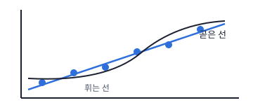

*곧은 선이 잘 안 맞으면 휘는 선으로 바꿔 볼 수 있어요.*

**정확히 말하면**

점들을 보고 "선형 관계일 것"이라고 정했다면, 묻지도 따지지도 말고 직선 모델을 써요.

$$
y = \theta_1 x + \theta_0
$$

그다음 $\theta_0,\theta_1$을 최적화해요. 이게 학습(피팅)이에요.

**모델이 안 맞으면 모델을 바꿔요**: 1차 → 2차 → 3차.

- 모델 크기(model size), 곧 파라미터 수가 커질수록 표현력(expressiveness)이 좋아져요.
- 고차 모델은 파라미터 일부를 0으로 두면 저차 모델이 돼요. 그래서 더 단순한 모델을 포함해요.

1. $$
   y = ax^2 + bx + c
   $$
2. $a=0$이면 $y=bx+c$ (1차식)

**같은 직선 모델 안에서도** 어느 직선이 데이터를 가장 잘 나타내는지 정할 기준이 필요해요. 그 기준이 손실 함수(loss function)예요.

- 손실 함수를 어떻게 정의하느냐에 따라 무엇을 중요하게 볼지가 달라져요.
- 손실 함수는 우리가 설계할 수 있어요. 수학은 정의에서 시작해요.

**교수님 말씀**

어휘가 많으면 말이 유창해지는 것에 비유하셨어요. 유치원생은 "밥 줘, 배고파"라고 말하지만 대학생은 고급 언어를 써요. 파라미터가 많을수록 표현력이 좋은 것과 같아요 (0909 49:04).

영화를 평가할 때 러닝타임만 보는 사람도, 액션 비중만 보는 사람도 있어요. 그 평가 기준이 곧 손실 함수예요 (0909 50:54).

> "손실 함수를 내가 어떻게 디파인 하느냐에 따라서 뭘 더 중요하게 볼지" (0909 50:43)

> "내가 무엇을 중요하게 보고 무엇을 좋게 볼 거냐라는 것도 디파인하기 나름이에요." (0909 51:19)

**페이지 요약**

직선이 안 맞으면 모델을 키우고, 어느 선이 좋은지는 손실 함수로 정해요.

*핵심 식*

- 직선 모델

  $$
  y = \theta_1 x + \theta_0
  $$
- 2차 모델

  $$
  y = ax^2 + bx + c
  $$

*용어*

- **모델 크기(model size)** — 파라미터 수. 클수록 표현력이 좋아요
- **손실 함수(loss function)** — 어느 모델이 데이터를 잘 나타내는지 재는 기준

---

### 확률 모델: 조건부 PDF와 MLE 맛보기

*0909 수업 · L01 s7*

**쉽게 말하면**

답을 숫자 하나로 콕 찍는 대신, 어디쯤일지 넓게 알려 주는 방법도 있어요.

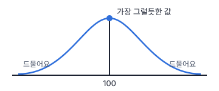

*가운데 100 근처가 가장 그럴듯하고, 멀어질수록 드물어요.*

**정확히 말하면**

모델을 확률 밀도 함수(PDF)로도 나타낼 수 있어요. 많은 데이터는 noisy observation이라서, 실제 underlying effect를 보려면 노이즈의 영향을 가정하고 설명하는 편이 좋아요.

이때 파라미터는 확률 모형의 파라미터예요. 가우시안 $\mathcal{N}(\mu,\sigma^2)$이라면 평균과 분산, 곧 실수 두 개를 최적화하는 문제가 돼요.

**같은 파란 점 다섯 개로 두 모델 비교하기**(L01 s7 그림)

- 결정론적 모델: 선형 모델과 손실 함수로 가장 좋은 직선을 얻고, 처음 보는 입력(unseen data) $x=60$이 들어오면 $f(60)=100$으로 예측해요.
- 확률 모델: 데이터로 가장 그럴듯한 조건부 PDF $p(y \mid \mathbf{x})$를 만들어요. 예를 들어 $x=60$일 때

$$
y \mid x=60 \sim \mathcal{N}(100, \sigma^2)
$$

평균 100은 $x$ 자체가 아니라 모델이 내는 값이에요.

이 PDF는 "100을 중심으로 크거나 작을 수 있지만, 100에서 멀수록 확률이 낮다"고 말해 줘요. 분포 자체가 결과인 거예요. 교수님은 이 PDF 자체가 pure Bayesian 결과라고 하셨어요 (0909 56:52).

그래도 값 하나를 내야 한다면 가장 그럴듯한 값 100을 골라요. 수업에서는 이것을 MLE(Maximum Likelihood Estimate)의 맛보기로 설명했어요.

PDF에서 값 하나를 고르는 기준(criterion)은 여럿이에요: Neyman–Pearson criterion, 평균제곱오차(mean squared error) 최소화, 그리고 대표적인 MLE와 MAP(Maximum A Posteriori).

확률 모델을 쓰는 이유는 결정론적으로 보이는 것도 사실 불확실성을 가진 확률 모형의 결과일 수 있어서예요. 관측에는 노이즈와 에러가 끼고, 그 에러를 통계적으로 어떻게 모델링하느냐에 따라 원 데이터의 패턴을 다르게 해석해요.

엄밀히는 조건부 PDF에서 가장 그럴듯한 값을 고른 것이고, 파라미터 추정 방법으로서 MLE의 정의는 뒤 시간에 다뤄요. 조건부 PDF를 데이터로부터 만드는 방법도 아직 배우지 않았어요.

**교수님 말씀**

동전을 다섯 번 던져 앞·앞·뒤·뒤·앞이 나오면 "앞면 확률 0.6"이라고 보는 것이 확률적 사고라고 하셨어요 (0909 25:09).

논리회로 실험에서 1과 0으로 적는 신호도 실제로는 5.3 V, 6.2 V처럼 노이즈가 낀 전압이라고 하셨어요 (0909 25:45).

군 장성들은 "기지국이 꺼지면 몇 퍼센트 통신이 됩니까? 숫자로" 하고 단답을 원해요. 엔지니어는 그 숫자 뒤의 분포를 알지만 설명이 길어요. 숫자 하나를 줘야 할 때 쓰는 기준이 MLE·MAP 같은 추정법이에요 (0909 56:07).

영화를 러닝타임으로 볼지, 액션으로 볼지, 주인공 외모로 볼지에 따라 평가가 달라지듯, 무엇을 중요하게 보느냐에 따라 추정값도 달라진다고 하셨어요 (0909 58:22).

> "이게 맥시멈 라이클리후드 에스티메이션. 가장 그럴듯한 에스티메이션의 결과." (0909 57:28)

**페이지 요약**

확률 모델은 답을 분포로 내고, 값 하나가 필요하면 가장 그럴듯한 값을 골라요.

*핵심 식*

- 조건부 PDF

  $$
  p(y \mid \mathbf{x})
  $$
- 수업 예시

  $$
  y \mid x=60 \sim \mathcal{N}(100, \sigma^2)
  $$

*용어*

- **noisy observation** — 노이즈가 낀 관측
- **MLE(Maximum Likelihood Estimate)** — 가장 그럴듯한 값을 고르는 추정

---

## 3. 러닝: 좋은 모델과 세 단계

### 좋은 모델 = unseen data에서 잘하는 모델

*0909 수업 · L01 s5*

**쉽게 말하면**

좋은 규칙은 처음 보는 문제도 잘 푸는 규칙이에요.

*연습한 문제보다 처음 보는 문제에서 잘해야 좋은 규칙이에요.*

**정확히 말하면**

슬라이드는 러닝(learning)을 "training, and prediction/inference"로 적어요. 러닝의 최종 목적은 예측·추론(prediction/inference)이에요. 한 번도 보지 못한 사진이 개인지 고양이인지 맞히는 일이에요.

학습은 사진 세트를 대량으로 보여 주고 모델 속 숫자(파라미터)를 최적화하는 과정이에요. 예를 들어 모델을 $y = 3x_1 + 5x_2 + 6x_3 + 0.6$으로 세웠다면 $3, 5, 6, 0.6$이 학습으로 맞출 숫자예요([모델 = 수식 (정답은 없다)](#s2-model-eq)).

학습이 잘되려면 두 가지가 필요해요.

1. 데이터가 많아야 해요.
2. 데이터가 과업을 잘 표현해야 해요. 픽셀을 무작위로 섞은 사진에는 패턴이 없어 노이즈로만 보여요. 과업에 맞는 정보를 뽑아내는 일이 특징 추출(feature extraction)이에요([더 나은 표현: PCA와 kernel](#s1-pca)).

슬라이드의 기준은 "Good machine learning models: perform well for unseen (untrained) data"예요.

- 모델은 correct/incorrect(옳고 그름)로 따지지 않고 good(좋음)으로 따져요. 모델은 취사선택의 문제예요.
- unseen data는 학습에 쓰지 않은, 아직 보지 않은 새 데이터예요.
- unseen data에서 내가 하려는 일(분류, 추측, 추론)을 잘하면 좋은 모델이에요.

머신러닝 알고리즘은 트레이닝(training)과 예측(prediction)으로 이루어져요. 트레이닝 안에는 모델 선택(하이퍼파라미터 최적화)도 들어가요. 데이터가 가설(모델)과 너무 안 맞으면 모델을 바꿔야 해요([모델 선택과 하이퍼파라미터](#s3-hyperparam)).

**교수님 말씀**

> "교수님이 correct, incorrect라는 말을 쓰지 않고 good이라는 단어를 썼잖아요." (0909 28:18)

과업만 잘해내면 좋은 모델이라는 뜻으로 "모로 가도 서울만 가면 된다", "고양이는 쥐만 잘 잡으면 된다"를 들었어요 (0909 29:00).

"이 데이터는 본능적으로 1차 함수에서 나왔을 거야"라고 우기는 고집쟁이가 되지 말라고 했어요. 데이터가 안 맞으면 모델을 바꿔야 해요 (0909 29:50).

> "그래서 모델 셀렉션까지 포함하는 게 트레이닝 과정이다." (0909 30:06)

**페이지 요약**

좋은 모델은 correct가 아니라 good으로 따지고, unseen data에서 과업을 잘하는 모델이에요.

*용어*

- **unseen data** — 학습에 쓰지 않은, 아직 보지 않은 새 데이터
- **좋은 모델(good model)** — unseen data에서 분류·추측·추론을 잘하는 모델
- **특징 추출(feature extraction)** — 과업에 맞는 정보를 데이터에서 뽑아내는 일

---

### 학습 알고리즘의 세 단계 (거꾸로 읽기)

*0909 수업 · L01 s8*

**쉽게 말하면**

배우기는 모양 고르기, 숫자 맞추기, 새 문제 풀기의 세 걸음이에요.

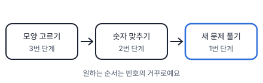

*번호는 거꾸로 붙어 있지만, 실제로는 왼쪽부터 차례로 해요.*

**정확히 말하면**

슬라이드 s8의 첫 문장은 이래요.

> The goal of learning is to find a model and its corresponding parameters such that the resulting predictor will perform well on unseen data.

- "such that 이하"(unseen data에서 성능이 좋은 예측기)를 **위하여** 모델과 파라미터를 찾는다는 뜻이에요.
- 찾을 것은 두 가지예요. (1) 모델: 1차·2차·3차·로그 함수인지, 가우시안·지수·베타 분포인지. (2) 그 모델 안의 파라미터: 예를 들어 $y = a_1x_1 + a_2x_2 + b$의 $a_1, a_2, b$.
- 파라미터를 데이터에 맞추는 일이 피팅(fitting), 곧 파라미터 튜닝이에요.
- unseen data에서 성능을 평가하는 일을 테스트(test)라고 해요.

러닝과 트레이닝은 거의 같은 말이에요. 러닝(learning)은 모델 결정까지 포함하고, 트레이닝(training)은 정해진 모델의 파라미터 튜닝을 가리켜요.

슬라이드의 번호는 ① Prediction or inference ② Training or parameters estimation ③ Model selection이에요. 수업에서는 3번부터 거꾸로 설명했고, 이것이 실제 작업 순서예요.

1. ③ model selection: 하이퍼파라미터를 골라 모델의 꼴을 정해요([모델 선택과 하이퍼파라미터](#s3-hyperparam)).
2. ② training(파라미터 추정): 정해진 모델 안의 파라미터를 데이터로 최적화해요. 파라미터를 고정값으로 보는 비확률적 방법(예: empirical risk minimization)과, 베이지안(Bayesian) 관점의 확률적 방법(예: ML, MAP)이 있어요([파라미터 추정: 격자 탐색에서 gradient descent까지](#s3-estimation)).
3. ① prediction/inference: 모델과 파라미터가 정해지면 unseen data를 넣어 테스트해요. 함수 모델이면 출력값을, 확률 모델이면 분포를 내놓아요.

**교수님 말씀**

선형 모델을 정한 다음 무엇을 하느냐고 묻자 한 학생이 "피팅"이라고 답했어요 (0909 60:14).

"such that"을 학창 시절 영어 교재(정철영어)로 배운 대로 "~하도록, ~을 위하여"로 풀어 읽었어요 (0909 60:40).

슬라이드에 1, 2, 3이라고 써 놓고 "3번부터" 거꾸로 설명했어요 (0909 62:22).

> "문 열어야지. unseen data 들어와." (0909 70:17)

학습이 끝나면 문을 열고 새 데이터를 받아 예측한다는 뜻이에요.

**페이지 요약**

unseen data에서 잘하는 예측기를 위해 모델 선택, 트레이닝, 예측 순서로 일해요.

*용어*

- **model selection** — 하이퍼파라미터를 골라 모델의 꼴을 정하는 단계
- **training(파라미터 추정)** — 정해진 모델의 파라미터를 데이터로 최적화하는 단계, 곧 피팅
- **prediction/inference** — unseen data를 넣어 답을 내는 단계, 평가하면 테스트

---

### 모델 선택과 하이퍼파라미터

*0909 수업 · L01 s8*

**쉽게 말하면**

몇 무리로 나눌지를 바꾸면 아예 다른 규칙이 돼요.

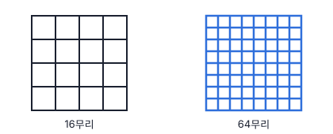

*사람을 16무리로 나눌지 64무리로 나눌지는 배우기 전에 먼저 정해요.*

**정확히 말하면**

뉴럴넷(neural network)도 모델이에요.

- 선형 모델은 $\boldsymbol{\theta}^\top\mathbf{x}$로 추론해요([함수 모델 f: 공장에 들어가는 입장권](#s2-function)).
- 뉴럴넷은 선형 가중합(weighted sum) 뒤에 비선형 활성화 함수(activation function)를 붙인 층을 여러 겹 결합한 합성 모델(composite function)이에요. 활성화 함수의 예는 sigmoid, ReLU, Leaky ReLU예요.

모델이 필요 이상으로 복잡하면 안 돼요. 그래서 층 수와 뉴런 수도 최적화 대상이고, 모델 선택(model selection)이 매우 중요해요.

하이퍼파라미터(hyperparameter)는 바뀌면 모델 자체가 바뀌는 값이에요. 슬라이드 s8은 둘을 이렇게 나눠요.

- 파라미터(parameter): 훈련 데이터로 학습해요(예: weight, bias).
- 하이퍼파라미터: 훈련 전에 정해 학습 과정을 조절해요(예: learning rate, regularization strength).

예: 클러스터 개수. MBTI처럼 사람을 비트로 나누면

1. 4비트: $2^4 = 16$그룹
2. 6비트: $2^6 = 64$그룹

클러스터 개수를 바꾸는 것은 모델을 바꾸는 것과 거의 같아요. 하이퍼파라미터를 먼저 최적화한 뒤 그 모델 안에서 파라미터를 튜닝해요. 이 둘을 묶어 model selection and training이라고 불러요.

**교수님 말씀**

"소 잡는 칼로 닭 잡을 필요 없다"고 했어요. 선형 모델로 이틀이면 될 일을 복잡한 모델로 한 달 동안 시뮬레이션하지 말라는 뜻이에요 (0909 65:16).

> "그런 일이 없어야 되기 때문에 모델 선택이 매우 중요하다." (0909 66:00)

> "클러스터 몇 개로 클러스터링할 거야?라는 거를 바꾸는 거는 모델을 바꾸는 겁니다, 거의." (0909 66:46)

**페이지 요약**

하이퍼파라미터는 바뀌면 모델 자체가 바뀌는 값이라, 먼저 고르고 그다음 파라미터를 맞춰요.

*핵심 식*

- 클러스터 개수 예(6비트)

  $$
  2^6 = 64
  $$

*용어*

- **하이퍼파라미터(hyperparameter)** — 훈련 전에 정하며, 바뀌면 모델 자체가 바뀌는 값
- **합성 모델(composite function)** — 가중합과 활성화 함수(activation function)를 여러 층 결합한 뉴럴넷

---

### 파라미터 추정: 격자 탐색에서 gradient descent까지

*0909 수업 · L01 s8*

**쉽게 말하면**

숫자를 맞출 때 모든 칸을 다 재 보면 확실하지만 오래 걸려요.

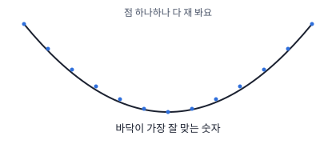

*점을 전부 재 보면 바닥을 꼭 찾지만, 잴 점이 너무 많아 시간이 오래 걸려요.*

**정확히 말하면**

트레이닝은 파라미터 추정(parameter estimation)이에요. $y = a_1x_1 + a_2x_2 + b$라면 학습할 파라미터 $a_1, a_2, b$를 최적화해요. 추정 방법(MLE, MAP 같은)으로 리스크를 최소화하는 것이 목표예요.

실제 데이터는 5개가 아니라 5만 개쯤 돼요. 그래도 문제는 실수 세 개를 찾는 일이에요. 가장 확실한 방법은 격자 탐색(grid search)이에요.

1. 각 파라미터를 $[-100, 100]$에서 $0.01$ 간격으로 둬요.
2. 한 축의 후보 수: $\frac{200}{0.01} + 1 = 20001$
3. 세 파라미터의 조합 수: $20001^3 \approx 8.0 \times 10^{12}$
4. 조합마다 5만 개 데이터에 대해 얼마나 잘 맞는지 계산해 가장 좋은 조합을 골라요.

이 방법은 확실하지만 매우 비싸요. 더 효율적인 방법으로 gradient descent, regression, least squares가 있어요. 수업에서는 이름만 나왔어요.

슬라이드 s8의 트레이닝 항목에는 두 가지가 더 있어요. 둘 다 "MAP 할 때 다시 설명"하기로 미뤘어요.

- cross-validation(교차검증): unseen data에서의 성능을 흉내 내는 시뮬레이션이에요.
- regularization/prior(정규화/사전분포): 훈련 데이터와 unseen data 사이에서 모델의 균형을 잡아요.

추정이 끝나면 unseen data로 예측해요([학습 알고리즘의 세 단계 (거꾸로 읽기)](#s3-three-phases)).

**교수님 말씀**

머신러닝은 교수님 대학원 시절의 패턴 인식(pattern recognition)이에요. 파라미터 추정(MLE, MAP)이 기초라서 신호처리·통신 연구자에게는 적용이 쉬워요 (0909 67:30).

> "머신러닝은 신기한 학문이 아니에요, 사실은." (0909 67:30)

전수 격자 탐색에 대해서는 이렇게 말했어요.

> "돈이 많고 시간이 많으신 분들은 그걸 하길 바라요. 그게 제일 좋은 방법이거든요." (0909 69:50)

**페이지 요약**

트레이닝은 파라미터 추정이고, 격자 탐색은 확실하지만 비싸서 gradient descent 같은 효율적 방법을 써요.

*핵심 식*

- 격자 조합 수

  $$
  20001^3 \approx 8.0 \times 10^{12}
  $$

*용어*

- **파라미터 추정(parameter estimation)** — 정해진 모델의 파라미터를 데이터로 최적화하는 일
- **격자 탐색(grid search)** — 후보 값을 일정 간격으로 전부 시험해 보는 방법
- **gradient descent** — 격자 탐색보다 효율적인 파라미터 학습 방법(이름만 나옴)

---

## 4. 한 장 요약 · 다음 시간 예고

### 한 장 치트시트

*0909 수업 · L01 s2–s8*

0909 수업을 한 장에 모은 치트시트예요. 줄마다 해당 토픽으로 이어져요.

| 주제 | 핵심 식 · 용어 | 한 줄 정리 |
|---|---|---|
| [오늘의 목표](#s0-targets) | 리스크 최소화, Maximum Likelihood, MAP | 세부 없이 먼 산 보듯 큰 그림부터 봐요. |
| [세 구성요소](#s0-components) | 데이터 · 모델 · 러닝 | 성능이 안 나오면 대부분 데이터가 부족한 탓이에요. |
| [데이터 표기](#s1-notation) | $\{(\mathbf{x}_n, y_n)\}_{n=1}^{N}$, 빅데이터 $N \to \infty$ | 볼드체 소문자는 벡터, 괄호는 짝(세트)이에요. |
| [지도 · 비지도](#s1-supervised) | 라벨, 클러스터링, $\{\mathbf{x}_1, \dots, \mathbf{x}_N\}$ | 비지도학습은 라벨 없이 비슷한 것끼리 묶어요. |
| [특징 벡터](#s1-vectors) | $\mathbf{x}_n \in \mathbb{R}^D$, feature | 데이터는 실수 $D$개로 된 특징 벡터예요. |
| [더 나은 표현](#s1-pca) | PCA, SVD, EVD, kernel | 중요한 성분만 남겨 저차원으로 줄이거나, 비선형으로 늘려요. |
| [모델 = 수식](#s2-model-eq) | $y = 3x_1 + 5x_2 + 6x_3 + 0.6$ | 모델에는 정답이 없고, 자신 있게 정해야 해요. |
| [메인 레슨](#s2-induction) | 연역 vs 귀납 | 머신러닝은 주어진 점(데이터)에서 수식을 찾는 귀납이에요. |
| [함수 모델](#s2-function) | $f: \mathbb{R}^D \to \mathbb{R}$, $f(\mathbf{x}) = \boldsymbol{\theta}^\top \mathbf{x} + \theta_0$ | 내적 $\boldsymbol{\theta}^\top \mathbf{x}$는 스칼라라서 출력이 실수 하나예요. |
| [직선 피팅](#s2-fitting) | $y = \theta_1 x + \theta_0$, 모델 크기, loss function | 파라미터가 많을수록 표현력이 커지고, 좋은 직선은 손실 함수로 골라요. |
| [확률 모델](#s2-prob) | $p(y \mid \mathbf{x})$, $\mathcal{N}(100, \sigma^2)$, MLE | 노이즈를 분포로 두고, 한 값을 골라야 하면 가장 그럴듯한 값을 골라요. |
| [좋은 모델](#s3-good-model) | unseen data, good | 옳고 그름이 아니라 처음 보는 데이터에서 잘하면 좋은 모델이에요. |
| [학습 세 단계](#s3-three-phases) | prediction · training · model selection | 모델 선택, 파라미터 추정(피팅), 예측(테스트) 순서로 돌아가요. |
| [하이퍼파라미터](#s3-hyperparam) | hyperparameter, sigmoid, ReLU, $2^6 = 64$ | 바꾸면 모델 자체가 바뀌는 값이에요(예: 클러스터 개수). |
| [파라미터 추정](#s3-estimation) | grid search, gradient descent, least squares | 격자 탐색은 확실하지만 비싸서 더 효율적인 방법을 써요. |

---

### 다음 시간 예고 (아직 안 배움)

*0909 수업 · L01 s9–s17*

0909 수업에서 제목만 나왔거나 시작하지 않은 슬라이드예요.

- 교수님 예고: 결정론적 함수 모델과 확률 모델을 더 자세히, 가능하면 inference까지 (0909 70:35)
- L01 s9 Roadmap (2): (2) Empirical Risk Minimization부터 (5) Directed Graphical Models, (6) Model Selection까지의 로드맵
- L01 s10 Empirical Risk Minimization: 예측기를 함수로 보고 좋은 파라미터 찾기
- L01 s11 Loss Function: 평균 손실 $R_{\text{emp}}$, squared loss, 기대 리스크 $R_{\text{true}}$
- L01 s12 Overfitting & Regularization: regularizer와 regularization parameter
- L01 s13 Roadmap (3)
- L01 s14 MLE: Concept (negative log-likelihood)
- L01 s15 MLE: Supervised Learning
- L01 s16 MAP (Maximum A Posteriori)
- L01 s17 Model Fitting: overfitting vs underfitting vs good fitting

---

### 함께 보면 좋은 자료

*0909 수업*

- [복습문제 풀러 가기 (0909 수업 범위 7문항)](복습문제_0909_Data_Models_Learning.md)
- 교과서: MML 8.1 Data, Models, and Learning (Deisenroth, Faisal, Ong, *Mathematics for Machine Learning*)

---

출처: 정방철 교수님 강의자료(Lecture01) · 수업 녹음 전사(0909) · Deisenroth, Faisal, Ong, *Mathematics for Machine Learning* (2020) 8장.
