# 경험적 위험 최소화와 최대우도추정 — 5살도 이해하는 정리노트

정방철 교수님 머신러닝기초 · 0914 수업 (Lecture01, MML 8장)

> `정리노트_0914_ERM_and_MLE.html`를 마크다운으로 옮겼어요. 그림은 `figures_0914/` 폴더의 SVG, 위젯은 대표 설정의 정적 그림으로 바꿨어요. 수식은 `$…$` / `$$…$$`라서 GitHub, Obsidian, Typora에서 보여요.

**목차**

- [0. 모델은 가정이다](#s0)
  - [모델은 suppose, 그리고 선호의 문제](#s0-suppose)
  - [두 갈래 모델과 학습(트레이닝)의 뜻](#s0-two-models)
- [1. Empirical Risk Minimization: 좋은 θ* 찾기](#s1)
  - [Empirical · Risk · Minimization이라는 이름](#s1-erm-name)
  - [데이터 표기: 볼드 소문자는 벡터](#s1-data)
  - [좋은 파라미터 θ*와 for all의 뜻](#s1-goal)
  - [가장 중요한 수식: 어파인 모델과 바이어스 흡수](#s1-affine)
- [2. 손실 함수와 경험적 위험](#s2)
  - [데이터 행렬 X와 평균 손실 R_emp](#s2-remp)
  - [제곱 손실을 행렬 한 줄로 (김밥 재료 손질)](#s2-squared)
  - [θ를 어떻게 찾나, 그리고 진짜 목표 R_true](#s2-true-risk)
- [3. 과적합과 정규화](#s3)
  - [Overfitting과 정규화 최소제곱](#s3-reg)
  - [여러 가지 노름과 하이퍼파라미터 튜닝](#s3-norms)
- [4. 확률 모델로: 최대우도추정(MLE)](#s4)
  - [Likelihood = 그럴듯함, 그리고 −log](#s4-likelihood)
  - [i.i.d.: 곱을 합으로](#s4-iid)
  - [가우시안 노이즈면 MLE = 최소제곱](#s4-mle-ls)
  - [확률 모델은 결정론적 모델을 품는다](#s4-contains)
- [5. 한 장 요약 · 다음 시간 예고](#s5)
  - [한 장 치트시트](#s5-cheatsheet)
  - [다음 시간 예고 (아직 안 배움)](#s5-next)
  - [함께 보면 좋은 자료](#s5-links)

## 0. 모델은 가정이다

### 모델은 suppose, 그리고 선호의 문제

*0914 수업 · L01 s7 · L01 s5*

**쉽게 말하면**

데이터를 설명하는 틀은 정답이 아니라 "아마 이렇게 생겼을 거야" 하는 짐작이에요.

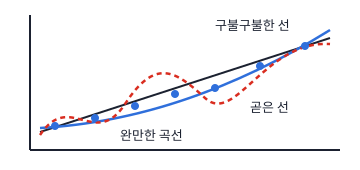

*같은 점들에 곧은 선도, 곡선도 그려 볼 수 있고, 무엇을 고를지는 좋고 싫음의 문제예요.*

**정확히 말하면**

머신러닝은 설명하기 어렵고 시간에 따라 바뀌기까지 하는(time-varying) 데이터를 최대한 설명해 보려는 일이에요. 이때 데이터를 만든 규칙을 우리는 몰라요.

그래서 모델은 1차식, 2차식, 비선형 함수, 뉴럴넷(neural network) 중 무엇으로든 **가정해요(suppose)**.

| 단어 | 뉘앙스 |
|---|---|
| assume | 사실이 아닌 줄 알면서도 그렇다고 치는 가정 |
| suppose | 모르니까 "이렇지 않을까" 하고 세우는 추측 |

예를 들어 입력 $x$와 출력 $y$ 사이를 $y = ax + b$ 로 가정할 수 있어요. 이것이 맞는 모델인지 증명할 방법은 없어요.

1. 모델 선택은 옳다/그르다(correct/incorrect)가 아니라 좋다/나쁘다(good/bad)의 문제예요.
2. 그래서 모델은 **취사선택**의 문제이고, 결국 선호(preference)의 문제예요.
3. 수학이 **정의**(definition)에서 출발하는 것과 같아요. 정의에는 참·거짓이 없고, 유용하니까 그렇게 정하기로 한 거예요.
4. 무엇이 "좋은" 모델인지도 기준을 정해야 해요. 예를 들어 파라미터가 많은 큰 모델보다 **작은 모델**로 비슷한 성능을 내는 쪽이 더 좋은 엔진이에요.

모델을 정한 다음에 할 일(파라미터 찾기)은 [두 갈래 모델과 학습(트레이닝)의 뜻](#s0-two-models)에서 이어져요.

**교수님 말씀**

영화 취향 예측을 예로 들었어요. 사람 마음속 기작은 아무도 모르고, 1년 전 취향과 지금 취향이 다를 수도 있어요. 그래도 그 데이터를 설명해 보려는 것이 머신러닝이에요 (0914 00:36–01:10).

> "이 모델을 결정하는 문제는 매우 중요하다." (0914 01:24)

> "모델은 옳고 그름의 문제가 아니라 취사선택의 문제고, 결국 프레퍼런스의 문제다." (0914 02:00)

큰 GPU가 있는 연구실은 파라미터가 많은 모델을 돌릴 수 있어요. 하지만 작은 모델로 비슷한 성능을 내면 그쪽이 더 좋은 머신러닝 엔진이라고 했어요 (0914 02:08–02:46).

"수학은 무엇에서 시작하나?"라는 물음에 한 학생이 "정의"라고 답했어요. 지난 학기 확률 수업을 들은 학생이었어요 (0914 03:19–03:28).

> "옳은 모델이냐 그른 모델이냐, 이런 건 없다." (0914 03:54)

**페이지 요약**

모델은 모르니까 세우는 가정(suppose)이고, 옳고 그름이 아니라 선호(preference)의 문제예요.

*핵심 식*

- 가정한 모델의 예$y = ax + b$

*용어*

- **suppose** — 모르니까 이렇지 않을까 하고 세우는 추측
- **선호(preference)** — 모델 선택은 좋고 나쁨을 고르는 취사선택

---

### 두 갈래 모델과 학습(트레이닝)의 뜻

*0914 수업 · L01 s7 · L01 s8*

**쉽게 말하면**

예측하는 틀은 두 가지예요: 답을 딱 하나 내놓거나, "이쯤일 가능성이 커요" 하고 퍼진 모양으로 내놓아요.

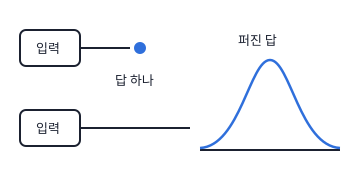

*어느 쪽이든 틀 속 숫자를 데이터에 맞게 고르는 일을 배운다고 불러요.*

**정확히 말하면**

모델을 정하는 방법은 크게 두 갈래예요 (L01 s7).

| 구분 | ① 결정론적 함수(deterministic function) | ② 확률 모델(probabilistic model) |
|---|---|---|
| 모양 | $f : \mathbb{R}^D \to \mathbb{R}$, 입력 하나에 답 하나 | 확률밀도함수(PDF) $p(y \mid \mathbf{x}, \boldsymbol{\theta})$ 자체가 모델 |
| 예 | $f(\mathbf{x}, \boldsymbol{\theta}) = \boldsymbol{\theta}^\top \mathbf{x} + \theta_0$ 여기서 $\boldsymbol{\theta}$에는 $\theta_0$이 들어 있지 않아요(바이어스를 흡수하는 표기는 [가장 중요한 수식: 어파인 모델과 바이어스 흡수](#s1-affine)). | 가우시안: 평균 $\mu$, 분산 $\sigma^2$ |
| 파라미터 | 함수를 이루는 상수 | 고른 분포의 파라미터 |
| 특징 | 불확실성을 표현하지 않아요(non-probabilistic) | 데이터를 참값에 잡음이 섞인 관측으로 보고, 예측의 불확실성을 표현해요 |

이날은 ①부터 다뤘어요([Empirical · Risk · Minimization이라는 이름](#s1-erm-name)). ②는 [Likelihood = 그럴듯함, 그리고 −log](#s4-likelihood)에서 이어져요.

**학습 = 트레이닝 = 러닝**은 모델을 정한 뒤 **파라미터**를 최적화하는 일이에요.

1. 모델을 가정: $y = ax + b$
2. 데이터로 파라미터를 정함: $a = 0.3$, $b = 1.8$
3. 처음 보는(unseen) $x$를 넣어 $y$를 예측

모델 자체가 잘못됐다면 트레이닝을 아무리 잘해도 한계가 있어요. 그래서 요즘 "학습"은 **하이퍼파라미터**(hyperparameter)를 바꿔 모델 자체를 바꿔 보는 일까지 포함해요.

| 구분 | 언제 정하나 | 예 |
|---|---|---|
| 파라미터(parameter) | 학습 데이터로 배움 | 가중치(weight), 바이어스(bias), $a$, $b$ |
| 하이퍼파라미터(hyperparameter) | 트레이닝 전에 정해 학습 과정을 조절 | 학습률(learning rate), 정규화 세기(regularization strength) |

슬라이드(L01 s8)는 학습을 세 단계로 나눠요.

1. 예측(prediction, inference): 함수 모델이나 확률 모델로 답을 냄
2. 트레이닝(training, parameter estimation): 결정론적이면 경험적 위험 최소화, 확률적이면 최대우도(ML)나 MAP
3. 모델 선택(model selection): 하이퍼파라미터를 고름

하이퍼파라미터를 실제로 고르는 이야기는 [여러 가지 노름과 하이퍼파라미터 튜닝](#s3-norms)에서 이어져요.

**교수님 말씀**

모델을 정하면 파라미터를 최적화해요. $y = ax + b$ 로 가정하고 $a = 0.3$, $b = 1.8$ 처럼 정해 unseen 데이터를 예측하는 과정이 트레이닝이라고 했어요 (0914 04:04–04:39).

모델이 틀렸으면 학습을 잘해도 한계가 있으니, 요즘은 모델의 하이퍼파라미터를 건드려 모델 자체를 바꿔 보는 것까지 학습이라고 부른다고 했어요 (0914 04:43–05:38).

> "그 이그잼플 좀 이따 이제 설명할게요. 크로스 밸리데이션이라고 하는데" (0914 05:47)

교차검증(cross-validation) 예시는 이날 끝까지 설명하지 않았어요.

이어서 모델을 정하는 방법은 결정론적 함수와 확률 모델 두 가지이고, 오늘은 결정론적 함수부터 한다고 했어요 (0914 05:52–06:13). 확률 모델에서는 PDF 자체가 모델이고, PDF의 파라미터가 학습 파라미터라고 다시 짚었어요 (0914 58:10–59:22).

**페이지 요약**

모델은 결정론적 함수나 확률밀도함수(PDF)로 정하고, 트레이닝은 그 파라미터를 데이터로 고르는 일이에요.

*핵심 식*

- 결정론적 함수$f(\mathbf{x}, \boldsymbol{\theta}) = \boldsymbol{\theta}^\top \mathbf{x} + \theta_0$
- 확률 모델$p(y \mid \mathbf{x}, \boldsymbol{\theta})$

*용어*

- **파라미터(parameter)** — 학습 데이터로 배우는 모델 속 상수
- **하이퍼파라미터(hyperparameter)** — 트레이닝 전에 정해 학습 과정을 조절하는 값

---

## 1. Empirical Risk Minimization: 좋은 θ\* 찾기

### Empirical · Risk · Minimization이라는 이름

*0914 수업 · L01 s9–s10*

**쉽게 말하면**

상상 대신 진짜 자료를 넣어 보고, 틀리는 정도가 가장 작아지게 맞추는 일이에요.

*자료를 넣고, 틀린 정도를 재고, 그 값을 줄여요.*

**정확히 말하면**

모델을 결정론적 함수로 정했을 때 파라미터를 고르는 방법이 경험적 위험 최소화(Empirical Risk Minimization, ERM)예요. 로드맵(L01 s9)의 두 번째 항목 "Models as Functions"에 해당해요. 확률 모델 쪽은 [Likelihood = 그럴듯함, 그리고 −log](#s4-likelihood)에서 이어져요.

세 단어를 하나씩 풀면 이래요.

- **Empirical**(경험적, 실험적): 머릿속 상상이 아니라 실제 데이터를 받아 넣어 본다는 뜻이에요.
- **Risk**(위험): 작을수록 좋은 부정적인 지표(metric)예요.
- **Minimization**(최소화): 그 위험을 가장 작게 만든다는 뜻이에요.

합치면 "가정한 함수의 파라미터를 위험을 최소화하는 관점에서 최적화한다"는 말이에요.

- 모델을 이루는 상수들이 파라미터예요. 머신러닝 엔진을 만든다는 것은 이 파라미터를 위험 최소화 관점에서 튜닝하는 일이에요.
- "최적"이라는 말 뒤에는 늘 **in terms of**(어떤 관점에서)가 붙어야 해요. 모든 면에서 최고인 기법은 없어요.
- 그 관점을 식으로 적은 것이 목적함수(objective function)예요. ERM에서는 위험이 목적함수이고, 이를 줄이는 방향으로 최적화(optimization)해요.
- 인공지능수학에서 볼록 최적화(convex optimization), 최소제곱(least squares), 선형대수, PCA를 배운 이유도 제약 아래에서 최적화하는 이론이 필요하기 때문이에요.

**교수님 말씀**

Empirical은 플라톤 철학자처럼 "모름지기 데이터는 이래야 해"라고 상상하는 게 아니에요. 실제 데이터를 넣어 보는 거예요 (0914 06:37).

시간표를 짜며 "학교에 머무는 시간을 최소화"하려던 학생처럼, 누구나 자기 목적함수를 두고 최적화를 해요 (0914 08:06). "인생에서 무엇이 최적인가"는 허황된 질문이에요. 지금 좋아 보이는 선택도 6개월 뒤 후회할 수 있어요.

> "그 뒤에 뭐가 붙어야 되냐면 in terms of가 붙어야 돼." (0914 09:16)

> "강의 노트를 이렇게 볼 때도 그냥 허투루 보지 말라는 거예요." (0914 10:32)

신호처리 연구자들이 머신러닝으로 빨리 넘어간 것도 원래 "최적화의 달인"이었기 때문이라고 하셨어요 (0914 11:46).

> "머신러닝을 잘한다는 건 사실 최적화를 잘한다는 거예요." (0914 11:16)

**페이지 요약**

실제 데이터로 잰 위험을 최소화하는 관점에서 파라미터를 최적화하는 게 ERM이에요.

*용어*

- **경험적 위험 최소화(Empirical Risk Minimization)** — 실제 데이터에서 잰 위험을 가장 작게 하도록 파라미터를 고르는 방법
- **in terms of** — "최적"에 늘 붙어야 하는 "어떤 관점에서"
- **목적함수(objective function)** — 최적화할 관점을 식으로 적은 것

---

### 데이터 표기: 볼드 소문자는 벡터

*0914 수업 · L01 s6, s10*

**쉽게 말하면**

자료 하나는 숫자 여러 개를 한 줄로 묶은 꾸러미이고, 꾸러미마다 정답 쪽지가 붙어 있어요.

*꾸러미를 세워서 옆으로 붙이면 큰 표 하나가 돼요.*

**정확히 말하면**

머신러닝 엔진이 주로 하는 일은 새 데이터의 정답을 내놓는 predictor(inference)예요. 이를 위해 이런 학습 데이터를 받아요.

$$
\{(\mathbf{x}_1, y_1), \dots, (\mathbf{x}_N, y_N)\}, \qquad \mathbf{x}_n \in \mathbb{R}^D
$$

- 소문자 볼드체 $\mathbf{x}_n$은 관례상 벡터예요. 각 원소를 feature(attribute, covariate)라고 불러요.
- $y_n$은 볼드가 아닌 스칼라 라벨(label, target, response variable, annotation)이에요.
- 입력 $\mathbf{x}_n$마다 라벨 $y_n$이 붙어 있으니 지도학습(supervised learning)을 가정한 거예요.

칠판 예시로 $D = 3$이면 벡터 하나는 이렇게 생겼어요.

$$
\mathbf{x}_1 = \begin{bmatrix} x_{11} \\ x_{12} \\ x_{13} \end{bmatrix} = [x_{11}, x_{12}, x_{13}]^\top \in \mathbb{R}^3
$$

$\mathbf{x}_1, \dots, \mathbf{x}_N$을 세로로 세워 옆으로 이어 붙이면 행렬 하나가 돼요.

$$
\big[\,\mathbf{x}_1 \;\; \mathbf{x}_2 \;\; \cdots \;\; \mathbf{x}_N\,\big] \in \mathbb{R}^{D \times N}
$$

행의 수는 벡터 하나의 길이 $D$, 열의 수는 데이터 개수 $N$이에요. 슬라이드의 데이터 행렬 $\mathbf{X}$는 이것을 전치해 $N \times D$로 둔 것이고, [데이터 행렬 X와 평균 손실 R_emp](#s2-remp)에서 다시 정리해요.

**페이지 요약**

볼드 소문자는 벡터, 라벨은 스칼라이고, 벡터를 세로로 이어 붙이면 D×N 행렬이 돼요.

*핵심 식*

- 학습 데이터

  $$
  \{(\mathbf{x}_1, y_1), \dots, (\mathbf{x}_N, y_N)\}, \qquad \mathbf{x}_n \in \mathbb{R}^D
  $$
- 세로로 이어 붙인 행렬

  $$
  \big[\,\mathbf{x}_1 \;\; \mathbf{x}_2 \;\; \cdots \;\; \mathbf{x}_N\,\big] \in \mathbb{R}^{D \times N}
  $$

*용어*

- **볼드 소문자** — 관례상 벡터를 뜻하는 표기
- **지도학습(supervised learning)** — 입력마다 라벨이 붙은 데이터로 배우는 것

---

### 좋은 파라미터 θ\*와 for all의 뜻

*0914 수업 · L01 s10*

**쉽게 말하면**

좋은 설정값은 자료 하나만이 아니라 모든 자료에서 정답에 가깝게 맞히는 값이에요.

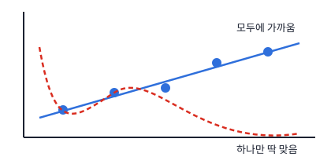

*한 점만 딱 맞히는 선보다, 모든 점 근처를 지나는 선이 좋아요.*

**정확히 말하면**

결정론적 함수 모델의 역할은 과거 데이터로 학습해 unseen 데이터를 예측하는 거예요. 함수의 파라미터(예: $y = ax + b$의 $a, b$)를 모은 벡터를 $\boldsymbol{\theta}$라고 불러요. 예측기(predictor)는 $f(\cdot, \boldsymbol{\theta}) : \mathbb{R}^D \to \mathbb{R}$예요.

ERM의 목표(L01 s10)는 다음을 만족하는 좋은 파라미터 $\boldsymbol{\theta}^*$를 찾는 거예요.

$$
f(\mathbf{x}_n, \boldsymbol{\theta}^*) = \hat{y}_n \approx y_n, \quad \text{for all } n = 1, \dots, N
$$

- $y_n$: 데이터로 주어진 정답(라벨)이에요.
- $\hat{y}_n$: 튜닝한 모델에 $\mathbf{x}_n$을 넣어 나온 추정치예요. 햇(^)은 관례상 추정치를 뜻해요.
- 모델 출력 $\hat{y}_n$이 라벨 $y_n$과 가장 비슷해지도록 $\boldsymbol{\theta}$를 고르는 것이 파라미터 튜닝이에요.

regression, classification, PCA, 뉴럴넷, 딥러닝이 수학적으로는 모두 이 일을 해요.

**for all**의 뜻은 이래요.

1. $\boldsymbol{\theta}$를 $\mathbf{x}_1$ 하나에만 맞추면 $f(\mathbf{x}_1, \boldsymbol{\theta}) = y_1$이 정확히 나올 수 있어요.
2. 그 $\boldsymbol{\theta}$로 $\mathbf{x}_2$를 넣으면 $f(\mathbf{x}_2, \boldsymbol{\theta})$가 $y_2$와 크게 어긋날 수 있어요.
3. 특정 데이터에 과적합(overfitting)하지 말고, $n = 1, \dots, N$ 모두에서 두루 그럴듯한 $\boldsymbol{\theta}^*$를 찾으라는 조건이에요.

슬라이드에는 조건으로만 적혀 있고, 과적합 방지라는 풀이는 교수님이 덧붙인 거예요. 과적합을 막는 방법은 [Overfitting과 정규화 최소제곱](#s3-reg)으로 이어져요.

**교수님 말씀**

LLM처럼 파라미터가 수십억 개가 넘는 모델도 결국 이 $\boldsymbol{\theta}$를 학습하는 것이고, 그 계산을 GPU가 맡아요 (0914 15:58).

"such that 뒤에 문장이 나올 줄 알았더니 수식이 나왔네? 수학은 언어니까"라며 식을 문장처럼 읽어 주셨어요 (0914 16:19).

> "이 모든 일들이 다 저거 하는 거예요, 사실은." (0914 18:26)

> "하나도 버릴 단어가 없어." (0914 18:40)

> "특정 데이터에만 과적합시키면 안 된다는 거." (0914 20:29)

**페이지 요약**

모든 학습 데이터에서 추정치가 라벨에 가까워지는 파라미터 θ\*를 찾는 게 목표예요.

*핵심 식*

- ERM의 목표

  $$
  f(\mathbf{x}_n, \boldsymbol{\theta}^*) = \hat{y}_n \approx y_n, \quad \text{for all } n = 1, \dots, N
  $$

*용어*

- **for all** — 한 데이터가 아니라 모든 학습 데이터에서 맞아야 한다는 조건
- **과적합(overfitting)** — 특정 데이터에만 너무 맞춰 다른 데이터에서 어긋나는 것

---

### 가장 중요한 수식: 어파인 모델과 바이어스 흡수

*0914 수업 · L01 s10*

**쉽게 말하면**

자료 맨 앞에 숫자 1을 하나 붙이면, 따로 더하던 덤까지 곱해서 더하기 한 번으로 끝나요.

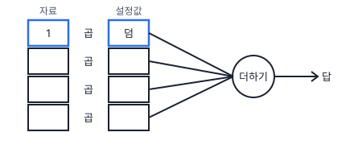

*맨 위 칸의 1이 따로 떨어져 있던 덤을 대신 맡아 줘요.*

**정확히 말하면**

예시 모델로 선형(어파인) 함수를 가정해요. 칠판 유도는 이래요.

1. 원래 식은 입력의 가중합에 바이어스를 더한 거예요.

   $$
   f(\mathbf{x}_n, \boldsymbol{\theta}) = \theta_1 x_n^{(1)} + \theta_2 x_n^{(2)} + \cdots + \theta_D x_n^{(D)} + b
   $$
2. 바이어스 $b$만 식 밖에 따로 떨어져 있어 다루기 번거로워요. 그런데 $b = \theta_0 \cdot 1$로 쓸 수 있어요.
3. 데이터 벡터 맨 앞에 상수 1을 붙여요(augmentation). 길이가 $D$에서 $D+1$로 늘어나요.

   $$
   \mathbf{x}_n = [1, x_n^{(1)}, \dots, x_n^{(D)}]^\top \in \mathbb{R}^{D+1}
   $$
4. 파라미터도 $\theta_0$을 맨 앞에 넣어 같은 길이로 맞춰요.

   $$
   \boldsymbol{\theta} = [\theta_0, \theta_1, \dots, \theta_D]^\top
   $$
5. 그러면 식 전체가 내적 하나가 돼요.

   $$
   f(\mathbf{x}_n, \boldsymbol{\theta}) = \boldsymbol{\theta}^\top \mathbf{x}_n = \theta_0 + \sum_{d=1}^{D} \theta_d x_n^{(d)}
   $$

- 여기서 augmentation은 흔히 말하는 "데이터 증강"이 아니라, 1을 붙여 벡터를 늘리는 바이어스 흡수를 뜻해요.
- 선형 모델은 늘 "데이터와 파라미터 벡터의 내적"이에요. 다만 데이터와 무관한 상수 $\theta_0$이 더해져 원점을 지나지 않을 수 있으므로 linear가 아니라 affine function이라고 불러요.

뉴런과의 연결(L01 s10, "Example. Neural network")도 같은 식이에요.

$$
\text{output} = \sigma\left(\sum_i w_i x_i + b\right)
$$

- 노드 하나는 어파인 함수 $\sum_i w_i x_i + b$에 활성화 함수(activation function) $\sigma$를 씌워 내보내요. 활성화 함수로는 sigmoid, ReLU 등을 써요.
- 딥러닝은 이런 레이어를 여러 층 쌓은 것이에요. 가장 복잡하다는 딥 뉴럴넷도 어파인 함수를 층층이 쌓은 합성 함수(composite function)예요.

(수업 중 $b$를 "곱한다"고 말했지만, 바이어스는 더하는 것이 맞아요.)

**교수님 말씀**

> "가장 중요한 컨셉이 뭐냐라고 묻는다면 저는 이 수식을 만드는 거라고 생각해요." (0914 26:00)

왜 선형으로 했냐고 물으면 "그냥 해본 거야"라고 하셨어요. 선형으로 되면 끝내고, 안 되면 뉴럴넷을 써요 (0914 26:32).

> "아니야, 그냥 내가 선택한 거야." (0914 26:32)

> "딥 뉴럴넷도 사실은 어파인 펑션의 웨이티드 썸이야, 그냥 다." (0914 28:33)

GPU가 딥러닝을 잘하는 이유도 여기 있어요. 원래 그래픽용으로 곱셈과 덧셈을 하던 장치이고, 곱셈과 덧셈은 여러 코어로 나눠 병렬 처리할 수 있어요 (0914 28:41).

**페이지 요약**

데이터 앞에 1을 붙이면 바이어스가 θ₀으로 흡수되어 어파인 모델이 내적 하나가 돼요.

*핵심 식*

- 1을 붙인 데이터

  $$
  \mathbf{x}_n = [1, x_n^{(1)}, \dots, x_n^{(D)}]^\top \in \mathbb{R}^{D+1}
  $$
- 어파인 모델

  $$
  f(\mathbf{x}_n, \boldsymbol{\theta}) = \boldsymbol{\theta}^\top \mathbf{x}_n = \theta_0 + \sum_{d=1}^{D} \theta_d x_n^{(d)}
  $$
- 뉴런 하나

  $$
  \text{output} = \sigma\left(\sum_i w_i x_i + b\right)
  $$

*용어*

- **affine function** — 내적에 상수가 더해져 원점을 지나지 않을 수 있는 함수
- **augmentation** — 데이터 벡터 앞에 1을 붙여 길이를 D+1로 늘리는 것
- **활성화 함수(activation function)** — 어파인 함수 출력에 씌우는 sigmoid, ReLU 같은 함수

---

## 2. 손실 함수와 경험적 위험

### 데이터 행렬 X와 평균 손실 R_emp

*0914 수업 · L01 s11*

**쉽게 말하면**

과목 점수를 모아 평점을 내듯, 문제마다 틀린 만큼을 모아 평균을 내요.

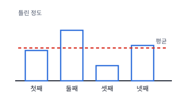

*막대 하나가 한 문제에서 틀린 정도이고, 점선이 그 평균이에요.*

**정확히 말하면**

학습 데이터는 $\{(\mathbf{x}_1, y_1), \dots, (\mathbf{x}_N, y_N)\}$이고, 각 입력 $\mathbf{x}_n$에 라벨 $y_n$이 붙은 지도학습(supervised learning)을 가정해요. 입력들을 행렬 하나로 묶어요(L01 s11, MML 8.2.2).

$$
\mathbf{X} := [\mathbf{x}_1, \dots, \mathbf{x}_N]^\top \in \mathbb{R}^{N \times D}
$$

- 대문자 볼드체는 관례상 행렬이에요. 소문자 볼드체는 벡터예요.
- 전치($\top$)가 붙어 있어서, 세로 벡터 $\mathbf{x}_n$을 가로로 눕혀 아래로 $N$개 쌓은 모양이에요. 첫 번째 행이 $\mathbf{x}_1^\top$이에요.
- 칠판에서 처음에 $\mathbf{x}_n$을 세로로 세워 옆으로 이어 붙인 $D \times N$ 행렬을 그렸어요. 슬라이드의 $\mathbf{X}$는 그것의 전치예요.
- $\mathbf{X}$에는 입력만 있고 라벨은 없어요. 라벨은 세로 벡터 $\mathbf{y} := [y_1, \dots, y_N]^\top \in \mathbb{R}^N$로 따로 모아요.
- 맨 앞에 상수 1을 붙인 벡터([가장 중요한 수식: 어파인 모델과 바이어스 흡수](#s1-affine))를 쓰면 한 행의 길이가 $D+1$이 돼요.

평균 손실(average loss)을 경험적 위험(empirical risk)이라고 불러요.

$$
R_{\text{emp}}(f, \mathbf{X}, \mathbf{y}) = \frac{1}{N}\sum_{n=1}^{N} \ell(y_n, \hat{y}_n), \quad \hat{y}_n = f(\mathbf{x}_n, \boldsymbol{\theta})
$$

1. 손실 함수(loss function) $\ell(y_n, \hat{y}_n)$은 한 데이터에서 얼마나 틀렸는지를 음이 아닌 수 하나로 돌려줘요. $\ell$은 loss의 L이에요.
2. 첫 번째 인자 $y_n$은 데이터로 주어진 정답(라벨)이에요.
3. 두 번째 인자 $\hat{y}_n$은 모델이 낸 추정치(estimate)예요. 햇(^)은 관례상 추정치를 뜻해요.
4. 학습 중에 나온 값은 아직 unseen 데이터에 대한 예측이 아니에요. 그래서 예측보다 추정이라고 불러요.
5. $N$개 손실을 더해 $N$으로 나눠요. 특정 데이터 하나가 아니라 모든 데이터에서 두루 잘 맞게 하려는 거예요.
6. $R_{\text{emp}}$는 예측기 $f$와 데이터 $\mathbf{X}$, $\mathbf{y}$ 세 가지에 달려 있어요. 이것을 최소화하는 전략이 경험적 위험 최소화(ERM)예요.

이 식도 정의(definition)예요. 꼭 평균으로 해야 하는 법은 없고, 쓸모가 있어서 이렇게 정한 거예요.

**교수님 말씀**

평균 손실은 학점 평점과 같아요. 과목별 학점을 평균 내듯 데이터별 손실을 평균 내요 (0914 32:45).

> "이것도 데피니션이에요 정의해야 돼." (0914 31:50)

> "교수님 꼭 저렇게 해야 되나요? 꼭 저렇게 할 필요 없어요." (0914 31:54)

수식이 낯설어도 팔짱 끼고 기호를 하나씩 읽어 보라고 하셨어요 (0914 33:06).

> "그래서 예측이라고 보통 안 하고 추정이라고 불러 추정." (0914 34:06)

**페이지 요약**

입력을 가로로 눕혀 쌓은 행렬 X를 만들고, 데이터별 손실의 평균을 경험적 위험이라고 불러요.

*핵심 식*

- 데이터 행렬

  $$
  \mathbf{X} := [\mathbf{x}_1, \dots, \mathbf{x}_N]^\top \in \mathbb{R}^{N \times D}
  $$
- 경험적 위험

  $$
  R_{\text{emp}}(f, \mathbf{X}, \mathbf{y}) = \frac{1}{N}\sum_{n=1}^{N} \ell(y_n, \hat{y}_n)
  $$

*용어*

- **경험적 위험(empirical risk)** — 학습 데이터에서 낸 손실의 평균
- **추정치(estimate)** — 학습 중 모델이 낸 값 $\hat{y}_n$, 햇은 추정을 뜻함

---

### 제곱 손실을 행렬 한 줄로 (김밥 재료 손질)

*0914 수업 · L01 s11*

**쉽게 말하면**

김밥 재료를 미리 손질해 두면 한 번에 돌돌 말 수 있어요.

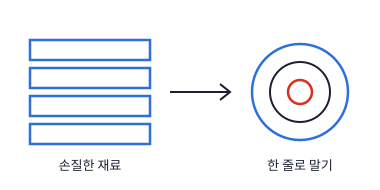

*재료를 가로로 눕혀 쌓아 두면, 틀린 만큼을 모두 더하는 일이 한 줄로 끝나요.*

**정확히 말하면**

제곱 손실(squared loss)은 이렇게 정해요. 딥러닝에서도 많이 써요.

$$
\ell(y_n, \hat{y}_n) = (y_n - \hat{y}_n)^2
$$

$y_n$은 스칼라라서 노름을 쓸 필요 없이 차이의 제곱이면 돼요. 어파인 모델의 추정치 $\hat{y}_n = \mathbf{x}_n^\top\boldsymbol{\theta}$를 넣고 행렬로 바꿔요(MML Example 8.2, 식 8.7–8.9).

1. $$
   \frac{1}{N}\sum_{n=1}^{N}(y_n - \mathbf{x}_n^\top\boldsymbol{\theta})^2
   $$
2. $\mathbf{X}$의 $n$번째 행이 $\mathbf{x}_n^\top$이므로 $\mathbf{X}\boldsymbol{\theta}$의 $n$번째 원소는 $\mathbf{x}_n^\top\boldsymbol{\theta}$예요.
3. $$
   = \frac{1}{N}\left\|\begin{bmatrix} y_1 - \mathbf{x}_1^\top\boldsymbol{\theta} \\ \vdots \\ y_N - \mathbf{x}_N^\top\boldsymbol{\theta} \end{bmatrix}\right\|^2
   $$
4. 유클리드 노름의 제곱은 원소 제곱의 합이에요. 괄호 안 벡터는 $\mathbf{y} - \mathbf{X}\boldsymbol{\theta}$예요.
5. $$
   = \frac{1}{N}\|\mathbf{y} - \mathbf{X}\boldsymbol{\theta}\|^2
   $$

$\mathbf{X}$를 가로로 눕혀 쌓아 정의한 이유가 바로 이 한 줄이에요. 풀 문제는 최소제곱 문제(least squares problem)예요.

$$
\min_{\boldsymbol{\theta} \in \mathbb{R}^D} \frac{1}{N}\|\mathbf{y} - \mathbf{X}\boldsymbol{\theta}\|^2
$$

- 바꾸는 대상은 $\boldsymbol{\theta}$예요. $\mathbf{X}$와 $\mathbf{y}$는 데이터로 고정돼 있어요.
- 추정치를 모은 벡터는 $\hat{\mathbf{y}} = \mathbf{X}\boldsymbol{\theta}$이고 크기는 $N \times 1$이에요. 식에서 $\mathbf{X}\boldsymbol{\theta}$ 자리가 원래 $\hat{y}_n$들이 있던 자리예요.

**교수님 말씀**

김밥을 예쁘게 말려면 재료를 먼저 손질해 둬야 해요. $\mathbf{X}$를 미리 그렇게 정의해 둔 것이 재료 손질이에요 (0914 38:01).

> "여러분 이거는 해보세요. 산수니까." (0914 37:24)

> "잊지 말아야 될 건 … 세타를 변화시키고 싶은 거." (0914 38:22)

**보충 · 수업에서 유도하진 않았어요**

수업에서 학생 몫으로 남긴 "산수"를 $N = 2$, $D = 2$로 확인해 봐요.

$$
\mathbf{x}_1 = [1, 0]^\top, \quad \mathbf{x}_2 = [1, 1]^\top, \quad \mathbf{X} = [\mathbf{x}_1, \mathbf{x}_2]^\top
$$

$$
\mathbf{y} = [1, 2]^\top, \quad \boldsymbol{\theta} = [0, 1]^\top
$$

1. 합으로: $(1 - 0)^2 + (2 - 1)^2 = 2$
2. 행렬로: $\mathbf{X}\boldsymbol{\theta} = [0, 1]^\top$, $\mathbf{y} - \mathbf{X}\boldsymbol{\theta} = [1, 1]^\top$, $\|[1, 1]^\top\|^2 = 2$
3. 두 값이 같고, $N = 2$로 나누면 $R_{\text{emp}} = 1$이에요.

이 문제는 정규방정식(normal equations)으로 닫힌 해를 구할 수 있어요(MML 9.2). 수업에서는 다음 주로 미뤘어요.

**페이지 요약**

제곱 손실의 평균은 X를 가로로 쌓아 둔 덕분에 노름 제곱 한 줄로 써져요.

*핵심 식*

- 제곱 손실

  $$
  \ell(y_n, \hat{y}_n) = (y_n - \hat{y}_n)^2
  $$
- 최소제곱 문제

  $$
  \min_{\boldsymbol{\theta} \in \mathbb{R}^D} \frac{1}{N}\|\mathbf{y} - \mathbf{X}\boldsymbol{\theta}\|^2
  $$
- 추정치 벡터

  $$
  \hat{\mathbf{y}} = \mathbf{X}\boldsymbol{\theta}
  $$

*용어*

- **최소제곱 문제(least squares problem)** — 제곱 손실의 평균을 가장 작게 하는 θ 찾기

---

### θ를 어떻게 찾나, 그리고 진짜 목표 R_true

*0914 수업 · L01 s11*

**쉽게 말하면**

연습문제만 잘 푸는 게 목표가 아니라, 처음 보는 시험 문제도 잘 풀어야 해요.

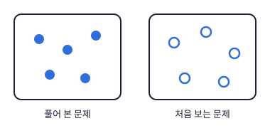

*색칠된 점은 풀어 본 문제, 테두리만 있는 원은 앞으로 만날 문제예요.*

**정확히 말하면**

$\frac{1}{N}\|\mathbf{y} - \mathbf{X}\boldsymbol{\theta}\|^2$을 가장 작게 하는 $\boldsymbol{\theta}$는 이렇게 찾을 수 있어요.

- 무식한 방법: $\boldsymbol{\theta}$를 하나씩 바꿔 가며 찾아요. 튜닝할 파라미터는 $D$개이고, 1을 붙였다면 $D+1$개예요.
- 체계적인 방법: least squares 알고리즘과 pseudo-inverse가 있어요. 이 수학은 다음 주 선형 회귀(linear regression)에서 배워요.

여기까지가 트레이닝이에요. 학습 데이터를 잘 설명하면 예측도 잘된다는 건 "앞으로 올 데이터가 지금 본 데이터와 크게 다르지 않다"는 가정이 맞을 때뿐이에요.

궁극적인 목표는 기대 위험(expected risk)을 최소화하는 거예요(MML 식 8.10).

$$
R_{\text{true}}(f) = \mathbb{E}_{\mathbf{x}, y}\big[\ell(y, f(\mathbf{x}))\big]
$$

1. $y$는 라벨이고, $f(\mathbf{x})$는 파라미터를 고정한 예측기가 $\mathbf{x}$로 낸 예측이에요.
2. 기댓값 $\mathbb{E}_{\mathbf{x}, y}$는 가능한 모든 데이터와 라벨에 대한 평균이에요. 교과서는 데이터를 무한히 가졌을 때의 진짜 위험이라고 설명해요.
3. 그래서 $R_{\text{true}}$가 작다는 건 unseen 데이터에서도 평균적으로 손실이 작다는 뜻이에요.
4. 우리가 가진 건 유한한 데이터라서 직접 계산할 수 있는 건 $R_{\text{emp}}$뿐이에요.

교수님은 데이터 뒤에 숨은 잠재 변수(hidden latent variable)가 있다고 덧붙였어요.

| 구분 | $R_{\text{emp}}$ | $R_{\text{true}}$ |
|---|---|---|
| 평균 내는 대상 | 가진 학습 데이터 $N$개 | 가능한 모든 데이터 |
| 계산 | 직접 할 수 있음 | 직접 할 수 없음 |

예측 성능을 확인하려면 테스트용 데이터를 남겨 둬요. 흔히 학습 70%, 테스트 30%로 나누거나, 테스트 20%를 떼고 남은 80%를 검증 20%, 학습 60%로 나눠요. 정답 비율은 없어요.

**교수님 말씀**

"해 아래 새 것이 없다"(성경): 새 데이터도 이미 본 데이터의 일부라는 가정이 맞으면, 트레이닝만 잘돼도 예측이 잘돼요 (0914 42:22).

바둑 AI는 프로들의 기보를 대량으로 학습했어요. 기보는 바둑판을 벡터로 만들어 흑백 돌의 위치와 순서를 적은 데이터예요. 그랬더니 누가 와도 이겨요. 대국 영상 전체가 아니라 필요한 특징만 뽑아 쓰면 돼요(feature extraction) (0914 42:37).

학습과 테스트를 70:30으로 나눌지는 청국장에 소금을 몇 스푼 넣느냐 같은 장인의 손맛이에요 (0914 45:38).

**페이지 요약**

학습 데이터에서의 평균 손실을 줄이는 건 수단이고, 진짜 목표는 처음 보는 데이터까지 포함한 기대 위험을 줄이는 거예요.

*핵심 식*

- 기대 위험

  $$
  R_{\text{true}}(f) = \mathbb{E}_{\mathbf{x}, y}\big[\ell(y, f(\mathbf{x}))\big]
  $$

*용어*

- **기대 위험(expected risk)** — 가능한 모든 데이터에 대한 평균 손실
- **pseudo-inverse** — 최소제곱 해를 체계적으로 구하는 도구, 다음 주에 배움

---

## 3. 과적합과 정규화

### Overfitting과 정규화 최소제곱

*0914 수업 · L01 s12*

**쉽게 말하면**

연습 문제의 답만 통째로 외우면 새 문제에서 틀려요.

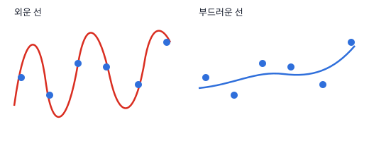

*점을 하나도 빠짐없이 지나려는 선은 구불구불해지고, 조금 봐주는 선은 새 점도 잘 맞혀요.*

그래서 선이 너무 요란해지면 벌점을 매겨 얌전하게 만들어요.

**정확히 말하면**

**과적합(overfitting)**은 예측기가 학습 데이터에 너무 가깝게 맞춰져서(fits too closely) 새 데이터로 일반화되지 않는 현상이에요.

학습 데이터에서는 평균 손실이 아주 작은데, 테스트 데이터에서는 평균 손실이 큰 모습으로 나타나요.

그래서 경험적 위험을 최소화하는 $\boldsymbol{\theta}$를 찾을 때 **패널티 항(penalty term)**을 더해 탐색을 한쪽으로 기울여요. 이 항에는 "$\boldsymbol{\theta}$는 이래야 한다"는 사람의 사전 지식을 담아요. 이것이 **정규화(regularization)**예요.

정규화는 경험적 위험을 정확히 최소화하는 것과, 해의 크기·복잡도를 작게 두는 것 사이의 타협이에요.

정규화 최소제곱(regularized least squares)은 다음과 같아요.

$$
\min_{\boldsymbol{\theta}}\ \frac{1}{N}\|\mathbf{y}-\mathbf{X}\boldsymbol{\theta}\|^2 + \lambda \|\boldsymbol{\theta}\|^2
$$

- $\|\boldsymbol{\theta}\|^2$: **regularizer**(정규화 항)
- $\lambda$: **regularization parameter**(정규화 파라미터). 사람이 미리 정하는 **hyperparameter**(하이퍼파라미터)예요.
- 하이퍼파라미터는 모델 자체(어파인 함수 $f(\mathbf{x}_n,\boldsymbol{\theta})=\boldsymbol{\theta}^\top\mathbf{x}_n$)를 바꾸지 않아요. 무엇을 최소화할지만 바꿔요.

$\lambda$ 값에 따라 목적 함수가 이렇게 달라져요.

1. $\lambda = 0$: 패널티 항이 사라져요. $\min_{\boldsymbol{\theta}}\frac{1}{N}\|\mathbf{y}-\mathbf{X}\boldsymbol{\theta}\|^2$, 경험적 위험만 최소화해서 과적합되기 쉬워요.
2. $\lambda \gt 0$(예: $\lambda=1$): 학습 데이터에 가까워지려는 첫째 항과, $\boldsymbol{\theta}$가 원점에서 먼 정도를 재는 $\lambda \|\boldsymbol{\theta}\|^2$ 사이에서 균형을 잡아요.

**교수님 말씀**

> "아, 내가 너무 오버했네." 그게 오버피팅이에요. (0914 46:59)

패널티 항은 "모름지기 $\boldsymbol{\theta}$는 이래야 해"라는 전문가의 지식을 넣는 자리라고 하셨어요. (0914 47:03–47:47)

> $\lambda = 0$이면 "딱 과적합되기 좋지." (0914 48:44–49:13)

$\lambda=1$처럼 양수를 주면 학습 데이터에 맞추면서도 $\boldsymbol{\theta}$가 원점에서 얼마나 먼지를 함께 따져 균형을 잡는다고 하셨어요. (0914 49:16–49:53)

#### 직접 해 보기: 정규화 세기 λ *(정적 스냅샷 — 직접 조작은 HTML 버전)*

λ를 0에서 키우면, 점 10개를 모두 지나며 구불구불하던 9차 다항식 곡선이 점점 완만해져요. 입력의 거듭제곱을 특징으로 쓴 선형 모델이에요.

λ = **0** · 학습 오차 $\frac{1}{N}\|\mathbf{y}-\mathbf{X}\boldsymbol{\theta}\|^2$ = **0** · $\|\boldsymbol{\theta}\|^2$ = **0**

범례: 진짜 곡선 sin(πx) (점선) · 정규화 최소제곱으로 맞춘 9차 다항식 · 학습 데이터 10개

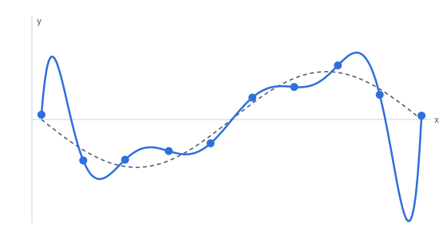

*λ = 0: 점을 모두 지나며 구불구불해요.*

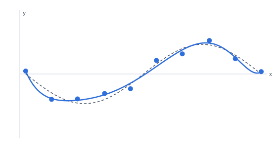

*λ = 1×10⁻⁴: 완만해지고 진짜 곡선과 비슷해요.*

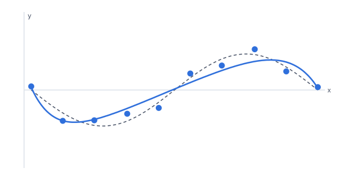

*λ = 1×10⁻²: 한결 완만하고 ‖θ‖²가 작아요.*

| λ | 학습 오차 | ‖θ‖² | 모양 |
|---|---|---|---|
| 0 | 0.0000 | 128,055 | 점을 모두 지나며 구불구불(과적합) |
| 1×10⁻⁴ | 0.0110 | 28.58 | 완만하고 진짜 곡선과 비슷 |
| 1×10⁻² | 0.0407 | 3.53 | 한결 완만, ‖θ‖²가 작음 |

**페이지 요약**

학습 데이터에 너무 맞추면 과적합이 생겨서, 패널티 항을 더해 θ를 원점 쪽으로 붙잡아요.

*핵심 식*

- 정규화 최소제곱

  $$
  \min_{\boldsymbol{\theta}}\ \frac{1}{N}\|\mathbf{y}-\mathbf{X}\boldsymbol{\theta}\|^2 + \lambda \|\boldsymbol{\theta}\|^2
  $$

*용어*

- **과적합(overfitting)** — 학습 데이터에 너무 가깝게 맞춰 새 데이터에서 틀리는 현상
- **regularizer** — 패널티 항 $\|\boldsymbol{\theta}\|^2$
- **hyperparameter** — 사람이 정하는 $\lambda$, 모델 자체는 바꾸지 않아요

---

### 여러 가지 노름과 하이퍼파라미터 튜닝

*0914 수업 · L01 s12*

**쉽게 말하면**

크기를 재는 자는 여러 가지예요.

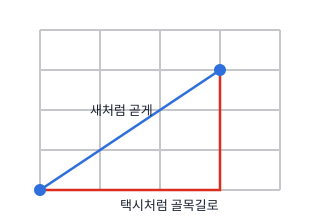

*같은 두 점이라도 곧게 재느냐, 골목을 따라 재느냐에 따라 거리가 달라요.*

어떤 자를 쓸지, 벌점을 얼마나 줄지는 요리 간처럼 해 보며 맞춰요.

**정확히 말하면**

정규화 항에는 여러 가지 노름(norm)을 쓸 수 있어요. $\boldsymbol{\theta}=[\theta_1,\dots,\theta_D]^\top$일 때,

- 2-노름(유클리드 노름): $\|\boldsymbol{\theta}\|_2=\sqrt{\sum_{d=1}^D\theta_d^2}$, 즉 $\|\boldsymbol{\theta}\|_2^2=\sum_{d=1}^D\theta_d^2$. 원점에서의 거리예요. 정규화 최소제곱의 $\|\boldsymbol{\theta}\|^2$가 바로 $\|\boldsymbol{\theta}\|_2^2$예요.
- 1-노름: $\|\boldsymbol{\theta}\|_1=\sum_{d=1}^D|\theta_d|$
- $p$-노름: $\|\boldsymbol{\theta}\|_p=\left(\sum_{d=1}^D|\theta_d|^p\right)^{1/p}$. $p=1$, $p=2$가 앞의 두 노름이에요.

1-노름으로 정규화하면 **희소해(sparse solution)**가 나와요. 파라미터를 0으로 보내려는 성질이 있어서, 0이 아닌 원소의 개수를 줄여요. 왜 그런지는 최적화 과목에서 배운다고 하셨어요.

**하이퍼파라미터 튜닝(hyperparameter tuning)**: 1-노름과 2-노름 중 무엇을 쓸지, $\lambda$를 0.5로 할지 1.5로 할지는 문제와 데이터에 따라 달라요. 정답이 정해져 있지 않아요.

하이퍼파라미터를 찾는 체계적인 방법으로 **Bayesian optimization**(베이지안 최적화)이 있어요. 가우시안 분포의 성질을 이용하는 **Gaussian process**(가우시안 프로세스)로 좋은 하이퍼파라미터를 찾아가요. 참고서로 Rasmussen·Williams의 *Gaussian Processes for Machine Learning*을 소개하셨어요.

**교수님 말씀**

하이퍼파라미터 고르기는 "장인의 손맛"이라고 하셨어요. 청국장 잘하는 집, 김밥 맛집을 고르듯 취향과 취사선택의 문제예요. (0914 52:06–53:07)

> 우엉이 많이 든 김밥을 좋아한다는 걸 "휴먼 러닝"으로 알아냈다. (0914 52:06–53:07)

문제에 따라 $\lambda=0.7$이 최적일 수도, $\lambda=0.9$가 최적일 수도 있어요.

> Bayesian optimization도 써 봤는데 "될 때가 있고 안 될 때가 있다." (0914 53:44–54:12)

만능 해법은 없다는 뜻이에요. 노름을 "원 놈, 투 놈"이라고 부르며 웃기신 대목도 있었어요. (0914 50:23)

**보충 · 수업에서 유도하진 않았어요**

**노름의 정의(MML 3.1).** 벡터 공간 $V$ 위의 노름 $\|\cdot\|$은 모든 $\lambda\in\mathbb{R}$, $\mathbf{x},\mathbf{y}\in V$에 대해 다음 세 가지를 만족해요.

1. 절대 동차성: $\|\lambda\mathbf{x}\|=|\lambda|\,\|\mathbf{x}\|$
2. 삼각 부등식: $\|\mathbf{x}+\mathbf{y}\|\le\|\mathbf{x}\|+\|\mathbf{y}\|$
3. 양의 정부호: $\|\mathbf{x}\|\ge 0$이고, $\|\mathbf{x}\|=0 \iff \mathbf{x}=\mathbf{0}$

MML은 1-노름을 맨해튼 노름(Manhattan norm), 2-노름을 유클리드 노름(Euclidean norm)이라고 불러요. 격자 골목을 따라가는 거리와 곧은 거리의 차이예요.

**1-노름이 희소해를 만드는 이유(직관).** 2차원에서 $\|\boldsymbol{\theta}\|_1\le c$인 영역은 꼭짓점이 좌표축 위에 있는 마름모이고, $\|\boldsymbol{\theta}\|_2\le c$인 영역은 원이에요. 손실의 등고선이 이 영역에 처음 닿는 점은 마름모에서는 꼭짓점일 때가 많아요. 꼭짓점에서는 한 좌표가 정확히 0이에요.

**페이지 요약**

정규화 항에 쓰는 노름은 여러 가지이고, 무엇을 얼마나 쓸지는 하이퍼파라미터 튜닝으로 정해요.

*핵심 식*

- 1-노름

  $$
  \|\boldsymbol{\theta}\|_1=\sum_{d=1}^D|\theta_d|
  $$
- p-노름

  $$
  \|\boldsymbol{\theta}\|_p=\left(\sum_{d=1}^D|\theta_d|^p\right)^{1/p}
  $$

*용어*

- **희소해(sparse solution)** — 0이 아닌 원소가 적은 해, 1-노름 정규화가 만들어요
- **Bayesian optimization** — Gaussian process로 하이퍼파라미터를 찾아가는 방법

---

## 4. 확률 모델로: 최대우도추정(MLE)

### Likelihood = 그럴듯함, 그리고 −log

*0914 수업 · L01 s14*

**쉽게 말하면**

여러 종 모양 중에서 지금 가진 점들을 가장 잘 만들어 냈을 것 같은 종을 고르는 일이에요.

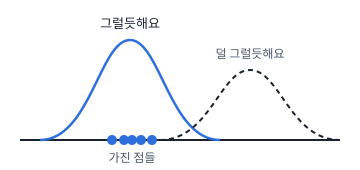

*점들 바로 위에 선 종이 점들을 만들었을 가능성이 더 커요.*

**정확히 말하면**

여기까지는 모델을 함수로 본 경험적 위험 최소화(ERM)였어요. 이제 모델을 확률분포로 봐요. 확률 모델에서는 확률밀도함수(PDF) 자체가 모델이고, PDF의 파라미터가 학습할 파라미터예요.

용어부터 풀어요. *likely to*는 "~할 것 같다"는 뜻이에요. *-hood*는 childhood(어린 시절)처럼 명사를 만들어요. 그래서 likelihood(우도)는 "그럴듯함"이고, maximum likelihood는 "가장 그럴듯한 것"이에요.

최대우도추정(maximum likelihood estimation, MLE)은 주어진 데이터가 그 파라미터에서 나왔을 그럴듯함이 가장 큰 파라미터를 학습 결과로 고르는 방법이에요.

예를 들어 가우시안 $\mathcal{N}(\mu, \sigma^2)$ 모델의 PDF는 다음과 같고, 학습할 파라미터는 평균 $\mu$와 분산 $\sigma^2$(퍼진 정도)예요.

$$
p(x) = \frac{1}{\sqrt{2\pi\sigma^2}}\exp\left(-\frac{(x-\mu)^2}{2\sigma^2}\right)
$$

지수분포도 예로 들었어요: $p(x) = \lambda e^{-\lambda x}\ (x \ge 0)$. (수업 중 $\frac{1}{\lambda}e^{-\lambda x}$로 말했는데, 적분이 1이 되려면 이 형태여야 해요.)

데이터 $\mathbf{x}$와 파라미터 $\boldsymbol{\theta}$로 정해지는 확률밀도 $p(\mathbf{x} \mid \boldsymbol{\theta})$에 대해 음의 로그우도(negative log-likelihood)를 이렇게 정의해요.

$$
\mathcal{L}(\boldsymbol{\theta}) = -\log p(\mathbf{x} \mid \boldsymbol{\theta})
$$

1. 데이터 $\mathbf{x}$는 고정하고 $\boldsymbol{\theta}$를 바꿔 가며 봐요. 그래서 $\mathcal{L}$은 $\boldsymbol{\theta}$의 함수예요.
2. $\log$는 단조증가 함수라서 $p$가 커질수록 $\log p$도 커져요.
3. 따라서 $-\log p$를 최소화하는 $\boldsymbol{\theta}$가 $p$를 최대화하는 $\boldsymbol{\theta}$와 같아요.
4. MLE: $\mathcal{L}(\boldsymbol{\theta})$를 최소화하는 $\boldsymbol{\theta}$를 찾아요(= likelihood 최대화).

우도는 수학적으로 정확히 말하면 PDF가 아니에요. 같은 식이라도 $\mathbf{x}$가 아니라 $\boldsymbol{\theta}$의 함수로 읽기 때문이에요.

**교수님 말씀**

디지털통신에서 배운 ML detection과 MAP는 통신 용어가 아니라 통계학 용어라고 짚으셨어요(0914 55:19). 통신의 ML detection과 이 수업의 ML estimation은 같은 원리예요.

> "영어로 어떤 터미놀로지가 정의될 때 다 의미가 있거든." (0914 55:19)

*likely*의 느낌은 "I'm likely to love you", 곧 "너를 사랑하게 될 것만 같아"라고 설명하셨어요(0914 55:40). childhood가 어린 시절이듯 likelihood는 그럴듯함이에요(0914 56:48).

**페이지 요약**

데이터를 가장 그럴듯하게 만들어 내는 파라미터를 고르는 게 MLE예요.

*핵심 식*

- 음의 로그우도

  $$
  \mathcal{L}(\boldsymbol{\theta}) = -\log p(\mathbf{x} \mid \boldsymbol{\theta})
  $$

*용어*

- **우도(likelihood)** — 그럴듯함. 데이터가 이 파라미터에서 나왔을 가능성
- **단조증가** — $\log$는 단조증가라서 $-\log p$ 최소화가 $p$ 최대화와 같아요

---

### i.i.d.: 곱을 합으로

*0914 수업 · L01 s15*

**쉽게 말하면**

데이터끼리 서로 모르는 사이면, 하나씩 따로 점수를 매겨서 합칠 수 있어요.

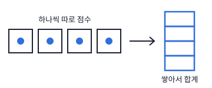

*따로 매긴 점수를 차곡차곡 쌓으면 전체 점수가 돼요.*

**정확히 말하면**

지도학습 데이터 $(\mathbf{x}_1, y_1), \dots, (\mathbf{x}_N, y_N)$이 i.i.d.(independently and identically distributed, 독립 동일 분포)라고 해요. 입력 모음 $\mathcal{X} = \{\mathbf{x}_1, \dots, \mathbf{x}_N\}$, 라벨 모음 $\mathcal{Y} = \{y_1, \dots, y_N\}$이에요.

1. 음의 로그우도:

   $$
   \mathcal{L}(\boldsymbol{\theta}) = -\log p(\mathcal{Y} \mid \mathcal{X}, \boldsymbol{\theta})
   $$
2. 독립이면 $p(A, B) = p(A)p(B)$이므로 곱으로 쪼개요:

   $$
   = -\log \prod_{n=1}^{N} p(y_n \mid \mathbf{x}_n, \boldsymbol{\theta})
   $$
3. $\log ab = \log a + \log b$이므로 곱이 합이 돼요:

   $$
   = -\sum_{n=1}^{N} \log p(y_n \mid \mathbf{x}_n, \boldsymbol{\theta})
   $$

곱으로 쓸 수 있는 이유는 데이터가 통계적으로 독립이기 때문이에요. $\mathbf{x}_1$은 $y_1$에만 영향을 주고 $y_2, y_3$에는 영향을 주지 않아요. "identically distributed"는 곱의 모든 항이 같은 분포이고 같은 $\boldsymbol{\theta}$를 쓴다는 뜻이에요.

여기까지는 어떤 분포에도 성립하는 일반식이에요. 더 내려가려면 $p(y_n \mid \mathbf{x}_n, \boldsymbol{\theta})$의 모양을 가정해야 해요([가우시안 노이즈면 MLE = 최소제곱](#s4-mle-ls)).

**교수님 말씀**

곱을 합으로 바꾸는 단계를 칠판에 한 줄씩 적으며, 독립이라 곱이 되고 로그의 곱셈 법칙으로 합이 된다고 설명하셨어요(0914 62:00–65:38).

> "이 수식까지는 일반적인 수식인데, 밑으로 내리려면 가정이 필요해요." (0914 66:35)

**페이지 요약**

i.i.d.면 전체 우도가 곱으로 쪼개지고, 로그를 씌우면 합이 돼요.

*핵심 식*

- i.i.d. 분해

  $$
  = -\log \prod_{n=1}^{N} p(y_n \mid \mathbf{x}_n, \boldsymbol{\theta})
  $$
- 합으로

  $$
  = -\sum_{n=1}^{N} \log p(y_n \mid \mathbf{x}_n, \boldsymbol{\theta})
  $$

*용어*

- **i.i.d.** — 독립이고 모두 같은 분포(같은 파라미터)를 따름
- **일반식** — 분포 모양을 정하기 전까지 성립하는 식

---

### 가우시안 노이즈면 MLE = 최소제곱

*0914 수업 · L01 s15*

**쉽게 말하면**

점들이 곧은 선 둘레에 종 모양으로 흩어져 있다고 믿으면, 가장 그럴듯한 선은 점과의 틈이 가장 작은 선이에요.

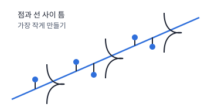

*선 둘레의 종 모양은 점이 흩어지는 방식을 뜻해요.*

**정확히 말하면**

일반식 $\mathcal{L}(\boldsymbol{\theta}) = -\sum_{n=1}^{N} \log p(y_n \mid \mathbf{x}_n, \boldsymbol{\theta})$([i.i.d.: 곱을 합으로](#s4-iid))를 더 풀려면 모델을 가정(suppose)해야 해요.

1. 모델링: 어파인 모델에 노이즈를 더해요.

   $$
   y_n = \mathbf{x}_n^\top \boldsymbol{\theta} + w, \quad w \sim \mathcal{N}(0, \sigma^2)
   $$
2. 상수 $\mathbf{x}_n^\top \boldsymbol{\theta}$에 확률변수 $w$를 더했으니 $y_n$도 확률변수예요. 평균은 상수만큼 옮겨 가고 분산은 그대로예요.

   $$
   y_n \mid \mathbf{x}_n, \boldsymbol{\theta} \sim \mathcal{N}(\mathbf{x}_n^\top \boldsymbol{\theta}, \sigma^2)
   $$
3. 가우시안 PDF를 대입해요.

   $$
   \mathcal{L}(\boldsymbol{\theta}) = -\sum_{n=1}^{N} \log \frac{1}{\sqrt{2\pi\sigma^2}}\exp\left(-\frac{(y_n - \mathbf{x}_n^\top \boldsymbol{\theta})^2}{2\sigma^2}\right)
   $$
4. 자연로그와 $\exp$가 상쇄되고, $n$과 무관한 $\frac{1}{2\sigma^2}$은 합 밖으로 빼요.

   $$
   = \frac{N}{2}\log(2\pi\sigma^2) + \frac{1}{2\sigma^2}\sum_{n=1}^{N}(y_n - \mathbf{x}_n^\top \boldsymbol{\theta})^2
   $$
5. 앞의 상수항은 $\boldsymbol{\theta}$와 무관하므로 최소화에서 무시해요(슬라이드는 $\propto$로 표기. 엄밀히는 $\boldsymbol{\theta}$와 무관한 상수를 더한 차이예요).

   $$
   \mathcal{L}(\boldsymbol{\theta}) \propto \frac{1}{2\sigma^2}\sum_{n=1}^{N}(y_n - \mathbf{x}_n^\top \boldsymbol{\theta})^2
   $$

남은 $\sum_{n}(y_n - \mathbf{x}_n^\top \boldsymbol{\theta})^2$은 제곱 손실의 합이고, $\mathbf{x}_n^\top \boldsymbol{\theta}$는 어파인 모델의 추정치 $\hat{y}_n$이에요. 따라서 확률 모델에서 음의 로그우도를 최소화하는 것은 결정론적 모델에서 least squares(최소제곱) 문제를 푸는 것과 같은 해를 줘요([제곱 손실을 행렬 한 줄로 (김밥 재료 손질)](#s2-squared)).

최소제곱의 닫힌 해는 수업에서 다음 주로 미뤘어요.

**교수님 말씀**

> "발음을 촌스럽게 서포즈 자꾸 강조하잖아요? 이게 지금 강조하고 있는 거야." (0914 66:25)

머신러닝은 데이터가 먼저 주어지는 귀납적 학문이에요. 어떤 식으로 잘 설명된다고 해서 데이터가 그 식에서 만들어졌다는 뜻은 아니고, "영원히 정답은 없다"고 하셨어요(0914 67:46–68:15).

넷플릭스 추천 모델이 꼭 선형이거나 트랜스포머, RNN일 필요는 없고 잘 추정하기만 하면 된다는 비유예요.

> "쥐만 잘 잡으면 돼, 냥이가." (0914 68:59)

> "라이클리후드 펑션을 미니마이즈하는 것이 결국은 리스트 스퀘어 프라블럼을 … 미니마이즈하는 것과 똑같은 솔루션이다." (0914 71:08)

**보충 · 수업에서 유도하진 않았어요**

MML Example 8.5(식 8.18)은 상수항을 버리지 않고 끝까지 적어요.

$$
\mathcal{L}(\boldsymbol{\theta}) = \frac{1}{2\sigma^2}\sum_{n=1}^{N}(y_n - \mathbf{x}_n^\top \boldsymbol{\theta})^2 - \sum_{n=1}^{N}\log\frac{1}{\sqrt{2\pi\sigma^2}}
$$

두 번째 항은 $-N\log\frac{1}{\sqrt{2\pi\sigma^2}} = \frac{N}{2}\log(2\pi\sigma^2)$로, 수업의 상수항과 같아요. $\sigma$가 주어진 값이면 이 항은 상수라서 최소화하는 $\boldsymbol{\theta}$를 바꾸지 않아요. 양수 $\frac{1}{2\sigma^2}$을 곱해도 최소점은 그대로라서 다음이 성립해요.

$$
\arg\min_{\boldsymbol{\theta}} \mathcal{L}(\boldsymbol{\theta}) = \arg\min_{\boldsymbol{\theta}} \|\mathbf{y} - \mathbf{X}\boldsymbol{\theta}\|^2
$$

MML에 따르면 가우시안 우도에서는 이 문제에 닫힌 해가 있고(9장), 가우시안이 아닌 노이즈를 쓰면 닫힌 해가 없을 수 있어 수치 최적화(7장)를 써요. MLE도 정규화 없는 ERM처럼 과적합할 수 있어요([Overfitting과 정규화 최소제곱](#s3-reg)). 음의 부호는 "최대화"를 최적화 문헌의 "최소화" 관례에 맞추려고 붙인 거예요.

**페이지 요약**

노이즈를 가우시안으로 가정하면 음의 로그우도 최소화가 최소제곱과 같아져요.

*핵심 식*

- 라벨의 분포

  $$
  y_n \mid \mathbf{x}_n, \boldsymbol{\theta} \sim \mathcal{N}(\mathbf{x}_n^\top \boldsymbol{\theta}, \sigma^2)
  $$
- 가우시안 음의 로그우도

  $$
  = \frac{N}{2}\log(2\pi\sigma^2) + \frac{1}{2\sigma^2}\sum_{n=1}^{N}(y_n - \mathbf{x}_n^\top \boldsymbol{\theta})^2
  $$

*용어*

- **가정(suppose)** — 일반식에서 더 내려가려면 노이즈 모양을 정해야 해요
- **최소제곱(least squares)** — 제곱 손실 합을 최소화하는 문제

---

### 확률 모델은 결정론적 모델을 품는다

*0914 수업 · L01 s15*

**쉽게 말하면**

퍼진 종을 한없이 좁히면 한 점에 꽂힌 막대가 되고, 그게 바로 딱 정해진 값이에요.

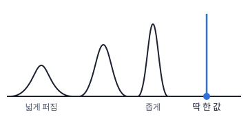

*그래서 퍼짐으로 설명하는 쪽이 딱 정해진 값까지 품어요.*

**정확히 말하면**

MLE가 최소제곱과 같아진 것은 노이즈를 가우시안으로 가정했기 때문이에요([가우시안 노이즈면 MLE = 최소제곱](#s4-mle-ls)). 라플라스 분포나 지수 분포처럼 좌우 비대칭이거나 모양이 다른 노이즈를 가정하면 음의 로그우도의 식이 달라져요.

1. 결정론적 모델(함수)의 해는 확률 모델에서 노이즈를 가우시안으로 둔 특수한 경우로 얻을 수 있어요.
2. 상수 $c$는 확률밀도가 한 점에 모인 델타 함수 PDF $p(x) = \delta(x - c)$를 가진 확률변수로 볼 수 있어요.
3. 밀도가 한 점에 모여 있으니 불확실성이 없어요.
4. 따라서 확률밀도함수 모델은 결정론적 함수를 포함해요.

이것이 요즘 확률밀도함수로 데이터를 모델링하는 방식이 대세인 이유예요. 확률 모델이 결정론적 모델의 metric까지 포함하기 때문이에요.

**교수님 말씀**

한 학생에게 "왜 대세일까?"라고 물으셨고, 답이 나오지 않자 직접 설명하셨어요(0914 72:07).

> "요즘 확률 밀도 함수로 데이터를 모델링하는 게 대세다." (0914 72:01)

> "확률로 정의하는 게 디터미니스틱 펑션을 포함하는 경우가 많다." (0914 72:30)

이번 주까지는 "뜬구름 잡는 얘기"이고, 숙제와 예제를 거쳐 회귀 문제로 가면 구체화된다고 하셨어요(0914 73:36).

**페이지 요약**

결정론적 모델은 확률 모델의 특수한 경우라서, 확률 모델이 더 넓어요.

*핵심 식*

- 상수의 PDF

  $$
  p(x) = \delta(x - c)
  $$

*용어*

- **델타 함수 PDF** — 밀도가 한 점에 모여 불확실성이 없는 분포
- **특수한 경우** — 가우시안 노이즈일 때 확률 모델의 해가 최소제곱 해와 같아요

---

## 5. 한 장 요약 · 다음 시간 예고

### 한 장 치트시트

*0914 수업 · L01 s7–s15*

오늘 수업을 한 장에 모은 치트시트예요. 주제 이름을 누르면 그 토픽으로 가요.

| 주제 | 핵심 식 | 한 줄 요점 |
|---|---|---|
| [모델은 suppose, 그리고 선호의 문제](#s0-suppose) | $y = ax + b$ | 모델은 옳고 그름이 아니라 취사선택, 곧 선호(preference)의 문제예요. |
| [두 갈래 모델과 학습(트레이닝)의 뜻](#s0-two-models) | 함수 $f(\mathbf{x}, \boldsymbol{\theta})$ 또는 PDF $p(\mathbf{x} \mid \boldsymbol{\theta})$ | 결정론적 함수와 확률밀도함수 두 갈래가 있고, 파라미터를 정하는 일이 트레이닝이에요. |
| [Empirical · Risk · Minimization이라는 이름](#s1-erm-name) | $\min_{\boldsymbol{\theta}} R_{\text{emp}}$ | 실제 데이터에서 잰 위험을 최소화하는 관점(in terms of)으로 파라미터를 최적화해요. |
| [데이터 표기: 볼드 소문자는 벡터](#s1-data) | $\{(\mathbf{x}_1, y_1), \dots, (\mathbf{x}_N, y_N)\}$, $\mathbf{x}_n \in \mathbb{R}^D$ | 볼드 소문자는 벡터, 볼드 대문자는 행렬이에요. |
| [좋은 파라미터 θ\*와 for all의 뜻](#s1-goal) | $f(\mathbf{x}_n, \boldsymbol{\theta}^*) = \hat{y}_n \approx y_n$ | 모든 $n$에서 두루 맞아야 해요. 한 데이터에만 맞추면 과적합이에요. |
| [가장 중요한 수식: 어파인 모델과 바이어스 흡수](#s1-affine) | $f(\mathbf{x}_n, \boldsymbol{\theta}) = \boldsymbol{\theta}^\top \mathbf{x}_n$ | 벡터 맨 앞에 1을 붙여 길이를 $D+1$로 만들면 바이어스가 $\theta_0$로 들어가요. |
| [데이터 행렬 X와 평균 손실 R_emp](#s2-remp) | $R_{\text{emp}}(f, \mathbf{X}, \mathbf{y}) = \frac{1}{N}\sum_{n=1}^{N} \ell(y_n, \hat{y}_n)$ | 데이터마다 잰 손실의 평균이 경험적 위험이에요. |
| [제곱 손실을 행렬 한 줄로](#s2-squared) | $\frac{1}{N}\Vert \mathbf{y} - \mathbf{X}\boldsymbol{\theta}\Vert ^2$ | 제곱 손실의 평균은 노름 제곱 한 줄로 써져요(최소제곱). |
| [θ를 어떻게 찾나, 그리고 진짜 목표 R_true](#s2-true-risk) | $R_{\text{true}} = \mathbb{E}_{\mathbf{x}, y}[\ell(y, f(\mathbf{x}))]$ | 진짜 목표는 아직 보지 않은(unseen) 데이터에서 손실이 작은 거예요. |
| [Overfitting과 정규화 최소제곱](#s3-reg) | $\min_{\boldsymbol{\theta}} \frac{1}{N}\Vert \mathbf{y} - \mathbf{X}\boldsymbol{\theta}\Vert ^2 + \lambda \Vert \boldsymbol{\theta}\Vert ^2$ | 패널티 항으로 과적합(overfitting)을 막아요. $\lambda$는 하이퍼파라미터예요. |
| [여러 가지 노름과 하이퍼파라미터 튜닝](#s3-norms) | $\Vert \boldsymbol{\theta}\Vert _1$, $\Vert \boldsymbol{\theta}\Vert _2$, $\Vert \boldsymbol{\theta}\Vert _p$ | 1-노름 정규화는 희소해(sparse solution)를 만들어요. |
| [Likelihood = 그럴듯함, 그리고 −log](#s4-likelihood) | $\mathcal{L}(\boldsymbol{\theta}) = -\log p(\mathbf{x} \mid \boldsymbol{\theta})$ | 우도를 최대화하는 것은 음의 로그우도를 최소화하는 것과 같아요. |
| [i.i.d.: 곱을 합으로](#s4-iid) | $-\sum_{n=1}^{N}\log p(y_n \mid \mathbf{x}_n, \boldsymbol{\theta})$ | 독립이면 곱으로 쪼개지고, 로그를 씌우면 합이 돼요. |
| [가우시안 노이즈면 MLE = 최소제곱](#s4-mle-ls) | $\frac{N}{2}\log(2\pi\sigma^2) + \frac{1}{2\sigma^2}\sum_{n=1}^{N}(y_n - \mathbf{x}_n^\top\boldsymbol{\theta})^2$ | 노이즈를 가우시안으로 가정하면 MLE와 최소제곱의 해가 같아요. |
| [확률 모델은 결정론적 모델을 품는다](#s4-contains) | 상수 = 델타 PDF | 결정론적 모델은 확률 모델의 특수한 경우라서 확률 모델이 대세예요. |

---

### 다음 시간 예고 (아직 안 배움)

*0914 수업 · L01 s16–s17 · L02*

이번 수업에서 제목만 나왔거나 아직 시작하지 않은 내용이에요.

- L01 s16 MAP (Maximum A Posteriori): MLE에 "θ는 이럴 거야"라는 사전 지식을 더해요. 교수님이 수요일에 다룬다고 했어요 (0914 73:33).
- 최소제곱의 닫힌 해와 pseudo-inverse: 다음 주 선형 회귀에서 배워요 (0914 41:03).
- 다음 시간에는 실습(랩)도 있다고 했어요 (0914 71:23).
- L01 s17 Model Fitting: model class, overfitting vs. underfitting vs. good fitting
- Lecture02 (When Models Meet Data – Part 2): 확률적 모델링과 추론, Fully Bayesian vs. ML/MAP
- Lecture02: Graphical Models, Conditional Independence & d-separation
- Lecture02: Nested Cross-Validation, Bayesian Model Selection, Bayes factor

---

### 함께 보면 좋은 자료

*0914 수업*

- [0914 복습문제 7선 풀러 가기](복습문제_0914_ERM_and_MLE.md)

복습문제 7문항

- [문제지 PDF](복습문제_0914_ERM_and_MLE-문제.pdf)
- [해설지 PDF](복습문제_0914_ERM_and_MLE-답안.pdf)
- [0909 정리노트: 데이터, 모델, 학습](../../0909/정리노트_0909_Data_Models_Learning.html)
- [ELI5 Lecture 10: 통계적 추론 1부](../../../강의노트/추가%20강의/eli5_lecture10_statistical_inference_part1.html)
- [ELI5 Lecture 11: 통계적 추론 2부](../../../강의노트/추가%20강의/eli5_lecture11_statistical_inference_part2.html)
- [ELI5 Lecture 12: 통계적 추론 3부](../../../강의노트/추가%20강의/eli5_lecture12_statistical_inference_part3.html)

---

출처: 정방철 교수님 강의자료(Lecture01) · 수업 녹음 전사(0914) · Deisenroth, Faisal, Ong, *Mathematics for Machine Learning* (2020) 8장.
