# MAP and Generative Models — 5살도 이해하는 정리노트

정방철 교수님 머신러닝기초 · 0916 수업 (Lecture01~02, MML 8장)

> `정리노트_0916_MAP_and_Generative_Models.html`를 마크다운으로 옮겼어요. 그림은 `figures_0916/` 폴더의 SVG, 위젯은 대표 설정의 정적 그림으로 바꿨어요. 수식은 `$…$` / `$$…$$`라서 GitHub, Obsidian, Typora에서 보여요.

**목차**

- [0. MLE 다시 보기: −log와 i.i.d.](#s0)
  - [데이터만 볼까, 사전 지식도 반영할까?](#s0-learning-map)
  - [Likelihood = 그럴듯함, 그리고 −log](#s0-nll)
  - [i.i.d. 가정으로 곱을 합으로](#s0-iid)
  - [가우시안 노이즈면 MLE = Least Squares](#s0-mle-ls)
- [1. MAP와 모델 피팅](#s1)
  - [Posterior와 베이즈 룰](#s1-posterior)
  - [MAP = MLE + log prior](#s1-map)
  - [보충: 가우시안 prior = L2 정규화](#s1-map-reg)
  - [Model fitting: 과적합 · 과소적합 · 적정적합](#s1-fitting)
- [2. 확률적 모델링: 생성 과정과 joint](#s2)
  - [Generative process: 이렇게 만들어졌을 거야](#s2-generative)
  - [Joint · Marginal · Latent](#s2-joint)
  - [Prior × Likelihood → Marginal Likelihood → Posterior](#s2-posterior)
- [3. ML vs MAP vs Fully Bayesian](#s3)
  - [세 가지 답: ML · MAP · Fully Bayesian](#s3-three-ways)
  - [보충: 동전으로 보는 ML과 MAP](#s3-coin)
  - [보충: Posterior predictive와 조건부 독립](#s3-predictive)
- [4. 요약 · 예고](#s4)
  - [한 장 치트시트](#s4-cheatsheet)
  - [다음 시간 예고 (아직 안 배움)](#s4-next)
  - [함께 보면 좋은 자료](#s4-links)

## 0. MLE 다시 보기: −log와 i.i.d.

### 데이터만 볼까, 사전 지식도 반영할까?

*학습 길잡이 · 기존 내용 재구성*

**먼저 큰 그림**

**오늘의 질문.** 같은 데이터에서도 파라미터를 고르는 기준과 불확실성을 보존하는 방식에 따라 답이 달라져요.

ML은 고정된 미지의 파라미터를 추정해요. MAP과 Fully Bayesian(FB)은 파라미터에 사전분포를 부여하고, 데이터로 갱신한 사후분포를 이용해요.

| 구분 | 무엇을 하나요? | 무엇이 남나요? |
|---|---|---|
| ML | 데이터의 우도 최대화 | 파라미터 값 하나 |
| MAP | 사후분포의 밀도가 최고인 위치 선택 | 파라미터 값 하나 |
| FB | 사후분포 전체를 유지 | 분포를 이용한 추론·예측 |

**구할 결과.** MAP은 확률변수로 모델링한 파라미터에서 한 점을 고르고, FB는 가능한 값들의 불확실성을 계속 반영해요.

앞서 만든 음의 로그우도는 그대로 두고, MAP에서는 사전분포의 음의 로그를 더해요. **목적함수에 어떤 항이 추가되는가**와 **θ 한 점을 남기는가, 분포를 남기는가**를 나누어 비교해요.

**수식이 하는 일.** 베이즈 정리는 사전분포와 우도를 사후분포로 연결해요. 음의 로그를 취하면 MAP의 목적함수에 데이터 항과 사전분포 항이 더해져요.

**헷갈리기 쉬운 점.** MAP이라고 사후분포 전체를 먼저 계산해야 하는 것은 아니에요. 최고점을 찾을 수 있으면 돼요. 사전분포를 쓰는 것과 분포 전체를 유지하는 것은 다른 선택이에요.

이어서 읽기: [Posterior와 베이즈 룰](#s1-posterior) · [MAP = MLE + log prior](#s1-map) · [세 가지 답: ML · MAP · Fully Bayesian](#s3-three-ways)

**페이지 요약**

MAP은 확률변수로 모델링한 파라미터에서 한 점을 고르고, FB는 가능한 값들의 불확실성을 계속 반영해요.

#### 조건·구분

ML은 고정된 미지의 파라미터에서 우도를, MAP은 사전분포를 부여한 파라미터에서 사후밀도를 최대화해요. MAP은 최고점만 찾으면 되고 사후분포 전체 계산이 먼저 필요한 것은 아니에요.

---

### Likelihood = 그럴듯함, 그리고 −log

*0916 수업 · L01 s14*

**쉽게 말하면**

여러 설명 중에서 데이터를 가장 그럴듯하게 만드는 설명을 골라요.

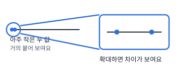

*아주 작은 값끼리도 크게 확대하면 차이가 또렷해져요.*

**정확히 말하면**

모델을 결정론적 함수로 두면 empirical risk minimization이나 least squares로 파라미터를 맞춰요. 모델을 확률 모델로 두면 PDF의 파라미터(가우시안이면 $\mu,\sigma^2$)를 최적화해요. MLE(maximum likelihood estimation)는 그 방법 중 하나예요.

likelihood는 우리말로 "그럴듯함"이고, maximum likelihood는 "가장 그럴듯함"이에요. 머신러닝은 귀납적인 학문이에요. 데이터 뒤에 숨은 latent variable(패턴)을 수학으로 찾는 방법론이에요. "그럴듯함"을 수학으로 옮긴 것이 확률이에요.

그래서 다음 negative log-likelihood(NLL)를 최소화하는 $\theta$를 maximum likelihood estimator라고 불러요.

$$
\mathcal{L}(\theta) = -\log P(x\mid\theta)
$$

1. $\log$는 단조 증가 함수라서 확률의 대소 관계를 그대로 보존해요.
2. $\max_\theta P(x\mid\theta)$에 $-\log$를 붙이면 $\min_\theta\big(-\log P(x\mid\theta)\big)$가 돼요.
3. loss는 보통 "나쁜 정도"를 재는 metric이라 최소화 형태가 자연스러워요.

로그를 쓰는 이유는 세 가지예요.

1. 노이즈나 관측을 가우시안으로 모델링하는 일이 많아요. 로그를 취하면 $\exp$가 사라져요.
2. 확률값은 아주 작아질 수 있어요. $0.001$과 $0.002$는 두 배 차이지만 값이 작아 격차가 잘 안 보여요. 로그는 1보다 작은 구간을 확대하는 클로즈업 역할을 해요.
3. PDF의 값 자체는 1보다 클 수 있어요. 1을 넘을 수 없는 것은 적분값(전체 넓이)뿐이에요.

$x$와 $y$의 관계를 PDF로 정의하겠다고 정하면 파라미터가 생겨요. 가우시안이면 $\mu=\theta_1$, $\sigma^2=\theta_2$예요. 지수분포라면 $f(x)=\lambda e^{-\lambda x}$이고 파라미터는 $\lambda$예요. 가우시안 관계로 볼지 지수 관계로 볼지는 모델을 만드는 내가 정해요.

**교수님 말씀**

> "그럴 확률이 maximum인 놈을 고르는 게 가장 효과적인 방법론이거든, 공학자들한테는."

로그는 예능이나 영화의 클로즈업 같다고 하셨어요. 1보다 작은 확률 구간을 확대해서 보여 준다는 뜻이에요.

> "확률 밀도 함수의 값 자체는 1보다 커질 수 있습니다."

**페이지 요약**

가장 그럴듯한 $\theta$를 찾는 문제를 $-\log$로 최소화 문제로 바꿔요.

*핵심 식*

- negative log-likelihood

  $$
  \mathcal{L}(\theta) = -\log P(x\mid\theta)
  $$
- 지수분포 PDF

  $$
  f(x)=\lambda e^{-\lambda x}
  $$

*용어*

- **likelihood** — 그럴듯함, 파라미터가 데이터를 만들 확률
- **단조 증가** — $\log$가 대소 관계를 보존하는 성질

#### 조건·구분

로그는 가우시안의 $\exp$를 풀고 작은 값의 차이를 드러내요. PDF 높이는 1보다 클 수 있으며 전체 적분이 1이라는 조건과 구별해요.

---

### i.i.d. 가정으로 곱을 합으로

*0916 수업 · L01 s15*

**쉽게 말하면**

모든 데이터가 같은 공장에서 같은 방식으로 찍혀 나왔다고 믿어요.

*한 공장이 만든 상자들이라 공장 하나만 알아내면 돼요.*

**정확히 말하면**

입력 $x_n\in\mathbb{R}^D$들을 모은 집합을 $\mathcal{X}=\{x_1,\dots,x_N\}$, 라벨을 모은 집합을 $\mathcal{Y}=\{y_1,\dots,y_N\}$로 써요. $\theta$는 $x\to y$ 관계를 만드는 latent parameter이고 학습할 대상이에요.

지도학습의 NLL은 항상 다음 식에서 출발해요.

$$
\mathcal{L}(\theta) = -\log P(\mathcal{Y}\mid\mathcal{X},\theta)
$$

1. 출발식: $-\log P(\mathcal{Y}\mid\mathcal{X},\theta)$ (확률 모델링을 하면 여기까지는 늘 같아요)
2. independence 가정으로 곱으로 분해해요. 아직 $\theta_n$이 데이터마다 달라요.

   $$
   -\log\prod_{n=1}^{N}P(y_n\mid x_n,\theta_n)
   $$
3. identically distributed 가정을 더하면 $\theta_n\to\theta$ 하나로 통일돼요.

   $$
   -\log\prod_{n=1}^{N}P(y_n\mid x_n,\theta)
   $$
4. $\log(ab)=\log a+\log b$로 곱을 합으로 바꿔요.

   $$
   -\sum_{n=1}^{N}\log P(y_n\mid x_n,\theta)
   $$

마지막 식이 negative log-likelihood, 즉 loss예요. 두 가정을 합쳐 i.i.d.(independent and identically distributed)라고 해요.

- independence: $x_1$은 짝인 $y_1$에만 영향을 주고, 다른 $y$와는 통계적으로 독립이에요.
- identically distributed: 데이터마다 PDF가 다르면 PDF 하나를 추정할 데이터가 하나뿐이에요. 그래서 데이터 전체를 설명하는 PDF 하나를 가정해요.

로그의 곱셈 성질은 $\log(ab)=\log a+\log b$예요.

**교수님 말씀**

벡터 $x_1,\dots,x_N$을 모아 모아서 추석 선물 세트처럼 하나의 세트 $\mathcal{X}$로 만든다고 하셨어요.

> "negative log-likelihood를 계산하는 방법은 항상 예외 없이 이 수식을 쓰는 거예요."

> "묻지도 말고 따지지도 말고 -log를 쳐."

> "그 다음으로 넘어가면 어떤 가정이 필요하다? i.i.d. 가정이 필요하다."

데이터 세트 전체가 PDF 하나로 만들어진다는 뜻이냐는 질문에 그렇다고 답하셨어요. 동일한 공장에서 동일한 불확실성으로 찍어낸 $N$개의 데이터라는 가정이에요.

**페이지 요약**

i.i.d. 가정이 있어야 곱이 한 $\theta$의 로그 합으로 바뀌어요.

*핵심 식*

- 출발식

  $$
  \mathcal{L}(\theta) = -\log P(\mathcal{Y}\mid\mathcal{X},\theta)
  $$
- i.i.d. 적용 후

  $$
  -\sum_{n=1}^{N}\log P(y_n\mid x_n,\theta)
  $$

*용어*

- **i.i.d.** — independent and identically distributed, 서로 독립이고 같은 분포

#### 조건·구분

독립이면 예제별 우도를 곱으로 나누고, 동일 분포이면 공통 $\theta$를 써요. 곱을 합으로 바꾸는 단계는 $\log(ab)=\log a+\log b$예요.

---

### 가우시안 노이즈면 MLE = Least Squares

*0916 수업 · L01 s15*

**쉽게 말하면**

흔들림이 종 모양이라고 믿으면, 가장 그럴듯한 선은 점들과 가장 가까운 선이에요.

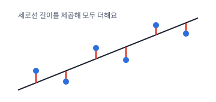

*점과 선 사이의 세로 거리를 제곱해서 더한 값이 가장 작은 선을 골라요.*

**정확히 말하면**

모델을 다음처럼 가정해요.

$$
y_n = x_n^\top\theta + \epsilon,\qquad \epsilon\sim\mathcal{N}(0,\sigma^2)
$$

그러면 $y_n\mid x_n,\theta \sim \mathcal{N}(x_n^\top\theta,\ \sigma^2)$이고, i.i.d. NLL은 다음과 같아요.

$$
\mathcal{L}(\theta) = -\sum_{n=1}^{N}\log\frac{1}{\sqrt{2\pi\sigma^2}}\exp\!\left(-\frac{(y_n-x_n^\top\theta)^2}{2\sigma^2}\right)
$$

1. $\log(A\cdot B)=\log A+\log B$로 각 항을 A항과 B항으로 나눠요.

   $$
   \log\frac{1}{\sqrt{2\pi\sigma^2}} + \log\exp\!\left(-\frac{(y_n-x_n^\top\theta)^2}{2\sigma^2}\right)
   $$
2. A항은 $n$과 무관해서 $N$번 더하면 상수가 돼요.

   $$
   N\log\frac{1}{\sqrt{2\pi\sigma^2}}
   $$
3. A항은 $\theta$와도 무관하니 최적화에서 버려요. 그래서 등호 대신 비례 기호 $\propto$를 써요.

   $$
   \mathcal{L}(\theta)\propto\frac{1}{2\sigma^2}\sum_{n=1}^{N}(y_n-x_n^\top\theta)^2
   $$
4. 제곱합은 유클리드 노름의 제곱으로 쓸 수 있어요.

   $$
   \sum_{n=1}^{N}(y_n-x_n^\top\theta)^2=\|y-X\theta\|^2
   $$

결론: 가우시안 노이즈를 가정한 확률 모델에서 $\mathcal{L}(\theta)$를 최소화하는 것은 결정론적 모델의 least squares 문제를 푸는 것과 같아요.

**페이지 요약**

노이즈가 가우시안이면 MLE는 least squares와 같은 답을 줘요.

*핵심 식*

- 모델

  $$
  y_n = x_n^\top\theta + \epsilon,\qquad \epsilon\sim\mathcal{N}(0,\sigma^2)
  $$
- NLL의 핵심

  $$
  \mathcal{L}(\theta)\propto\frac{1}{2\sigma^2}\sum_{n=1}^{N}(y_n-x_n^\top\theta)^2
  $$
- 노름 표기

  $$
  \sum_{n=1}^{N}(y_n-x_n^\top\theta)^2=\|y-X\theta\|^2
  $$

*용어*

- **least squares** — 오차 제곱합을 최소화하는 방법

#### 조건·구분

여기서는 i.i.d.와 공통 가우시안 잡음을 가정하고, $\sigma^2$를 $\theta$와 무관한 값으로 두어요. NLL에서 $\theta$와 무관한 상수항을 제외하고 남은 양의 배율의 오차 제곱합을 최소화하므로 해가 같아요.

---

## 1. MAP와 모델 피팅

### Posterior와 베이즈 룰

*0916 수업 · L01 s16*

**쉽게 말하면**

손에 든 단서를 보고, 보이지 않는 속사정을 거꾸로 짐작하는 일이에요.

*의사 선생님은 사진을 보고 병이 있는지 짐작해요.*

**정확히 말하면**

posterior는 "사후", 곧 사건(데이터 관측)이 일어난 *뒤*의 확률이에요. 조건부 확률이고, 사후 분포(posterior distribution)라고 불러요.

추론(inference) 문제는 늘 같은 틀이에요. 손에 쥔 것은 데이터 $x$이고, 알고 싶은 것은 파라미터 $\theta$예요. 그래서 주어진 것을 조건 자리에, 추정할 것을 앞자리에 둬요: $P(\theta\mid x)$.

1. 조건부 확률의 정의: $P(A\mid B)=\dfrac{P(A,B)}{P(B)}$
2. 곱셈 규칙(multiplication rule): $P(x,\theta)=P(x\mid\theta)P(\theta)$
3. 베이즈 룰(Bayes' rule):

   $$
   P(\theta\mid x)=\dfrac{P(x\mid\theta)P(\theta)}{P(x)}
   $$
4. 분모 $P(x)$는 $\theta$와 무관하니 최적화에서 빼고 비례로 써요:

   $$
   P(\theta\mid x)\propto P(x\mid\theta)P(\theta)
   $$
5. $\max_\theta P(\theta\mid x)$는 가장 큰 확률값 자체이고, $\text{argmax}_\theta\, P(\theta\mid x)$는 그 값을 만드는 $\theta$예요. 우리가 찾는 것은 argmax 쪽이에요.

1단계의 분모 $P(B)$는 관측 $B$가 나올 전체 확률이에요.

이어지는 계산은 [MAP = MLE + log prior](#s1-map)에서 해요.

**교수님 말씀**

의사가 CT를 판독하는 장면을 떠올려 보래요. 의사 손에 있는 것은 영상·숫자·테이블 같은 데이터이고, 그 데이터로 암인지 아닌지라는 판단 파라미터를 추론해요. 모든 inference 문제가 이 구조래요.

> "나한테 주어진 건 뭐지? 내가 알고 싶은 건 뭐지?"

posterior의 "사후"는 죽은 뒤가 아니라, 사건이 일어난 뒤라는 뜻이라고 짚었어요.

**꼭 기억해요**

> "인퍼런스 프라블럼의 그 체계를 수학으로 옮겨 놓으라고 하면 항상 이 수식을 기억해야 돼."

**페이지 요약**

데이터 $x$가 주어졌을 때 $\theta$의 확률, 곧 posterior를 베이즈 룰로 구해요.

*핵심 식*

- 조건부 확률

  $$
  P(A\mid B)=\dfrac{P(A,B)}{P(B)}
  $$
- posterior 비례식

  $$
  P(\theta\mid x)\propto P(x\mid\theta)P(\theta)
  $$

*용어*

- **사후 확률(posterior)** — 데이터를 본 뒤의 $\theta$ 확률
- **argmax** — 최댓값을 만드는 변수 값

#### 조건·구분

분모 $P(x)$는 $\theta$와 무관해 최고점 선택에서 제외해요. $\max$는 최고 밀도값이고 $\arg\max$는 그 값을 만드는 파라미터예요.

---

### MAP = MLE + log prior

*0916 수업 · L01 s16*

**쉽게 말하면**

데이터가 하는 말에 내가 원래 믿던 것을 보태서 답을 골라요.

*믿음이 아무 쪽도 편들지 않으면 데이터만 보고 고른 답과 같아져요.*

**정확히 말하면**

MAP(maximum a posteriori)는 [Posterior와 베이즈 룰](#s1-posterior)의 posterior를 가장 크게 만드는 $\theta$예요.

1. $\theta_{\text{MAP}}=\arg\max_\theta P(\theta\mid x)$
2. $=\arg\max_\theta P(x\mid\theta)P(\theta)$ ($P(x)$는 $\theta$와 무관)
3. $-\log$는 단조 감소라서 max가 min으로 바뀌어요: $\arg\min_\theta\big[-\log P(x\mid\theta)P(\theta)\big]$
4. $\log(ab)=\log a+\log b$로 나누면

   $$
   \theta_{\text{MAP}}=\arg\min_\theta\big[-\log P(x\mid\theta)-\log P(\theta)\big]
   $$

- 앞 항 $-\log P(x\mid\theta)$는 [Likelihood = 그럴듯함, 그리고 −log](#s0-nll)의 MLE 항(negative log-likelihood)이에요.
- 뒤 항은 prior(사전 확률) $P(\theta)$($\theta$의 marginal PDF)에 $-\log$를 붙인 것이에요.
- 그래서 MAP는 MLE에 log prior를 더한 것이고, 확률로 보면 likelihood에 prior를 곱한 것이에요.
- prior가 uniform 분포(상수 $c$, "purely random")이면 $-\log P(\theta)=-\log c$는 $\theta$와 무관한 상수예요. 최적화에서 빠지므로 MAP = MLE가 돼요.

교과서(MML 8.3.2)는 이를 "negative log-posterior를 최소화한다"고 표현하고, 0 평균 가우시안 prior를 주면 직선의 기울기가 덜 가파르게 끌려간다고 보여 줘요(Fig 8.6).

#### ML에서 기억한 목적함수의 어느 자리가 달라질까요?

위 베이즈 식의 분모 $P(x)$는 관측 x가 주어지면 θ와 무관해요. $P(x)\gt0$인 경우 최고점 계산에서만 빼도 돼요. 앞에서 쓴 ML 목적함수를 $J_{\rm ML}(\theta):=-\log P(x\mid\theta)$로 줄여 쓰면,

$$
-\log P(\theta\mid x)=J_{\rm ML}(\theta)-\log P(\theta)+\log P(x)
$$

마지막 상수를 빼고 최소화하면 $J_{\rm ML}(\theta)-\log P(\theta)$가 돼요. **ML 데이터 항은 유지하고 prior 항 하나를 더한다**고 복원해요. uniform prior라면 그 지지집합 안에서 prior 항이 상수예요. 따라서 같은 영역 안의 ML과 같고, 영역 밖까지 허용한 ML과 항상 같은 것은 아니에요.

**교수님 말씀**

> "사후 확률을 맥시마이즈 하게 만드는 세타 … 우리의 얼티메이트 골 오브 인퍼런스"

구체적인 회귀 예제는 다음 주부터 제대로 된 regression을 하면서 보여 주겠다고 했어요.

**페이지 요약**

MAP는 음의 로그우도에 음의 로그 prior를 더해 최소화해요. prior가 uniform이면 MAP = MLE예요.

*핵심 식*

- MAP

  $$
  \begin{aligned}\theta_{\text{MAP}}&=\arg\min_\theta\bigl[\\&-\log P(x\mid\theta)\\&-\log P(\theta)\bigr]\end{aligned}
  $$

*용어*

- **사전 확률(prior)** — 데이터를 보기 전 $\theta$에 대한 믿음
- **uniform prior** — 모든 $\theta$를 똑같이 보는 상수 prior

#### 조건·구분

정확한 최소화 항은 NLL에 **음의 로그 prior** $-\log P(\theta)$를 더한 것이에요. 확률로 쓰면 likelihood와 prior의 곱이에요.

---

### 보충: 가우시안 prior = L2 정규화

*0916 수업 · L02 s5 · L01 s12*

**쉽게 말하면**

"답은 작을수록 좋다"는 믿음이 고무줄처럼 답을 가운데로 당겨요.

*당기는 힘을 0으로 두면 답은 데이터만 따라가요.*

**정확히 말하면**

수업에서는 prior를 설명하면서 지난 시간의 정규화(regularization) 식을 다시 보여 줬어요.

$$
\min_\theta\frac{1}{N}\|y-X\theta\|^2+\lambda\|\theta\|^2
$$

- $\lambda=0$이면 선험적인 편견(prior)을 전혀 고려하지 않아요. 식은 least squares와 같아요.
- $\lambda$가 크면 "모름지기 $\theta$는 크기가 작을수록 좋다"는 선호를 식에 녹여요.
- prior $P(\theta)$는 데이터를 보기 전의 notion, 편견, bias, preference, intention이에요.

prior가 정확히 어떻게 $\lambda\|\theta\|^2$ 항이 되는지는 나중에 설명하겠다고 미뤘어요.

[MAP의 두 항](#s1-map) 중 데이터 항은 이전 최소제곱이고, prior의 음의 로그가 패널티 역할을 해요. 이 날짜에서는 연결을 소개했고, 정확한 가우시안 계수 대입은 기존 보충 설명으로 구별해요. “분포를 가정한다”와 “분포 전체를 답으로 유지한다”는 별도 선택이에요.

**교수님 말씀**

> "모름지기 파라미터는 이래야 되는 거 아닙니까?"

prior는 이런 말투로 표현되는 선호이자 편견이래요. 정규화와의 연결은 "그건 나중에 다시 썰 푸는 걸로" 하고 넘어갔어요.

**보충 · 수업에서 유도하진 않았어요**

MML Example 8.6처럼 가우시안 likelihood에 0 평균 가우시안 prior를 둬요. 여기서는 공분산을 $b^2 I$로 단순하게 잡아요.

여기서 $\theta$는 여러 파라미터를 묶은 벡터이고, $b^2\gt0$이에요. $b^2 I$는 각 파라미터의 분산이 $b^2$이고 서로의 공분산이 0인 행렬이에요. 성분들을 함께 묶은 분포가 가우시안, 즉 공동 가우시안이므로 성분들이 독립이에요. 스칼라 분산을 행렬로 묶는 과정은 [0928 가우시안 사전분포 보충](../../0928/정리노트_0928_Linear_Regression.html#s4-gaussian-prior)에 있어요.

1. likelihood: $y_n\mid x_n,\theta\sim\mathcal{N}(x_n^\top\theta,\sigma^2)$이므로 $-\log P(y\mid X,\theta)=\frac{1}{2\sigma^2}\|y-X\theta\|^2+\text{const}$
2. prior: $\theta\sim\mathcal{N}(0, b^2 I)$이므로 $-\log P(\theta)=\frac{1}{2b^2}\|\theta\|^2+\text{const}$
3. MAP 목적함수: $\frac{1}{2\sigma^2}\|y-X\theta\|^2+\frac{1}{2b^2}\|\theta\|^2$
4. 양변에 양수 $\frac{2\sigma^2}{N}$을 곱해도 최솟점은 같아요: $\frac{1}{N}\|y-X\theta\|^2+\frac{\sigma^2}{N b^2}\|\theta\|^2$
5. 그러므로

   $$
   \lambda = \frac{\sigma^2}{N b^2}
   $$

prior 폭 $b$가 좁을수록(믿음이 강할수록) $\lambda$가 커지고, $b\to\infty$이면 $\lambda\to 0$이라 MLE로 돌아가요. 교과서는 MAP의 자세한 계산을 9장에서 다뤄요.

**페이지 요약**

$\lambda\|\theta\|^2$ 정규화 항은 "$\theta$는 작을수록 좋다"는 prior를 식에 넣은 것이에요.

*핵심 식*

- L2 정규화

  $$
  \min_\theta\frac{1}{N}\|y-X\theta\|^2+\lambda\|\theta\|^2
  $$

*용어*

- **정규화(regularization)** — 선호를 벌점 항으로 목적함수에 더하는 것
- **$\lambda=0$** — prior를 고려하지 않는 경우

#### 조건·구분

보충(MML Example 8.6): 가우시안 likelihood와 $\theta\sim\mathcal N(0,b^2I)$, $b^2>0$인 가우시안 prior에서 $\lambda=\sigma^2/(Nb^2)$예요. 벡터 성분은 분산 $b^2$, 교차 공분산 0이며 공동 가우시안이라 독립이에요. 이 유도는 수업에서 미룬 부분이고, prior 폭이 좁을수록 벌점이 강해져요.

---

### Model fitting: 과적합 · 과소적합 · 적정적합

*0916 수업 · L01 s17*

**쉽게 말하면**

옷이 몸에 딱 맞아야 하듯, 설명하는 틀도 자료에 알맞은 크기여야 해요.

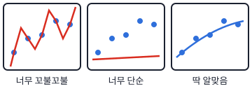

*너무 꼬불꼬불하면 새 점을 못 맞히고, 너무 단순하면 지금 점도 못 맞혀요.*

**정확히 말하면**

파라미터 training, learning, optimization, fitting은 모두 모델 *안의 파라미터*를 튜닝하는 말이에요. 모델 피팅(model fitting)은 모델 *자체*를 바꿔 보는 일이에요. 파라미터를 최선으로 맞춰도 성능이 나쁘면 모델을 바꿔야 해요.

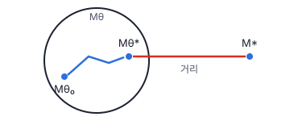

*모델 클래스 안에서 가장 좋은 모델과 진짜 모델 사이의 거리(MML Fig 8.7).*

1. 진짜 모델(right model) $M^*$는 알 수 없어요.
2. 내가 가정한 모델 클래스(model class) $M_\theta$(linear, Gaussian, mixed Gaussian 등)에서 $M_{\theta_0}$로 시작해요.
3. 학습하면 클래스 안의 최적 $M_{\theta^*}$에 도달해요. 별표(\*)는 optimal이라는 뜻이에요.
4. $M_{\theta^*}$와 $M^*$ 사이 거리가 클수록 나쁜 모델이에요.

| 경우 | 원인 | 증상 |
|---|---|---|
| 과적합(overfitting) | 데이터 수에 비해 너무 복잡한 모델(파라미터가 너무 많음) | 가진 데이터는 기가 막히게 설명하지만, 새 입력에는 실제와 크게 다른 값을 예측해요. |
| 과소적합(underfitting) | 데이터는 많은데 너무 간단한 모델(예: 그냥 linear) | 가진 데이터조차 잘 설명하지 못해요. 대신 안정적이라 어떤 데이터에도 적당히는 맞아요. |
| 적정적합(good fitting) | 데이터 사이즈와 모델 사이즈가 알맞음 | 지금 데이터와 앞으로 들어올 데이터(unseen data)를 모두 잘 설명해요. |

- 모델 사이즈 = 최적화해야 하는 파라미터 개수(the number of parameters to be optimized)예요.
- 요즘은 GPU와 거대 모델 때문에 과적합이 더 흔하고, 예전에는 과소적합이 더 흔했어요.
- 요즘은 모델 피팅과 모델 셀렉션도 러닝의 일부로 봐요.
- 모델 선택은 컴퓨팅 자원, 풀려는 문제의 사이즈, 데이터 개수를 함께 따져야 해요.

**교수님 말씀**

진짜 모델 $M^*$는 전지전능한 요정(지니)만 안대요.

학습에 쓴 데이터 일부로 테스트해서 논문에 싣는 것은 "되새김질"이래요. 이미 먹은 것을 다시 씹으니 소화가 잘 될(정확하게 나올) 수밖에 없어요.

거대 모델의 파라미터 수는 과장해서 말했다고 덧붙였어요. 실제 규모는 수백억 개 이상이에요(예: Llama 70B는 약 700억 개).

"그럼 이걸 어떻게 잘 합니까?"라는 물음에는 "GPT한테 물어보세요"라고 농담한 뒤, 결국 사람의 노하우가 필요하다고 했어요.

> "이건 그냥 컨셉적인 … 얘기니까 그냥 머릿속으로 받아만 두세요."

**꼭 기억해요**

학습 데이터로 테스트하면 안 돼요.

> "이건 말이 안 되는 거야. 이렇게 하면 안 돼."

**페이지 요약**

모델 클래스 안의 최적 $M_{\theta^*}$가 진짜 모델 $M^*$에 가까워야 하고, 모델 크기는 데이터에 알맞아야 해요.

*용어*

- **과적합(overfitting)** — 파라미터가 너무 많아 새 데이터를 못 맞힘
- **과소적합(underfitting)** — 모델이 너무 단순해 가진 데이터도 못 맞힘
- **모델 사이즈** — 최적화할 파라미터 개수

#### 조건·구분

과적합은 훈련에는 잘 맞고 새 데이터에는 어긋나며, 과소적합은 훈련 데이터도 잘 설명하지 못해요. 적정적합은 양쪽을 잘 설명해야 하므로 학습 데이터로 테스트하지 않아요.

---

## 2. 확률적 모델링: 생성 과정과 joint

### Generative process: 이렇게 만들어졌을 거야

*0916 수업 · L02 s3–5*

**쉽게 말하면**

손에 쥔 데이터를 보고 "이렇게 만들어졌을 거야" 하고 이야기를 지어요.

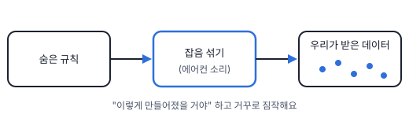

*숨은 규칙에 잡음이 섞여서 우리가 받은 데이터가 돼요.*

노래를 녹음하면 에어컨 소리가 같이 들어가는 것과 같아요.

**정확히 말하면**

Lecture02(Part 2)는 세 토픽으로 나뉘어요. (4) Probabilistic Modeling and Inference, (5) Directed Graphical Models, (6) Model Selection이에요. 이번 수업은 (4)의 앞부분까지 다뤘어요.

머신러닝 과제는 주로 두 가지예요.

- 예측(prediction): 아직 보지 못한(unseen) 사건을 맞히기
- 결정(decision making): expected risk를 가장 작게 만드는 선택하기

확률 모형은 관측 데이터가 어떤 generative process(아마도 random process)로 만들어졌다고 **가정(suppose)**하고 세워요. 예를 들면 이런 가정이에요.

$$
y_n = x_n^\top\theta + \epsilon_n,\quad \epsilon_n\sim\mathcal{N}(0,\sigma^2)
$$

"$y_n$은 $x_n^\top\theta$에 평균 $0$, 분산 $\sigma^2$인 노이즈가 더해져서 만들어졌을 거야." 이 문장이 generative process예요.

손에 쥔 데이터는 온전하지 않아요. 온도 측정값, 사진, 녹음에는 모두 노이즈가 끼어 있어요. 이 노이즈를 확률변수(불확실성)로 두는 모형을 확률 모형(probabilistic model)이라고 해요.

칠판 유도: $y_n$의 분포

1. $x_n$은 주어진 데이터이고 $\theta$는 추정할 파라미터예요. 둘 다 확률변수가 아니에요.
2. 그러니 $c_n = x_n^\top\theta$는 상수예요.
3. $y_n = c_n + \epsilon_n,\ \epsilon_n\sim\mathcal{N}(0,\sigma^2)$
4. 가우시안에 상수를 더하면 평균만 옮겨 가요: $y_n\sim\mathcal{N}(c_n,\sigma^2)$
5. $c_n$은 $\theta$의 함수예요. 즉 $\theta$는 분포의 평균을 움직이는 역할을 해요.

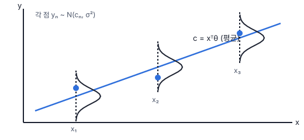

*각 $x_n$마다 $y_n$은 직선 위의 값 $c_n$을 평균으로 하는 가우시안에서 뽑혀요. $\theta$를 바꾸면 직선이, 곧 모든 평균이 함께 움직여요.*

교과서 MML 8.4.1에서도 같은 흐름으로, 관측 데이터를 만드는 generative process를 묘사하는 확률 모형을 세운다고 설명해요.

**교수님 말씀**

신승훈의 「보이지 않는 사랑」은 가사가 "~했을 거야"로 끝나요. generative process는 바로 그 말투, "이렇게 만들어졌을 거야"라고 가정하는 말이에요.

교수님이 노래하면 녹음에 에어컨 소리가 섞여요. 데이터에도 그렇게 노이즈가 섞여 있어요.

한 학생이 설명 끝에 "만들어졌을 거야"를 대신 말하자, 교수님은 확률 수업을 들은 덕분이라고 했어요.

> "근데 여러분, 확률 랜덤 변수 수업이 이만큼 중요한 거야."

**페이지 요약**

데이터가 "이렇게 만들어졌을 거야" 하고 가정한 과정이 generative process예요.

*핵심 식*

- 평균 부분(상수)

  $$
  c_n = x_n^\top\theta
  $$
- $y_n$의 분포

  $$
  y_n\sim\mathcal{N}(c_n,\sigma^2)
  $$

*용어*

- **생성 과정(generative process)** — 관측 데이터가 만들어졌다고 가정하는 (랜덤) 과정
- **확률 모형(probabilistic model)** — 데이터 속 노이즈를 확률변수로 두는 모형

#### 조건·구분

이 유도는 입력과 미지의 계수를 고정해 $c_n=x_n^\top\theta$를 상수로 보아요. 가우시안 잡음에 상수를 더하면 평균만 $c_n$으로 옮겨지고 분산 $\sigma^2$는 유지돼요.

---

### Joint · Marginal · Latent

*0916 수업 · L02 s5*

**쉽게 말하면**

보이는 것과 숨은 핵심을 한 표에 함께 적으면 가장 많은 걸 알 수 있어요.

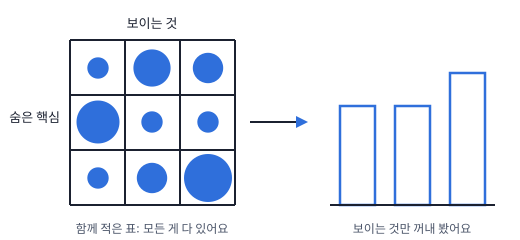

*표를 세로로 더하면 보이는 것 하나만 꺼내 볼 수 있어요. 하지만 꺼낸 막대만 보고는 원래 표를 되살릴 수 없어요.*

**정확히 말하면**

확률 모형을 세울 때는 항상 joint distribution부터 생각해요. 확률분포 가운데 가장 많은 정보를 가진 분포가 joint 분포이기 때문이에요.

- marginal PDF $f_X(x)$, $f_\theta(\theta)$, $f_Y(y)$는 각각 자기 변수의 불확실성만 설명해요.
- PDF(PMF)를 알면 그 확률변수의 모든 것(평균, 분산, 함수의 기댓값)을 알아요.
- 변수가 두 개면 둘 사이 관계(공분산 등)까지 알아야 하니 joint PDF가 필요해요.

joint에서 marginal은 관심 없는 변수를 적분해(더해) 없애면 나와요(MML 6.3 합 규칙, sum rule).

$$
f_X(x)=\int f_{X,\theta}(x,\theta)\,d\theta
$$

거꾸로 marginal 두 개만으로는 joint를 되살릴 수 없어요. 그래서 joint가 정보를 가장 많이 가져요.

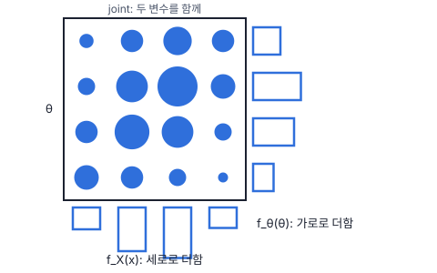

*격자의 색칠된 원 크기가 joint 확률이에요. 세로로 더하면 $f_X(x)$, 가로로 더하면 $f_\theta(\theta)$가 나와요.*

$\theta$는 부르는 이름이 둘이에요.

- 확률론: hidden parameter(숨은 파라미터)
- 머신러닝: latent variable(잠재 변수)

둘 다 표면에 보이는 $x$를 만들어 내는 안쪽 기작이라는 뜻이에요.

**교수님 말씀**

주민등록번호 비유: 확률변수의 "정체"를 알려면 주민번호가 아니라 PDF를 알아야 해요.

인셉션(꿈속의 꿈) 비유: 표면의 현상 $x$ 안쪽에 코어 $\theta$가 들어 있어요.

> "가장 많은 인포메이션을 갖고 있는 분포가 무슨 분포? joint 분포거든요."

> "할 수만 있다면 우리는 이 joint distribution을 알아야 돼요."

**페이지 요약**

joint 분포가 정보를 가장 많이 담고, marginal은 거기서 한 변수만 남긴 거예요.

*핵심 식*

- marginal (합 규칙)

  $$
  f_X(x)=\int f_{X,\theta}(x,\theta)\,d\theta
  $$

*용어*

- **결합 분포(joint distribution)** — 여러 확률변수를 함께 본 분포, 정보가 가장 많아요
- **주변 분포(marginal)** — joint에서 다른 변수를 적분해 없앤 분포
- **잠재 변수(latent variable)** — $x$를 만드는 숨은 $\theta$, 확률론에서는 hidden parameter

#### 조건·구분

joint는 변수 사이 관계까지 담아요. 관심 없는 변수를 적분해 marginal을 얻을 수 있지만 marginal 둘만으로 원래 joint를 복원할 수는 없어요.

---

### Prior × Likelihood → Marginal Likelihood → Posterior

*0916 수업 · L02 s5*

**쉽게 말하면**

처음 생각에 데이터가 알려 준 것을 곱해서 생각을 고쳐요.

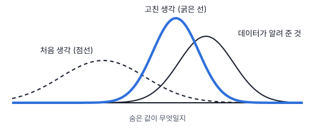

*넓은 점선과 가는 실선을 합치면 좁고 높은 굵은 선이 나와요.*

**정확히 말하면**

슬라이드는 "joint distribution이 key information을 encapsulate한다"고 적어요. 하지만 $\theta$가 처음부터 key information을 담고 있는 건 아니에요. 모델을 잘 세우고 최적화해서 key information을 머금도록 **만들어 가는** 거예요(귀납적 관점). 모델 가정이 틀리면 최적화에도 한계가 있어요([Model fitting: 과적합 · 과소적합 · 적정적합](#s1-fitting)).

목표는 손에 쥔 데이터를 가장 잘 설명하고, unseen 데이터도 잘 예측하는 $\theta$예요.

주어지는 것: prior $P(\theta)$와 likelihood $P(x\mid\theta)$. 여기서 joint, marginal likelihood, posterior를 차례로 얻어요.

1. 곱 규칙(product rule, MML 6.3)으로 joint를 나눠요:

   $$
   P(x,\theta)=P(x\mid\theta)P(\theta)
   $$
2. 베이즈 룰:

   $$
   P(\theta\mid x)=\dfrac{P(x\mid\theta)P(\theta)}{P(x)}
   $$
3. 분모는 joint를 관심 없는 $\theta$에 대해 적분해요(합 규칙):

   $$
   P(x)=\int P(x,\theta)\,d\theta
   $$
4. 1을 대입하면 marginal likelihood예요:

   $$
   P(x)=\int P(x\mid\theta)P(\theta)\,d\theta
   $$
5. 2의 분자를 1로, 분모를 3으로 바꿔요:

   $$
   P(\theta\mid x)=\dfrac{P(x,\theta)}{\int P(x,\theta)\,d\theta}
   $$

각 항의 이름과 뜻이에요.

- $P(\theta)$: prior probability(사전 확률). 데이터를 보기 전의 생각, 곧 편견, bias, preference, intention이에요.
- $P(x\mid\theta)$: likelihood. forward probability 또는 transition probability라고도 하고, 보통 주어지는 경우가 많아요.
- $P(x)$: marginal likelihood. joint를 $\theta$에 대해 적분한 값이에요.
- $P(\theta\mid x)$: posterior(사후 확률). 데이터를 본 뒤 $\theta$에 대한 분포예요.

5의 분자와 분모가 모두 joint $P(x,\theta)$예요. joint 함수 하나만 계산해 두면 위아래에 다 쓸 수 있어서 엔지니어링으로도 효과적이에요.

prior는 나중에 정규화(regularization)와 이어져요.

$$
\min_\theta \frac{1}{N}\|y-X\theta\|^2+\lambda\|\theta\|^2
$$

- $\lambda=0$: 선험적 편견을 고려하지 않아요.
- $\lambda$가 크면: "모름지기 $\theta$는 크기가 작을수록 좋다"는 선호를 식에 녹여요.

이 연결의 유도는 수업에서 뒤로 미뤘어요([보충: 가우시안 prior = L2 정규화](#s1-map-reg)).

같은 joint를 재사용하는 순서는 **prior×likelihood로 joint 만들기 → θ에 대해 적분해 $P(x)$ 만들기 → joint를 그 값으로 나누기**예요. 이때 남은 θ의 함수가 posterior예요. MAP에서는 분모가 최고점 위치를 바꾸지 않지만, posterior를 밀도로 보고할 때는 적분값이 1이 되도록 정규화해야 해요.

**교수님 말씀**

$\theta$가 원래부터 key information을 담고 있다는 연역적 생각은 버리라고 했어요.

> "머신러닝을 연구할 때 그런 생각은 없애야 된다니까."

prior는 "모름지기 파라미터는 이래야 되는 거 아닙니까?" 하는 말투예요.

문제를 만나면 먼저 두 가지를 물으라고 했어요.

> "내 손안의 데이터가 뭐지? 내가 추론하고 싶은 파라미터는 뭐지?"

> "모델을 … 만들어 낸다라고 할 때 항상 이 확률 수식을 기억해야 되거든요."

**페이지 요약**

prior와 likelihood를 곱해 joint를 만들고, joint 하나로 marginal likelihood와 posterior를 모두 구해요.

*핵심 식*

- joint 분해

  $$
  P(x,\theta)=P(x\mid\theta)P(\theta)
  $$
- marginal likelihood

  $$
  P(x)=\int P(x\mid\theta)P(\theta)\,d\theta
  $$
- posterior

  $$
  P(\theta\mid x)=\dfrac{P(x,\theta)}{\int P(x,\theta)\,d\theta}
  $$

*용어*

- **사전 확률(prior probability)** — 데이터를 보기 전의 편견·선호, $P(\theta)$
- **likelihood(forward probability)** — $\theta$가 주어졌을 때 데이터의 확률, $P(x\mid\theta)$

---

## 3. ML vs MAP vs Fully Bayesian

### 세 가지 답: ML · MAP · Fully Bayesian

*0916 수업 · L02 s6*

**쉽게 말하면**

장군님은 앞인지 뒤인지 한마디만 듣고 싶어 하지만, 기술자 손에는 가능성 전체가 들려 있어요.

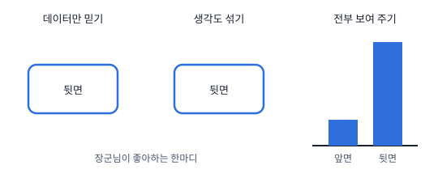

*그림은 수업의 단답 비유예요. 수학적으로는 세 방법 모두 예측확률을 낼 수 있고, 차이는 θ 한 점을 쓰는지 분포를 유지하는지예요.*

**정확히 말하면**

학습은 끝났고, 처음 보는(unseen) 데이터 $X$가 주어졌어요. 이때 이벤트 $A$(예: 개냐 고양이냐, 재밍이 있냐 없냐)를 예측하고 싶어요. 즉 구하려는 것은 $P(A\mid X)$예요.

1. **ML**: 데이터만 믿고 $\theta$를 하나로 정해요.

   $$
   \theta_{\text{ML}}=\arg\max_\theta P(X\mid\theta)
   $$

   $$
   P(A\mid X)\approx P(A\mid\theta_{\text{ML}})
   $$
2. **MAP**: 데이터에 prior(선입견, 편견, 의도)를 섞어 $\theta$를 하나로 정해요.

   $$
   \theta_{\text{MAP}}=\arg\max_\theta P(\theta\mid X)
   $$

   $$
   P(A\mid X)\approx P(A\mid\theta_{\text{MAP}})
   $$
3. **Fully Bayesian**: $\theta$를 하나로 정하지 않아요. posterior $P(\theta\mid X)$ 전체를 써서 예측해요.

   $$
   P(A\mid X)=\int P(A\mid\theta)P(\theta\mid X)\,d\theta
   $$

   식이 나오는 과정은 [보충: Posterior predictive와 조건부 독립](#s3-predictive)에서 이어서 봐요.

| 방법 | 파라미터 추론에서 남기는 것 | 예측에 쓰는 법 |
|---|---|---|
| ML | 우도를 크게 하는 θ 한 점 | 그 점을 조건부 관측 모형에 대입 |
| MAP | posterior 밀도가 높은 θ 한 점 | 그 점을 조건부 관측 모형에 대입 |
| Fully Bayesian | θ의 posterior 전체 | 조건부 예측을 posterior로 가중해 적분 |

ML과 MAP는 θ를 한 점으로 추정해요. 그 점을 확률모형에 넣으면 관측값의 예측분포도 얻을 수 있어요. FB는 가능한 θ들의 예측을 posterior로 가중해 합쳐 파라미터 불확실성도 반영해요. Yes/No 결정은 이렇게 얻은 확률에 별도의 결정 기준을 적용한 결과예요. 교수님의 단답 비유와 수학적 구분은 이렇게 연결해 읽어요.

MML 8.4.2도 같은 구분을 해요. ML·MAP의 핵심 계산은 최적화이고, Fully Bayesian의 핵심 계산은 적분이에요.

**교수님 말씀**

장군님은 복잡한 걸 싫어해요. 말이 길어지면 싫어하고, 정답을 단답형으로 요구해요.

> "우리 장군님은 정답을 단답형으로 요구해. Yes or No."

그런데 엔지니어, 데이터 사이언티스트 손에 있는 것은 Yes/No가 아니라 확률 밀도 함수 같은 원재료예요.

> "Fully Bayesian은 우리 같은 엔지니어들이 좋아하는 모델이에요, 복잡하긴 하지만."

> "ML이나 MAP은 단답형을 요구하는 장군님들이 좋아하시는 대답이에요."

교수님이 한 학생에게 동전을 던지면 앞면이냐 뒷면이냐고 물었어요. "앞면 0.5, 뒷면 0.5"라는 답에 교수님은 이렇게 말했어요. "말이 길잖아. 그런데 이게 정확한 대답이거든요. 이게 Fully Bayesian이야". 이어서 "말이 길다, 정답만 얘기해"라고 하면, 10번 중 앞면 2번이라는 데이터로 "뒷면"이라고 답하는 것이 ML이라고 했어요.

오늘은 요약본으로 설명하니, 지난 학기 확률 강의 영상을 꼭 찾아 보라고 당부했어요. "오늘 가서 꼭 … 강의 수강할 거야."

**페이지 요약**

ML과 MAP는 $\theta$ 하나로 단답을 내고, Fully Bayesian은 posterior 전체로 예측해요.

*핵심 식*

- ML

  $$
  \theta_{\text{ML}}=\arg\max_\theta P(X\mid\theta)
  $$
- MAP

  $$
  \theta_{\text{MAP}}=\arg\max_\theta P(\theta\mid X)
  $$
- Fully Bayesian

  $$
  P(A\mid X)=\int P(A\mid\theta)P(\theta\mid X)\,d\theta
  $$

*용어*

- **Fully Bayesian** — $\theta$를 하나로 정하지 않고 분포 전체로 예측하는 방식
- **점 추정(point estimate)** — $\theta$를 값 하나로 정하는 것(ML, MAP)

#### 조건·구분

ML은 likelihood 최적화, MAP은 prior를 반영한 posterior 최적화이고 둘 다 점 추정이에요. FB의 핵심 계산은 posterior로 가중한 적분이며, 표시한 예측식의 조건부 독립 가정은 뒤 보충에서 풀어요.

---

### 보충: 동전으로 보는 ML과 MAP

*0916 수업 · L02 s6*

**쉽게 말하면**

숫자만 보는 사람과 "내가 해 봐서 아는데" 하는 사람의 생각을 섞으면, 답은 둘 사이 어딘가에 놓여요.

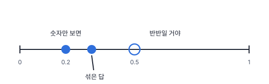

*숫자가 말하는 곳과 "반반일 거야"라는 생각 사이에 섞은 답이 와요.*

**정확히 말하면**

동전의 앞면 확률을 $\theta$라고 해요. 10번 던져 앞면 2번, 뒷면 8번이 나왔어요(0 = 앞면, 1 = 뒷면).

1. 앞면 횟수는 이항분포(binomial distribution)를 따라요. $\theta=0.5$라면 뒷면 횟수 분포는 5에서 봉우리가 서요.
2. 뒷면 8번이 가장 그럴듯하게 나오려면 $\theta$가 0.2여야 해요. 그래서

   $$
   \hat\theta_{\text{ML}}=0.2
   $$
3. MAP는 여기에 "모름지기 동전이면 반반"이라는 prior를 섞어요. 교수님은 그 결과를 앞면 확률 "0.3 정도"라고 했어요.

수업에서는 0.2가 미분으로 나온다는 것과 prior가 정확히 어떻게 반영되는지를 "나중에" 설명하기로 했어요. 그 계산은 이 토픽의 보충 레이어에 있어요.

**교수님 말씀**

영화 「머니볼」은 데이터 사이언티스트를 잘 써서 데이터로 야구를 한 팀 이야기예요. 데이터 사이언티스트는 본능적 감각 없이 데이터만 봐요. 이것이 ML이에요.

> "여러분 그 머니볼이라는 영화가 있어요."

MAP를 쓰는 사람은 "그래도 모름지기 동전이면 반반 아니겠어? 네 생각과 내 생각을 섞자"라고 말해요.

야구판 논쟁도 같아요. 기존 야구인은 "내가 해 봐서 아는데, 에이징 커브가 온 게 아니고 어제 술 먹은 거야"라고 해요. 데이터 사이언티스트는 "이미 꺾였는데요, 구속도 안 나오고요"라고 해요.

> "온전한 솔루션은 항상 그 사이에 있기는 해."

**보충 · 수업에서 유도하진 않았어요**

**ML: 미분해서 0.2 얻기.** likelihood에서 $\theta$와 무관한 상수 $\binom{10}{2}$는 빼요.

1. $$
   P(X\mid\theta)\propto\theta^{2}(1-\theta)^{8}
   $$
2. $$
   \log P(X\mid\theta)=2\log\theta+8\log(1-\theta)+\text{const}
   $$
3. $$
   \frac{2}{\theta} - \frac{8}{1-\theta} = 0
   $$
4. $$
   2(1-\theta)=8\theta\ \Rightarrow\ \hat\theta_{\text{ML}}=\frac{2}{10}=0.2
   $$

**MAP: Beta prior를 곱하기.** 확률값 $\theta\in[0,1]$의 prior로는 Beta 분포가 알맞아요(수업에서도 언급). "반반"이라는 믿음은 대칭인 $\text{Beta}(a,a)$로 쓰고, $a$가 클수록 믿음이 강해요.

1. $$
   P(\theta)\propto\theta^{a-1}(1-\theta)^{a-1}
   $$
2. $$
   P(\theta\mid X)\propto\theta^{2+a-1}(1-\theta)^{8+a-1}
   $$

   즉 posterior는 $\text{Beta}(2+a,\,8+a)$예요. posterior가 prior와 같은 Beta 꼴이고, 파라미터만 $a$에서 $2+a$, $8+a$로 바뀌어요(MML Example 6.11, Beta-Binomial).
3. $$
   \frac{1+a}{\theta}-\frac{7+a}{1-\theta}=0
   $$
4. $$
   \theta_{\text{MAP}}=\frac{2+a-1}{10+2a-2}
   $$

- $a=1$이면 prior가 uniform이라 $\theta_{\text{MAP}}=\frac{2}{10}=0.2$로 ML과 같아요([MAP = MLE + log prior](#s1-map)의 "MAP = MLE").
- $a=4$이면 $\theta_{\text{MAP}}=\frac{5}{16}=0.3125$로, 교수님이 말한 "0.3 정도"와 비슷해요. 수업에서 $a$ 값을 정하진 않았어요.
- $a$가 커질수록 $\theta_{\text{MAP}}$는 0.5 쪽으로 가요. 반대로 데이터가 많아지면(100번 중 앞면 20번, $a=4$면 $\frac{23}{106}\approx0.217$) 데이터 쪽으로 돌아와요.

#### 직접 해 보기: prior 강도와 MAP *(정적 스냅샷 — 직접 조작은 HTML 버전)*

prior 강도 a를 키우면 MAP 추정값이 ML 0.2에서 0.5 쪽으로 움직여요.

MAP 추정값 = (2 + a − 1) / (10 + 2a − 2) = **5/16 = 0.3125** (ML은 항상 0.2)

범례: likelihood(데이터) · prior Beta(a, a)(반반이라는 믿음) · posterior(섞은 결과) · 세로 점선: ML과 MAP 위치 · 곡선 높이는 모양 비교용으로 봉우리를 1에 맞췄어요

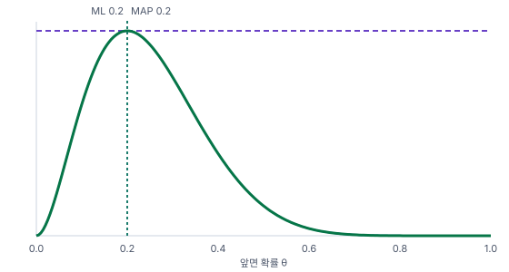

*a = 1 (uniform prior): MAP = ML = 0.2*

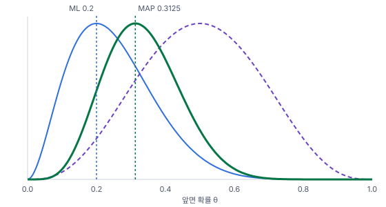

*a = 4: MAP = 5/16 = 0.3125*

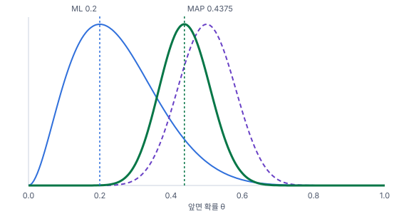

*a = 20: MAP = 21/48 = 7/16 = 0.4375*

| prior 강도 a | MAP 계산 | MAP 값 | ML 값 |
|---|---|---|---|
| 1 (uniform) | $\frac{2}{10}$ | 0.2 | 0.2 |
| 4 | $\frac{5}{16}$ | 0.3125 | 0.2 |
| 20 | $\frac{21}{48}=\frac{7}{16}$ | 0.4375 | 0.2 |

**페이지 요약**

ML은 데이터만 믿어 0.2를 내고, MAP는 "반반"이라는 prior를 섞어 그 사이 값을 내요.

*핵심 식*

- ML 조건

  $$
  \frac{2}{\theta} - \frac{8}{1-\theta} = 0
  $$
- ML 답

  $$
  \hat\theta_{\text{ML}}=0.2
  $$
- Beta(a, a) prior일 때 MAP

  $$
  \theta_{\text{MAP}}=\frac{2+a-1}{10+2a-2}
  $$

*용어*

- **Beta 분포(Beta distribution)** — 0과 1 사이 확률값 $\theta$에 대한 분포, $a$가 클수록 믿음이 강함

#### 조건·구분

보충의 대칭 Beta$(a,a)$ prior 계산은 수업에서 유도하지 않았어요. $a=1$이면 MAP도 0.2이고 $a=4$이면 $5/16=0.3125$예요. 수업의 “0.3 정도”는 $a=4$를 지정한 결과가 아니에요.

---

### 보충: Posterior predictive와 조건부 독립

*0916 수업 · L02 s6*

**쉽게 말하면**

후보 한 명의 말만 듣지 않고, 믿을 만한 만큼씩 모든 후보의 말을 섞어서 예측해요.

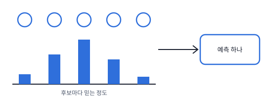

*막대가 높은 후보일수록 예측에 더 크게 들어가요.*

**정확히 말하면**

Fully Bayesian은 $\theta$ 하나를 고르지 않고 posterior 전체를 써서 예측해요. 이렇게 얻는 분포를 (posterior) predictive distribution이라고 해요. 그래서 full posterior $P(\theta\mid X)$가 있어야만 할 수 있어요.

1. $\theta$를 끼워 넣고 marginalize해요.

   $$
   P(A\mid X)=\int P(A,\theta\mid X)\,d\theta
   $$
2. 곱셈 규칙으로 나눠요.

   $$
   =\int P(A\mid\theta,X)P(\theta\mid X)\,d\theta
   $$
3. $\theta$가 주어지면 $X$의 영향은 사라진다고 봐요.

   $$
   P(A\mid\theta,X)=P(A\mid\theta)
   $$
4. 그래서

   $$
   P(A\mid X)=\int P(A\mid\theta)P(\theta\mid X)\,d\theta
   $$

3단계를 조건부 독립(conditional independence) 가정이라고 해요. 수업에서는 이 전개를 72:04에 훑기만 했고, 다음 시간에 자세히 다루기로 했어요.

**연속 분포는 어떻게 보고할까.** 앞면·뒷면처럼 값이 둘이면 확률 두 개로 말하면 돼요. 연속값이면 PDF 전체를 말로 설명하기 어려워요.

- predictive distribution을 가우시안으로 가정하면 파라미터 두 개로 말할 수 있어요. 예: "평균 7.8, 분산 3.2인 가우시안이에요."
- 봉우리가 여러 개면 가우시안 여러 개의 합, 즉 mixed Gaussian($\mu_1,\sigma_1,\mu_2,\sigma_2,\dots$)으로 설명해요.
- PDF를 mixed Gaussian으로 설명하는 대표 방법이 학기 말에 배울 EM(Expectation-Maximization) 알고리즘이에요.

**교수님 말씀**

엔지니어는 Yes/No가 아니라 분포라는 원재료를 모두 갖고 있어요.

> "우리는 원재료를 다 갖고 있거든."

PDF를 그대로 설명하면 말이 길어져서 모두 싫어해요. 그래서 가우시안처럼 숫자 두 개로 줄여 장군님께 보고해요.

> "세타가 주어지는 순간 x의 영향은 사라지는" likelihood라서 $X$를 생략해요.

**보충 · 수업에서 유도하진 않았어요**

**왜 $P(A\mid\theta,X)=P(A\mid\theta)$인가.** 슬라이드의 답은 조건부 독립 가정이에요. $\theta$가 주어지면 관측 $x_1,\dots,x_N$과 새 이벤트 $A$가 서로 독립이라고 둬요.

1. $$
   P(x_1,\dots,x_N,A\mid\theta)=\prod_{i=1}^{N}P(x_i\mid\theta)\cdot P(A\mid\theta)
   $$
2. $$
   P(A\mid\theta,X)=\frac{P(A,X\mid\theta)}{P(X\mid\theta)}=\frac{P(X\mid\theta)P(A\mid\theta)}{P(X\mid\theta)}=P(A\mid\theta)
   $$

**동전 예로 계산해 보기.** [보충: 동전으로 보는 ML과 MAP](#s3-coin)의 posterior $\text{Beta}(2+a,\,8+a)$를 써요. $A$ = "다음 번에 앞면"이면 $P(A\mid\theta)=\theta$예요.

1. $$
   P(A\mid X)=\int_0^1\theta\,P(\theta\mid X)\,d\theta=\frac{2+a}{10+2a}
   $$
2. $a=4$이면 $\frac{6}{18}\approx0.333$이에요. 같은 prior의 MAP는 0.3125, ML은 0.2예요.
3. $a=1$(uniform)이면 $\frac{3}{12}=0.25$로, ML과 MAP(둘 다 0.2)와도 달라요. 분포 전체를 평균낸 값이기 때문이에요.

**페이지 요약**

Fully Bayesian 예측은 posterior로 가중평균한 predictive distribution이고, 조건부 독립 덕분에 식이 간단해져요.

*핵심 식*

- posterior predictive

  $$
  P(A\mid X)=\int P(A\mid\theta)P(\theta\mid X)\,d\theta
  $$
- 조건부 독립

  $$
  P(A\mid\theta,X)=P(A\mid\theta)
  $$

*용어*

- **predictive distribution** — posterior 전체로 평균 내어 얻은 예측 분포
- **mixed Gaussian** — 봉우리가 여러 개인 분포를 가우시안 여러 개의 합으로 설명한 것

#### 조건·구분

$P(A\mid\theta,X)=P(A\mid\theta)$는 조건부 독립 **가정**이에요. 보충의 Beta posterior 예에서 $a=4$이면 다음 앞면 확률은 $1/3$으로 MAP $5/16$과 다르고, $a=1$에서도 예측 $1/4$은 ML·MAP $1/5$과 달라요. 이 상세 전개는 수업 밖 보충이에요.

---

## 4. 요약 · 예고

### 한 장 치트시트

*0916 수업 · L01 s14–17, L02 s3–6*

0916 수업의 치트시트예요. 주제 이름을 누르면 그 토픽으로 가요.

| 주제 | 핵심 식 | 한 줄 정리 |
|---|---|---|
| [Likelihood와 −log](#s0-nll) | $\mathcal{L}(\theta) = -\log P(x\mid\theta)$ | likelihood는 "그럴듯함"이에요. log는 단조 증가라서 최대화를 −log 최소화로 바꿔도 답이 같아요. |
| [i.i.d.로 곱을 합으로](#s0-iid) | $\mathcal{L}(\theta) = -\sum_{n=1}^{N}\log P(y_n\mid x_n,\theta)$ | i.i.d. 가정이면 곱이 되고, $\log(ab)=\log a+\log b$로 합이 돼요. |
| [MLE = Least Squares](#s0-mle-ls) | $y_n = x_n^\top\theta + \epsilon,\ \epsilon\sim\mathcal{N}(0,\sigma^2)$ | 가우시안 노이즈면 NLL이 $\Vert y-X\theta\Vert ^2$에 비례해요. |
| [Posterior와 베이즈 룰](#s1-posterior) | $P(\theta\mid x)\propto P(x\mid\theta)P(\theta)$ | 데이터를 본 뒤의 확률(사후)이에요. 분모 $P(x)$는 $\theta$와 무관해요. |
| [MAP](#s1-map) | $\theta_{\text{MAP}}=\arg\min_\theta\big[-\log P(x\mid\theta)-\log P(\theta)\big]$ | MAP = MLE + log prior예요. 같은 지지집합 안에서 prior가 uniform이면 MAP = MLE예요. |
| [가우시안 prior = L2 정규화](#s1-map-reg) | $\lambda = \frac{\sigma^2}{N b^2}$ | prior $\mathcal{N}(0, b^2 I)$를 넣으면 $\lambda\Vert \theta\Vert ^2$ 항이 생겨요. |
| [Model fitting](#s1-fitting) | $M^*$ vs $M_{\theta^*}$ | 데이터 수에 비해 모델(파라미터 수)이 너무 크면 overfitting, 너무 작으면 underfitting이에요. |
| [Generative process](#s2-generative) | $y_n\sim\mathcal{N}(c_n,\sigma^2),\ c_n = x_n^\top\theta$ | 데이터가 "이렇게 만들어졌을 거야"라고 과정을 가정해요. |
| [Joint · Marginal · Latent](#s2-joint) | $P(x,\theta)=P(x\mid\theta)P(\theta)$ | joint distribution이 가장 많은 정보를 담아요. $\theta$는 숨은(latent) 변수예요. |
| [Marginal likelihood와 posterior](#s2-posterior) | $P(x)=\int P(x\mid\theta)P(\theta)\,d\theta$ | joint를 $\theta$로 적분하면 분모가 되고, 나누면 posterior예요. |
| [ML · MAP · Fully Bayesian](#s3-three-ways) | $\theta_{\text{ML}}=\arg\max_\theta P(X\mid\theta)$ | ML과 MAP은 $\theta$ 하나를 골라요. Fully Bayesian은 분포 전체를 써요. |
| [동전 예시](#s3-coin) | $\hat\theta_{\text{ML}}=0.2$ | 10번 중 앞면 2번이면 ML은 0.2예요. MAP은 prior 쪽으로 당겨져 0.2보다 커요. |
| [Posterior predictive](#s3-predictive) | $P(A\mid X)=\int P(A\mid\theta)P(\theta\mid X)\,d\theta$ | 조건부 독립 가정으로 $P(A\mid\theta,X)=P(A\mid\theta)$가 돼요. |
| 복원 순서 | 우도 → prior를 곱해 posterior의 모양 → MAP은 최고점, FB는 전체 분포. 예측의 Yes/No와 θ의 점 추정은 구별해요. |  |

---

### 다음 시간 예고 (아직 안 배움)

*0916 수업 · L02 s7–19*

수업은 L02 s6에서 끝났어요. 아래 슬라이드는 아직 다루지 않았어요.

- L02 s6 뒷부분: Fully Bayesian 예측식과 조건부 독립은 "다음 시간에 조금 더 자세히" 다시 설명한다고 했어요.
- L02 s7 (Fully) Bayesian Inference: Hardness (MCMC)
- L02 s8 Roadmap
- L02 s9 Graphical Models
- L02 s10 Graph Semantics
- L02 s11 Example: N Coin-Flip Experiments
- L02 s12 Conditional Independence & d-separation
- L02 s13 Example (d-separation)
- L02 s14 Example in Healthcare
- L02 s15 Three Types of Graphical Models
- L02 s16 Roadmap
- L02 s17 Nested Cross-Validation
- L02 s18 Bayesian Model Selection
- L02 s19 Bayes Factors for Model Comparison (Bayes factor)

---

### 함께 보면 좋은 자료

*0916 수업*

- [복습문제 풀러 가기 (0916 수업 범위 6문제)](복습문제_0916_MAP_and_Generative_Models.md)
- [지난 시간 0914 정리노트: ERM and MLE](../../0914/정리노트_0914_ERM_and_MLE.html)
- [추가 강의 Lecture 10: Statistical Inference Part 1](../../../강의노트/추가%20강의/eli5_lecture10_statistical_inference_part1.html)
- [추가 강의 Lecture 11: Statistical Inference Part 2](../../../강의노트/추가%20강의/eli5_lecture11_statistical_inference_part2.html)
- [추가 강의 Lecture 12: Statistical Inference Part 3](../../../강의노트/추가%20강의/eli5_lecture12_statistical_inference_part3.html)

복습문제 6문항

- [문제지 PDF](../복습문제_0916_MAP_and_Generative_Models-문제.pdf)
- [해설지 PDF](../복습문제_0916_MAP_and_Generative_Models-답안.pdf)

---

출처: 정방철 교수님 강의자료(Lecture01–02) · 수업 녹음 전사(0916) · Deisenroth, Faisal, Ong, *Mathematics for Machine Learning* (2020) 8장.
