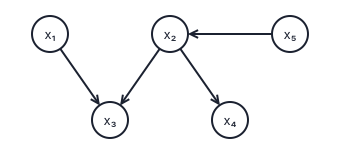

# 복습문제 6선 — 0921 수업 범위

MML 8장 방향 그래피컬 모델 본문 예제를 문제로 바꾼 4문제와 6장 연습문제 2문제로 구성했어요. 먼저 풀어 보고, 막히면 힌트를 열어 보세요.

> `복습문제_0921_Bayesian_Inference_Model_Selection.html`를 마크다운으로 옮겼어요. 원문, 힌트, 풀이는 접혀 있어요. 먼저 풀어 보고 펼쳐 보세요.

**목차**

- [A. 교과서 본문 예제 (MML 8장)](#partA)
  - [P1. 인수분해에서 의존 관계 읽기](#p1)
  - [P2. 인수분해로 방향 그래프 그리기](#p2)
  - [P3. 그래프에서 조건부 분포와 부모 찾기](#p3)
  - [P4. 그래프에서 결합분포 인수분해 쓰기](#p4)
- [B. 교과서 연습문제](#partB)
  - [P5. 망고는 어느 가방에서 나왔을까](#p5)
  - [P6. 반복 기댓값 법칙 보이기](#p6)

## A. 교과서 본문 예제 (MML 8장)

### P1. 인수분해에서 의존 관계 읽기

세 확률변수 $a, b, c$의 결합분포가 아래처럼 인수분해돼 있어요.

$$
p(a, b, c) = p(c \mid a, b)\, p(b \mid a)\, p(a)
$$

이 식만 보고 각 변수가 어느 변수에 직접 의존하는지 적어 보세요.

- (a) $c$는 어느 변수에 직접 의존하나요?
- (b) $b$는 어느 변수에 직접 의존하나요?
- (c) $a$는 어느 변수에 의존하나요?

교과서 원문 보기

"c depends directly on a and b. b depends directly on a." — Example 8.7

힌트 보기

각 조건부 분포에서 세로 막대 오른쪽, 즉 조건으로 붙은 변수가 그 변수가 직접 기대는 변수예요.

풀이 보기

1. 인수분해를 조각으로 나눠요: $p(c \mid a, b)$, $p(b \mid a)$, $p(a)$.
2. $p(c \mid a, b)$에서 $c$의 조건은 $a$와 $b$예요. 그래서 $c$는 $a$와 $b$에 직접 의존해요.
3. $p(b \mid a)$에서 $b$의 조건은 $a$ 하나예요. 그래서 $b$는 $a$에 직접 의존해요.
4. $p(a)$에는 조건이 없어요. 그래서 $a$는 $b$에도 $c$에도 의존하지 않아요.

**정답:** (a) $c$는 $a$와 $b$에 직접 의존 (b) $b$는 $a$에 직접 의존 (c) $a$는 $b$와 $c$ 어느 쪽에도 의존하지 않음

---

### P2. 인수분해로 방향 그래프 그리기

세 확률변수 $a, b, c$의 결합분포가 아래처럼 인수분해돼 있어요.

$$
p(a, b, c) = p(c \mid a, b)\, p(b \mid a)\, p(a)
$$

이 인수분해에 맞는 방향 그래피컬 모델을 그려 보세요.

- (a) 화살표를 모두 "출발 $\to$ 도착" 꼴로 적어 보세요.
- (b) 화살표는 모두 몇 개인가요? 세 노드의 모든 쌍이 이어져 있나요?

교과서 원문 보기

"For the factorization in (8.29), we obtain the directed graphical model in Figure 8.9(a)." — Example 8.7

힌트 보기

변수마다 노드를 하나 두고, 조건으로 붙은 변수에서 그 변수로 화살표를 그어요.

풀이 보기

1. 노드 $a$, $b$, $c$를 하나씩 둬요.
2. $p(c \mid a, b)$: $c$가 $a$와 $b$에 직접 의존하니 $a \to c$, $b \to c$를 그어요.
3. $p(b \mid a)$: $b$가 $a$에 직접 의존하니 $a \to b$를 그어요.
4. $p(a)$: 조건이 없으니 $a$로 들어오는 화살표는 없어요.
5. 화살표는 $a \to b$, $a \to c$, $b \to c$로 모두 $3$개예요. 세 노드 쌍 $(a,b)$, $(a,c)$, $(b,c)$가 모두 이어져 있어서 fully connected 그래프예요.

**정답:** (a) $a \to b$, $a \to c$, $b \to c$ (b) $3$개, 모든 쌍이 이어진 fully connected 그래프

---

### P3. 그래프에서 조건부 분포와 부모 찾기

다섯 확률변수 $x_1, \dots, x_5$의 방향 그래피컬 모델이 아래와 같아요.

*다섯 노드 방향 그래프: x₁→x₃, x₂→x₃, x₅→x₂, x₂→x₄*

결합분포 $p(x_1, \dots, x_5)$를 조건부 분포의 곱으로 쓰려고 해요.

- (a) 조건부 분포가 몇 개 필요한가요?
- (b) 각 노드의 부모(parent)를 모두 적어 보세요.
- (c) $x_4$에 해당하는 조건부 분포를 적어 보세요.

교과서 원문 보기

"we will need five conditionals ... x4 will be conditioned on x2." — Example 8.8

힌트 보기

노드마다 조건부 분포가 하나씩 있어요. 각 노드의 조건은 그 노드로 화살표를 보내는 노드, 즉 부모뿐이에요.

풀이 보기

1. 노드가 $x_1, \dots, x_5$로 다섯 개이니 조건부 분포도 $5$개가 필요해요.
2. 들어오는 화살표를 노드마다 세어요. $x_1$과 $x_5$에는 들어오는 화살표가 없어서 부모가 없어요.
3. $x_5 \to x_2$뿐이니 $x_2$의 부모는 $x_5$예요.
4. $x_1 \to x_3$, $x_2 \to x_3$이니 $x_3$의 부모는 $x_1, x_2$예요.
5. $x_2 \to x_4$뿐이니 $x_4$의 부모는 $x_2$이고, 조건부 분포는 $p(x_4 \mid x_2)$예요.

**정답:** (a) $5$개 (b) $x_1$, $x_5$: 부모 없음 / $x_2$: $x_5$ / $x_3$: $x_1, x_2$ / $x_4$: $x_2$ (c) $p(x_4 \mid x_2)$

---

### P4. 그래프에서 결합분포 인수분해 쓰기

다섯 확률변수 $x_1, \dots, x_5$의 방향 그래피컬 모델이 아래와 같아요.

*다섯 노드 방향 그래프: x₁→x₃, x₂→x₃, x₅→x₂, x₂→x₄*

결합분포 $p(x_1, x_2, x_3, x_4, x_5)$를 노드마다 조건부 분포 하나씩의 곱으로 인수분해해 보세요.

교과서 원문 보기

"These two properties yield the desired factorization of the joint distribution" — Example 8.8

힌트 보기

노드마다 $p(\text{노드} \mid \text{부모})$를 하나씩 만들어 모두 곱해요. 부모가 없으면 조건 없이 $p(\text{노드})$로 써요.

풀이 보기

1. 들어오는 화살표로 부모를 찾아요: $x_1$, $x_5$는 부모 없음, $x_2$는 $x_5$, $x_3$은 $x_1$과 $x_2$, $x_4$는 $x_2$예요.
2. 부모가 없는 노드는 $p(x_1)$, $p(x_5)$로 써요.
3. 나머지는 $p(x_2 \mid x_5)$, $p(x_3 \mid x_1, x_2)$, $p(x_4 \mid x_2)$로 써요.
4. 다섯 개를 모두 곱하면 결합분포가 돼요.

   $$
   p(x_1, x_2, x_3, x_4, x_5) = p(x_1)\, p(x_5)\, p(x_2 \mid x_5)\, p(x_3 \mid x_1, x_2)\, p(x_4 \mid x_2)
   $$

**정답:** $p(x_1, x_2, x_3, x_4, x_5) = p(x_1)\, p(x_5)\, p(x_2 \mid x_5)\, p(x_3 \mid x_1, x_2)\, p(x_4 \mid x_2)$

---

## B. 교과서 연습문제

### P5. 망고는 어느 가방에서 나왔을까

가방이 두 개 있어요. 가방 1에는 망고 $4$개와 사과 $2$개, 가방 2에는 망고 $4$개와 사과 $4$개가 들어 있어요. 앞면이 나올 확률이 $0.6$, 뒷면이 나올 확률이 $0.4$인 동전이 있어요. 앞면이면 가방 1에서, 뒷면이면 가방 2에서 과일 하나를 무작위로 꺼내요. 친구가 동전을 던지고(결과는 안 보여요) 해당 가방에서 과일을 꺼내 망고를 보여 줬어요. 이 망고가 가방 2에서 나왔을 확률을 구해 보세요.

교과서 원문 보기

"What is the probability that the mango was picked from bag 2?" — Exercise 6.4

힌트 보기

베이즈 정리를 써요. 먼저 망고가 나올 전체 확률 $P(\text{망고})$를 두 가방에 걸쳐 더해 구해요.

풀이 보기

1. 사전확률: $P(\text{가방 1}) = 0.6 = \frac{3}{5}$, $P(\text{가방 2}) = 0.4 = \frac{2}{5}$예요.
2. 우도: $P(\text{망고} \mid \text{가방 1}) = \frac{4}{6} = \frac{2}{3}$, $P(\text{망고} \mid \text{가방 2}) = \frac{4}{8} = \frac{1}{2}$예요.
3. 전체 확률: $P(\text{망고}) = \frac{3}{5} \cdot \frac{2}{3} + \frac{2}{5} \cdot \frac{1}{2} = \frac{2}{5} + \frac{1}{5} = \frac{3}{5}$예요.
4. 베이즈 정리: $P(\text{가방 2} \mid \text{망고}) = \dfrac{\frac{2}{5} \cdot \frac{1}{2}}{\frac{3}{5}} = \dfrac{\frac{1}{5}}{\frac{3}{5}} = \frac{1}{3}$이에요.
5. 오즈로 한 번 더 확인해요. prior odds는 $\frac{0.6}{0.4} = \frac{3}{2}$, Bayes factor는 $\frac{2/3}{1/2} = \frac{4}{3}$이라서 posterior odds는 $\frac{3}{2} \cdot \frac{4}{3} = 2$예요. 가방 1 : 가방 2 $= 2 : 1$이니 가방 2일 확률은 $\frac{1}{3}$, 가방 1일 확률은 $\frac{2}{3}$로 같아요.

**정답:** $\frac{1}{3}$

---

### P6. 반복 기댓값 법칙 보이기

결합분포가 $p(x, y)$인 두 연속 확률변수 $X, Y$가 있어요. $\mathbb{E}_X[x \mid y]$는 조건부 분포 $p(x \mid y)$ 아래에서 구한 $x$의 기댓값이에요. 다음 등식이 성립함을 보여 보세요.

$$
\mathbb{E}_X[x] = \mathbb{E}_Y[\mathbb{E}_X[x \mid y]]
$$

교과서 원문 보기

"Iterated Expectations. Consider two random variables x, y with joint distribution p(x, y)." — Exercise 6.11

힌트 보기

안쪽 기댓값을 적분으로 풀어 쓰고, 곱셈 규칙으로 $p(x \mid y)\, p(y)$를 합쳐요. 마지막에 $y$를 적분해서 없애요. 이중적분의 순서를 바꿔도 된다는 점을 써요.

풀이 보기

1. 조건부 기댓값의 정의로 안쪽을 써요: $\mathbb{E}_X[x \mid y] = \int x\, p(x \mid y)\, dx$. 이 값은 $y$의 함수예요.
2. 바깥 기댓값은 이 함수를 $p(y)$로 가중 평균한 거예요.

   $$
   \mathbb{E}_Y[\mathbb{E}_X[x \mid y]] = \int \left( \int x\, p(x \mid y)\, dx \right) p(y)\, dy
   $$
3. 곱셈 규칙 $p(x, y) = p(x \mid y)\, p(y)$로 두 밀도를 합쳐요.

   $$
   = \int \int x\, p(x, y)\, dx\, dy
   $$
4. 적분 순서를 바꿔 $y$부터 적분해요. 주변화 $\int p(x, y)\, dy = p(x)$를 쓰면

   $$
   = \int x \left( \int p(x, y)\, dy \right) dx = \int x\, p(x)\, dx
   $$
5. 마지막 식은 $x$의 기댓값의 정의 그대로예요. 그래서 $\mathbb{E}_X[x] = \mathbb{E}_Y[\mathbb{E}_X[x \mid y]]$가 성립해요.

**정답:** $\mathbb{E}_Y[\mathbb{E}_X[x \mid y]] = \int \int x\, p(x \mid y)\, p(y)\, dx\, dy = \int \int x\, p(x, y)\, dx\, dy = \int x\, p(x)\, dx = \mathbb{E}_X[x]$

---

출처: Deisenroth, Faisal, Ong, *Mathematics for Machine Learning* (Cambridge University Press, 2020). 풀이는 자체 작성이며 수치는 Python으로 검증했습니다.
