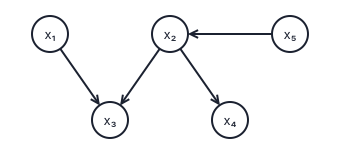

# 머신러닝기초 복습 0921 문제설명

주어진 조건을 읽고, 첫 줄을 쓰고, 이유를 따라가며 답을 확인해요.

문제의 첫 줄부터 검산까지 설명해요.

**목차**

- [문항별 설명](#problems)
  - [P1. 인수분해에서 의존 관계 읽기](#p1)
  - [P2. 인수분해로 방향 그래프 그리기](#p2)
  - [P3. 그래프에서 조건부 분포와 부모 찾기](#p3)
  - [P4. 그래프에서 결합분포 인수분해 쓰기](#p4)
  - [P5. 망고는 어느 가방에서 나왔을까](#p5)
  - [P6. 반복 기댓값 법칙 보이기](#p6)

## 문항별 설명

### P1. 인수분해에서 의존 관계 읽기

MML Example 8.7 · [원 문제 보기](%EB%B3%B5%EC%8A%B5%EB%AC%B8%EC%A0%9C_0921_Bayesian_Inference_Model_Selection.html#p1)

#### 주어진 조건

세 확률변수 $a, b, c$의 결합분포가 아래처럼 인수분해돼 있어요.

$$
p(a, b, c) = p(c \mid a, b)\, p(b \mid a)\, p(a)
$$

#### 구할 것

이 식만 보고 각 변수가 어느 변수에 직접 의존하는지 적어 보세요.

- (a) $c$는 어느 변수에 직접 의존하나요?
- (b) $b$는 어느 변수에 직접 의존하나요?
- (c) $a$는 어느 변수에 의존하나요?

#### 무엇을 구하는 문제인가요?

인수분해에서 의존 관계 읽기를 주어진 조건에서 차례로 구해요. 원문 아래의 각 소문항이 모두 풀이 대상이에요.

#### 이 문제를 봤을 때 떠올릴 개념과 공식

방향 그래피컬 모델(DAG)의 인수는 $p(v\mid pa(v))$예요. pa는 그래프에서 바로 들어오는 부모예요. 조건 목록을 읽는 것은 통계적 독립을 모두 판정하는 것과 달라요.

#### 종이에 적을 첫 줄

$pa(c)=\{a,b\}$, $pa(b)=\{a\}$, $pa(a)=\varnothing$예요.

#### 왜 이렇게 푸는지 함께 따라가요

인수분해를 조각으로 나눠요: $p(c \mid a, b)$, $p(b \mid a)$, $p(a)$.

$p(c \mid a, b)$에서 $c$의 조건은 $a$와 $b$예요. 그래서 $c$는 $a$와 $b$에 직접 의존해요.

$p(b \mid a)$에서 $b$의 조건은 $a$ 하나예요. 그래서 $b$는 $a$에 직접 의존해요.

$p(a)$에는 조건이 없어요. 그래서 그래프에서 $a$의 부모는 없어요. 이는 $a$가 $b,c$와 통계적으로 독립이라는 뜻은 아니에요.

#### (a)

p(c|a,b)의 조건이 a,b라서 두 부모예요. 실제 확률 의존의 강도는 분포 값에 따라 달라져요.

#### (b)

p(b|a)의 조건이 a이므로 부모는 a예요.

#### (c)

p(a)는 부모가 없는 루트의 인수예요. 이는 a와 b,c의 주변 독립을 뜻하지 않아요.

#### 완성 답과 검산

#### (a) 검산

p(c|a,b)의 조건이 a,b라서 두 부모예요. 실제 확률 의존의 강도는 분포 값에 따라 달라져요.

#### (b) 검산

p(b|a)의 조건이 a이므로 부모는 a예요.

#### (c) 검산

p(a)는 부모가 없는 루트의 인수예요. 이는 a와 b,c의 주변 독립을 뜻하지 않아요.

정답: (a) $c$는 $a$와 $b$에 직접 의존 (b) $b$는 $a$에 직접 의존 (c) $a$는 $b$와 $c$ 어느 쪽에도 의존하지 않음

원 참고 답에서 “의존하지 않음”은 부모가 없다는 뜻으로 한정해 읽어요. 결합분포의 통계적 독립과 구별해요.

#### 여기서 주의해요

부모가 없는 a도 자식 b,c와 관련될 수 있어요. “부모 없음”을 “모든 변수와 독립”으로 바꾸지 않아요.

#### 설명을 닫고 다시 해요

1. $pa(c)=\{a,b\}$, $pa(b)=\{a\}$, $pa(a)=\varnothing$예요.
2. 각 소문항의 계산과 이유를 직접 적어요.
3. 부모가 없는 a도 자식 b,c와 관련될 수 있어요. “부모 없음”을 “모든 변수와 독립”으로 바꾸지 않아요.

**페이지 요약**

#### 떠올릴 개념·공식

방향 그래피컬 모델(DAG)의 인수는 $p(v\mid pa(v))$예요.

#### 첫 줄

$pa(c)=\{a,b\}$, $pa(b)=\{a\}$, $pa(a)=\varnothing$예요.

#### 검산

p(c|a,b)의 조건이 a,b라서 두 부모예요. 실제 확률 의존의 강도는 분포 값에 따라 달라져요. p(b|a)의 조건이 a이므로 부모는 a예요. p(a)는 부모가 없는 루트의 인수예요. 이는 a와 b,c의 주변 독립을 뜻하지 않아요.

---

### P2. 인수분해로 방향 그래프 그리기

MML Example 8.7 · [원 문제 보기](%EB%B3%B5%EC%8A%B5%EB%AC%B8%EC%A0%9C_0921_Bayesian_Inference_Model_Selection.html#p2)

#### 주어진 조건

세 확률변수 $a, b, c$의 결합분포가 아래처럼 인수분해돼 있어요.

$$
p(a, b, c) = p(c \mid a, b)\, p(b \mid a)\, p(a)
$$

#### 구할 것

이 인수분해에 맞는 방향 그래피컬 모델을 그려 보세요.

- (a) 화살표를 모두 "출발 $\to$ 도착" 꼴로 적어 보세요.
- (b) 화살표는 모두 몇 개인가요? 세 노드의 모든 쌍이 이어져 있나요?

#### 무엇을 구하는 문제인가요?

인수분해로 방향 그래프 그리기를 주어진 조건에서 차례로 구해요. 원문 아래의 각 소문항이 모두 풀이 대상이에요.

#### 이 문제를 봤을 때 떠올릴 개념과 공식

DAG에서는 조건에 있는 부모에서 인수의 대상으로 화살표를 그려요. $p(c\mid a,b)$는 a→c와 b→c예요. 이 모델의 연결 구조를 묻는 문제예요.

#### 종이에 적을 첫 줄

노드 a,b,c를 적고 a→b부터 그려요.

#### 왜 이렇게 푸는지 함께 따라가요

노드 $a$, $b$, $c$를 하나씩 둬요.

$p(c \mid a, b)$: $c$가 $a$와 $b$에 직접 의존하니 $a \to c$, $b \to c$를 그어요.

$p(b \mid a)$: $b$가 $a$에 직접 의존하니 $a \to b$를 그어요.

$p(a)$: 조건이 없으니 $a$로 들어오는 화살표는 없어요.

화살표는 $a \to b$, $a \to c$, $b \to c$로 모두 $3$개예요. 세 노드 쌍 $(a,b)$, $(a,c)$, $(b,c)$가 모두 이어져 있어서 fully connected 그래프예요.

#### (a)

부모 목록을 복원하면 a→b,a→c,b→c 세 간선이에요.

#### (b)

쌍{a,b},{a,c},{b,c}마다 한 간선이라3개예요. 위상순서 a,b,c가 있어 순환은 없어요.

#### 완성 답과 검산

#### (a) 검산

부모 목록을 복원하면 a→b,a→c,b→c 세 간선이에요.

#### (b) 검산

쌍{a,b},{a,c},{b,c}마다 한 간선이라3개예요. 위상순서 a,b,c가 있어 순환은 없어요.

정답: (a) $a \to b$, $a \to c$, $b \to c$ (b) $3$개, 모든 쌍이 이어진 fully connected 그래프

#### 여기서 주의해요

p(c|a,b)를 c→a,b로 거꾸로 그리지 않아요. 인수분해만으로 인과관계를 증명한 것도 아니에요.

#### 설명을 닫고 다시 해요

1. 노드 a,b,c를 적고 a→b부터 그려요.
2. 각 소문항의 계산과 이유를 직접 적어요.
3. p(c|a,b)를 c→a,b로 거꾸로 그리지 않아요. 인수분해만으로 인과관계를 증명한 것도 아니에요.

**페이지 요약**

#### 떠올릴 개념·공식

DAG에서는 조건에 있는 부모에서 인수의 대상으로 화살표를 그려요. $p(c\mid a,b)$는 a→c와 b→c예요.

#### 첫 줄

노드 a,b,c를 적고 a→b부터 그려요.

#### 검산

부모 목록을 복원하면 a→b,a→c,b→c 세 간선이에요. 쌍{a,b},{a,c},{b,c}마다 한 간선이라3개예요. 위상순서 a,b,c가 있어 순환은 없어요.

---

### P3. 그래프에서 조건부 분포와 부모 찾기

MML Example 8.8 · [원 문제 보기](%EB%B3%B5%EC%8A%B5%EB%AC%B8%EC%A0%9C_0921_Bayesian_Inference_Model_Selection.html#p3)

#### 주어진 조건

다섯 확률변수 $x_1, \dots, x_5$의 방향 그래피컬 모델이 아래와 같아요.

#### 구할 것

결합분포 $p(x_1, \dots, x_5)$를 조건부 분포의 곱으로 쓰려고 해요.

- (a) 조건부 분포가 몇 개 필요한가요?
- (b) 각 노드의 부모(parent)를 모두 적어 보세요.
- (c) $x_4$에 해당하는 조건부 분포를 적어 보세요.

*다섯 노드 방향 그래프: x₁→x₃, x₂→x₃, x₅→x₂, x₂→x₄*

#### 무엇을 구하는 문제인가요?

그래프에서 조건부 분포와 부모 찾기를 주어진 조건에서 차례로 구해요. 원문 아래의 각 소문항이 모두 풀이 대상이에요.

#### 이 문제를 봤을 때 떠올릴 개념과 공식

노드별 조건부 분포(node conditional)는 노드 하나에 하나씩이에요. 부모는 바로 들어오는 화살표의 출발점이고 조상 전체가 아니에요.

#### 종이에 적을 첫 줄

첫 행은 $x_1: pa(x_1)=\varnothing$으로 적고 나머지 노드를 채워요.

#### 왜 이렇게 푸는지 함께 따라가요

노드가 $x_1, \dots, x_5$로 다섯 개이니 조건부 분포도 $5$개가 필요해요.

들어오는 화살표를 노드마다 세어요. $x_1$과 $x_5$에는 들어오는 화살표가 없어서 부모가 없어요.

$x_5 \to x_2$뿐이니 $x_2$의 부모는 $x_5$예요.

$x_1 \to x_3$, $x_2 \to x_3$이니 $x_3$의 부모는 $x_1, x_2$예요.

$x_2 \to x_4$뿐이니 $x_4$의 부모는 $x_2$이고, 조건부 분포는 $p(x_4 \mid x_2)$예요.

#### (a)

노드5개를 빠짐없이 한 번씩 세므로 인수5개예요.

#### (b)

그림의 간선 x5→x2,x1→x3,x2→x3,x2→x4에서 부모를 역으로 읽어요.

#### (c)

x4로 오는 간선은 x2→x4 하나이므로 p(x4|x2)예요.

#### 완성 답과 검산

#### (a) 검산

노드5개를 빠짐없이 한 번씩 세므로 인수5개예요.

#### (b) 검산

그림의 간선 x5→x2,x1→x3,x2→x3,x2→x4에서 부모를 역으로 읽어요.

#### (c) 검산

x4로 오는 간선은 x2→x4 하나이므로 p(x4|x2)예요.

정답: (a) $5$개 (b) $x_1$, $x_5$: 부모 없음 / $x_2$: $x_5$ / $x_3$: $x_1, x_2$ / $x_4$: $x_2$ (c) $p(x_4 \mid x_2)$

#### 여기서 주의해요

x3의 조상 x5를 직접 부모 목록에 덧붙이지 않아요.

#### 설명을 닫고 다시 해요

1. 첫 행은 $x_1: pa(x_1)=\varnothing$으로 적고 나머지 노드를 채워요.
2. 각 소문항의 계산과 이유를 직접 적어요.
3. x3의 조상 x5를 직접 부모 목록에 덧붙이지 않아요.

**페이지 요약**

#### 떠올릴 개념·공식

노드별 조건부 분포(node conditional)는 노드 하나에 하나씩이에요.

#### 첫 줄

첫 행은 $x_1: pa(x_1)=\varnothing$으로 적고 나머지 노드를 채워요.

#### 검산

노드5개를 빠짐없이 한 번씩 세므로 인수5개예요. 그림의 간선 x5→x2,x1→x3,x2→x3,x2→x4에서 부모를 역으로 읽어요. x4로 오는 간선은 x2→x4 하나이므로 p(x4|x2)예요.

---

### P4. 그래프에서 결합분포 인수분해 쓰기

MML Example 8.8 · [원 문제 보기](%EB%B3%B5%EC%8A%B5%EB%AC%B8%EC%A0%9C_0921_Bayesian_Inference_Model_Selection.html#p4)

#### 주어진 조건

다섯 확률변수 $x_1, \dots, x_5$의 방향 그래피컬 모델이 아래와 같아요.

#### 구할 것

결합분포 $p(x_1, x_2, x_3, x_4, x_5)$를 노드마다 조건부 분포 하나씩의 곱으로 인수분해해 보세요.

*다섯 노드 방향 그래프: x₁→x₃, x₂→x₃, x₅→x₂, x₂→x₄*

#### 무엇을 구하는 문제인가요?

그래프에서 결합분포 인수분해 쓰기를 주어진 조건에서 차례로 구해요. 원문 아래의 각 소문항이 모두 풀이 대상이에요.

#### 이 문제를 봤을 때 떠올릴 개념과 공식

베이지안 네트워크(Bayesian network)는 결합밀도를 노드별 조건부의 곱으로 표현해요. $p(\mathbf x)=\prod_i p(x_i\mid pa(x_i))$이며 부모 없는 노드는 주변 인수로 써요.

#### 종이에 적을 첫 줄

$p(x_1)p(x_5)$부터 적고 세 조건부 인수를 붙여요.

#### 왜 이렇게 푸는지 함께 따라가요

#### 풀이

들어오는 화살표로 부모를 찾아요: $x_1$, $x_5$는 부모 없음, $x_2$는 $x_5$, $x_3$은 $x_1$과 $x_2$, $x_4$는 $x_2$예요.

부모가 없는 노드는 $p(x_1)$, $p(x_5)$로 써요.

나머지는 $p(x_2 \mid x_5)$, $p(x_3 \mid x_1, x_2)$, $p(x_4 \mid x_2)$로 써요.

다섯 개를 모두 곱하면 결합분포가 돼요.

$$
p(x_1, x_2, x_3, x_4, x_5) = p(x_1)\, p(x_5)\, p(x_2 \mid x_5)\, p(x_3 \mid x_1, x_2)\, p(x_4 \mid x_2)
$$

#### 완성 답과 검산

#### 검산

위상순서 x1,x5,x2,x3,x4에 맞게 각각 한 인수가 있어요. 역순으로 적분하면 각 조건부가1이 되어 전체 정규화도1이에요.

정답: $p(x_1, x_2, x_3, x_4, x_5) = p(x_1)\, p(x_5)\, p(x_2 \mid x_5)\, p(x_3 \mid x_1, x_2)\, p(x_4 \mid x_2)$

#### 여기서 주의해요

같은 노드를 두 인수의 대상으로 쓰거나 하나 빼먹지 않아요.

#### 설명을 닫고 다시 해요

1. $p(x_1)p(x_5)$부터 적고 세 조건부 인수를 붙여요.
2. 각 소문항의 계산과 이유를 직접 적어요.
3. 같은 노드를 두 인수의 대상으로 쓰거나 하나 빼먹지 않아요.

**페이지 요약**

#### 떠올릴 개념·공식

베이지안 네트워크(Bayesian network)는 결합밀도를 노드별 조건부의 곱으로 표현해요. $p(\mathbf x)=\prod_i p(x_i\mid pa(x_i))$

#### 첫 줄

$p(x_1)p(x_5)$부터 적고 세 조건부 인수를 붙여요.

#### 검산

위상순서 x1,x5,x2,x3,x4에 맞게 각각 한 인수가 있어요. 역순으로 적분하면 각 조건부가1이 되어 전체 정규화도1이에요.

---

### P5. 망고는 어느 가방에서 나왔을까

MML Exercise 6.4 · [원 문제 보기](%EB%B3%B5%EC%8A%B5%EB%AC%B8%EC%A0%9C_0921_Bayesian_Inference_Model_Selection.html#p5)

#### 주어진 조건

가방이 두 개 있어요. 가방 1에는 망고 $4$개와 사과 $2$개, 가방 2에는 망고 $4$개와 사과 $4$개가 들어 있어요. 앞면이 나올 확률이 $0.6$, 뒷면이 나올 확률이 $0.4$인 동전이 있어요. 앞면이면 가방 1에서, 뒷면이면 가방 2에서 과일 하나를 무작위로 꺼내요.

#### 구할 것

친구가 동전을 던지고(결과는 안 보여요) 해당 가방에서 과일을 꺼내 망고를 보여 줬어요. 이 망고가 가방 2에서 나왔을 확률을 구해 보세요.

#### 무엇을 구하는 문제인가요?

망고는 어느 가방에서 나왔을까를 주어진 조건에서 차례로 구해요. 원문 아래의 각 소문항이 모두 풀이 대상이에요.

#### 이 문제를 봤을 때 떠올릴 개념과 공식

망고를 본 뒤 가방을 추론하므로 베이즈 정리(Bayes theorem)예요. $P(B_2\mid M)=P(M\mid B_2)P(B_2)/P(M)$에서 M은 관측, B2는 원인이에요.

#### 종이에 적을 첫 줄

$P(M)=0.6(4/6)+0.4(4/8)$예요.

#### 왜 이렇게 푸는지 함께 따라가요

#### 풀이

사전확률: $P(\text{가방 1}) = 0.6 = \frac{3}{5}$, $P(\text{가방 2}) = 0.4 = \frac{2}{5}$예요.

우도: $P(\text{망고} \mid \text{가방 1}) = \frac{4}{6} = \frac{2}{3}$, $P(\text{망고} \mid \text{가방 2}) = \frac{4}{8} = \frac{1}{2}$예요.

전체 확률: $P(\text{망고}) = \frac{3}{5} \cdot \frac{2}{3} + \frac{2}{5} \cdot \frac{1}{2} = \frac{2}{5} + \frac{1}{5} = \frac{3}{5}$예요.

베이즈 정리: $P(\text{가방 2} \mid \text{망고}) = \dfrac{\frac{2}{5} \cdot \frac{1}{2}}{\frac{3}{5}} = \dfrac{\frac{1}{5}}{\frac{3}{5}} = \frac{1}{3}$이에요.

오즈로 한 번 더 확인해요. prior odds는 $\frac{0.6}{0.4} = \frac{3}{2}$, Bayes factor는 $\frac{2/3}{1/2} = \frac{4}{3}$이라서 posterior odds는 $\frac{3}{2} \cdot \frac{4}{3} = 2$예요. 가방 1 : 가방 2 $= 2 : 1$이니 가방 2일 확률은 $\frac{1}{3}$, 가방 1일 확률은 $\frac{2}{3}$로 같아요.

#### 완성 답과 검산

#### 검산

망고가 나온 두 경로의 질량은2/5와1/5예요. 두 번째 비율은 (1/5)/(3/5)=1/3이고 다른 가방은2/3으로 합1이에요.

정답: $\frac{1}{3}$

#### 여기서 주의해요

P(M|B2)=1/2를 물어본 P(B2|M)으로 쓰지 않아요.

#### 설명을 닫고 다시 해요

1. $P(M)=0.6(4/6)+0.4(4/8)$예요.
2. 각 소문항의 계산과 이유를 직접 적어요.
3. P(M|B2)=1/2를 물어본 P(B2|M)으로 쓰지 않아요.

**페이지 요약**

#### 떠올릴 개념·공식

망고를 본 뒤 가방을 추론하므로 베이즈 정리(Bayes theorem)예요. $P(B_2\mid M)=P(M\mid B_2)P(B_2)/P(M)$

#### 첫 줄

$P(M)=0.6(4/6)+0.4(4/8)$예요.

#### 검산

망고가 나온 두 경로의 질량은2/5와1/5예요. 두 번째 비율은 (1/5)/(3/5)=1/3이고 다른 가방은2/3으로 합1이에요.

---

### P6. 반복 기댓값 법칙 보이기

MML Exercise 6.11 · [원 문제 보기](%EB%B3%B5%EC%8A%B5%EB%AC%B8%EC%A0%9C_0921_Bayesian_Inference_Model_Selection.html#p6)

#### 주어진 조건

결합분포가 $p(x, y)$인 두 연속 확률변수 $X, Y$가 있어요. $\mathbb{E}_X[x \mid y]$는 조건부 분포 $p(x \mid y)$ 아래에서 구한 $x$의 기댓값이에요.

#### 구할 것

다음 등식이 성립함을 보여 보세요.

$$
\mathbb{E}_X[x] = \mathbb{E}_Y[\mathbb{E}_X[x \mid y]]
$$

#### 무엇을 구하는 문제인가요?

반복 기댓값 법칙 보이기를 주어진 조건에서 차례로 구해요. 원문 아래의 각 소문항이 모두 풀이 대상이에요.

#### 이 문제를 봤을 때 떠올릴 개념과 공식

반복 기댓값 법칙(law of total expectation)은 조건별 평균을 조건의 확률로 다시 평균내요. $E[X\mid Y=y]=\int xp(x\mid y)dx$는 y의 함수예요. $E|X|<\infty$이면 Fubini 정리를 써 적분 순서를 바꿀 수 있어요.

#### 종이에 적을 첫 줄

$E_Y[E[X\mid Y]]=\int\int x p(x\mid y)p(y)\,dx\,dy$예요.

#### 왜 이렇게 푸는지 함께 따라가요

#### 풀이

조건부 기댓값의 정의로 안쪽을 써요: $\mathbb{E}_X[x \mid y] = \int x\, p(x \mid y)\, dx$. 이 값은 $y$의 함수예요.

바깥 기댓값은 이 함수를 $p(y)$로 가중 평균한 거예요.

$$
\mathbb{E}_Y[\mathbb{E}_X[x \mid y]] = \int \left( \int x\, p(x \mid y)\, dx \right) p(y)\, dy
$$

곱셈 규칙 $p(x, y) = p(x \mid y)\, p(y)$로 두 밀도를 합쳐요.

$$
= \int \int x\, p(x, y)\, dx\, dy
$$

적분 순서를 바꿔 $y$부터 적분해요. 주변화 $\int p(x, y)\, dy = p(x)$를 쓰면

$$
= \int x \left( \int p(x, y)\, dy \right) dx = \int x\, p(x)\, dx
$$

마지막 식은 $x$의 기댓값의 정의 그대로예요. 그래서 $\mathbb{E}_X[x] = \mathbb{E}_Y[\mathbb{E}_X[x \mid y]]$가 성립해요.

#### 완성 답과 검산

#### 검산

$p(x|y)p(y)=p(x,y)$를 대입하고 y를 적분하면 p(x)가 돼요. 절대적분가능성으로 순서교환이 정당하고 남는 적분은 E[X]예요. p(y)=0인 곳의 조건부 정의는 결과에 영향을 주지 않아요.

정답: $\mathbb{E}_Y[\mathbb{E}_X[x \mid y]] = \int \int x\, p(x \mid y)\, p(y)\, dx\, dy = \int \int x\, p(x, y)\, dx\, dy = \int x\, p(x)\, dx = \mathbb{E}_X[x]$

#### 여기서 주의해요

안쪽 조건부 평균은 아직 y에 의존해요. 바깥 평균 전에 상수 취급하지 않아요.

#### 설명을 닫고 다시 해요

1. $E_Y[E[X\mid Y]]=\int\int x p(x\mid y)p(y)\,dx\,dy$예요.
2. 각 소문항의 계산과 이유를 직접 적어요.
3. 안쪽 조건부 평균은 아직 y에 의존해요. 바깥 평균 전에 상수 취급하지 않아요.

**페이지 요약**

#### 떠올릴 개념·공식

반복 기댓값 법칙(law of total expectation)은 조건별 평균을 조건의 확률로 다시 평균내요. $E[X\mid Y=y]=\int xp(x\mid y)dx$는 y의 함수예요.

#### 첫 줄

$E_Y[E[X\mid Y]]=\int\int x p(x\mid y)p(y)\,dx\,dy$예요.

#### 검산

$p(x|y)p(y)=p(x,y)$를 대입하고 y를 적분하면 p(x)가 돼요. 절대적분가능성으로 순서교환이 정당하고 남는 적분은 E[X]예요. p(y)=0인 곳의 조건부 정의는 결과에 영향을 주지 않아요.

---

원 문제·정리노트·PDF는 보존해요.
