# Bayesian Inference & Model Selection — 5살도 이해하는 정리노트

정방철 교수님 머신러닝기초 · 0921 수업 (Lecture02, MML 8장)

> `정리노트_0921_Bayesian_Inference_Model_Selection.html`를 마크다운으로 옮겼어요. 그림은 `figures_0921/` 폴더의 SVG, 위젯은 대표 설정의 정적 그림으로 바꿨어요. 수식은 `$…$` / `$$…$$`라서 GitHub, Obsidian, Typora에서 보여요.

**목차**

- [0. 통계적 추론: ML/MAP vs Fully Bayesian](#s0)
  - [1. 통계적 추론은 P(A | X) 하나로](#s0-inference)
  - [2. ML/MAP은 공장 g를 거친 근사](#s0-approx)
- [1. Fully Bayesian 추론](#s1)
  - [3. 주변화 → 곱셈 규칙 → 조건부 독립](#s1-derivation)
  - [4. 조건부 기댓값으로 읽기와 델타 함수](#s1-expectation)
  - [5. Fully Bayesian이 어려운 이유와 근사 기법](#s1-hardness)
- [2. 방향 그래피컬 모델](#s2)
  - [6. 왜 그래프인가: 독립과 조건부 독립](#s2-motivation)
  - [7. 그래프 시맨틱스와 인수분해 (가족 그래프)](#s2-semantics)
  - [8. N번 동전 던지기와 하이퍼프라이어](#s2-coin)
  - [9. 헬스케어 예제: LUCAS 인과 그래프](#s2-healthcare)
  - [10. 생일 예로 본 ML vs MAP, 그리고 방향 그래프](#s2-birthday)
- [3. 모델 선택](#s3)
  - [11. 모델 선택은 선택의 문제: 훈련·검증·테스트](#s3-validation)
  - [12. 교차 검증](#s3-cv)
  - [13. 베이지안 모델 선택](#s3-bayes-ms)
  - [14. 베이즈 팩터로 두 모델 비교](#s3-bayes-factor)
- [4. 한 장 요약 · 다음 시간 예고](#s4)
  - [한 장 치트시트](#s4-cheatsheet)
  - [다음 시간 예고 (아직 안 배움)](#s4-next)
  - [함께 보면 좋은 자료](#s4-links)

## 0. 통계적 추론: ML/MAP vs Fully Bayesian

### 1. 통계적 추론은 P(A | X) 하나로

*0921 수업 · L02 s5–s6*

**쉽게 말하면**

손에 쥔 기록을 보고 궁금한 일이 일어날 가능성을 따져 보는 게 추론이에요.

*늘 기록을 먼저 쥐고, 그다음 궁금한 일을 물어요.*

**정확히 말하면**

가진 데이터 전체를 $X$, 추론하려는 사건을 $A$라고 해요. 통계적 추론(statistical inference) 문제에서 늘 떠올릴 식은 하나예요.

$$
P(A \mid X)
$$

손에 쥔 것($X$)을 조건에 두고, 궁금한 것($A$)의 조건부 확률(PDF 또는 PMF)을 계산해요.

데이터 뒤에는 데이터를 만든 규칙, 곧 모델이 있다고 봐요. 예를 들어 선형으로 만들어지고 노이즈로 흔들리는 모델은 이렇게 써요.

$$
y = \theta x + \epsilon
$$

모델은 내가 가정한 것(suppose)이에요. 그 모양을 정하는 것이 파라미터 $\theta$이므로, 실제로 최적화할 대상은 $\theta$예요.

1. MLE(maximum likelihood estimation)는 데이터만 봐요. 사전 직관(prior information)은 쓰지 않아요.

   $$
   \theta_{\text{ML}} = \arg\max_\theta P(X \mid \theta)
   $$
2. MAP(maximum a posteriori)는 사전 확률 $P(\theta)$까지 반영해요.

   $$
   \theta_{\text{MAP}} = \arg\max_\theta P(\theta \mid X)
   $$

   $$
   P(\theta \mid X) = \frac{P(X \mid \theta)\, P(\theta)}{P(X)}
   $$
3. 두 방법 모두 "내가 가정한 모델이 맞다면, 어떤 $\theta$였길래 이런 데이터가 나왔을까"를 거꾸로 따져요.
4. 그 결과로 $\theta$ 값 하나를 결정해요.

MLE와 MAP의 자세한 차이는 따로 올린 강의노트와 강의 동영상에서 보라고 하셨어요(0921 03:52).

**교수님 말씀**

데이터를 만든 모델을 신승훈의 노래 〈보이지 않는 사랑〉에 빗대셨어요. 눈에 보이지는 않지만 데이터를 만든 흐름이 분명히 있다는 뜻이에요. 지난 시간부터 이어진 비유이고, 모델 선택을 시작할 때(0921 41:19) 다시 나와요.

> "항상 기억해야 될 수식은 딱 이거 하나예요." (0921 00:23)

> "궁금해하고 있는 거를 given condition에 대해서 확률을 계산하는 문제로 생각해야 돼요, 항상." (0921 00:37)

> "사실상 우리가 최적화해야 되는 거는 세타다." (0921 03:13)

**페이지 요약**

추론은 가진 데이터 $X$를 조건에 두고 궁금한 사건 $A$의 확률을 구하는 일이에요.

*핵심 식*

- 추론의 목표

  $$
  P(A \mid X)
  $$
- ML

  $$
  \theta_{\text{ML}} = \arg\max_\theta P(X \mid \theta)
  $$
- MAP

  $$
  \theta_{\text{MAP}} = \arg\max_\theta P(\theta \mid X)
  $$

*용어*

- **통계적 추론(statistical inference)** — 가진 것을 조건으로 궁금한 것의 확률을 구하는 문제
- **모델(suppose)** — 데이터가 이렇게 만들어졌다고 내가 가정한 규칙

---

### 2. ML/MAP은 공장 g를 거친 근사

*0921 수업 · L02 s6*

**쉽게 말하면**

기록을 전부 들고 다니기 무거워서, 공장에서 숫자 하나로 눌러 담아 들고 다녀요.

가볍지만, 그 숫자가 틀리면 답도 조금 빗나가요.

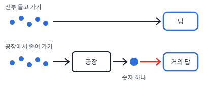

*아래 줄은 숫자 하나만 들고 가서 가볍지만, 답이 조금 어긋날 수 있어요.*

**정확히 말하면**

ML/MAP 추론은 원시 데이터 $X$를 직접 쓰지 않아요. 단계는 이래요.

1. 데이터 $X$ 전체를 공장 $g$에 넣어요: $\theta_{\text{ML}} = g(X)$ 또는 $\theta_{\text{MAP}} = g(X)$.
2. 미래 사건 $A$는 그 값 하나로만 추론해요.

   $$
   P(A \mid X) \approx P(A \mid \theta_{\text{ML}})
   $$

   $$
   P(A \mid X) \approx P(A \mid \theta_{\text{MAP}})
   $$

그래서 등호가 아니라 물결($\approx$)이에요. 추정한 $\theta$가 틀리면 $A$에 대한 추론도 빗나가요. $\theta$라는 잠재(latent, hidden) 파라미터를 한 단계 더 거치므로 오류가 더 생길 수 있어요.

원시 데이터를 그대로 쓰는 왼쪽 $P(A \mid X)$도 완벽하지는 않아요. 머신러닝은 귀납적 학문이고, 숨은 모델과 $\theta$의 참값은 아무도 몰라요(nobody knows).

고를 수 있다면 왼쪽이 나아요. 하지만 There is no free lunch예요.

- 왼쪽은 원시 데이터를 매번 넣어야 해서 복잡하고, 비싸고, 오래 걸려요.
- 그래서 실제로는 함수를 한 번 거쳐 $\theta$를 만들어 두고 그것만 들고 다녀요. 이것이 학습(training)이에요.

근사 없이 $P(A \mid X)$를 그대로 푸는 방법은 [3. 주변화 → 곱셈 규칙 → 조건부 독립](#s1-derivation)에서 이어져요.

(수업 중 이 학습 과정을 "프리트레이닝"이라고 부르셨는데, 딥러닝의 pre-training이 아니라 일반적인 파라미터 추정을 뜻해요.)

**교수님 말씀**

공장 $g$ 비유: 데이터를 모조리 공장에 넣어 $\theta$ 하나를 뽑아내고, 그것만 들고 다니는 과정이에요. 공짜 점심이 없다는 말은 성능과 계산 비용을 맞바꾼다는 뜻이에요.

교수님이 스스로 묻고 답하며 정리하셨어요.

- "이거 equal이 아니라 approximation인가요?" 그렇다. (0921 01:20, 06:03)
- "그럼 이거는 완벽한 건가요?" 이것도 완벽하지 않다. (0921 06:31)
- "둘 중에 뭘 선택해야 되나요?" 가능하면 왼쪽. (0921 07:30)

> "그래서 이게 이퀄이 아니라 물결표가 되는 겁니다." (0921 06:03)

> "세상에 There is no free lunch." (0921 07:37)

**페이지 요약**

ML/MAP은 데이터를 공장에서 $\theta$ 하나로 줄인 뒤 쓰므로 근사예요.

*핵심 식*

- ML 근사

  $$
  P(A \mid X) \approx P(A \mid \theta_{\text{ML}})
  $$
- MAP 근사

  $$
  P(A \mid X) \approx P(A \mid \theta_{\text{MAP}})
  $$

*용어*

- **잠재 파라미터(latent parameter)** — 데이터 뒤에 숨어 직접 보이지 않는 $\theta$
- **There is no free lunch** — 더 정확한 방법은 그만큼 계산 비용이 든다

---

## 1. Fully Bayesian 추론

### 3. 주변화 → 곱셈 규칙 → 조건부 독립

*0921 수업 · L02 s6*

**쉽게 말하면**

동전이 얼마나 앞면을 잘 내는지만 알면, 지난 기록은 없어도 다음을 맞힐 수 있어요.

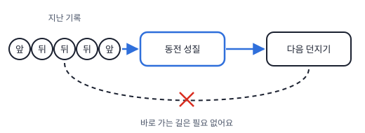

*성질을 끼워 넣으면 기록에서 다음으로 바로 가는 길은 지워져요.*

**정확히 말하면**

Fully Bayesian은 $P(A \mid X)$를 근사(≈) 없이 등호로 계산해요. 슬라이드의 결과식은 아래와 같아요.

$$
P(A \mid X) = \int P(A \mid \theta)\, P(\theta \mid X)\, d\theta
$$

조건부 독립 가정이 있어야 등호가 성립해요.

1. **주변화(marginalization).** 새 변수 $\theta$를 넣고 적분으로 다시 없애요. 값은 그대로라서 "하나 마나 한" 단계예요.

   $$
   P(A \mid X) = \int P(A, \theta \mid X)\, d\theta
   $$

   복습: $\int_{-\infty}^{\infty} p(x,y)\,dx = p(y)$는 결합에서 주변으로 가는 방향(1번)이에요. 여기서는 반대로 주변에서 잠재변수를 넣은 결합의 적분으로 가요(2번).
2. **곱셈 규칙(multiplication rule).** $\theta$를 조건 쪽으로 넘겨요.

   $$
   P(A, \theta \mid X) = P(A \mid \theta, X)\, P(\theta \mid X)
   $$

   복습: $P(a,b,c) = P(a \mid b,c)\,P(b,c) = P(a,b \mid c)\,P(c)$. 조건 $X$를 모든 항에 붙인 채 같은 규칙을 쓴 거예요.
3. **조건부 독립(conditional independence) 가정.** $\theta$가 주어지면 $A$와 $X$는 통계적으로 독립이라고 가정해요.

   $$
   P(A \mid \theta, X) = P(A \mid \theta)
   $$

   슬라이드 근거: $P(x_1,\dots,x_N,A \mid \theta) = \prod_{i=1}^{N} P(x_i \mid \theta)\cdot P(A \mid \theta)$.
4. **대입.** 세 식을 합치면 결과식이 나와요.

   $$
   P(A \mid X) = \int P(A, \theta \mid X)\, d\theta = \int P(A \mid \theta, X)\, P(\theta \mid X)\, d\theta
   $$

   $$
   P(A \mid X) = \int P(A \mid \theta)\, P(\theta \mid X)\, d\theta
   $$

**동전 예.** 동전을 5번 던져 H, T, T, T, H가 나왔어요($X$). 다음 던지기가 앞면일 사건이 $A$예요.

- 동전은 베르누이(Bernoulli) 확률변수라서 앞면 확률 $\theta$만 알면 돼요. 즉 $P(A \mid \theta) = \theta$예요.
- 앞면이 2번이므로 ML 추정은 $\theta = \frac{2}{5}$예요.
- $\theta$가 정해지면 과거 5개 결과는 있어도 되고 없어도 되는 정보예요. 이것이 조건부 독립이에요.

(수업 중 $3/5$로 말씀하셨지만 앞면 확률은 $2/5$예요)

**교수님 말씀**

"수학을 잘하려면 뭘 잘해야 돼?"라는 물음에 한 학생이 "하나 마나 한…"이라고 답했어요. 교수님은 "이 친구 에이스네요"라고 했어요. 항등식으로 변수를 끼워 넣는 기술이 주변화예요. (0921 09:21)

> "좋은 엔지니어들은 1번도 잘해야 되지만 2번을 할 줄 알아야 돼요." (0921 10:53)

> "요 수식을 이렇게 바꾸는 2번이 사실 이 문제를 해석하는 키가 되거든." (0921 11:11)

영화 〈타짜〉의 "첫 판부터 장난질이냐"를 빌려, 식에서 $X$가 슬쩍 사라진 곳에 숨은 가정이 있다고 짚었어요.

> "마음대로 이렇게 하면 안 돼. … 이퀄리티가 성립하려면 어떤 조건이 필요해요." (0921 13:39)

**페이지 요약**

주변화, 곱셈 규칙, 조건부 독립을 차례로 쓰면 Fully Bayesian 식이 나와요.

*핵심 식*

- 주변화

  $$
  P(A \mid X) = \int P(A, \theta \mid X)\, d\theta
  $$
- 조건부 독립

  $$
  P(A \mid \theta, X) = P(A \mid \theta)
  $$
- Fully Bayesian 예측

  $$
  P(A \mid X) = \int P(A \mid \theta)\, P(\theta \mid X)\, d\theta
  $$

*용어*

- **주변화(marginalization)** — 변수를 넣고 적분해 없애는 항등식
- **조건부 독립(conditional independence)** — $\theta$가 주어지면 $A$와 $X$가 독립

---

### 4. 조건부 기댓값으로 읽기와 델타 함수

*0921 수업 · L02 s6*

**쉽게 말하면**

모든 후보의 답을 믿는 만큼 섞어 평균 내요.

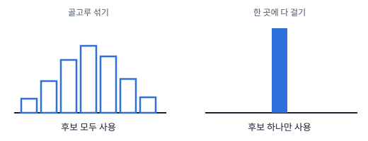

*왼쪽은 후보를 모두 섞고, 오른쪽은 가장 믿는 후보 하나에 다 걸어요.*

**정확히 말하면**

확률과 랜덤변수 복습이에요.

$$
E[X] = \int x\, f(x)\, dx
$$

$$
E[g(X)] = \int g(x)\, f(x)\, dx
$$

$$
E[g(X) \mid Y=y] = \int g(x)\, f(x \mid y)\, dx
$$

마지막 식이 조건부 기댓값(conditional expectation)이에요. Fully Bayesian 식과 짝을 지어요.

1. $x \to \theta$, $g(\theta) = P(A \mid \theta)$
2. $f(\theta \mid X) = P(\theta \mid X)$: 데이터를 본 뒤 $\theta$에 대한 믿음을 요약한 조건부 pdf예요.
3. $$
   P(A \mid X) = \mathbb{E}_{\theta \mid X}[P(A \mid \theta)]
   $$

**가중 평균으로 읽기.** 적분은 촘촘한 리만 합이에요.

$$
P(A \mid X) \approx \sum_i P(A \mid \theta_i)\, P(\theta_i \mid X)\, \Delta\theta
$$

후보 $\theta_1, \theta_2, \dots$마다 예측 $P(A \mid \theta_i)$에 믿음 $P(\theta_i \mid X)$를 가중치로 곱해 빠짐없이 더해요. 이 가중 평균이 사후 예측분포(posterior predictive)예요. MML 식 (8.23)도 예측을 "그럴듯한 모든 $\theta$에 대한 평균"으로 설명해요.

**ML/MAP은 델타 함수 가정.** ML/MAP은 가중치가 가장 큰 $\hat{\theta}$ 하나만 골라 적분 없이 대입해요. 사후분포를 델타 함수로 둔 것과 같아요.

1. $$
   P(\theta \mid X) \approx \delta(\theta - \hat{\theta})
   $$
2. $$
   P(A \mid X) \approx \int P(A \mid \theta)\, \delta(\theta - \hat{\theta})\, d\theta
   $$
3. $$
   P(A \mid X) \approx P(A \mid \hat{\theta})
   $$

믿음을 한 점에 몰빵한 셈이에요. 그래서 ML/MAP 예측은 등호가 아니라 근사예요.

**교수님 말씀**

> "이런 거 하려고 여러분 확률 배운 거예요, 사실." (0921 16:43)

> "그 모든 것들을 하나도 놓치지 않고 다 모아서 평균을 내는 게 fully Bayesian" (0921 21:10)

ML/MAP을 신호및시스템 관점으로 보면 사후분포를 델타 함수로 둔 거예요. 온 믿음을 한 점에 몰빵한다고 비유했어요.

> "델타 펑션이라고 가정한 거지." (0921 22:11)

**페이지 요약**

Fully Bayesian 예측은 사후분포로 가중한 평균이고, ML/MAP은 그 분포를 한 점으로 줄인 근사예요.

*핵심 식*

- 조건부 기댓값

  $$
  E[g(X) \mid Y=y] = \int g(x)\, f(x \mid y)\, dx
  $$
- 사후 예측분포

  $$
  P(A \mid X) = \mathbb{E}_{\theta \mid X}[P(A \mid \theta)]
  $$
- 델타 함수 가정

  $$
  P(\theta \mid X) \approx \delta(\theta - \hat{\theta})
  $$

*용어*

- **사후 예측분포(posterior predictive)** — 사후분포로 가중한 예측의 평균
- **조건부 기댓값(conditional expectation)** — 조건부 pdf로 가중한 평균

---

### 5. Fully Bayesian이 어려운 이유와 근사 기법

*0921 수업 · L02 s7*

**쉽게 말하면**

울퉁불퉁한 모양의 넓이는 정확히 재기 어려워요.

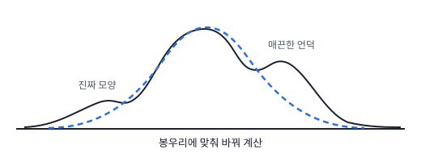

*그래서 가장 높은 봉우리에 맞춘 매끈한 언덕으로 바꿔서 계산해요.*

**정확히 말하면**

Fully Bayesian을 곧이곧대로 풀려면 사후분포 전체가 필요해요. 사전확률 $P(\theta)$와 우도에서 베이즈 정리로 구해요(MML 식 8.22).

$$
P(\theta \mid X) = \frac{P(X \mid \theta)\, P(\theta)}{P(X)}
$$

$$
P(X) = \int P(X \mid \theta)\, P(\theta)\, d\theta
$$

어려움은 두 가지예요.

- **적분.** 정규화 상수 $P(X)$에 적분이 있고, 예측 $\int P(A \mid \theta)\, P(\theta \mid X)\, d\theta$에도 적분이 또 있어요. 켤레 사전분포(conjugate prior)가 아니면 해석적으로 풀리지 않는다고 슬라이드에 적혀 있어요.
- **구현.** 아주 작은 확률값(0.0000002 같은 값)을 곱하다 보면 수치가 튀어요(언더플로).

| 방식 | 결과 | 핵심 계산 |
|---|---|---|
| ML/MAP | 점 추정 $\hat{\theta}$ 하나 | 최적화 |
| Fully Bayesian | 사후분포 $P(\theta \mid X)$ 전체 | 적분 |

그래서 근사 기법을 써요.

- **MCMC**(Markov chain Monte Carlo): 시뮬레이션으로 샘플을 만들고, 그 샘플의 분포를 원래 분포로 간주해요.
- **Laplace approximation**: 가장 높은 봉우리 주변을 가우시안으로 피팅해 PDF를 근사해요.
- **variational inference**: 수업에서는 이름만 언급했어요.
- **expectation propagation**: 수업에서는 이름만 언급했어요.

봉우리를 라플라스나 가우시안으로 피팅해 PDF를 근사하는 것이 머신러닝에서 자주 보이는 방식이에요.

**교수님 말씀**

> "공짜 점심은 없다." (0921 22:53)

Fully Bayesian이 더 좋아 보여도 계산 비용을 치러야 한다는 뜻이에요.

> "결국 허들이 어디서 생기냐면 파이썬 코드에서 생기지 않아요." (0921 24:29)

코드는 GPT가 3초 만에 바꿔 준다고 했어요. 머신러닝 엔진을 설계하려면 수식이 허들이에요. 강화학습, 지도, 비지도, CNN, DNN 모두 바탕은 같아요.

> "결국 펀더멘털은 바뀌지 않고, 그 펀더멘털을 이해하려면 수학을 해야 된다." (0921 25:20)

> "확률이 그만큼 중요해서 지금 복습을 하고 있는 거지" (0921 25:55)

**페이지 요약**

사후분포와 예측에 적분이 들어가서, 실제로는 MCMC 같은 근사 기법을 써요.

*핵심 식*

- 사후분포

  $$
  P(\theta \mid X) = \frac{P(X \mid \theta)\, P(\theta)}{P(X)}
  $$
- 정규화 상수

  $$
  P(X) = \int P(X \mid \theta)\, P(\theta)\, d\theta
  $$

*용어*

- **MCMC(Markov chain Monte Carlo)** — 샘플로 분포를 근사하는 기법
- **Laplace approximation** — 봉우리 주변을 가우시안으로 피팅하는 근사

---

## 2. 방향 그래피컬 모델

### 6. 왜 그래프인가: 독립과 조건부 독립

*0921 수업 · L02 s9*

**쉽게 말하면**

모든 것이 모든 것과 얽혀 있으면 따라가기 너무 힘들어요.

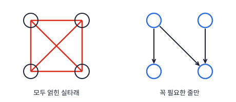

*서로 상관없는 줄은 끊고, 꼭 필요한 줄만 화살표로 남기면 한눈에 보여요.*

**정확히 말하면**

확률 모델에서 가장 일반적인 표현은 결합분포(joint distribution)예요. $X$와 $Y$의 행동을 정확히 모델링하려면 결합 PDF $p(x, y)$를 아는 게 최선이에요.

문제는 변수가 많아질수록 결합 PDF를 구하기가 매우 까다롭다는 점이에요. 그래서 변수 사이의 구조적 특성(structural property)을 찾아 복잡도를 줄여요.

- 독립(statistical independence): $P(A) = P(A \mid B)$이면 $A$와 $B$는 통계적으로 독립이에요. $B$를 알아도 $A$에 대한 확률이 바뀌지 않으니 둘을 따로 다뤄도 돼요.
- 조건부 독립(conditional independence): 어떤 변수 $C$가 주어졌을 때 $P(A \mid B, C) = P(A \mid C)$이면, $C$를 조건으로 $A$와 $B$가 독립이에요. [3. 주변화 → 곱셈 규칙 → 조건부 독립](#s1-derivation)에서 쓴 $P(A \mid \theta, X) = P(A \mid \theta)$가 이 예예요.
- 연관성이 아주 작으면 실제로는 독립이 아니어도 "독립이라고 합시다"로 단순화하기도 해요(수업에서 덧붙인 설명).

이런 독립과 조건부 독립 관계를 그래프로 나타낸 것이 (확률적) 그래피컬 모델(graphical model)이에요. 노드는 확률변수예요. 슬라이드가 꼽은 장점은 세 가지예요.

1. 모델의 구조를 간단하게 시각화해요.
2. 조건부 독립 같은 구조적 특성을 그래프에서 바로 읽어요.
3. 추론(inference)과 학습(learning)의 계산을 그래프 조작으로 표현해요(graph semantics).

**교수님 말씀**

이 과목을 들은 학생의 후기를 소개했어요. "머신러닝의 기초인 줄 알았는데 확률 및 랜덤변수 2야?"라는 말이었어요. 머신러닝을 확률로 다루기 때문에 확률 복습이 계속 나온다는 설명이에요.

> "조인트 PDF를 아는 게 옵티멀이에요. 얘를 알면 다 아는 거예요." (0921 26:23)

**페이지 요약**

결합 PDF는 구하기 어려워서, 독립과 조건부 독립으로 구조를 줄이고 그걸 그래프로 그려요.

*핵심 식*

- 독립

  $$
  P(A) = P(A \mid B)
  $$
- 조건부 독립

  $$
  P(A \mid B, C) = P(A \mid C)
  $$

*용어*

- **구조적 특성(structural property)** — 변수 사이의 독립·조건부 독립 같은 관계
- **그래피컬 모델(graphical model)** — 확률변수를 노드로, 의존을 간선으로 그린 그래프

---

### 7. 그래프 시맨틱스와 인수분해 (가족 그래프)

*0921 수업 · L02 s10*

**쉽게 말하면**

화살표는 "누가 누구에게 말하는지"를 보여 줘요.

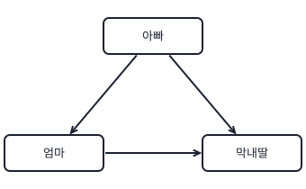

*아빠는 말만 하고, 엄마는 아빠 말을 듣고, 막내딸은 두 사람 말을 모두 들어요.*

**정확히 말하면**

- 노드(node): 확률변수예요.
- 방향 간선 $a \to b$: $b$가 $a$에 직접 의존한다는 뜻이에요.
- 그래프 배치가 곧 결합분포의 인수분해(factorization)예요.

세 노드 예: $a \to b$, $a \to c$, $b \to c$.

1. $$
   P(a,b,c) = P(c \mid a,b)\, P(a,b)
   $$
2. $$
   P(a,b) = P(b \mid a)\, P(a)
   $$
3. $$
   P(a,b,c) = P(c \mid a,b)\, P(b \mid a)\, P(a)
   $$

곱셈 규칙(multiplication rule)만 쓰면 $P(a,b,c) = P(a \mid b,c)\, P(b \mid c)\, P(c)$처럼 다른 순서도 등식으로 성립해요. 하지만 구조가 주어지면 그 구조를 따른 인수분해 하나만 의미가 있어요.

다섯 노드 예: $x_1$, $x_5$는 부모가 없고, $x_5 \to x_2$, $x_1, x_2 \to x_3$, $x_2 \to x_4$예요.

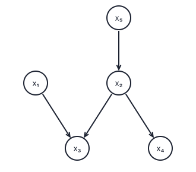

*화살표를 따라 각 노드를 자기 부모로 조건 지어요.*

$$
P(x_1, \dots, x_5) = P(x_1)\, P(x_5)\, P(x_2 \mid x_5)\, P(x_3 \mid x_1, x_2)\, P(x_4 \mid x_2)
$$

일반형은 이렇게 써요. 여기서 $\mathrm{Pa}_k$는 $x_k$의 부모(parent) 노드 집합이에요.

$$
P(x_1, \dots, x_K) = \prod_{k=1}^{K} P(x_k \mid \mathrm{Pa}_k)
$$

화살표가 나가는 쪽이 parent, 들어오는 쪽이 child예요. 위 예에서 $x_1, x_2$는 $x_3$의 parent이고, $x_3$은 child예요.

**교수님 말씀**

가족 그래프로 설명했어요. 화살표는 "말한다 → 듣는다"예요.

- $A$ = 아버지: "천상천하 유아독존", 말만 해요. 그래서 $P(a)$예요.
- $B$ = 엄마: 아버지 말을 듣고 딸에게 말해요. 그래서 $P(b \mid a)$예요.
- $C$ = 막내딸: 두 사람에게 모두 잔소리를 들어요. 그래서 $P(c \mid a,b)$예요.

부모 노드는 화살표로 나에게 "잔소리하는" 노드라고도 표현했어요. 가상의 질문 "곱셈 규칙으로 다르게 쓰면 안 돼요?"에는 등식은 성립하지만 구조가 주어지면 그 구조의 인수분해만 의미가 있다고 답했어요 (0921 30:50).

> "요것만 알면 되는 거야, 요것만." (0921 31:42)

구조가 주어지면 그 구조를 따른 인수분해 $P(a,b,c) = P(c \mid a,b)\, P(b \mid a)\, P(a)$만 의미가 있다는 말이에요.

**페이지 요약**

방향 그래프는 각 노드를 자기 부모로 조건 지은 곱으로 결합분포를 인수분해해요.

*핵심 식*

- 세 노드 예

  $$
  P(a,b,c) = P(c \mid a,b)\, P(b \mid a)\, P(a)
  $$
- 일반형

  $$
  P(x_1, \dots, x_K) = \prod_{k=1}^{K} P(x_k \mid \mathrm{Pa}_k)
  $$

*용어*

- **인수분해(factorization)** — 결합분포를 조건부 확률의 곱으로 나눠 쓰기
- **parent / child** — 화살표가 나가는 노드 / 들어오는 노드

---

### 8. N번 동전 던지기와 하이퍼프라이어

*0921 수업 · L02 s11*

**쉽게 말하면**

동전 하나를 여러 번 던지면, 모든 결과는 "앞면이 나올 확률" 하나에만 달려 있어요.

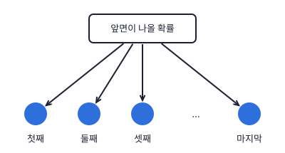

*문어발처럼 한 곳에서 뻗어 나가고, 던진 결과끼리는 서로 영향을 주지 않아요.*

**정확히 말하면**

- $\mu$: 앞면이 나올 확률이에요. 잠재(latent) 확률변수이고, 앞에서 쓴 $\theta$와 같은 역할이에요.
- $x_1, \dots, x_N$: $N$번 던진 결과예요. 슬라이드에서 색칠된 노드는 관측값(observables)이에요.
- $x_n$은 자식이 없는 끝 노드(leaf node)이고, $x_n$끼리는 간선이 없어요.

그래서 결합분포는 $\mu$에만 의존해요.

$$
P(x_1, \dots, x_N \mid \mu) = \prod_{n=1}^{N} P(x_n \mid \mu)
$$

이 식은 [3. 주변화 → 곱셈 규칙 → 조건부 독립](#s1-derivation)에서 쓴 조건부 독립 가정을 그래프로 그린 것이에요. $\mu$가 정해지면 과거·현재·미래의 모든 던지기가 $\mu$로만 결정돼요.

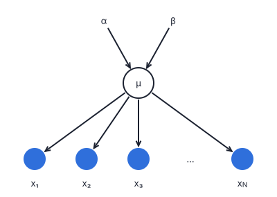

*α와 β는 원 없이 쓰고, 관측한 x만 색칠해요.*

하이퍼프라이어(hyperprior): $\mu$ 자체가 다시 $\alpha$, $\beta$라는 값의 영향을 받는 분포를 따르면 그것도 그래프에 그려요. $\alpha$, $\beta$는 확률변수가 아닌 결정론적(deterministic) 파라미터라서 원을 생략해요.

이 그래프는 결합확률에서 무엇이 조건이고 무엇이 결과인지, 곧 결합확률의 구조를 설명하는 표기법이에요. 이어지는 L02 s12–13은 수업에서 건너뛰었고, 그래피컬 모델을 더 다룰 때 다시 보기로 했어요 (0921 35:40).

(수업 중 $\alpha$, $\beta$를 "히든 파라미터"라고 말했지만, 슬라이드 기준으로는 결정론적 파라미터예요.)

**교수님 말씀**

부모 $\mu$ 하나에 자식 $x_1, \dots, x_N$이 문어발처럼 달린 모양이라고 설명했어요. 앞면 확률이 정해지면 과거, 현재, 미래의 모든 던지기가 그 값 하나로 결정된다고 했어요 (0921 34:10–34:35).

**페이지 요약**

동전 던지기 결과들은 앞면 확률 하나를 부모로 둔 끝 노드이고, 그 부모가 정해지면 서로 독립이에요.

*핵심 식*

- N번 던지기의 결합분포

  $$
  P(x_1, \dots, x_N \mid \mu) = \prod_{n=1}^{N} P(x_n \mid \mu)
  $$

*용어*

- **leaf node** — 자식이 없는 끝 노드
- **하이퍼프라이어(hyperprior)** — $\mu$의 분포를 정하는 결정론적 파라미터 $\alpha$, $\beta$

---

### 9. 헬스케어 예제: LUCAS 인과 그래프

*0921 수업 · L02 s14*

**쉽게 말하면**

병과 습관 사이의 원인과 결과를 화살표로 그린 지도예요.

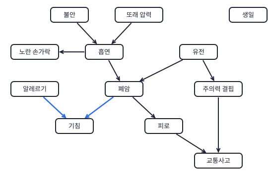

*기침은 폐암 때문일 수도, 알레르기 때문일 수도 있어서 기침만 보고 폐암이라고 단정하지 않아요.*

**정확히 말하면**

슬라이드의 LUCAS 데이터셋 인과 그래프예요. 간선은 이래요.

- 불안, 또래 압력 → 흡연
- 흡연 → 폐암, 흡연 → 노란 손가락
- 유전 → 폐암, 유전 → 주의력 결핍
- 폐암 → 기침, 알레르기 → 기침
- 폐암 → 피로
- 피로, 주의력 결핍 → 교통사고
- 생일(홀짝)은 어디에도 연결되지 않아요.

그래프를 그리는 원칙은 두 가지예요.

1. 연관성이 아주 작으면 독립으로 보고 선을 없애요. 예: 흡연과 알레르기 사이에 약한 연관이 있을 수 있어도 선을 긋지 않아요.
2. 데이터로 검증할 수 없는 관계에는 화살표를 넣지 않아요. 충분히 많은 사람을 조사해 통계적 차이가 확인되면 그때 반영해요.

**교수님 말씀**

- 고등학교 때 선생님이 손가락 냄새를 맡아 흡연을 확인하던 일을 들었어요. 흡연 → 노란 손가락처럼 관측 가능한 결과의 예예요.
- "손 없는 날" 이사처럼 데이터로 검증되지 않는 미신은 그래프에 넣지 않는다고 했어요.
- 가상의 반론 "교수님, 미신은 과학입니다"에도 검증할 수 없는 건 화살표를 넣지 않는다고 답했어요 (0921 37:57).

> "보통의 데이터로 검증할 수 없는 것들은 화살표를 넣지 않습니다." (0921 38:05)

**페이지 요약**

인과 그래프에는 데이터로 확인되는 관계만 화살표로 넣고, 연관이 작으면 선을 없애요.

*용어*

- **LUCAS** — 폐암 관련 요인을 그린 헬스케어 인과 그래프 예제
- **검증할 수 없는 관계** — 화살표를 넣지 않아요(예: 손 없는 날)

---

### 10. 생일 예로 본 ML vs MAP, 그리고 방향 그래프

*0921 수업 · L02 s14–s15*

**쉽게 말하면**

몇 명만 보고 "짝수 날 태어나면 산만하다"고 믿으면 성급해요.

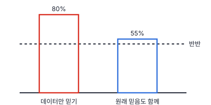

*원래 알던 상식을 함께 보면 반반 근처로 조심스럽게 판단해요.*

**정확히 말하면**

주의력 결핍이 있는 50명 가운데 우연히 짝수일에 태어난 사람이 80%라고 해 봐요(수업에서 든 예시 숫자예요).

- ML 판단: 데이터만 믿어요. 생일과 증상의 연관성 확률을 약 0.8로 봐요.
- MAP 판단: "태어난 날과 증상은 관련이 없을 것"이라는 사전 믿음(0.5)을 반영해요. 데이터는 조금만 반영해 약 0.55로 봐요.

ML의 문제는 데이터가 작으면 전체 현상을 대변하지 못한다는 점이에요. 그래서 정규화(regularization)로 조정해요. 그 조정에 쓰는 전문가의 식견·지식·경험·선호, 곧 데이터로 설명할 수 없는 믿음이 사전확률(prior probability) $P(\theta)$예요.

10년 넘게 조사해 보니 늘 홀짝이 반반이었다는 경험이 있다면 ML 판단을 하지 않아요. 그 경험을 반영하는 것이 MAP이에요([1. 통계적 추론은 P(A | X) 하나로](#s0-inference)의 $\theta_{\text{ML}}$, $\theta_{\text{MAP}}$).

베이지안 접근은 확률(조건부 확률)로 관계를 설명하므로 주로 방향 그래프, 곧 directed graphical model을 써요. 슬라이드 s15는 그래피컬 모델을 세 종류로 들지만 수업에서는 방향 그래프만 다뤘어요.

**교수님 말씀**

데이터 사이언티스트는 데이터만 믿기 때문에 작은 데이터에서 이런 우연을 그대로 받아들일 수 있다고 했어요. 전문가의 경험이 들어가는 자리가 prior라고 설명했어요.

> "데이터 사이언티스트는 진짜 데이터만 믿거든." (0921 39:50)

> "그래서 레귤러라이제이션이 필요한 거야." (0921 40:01)

**페이지 요약**

작은 데이터만 믿는 ML은 성급할 수 있어서, 사전확률로 판단을 조정하는 것이 MAP이에요.

*용어*

- **정규화(regularization)** — 데이터만 믿는 판단을 사전 지식으로 조정하기
- **사전확률(prior probability)** — 데이터로 설명할 수 없는 전문가의 믿음 $P(\theta)$
- **directed graphical model** — 조건부 확률로 관계를 나타내는 방향 그래프

---

## 3. 모델 선택

### 11. 모델 선택은 선택의 문제: 훈련·검증·테스트

*0921 수업 · L02 s17*

**쉽게 말하면**

어떤 모델을 쓸지는 맞고 틀림이 아니라 고르는 일이라서, 연습 시험으로 미리 확인해요.

*문제 100개를 공부용 60개, 연습 시험 20개, 끝까지 숨겨 둘 진짜 시험 20개로 나눠요.*

**정확히 말하면**

모델(model)은 "데이터가 이런 규칙에서 만들어졌을 것"이라는 가정이에요. 그래서 모델은 옳고 그름이나 좋고 나쁨이 아니라 **선택의 문제**예요. 고르려면 늘 검증(validation)이 필요해요.

슬라이드 s17의 제목은 Nested Cross-Validation이에요. 레이블이 붙은 데이터가 100개일 때 이렇게 나눠요.

1. 20개는 test set으로 떼어 두고 끝까지 쓰지 않아요(unseen data).
2. 남은 80개가 training set이에요.
3. training set을 다시 60개(파라미터 학습)와 20개(validation)로 나눠요.
4. 60개로 후보 모델마다 $\boldsymbol{\theta}$를 학습해요. 후보는 선형, 다항, DNN, CNN, RNN, 트랜스포머 등이에요.
5. validation 20개의 성능으로 어느 모델을 쓸지 골라요.
6. 고른 모델의 성능을 test set으로 보고해요.

가장 단순한 방법은 80개 전부로 선형 모델의 $\boldsymbol{\theta}$를 학습하고 test set으로 성능만 보는 거예요. 모델을 여러 개 비교하려면 validation을 따로 둬야 해요.

모델 선택은 model complexity(모델 복잡도)와 data fit(데이터 적합) 사이의 trade-off(트레이드오프)예요.

- 너무 단순하면 데이터를 못 따라가요(과소적합, underfitting).
- 너무 복잡하면 training set에만 맞춰져요(과적합, overfitting). 이때 validation 성능이 나빠져요.
- 적당한 복잡도에서 validation 성능이 가장 좋아요.

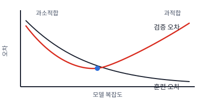

*검증 오차는 복잡도가 적당할 때 가장 낮아요.*

슬라이드의 오컴의 면도날(Occam's razor)은 "데이터를 충분히 설명하는 가장 단순한 모델을 고르라"는 원칙이에요. 수업에서는 "성능이 비슷하면 단순한 모델"로 같은 뜻을 말했어요([13. 베이지안 모델 선택](#s3-bayes-ms)).

**교수님 말씀**

신승훈의 〈보이지 않는 사랑〉처럼, 데이터를 만든 규칙은 보이지 않아요. "이런 모델에서 만들어졌을 것"이라는 가정이 곧 모델이에요.

> "옳고 그름의 문제다? 아니야. … 선택의 문제인 거거든." (0921 41:57)

> "그래서 모델 셀렉션은 항상 밸리데이션이 필요하다." (0921 42:13)

> "모델의 컴플렉시티와 데이터 핏 사이의 트레이드오프를 갖고 있어요." (0921 44:23)

**페이지 요약**

모델은 선택의 문제라서, validation으로 복잡도와 적합의 균형을 보고 골라요.

*용어*

- **검증(validation)** — training set에서 떼어 낸 20개로 모델을 고르는 단계
- **test set** — 끝까지 숨겨 뒀다가 최종 성능을 보고하는 데이터
- **trade-off** — model complexity와 data fit 사이의 균형, 넘치면 overfitting

---

### 12. 교차 검증

*0921 수업 · L02 s17*

**쉽게 말하면**

연습 시험 문제를 한 묶음으로 고정하지 않고 돌아가며 바꿔 써요.

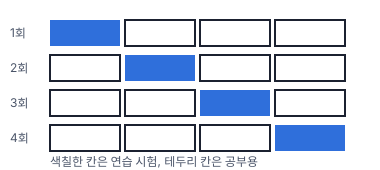

*네 묶음이 한 번씩 연습 시험이 되고, 나머지 세 묶음으로 공부해요.*

**정확히 말하면**

두 데이터의 역할이 달라요.

- validation set: 후보 가운데 가장 좋은 모델을 고르는 데 써요.
- test set: 고른 모델의 일반화 성능(generalization performance)을 추정하는 데 써요.

training 80개를 학습 60개와 검증 20개로 나누는 60:20은 정답이 아니에요. 30:50이나 40:40도 돼요. 파라미터 튜닝에 데이터를 많이 쓰는 편이 좋아서 보통 60:20을 써요.

교차 검증(cross validation, CV)은 validation 20개를 한곳에 고정하지 않아요.

1. training 80개를 20개씩 4조각으로 나눠요.
2. 3조각(60개)으로 학습하고 남은 1조각(20개)으로 검증해요.
3. 검증 조각을 바꿔 가며 4번 반복해요.
4. 4번의 검증 성능을 모아 모델을 골라요.

같은 데이터가 한 번은 검증에, 나머지는 학습에 쓰여요. 곧 데이터 재사용(reuse)이에요. 데이터 수집은 비싸서, 영상 데이터를 이어 붙이거나(stitch) 섞어서(randomize) 늘려 쓰기도 해요.

**교수님 말씀**

비율은 상황에 따라 정해요. 데이터를 모으는 데 돈이 많이 드니, 있는 데이터를 최대한 돌려 써야 해요.

> "꼭 60 대 20이 정답은 아니에요." (0921 45:18)

**페이지 요약**

교차 검증은 검증 조각을 돌려 가며 바꿔서 데이터를 재사용해요.

*용어*

- **교차 검증(cross validation)** — training을 4조각으로 나눠 3개로 학습, 1개로 검증을 돌아가며 반복
- **validation set** — 가장 좋은 모델을 고르는 데 쓰는 데이터
- **일반화(generalization)** — test set으로 추정하는, 처음 보는 데이터에서의 성능

---

### 13. 베이지안 모델 선택

*0921 수업 · L02 s18*

**쉽게 말하면**

후보 모델마다 이 데이터를 얼마나 잘 설명하는지 점수를 매기고, 가장 높은 모델을 골라요.

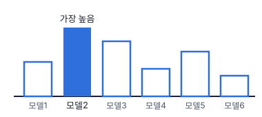

*점수가 가장 높은 모델을 고르지만, 점수가 비슷하면 더 단순한 모델이 나을 수도 있어요.*

**정확히 말하면**

후보 모델의 집합을 $\mathcal{M}=\{M_1,\dots,M_K\}$라 해요. 예를 들어 $M_1$은 RNN, $M_2$는 트랜스포머, $M_3$은 CNN, $M_4$는 DNN, $M_5$는 선형, $M_6$은 다항 모델이에요. 각 $M_k$는 학습으로 자기 파라미터 $\theta_k$를 가져요. 선형 모델도 입력 벡터 크기에 따라 파라미터 수가 달라져요.

데이터가 만들어지는 과정(generative process)을 이렇게 가정해요.

$$
M_k \sim P(M)
$$

$$
\theta_k \sim P(\theta \mid M_k)
$$

$$
D \sim P(D \mid \theta_k)
$$

모델 사전확률(model prior) $P(M)$은 $\sum_{k} P(M_k)=1$이기만 하면 마음대로 정해요(예: 0.2, 0.3, 0.2, …). 선호가 없으면 균등 사전확률(uniform prior) $P(M_k) = 1/K$로 둬요.

사후확률은 베이즈 규칙으로 유도해요(칠판).

1. $$
   P(M_k \mid D)=\frac{P(M_k, D)}{P(D)}
   $$
2. $$
   P(M_k, D)=P(D \mid M_k)\, P(M_k)
   $$
3. $P(D)$는 $k$와 무관하니 비교할 때 무시해요.

   $$
   P(M_k \mid D) \propto P(D \mid M_k)\, P(M_k)
   $$

여기서 $P(D \mid M_k)$를 모델 증거(evidence) 또는 주변 우도(marginal likelihood)라고 해요. 모델 자체는 흐릿한 이름이라, 그 모델이 만드는 $\theta_k$로 데이터를 얼마나 잘 설명하는지를 평균 내요.

$$
P(D \mid M_k) = \int P(D \mid \theta_k)\, P(\theta_k \mid M_k)\, d\theta_k = \mathbb{E}_{\theta_k \mid M_k}\!\left[P(D \mid \theta_k)\right]
$$

슬라이드에서는 이 적분을 (***)로 표시해요. 모델에 대한 MAP은 사후확률이 가장 큰 모델이에요.

$$
M^\ast = \arg\max_{M_k} P(M_k \mid D)
$$

균등 사전확률이면 $P(M_k)$가 모든 $k$에서 같아요. 그래서 MAP은 증거 $P(D \mid M_k)$를 최대화하는 것, 곧 ML과 같은 답을 내요.

모델 선택도, 모델 안의 $\theta$도 같은 틀(Fully Bayesian, MAP, ML)로 판단해요. "가장 그럴듯한 답"이라는 머신러닝의 생각 자체가 확률의 생각이에요.

복잡도도 따져야 해요. $P(M_1 \mid D)=0.25$, $P(M_2 \mid D)=0.23$처럼 차이가 작은데 $M_1$이 훨씬 복잡하면 $M_2$가 더 나은 선택일 수 있어요([11. 모델 선택은 선택의 문제](#s3-validation)의 오컴의 면도날). 이런 비교는 답 하나만 주는 MAP보다 모든 경우의 확률을 주는 Fully Bayesian이 잘해요.

**교수님 말씀**

모델 선택까지 같은 확률의 틀로 풀리니 "베이지안으로 안 되는 게 없네"라고 했어요.

> "내 손 안에 뭐가 있는지 … 컨디셔널 프로바빌리티로 만드는 게 제일 중요하다." (0921 49:34)

> "어떤 모델 k가 주어졌을 때 이 데이터를 그 모델이 얼마나 잘 설명하느냐" (0921 50:25)

> "이 확률을 모르고서는 절대 머신러닝을 이해하기 힘들다." (0921 52:20)

> "fully Bayesian이 그만큼 스트롱하다, 좋은 기법이다" (0921 53:46)

**페이지 요약**

모델마다 증거와 사전확률을 곱해 사후확률을 구하고, 가장 큰 모델을 골라요.

*핵심 식*

- 사후확률

  $$
  P(M_k \mid D) \propto P(D \mid M_k)\, P(M_k)
  $$
- 증거

  $$
  P(D \mid M_k) = \int P(D \mid \theta_k)\, P(\theta_k \mid M_k)\, d\theta_k = \mathbb{E}_{\theta_k \mid M_k}\!\left[P(D \mid \theta_k)\right]
  $$
- 모델의 MAP

  $$
  M^\ast = \arg\max_{M_k} P(M_k \mid D)
  $$

*용어*

- **증거(evidence)** — 주변 우도(marginal likelihood), 모델이 데이터를 설명하는 정도의 평균
- **균등 사전확률(uniform prior)** — $P(M_k) = 1/K$, 이때 MAP은 ML과 같아요

---

### 14. 베이즈 팩터로 두 모델 비교

*0921 수업 · L02 s19*

**쉽게 말하면**

후보가 둘뿐이면 순위를 매길 필요 없이 두 점수를 나눠 봐요.

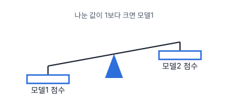

*두 점수를 나눈 값이 1보다 크면 모델1, 아니면 모델2를 골라요.*

**정확히 말하면**

모델이 $M_1$, $M_2$ 둘뿐이면 사후확률의 비, 곧 사후 오즈(posterior odds)를 봐요.

1. $$
   \frac{P(M_1 \mid D)}{P(M_2 \mid D)}=\frac{P(D \mid M_1)\,P(M_1)/P(D)}{P(D \mid M_2)\,P(M_2)/P(D)}
   $$
2. $P(D)$는 위아래에서 약분돼요.

   $$
   \frac{P(M_1 \mid D)}{P(M_2 \mid D)}=\underbrace{\frac{P(M_1)}{P(M_2)}}_{\text{prior odds}}\;\underbrace{\frac{P(D \mid M_1)}{P(D \mid M_2)}}_{\text{Bayes factor}}
   $$

- posterior odds = prior odds × Bayes factor예요.
- $P(D \mid M_k)$는 모델 $M_k$가 데이터를 얼마나 잘 예측하는지를 나타내요.

균등 사전확률이면 prior odds가 1이라, 베이즈 팩터(Bayes factor) $\frac{P(D \mid M_1)}{P(D \mid M_2)}$만 보면 돼요.

- $\frac{P(D \mid M_1)}{P(D \mid M_2)} \gt 1$이면 $M_1$을 골라요.
- 1 이하이면 $M_2$를 골라요.

로그를 씌우면 로그 우도비(log likelihood ratio) $\log \frac{P(D \mid M_1)}{P(D \mid M_2)}$가 0보다 큰지 보는 것과 같아요.

디지털통신의 비트 검출과 같은 구조예요. 받은 신호 $y$로 비트를 정할 때 MAP 검출이 항상 최적이에요. 1과 0이 같은 확률로 보내지면 사전확률이 균등하므로, ML 검출 $P(y \mid 1)$ 대 $P(y \mid 0)$ 비교와 같아져요.

베이즈 팩터를 구하려면 증거 적분([13. 베이지안 모델 선택](#s3-bayes-ms)의 (***))을 풀어야 해요. 데이터가 커질수록 적분이 복잡해져서 MCMC(Markov chain Monte Carlo) 같은 근사를 써요. MCMC의 구체적 방법은 기말고사 무렵에 다룰 예정이에요.

**교수님 말씀**

디지털통신에서 비트를 검출할 때와 같은 판단이라고 연결했어요.

> "이 확률이 큰 놈을 결정하는 게 optimal이다." (0921 56:40)

> "나중에 아마 기말고사 그때 한번 설명할 기회가 있을 거예요." (0921 57:56)

**페이지 요약**

두 모델은 사후 오즈를 prior odds와 베이즈 팩터로 나눠 비교해요.

*핵심 식*

- 사후 오즈

  $$
  \frac{P(M_1 \mid D)}{P(M_2 \mid D)}=\underbrace{\frac{P(M_1)}{P(M_2)}}_{\text{prior odds}}\;\underbrace{\frac{P(D \mid M_1)}{P(D \mid M_2)}}_{\text{Bayes factor}}
  $$

*용어*

- **베이즈 팩터(Bayes factor)** — 두 모델의 증거의 비, 균등 사전확률이면 이것만 보면 돼요
- **MCMC** — 증거 적분이 어려울 때 쓰는 근사 방법

---

## 4. 한 장 요약 · 다음 시간 예고

### 한 장 치트시트

*0921 수업 · L02 s6–19*

0921 수업 전체를 한 표로 모은 치트시트예요. 모든 줄의 출발점은 $P(A \mid X)$ 하나예요. 토픽 제목을 누르면 그 토픽으로 가요.

| 토픽 | 핵심 식 | 한 줄 정리 |
|---|---|---|
| [1. 통계적 추론은 P(A \| X) 하나로](#s0-inference) | $\theta_{\text{ML}} = \arg\max_\theta P(X \mid \theta)$ $\theta_{\text{MAP}} = \arg\max_\theta P(\theta \mid X)$ | 손에 쥔 데이터 $X$를 조건에 두고 궁금한 사건 $A$의 확률을 구해요. 최적화 대상은 $\theta$예요. |
| [2. ML/MAP은 공장 g를 거친 근사](#s0-approx) | $P(A \mid X) \approx P(A \mid \theta_{\text{ML}})$ | $\theta$ 하나를 먼저 뽑아 쓰므로 등호가 아니라 근사(≈)예요. |
| [3. 주변화 → 곱셈 규칙 → 조건부 독립](#s1-derivation) | $P(A \mid X) = \int P(A \mid \theta)\, P(\theta \mid X)\, d\theta$ | $\theta$를 끼워 넣고(주변화), 곱셈 규칙으로 쪼갠 뒤, $\theta$가 주어지면 $X$를 지워요. |
| [4. 조건부 기댓값으로 읽기와 델타 함수](#s1-expectation) | $P(A \mid X) = \mathbb{E}_{\theta \mid X}[P(A \mid \theta)]$ | posterior predictive는 모든 $\theta$의 가중 평균이에요. ML/MAP은 사후분포를 $\delta(\theta - \hat{\theta})$로 몰빵한 경우예요. |
| [5. Fully Bayesian이 어려운 이유와 근사 기법](#s1-hardness) | $P(X) = \int P(X \mid \theta)\, P(\theta)\, d\theta$ | 이 적분이 어려워 MCMC, Laplace approximation, variational inference, expectation propagation으로 근사해요. |
| [6. 왜 그래프인가: 독립과 조건부 독립](#s2-motivation) | $P(A) = P(A \mid B)$ | 결합 PDF의 구조(독립·조건부 독립)를 그림으로 보이려고 graphical model을 써요. |
| [7. 그래프 시맨틱스와 인수분해 (가족 그래프)](#s2-semantics) | $P(x_1, \dots, x_K) = \prod_{k=1}^{K} P(x_k \mid \mathrm{Pa}_k)$ | 각 노드는 parent만 조건으로 두고 곱해요(factorization). |
| [8. N번 동전 던지기와 하이퍼프라이어](#s2-coin) | $P(x_1, \dots, x_N \mid \mu) = \prod_{n=1}^{N} P(x_n \mid \mu)$ | $\mu$ 하나에서 $x_n$이 문어발처럼 뻗어요. $\mu$의 prior를 정하는 결정론적 파라미터 $\alpha$, $\beta$(그래프에서 원 생략)가 hyperprior예요. |
| [9. 헬스케어 예제: LUCAS 인과 그래프](#s2-healthcare) | 식 없음 | 흡연, 폐암, 기침, 알레르기 같은 원인과 결과를 방향 화살표로 그려요. |
| [10. 생일 예로 본 ML vs MAP, 그리고 방향 그래프](#s2-birthday) | ML 0.8, MAP 0.55 | 데이터만 믿으면 0.8, 사전 믿음을 섞으면 0.55예요. 이 조정이 regularization이에요. |
| [11. 모델 선택은 선택의 문제: 훈련·검증·테스트](#s3-validation) | training 60 : validation 20 : test 20 | 모델 선택은 model complexity와 data fit의 trade-off라서 validation이 늘 필요해요. |
| [12. 교차 검증](#s3-cv) | 식 없음 | 검증 조각을 돌려 가며 바꿔 데이터를 재사용해요(cross validation). |
| [13. 베이지안 모델 선택](#s3-bayes-ms) | $P(M_k \mid D) \propto P(D \mid M_k)\, P(M_k)$ $P(D \mid M_k) = \int P(D \mid \theta_k)\, P(\theta_k \mid M_k)\, d\theta_k$ | evidence(marginal likelihood)가 큰 모델을 골라요. 균등 prior이면 MAP과 ML이 같아요. |
| [14. 베이즈 팩터로 두 모델 비교](#s3-bayes-factor) | $\frac{P(D \mid M_1)}{P(D \mid M_2)}$ | posterior odds = prior odds × Bayes factor예요. 1보다 크면 $M_1$을 골라요. |

---

### 다음 시간 예고 (아직 안 배움)

*0921 수업 · L02 s12–13 · L03*

이번 수업에서 다루지 않은 내용이에요. 제목만 적어 둘게요.

- d-separation (L02 s12–13, 건너뜀. 그래피컬 모델을 더 설명할 때 다시 다뤄요)
- Linear Regression (L03, 수요일부터)

  - Regression Problem · Formulation · Parameter Estimation
  - MLE · MLE with Features · Feature Matrix & MLE
  - Polynomial Fit · Overfitting in Linear Regression
  - MAPE · MAPE for Gaussian Prior · Regularization: MAPE vs. Explicit Regularizer
- 퀴즈: 10월 초, 이론과 실습 포함 (추석 뒤 linear regression 실습 먼저)

---

### 함께 보면 좋은 자료

- [Lecture 10 · Statistical Inference Part 1 (쉬운 설명)](../../강의노트/추가%20강의/eli5_lecture10_statistical_inference_part1.html)
- [Lecture 11 · Statistical Inference Part 2 (쉬운 설명)](../../강의노트/추가%20강의/eli5_lecture11_statistical_inference_part2.html)
- [Lecture 12 · Statistical Inference Part 3 (쉬운 설명)](../../강의노트/추가%20강의/eli5_lecture12_statistical_inference_part3.html)
- [복습문제 6선 풀러 가기 (0921 수업 범위)](복습문제_0921_Bayesian_Inference_Model_Selection.md)

복습문제 6문항

- [문제지 PDF](복습문제_0921_Bayesian_Inference_Model_Selection-문제.pdf)
- [해설지 PDF](복습문제_0921_Bayesian_Inference_Model_Selection-답안.pdf)
- [지난 정리노트: 0916 MAP and Generative Models](../0916/정리노트_0916_MAP_and_Generative_Models.html)

---

출처: 정방철 교수님 강의자료(Lecture02) · 수업 녹음 전사(0921) · Deisenroth, Faisal, Ong, *Mathematics for Machine Learning* (2020) 8장.
