# Linear Regression — 5살도 이해하는 정리노트

정방철 교수님 머신러닝기초 · 0923 수업 (Lecture03, MML 9장)

> `정리노트_0923_Linear_Regression.html`를 마크다운으로 옮겼어요. 그림은 `figures_0923/` 폴더의 SVG, 위젯은 대표 설정의 정적 그림으로 바꿨어요. 수식은 `$…$` / `$$…$$`라서 GitHub, Obsidian, Typora에서 보여요.

**목차**

- [0. 회귀 문제와 포뮬레이션](#s0)
  - [회귀 vs 분류: 숫자를 맞히기 vs 칸을 고르기](#s0-regression)
  - [가장 중요한 건 포뮬레이션, 그리고 로드맵](#s0-formulation)
- [1. 확률적 회귀 모델: 가우시안 노이즈와 우도](#s1)
  - [결정론적 모델 vs 확률적 모델](#s1-det-prob)
  - [가우시안 노이즈와 종 모양 PDF](#s1-gaussian)
  - [선형회귀 = "~일 거야"라는 가정 (순환논증 경고)](#s1-assume)
  - [우도와 선형 모델: 내 안에 θ 있다](#s1-likelihood)
  - [x에 대해 비선형이어도 선형회귀: 특징 벡터](#s1-features)
- [2. 파라미터 추정: iid 우도에서 최소제곱까지](#s2)
  - [훈련 집합과 데이터 행렬 X](#s2-dataset)
  - [iid면 우도는 곱이 된다](#s2-iid)
  - [ML → 음의 로그우도 → 최소제곱](#s2-nll)
  - [가우시안 노이즈에서 ML = 경험적 위험 최소화](#s2-ml-erm)
- [3. 미분해서 해 구하기: 정규방정식과 유사역행렬](#s3)
  - [미분이 0이 되는 θ 찾기: 정규방정식](#s3-normal-eq)
  - [선형회귀의 답은 유사역행렬](#s3-pinv)
  - [보충: dL/dθ 벡터 미분 유도](#s3-vector-diff)
  - [수업 후 질문: 상수항을 넣으면 D+1 차원](#s3-bias)
- [4. 한 장 요약 · 다음 시간 예고](#s4)
  - [한 장 치트시트](#s4-cheatsheet)
  - [다음 시간 예고 (아직 안 배움)](#s4-next)
  - [함께 보면 좋은 자료](#s4-links)

## 0. 회귀 문제와 포뮬레이션

### 회귀 vs 분류: 숫자를 맞히기 vs 칸을 고르기

*0923 수업 · L03 s5*

**쉽게 말하면**

회귀는 자 위의 아무 눈금이나 짚는 놀이이고, 분류는 정해진 상자 몇 개 중 하나를 고르는 놀이예요.

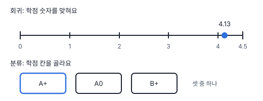

*학점이 4.13일지 맞히면 회귀이고, A+인지 A0인지 고르면 분류예요.*

**정확히 말하면**

- **회귀(regression)**: 예측값이 실수(real number) 하나인 추정 문제예요. 정답 후보가 정해져 있지 않고, 실수 위 어떤 값이든 예측할 수 있어요. 그래서 추정기(estimator)라고 불러도 돼요.
- **분류(classification)**: 몇 개로 딱 정해진 클래스(class) 가운데 하나를 고르는 문제예요. 예: 개 아니면 고양이, 1 아니면 0.
- 학점 예: 학점 값 4.13, 3.87을 맞히면 회귀, A+/A0/B+ 중 무엇을 받을지 고르면 분류예요.
- 나이 예: 사진 속 사람을 10대/20대/30대로 나누면 분류, 27.03세처럼 추론하면 회귀예요.

회귀 문제의 설정(L03 s5)은 이래요. 입력 $\mathbf{x}_n$마다 노이즈가 섞인 관측 $y_n$을 얻어요.

$$
y_n = f(\mathbf{x}_n) + \epsilon
$$

목표는 새 입력에서도 함숫값을 잘 맞히도록 일반화하는(generalize well) 함수 $f$를 추론하는 거예요. 가진 데이터를 설명하는 것보다 새 입력의 $y$를 잘 추론하는 쪽이 핵심이에요. 이 식의 뜻은 [결정론적 모델 vs 확률적 모델](#s1-det-prob)에서 이어서 봐요.

| 응용(L03 s5) | 무엇을 예측하나 | 회귀인 이유 |
|---|---|---|
| 시계열 분석(time-series analysis) | 과거 학점을 보고 이번 학기 학점 | 학점 값은 실수 |
| 제어·로보틱스(control and robotics) | 지금까지의 관절 움직임을 보고 다음 동작 | 궤적은 연속값 |
| 이미지 인식(image recognition) | 사진 속 사람의 나이 | 27.03세처럼 실수로 추론하면 회귀(연령대로 나누면 분류) |

**교수님 말씀**

교수님은 한 학생의 학점을 예로 들었어요. 4.13이든 3.87이든 실수 위의 값을 예측하면 회귀이고, A+를 받을지 B+를 받을지는 몇 개 중 하나라서 분류라고 했어요.

> "어떤 리얼 넘버 상에서 … 내가 예측하는 걸 회귀라고 불러요, 회귀." (0923 00:58)

목표에 대해서는 데이터를 잘 설명하는 것보다 새 입력을 잘 추론하는 쪽을 강조했어요.

> "후자에 방점이 있죠." (0923 10:23)

삼성 미래기술육성재단 과제 심사 이야기도 했어요. 사용자의 위치·방향·속도·이동 경로를 미리 추론해 기지국 안테나 틸팅 등을 준비하는 연구예요. 이동 경로 예측이 회귀인 까닭은 A/B/C 중 하나를 고르는 게 아니기 때문이래요.

> "아예 흰색 캔버스 위에 내가 그림을 그리듯 … 리그레션 문제라는 거야." (0923 12:31)

이미지 인식도 개/고양이 판별은 분류지만, 사진을 보고 27.03세라고 나이를 추론하면 회귀라고 했어요. 학생들이 교수님 나이를 33.5세라고 추론했으면 "오늘 일찍 끝내는 거였어"라는 농담도 덧붙였어요(0923 13:31).

**페이지 요약**

실수 값 하나를 맞히면 회귀, 정해진 클래스 중 하나를 고르면 분류예요.

*핵심 식*

- 노이즈 섞인 관측

  $$
  y_n = f(\mathbf{x}_n) + \epsilon
  $$

*용어*

- **회귀(regression)** — 실수 값 하나를 예측하는 추정 문제(estimator)
- **분류(classification)** — 정해진 클래스 가운데 하나를 고르는 문제
- **일반화(generalize well)** — 새 입력에서도 함숫값을 잘 맞히는 것

---

### 가장 중요한 건 포뮬레이션, 그리고 로드맵

*0923 수업 · L03 s2–s4*

**쉽게 말하면**

문제를 잘 세우는 사람이 똑똑한 도우미를 가장 잘 부려요.

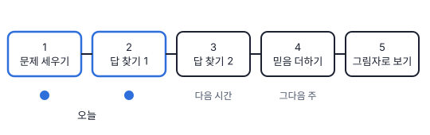

*다섯 칸짜리 길 중에서 오늘은 앞의 두 칸에 들어섰고, 이 길을 두 주 동안 걸어요.*

**정확히 말하면**

**포뮬레이션(problem formulation)**: 문제를 잘 만들고, 그 문제가 무엇을 뜻하는지, 어떻게 풀지를 정하는 일이에요. 오늘 선형회귀에서 가장 중요한 것이 이거예요.

오늘의 목표(L03 s2 Targets 중 첫째)는 이래요.

1. 선형회귀 모델을 포뮬레이션해요.
2. 노이즈가 가우시안이라고 가정해요([가우시안 노이즈와 종 모양 PDF](#s1-gaussian)).
3. 그 가정에서 최대우도(ML) 추정을 풀면 최소제곱(least squares, LS) 문제가 돼요.

사람들은 흔히 "선형회귀 = least squares 문제", 곧 squared error를 최소화하는 문제라고 말해요. 둘이 거의 동치가 되는 데에는 이유가 있고, 그 이유가 오늘 수업의 핵심이에요([가우시안 노이즈에서 ML = 경험적 위험 최소화](#s2-ml-erm)).

| 로드맵(L03 s3–s4) | 언제 |
|---|---|
| (1) Problem Formulation | 오늘 |
| (2) Parameter Estimation: ML | 오늘 절반, 다음 시간에 마무리 |
| (3) Parameter Estimation: MAP | 다음 시간 |
| (4) Bayesian Linear Regression | 그다음 주 |
| (5) Maximum Likelihood as Orthogonal Projection | 일정 언급 없음 |

강의 노트 Part 1은 이 가운데 앞의 세 주제를 다뤄요. 이 주제로 약 2주를 써요.

**교수님 말씀**

> "가장 중요한 건 포뮬레이션이에요." (0923 01:20)

교수님은 GPT나 Claude 같은 생성형 AI를 쓰면 내 옆에 나보다 똑똑한 조수가 한 명 생긴 셈이라고 했어요. 문제는 월 3만 원이면 전 세계 모두에게 그 조수가 생겨서 무한 경쟁의 시대가 됐다는 거예요.

> "포뮬레이션을 잘해야 돼요, 포뮬레이션." (0923 02:24)

문제를 잘 만들고, 그 뜻과 푸는 방법을 고민하는 것이 엔지니어가 회사나 연구소에서 할 일이래요. 수학을 잘하고 논리적인 사람이 포뮬레이션을 잘할 수밖에 없고, 교수님도 그 논리를 길러 주려 한다고 했어요.

> "사실 거의 동치가 되는 이유가 있어요." (0923 03:31)

일정은 "오늘 여기 요만큼" 배우고, 다음 시간에 ML의 남은 절반과 MAP, 그다음 주에 베이지안 선형회귀까지 가서 "한 2주 정도" 이 내용을 다룬다고 했어요(0923 03:41–03:58).

**페이지 요약**

문제를 잘 세우는 포뮬레이션이 가장 중요하고, 오늘은 가우시안 노이즈에서 ML이 최소제곱이 되는 것까지 가요.

*용어*

- **포뮬레이션(problem formulation)** — 문제를 만들고 그 뜻과 푸는 방법을 정하는 일
- **최소제곱(least squares, LS)** — squared error를 최소화하는 문제

---

## 1. 확률적 회귀 모델: 가우시안 노이즈와 우도

### 결정론적 모델 vs 확률적 모델

*0923 수업 · L03 s5*

**쉽게 말하면**

줄 하나만 긋는 방법도 있고, 줄 위에 "이만큼 흔들릴 수 있어요"를 같이 그려 두는 방법도 있어요.

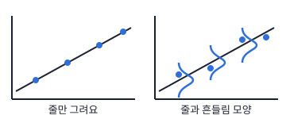

*흔들림을 아주 작게 줄이면 오른쪽 그림이 왼쪽 그림과 같아져요.*

**정확히 말하면**

입력 $\mathbf{x}_n$마다 노이즈가 섞인 관측(noisy observation)을 얻어요.

$$
y_n = f(\mathbf{x}_n) + \epsilon
$$

$\epsilon$은 흔들림(perturbation), 곧 노이즈예요. 함수 $f$가 무엇인지는 몰라요.

연역적 학문은 모델을 먼저 줘요(예: 전류를 미분하면 전압). 머신러닝은 이 순서를 뒤집어서 데이터를 먼저 받고, $\mathbf{x}$와 $y$의 관계를 추론해요.

- **결정론적 모델(deterministic model)**: 곡선 $f$ 하나를 찾는 모델이에요.
- **확률적 모델(probabilistic model)**: 그 곡선 위에 확률밀도함수(PDF)를 덧씌운 모델이에요.

결정론적 모델은 PDF가 델타 함수인 확률적 모델의 특수한 경우예요.

$$
p(y \mid \mathbf{x}) = \delta\big(y - f(\mathbf{x})\big)
$$

그래서 이번 학기에는 확률적 모델을 주로 다뤄요. 노이즈가 아주 작으면 가우시안의 폭(분산)이 좁고 뾰족해져요. 그러면 불확실성을 따지지 않게 되어 결정론적 모델로 돌아가요.

표기: 이번 학기에 $f$는 함수, 곧 모델이에요. PDF는 확률 및 랜덤변수 수업의 $f_X$ 대신 $p(\cdot)$로 써요.

모델은 파라미터 $\boldsymbol{\theta}$를 가져요. 모델 꼴(선형, 고차 다항식, 로그 함수 등)을 고르면 남은 일은 파라미터 최적화예요. 이 과정이 함수 $f$를 추론(inference)하는 일이에요.

**교수님 말씀**

교수님이 학생 질문 형식으로 스스로 묻고 답했어요. "노이즈가 없는 환경도 있지 않나요?"에는 고해상도 사진이나 깨끗한 음질처럼 잘 정제된 데이터라면 노이즈를 무시할 수 있다고 했어요 (0923 06:57).

> "노이즈의 영향을 무시하면 디터미니스틱 모델로 돌아가는 겁니까?" "빙고." (0923 07:16)

> "디터미니스틱 모델은 … PDF가 델타 함수를 갖는 스페셜 케이스" (0923 06:07)

**페이지 요약**

결정론적 모델은 곡선만, 확률적 모델은 곡선 위의 PDF까지 찾아요.

*핵심 식*

- 노이즈 섞인 관측

  $$
  y_n = f(\mathbf{x}_n) + \epsilon
  $$
- 결정론적 = 델타 PDF

  $$
  p(y \mid \mathbf{x}) = \delta\big(y - f(\mathbf{x})\big)
  $$

*용어*

- **결정론적 모델(deterministic model)** — 곡선 하나만 찾는 모델
- **확률적 모델(probabilistic model)** — 곡선 위에 PDF를 덧씌운 모델
- **흔들림(perturbation)** — 관측에 더해지는 노이즈

---

### 가우시안 노이즈와 종 모양 PDF

*0923 수업 · L03 s6*

**쉽게 말하면**

흔들림은 대부분 조금만 생기고, 크게 흔들리는 일은 아주 드물어요.

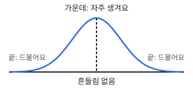

*종처럼 생긴 모양이라 가운데 근처가 가장 흔해요.*

**정확히 말하면**

선형회귀의 노이즈는 평균 0, 분산 $\sigma^2$인 가우시안이라고 가정해요.

$$
\epsilon \sim \mathcal{N}(0, \sigma^2)
$$

칠판에 쓴 가우시안 PDF예요.

1. 평균 0:

   $$
   p_X(x) = \frac{1}{\sqrt{2\pi\sigma^2}}\exp\!\left(-\frac{(x-0)^2}{2\sigma^2}\right)
   $$
2. 0 자리에 $\mu$를 넣어 일반화:

   $$
   p_X(x) = \frac{1}{\sqrt{2\pi\sigma^2}}\exp\!\left(-\frac{(x-\mu)^2}{2\sigma^2}\right)
   $$

종 모양이라 bell-shaped 함수라고도 불러요.

- 밀도가 평균 근처에 몰려 있어서, 평균 근처를 적분한 확률이 커요.
- 평균에서 멀어지면 처음에는 천천히, 그 뒤로는 급격하게 0으로 떨어져요.
- 그래서 특이하게(extraordinary) 큰 흔들림이 생길 확률은 급격히 작아요.

노이즈가 늘 가우시안은 아니에요. 도메인에 따라 샷 노이즈(shot noise)나 라플라스 분포 꼴의 노이즈도 있어요. 그래도 보통은 99% 정도 가우시안을 가정해요. 전기적으로 생기는 노이즈가 가우시안인 까닭은 중심극한정리(central limit theorem) 등으로 보일 수 있어요.

**교수님 말씀**

"교수님, 노이즈는 항상 가우시안인가요?"라는 물음에 "대부분 그래요"라고 답했어요 (0923 14:10).

> "보통의 경우에 가우시안 노이즈를 가정할 때가 99% 정도 된다고 봐요." (0923 14:10)

> "종 모양이라고 해서 벨 쉐입 펑션이라고 부르기도 해요." (0923 15:43)

가우시안 모양을 길게 설명한 까닭은 가우시안 노이즈일 때 ML이 최소제곱과 같아지는 이유로 이어지기 때문이에요([가우시안 노이즈에서 ML = 경험적 위험 최소화](#s2-ml-erm)).

**페이지 요약**

노이즈는 평균 근처에 몰린 종 모양 가우시안이라고 가정해요.

*핵심 식*

- 가우시안 노이즈

  $$
  \epsilon \sim \mathcal{N}(0, \sigma^2)
  $$
- 가우시안 PDF

  $$
  p_X(x) = \frac{1}{\sqrt{2\pi\sigma^2}}\exp\!\left(-\frac{(x-\mu)^2}{2\sigma^2}\right)
  $$

*용어*

- **종 모양(bell-shaped)** — 평균에서 가장 높고 양옆으로 급격히 낮아지는 꼴
- **중심극한정리(central limit theorem)** — 전기적 노이즈가 가우시안인 근거

---

### 선형회귀 = "~일 거야"라는 가정 (순환논증 경고)

*0923 수업 · L03 s6*

**쉽게 말하면**

점들을 보고 "곧은 줄로 만들어졌을 거야" 하고 짐작하는 방법이에요.

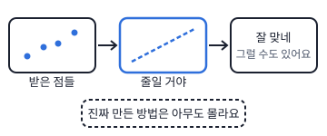

*잘 맞아도 "그랬을 수 있다"일 뿐, 진짜 만든 방법은 아무도 몰라요.*

**정확히 말하면**

선형회귀는 "$y$가 입력 벡터 $\mathbf{x}$의 선형 함수에 노이즈 $\epsilon$이 더해져 내 손에 들어온 것**일 거야**"라고 가정(assume = suppose)하는 일이에요.

$$
y = \mathbf{x}^\top\boldsymbol{\theta} + \epsilon, \quad \epsilon \sim \mathcal{N}(0, \sigma^2) \quad \text{(이라고 가정)}
$$

**순환논증(circular reasoning) 경고**

1. "데이터가 원래 선형으로 만들어졌으니까 선형회귀를 쓰는 건가요?"라고 말하는 순간 순환논증이에요.
2. 데이터를 선형으로 만들어 놓고 선형회귀가 잘 된다고 주장하는 것은 말이 안 돼요.
3. 선형이라고 가정하고 풀었더니 잘 맞으면, 선형 패턴으로 만들어졌을 **개연성**이 있을 뿐이에요.
4. 실제 생성 과정은 nobody knows in the world, 곧 아무도 몰라요.

선형회귀의 "선형"은 찾고 싶은 파라미터와의 관계가 선형이라는 뜻이지, 재료($\mathbf{x}$) 자체가 선형이라는 뜻이 아니에요. 자세한 내용은 [x에 대해 비선형이어도 선형회귀: 특징 벡터](#s1-features)에서 이어져요.

**교수님 말씀**

신승훈의 노래 〈보이지 않는 사랑〉 비유를 지난 시간에 이어 다시 꺼냈어요. 마지막 가사가 "~일 거야"라는 추측형으로 끝나듯, 보이지 않는 패턴을 "~일 거야"라고 가정하는 것이 머신러닝이자 선형회귀라는 거예요 (0923 17:45).

> "여러분, 잘 보세요." (0923 17:45)

대학원 시절 LG전자 과제에서 바로 이 순환논증 실수를 해서 지도교수님께 45분간 혼났다고 했어요.

> "단언컨대 대학원 1학년 때 이런 실수 한 번씩 합니다." (0923 19:41)

넷플릭스 추천 비유: 범죄도시 1·2·3을 본 기록에서 "액션, 마동석 선호"라는 특징이 드러나요. 오늘 왜 짬뽕이 당기는지 모르듯 나도 이유를 모르지만, 머신러닝이 그 특징을 눈치채면 잘 맞히는 시스템이 돼요 (0923 20:53).

> "파라미터 간의 관계가 리니어하다는 거지 재료 자체가 리니어하다는 뜻은 아니에요." (0923 23:15)

**페이지 요약**

선형회귀는 "선형 함수 더하기 노이즈일 거야"라는 가정이지, 사실 확인이 아니에요.

*핵심 식*

- 가정한 생성 과정

  $$
  y = \mathbf{x}^\top\boldsymbol{\theta} + \epsilon, \quad \epsilon \sim \mathcal{N}(0, \sigma^2) \quad \text{(이라고 가정)}
  $$

*용어*

- **가정(assume = suppose)** — "~일 거야"라고 두고 푸는 것
- **순환논증(circular reasoning)** — 선형으로 만든 데이터로 선형 가정을 정당화하는 오류

---

### 우도와 선형 모델: 내 안에 θ 있다

*0923 수업 · L03 s6*

**쉽게 말하면**

기계 속에 숨은 손잡이 숫자들이 재료를 받아 예상값 하나를 내놓아요.

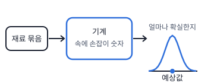

*예상값 하나에 얼마나 확실한지까지 같이 알려 줘요.*

**정확히 말하면**

우도(likelihood)라는 말이 나오면 확률(probability) 또는 PDF를 떠올리면 돼요. 여기서는 입력 $\mathbf{x}$가 주어졌을 때 $y$가 어떻게 나올지를 나타내는 조건부 PDF $p(y \mid \mathbf{x})$예요.

입력은 $\mathbf{x} = [x_1, \dots, x_D]^\top \in \mathbb{R}^D$이고, 모델은 벡터를 받아 숫자 하나를 내는 함수예요.

$$
f: \mathbb{R}^D \to \mathbb{R}
$$

정의역은 $\mathbb{R}^D$, 공역은 $\mathbb{R}$이에요. $f$가 정해져 있으면 불확실성은 $\epsilon$에서만 생겨요.

$$
p(y \mid \mathbf{x}) = \mathcal{N}\big(y \mid f(\mathbf{x}), \sigma^2\big)
$$

이 식도 "진짜 그런 게 아니라 그럴 거야라고 suppose한 것"이에요.

**선형회귀**: $f$를 선형 꼴로 가정하고 파라미터를 $\boldsymbol{\theta} = [\theta_1, \dots, \theta_D]^\top \in \mathbb{R}^D$로 둬요.

1. $$
   f_{\boldsymbol{\theta}}(\mathbf{x}) = \mathbf{x}^\top\boldsymbol{\theta} = \boldsymbol{\theta}^\top\mathbf{x} = \sum_{i=1}^{D} x_i\theta_i
   $$
2. $$
   p(y \mid \mathbf{x}) = \mathcal{N}(y \mid \mathbf{x}^\top\boldsymbol{\theta}, \sigma^2) \iff y = \mathbf{x}^\top\boldsymbol{\theta} + \epsilon, \quad \epsilon \sim \mathcal{N}(0, \sigma^2)
   $$

- 아래첨자 $\boldsymbol{\theta}$는 표기일 뿐이에요. 함수 안에 파라미터 $\boldsymbol{\theta}$가 들어 있다는 뜻이에요.
- 내적은 교환법칙이 성립해서 $\boldsymbol{\theta}^\top\mathbf{x} = \mathbf{x}^\top\boldsymbol{\theta}$예요.
- $\mathbf{x}^\top\boldsymbol{\theta}$는 같은 길이의 벡터끼리 내적한 값이라 **스칼라**예요. 그래서 $y$는 평균이 $\mathbf{x}^\top\boldsymbol{\theta}$, 분산이 $\sigma^2$인 가우시안 확률변수예요.

결정론적 모델은 평균, 곧 점 하나만 예측해요. 확률적 모델은 분산을 더해서 예측이 얼마나 확실한지, 틀릴 가능성은 어느 정도인지까지 알려 줘요.

**교수님 말씀**

드라마 〈파리의 연인〉의 "내 안에 너 있다"로 $f_{\boldsymbol{\theta}}$를 설명했어요. 함수 안에 $\boldsymbol{\theta}$가 기다리고 있다가 $\mathbf{x}$가 들어오면 "어서 오십시오 손님" 하고 내적해서 $y$를 만든다는 거예요 (0923 27:51).

교수님이 한 학생에게 "$\mathbf{x}^\top\boldsymbol{\theta}$가 벡터야, 스칼라야?"라고 물었고, 학생이 "스칼라"라고 답했어요 (0923 30:16).

"장군님" 비유: 장군은 점 하나(예측값)만 궁금하지만, 엔지니어는 그 예측이 얼마나 확실한지(분산)까지 보고해야 해요. 이것이 확률적 모델의 가치예요 (0923 31:22).

> "likelihood라는 말이 나오면 probability 또는 PDF를 떠올려라." (0923 23:37)

**페이지 요약**

선형회귀의 우도는 평균이 내적값, 분산이 노이즈 분산인 가우시안이에요.

*핵심 식*

- 모델의 정의역·공역

  $$
  f: \mathbb{R}^D \to \mathbb{R}
  $$
- 선형회귀의 우도

  $$
  p(y \mid \mathbf{x}) = \mathcal{N}(y \mid \mathbf{x}^\top\boldsymbol{\theta}, \sigma^2) \iff y = \mathbf{x}^\top\boldsymbol{\theta} + \epsilon, \quad \epsilon \sim \mathcal{N}(0, \sigma^2)
  $$

*용어*

- **우도(likelihood)** — 입력이 주어졌을 때 출력의 조건부 PDF
- **스칼라(scalar)** — 같은 길이 벡터끼리 내적한 숫자 하나

---

### x에 대해 비선형이어도 선형회귀: 특징 벡터

*0923 수업 · L03 s6, s12*

**쉽게 말하면**

재료 하나를 여러 모양으로 바꿔 늘어놓으면, 굽은 관계도 "곱해서 더하기"로 맞출 수 있어요.

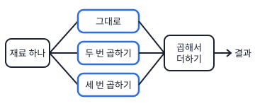

*손잡이 숫자는 그냥 곱하고 더하기만 하니까 여전히 곧은 방식이에요.*

**정확히 말하면**

보통 교재는 $\mathbf{x}^\top\boldsymbol{\theta} = \sum_{i=1}^{3} x_i\theta_i$까지만 선형회귀로 설명해요. 하지만 선형회귀의 범위는 훨씬 넓어요.

예: 스칼라 입력 $x$에 대해 $y$가 $x, x^2, x^3$ 모두의 영향을 받는 것 같다면 $f$는 3차 다항식이에요.

1. $$
   f_{\boldsymbol{\theta}}(x) = \theta_1 x + \theta_2 x^2 + \theta_3 x^3
   $$
2. $$
   \boldsymbol{\phi}(x) = [x, x^2, x^3]^\top \text{ 로 두면}
   $$
3. $$
   f_{\boldsymbol{\theta}}(x) = \boldsymbol{\phi}(x)^\top\boldsymbol{\theta}
   $$

이 식은 $x$에 대해서는 비선형이지만 $\boldsymbol{\theta}$에 대해서는 선형(linear in $\boldsymbol{\theta}$)이에요. 그래서 이것도 선형회귀예요. PDF의 꼴은 같고 평균만 바뀌어요.

일반형(슬라이드 s6):

$$
p(y \mid \mathbf{x}) = \mathcal{N}\big(y \mid \boldsymbol{\phi}(\mathbf{x})^\top\boldsymbol{\theta}, \sigma^2\big) \iff y = \boldsymbol{\phi}(\mathbf{x})^\top\boldsymbol{\theta} + \epsilon
$$

슬라이드 결론은 "Both are linear in θ"예요. 곧 $\mathbf{x}^\top\boldsymbol{\theta}$도 $\boldsymbol{\phi}(\mathbf{x})^\top\boldsymbol{\theta}$도 모두 $\boldsymbol{\theta}$에 대해 선형이에요.

- $\boldsymbol{\phi}(\mathbf{x})$는 함수들로 이루어진 벡터이고, 특징 벡터(feature vector)라고 불러요.
- 특징은 $y$에 영향을 주는 로우 데이터의 성분을 뽑아 나열한 것이에요.
- 이런 함수를 만드는 과정이 특징 추출(feature extraction)이에요(예: PCA).
- 트랜스포머의 네트워크 임베딩도 수학적으로는 이 식 하나예요. 특징을 만드는 함수를 신경망으로 만든다는 점만 달라요.

수치 예: $x = 0.3$이면

$$
\boldsymbol{\phi}(x) = [0.3,\ 0.09,\ 0.027]^\top
$$

이고, $\boldsymbol{\phi}(x)^\top\boldsymbol{\theta}$를 평균으로 하는 가우시안 확률변수가 만들어져요.

(수업 중 셋째 성분을 0.0027로 말했지만 $0.3^3 = 0.027$이에요.)

이렇게 선형회귀를 함수 공간(function space)으로 확장해요. 구체적인 다항식 예제는 나중에 다시 나와요.

**교수님 말씀**

> "여러분, 이거 별표 한번 쳐놓으세요. 여기서부터 약간 어드밴스드된 기법인데" (0923 32:31)

> "웬만한 문제는 리니어 리그레션이 진짜 잘 푼다고." (0923 34:03)

> "내가 최적화하고 싶은 파라미터 자체가 리니어하면 얘도 여전히 이렇게 만들어낼 수 있어요" (0923 36:50)

LLM에서 쓰는 트랜스포머의 네트워크 임베딩도 수학적으로는 이 수식 하나라고 강조했어요 (0923 40:00). 함수 공간 확장은 "나중에 이그잼플로 또 나올 거예요"라며 미뤘어요 (0923 41:44).

**페이지 요약**

$\boldsymbol{\theta}$에 대해 선형이면 $x$에 대해 비선형이어도 선형회귀예요.

*핵심 식*

- 다항식 특징

  $$
  \boldsymbol{\phi}(x) = [x, x^2, x^3]^\top \text{ 로 두면}
  $$
- 특징 벡터 우도

  $$
  p(y \mid \mathbf{x}) = \mathcal{N}\big(y \mid \boldsymbol{\phi}(\mathbf{x})^\top\boldsymbol{\theta}, \sigma^2\big) \iff y = \boldsymbol{\phi}(\mathbf{x})^\top\boldsymbol{\theta} + \epsilon
  $$

*용어*

- **특징 벡터(feature vector)** — 입력을 함수들로 바꿔 나열한 벡터
- **특징 추출(feature extraction)** — 특징을 만드는 함수를 정하는 과정
- **함수 공간(function space)** — 특징으로 넓힌 선형회귀의 무대

---

## 2. 파라미터 추정: iid 우도에서 최소제곱까지

### 훈련 집합과 데이터 행렬 X

*0923 수업 · L03 s7*

**쉽게 말하면**

문제와 정답을 짝지어 한 줄씩 쌓은 표가 우리가 가진 공부 자료예요.

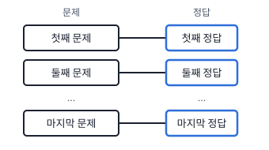

*한 줄에 문제 하나와 그 정답이 짝으로 들어 있어요.*

**정확히 말하면**

훈련 집합(training set)은 입력과 출력이 짝(paired)을 이룬 데이터예요. 지도학습이라서 입력마다 정답이 붙어 있어요.

$$
\mathcal{D} = \{(\mathbf{x}_1, y_1), \dots, (\mathbf{x}_N, y_N)\}, \quad \mathbf{x}_n \in \mathbb{R}^D,\ y_n \in \mathbb{R}
$$

칠판에서는 입력 벡터들을 행렬 하나로 묶었어요.

1. 열벡터 $N$개를 옆으로 붙여요: $[\mathbf{x}_1, \dots, \mathbf{x}_N] \in \mathbb{R}^{D \times N}$
2. 전치(transpose)하면 각 행이 $\mathbf{x}_n^\top$인 행렬이 돼요: $\mathbf{X} = [\mathbf{x}_1, \dots, \mathbf{x}_N]^\top \in \mathbb{R}^{N \times D}$
3. 출력과 노이즈도 벡터로 모아요: $\mathbf{y} = [y_1, \dots, y_N]^\top$, $\boldsymbol{\epsilon} = [\epsilon_1, \dots, \epsilon_N]^\top$
4. 샘플마다 $y_n = \mathbf{x}_n^\top\boldsymbol{\theta} + \epsilon_n$이에요. $\mathbf{X}\boldsymbol{\theta}$의 $n$번째 성분이 $\mathbf{x}_n^\top\boldsymbol{\theta}$이므로 $N$줄을 한 번에 쓸 수 있어요.

$$
\mathbf{y} = \mathbf{X}\boldsymbol{\theta} + \boldsymbol{\epsilon}
$$

차원 확인: $(N \times D)(D \times 1) = N \times 1$이라서 $\mathbf{X}\boldsymbol{\theta}$와 $\mathbf{y}$의 길이가 같아요. 슬라이드와 MML(식 9.10b)의 $\mathbf{X}$는 이미 전치한 $N \times D$ 행렬이에요. 칠판에서 처음 만든 $D \times N$ 행렬로 쓰면 곱할 때 전치가 한 번 더 필요해요.

그래프 표현(graphical representation)으로 보면 $\mathbf{x}_n$이 들어와 $y_n$이 만들어지고, 모델 파라미터 $\boldsymbol{\theta}$와 $\sigma$가 그 과정에 영향을 줘요. 판(plate) 하나가 $n = 1, \dots, N$ 반복을 나타내요. 이 반복을 곱으로 바꾸는 과정은 [iid면 우도는 곱이 된다](#s2-iid)에서 이어져요.

(수업 중 $\mathbf{X}$를 "길이가 $D$고 너비가 $N$인 행렬"로 말했다가 $N \times D$로 정정, 0923 58:13–58:59)

**교수님 말씀**

포뮬레이션이 끝났으니 이제 할 일은 파라미터를 찾는 거라고 했어요.

> "세타 찾아야지, 세타." (0923 41:54)

슬라이드의 $\mathbf{X}$가 왜 누워 있는지 짚었어요. 칠판의 열벡터 행렬을 뒤집은 것이 슬라이드의 $\mathbf{X}$예요.

> "트랜스포즈를 하니까 이렇게 누워있는 거고" (0923 46:18)

그래프 표현과 plate, iid 가정은 지난 시간에 배운 것을 다시 꺼낸 거예요(0923 44:18–45:03).

**페이지 요약**

짝지은 데이터 $N$개를 행렬로 쌓으면 모델 전체를 식 한 줄로 쓸 수 있어요.

*핵심 식*

- 훈련 집합

  $$
  \mathcal{D} = \{(\mathbf{x}_1, y_1), \dots, (\mathbf{x}_N, y_N)\}, \quad \mathbf{x}_n \in \mathbb{R}^D,\ y_n \in \mathbb{R}
  $$
- 행렬 모델

  $$
  \mathbf{y} = \mathbf{X}\boldsymbol{\theta} + \boldsymbol{\epsilon}
  $$

*용어*

- **데이터 행렬 $\mathbf{X}$** — 각 행이 $\mathbf{x}_n^\top$인 $N \times D$ 행렬
- **판(plate)** — $n = 1, \dots, N$ 반복을 그림에서 묶어 나타낸 상자

---

### iid면 우도는 곱이 된다

*0923 수업 · L03 s7*

**쉽게 말하면**

서로 영향을 주지 않는 일들이 모두 함께 일어날 가능성은 하나하나의 가능성을 곱하면 돼요.

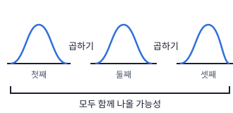

*모양이 같은 종 세 개를 곱하면 전체 가능성이 나와요.*

**정확히 말하면**

샘플 하나는 $y_n = \mathbf{x}_n^\top\boldsymbol{\theta} + \epsilon_n$, $\epsilon_n \sim \mathcal{N}(0, \sigma^2)$이에요. 불확실성은 $\epsilon_n$에서만 오므로 우도는 다음과 같아요.

$$
p(y_n \mid \mathbf{x}_n, \boldsymbol{\theta}) = \mathcal{N}(y_n \mid \mathbf{x}_n^\top\boldsymbol{\theta}, \sigma^2)
$$

이 표기를 가우시안 PDF로 풀어 쓰면 첫 번째 샘플은 이래요.

$$
p_{Y_1}(y_1) = \frac{1}{\sqrt{2\pi\sigma^2}}\exp\left(-\frac{(y_1 - \mathbf{x}_1^\top\boldsymbol{\theta})^2}{2\sigma^2}\right)
$$

첨자 1을 $i$로 바꾸면 $i$번째 marginal PDF가 돼요. 같은 분포를 따르는 것은 노이즈예요. 노이즈 $\epsilon_1, \dots, \epsilon_N$은 모두 $\epsilon_n \sim \mathcal{N}(0, \sigma^2)$이고 서로 독립이에요. 이것이 i.i.d.(independent and identically distributed) 가정이에요.

$y_n$ 자체는 평균 $\mathbf{x}_n^\top\boldsymbol{\theta}$가 샘플마다 달라서 분포가 같지 않아요. 분산 $\sigma^2$와 종 모양만 같아요.

대신 $y_1, \dots, y_N$은 각자의 입력 $\mathbf{x}_n$이 주어졌을 때 서로 조건부 독립(conditionally independent)이에요. 그래서 결합 PDF가 각 PDF의 곱으로 인수분해돼요(MML 식 9.5).

$$
p(\mathcal{Y} \mid \mathcal{X}, \boldsymbol{\theta}) = \prod_{n=1}^{N} p(y_n \mid \mathbf{x}_n, \boldsymbol{\theta}) = \prod_{n=1}^{N} \mathcal{N}(y_n \mid \mathbf{x}_n^\top\boldsymbol{\theta}, \sigma^2)
$$

여기서 $\mathcal{X} = \{\mathbf{x}_1, \dots, \mathbf{x}_N\}$, $\mathcal{Y} = \{y_1, \dots, y_N\}$예요. $\boldsymbol{\theta}$는 모든 샘플에 공통으로 영향을 줘요. 칠판에서 이 곱을 풀었어요.

1. $$
   \prod_{n=1}^{N} \frac{1}{\sqrt{2\pi\sigma^2}}\exp\left(-\frac{(y_n - \mathbf{x}_n^\top\boldsymbol{\theta})^2}{2\sigma^2}\right)
   $$
2. 앞의 상수는 $n$과 무관하니 $N$번 곱해져 $N$제곱으로 묶여요:

   $$
   \left(\frac{1}{\sqrt{2\pi\sigma^2}}\right)^{N} \prod_{n=1}^{N} \exp\left(-\frac{(y_n - \mathbf{x}_n^\top\boldsymbol{\theta})^2}{2\sigma^2}\right)
   $$
3. 지수함수의 곱은 지수의 합이에요($e^{a}e^{b} = e^{a+b}$):

   $$
   \left(\frac{1}{\sqrt{2\pi\sigma^2}}\right)^{N} \exp\left(-\frac{1}{2\sigma^2}\sum_{n=1}^{N}(y_n - \mathbf{x}_n^\top\boldsymbol{\theta})^2\right)
   $$

이제 바꿀 수 있는 것은 $\boldsymbol{\theta}$뿐이에요. 이 우도를 가장 크게 하는 $\boldsymbol{\theta}$를 찾는 방법이 ML과 MAP이고, 이번 수업은 ML만 다뤘어요. 이어지는 계산은 [ML → 음의 로그우도 → 최소제곱](#s2-nll)에 있어요.

**교수님 말씀**

$\mathcal{N}(y_1 \mid \mathbf{x}_1^\top\boldsymbol{\theta}, \sigma^2)$라는 표기가 실제로 어떤 식인지 칠판에 직접 풀어 쓰고, 이 표기를 기억하라고 했어요.

> "이제 가우시안 분포가 이제 본격적으로 처음 나오기 시작했으니까." (0923 50:00)

$y_2$도, $y_i$도 같은 꼴이고 서로 관련이 없다고 확인했어요. 여기서 "분포가 똑같다"는 가우시안 모양과 분산 $\sigma^2$가 같다는 뜻이에요. 평균 $\mathbf{x}_n^\top\boldsymbol{\theta}$는 샘플마다 달라요.

> "다 똑같지, 분포가. … 근데 서로 상호 관련이 있어요, 없어요? 없지." (0923 50:43)

> "통계적으로 독립이니까 전체 Y가 발생할 확률은 각각이 발생할 확률들의 곱" (0923 51:35)

**페이지 요약**

노이즈가 i.i.d.라서 $y_n$이 입력이 주어졌을 때 조건부 독립이에요. 그래서 전체 우도는 가우시안 $N$개의 곱이 되고, 정리하면 지수 안의 합이 돼요.

*핵심 식*

- 우도 인수분해

  $$
  p(\mathcal{Y} \mid \mathcal{X}, \boldsymbol{\theta}) = \prod_{n=1}^{N} p(y_n \mid \mathbf{x}_n, \boldsymbol{\theta}) = \prod_{n=1}^{N} \mathcal{N}(y_n \mid \mathbf{x}_n^\top\boldsymbol{\theta}, \sigma^2)
  $$
- 풀어 쓴 꼴

  $$
  \left(\frac{1}{\sqrt{2\pi\sigma^2}}\right)^{N} \exp\left(-\frac{1}{2\sigma^2}\sum_{n=1}^{N}(y_n - \mathbf{x}_n^\top\boldsymbol{\theta})^2\right)
  $$

*용어*

- **i.i.d.** — 노이즈 $\epsilon_n$이 모두 같은 분포 $\mathcal{N}(0, \sigma^2)$를 따르고 서로 독립이라는 가정. 그래서 $y_n$은 $\mathbf{x}_n$이 주어지면 조건부 독립이에요

---

### ML → 음의 로그우도 → 최소제곱

*0923 수업 · L03 s9*

**쉽게 말하면**

가장 그럴듯한 답을 찾는 일은 예상과 실제 사이의 틈을 가장 작게 만드는 일과 같아요.

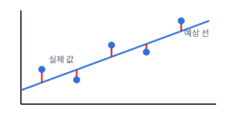

*색칠된 점과 선 사이의 세로 틈이 모두 작아지게 선을 맞춰요.*

**정확히 말하면**

최대우도 추정(maximum likelihood estimation)은 우도를 가장 크게 하는 파라미터를 고르는 방법이에요(MML 식 9.7–9.8).

$$
\boldsymbol{\theta}_{\text{ML}} = \arg\max_{\boldsymbol{\theta}} p(\mathcal{Y} \mid \mathcal{X}, \boldsymbol{\theta}) = \arg\min_{\boldsymbol{\theta}} \big(-\log p(\mathcal{Y} \mid \mathcal{X}, \boldsymbol{\theta})\big)
$$

로그는 증가함수라서 최대점의 위치를 바꾸지 않아요. 앞에 마이너스를 붙이면 최대화가 최소화로 바뀌어요. 이렇게 만든 $-\log p$를 음의 로그우도(negative log-likelihood)라고 해요.

[iid면 우도는 곱이 된다](#s2-iid)에서 얻은 식에 대입해요. 지수 안의 양을 $\star$로 둬요.

$$
\star = \frac{1}{2\sigma^2}\sum_{n=1}^{N}(y_n - \mathbf{x}_n^\top\boldsymbol{\theta})^2
$$

1. $$
   -\log p(\mathcal{Y} \mid \mathcal{X}, \boldsymbol{\theta}) = -\log\left[\left(\frac{1}{\sqrt{2\pi\sigma^2}}\right)^{N} \exp(-\star)\right]
   $$
2. $\log ab = \log a + \log b$로 나눠요:

   $$
   = -\log\left(\frac{1}{\sqrt{2\pi\sigma^2}}\right)^{N} - \log\exp(-\star)
   $$
3. 첫 항은 $\boldsymbol{\theta}$와 무관한 상수(const)라서 최소화에 영향이 없어요.
4. 자연로그와 지수가 상쇄되고 $-(-\star) = +\star$가 돼요:

   $$
   = \frac{1}{2\sigma^2}\sum_{n=1}^{N}(y_n - \mathbf{x}_n^\top\boldsymbol{\theta})^2 + \text{const}
   $$
5. $(\mathbf{X}\boldsymbol{\theta})_n = \mathbf{x}_n^\top\boldsymbol{\theta}$이므로 합을 노름으로 써요:

   $$
   = \frac{1}{2\sigma^2}\|\mathbf{y} - \mathbf{X}\boldsymbol{\theta}\|^2 + \text{const}
   $$

차원 확인: $\mathbf{X} \in \mathbb{R}^{N \times D}$, $\boldsymbol{\theta} \in \mathbb{R}^{D}$이므로 $\mathbf{X}\boldsymbol{\theta} \in \mathbb{R}^{N}$이고 $\mathbf{y}$와 길이가 같아요.

$\hat{\mathbf{y}} := \mathbf{X}\boldsymbol{\theta}$는 모델의 예측치예요. 그래서 ML은 실측값 $\mathbf{y}$와 예측 벡터 $\hat{\mathbf{y}}$의 차이 노름을 최소화하는 문제가 돼요. 이것을 최소제곱(least squares) 문제라고 불러요.

$$
\boldsymbol{\theta}_{\text{ML}} = \arg\min_{\boldsymbol{\theta}} \frac{1}{2\sigma^2}\|\mathbf{y} - \mathbf{X}\boldsymbol{\theta}\|^2
$$

(수업 중 "로그 a 곱하기 로그 b"로 말했다가 $\log ab = \log a + \log b$로 정정, 0923 56:09–56:40)

**교수님 말씀**

확률을 최대화하는 것과 로그를 취하고 마이너스를 붙여 최소화하는 것은 같은 문제라고 했어요(0923 54:45). 로그와 지수가 사라지는 순간을 짚었어요.

> "자연로그에다가 익스포넨셜이 있으니까 얘도 없어지잖아." (0923 57:04)

> "전체를 미니마이즈하려면 … 별표를 미니마이즈하면 되겠다." (0923 57:14)

$\mathbf{X}\boldsymbol{\theta}$에 이름을 붙이고, 그 뜻을 최소제곱으로 이었어요.

> "얘가 우리의 예측치다, 예측치." (0923 59:59)

> "그래서 이걸 리스트 스퀘어 프라블럼이라고 부르기도 한다." (0923 60:00)

**페이지 요약**

가우시안 노이즈에서 우도를 최대화하는 것은 예측치와 실측값의 제곱 거리를 최소화하는 최소제곱과 같아요.

*핵심 식*

- ML 추정

  $$
  \boldsymbol{\theta}_{\text{ML}} = \arg\max_{\boldsymbol{\theta}} p(\mathcal{Y} \mid \mathcal{X}, \boldsymbol{\theta}) = \arg\min_{\boldsymbol{\theta}} \big(-\log p(\mathcal{Y} \mid \mathcal{X}, \boldsymbol{\theta})\big)
  $$
- 음의 로그우도

  $$
  = \frac{1}{2\sigma^2}\|\mathbf{y} - \mathbf{X}\boldsymbol{\theta}\|^2 + \text{const}
  $$

*용어*

- **음의 로그우도(negative log-likelihood)** — 우도에 로그를 취하고 마이너스를 붙인 값
- **최소제곱(least squares)** — 실측값과 예측치 차이의 제곱 노름을 최소화하는 문제

---

### 가우시안 노이즈에서 ML = 경험적 위험 최소화

*0923 수업 · L03 s10*

**쉽게 말하면**

흔들림이 대개 0 근처에서 생긴다면 받은 값을 그대로 믿는 게 가장 좋은 선택이에요.

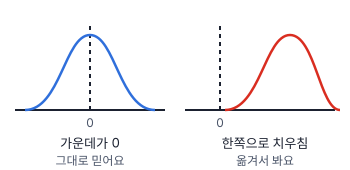

*종이 0 위에 서 있으면 그대로 믿고, 옆으로 비켜 서 있으면 그만큼 옮겨서 봐요.*

**정확히 말하면**

[ML → 음의 로그우도 → 최소제곱](#s2-nll)의 결과를 손실 함수(loss function)로 이름 붙여요. $\mathbf{y}$와 $\mathbf{X}$는 훈련 데이터로 주어져 있고 $\boldsymbol{\theta}$만 바꿔요.

$$
L(\boldsymbol{\theta}) = \frac{1}{2\sigma^2}\|\mathbf{y} - \mathbf{X}\boldsymbol{\theta}\|^2, \qquad \boldsymbol{\theta}_{\text{ML}} = \arg\min_{\boldsymbol{\theta}} L(\boldsymbol{\theta})
$$

지난 시간의 경험적 위험 최소화(empirical risk minimization)는 노이즈를 무시한 결정론적 모델 $f(\mathbf{x}_n, \boldsymbol{\theta}) = \mathbf{x}_n^\top\boldsymbol{\theta}$를 썼어요. 제곱 손실(squared loss)로 empirical risk를 쓰면 이래요.

$$
R_{\text{emp}}(\boldsymbol{\theta}) = \frac{1}{N}\sum_{n=1}^{N}(y_n - \mathbf{x}_n^\top\boldsymbol{\theta})^2 = \frac{1}{N}\|\mathbf{y} - \mathbf{X}\boldsymbol{\theta}\|^2
$$

$L(\boldsymbol{\theta})$와 $R_{\text{emp}}(\boldsymbol{\theta})$는 양의 상수 배만 달라서 최소점이 같아요. 슬라이드 s10의 결론은 이거예요.

- 가우시안 노이즈에서 $\boldsymbol{\theta}_{\text{ML}}$은 squared loss로 empirical risk를 최소화하는 $\boldsymbol{\theta}$와 같아요.
- Models as functions = Models as probabilistic models

왜 같은지는 가우시안 PDF의 모양에서 나와요.

1. 가우시안 노이즈는 평균 근처에 몰려 있어요.
2. 이 문제에서 노이즈 평균은 0이에요.
3. 그러니 "노이즈가 0이었을 것"이라고 보는 것이 가장 합리적이에요.
4. 받은 로우 데이터 $\mathbf{y}$를 그대로 믿는 셈이라서 결정론적 ERM과 같은 해가 나와요.

반대로 노이즈 $\epsilon'$의 PDF가 양수 $\lambda$ 근처에 몰려 있다고 해 봐요. 그러면 $y$를 받았을 때 실제 값은 $y - \lambda$ 근처였다고 보는 게 더 합리적이에요. 관측이 시프트된 셈이라, 이때는 ML과 단순 ERM이 달라질 수 있어요. 교수님도 이 예는 정확한 설명이 아니라 감을 잡기 위한 스케치라고 했어요.

남은 일은 $L(\boldsymbol{\theta})$를 $\boldsymbol{\theta}$로 미분해 0이 되는 점을 찾는 거예요. 그 과정은 [정규방정식](#s3-normal-eq)에서 이어져요.

**교수님 말씀**

수업 앞부분에서 가우시안 PDF 모양을 길게 설명한 이유가 여기 있었다고 했어요.

> "가우시안 노이즈 PDF의 꼬라지를 보여준 거예요. 이것 때문에 그래." (0923 63:00)

> "입실론이라는 것이 평균 근처에 몰려 있을 확률이 어떻다? 많다." (0923 63:28)

> "로우 데이터 자체로 오롯이 믿는 게 가장 합리적인 선택" (0923 64:09)

그래서 두 방법의 해가 같아진 것을 이렇게 표현했어요.

> "솔루션이 우연찮게 동일하게 나온 거예요." (0923 65:22)

치우친 노이즈 예를 들 때는 "예를 들어 보는 거예요 이거 정확하진 않습니다"라고 먼저 말했어요(0923 64:30).

**페이지 요약**

평균이 0인 가우시안 노이즈에서는 데이터를 그대로 믿는 게 최선이라, ML 해와 제곱 손실 ERM 해가 같아요.

*핵심 식*

- 손실 함수

  $$
  L(\boldsymbol{\theta}) = \frac{1}{2\sigma^2}\|\mathbf{y} - \mathbf{X}\boldsymbol{\theta}\|^2, \qquad \boldsymbol{\theta}_{\text{ML}} = \arg\min_{\boldsymbol{\theta}} L(\boldsymbol{\theta})
  $$
- 경험적 위험

  $$
  R_{\text{emp}}(\boldsymbol{\theta}) = \frac{1}{N}\sum_{n=1}^{N}(y_n - \mathbf{x}_n^\top\boldsymbol{\theta})^2 = \frac{1}{N}\|\mathbf{y} - \mathbf{X}\boldsymbol{\theta}\|^2
  $$

*용어*

- **경험적 위험 최소화(empirical risk minimization)** — 훈련 데이터의 평균 손실을 최소화하는 방법
- **제곱 손실(squared loss)** — $(y_n - \mathbf{x}_n^\top\boldsymbol{\theta})^2$처럼 오차를 제곱한 손실

---

## 3. 미분해서 해 구하기: 정규방정식과 유사역행렬

### 미분이 0이 되는 θ 찾기: 정규방정식

*0923 수업 · L03 s11*

**쉽게 말하면**

그릇 모양 곡선에서 가장 낮은 곳은 바닥이 평평한 곳이에요.

그래서 평평한 곳을 찾으면 가장 잘 맞는 답이 나와요.

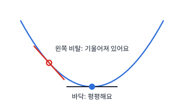

*비탈에서는 닿는 선이 기울어져 있고, 바닥에서만 선이 평평해져요.*

**정확히 말하면**

손실 함수는 $L(\boldsymbol{\theta}) = \frac{1}{2\sigma^2}\lVert \mathbf{y} - \mathbf{X}\boldsymbol{\theta} \rVert^2$이고, 그 꼴은 $L: \mathbb{R}^D \to \mathbb{R}$이에요.

입력은 벡터 $\boldsymbol{\theta} \in \mathbb{R}^D$이고, 벡터 $\mathbf{y} - \mathbf{X}\boldsymbol{\theta}$에 노름을 씌웠으니 출력은 스칼라예요.

$L$은 $\boldsymbol{\theta}$에 대한 2차식이라, $\mathrm{rk}(\mathbf{X}) = D$일 때 전역 최솟값이 하나예요. 그래서 기울기가 0이 되는 $\boldsymbol{\theta}$를 찾으면 돼요.

1. 조건:

   $$
   \frac{dL}{d\boldsymbol{\theta}} = \mathbf{0}^\top
   $$
2. 미분(유도는 [보충: dL/dθ 벡터 미분 유도](#s3-vector-diff)):

   $$
   \frac{dL}{d\boldsymbol{\theta}} = \frac{1}{2\sigma^2}\left(-2(\mathbf{y} - \mathbf{X}\boldsymbol{\theta})^\top\mathbf{X}\right)
   $$
3. 정리:

   $$
   \frac{dL}{d\boldsymbol{\theta}} = \frac{1}{\sigma^2}\left(-\mathbf{y}^\top\mathbf{X} + \boldsymbol{\theta}^\top\mathbf{X}^\top\mathbf{X}\right) = \mathbf{0}^\top
   $$
4. $\frac{1}{\sigma^2}$을 지우고 옮기면 정규방정식(normal equation):

   $$
   \boldsymbol{\theta}_{\text{ML}}^\top \mathbf{X}^\top\mathbf{X} = \mathbf{y}^\top\mathbf{X}
   $$

양변에 $(\mathbf{X}^\top\mathbf{X})^{-1}$을 곱하려면 역행렬이 있어야 해요. $\mathrm{rk}(\mathbf{X}) = D$이면 $\mathbf{X}^\top\mathbf{X}$는 positive definite(양의 정부호)라 역행렬이 있어요.

중복 데이터가 없고 $N \ge D$(데이터 수가 파라미터 수 이상)이면 보통 $\mathrm{rk}(\mathbf{X}) = D$예요.

헤세 행렬(Hessian) $\nabla^2_{\boldsymbol{\theta}} L = \frac{1}{\sigma^2}\mathbf{X}^\top\mathbf{X}$가 positive definite이라, 기울기 0은 필요충분조건이고 그 점이 전역 최솟값이에요(MML 9.2.1 Remark).

rank 조건은 슬라이드에만 적혀 있고 수업에서 말로 풀지는 않았어요.

1차원 예(Example 9.2의 숫자를 바꾼 예): 원점을 지나는 직선 $f(x) = \theta x$를 맞추면 $D = 1$이에요. 이때 $\mathbf{X}^\top\mathbf{X} = \sum_n x_n^2$, $\mathbf{y}^\top\mathbf{X} = \sum_n x_n y_n$이라 정규방정식은 $\theta_{\text{ML}}\sum_n x_n^2 = \sum_n x_n y_n$이에요.

$\mathbf{x} = (1, 2, 3)$, $\mathbf{y} = (3, 4, 8)$이면 $\sum_n x_n y_n = 35$, $\sum_n x_n^2 = 14$라서 $\theta_{\text{ML}} = \frac{35}{14} = \frac{5}{2}$예요.

#### 직접 해 보기: 기울기가 0인 곳이 ML 해 *(정적 스냅샷 — 직접 조작은 HTML 버전)*

직선의 기울기 $\theta$를 움직이면 왼쪽에 직선과 잔차가, 오른쪽에 $L(\theta)$ 곡선 위 현재 위치와 접선이 보여요. 여기서는 $\sigma^2 = \frac{1}{2}$로 두어 $L(\theta) = \sum_n (y_n - \theta x_n)^2$이에요.

현재: **θ = 1.0, L(θ) = 33.00, dL/dθ = -42.0. 기울기가 음수라 θ를 키우면 L이 줄어요**

범례: 직선 f(x) = θx · 데이터 점 · L(θ) 곡선 · 세로 선: 잔차 · 곡선 위 짧은 선: 접선 · 점선: ML 해

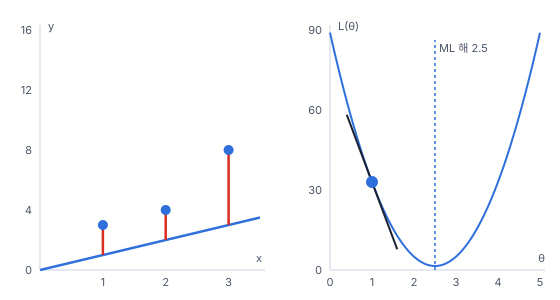

*$\theta = 1$: 직선이 낮아서 잔차가 크고, 기울기가 음수예요.*

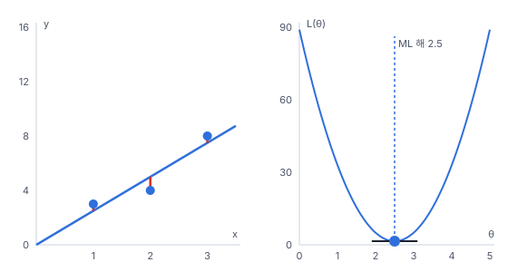

*$\theta = 2.5$: 곡선 바닥이고 접선이 수평이에요.*

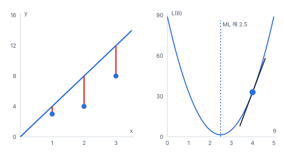

*$\theta = 4$: 직선이 높아서 잔차가 크고, 기울기가 양수예요.*

| $\theta$ | $L(\theta)$ | $\frac{dL}{d\theta}$ | 뜻 |
|---|---|---|---|
| 1 | 33.00 | -42.0 | 직선이 낮아 θ를 키워야 해요 |
| 2.5 | 1.50 | 0.0 | 바닥: ML 해 |
| 4 | 33.00 | 42.0 | 직선이 높아 θ를 줄여야 해요 |

**교수님 말씀**

교수님은 손실이 스칼라라는 점부터 짚었어요. 벡터 $\mathbf{y} - \mathbf{X}\boldsymbol{\theta}$에 노름을 취했으니 출력은 숫자 하나이고, 입력만 벡터라는 거예요.

미분 과정은 슬라이드를 짚으며 "이렇게, 이렇게" 하고 빠르게 넘어갔어요. 벡터 미분 유도는 보충 강의로 미뤘어요.

> "미분값이 0이 되는 점을 찾게 만드는 세타를 찾는 게 리니어 리그레션의 처음부터 끝이에요." (0923 67:19)

**페이지 요약**

손실을 θ로 미분해 0이 되는 곳을 찾으면 정규방정식이 나와요.

*핵심 식*

- 최적 조건

  $$
  \frac{dL}{d\boldsymbol{\theta}} = \mathbf{0}^\top
  $$
- 정규방정식

  $$
  \boldsymbol{\theta}_{\text{ML}}^\top \mathbf{X}^\top\mathbf{X} = \mathbf{y}^\top\mathbf{X}
  $$

*용어*

- **정규방정식(normal equation)** — 기울기가 0이라는 조건을 정리한 연립방정식
- **양의 정부호(positive definite)** — $\mathrm{rk}(\mathbf{X}) = D$이면 $\mathbf{X}^\top\mathbf{X}$가 갖는 성질, 역행렬이 있어요

---

### 선형회귀의 답은 유사역행렬

*0923 수업 · L03 s11*

**쉽게 말하면**

가장 잘 맞는 답은 늘 같은 방법으로 나와요.

잰 값 묶음을 자료 표로 만든 되돌리기 기계에 넣으면 가장 잘 맞는 답이 나와요.

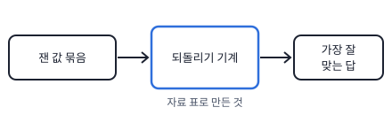

*기계는 자료 표만 있으면 만들 수 있어요.*

**정확히 말하면**

[미분이 0이 되는 θ 찾기: 정규방정식](#s3-normal-eq)에서 얻은 식에서 출발해요.

1. $$
   \boldsymbol{\theta}_{\text{ML}}^\top \mathbf{X}^\top\mathbf{X} = \mathbf{y}^\top\mathbf{X}
   $$
2. 오른쪽에 $(\mathbf{X}^\top\mathbf{X})^{-1}$을 곱해요:

   $$
   \boldsymbol{\theta}_{\text{ML}}^\top = \mathbf{y}^\top\mathbf{X}(\mathbf{X}^\top\mathbf{X})^{-1}
   $$
3. 양변을 전치해요($\mathbf{X}^\top\mathbf{X}$가 대칭이라 그 역행렬도 대칭):

   $$
   \boldsymbol{\theta}_{\text{ML}} = (\mathbf{X}^\top\mathbf{X})^{-1}\mathbf{X}^\top\mathbf{y}
   $$

$\mathbf{X} \in \mathbb{R}^{N \times D}$는 보통 정사각 행렬이 아니라 역행렬 $\mathbf{X}^{-1}$이 없어요. 대신 아래 행렬이 그 역할을 해요.

$$
\mathbf{X}^{+} := (\mathbf{X}^\top\mathbf{X})^{-1}\mathbf{X}^\top \in \mathbb{R}^{D \times N}, \qquad \mathbf{X}^{+}\mathbf{X} = \mathbf{I}_D
$$

$\mathbf{X}^{+}$를 $\mathbf{X}$의 유사역행렬(pseudo-inverse, 슈도 인버스)이라고 해요. 그래서 $\boldsymbol{\theta}_{\text{ML}} = \mathbf{X}^{+}\mathbf{y}$예요.

결론: 최소제곱 문제의 해는 데이터 행렬 $\mathbf{X}$의 유사역행렬을 $\mathbf{y}$에 곱한 것이에요.

숫자 예: $\mathbf{X} = [1, 2, 3]^\top$, $\mathbf{y} = [3, 4, 8]^\top$이면 $\mathbf{X}^\top\mathbf{X} = 14$, $\mathbf{X}^{+} = \frac{1}{14}[1, 2, 3]$이라 $\theta_{\text{ML}} = \frac{35}{14} = \frac{5}{2}$예요.

계산할 때는 역행렬을 직접 구하기보다 $\mathbf{A}\boldsymbol{\theta} = \mathbf{b}$ 꼴 연립방정식($\mathbf{A} = \mathbf{X}^\top\mathbf{X}$, $\mathbf{b} = \mathbf{X}^\top\mathbf{y}$)을 풀면 돼요(MML 9.2.1 Remark).

**교수님 말씀**

> "리스트 스퀘어 프라블럼의 솔루션은 항상 X라는 매트릭스 데이터의 슈도 인버스로 주어지게 된다." (0923 68:14)

바로 이어서 "그러니까 이게 결론이에요"라고 못 박았어요.

신나게 설명한 뒤에는 학생들이 속으로 "자기만 신났네" 하고 있을 거라며 농담했어요(0923 68:58).

> "리니어 리그레션의 솔루션은 뭘로 주어진다? 슈도 인버스로 주어진다." (0923 70:39)

**페이지 요약**

선형회귀(최소제곱)의 해는 데이터 행렬의 유사역행렬을 y에 곱한 거예요.

*핵심 식*

- ML 해

  $$
  \boldsymbol{\theta}_{\text{ML}} = (\mathbf{X}^\top\mathbf{X})^{-1}\mathbf{X}^\top\mathbf{y}
  $$
- 유사역행렬

  $$
  \mathbf{X}^{+} := (\mathbf{X}^\top\mathbf{X})^{-1}\mathbf{X}^\top \in \mathbb{R}^{D \times N}, \qquad \mathbf{X}^{+}\mathbf{X} = \mathbf{I}_D
  $$

*용어*

- **유사역행렬(pseudo-inverse)** — 정사각이 아닌 행렬에서 역행렬 역할을 하는 행렬

---

### 보충: dL/dθ 벡터 미분 유도

*0923 수업 · L03 s11*

**쉽게 말하면**

손잡이가 여러 개인 기계는 손잡이마다 살짝 돌리면 점수가 얼마나 바뀌는지 따로 재요.

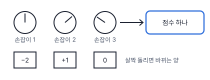

*그 값들을 한 줄로 늘어놓은 표가 이 기계의 기울기예요.*

**정확히 말하면**

스칼라 함수 $L: \mathbb{R}^D \to \mathbb{R}$을 벡터 $\boldsymbol{\theta}$로 미분한 것이 그레이디언트(gradient)예요.

MML은 이것을 행 벡터로 써요:

$$
\frac{dL}{d\boldsymbol{\theta}} = \left[\frac{\partial L}{\partial \theta_1}, \dots, \frac{\partial L}{\partial \theta_D}\right] \in \mathbb{R}^{1 \times D}
$$

그래서 최적 조건도 $\mathbf{0}^\top$(행 벡터 0)으로 적어요.

**보충 · 수업에서 유도하진 않았어요**

MML 식 (9.11)을 따라 한 줄씩 풀어요.

유도에 쓰는 규칙 두 개(모두 행 벡터 결과):

- $\frac{d}{d\boldsymbol{\theta}}(\mathbf{a}^\top\boldsymbol{\theta}) = \mathbf{a}^\top$
- $\frac{d}{d\boldsymbol{\theta}}(\boldsymbol{\theta}^\top\mathbf{A}\boldsymbol{\theta}) = \boldsymbol{\theta}^\top(\mathbf{A} + \mathbf{A}^\top)$, $\mathbf{A}$가 대칭이면 $2\boldsymbol{\theta}^\top\mathbf{A}$

1. 노름을 내적으로:

   $$
   L = \frac{1}{2\sigma^2}(\mathbf{y} - \mathbf{X}\boldsymbol{\theta})^\top(\mathbf{y} - \mathbf{X}\boldsymbol{\theta})
   $$
2. 전개($\boldsymbol{\theta}^\top\mathbf{X}^\top\mathbf{y}$는 스칼라라 $\mathbf{y}^\top\mathbf{X}\boldsymbol{\theta}$와 같아요):

   $$
   L = \frac{1}{2\sigma^2}\left(\mathbf{y}^\top\mathbf{y} - 2\mathbf{y}^\top\mathbf{X}\boldsymbol{\theta} + \boldsymbol{\theta}^\top\mathbf{X}^\top\mathbf{X}\boldsymbol{\theta}\right)
   $$
3. 첫 항은 $\boldsymbol{\theta}$와 무관:

   $$
   \frac{d}{d\boldsymbol{\theta}}\,\mathbf{y}^\top\mathbf{y} = \mathbf{0}^\top
   $$
4. 둘째 항, $\mathbf{a}^\top = \mathbf{y}^\top\mathbf{X}$:

   $$
   \frac{d}{d\boldsymbol{\theta}}\left(-2\mathbf{y}^\top\mathbf{X}\boldsymbol{\theta}\right) = -2\mathbf{y}^\top\mathbf{X}
   $$
5. 셋째 항, $\mathbf{A} = \mathbf{X}^\top\mathbf{X}$(대칭):

   $$
   \frac{d}{d\boldsymbol{\theta}}\left(\boldsymbol{\theta}^\top\mathbf{X}^\top\mathbf{X}\boldsymbol{\theta}\right) = 2\boldsymbol{\theta}^\top\mathbf{X}^\top\mathbf{X}
   $$
6. 모으면:

   $$
   \frac{dL}{d\boldsymbol{\theta}} = \frac{1}{2\sigma^2}\left(-2\mathbf{y}^\top\mathbf{X} + 2\boldsymbol{\theta}^\top\mathbf{X}^\top\mathbf{X}\right) = \frac{1}{\sigma^2}\left(-\mathbf{y}^\top\mathbf{X} + \boldsymbol{\theta}^\top\mathbf{X}^\top\mathbf{X}\right) \in \mathbb{R}^{1 \times D}
   $$

연쇄법칙으로도 같아요. $\mathbf{e} = \mathbf{y} - \mathbf{X}\boldsymbol{\theta}$라 두면 $\frac{d(\mathbf{e}^\top\mathbf{e})}{d\mathbf{e}} = 2\mathbf{e}^\top$, $\frac{d\mathbf{e}}{d\boldsymbol{\theta}} = -\mathbf{X}$라서 슬라이드 첫 줄 $-2(\mathbf{y} - \mathbf{X}\boldsymbol{\theta})^\top\mathbf{X}$가 나와요.

이차형식 규칙 확인: $\boldsymbol{\theta}^\top\mathbf{A}\boldsymbol{\theta} = \sum_{i,j}\theta_i A_{ij}\theta_j$를 $\theta_k$로 미분하면 $\sum_j A_{kj}\theta_j + \sum_i \theta_i A_{ik}$예요. 이것을 한 줄로 모으면 $\boldsymbol{\theta}^\top(\mathbf{A} + \mathbf{A}^\top)$예요.

$D = 1$이면 $\frac{dL}{d\theta} = \frac{1}{\sigma^2}\left(-\sum_n x_n y_n + \theta\sum_n x_n^2\right)$이에요. [미분이 0이 되는 θ 찾기: 정규방정식](#s3-normal-eq)의 위젯 곡선 기울기가 이 값이에요.

**교수님 말씀**

스칼라를 벡터로, 벡터를 벡터로 미분하는 방법(그레이디언트, 벡터 미적분)은 이날 풀지 않았어요.

교수님은 예전 인공지능 수학 강의 자료를 업데이트해 올려 주고, 추석 지나고 다음 주에 보충 강의로 가르치겠다고 했어요. 조교가 맡을 수도 있다고 했어요(0923 69:13–70:58).

마무리는 "지금 나가는 게 가능한가요?"라는 농담이었어요.

**페이지 요약**

손실을 전개한 뒤 두 가지 미분 규칙을 쓰면 슬라이드의 dL/dθ가 나와요.

*핵심 식*

- 전개

  $$
  L = \frac{1}{2\sigma^2}\left(\mathbf{y}^\top\mathbf{y} - 2\mathbf{y}^\top\mathbf{X}\boldsymbol{\theta} + \boldsymbol{\theta}^\top\mathbf{X}^\top\mathbf{X}\boldsymbol{\theta}\right)
  $$
- 그레이디언트

  $$
  \frac{dL}{d\boldsymbol{\theta}} = \frac{1}{2\sigma^2}\left(-2\mathbf{y}^\top\mathbf{X} + 2\boldsymbol{\theta}^\top\mathbf{X}^\top\mathbf{X}\right) = \frac{1}{\sigma^2}\left(-\mathbf{y}^\top\mathbf{X} + \boldsymbol{\theta}^\top\mathbf{X}^\top\mathbf{X}\right) \in \mathbb{R}^{1 \times D}
  $$

*용어*

- **그레이디언트(gradient)** — 스칼라 함수를 벡터로 미분한 것, MML에서는 행 벡터

---

### 수업 후 질문: 상수항을 넣으면 D+1 차원

*0923 수업 · 수업 후 질의응답*

**쉽게 말하면**

선이 꼭 왼쪽 아래 구석에서 출발할 필요는 없어요.

늘 1인 칸을 하나 더 붙이면 선을 위아래로 옮길 수 있어요.

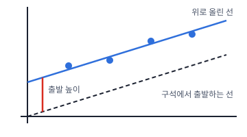

*색칠된 점들은 위로 올린 선에 더 잘 맞아요.*

**정확히 말하면**

지금까지의 모델 $f(\mathbf{x}) = \mathbf{x}^\top\boldsymbol{\theta}$에는 상수항(bias, 절편)이 없어서 항상 원점을 지나요.

상수항 $\theta_0$을 넣은 모델은 affine(어파인) 함수예요:

$$
f(\mathbf{x}) = \theta_0 + \mathbf{x}^\top\boldsymbol{\theta}
$$

1. 입력을 늘려요:

   $$
   \tilde{\mathbf{x}} = [1, \mathbf{x}^\top]^\top \in \mathbb{R}^{D+1}
   $$
2. 파라미터도 늘려요:

   $$
   \tilde{\boldsymbol{\theta}} = [\theta_0, \boldsymbol{\theta}^\top]^\top \in \mathbb{R}^{D+1}
   $$
3. 그러면 다시 내적 꼴:

   $$
   f(\mathbf{x}) = \tilde{\mathbf{x}}^\top\tilde{\boldsymbol{\theta}}
   $$

$\tilde{\boldsymbol{\theta}}$에 대해 선형이므로 지금까지의 유도가 그대로 성립해요. 데이터 행렬 $\tilde{\mathbf{X}} \in \mathbb{R}^{N \times (D+1)}$은 첫 열이 모두 1이에요.

해는 $\tilde{\boldsymbol{\theta}}_{\text{ML}} = (\tilde{\mathbf{X}}^\top\tilde{\mathbf{X}})^{-1}\tilde{\mathbf{X}}^\top\mathbf{y}$이고, 역행렬 조건은 $\mathrm{rk}(\tilde{\mathbf{X}}) = D+1$이 돼요.

$[1, \mathbf{x}^\top]^\top$은 특징 벡터 $\boldsymbol{\phi}(\mathbf{x})$의 한 예로 볼 수 있어요([x에 대해 비선형이어도 선형회귀: 특징 벡터](#s1-features)).

[미분이 0이 되는 θ 찾기: 정규방정식](#s3-normal-eq)의 위젯 직선 $f(x) = \theta x$도 상수항이 없어서 원점에 묶여 있어요.

**교수님 말씀**

수업이 끝난 뒤 한 학생이 물었어요. 상수항이 있으면 affine이 되니 자유도가 하나 늘어 차원이 $D+1$이어야 하지 않느냐는 질문이었어요.

> "그렇지. 그렇게 접근하면 되지." (0923 71:40)

교수님은 수업에서는 상수항이 없다고 가정했고, 넣어도 같은 이야기라고 답했어요. 그 답을 하던 중에 녹음이 끝났어요.

**페이지 요약**

상수항은 입력에 1을 붙여 D+1 차원으로 늘리면 같은 방법으로 풀려요.

*핵심 식*

- 입력 확장

  $$
  \tilde{\mathbf{x}} = [1, \mathbf{x}^\top]^\top \in \mathbb{R}^{D+1}
  $$
- affine 모델

  $$
  f(\mathbf{x}) = \tilde{\mathbf{x}}^\top\tilde{\boldsymbol{\theta}}
  $$

*용어*

- **affine(어파인)** — 선형 함수에 상수항을 더한 함수
- **상수항(bias)** — 입력과 상관없이 더해지는 값

---

## 4. 한 장 요약 · 다음 시간 예고

### 한 장 치트시트

*0923 수업 · L03 s1–s11*

0923 수업을 한 장에 모은 치트시트예요. 각 줄의 제목을 누르면 그 토픽으로 가요.

| 토픽 | 핵심 식 · 용어 | 한 줄 정리 |
|---|---|---|
| [회귀 vs 분류](#s0-regression) | 회귀(regression), 분류(classification), generalize well | 실수 값을 맞히면 회귀, 정해진 칸 중 하나를 고르면 분류예요. 목표는 새 입력에서 잘 맞히는 거예요. |
| [포뮬레이션과 로드맵](#s0-formulation) | Problem Formulation, ML, least squares | 문제를 잘 세우는 게 가장 중요해요. 가우시안 노이즈를 가정한 ML은 최소제곱이 돼요. |
| [결정론적 vs 확률적 모델](#s1-det-prob) | $y_n = f(\mathbf{x}_n) + \epsilon$ | 결정론적 모델은 PDF가 델타 함수인 확률적 모델의 특수한 경우예요. |
| [가우시안 노이즈](#s1-gaussian) | $\epsilon \sim \mathcal{N}(0, \sigma^2)$ | 종 모양이라 평균 근처에 몰려 있고, 멀어질수록 확률이 빠르게 줄어요. |
| [선형회귀는 가정](#s1-assume) | assume, suppose, 순환논증 | "선형일 거야"라고 가정할 뿐이에요. 실제 생성 과정은 아무도 몰라요. |
| [우도와 선형 모델](#s1-likelihood) | $p(y \mid \mathbf{x}) = \mathcal{N}(y \mid \mathbf{x}^\top\boldsymbol{\theta}, \sigma^2)$ | 평균은 스칼라 $\mathbf{x}^\top\boldsymbol{\theta}$, 분산은 $\sigma^2$인 가우시안이에요. |
| [특징 벡터](#s1-features) | $f_{\boldsymbol{\theta}}(x) = \boldsymbol{\phi}(x)^\top\boldsymbol{\theta}$, feature vector | $\boldsymbol{\theta}$에 대해 선형이면 $\mathbf{x}$에 대해 비선형이어도 선형회귀예요. |
| [훈련 집합과 데이터 행렬](#s2-dataset) | $\mathbf{y} = \mathbf{X}\boldsymbol{\theta} + \boldsymbol{\epsilon}$, $\mathbf{X} \in \mathbb{R}^{N \times D}$ | 각 행이 $\mathbf{x}_n^\top$인 행렬로 N개 식을 한 번에 써요. |
| [iid 우도](#s2-iid) | $p(\mathcal{Y} \mid \mathcal{X}, \boldsymbol{\theta}) = \prod_{n=1}^{N} \mathcal{N}(y_n \mid \mathbf{x}_n^\top\boldsymbol{\theta}, \sigma^2)$ | 독립이면 우도는 곱이 되고, 지수의 곱은 지수의 합이 돼요. |
| [음의 로그우도와 최소제곱](#s2-nll) | $-\log p = \frac{1}{2\sigma^2}\Vert \mathbf{y} - \mathbf{X}\boldsymbol{\theta}\Vert ^2 + \text{const}$ | 우도 최대화는 실측값과 예측치 사이 거리 제곱의 최소화와 같아요. |
| [ML = 경험적 위험 최소화](#s2-ml-erm) | $L(\boldsymbol{\theta})$, empirical risk, squared loss | 가우시안 노이즈에서는 "노이즈가 0이었을 것"이 가장 그럴듯해서 두 답이 같아져요. |
| [정규방정식](#s3-normal-eq) | $\boldsymbol{\theta}_{\text{ML}}^\top \mathbf{X}^\top\mathbf{X} = \mathbf{y}^\top\mathbf{X}$ | 손실을 $\boldsymbol{\theta}$로 미분해 0이 되는 점을 찾아요. |
| [유사역행렬 해](#s3-pinv) | $\boldsymbol{\theta}_{\text{ML}} = (\mathbf{X}^\top\mathbf{X})^{-1}\mathbf{X}^\top\mathbf{y}$, pseudo-inverse | 선형회귀의 답은 데이터 행렬의 pseudo-inverse로 주어져요. |
| [벡터 미분 (보충)](#s3-vector-diff) | $\frac{dL}{d\boldsymbol{\theta}} \in \mathbb{R}^{1 \times D}$ | 스칼라를 벡터로 미분하는 방법은 추석 뒤 보충 강의에서 배워요. |
| [상수항과 D+1 차원](#s3-bias) | $\tilde{\mathbf{x}} = [1, \mathbf{x}^\top]^\top \in \mathbb{R}^{D+1}$, $f(\mathbf{x}) = \tilde{\mathbf{x}}^\top\tilde{\boldsymbol{\theta}}$ | 입력 앞에 1을 붙이면 상수항도 같은 식으로 풀려요. |

---

### 다음 시간 예고 (아직 안 배움)

*0923 수업 · L03 s12–s21*

아래는 수업에서 제목만 예고했거나 아직 시작하지 않은 내용이에요.

- Feature Matrix와 MLE: feature matrix $\Phi$로 쓴 최대우도 해 (L03 s12–s13)
- Polynomial Fit: 다항식 특징으로 곡선 맞추기 (L03 s14)
- Overfitting in Linear Regression (L03 s15)
- MAP 추정: MAPE와 가우시안 사전분포, $\boldsymbol{\theta}_{\text{MAP}}$ (L03 s16–s20)
- 정규화(Regularization): MAPE vs regularized least squares (L03 s21)
- Bayesian Linear Regression (그다음 주 예정)
- ML as Orthogonal Projection (로드맵 5번)
- 보충 강의: 벡터 미분과 그레이디언트로 $\frac{dL}{d\boldsymbol{\theta}}$ 유도하기 (추석 뒤)

---

### 함께 보면 좋은 자료

- [복습문제 풀러 가기 (0923 Linear Regression)](복습문제_0923_Linear_Regression.md)

복습문제 7문항

- [문제지 PDF](복습문제_0923_Linear_Regression-문제.pdf)
- [해설지 PDF](복습문제_0923_Linear_Regression-답안.pdf)
- [지난 시간 정리노트: 0921 Bayesian Inference · Model Selection](../../0921/정리노트_0921_Bayesian_Inference_Model_Selection.html)
- [추가 강의 Lecture 10: Statistical Inference Part 1](../../../강의노트/추가%20강의/eli5_lecture10_statistical_inference_part1.html)
- [추가 강의 Lecture 12: Statistical Inference Part 3](../../../강의노트/추가%20강의/eli5_lecture12_statistical_inference_part3.html)

---

출처: 정방철 교수님 강의자료(Lecture03) · 수업 녹음 전사(0923) · Deisenroth, Faisal, Ong, *Mathematics for Machine Learning* (2020) 9장.
