# Linear Regression: 벡터 미분부터 MAP까지 — 5살도 이해하는 정리노트

정방철 교수님 머신러닝기초 · 0928 수업 (Lecture03, MML 5장 · 9장)

> `정리노트_0928_Linear_Regression.html`를 마크다운으로 옮겼어요. 그림은 `figures_0928/` 폴더의 SVG, 위젯은 대표 설정의 정적 그림으로 바꿨어요. 수식은 `$…$` / `$$…$$`라서 GitHub, Obsidian, Typora에서 보여요.

**목차**

- [0. 스칼라를 벡터로 미분하기: 그래디언트와 자코비안](#s0)
  - [ML 해에 사전분포를 반영하면 무엇이 바뀔까?](#s0-learning-map)
  - [복습: 음의 로그우도에서 최소제곱까지](#s0-recap)
  - [그래디언트: 편미분을 가로로 모은 것](#s0-gradient)
  - [자코비안과 Ax의 미분](#s0-jacobian)
- [1. 연쇄법칙으로 최대우도 해 완성하기](#s1)
  - [연쇄법칙으로 손실을 파라미터로 미분하기](#s1-chain)
  - [기울기를 0으로: 대칭행렬과 유사역행렬](#s1-theta-ml)
- [2. 특징 함수와 다항회귀](#s2)
  - [특징 함수: θ에 대해서만 선형이면 선형회귀](#s2-features)
  - [다항회귀: 입력을 K차원으로 올리기](#s2-polynomial)
  - [특징행렬 Φ와 최대우도 해](#s2-feature-matrix)
- [3. 다항 적합과 과적합](#s3)
  - [차수를 바꿔 가며 곡선 맞추기](#s3-polyfit)
  - [과적합: 훈련 오차와 테스트 오차](#s3-overfitting)
- [4. MAP 추정: 사전분포로 과적합 막기](#s4)
  - [MAP: 베이즈 정리와 한 가지 가정](#s4-map-bayes)
  - [가우시안 사전분포와 음의 로그사후확률](#s4-gaussian-prior)
  - [ML vs MAP: σ²/b² 한 항의 차이](#s4-ml-vs-map)
- [5. 정규화 최소제곱과 MAP은 같은 문제](#s5)
  - [일반 가우시안 사전분포: 다음 시간을 위한 포석](#s5-general-prior)
  - [정규화 최소제곱(RLS)과 MAP의 동치](#s5-rls)
- [6. 한 장 요약 · 다음 시간 예고](#s6)
  - [한 장 치트시트](#s6-cheatsheet)
  - [다음 시간 예고 (아직 안 배움)](#s6-next)
  - [함께 보면 좋은 자료](#s6-links)

## 0. 스칼라를 벡터로 미분하기: 그래디언트와 자코비안

### ML 해에 사전분포를 반영하면 무엇이 바뀔까?

*학습 길잡이 · 기존 내용 재구성*

**먼저 큰 그림**

**오늘의 질문.** 특징을 늘리면 더 복잡한 곡선을 맞출 수 있지만 과적합도 쉬워져요. 데이터 적합에 사전분포의 제약을 함께 반영해 봐요.

ML은 데이터의 우도로 파라미터 하나를 찾고, MAP은 사전분포까지 반영한 사후분포의 최고점 하나를 찾아요. 둘 다 최종 추정값은 한 점이에요.

| 구분 | 무엇을 하나요? | 무엇이 남나요? |
|---|---|---|
| ML | 사전분포 없이 데이터 항 사용 | 최소제곱 해 |
| MAP · 평균 0의 등방 사전 | 모든 방향에 같은 강도의 제약 | 역행렬 안에 정규화 항 추가 |
| MAP · 일반 가우시안 사전 | 방향별 제약과 사전평균 반영 | 행렬 항과 사전평균 항 변경 |

**구할 결과.** 특징행렬 Φ는 곡선의 재료를 모으고, 사전분포는 계수가 어디에 얼마나 모이길 기대하는지 나타내요.

아는 ML 정상조건에 prior의 미분만 더하면 MAP으로 갈 수 있어요. **왼쪽 행렬에 추가되는 항**과 **오른쪽 데이터 벡터가 그대로인 이유**를 비교하고, 마지막에 특수 사전분포를 일반형에 대입해 확인해요.

**수식이 하는 일.** MAP의 정상조건은 데이터에 맞추려는 항과 사전평균 쪽으로 끌어당기는 항의 합이 0이라는 뜻이에요. 사전평균이 0이면 오른쪽의 사전평균 항만 사라져요.

**헷갈리기 쉬운 점.** N(0, b²I)와 N(m₀, S₀)는 특수형과 일반형의 관계예요. 이를 MAP과 FB의 차이로 구분하면 안 돼요. 일반형은 MAP에도 쓸 수 있어요.

이어서 읽기: [특징행렬 Φ와 최대우도 해](#s2-feature-matrix) · [ML vs MAP: σ²/b² 한 항의 차이](#s4-ml-vs-map) · [일반 가우시안 사전분포: 다음 시간을 위한 포석](#s5-general-prior)

**페이지 요약**

특징행렬 Φ는 곡선의 재료를 모으고, 사전분포는 계수가 어디에 얼마나 모이길 기대하는지 나타내요.

#### 조건·구분

ML은 우도를, MAP은 사후분포를 최대화하지만 둘 다 최종 계수는 한 점이에요. $\mathcal N(0,b^2I)$는 $\mathcal N(m_0,S_0)$의 특수형이고, 이 두 사전분포를 MAP과 FB의 차이로 나누지 않아요.

---

### 복습: 음의 로그우도에서 최소제곱까지

*0928 수업 · L03 s6–s11*

**쉽게 말하면**

가장 잘 맞힐 것 같은 답을 찾는 일은, 틀린 만큼을 모두 모은 값을 가장 작게 만드는 일과 같아요.

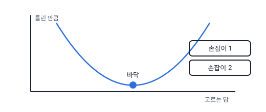

*모은 값은 밥그릇 모양이라 바닥만 찾으면 되는데, 돌릴 손잡이가 여러 개라 새 도구가 필요해요.*

**정확히 말하면**

지난 시간(0923)의 설정을 다시 적어요. 잡음이 가우시안인 선형회귀예요.

$$
y_n = \mathbf{x}_n^\top\boldsymbol{\theta} + \epsilon_n,\quad \epsilon_n \sim \mathcal{N}(0, \sigma^2)
$$

$y_n$을 만들려면 $\mathbf{x}_n$과 $\boldsymbol{\theta}$가 모두 필요해요. 잡음 $\epsilon_n$은 알 수 없는 값이라 확률로 다뤄요.

$\mathbf{x}_n$과 $\boldsymbol{\theta}$가 주어지면(given) 불확실한 것은 잡음뿐이에요. 그래서 $y_n$은 평균 $\mathbf{x}_n^\top\boldsymbol{\theta}$, 분산 $\sigma^2$인 가우시안이에요.

$$
p(y_n \mid \mathbf{x}_n, \boldsymbol{\theta}) = \mathcal{N}(y_n \mid \mathbf{x}_n^\top\boldsymbol{\theta}, \sigma^2) = \frac{1}{\sqrt{2\pi\sigma^2}}\exp\left(-\frac{(y_n - \mathbf{x}_n^\top\boldsymbol{\theta})^2}{2\sigma^2}\right)
$$

데이터 $N$개를 $\mathbf{X} = [\mathbf{x}_1, \dots, \mathbf{x}_N]^\top$, $\mathbf{y} = [y_1, \dots, y_N]^\top$로 모아요. 관측 전체를 $\mathcal{Y}$, 입력 전체를 $\mathcal{X}$로 적어요. i.i.d. 가정에서 독립인 확률변수들의 결합 PDF는 각 PDF의 곱이에요(s7).

$$
p(\mathcal{Y} \mid \mathcal{X}, \boldsymbol{\theta}) = \prod_{n=1}^{N} \mathcal{N}(y_n \mid \mathbf{x}_n^\top\boldsymbol{\theta}, \sigma^2)
$$

최대우도(ML) 추정은 이 확률을 최대화하는 $\boldsymbol{\theta}$를 찾는 거예요. 그것은 $-\log$를 취해 최소화하는 것과 같아요(s9).

$$
\boldsymbol{\theta}_{\text{ML}} = \arg\max_{\boldsymbol{\theta}} p(\mathcal{Y} \mid \mathcal{X}, \boldsymbol{\theta}) = \arg\min_{\boldsymbol{\theta}} \left(-\log p(\mathcal{Y} \mid \mathcal{X}, \boldsymbol{\theta})\right)
$$

여기서 $\log$는 **자연로그**($\ln$)예요. 로그를 쓰는 이유는 두 가지예요.

- 곱이 합으로 바뀌어요: $\log ab = \log a + \log b$.
- $\ln$이 $\exp$를 없애서 지수 안의 항만 남아요. 앞의 $\frac{1}{\sqrt{2\pi\sigma^2}}$는 $\boldsymbol{\theta}$와 무관한 상수라 최소화하는 위치를 바꾸지 않아요.

1. $$
   -\log p(\mathcal{Y} \mid \mathcal{X}, \boldsymbol{\theta}) = -\sum_{n=1}^{N} \log \mathcal{N}(y_n \mid \mathbf{x}_n^\top\boldsymbol{\theta}, \sigma^2)
   $$
2. $$
   = -\sum_{n=1}^{N} \left[ -\frac{1}{2}\log(2\pi\sigma^2) - \frac{(y_n - \mathbf{x}_n^\top\boldsymbol{\theta})^2}{2\sigma^2} \right]
   $$
3. $$
   = \frac{1}{2\sigma^2}\sum_{n=1}^{N} (y_n - \mathbf{x}_n^\top\boldsymbol{\theta})^2 + \text{const}
   $$
4. $\mathbf{y} - \mathbf{X}\boldsymbol{\theta}$의 $n$번째 성분이 $y_n - \mathbf{x}_n^\top\boldsymbol{\theta}$라서, 성분 제곱의 합은 노름의 제곱이에요.

   $$
   = \frac{1}{2\sigma^2}\|\mathbf{y} - \mathbf{X}\boldsymbol{\theta}\|^2 + \text{const}
   $$

$$
-\log p(\mathcal{Y} \mid \mathcal{X}, \boldsymbol{\theta}) = \frac{1}{2\sigma^2}\|\mathbf{y} - \mathbf{X}\boldsymbol{\theta}\|^2 + \text{const}
$$

그래서 풀 문제는 손실 $L(\boldsymbol{\theta}) = \frac{1}{2\sigma^2}\|\mathbf{y} - \mathbf{X}\boldsymbol{\theta}\|^2$을 최소화하는 거예요(s10). 선형대수에서는 이것을 **최소제곱**(least squares) 문제라고 해요. 제곱한 것을 최소화하기 때문이에요.

$L(\boldsymbol{\theta})$는 $\boldsymbol{\theta}$에 대한 2차식이라 아래로 볼록(convex)이에요. 따라서 미분해서 0이 되는 점이 최솟점이에요.

문제는 미분하는 방법이에요. $L$은 벡터 노름의 제곱이라 **스칼라**이고, $\boldsymbol{\theta}$는 **벡터**예요. 즉 **스칼라를 벡터로 미분**해야 해요. 같은 방식으로 벡터를 벡터로, 행렬을 벡터로도 미분할 수 있어요.

지난 시간에 적은 결과는 $\boldsymbol{\theta}_{\text{ML}} = (\mathbf{X}^\top\mathbf{X})^{-1}\mathbf{X}^\top\mathbf{y}$예요(s11). 이번 수업은 이 결과를 정당화하려고 [그래디언트: 편미분을 가로로 모은 것](#s0-gradient)과 [자코비안과 Ax의 미분](#s0-jacobian)을 먼저 준비하고, [연쇄법칙으로 손실을 파라미터로 미분하기](#s1-chain)에서 미분을 끝내요.

**교수님 말씀**

설정을 다시 적으면서, 당연해 보이는 식도 무엇을 뜻하는지 떠올리는 습관을 강조했어요.

> "수학을 잘하려면 하나 마나 한 짓을 잘해야 된다"

$y_n$을 만드는 데는 $\mathbf{x}_n$과 $\boldsymbol{\theta}$가 모두 필요하지만, 잡음 $\epsilon_n$만은 끝내 알 수 없어서 불확실성의 원천으로 두고 확률로 다룬다고 했어요.

> "y n을 만들어 내려면 x n도 필요하고 세타도 필요하잖아요. … 죽었다 깨어나도 우리가 알 수 없는 노이즈"

슬라이드의 log가 무엇인지 짚었어요.

> "여기 로그라고 썼지만 이거 자연로그예요, 여러분. ln."

"왜 로그를 취하나요?"라고 스스로 묻고, 가우시안은 exp와 상수가 붙어 다루기 번거롭다고 답했어요. 상수 항은 $\boldsymbol{\theta}$에 따라 변하지 않아 "대세에 지장이 없다"고 했어요.

> "마이너스 로그 라이클리후드를 미니마이즈하는 로스 펑션을 설계한 다음에 … 세타를 찾는 게 우리의 목표다."

스칼라를 벡터로 미분한다는 말에 학생들이 어려워하자, 지난주에도 표정이 같았다며 미분 과정을 보여 주는 슬라이드 s12–s16을 강의노트에 새로 넣었다고 했어요.

**페이지 요약**

가우시안 잡음에서 우도를 최대화하는 것은 음의 로그우도, 곧 최소제곱을 최소화하는 것과 같고, 이를 풀려면 스칼라를 벡터로 미분해야 해요.

*핵심 식*

- 음의 로그우도

  $$
  -\log p(\mathcal{Y} \mid \mathcal{X}, \boldsymbol{\theta}) = \frac{1}{2\sigma^2}\|\mathbf{y} - \mathbf{X}\boldsymbol{\theta}\|^2 + \text{const}
  $$
- 지난 시간의 해

  $$
  \boldsymbol{\theta}_{\text{ML}} = (\mathbf{X}^\top\mathbf{X})^{-1}\mathbf{X}^\top\mathbf{y}
  $$

*용어*

- **자연로그(ln)** — 곱을 합으로 바꾸고 exp를 없애 가우시안을 다루기 쉽게 해요.
- **최소제곱(least squares)** — 오차 제곱의 합을 최소화하는 문제예요.
- **볼록(convex)** — 2차식이라 미분이 0인 점이 최솟점이에요.

#### 조건·구분

입력·계수가 주어지면 잡음만 불확실해요. 공통 가우시안 분산을 계수와 무관하게 두면 i.i.d. 우도의 곱을 자연로그로 합으로 바꾸고, 계수와 무관한 상수를 제외해 최소제곱을 얻어요.

---

### 그래디언트: 편미분을 가로로 모은 것

*0928 수업 · L03 s12–s13*

**쉽게 말하면**

다른 손잡이는 가만히 두고 하나만 살짝 돌려서, 결과가 얼마나 변하는지 재요.

*손잡이마다 한 번씩 이렇게 재서, 잰 값을 가로 한 줄에 나란히 적어요.*

**정확히 말하면**

$f:\mathbb{R}^n \to \mathbb{R}$은 실수 $n$개를 입력받아 실수 하나를 내놓는 함수예요. 이 표기가 정의역과 공역의 크기를 정해 줘요. 손실 $L(\boldsymbol{\theta})$가 바로 이런 함수예요.

**편미분(partial derivative)**: 변수 하나만 움직이고 나머지는 상수로 둔 채 미분해요(s12).

$$
\frac{\partial f}{\partial x_1} = \lim_{h \to 0} \frac{f(x_1 + h, x_2, \dots, x_n) - f(\mathbf{x})}{h}
$$

$$
\frac{\partial f}{\partial x_n} = \lim_{h \to 0} \frac{f(x_1, x_2, \dots, x_n + h) - f(\mathbf{x})}{h}
$$

**그래디언트(gradient)**: 편미분 $n$개를 벡터 하나로 모은 거예요. 관례상 행벡터로 써요.

$$
\nabla_{\mathbf{x}} f = \frac{df}{d\mathbf{x}} = \begin{bmatrix} \frac{\partial f(\mathbf{x})}{\partial x_1} & \cdots & \frac{\partial f(\mathbf{x})}{\partial x_n} \end{bmatrix} \in \mathbb{R}^{1 \times n}
$$

- 세로(열벡터)로 모아도 틀린 건 아니에요. 뒤에서 헤시안(Hessian)을 배우기 때문에 행벡터로 쓰는 관례를 따라요.
- 기하학적 의미: 곡면 위의 한 점에서 $x_1$ 방향, $x_2$ 방향으로 조금 움직일 때의 변화량을 모은 거예요. $x_2$ 방향으로만 변하는 곡면이면 $\partial f / \partial x_1$은 어디서나 0이에요. 곡면이 비틀려 있으면 점마다 방향별 증감이 달라요.

**예제 1** (s13): $f(x, y) = (x + 2y^3)^2$. 괄호 안을 한 덩어리로 보고 치환 미분(연쇄법칙)을 써요.

1. $$
   \frac{\partial f}{\partial x} = 2(x + 2y^3) \cdot \frac{\partial (x + 2y^3)}{\partial x} = 2(x + 2y^3)
   $$
2. $$
   \frac{\partial f}{\partial y} = 2(x + 2y^3) \cdot \frac{\partial (x + 2y^3)}{\partial y} = 2(x + 2y^3) \cdot 6y^2
   $$
3. $$
   = 12(x + 2y^3)y^2
   $$
4. 두 변수를 묶은 벡터를 $\mathbf{a} = [x, y]^\top$로 두면

   $$
   \nabla_{\mathbf{a}} f = \begin{bmatrix} 2(x + 2y^3) & 12(x + 2y^3)y^2 \end{bmatrix}
   $$

**예제 2** (s13): $f(x_1, x_2) = x_1^2 x_2 + x_1 x_2^3$.

1. $$
   \frac{\partial f}{\partial x_1} = 2x_1 x_2 + x_2^3
   $$
2. $$
   \frac{\partial f}{\partial x_2} = x_1^2 + 3x_1 x_2^2
   $$
3. $$
   \nabla_{\mathbf{x}} f = \begin{bmatrix} 2x_1 x_2 + x_2^3 & x_1^2 + 3x_1 x_2^2 \end{bmatrix}
   $$

딥러닝과의 연결(슬라이드 밖 설명): 심층신경망의 가중치 $w_{ij}$를 바꿀 때 손실이 얼마나 변하는지가 $\partial L / \partial w_{ij}$예요. 이 값이 거의 0이면 그 파라미터는 손실에 별 영향이 없어요. 키울수록 손실이 줄면 키우는 쪽으로 움직여요. 얼마나 움직일지는 gradient descent(경사하강법)로 정하고, 이 계산에 연쇄법칙(chain rule)을 많이 써요. 연쇄법칙은 [연쇄법칙으로 손실을 파라미터로 미분하기](#s1-chain)에서 이어져요.

**교수님 말씀**

그래디언트를 어떤 모양으로 쓰는지 짚었어요.

> "partial derivative의 gradient는 보통 로우 벡터, 행벡터로 나열합니다."

"세로 벡터로 하면 안 되나요?"라고 스스로 묻고 "그래도 돼. 상관없어."라고 답했어요. 다만 헤시안을 배울 것이라 행벡터 관례를 따른다고 했어요.

칠판에 3D 곡면을 그려 편미분의 뜻을 보여 줬어요. 예제 1에서 "왜 아래첨자에 x라고 쓰지 않았나요?"라는 물음에는, 변수가 $(x, y)$라서 그 벡터를 $\mathbf{a}$로 정의해 아래첨자에 쓰면 된다고 했어요.

가중치를 바꿔도 손실이 거의 안 변하는 경우를 두고 이렇게 말했어요.

> "얘는 중요한 파라미터라기보다 중요하지 않다는 거야."

**페이지 요약**

스칼라 함수를 벡터로 미분하면, 변수마다 편미분을 구해 행벡터로 모은 그래디언트가 나와요.

*핵심 식*

- 그래디언트

  $$
  \nabla_{\mathbf{x}} f = \frac{df}{d\mathbf{x}} = \begin{bmatrix} \frac{\partial f(\mathbf{x})}{\partial x_1} & \cdots & \frac{\partial f(\mathbf{x})}{\partial x_n} \end{bmatrix} \in \mathbb{R}^{1 \times n}
  $$
- 예제 1

  $$
  \nabla_{\mathbf{a}} f = \begin{bmatrix} 2(x + 2y^3) & 12(x + 2y^3)y^2 \end{bmatrix}
  $$

*용어*

- **편미분(partial derivative)** — 변수 하나만 움직이고 나머지는 상수로 둔 미분이에요.
- **그래디언트(gradient)** — 편미분들을 행벡터로 모은 거예요.
- **gradient descent** — 그래디언트가 내려가는 방향으로 파라미터를 바꾸는 학습 방법이에요.

#### 조건·구분

행벡터는 이 수업의 관례이며 열벡터로 정의하는 관례도 가능해요. 편미분은 다른 변수를 고정한 국소 변화이고, 딥러닝 가중치의 손실 변화와 경사하강법 연결은 슬라이드 밖 수업 설명이에요.

---

### 자코비안과 Ax의 미분

*0928 수업 · L03 s14–s15*

**쉽게 말하면**

같은 재료를 여러 공장에 똑같이 넣고, 공장마다 변화량을 가로 한 줄로 적어요.

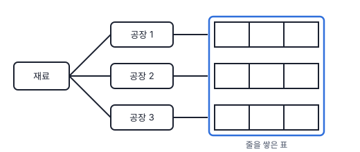

*그 줄들을 위아래로 쌓으면 네모난 표 하나가 돼요.*

**정확히 말하면**

**벡터값 함수(vector-valued function)**: 같은 입력 $\mathbf{x} \in \mathbb{R}^n$으로 함수 $f_1, \dots, f_m$을 계산해 세로로 쌓은 거예요. 굵은 소문자 $\mathbf{f}$는 관례상 벡터라는 뜻이에요(s14).

$$
\mathbf{f}:\mathbb{R}^n \to \mathbb{R}^m,\quad \mathbf{f}(\mathbf{x}) = \begin{bmatrix} f_1(\mathbf{x}) \\ \vdots \\ f_m(\mathbf{x}) \end{bmatrix}
$$

입력은 길이 $n$, 출력은 길이 $m$이에요. 함수가 $m$개라서 출력도 $m$개예요. 예: $\mathbb{R}^3 \to \mathbb{R}^2$이면 $\mathbf{x} = [x_1, x_2, x_3]^\top$를 받는 함수 $f_1, f_2$가 있어요.

$x_i$에 대한 편미분은 열벡터예요.

$$
\frac{\partial \mathbf{f}}{\partial x_i} = \begin{bmatrix} \frac{\partial f_1}{\partial x_i} \\ \vdots \\ \frac{\partial f_m}{\partial x_i} \end{bmatrix}
$$

**자코비안(Jacobian)**: 이 열벡터 $n$개를 옆으로 나란히 놓은 행렬이에요. 같은 행렬을 행으로 읽으면, 각 $f_i$의 그래디언트(행벡터)를 위아래로 쌓은 거예요(s15).

$$
\mathbf{J} = \nabla_{\mathbf{x}} \mathbf{f} = \frac{d\mathbf{f}(\mathbf{x})}{d\mathbf{x}} = \begin{bmatrix} \frac{\partial \mathbf{f}(\mathbf{x})}{\partial x_1} & \cdots & \frac{\partial \mathbf{f}(\mathbf{x})}{\partial x_n} \end{bmatrix}
$$

$$
= \begin{bmatrix} \frac{\partial f_1(\mathbf{x})}{\partial x_1} & \cdots & \frac{\partial f_1(\mathbf{x})}{\partial x_n} \\ \vdots & & \vdots \\ \frac{\partial f_m(\mathbf{x})}{\partial x_1} & \cdots & \frac{\partial f_m(\mathbf{x})}{\partial x_n} \end{bmatrix} \in \mathbb{R}^{m \times n}
$$

- $(1,1)$ 성분은 첫 번째 함수 $f_1$을 첫 번째 입력 $x_1$로 편미분한 값이에요. $(1,n)$ 성분은 $f_1$을 $n$번째 입력으로 편미분한 값이에요.
- $\mathbb{R}^n \to \mathbb{R}^m$ 함수의 자코비안은 $m \times n$ 행렬이에요. 예: $\mathbb{R}^3 \to \mathbb{R}^2$이면 $2 \times 3$이에요.
- $m = 1$이면 자코비안은 [그래디언트: 편미분을 가로로 모은 것](#s0-gradient)의 $1 \times n$ 행벡터와 같아요.

칠판 예(슬라이드 밖): $f_1 = x_1 + x_2$, $f_2 = x_1^2 + 3x_2$이면

$$
\mathbf{J} = \begin{bmatrix} \frac{\partial f_1}{\partial x_1} & \frac{\partial f_1}{\partial x_2} \\ \frac{\partial f_2}{\partial x_1} & \frac{\partial f_2}{\partial x_2} \end{bmatrix} = \begin{bmatrix} 1 & 1 \\ 2x_1 & 3 \end{bmatrix}
$$

**선형변환 $\mathbf{f}(\mathbf{x}) = \mathbf{A}\mathbf{x}$의 미분** (s15): $\mathbf{x} \in \mathbb{R}^n$, $\mathbf{f}(\mathbf{x}) \in \mathbb{R}^m$이 되도록 차원을 맞추면 $\mathbf{A} \in \mathbb{R}^{m \times n}$이에요. 행렬 곱은 앞 행렬의 열 수와 뒤 벡터의 길이가 같아야 해요.

1. $f_i$는 $\mathbf{A}$의 $i$번째 행과 $\mathbf{x}$의 내적이에요.

   $$
   f_i(\mathbf{x}) = \sum_{j=1}^{n} A_{ij} x_j = A_{i1}x_1 + A_{i2}x_2 + \cdots + A_{in}x_n
   $$
2. $x_j$로 편미분하면 $x_j$가 붙은 항만 남아요.

   $$
   \frac{\partial f_i}{\partial x_j} = A_{ij}
   $$
3. 따라서 자코비안의 $i$번째 행은 $\mathbf{A}$의 $i$번째 행 $[A_{i1}\ \cdots\ A_{in}]$이에요.
4. 모든 행을 위아래로 쌓으면

   $$
   \frac{d\mathbf{f}}{d\mathbf{x}} = \begin{bmatrix} A_{11} & \cdots & A_{1n} \\ \vdots & & \vdots \\ A_{m1} & \cdots & A_{mn} \end{bmatrix} = \mathbf{A}
   $$

$$
\frac{d(\mathbf{A}\mathbf{x})}{d\mathbf{x}} = \mathbf{A}
$$

그래디언트, 자코비안, $\mathbf{A}\mathbf{x}$의 미분이 준비됐어요. 이 도구로 스칼라 손실 $\|\mathbf{y} - \mathbf{X}\boldsymbol{\theta}\|^2$을 벡터 $\boldsymbol{\theta}$로 미분하는 과정은 [연쇄법칙으로 손실을 파라미터로 미분하기](#s1-chain)에서 이어져요.

**교수님 말씀**

벡터값 함수를 공장에 비유했어요. 입력 벡터 하나를 여러 함수에 똑같이 넣는다는 뜻이에요.

> "입력으로 똑같은 벡터 x를 받아다가 공장 몇 개를 돌린다? 스몰 m개"

고등학교에서 행렬을 배우지 않은 학생이 있다고 들었다며 손을 들어 보게 했어요. 행렬 곱만 할 줄 알면 "이제 디멘션만 맞추면 되는 거"라고 했어요.

$\mathbf{A}\mathbf{x}$의 자코비안이 $\mathbf{A}$라는 것까지 보인 뒤, 손실을 미분할 준비가 끝났다고 했어요.

> "자 이제 재료 손질이 끝났어요."

**페이지 요약**

벡터값 함수를 벡터로 미분하면, 각 함수의 그래디언트 행벡터를 위아래로 쌓은 자코비안이 나오고, $\mathbf{A}\mathbf{x}$의 자코비안은 $\mathbf{A}$예요.

*핵심 식*

- 자코비안

  $$
  \mathbf{J} = \nabla_{\mathbf{x}} \mathbf{f} = \frac{d\mathbf{f}(\mathbf{x})}{d\mathbf{x}}
  $$
- 성분

  $$
  \frac{\partial f_i}{\partial x_j} = A_{ij}
  $$
- 선형변환의 미분

  $$
  \frac{d(\mathbf{A}\mathbf{x})}{d\mathbf{x}} = \mathbf{A}
  $$

*용어*

- **벡터값 함수(vector-valued function)** — 같은 입력으로 여러 함수를 계산해 세로로 쌓은 함수예요.
- **자코비안(Jacobian)** — 모든 $\partial f_i / \partial x_j$를 모은 $m \times n$ 행렬이에요.

#### 조건·구분

입력 $n$, 출력 $m$인 자코비안은 $m\times n$이고 $m=1$이면 행 그래디언트예요. $A\in\mathbb R^{m\times n}$가 고정이면 $(Ax)_i=\sum_j A_{ij}x_j$의 편미분이 $A_{ij}$이므로 자코비안이 $A$예요.

---

## 1. 연쇄법칙으로 최대우도 해 완성하기

### 연쇄법칙으로 손실을 파라미터로 미분하기

*0928 수업 · L03 s16*

**쉽게 말하면**

손잡이를 돌리면 과녁에서 빗나간 정도가 바뀌고, 빗나간 정도가 바뀌면 벌점이 바뀌어요.

두 칸의 변화를 차례로 곱하면 손잡이가 벌점을 얼마나 바꾸는지 한 번에 알 수 있어요.

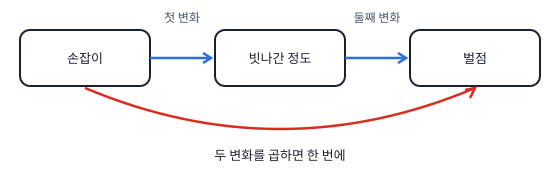

*테두리 상자 세 개를 잇는 두 화살표를 곱하면, 아래 곡선처럼 손잡이에서 벌점까지 바로 가요.*

**정확히 말하면**

목표는 손실 $L$을 가장 작게 만드는 파라미터 벡터 $\boldsymbol{\theta}$를 찾는 거예요(L03 s16). 선형 모델 $\mathbf{y} = \boldsymbol{\Phi}\boldsymbol{\theta}$에서 크기는 이래요.

- $\boldsymbol{\theta} \in \mathbb{R}^{D}$: 파라미터 벡터
- $\boldsymbol{\Phi} \in \mathbb{R}^{N \times D}$: 입력 특징(input features)을 행으로 쌓은 행렬
- $\mathbf{y} \in \mathbb{R}^{N}$: 관측값(observations)

손실은 오차 벡터 $\mathbf{e}$의 노름 제곱으로 둬요.

$$
L(\mathbf{e}) = \|\mathbf{e}\|^2, \qquad \mathbf{e}(\boldsymbol{\theta}) = \mathbf{y} - \boldsymbol{\Phi}\boldsymbol{\theta}
$$

$L$은 스칼라이고 $\boldsymbol{\theta}$는 벡터라서, 바로 미분하기가 번거로워요. 그래서 $\mathbf{e}$로 한 번 치환해서 미분해요. 이것이 치환 미분, 곧 연쇄법칙(chain rule)이에요.

$$
\frac{\partial L}{\partial \boldsymbol{\theta}} = \frac{\partial L}{\partial \mathbf{e}} \frac{\partial \mathbf{e}}{\partial \boldsymbol{\theta}}
$$

그래디언트를 행벡터로 쓰는 관례를 따르면 세 항의 크기는 이래요.

$$
\frac{\partial L}{\partial \boldsymbol{\theta}} \in \mathbb{R}^{1 \times D}, \qquad \frac{\partial L}{\partial \mathbf{e}} \in \mathbb{R}^{1 \times N}, \qquad \frac{\partial \mathbf{e}}{\partial \boldsymbol{\theta}} \in \mathbb{R}^{N \times D}
$$

$(1 \times N)(N \times D) = 1 \times D$이므로 차원이 맞아요.

1. 노름 제곱을 풀어 써요.

   $$
   \|\mathbf{e}\|^2 = e_1^2 + e_2^2 + \cdots + e_N^2 = \mathbf{e}^\top \mathbf{e}
   $$
2. 각 $e_i$로 편미분하면 $2e_i$예요. 가로로 모으면

   $$
   \frac{\partial L}{\partial \mathbf{e}} = 2\mathbf{e}^\top \in \mathbb{R}^{1 \times N}
   $$
3. $\mathbf{y}$는 $\boldsymbol{\theta}$와 무관하니 미분하면 $\mathbf{0}$이에요.
4. $\boldsymbol{\Phi}\boldsymbol{\theta}$는 $\mathbf{A}\mathbf{x}$ 꼴이라 미분하면 $\boldsymbol{\Phi}$예요([자코비안과 Ax의 미분](#s0-jacobian)). 따라서

   $$
   \frac{\partial \mathbf{e}}{\partial \boldsymbol{\theta}} = -\boldsymbol{\Phi} \in \mathbb{R}^{N \times D}
   $$
5. 둘을 곱해요.

   $$
   \frac{\partial L}{\partial \boldsymbol{\theta}} = 2\mathbf{e}^\top(-\boldsymbol{\Phi}) = -2(\mathbf{y}^\top - \boldsymbol{\theta}^\top \boldsymbol{\Phi}^\top)\boldsymbol{\Phi}
   $$

마지막 식에서 $(\mathbf{y}^\top - \boldsymbol{\theta}^\top \boldsymbol{\Phi}^\top)$는 $1 \times N$, $\boldsymbol{\Phi}$는 $N \times D$예요.

표기: 특징 함수 $\phi$가 항등(identity) 함수이면 $\boldsymbol{\Phi} = \mathbf{X}$예요. s16은 일반화하려고 $\boldsymbol{\Phi}$로 썼고, s11의 칠판 유도는 같은 식을 $\mathbf{X}$로 썼어요.

이제 연쇄법칙의 두 자리가 정해졌어요. 잔차에 대한 미분은 $1\times N$, 잔차를 θ로 미분한 것은 $N\times K$이므로 곱한 결과는 $1\times K$예요(특징행렬 $\boldsymbol\Phi$의 열 수를 K로 쓸 때). 이후 MAP에서도 **이 데이터 항의 미분을 그대로 재사용**하고 prior의 미분만 더해요.

**교수님 말씀**

지난주 설명 때 학생들 표정이 어두워서, 미분 과정을 보여 주려고 강의노트에 s12–s16을 새로 넣으셨어요. 그래디언트와 자코비안을 "재료"로 먼저 손질하고, 여기서 그 재료로 요리를 한 셈이에요.

> "자 이제 재료 손질이 끝났어요."

$\partial \mathbf{e} / \partial \boldsymbol{\theta}$를 구할 때는 바로 앞에서 배운 결과를 그대로 가져다 쓰셨어요.

> "Ax를 x에 대해서 미분하면 그냥 A 나온다며."

s16에서 굳이 $\boldsymbol{\Phi}$를 쓴 이유는 나중에 특징 함수로 일반화하기 위해서예요. 항등 함수라면 그냥 $\mathbf{X}$라고 설명하셨어요.

**페이지 요약**

스칼라 손실을 벡터 파라미터로 미분할 때는 오차로 한 번 치환해서 두 미분을 곱해요.

*핵심 식*

- 연쇄법칙

  $$
  \frac{\partial L}{\partial \boldsymbol{\theta}} = \frac{\partial L}{\partial \mathbf{e}} \frac{\partial \mathbf{e}}{\partial \boldsymbol{\theta}}
  $$
- 두 조각

  $$
  \frac{\partial L}{\partial \mathbf{e}} = 2\mathbf{e}^\top \in \mathbb{R}^{1 \times N}, \quad \frac{\partial \mathbf{e}}{\partial \boldsymbol{\theta}} = -\boldsymbol{\Phi} \in \mathbb{R}^{N \times D}
  $$
- 결과

  $$
  \frac{\partial L}{\partial \boldsymbol{\theta}} = 2\mathbf{e}^\top(-\boldsymbol{\Phi}) = -2(\mathbf{y}^\top - \boldsymbol{\theta}^\top \boldsymbol{\Phi}^\top)\boldsymbol{\Phi}
  $$

*용어*

- **연쇄법칙(chain rule)** — 중간 변수로 치환해 미분을 곱으로 나누는 규칙, 곧 치환 미분

#### 조건·구분

$e=y-\Phi\theta$에서 $y$는 계수와 무관하고 $de/d\theta=-\Phi$예요. $(1\times N)(N\times D)=1\times D$ 순서로 곱하며, 특징 함수가 항등이면 $\Phi=X$예요.

---

### 기울기를 0으로: 대칭행렬과 유사역행렬

*0928 수업 · L03 s11*

**쉽게 말하면**

벌점 그릇의 가장 낮은 바닥은 어느 쪽으로도 기울지 않은 평평한 곳이에요.

그래서 기울기가 없어지는 자리를 찾으면 가장 좋은 손잡이 위치가 나와요.

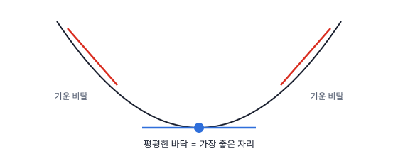

*비탈에서는 선이 기울어 있고, 색칠된 점이 있는 바닥에서만 선이 평평해요.*

**정확히 말하면**

s11은 같은 유도를 $\mathbf{X}$로 써요($\boldsymbol{\Phi}$가 항등 특징이면 $\boldsymbol{\Phi} = \mathbf{X}$). 음의 로그우도에서 상수를 뺀 손실은 이래요([복습: 음의 로그우도에서 최소제곱까지](#s0-recap)).

$$
L(\boldsymbol{\theta}) = \frac{1}{2\sigma^2}\|\mathbf{y} - \mathbf{X}\boldsymbol{\theta}\|^2
$$

$L$은 $\boldsymbol{\theta}$의 2차식이라 아래로 볼록(convex)해요. 그래서 기울기가 0인 점이 최솟점이에요.

1. [연쇄법칙으로 손실을 파라미터로 미분하기](#s1-chain)의 결과에 $\frac{1}{2\sigma^2}$를 곱해요.

   $$
   \frac{dL}{d\boldsymbol{\theta}} = \frac{1}{2\sigma^2}\left(-2(\mathbf{y} - \mathbf{X}\boldsymbol{\theta})^\top \mathbf{X}\right)
   $$
2. 2를 약분하고 전개해요.

   $$
   \frac{dL}{d\boldsymbol{\theta}} = \frac{1}{\sigma^2}\left(-\mathbf{y}^\top \mathbf{X} + \boldsymbol{\theta}^\top \mathbf{X}^\top \mathbf{X}\right)
   $$
3. 0으로 두면

   $$
   \boldsymbol{\theta}^\top \mathbf{X}^\top \mathbf{X} = \mathbf{y}^\top \mathbf{X}
   $$
4. $\mathbf{X}^\top \mathbf{X}$의 역행렬이 있다고 보고, 양변 오른쪽에 $(\mathbf{X}^\top \mathbf{X})^{-1}$을 곱해요.

   $$
   \boldsymbol{\theta}^\top = \mathbf{y}^\top \mathbf{X}(\mathbf{X}^\top \mathbf{X})^{-1}
   $$
5. 양변을 전치해요.

   $$
   \boldsymbol{\theta} = \left((\mathbf{X}^\top \mathbf{X})^{-1}\right)^\top \mathbf{X}^\top \mathbf{y}
   $$
6. $\mathbf{X}^\top \mathbf{X}$는 대칭행렬이고, 대칭행렬의 역행렬도 대칭이에요. 그래서 바깥 전치가 사라져요.

   $$
   \boldsymbol{\theta}_{\text{ML}} = (\mathbf{X}^\top \mathbf{X})^{-1} \mathbf{X}^\top \mathbf{y}
   $$

**대칭행렬(symmetric matrix)**: $\mathbf{A}^\top = \mathbf{A}$인 정방행렬이에요. 예를 들어 대각성분이 1, 1이고 비대각성분이 둘 다 3인 $2 \times 2$ 행렬은 대각선을 기준으로 접으면 같은 값이 겹쳐요. $\mathbf{X}^\top \mathbf{X}$는 항상 대칭이에요.

**유사역행렬(pseudo-inverse)**: $(\mathbf{X}^\top \mathbf{X})^{-1} \mathbf{X}^\top$를 가리켜요. $\mathbf{X}$는 $N \times D$라 정방행렬이 아니어서 역행렬이 없어요. 그래도 이 행렬이 역행렬과 비슷한 역할을 해서 "유사(pseudo)"라고 불러요. 결국 최대우도(ML) 추정은 유사역행렬을 구하는 문제예요.

특징행렬로 쓰면 같은 해가 $\boldsymbol{\theta}_{\text{ML}} = (\boldsymbol{\Phi}^\top \boldsymbol{\Phi})^{-1} \boldsymbol{\Phi}^\top \mathbf{y}$예요([특징행렬 Φ와 최대우도 해](#s2-feature-matrix)). MML (9.12)도 같은 순서로 유도해요.

**이후에도 유지할 뼈대:** 행벡터 식 $\boldsymbol\theta^\top\mathbf X^\top\mathbf X=\mathbf y^\top\mathbf X$를 전치하면 $\mathbf X^\top\mathbf X\boldsymbol\theta=\mathbf X^\top\mathbf y$예요. 왼쪽은 계수에 곱하는 행렬, 오른쪽은 데이터 벡터예요. 역행렬 해에는 X의 full column rank가 필요해요.

**교수님 말씀**

칠판에서 전치를 취한 뒤, 바깥 전치가 왜 사라지는지를 대칭행렬로 설명하셨어요.

> "X 트랜스포즈 X라는 거는 시메트릭 매트릭스가 되거든요."

대칭행렬의 역행렬이 왜 대칭인지는 증명하지 않고 넘어가셨어요.

> "요거는 여러분 구글에 물어보세요. GPT한테 물어보든지."

지난주에 결과만 보였던 $\boldsymbol{\theta}_{\text{ML}}$ 식이 어떻게 나오는지를, 그래디언트와 자코비안을 정의해서 보여 준 것이라고 정리하셨어요.

**보충 · 수업에서 유도하진 않았어요**

수업에서 "구글에 물어보라"고 넘긴 두 사실을 짧게 증명하고, 역행렬이 있을 조건을 덧붙여요.

**1. $\mathbf{X}^\top \mathbf{X}$는 대칭이에요.** 전치의 성질 $(\mathbf{A}\mathbf{B})^\top = \mathbf{B}^\top \mathbf{A}^\top$를 써요.

$$
(\mathbf{X}^\top \mathbf{X})^\top = \mathbf{X}^\top (\mathbf{X}^\top)^\top = \mathbf{X}^\top \mathbf{X}
$$

**2. 역행렬이 있는 대칭행렬 $\mathbf{A}$의 역행렬도 대칭이에요.**

1. 정의에서 출발해요.

   $$
   \mathbf{A}\mathbf{A}^{-1} = \mathbf{I}
   $$
2. 양변을 전치해요. $\mathbf{I}^\top = \mathbf{I}$예요.

   $$
   (\mathbf{A}^{-1})^\top \mathbf{A}^\top = \mathbf{I}
   $$
3. $\mathbf{A}^\top = \mathbf{A}$를 넣어요.

   $$
   (\mathbf{A}^{-1})^\top \mathbf{A} = \mathbf{I}
   $$
4. $(\mathbf{A}^{-1})^\top$는 $\mathbf{A}$의 역행렬이에요. 역행렬은 하나뿐이므로

   $$
   (\mathbf{A}^{-1})^\top = \mathbf{A}^{-1}
   $$

$\mathbf{A} = \mathbf{X}^\top \mathbf{X}$를 넣으면 $\left((\mathbf{X}^\top \mathbf{X})^{-1}\right)^\top = (\mathbf{X}^\top \mathbf{X})^{-1}$이 돼요. 그래서 유도의 마지막 단계에서 바깥 전치를 지울 수 있어요.

2단계는 대칭이 아니어도 성립하는 일반 성질 $(\mathbf{A}^{-1})^\top = (\mathbf{A}^\top)^{-1}$이기도 해요.

**3. 역행렬은 언제 있나요?** 유도 4단계는 $(\mathbf{X}^\top \mathbf{X})^{-1}$이 있다고 가정했어요. $\operatorname{rk}(\mathbf{X}) = D$이면 $\mathbf{X}^\top \mathbf{X}$가 양의 정부호(positive definite)라 역행렬이 있어요(L03 s11 슬라이드 주석, MML (9.12) 아래 설명). 수업에서는 이 조건을 따로 말하지 않았어요.

**페이지 요약**

기울기를 0으로 두고 대칭행렬 성질로 전치를 지우면, 최대우도 해가 유사역행렬로 나와요.

*핵심 식*

- 기울기 = 0

  $$
  \boldsymbol{\theta}^\top \mathbf{X}^\top \mathbf{X} = \mathbf{y}^\top \mathbf{X}
  $$
- 최대우도 해

  $$
  \boldsymbol{\theta}_{\text{ML}} = (\mathbf{X}^\top \mathbf{X})^{-1} \mathbf{X}^\top \mathbf{y}
  $$

*용어*

- **대칭행렬(symmetric matrix)** — $\mathbf{A}^\top = \mathbf{A}$인 정방행렬
- **유사역행렬(pseudo-inverse)** — 정방이 아닌 $\mathbf{X}$에 대해 역행렬 역할을 하는 $(\mathbf{X}^\top \mathbf{X})^{-1} \mathbf{X}^\top$

#### 조건·구분

역행렬이 존재하는 대칭행렬의 역행렬도 대칭이어서 전치를 지워요. 보충의 전치·역행렬 증명과 $\operatorname{rk}(X)=D$이면 $X^\top X$가 양의 정부호라는 조건은 수업에서 유도하지 않았어요.

---

## 2. 특징 함수와 다항회귀

### 특징 함수: θ에 대해서만 선형이면 선형회귀

*0928 수업 · L03 s17*

**쉽게 말하면**

재료를 마음대로 다듬어도, 마지막에 무게를 곱해 더하기만 하면 같은 방법으로 풀 수 있어요.

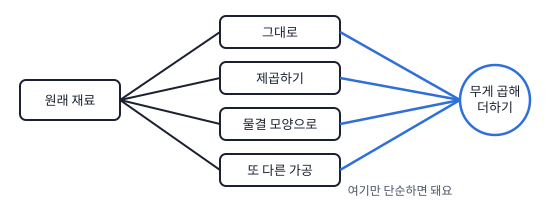

*다듬는 방법은 자유이고, 오른쪽 원에서 무게를 곱해 더하는 부분만 단순하면 돼요.*

**정확히 말하면**

선형회귀(linear regression)의 "선형"은 파라미터 $\boldsymbol{\theta}$에 대해 선형이라는 뜻이에요. 입력 $\mathbf{x}$에 대해서는 비선형이어도 돼요.

입력 $\mathbf{x} \in \mathbb{R}^D$를 벡터값 함수 $\boldsymbol{\phi}(\mathbf{x})$로 바꾼 값을 특징(feature)이라고 해요. $\boldsymbol{\phi}$는 비선형이어도 돼요.

$$
\boldsymbol{\phi} : \mathbb{R}^D \to \mathbb{R}^K, \qquad \boldsymbol{\theta} \in \mathbb{R}^K
$$

모델은 가우시안 잡음 선형회귀에서 $\mathbf{x}$ 자리에 $\boldsymbol{\phi}(\mathbf{x})$를 넣은 꼴이에요.

1. $$
   p(y \mid \mathbf{x}) = \mathcal{N}\big(y \mid \boldsymbol{\phi}(\mathbf{x})^\top \boldsymbol{\theta},\ \sigma^2\big)
   $$
2. $$
   \iff y = \boldsymbol{\phi}(\mathbf{x})^\top \boldsymbol{\theta} + \epsilon, \qquad \epsilon \sim \mathcal{N}(0, \sigma^2)
   $$
3. $$
   y = \sum_{k=0}^{K-1} \theta_k \phi_k(\mathbf{x}) + \epsilon
   $$

$\boldsymbol{\phi}(\mathbf{x})$와 $\boldsymbol{\theta}$가 둘 다 $K$차원이라 내적이 스칼라가 되고, 그 값이 $y$의 평균이에요. 각 $\theta_k$는 한 번씩만 곱해져 더해지므로 $\boldsymbol{\theta}$에 대해 선형이에요. 그래서 손실을 최소화하는 방법이 입력 그대로 쓸 때와 같아요.

특징 함수는 마음대로 만들 수 있어요. 수업의 예는 $\mathbf{x} = [x_1, x_2]^\top$에서 함수 6개를 뽑은 특징 벡터였어요.

$$
\boldsymbol{\phi}(\mathbf{x}) = [x_1,\ x_2,\ x_1^2,\ x_2^2,\ \cos x_1,\ \sin x_2]^\top \in \mathbb{R}^6
$$

이때 $D = 2$, $K = 6$이에요. 이 모델도 $\boldsymbol{\theta}$에 대해 선형이라 선형회귀예요. 선형회귀의 결과가 직선이나 평면일 필요는 없어요.

용어를 정리해요.

- $\mathbf{x}$는 원자료(raw data)예요. 원자료를 그대로 특징으로 쓰기도 해요.
- 원자료를 특징 벡터로 바꾸는 과정이 피처 추출(feature extraction)이에요. 새 특징을 만든다는 뜻으로 피처 생성(feature generation)이라고도 해요. CNN 같은 네트워크가 만든 출력도 특징 벡터예요.
- 데이터가 너무 클 때 중요한 성분만 뽑아 압축하는 방법은 주성분 분석(PCA)이에요.
- 교수님은 $\boldsymbol{\phi}$를 "커널 함수", "커널 벡터"라고도 불렀어요.

모델을 왜 이렇게 두는지에는 이론적 이유가 없어요. $y$가 이렇게 만들어졌다고 가정(assumption)한 것이고, 데이터에 잘 맞으면 좋은 가정이에요.

**교수님 말씀**

교수님이 학생 질문을 스스로 던지고 답했어요. 비선형 벡터로 선형회귀를 할 수 있느냐는 물음에는 이렇게 답했어요.

> "누가 리니어니까. 세타가 리니어니까. 미니마이즈 할 수 있다."

왜 모델을 이렇게 만들었느냐는 물음에는 이렇게 답했어요.

> "이유가 없다니까. … 그냥 가정해 본 거야."

직선 모델에 대해서도 이렇게 강조했어요.

> "리니어 리그레션이라고 해서 꼭 그 함수가 어떤 평면이라든지 직선일 필요는 없는 거다."

> "여기서 가장 간단한 모델이 이거고 꼭 이거일 필요는 없고"

**페이지 요약**

입력을 비선형 특징으로 바꿔도 θ에 대해 선형이면 선형회귀예요.

*핵심 식*

- 특징 모델

  $$
  y = \sum_{k=0}^{K-1} \theta_k \phi_k(\mathbf{x}) + \epsilon
  $$
- 특징 함수

  $$
  \boldsymbol{\phi} : \mathbb{R}^D \to \mathbb{R}^K, \qquad \boldsymbol{\theta} \in \mathbb{R}^K
  $$

*용어*

- **특징(feature)** — 입력을 함수로 바꾼 값, 비선형이어도 돼요.
- **피처 추출(feature extraction)** — 원자료를 특징 벡터로 바꾸는 과정이에요.

#### 조건·구분

$\phi(x)$와 $\theta$는 모두 길이 $K$라 내적 평균은 스칼라예요. 특징 함수는 $\mathbb R^D\to\mathbb R^K$이고, 결과 곡선이 직선일 필요는 없어요.

---

### 다항회귀: 입력을 K차원으로 올리기

*0928 수업 · L03 s17*

**쉽게 말하면**

숫자 하나를 그대로, 제곱, 세제곱으로 여러 번 늘려 쓰면 구불구불한 선도 그릴 수 있어요.

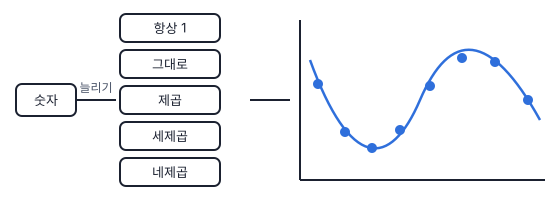

*숫자 하나를 다섯 칸으로 늘리면 색칠된 점들을 따라가는 곡선을 만들 수 있어요.*

**정확히 말하면**

다항회귀(polynomial regression)는 특징 함수를 단항식 $x^k$로 고른 선형회귀예요. 입력 $x \in \mathbb{R}$은 스칼라이고 $\boldsymbol{\theta} \in \mathbb{R}^K$예요.

1. $$
   \boldsymbol{\phi}(x) = \begin{bmatrix} \phi_0(x) \\ \vdots \\ \phi_{K-1}(x) \end{bmatrix} = [1, x, x^2, \dots, x^{K-1}]^\top \in \mathbb{R}^K
   $$
2. $$
   f(x) = \boldsymbol{\phi}(x)^\top \boldsymbol{\theta} = \sum_{k=0}^{K-1} \theta_k \phi_k(x)
   $$
3. $$
   f(x) = \sum_{k=0}^{K-1} \theta_k x^k = \theta_0 + \theta_1 x + \theta_2 x^2 + \dots + \theta_{K-1} x^{K-1}
   $$

1차원 입력을 $K$차원 특징 공간으로 올려요. 차원을 줄이는 게 아니라 늘리는 확장(expansion)이에요. 신경망의 임베딩(embedding)도 이렇게 입력을 더 높은 차원으로 보내는 경우가 있어요.

곡선 $f(x)$는 $x$에 대해 비선형이지만 $\boldsymbol{\theta}$에 대해서는 선형이라 선형회귀로 풀려요.

최고 차수와 $K$의 관계는 상수항 1 때문에 하나 차이가 나요.

| 최고 차수 | 특징 벡터 | $K$ |
|---|---|---|
| 3차 | $[1, x, x^2, x^3]^\top$ | 4 |
| 4차 | $[1, x, x^2, x^3, x^4]^\top$ | 5 |
| 6차 | $[1, x, \dots, x^6]^\top$ | 7 |

차수는 모델 복잡도(model complexity)예요. 몇 차가 좋은지에는 정해진 답이 없어요. $K = 7$이 $K = 4$보다 나은지는 데이터로 따져 봐야 해요.

$\boldsymbol{\theta}$는 데이터로 학습하는 파라미터(parameter)예요. $K$처럼 학습 전에 사람이 정하는 값이 하이퍼파라미터(hyperparameter)예요.

4차 다항식은 상수항부터 4차항까지 다섯 개의 특징을 쓰므로 $K=5$예요.

**교수님 말씀**

교수님은 "폴리노미얼 커널이라는 거를 뒤에 좀 살펴볼 건데"라고 한 뒤 바로 s17 예제로 다뤘어요. 3차($K = 4$)와 6차($K = 7$) 중 어느 쪽이 나은지는 답을 주지 않고 넘겼어요.

> "따져봐야 돼."

입력이 줄어드는 게 아니라 늘어난다는 점을 네트워크 임베딩에 빗대 설명했어요.

**페이지 요약**

스칼라 입력을 단항식으로 K차원까지 늘리면 곡선도 선형회귀로 맞출 수 있어요.

*핵심 식*

- 다항 특징

  $$
  \boldsymbol{\phi}(x) = \begin{bmatrix} \phi_0(x) \\ \vdots \\ \phi_{K-1}(x) \end{bmatrix} = [1, x, x^2, \dots, x^{K-1}]^\top \in \mathbb{R}^K
  $$
- 다항 모델

  $$
  f(x) = \sum_{k=0}^{K-1} \theta_k x^k = \theta_0 + \theta_1 x + \theta_2 x^2 + \dots + \theta_{K-1} x^{K-1}
  $$

*용어*

- **확장(expansion)** — 입력 차원을 늘리는 것이에요.
- **모델 복잡도(model complexity)** — 차수, 곧 K의 크기예요. 정답이 없어요.

#### 조건·구분

상수항을 포함하므로 최고 차수는 $K-1$이에요. $\theta$는 데이터로 배우는 파라미터이고 차수·$K$는 미리 고르는 하이퍼파라미터이며, 더 큰 차수가 더 좋은지는 데이터로 따져요.

---

### 특징행렬 Φ와 최대우도 해

*0928 수업 · L03 s18*

**쉽게 말하면**

자료마다 다듬은 재료를 한 줄씩 적어 표를 만들면, 예전 풀이 방법에 표만 바꿔 넣으면 돼요.

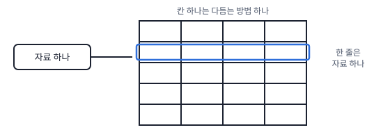

*표의 한 줄은 자료 하나이고, 한 칸은 다듬는 방법 하나예요.*

**정확히 말하면**

훈련 입력 $\mathbf{x}_1, \dots, \mathbf{x}_N$마다 특징 벡터를 구해 행으로 쌓은 행렬이 특징행렬(feature matrix)이에요.

$$
\boldsymbol{\Phi} := \begin{bmatrix} \boldsymbol{\phi}(\mathbf{x}_1)^\top \\ \vdots \\ \boldsymbol{\phi}(\mathbf{x}_N)^\top \end{bmatrix}, \qquad \boldsymbol{\Phi} \in \mathbb{R}^{N \times K}
$$

$$
\Phi_{ij} = \phi_j(\mathbf{x}_i), \qquad \phi_j : \mathbb{R}^D \to \mathbb{R}
$$

$i$번째 행은 $\mathbf{x}_i$로 만들고, $j$번째 열은 $j$번째 특징 함수예요. 행 수는 데이터 수 $N$, 열 수는 특징 수 $K$예요. 원자료 $\mathbf{X}$는 $\boldsymbol{\Phi}$를 만드는 입력으로 쓰여요.

예를 들어 2차 다항식 특징 $\boldsymbol{\phi}(x) = [1, x, x^2]^\top$이면 $i$번째 행은 $[1, x_i, x_i^2]$이고 $\boldsymbol{\Phi} \in \mathbb{R}^{N \times 3}$이에요(MML Example 9.4).

$\boldsymbol{\phi}$가 항등(identity) 함수 $\boldsymbol{\phi}(\mathbf{x}) = \mathbf{x}$이면 $\boldsymbol{\Phi} = \mathbf{X}$예요. 그래서 연쇄법칙 유도(s16)에서 처음부터 $\boldsymbol{\Phi}$로 적었어요. $\mathbf{X}$만 쓰는 경우를 포함하는 일반형이에요.

문제 모양은 $\mathbf{y} = \mathbf{X}\boldsymbol{\theta}$일 때와 같아요.

1. $$
   \mathbf{y} = \boldsymbol{\Phi}\boldsymbol{\theta} + \boldsymbol{\epsilon}, \qquad p(\mathcal{Y} \mid \mathcal{X}, \boldsymbol{\theta}) = \mathcal{N}(\mathbf{y} \mid \boldsymbol{\Phi}\boldsymbol{\theta},\ \sigma^2 \mathbf{I})
   $$
2. $$
   -\log p(\mathcal{Y} \mid \mathcal{X}, \boldsymbol{\theta}) = \frac{1}{2\sigma^2} \lVert \mathbf{y} - \boldsymbol{\Phi}\boldsymbol{\theta} \rVert^2 + \text{const}
   $$
3. $\mathbf{X}$ 자리에 $\boldsymbol{\Phi}$를 넣고 같은 방법으로 미분해 0으로 두면 돼요.

   $$
   \boldsymbol{\theta}_{\text{ML}} = (\boldsymbol{\Phi}^\top \boldsymbol{\Phi})^{-1} \boldsymbol{\Phi}^\top \mathbf{y}
   $$

해는 $\boldsymbol{\Phi}$의 유사역행렬(pseudo-inverse)을 $\mathbf{y}$에 곱한 값이에요. 이름은 추정(estimation)이지만 실제로는 $\boldsymbol{\theta}$를 학습하는 일이고, 그 계산을 역행렬 같은 선형대수로 할 뿐이에요.

원자료 대신 $\boldsymbol{\Phi}$를 쓰는 이유는 알맞은 도메인으로 바꾸면 학습이 잘 안 되던 문제도 잘 풀릴 수 있기 때문이에요.

특징행렬 $\boldsymbol\Phi$는 표본 $N$개를 행으로, 특징 $K$개를 열로 쌓은 $N\times K$ 행렬이에요.

새로운 ML 유도가 필요한 것이 아니에요. [앞 정상조건](#s1-theta-ml)의 X 자리에 특징행렬 Φ를 넣어 $\boldsymbol\Phi^\top\boldsymbol\Phi\boldsymbol\theta=\boldsymbol\Phi^\top\mathbf y$로 바꾸면 돼요. 이 역행렬 표현에는 Φ의 full column rank가 필요해요. 이 두 덩어리를 다음 MAP 비교에서도 그대로 써요.

**교수님 말씀**

교수님이 학생 입장에서 두 가지를 묻고 답했어요.

> "그냥 x로 합시다, 뭘 파이로 바꿉니까."

답은 바꾼 뒤에 학습이 더 잘될 수 있다는 것이었어요.

> "그러면 x는 어디다 써요?"

답은 $\boldsymbol{\Phi}$를 만들 때 입력으로 쓴다는 것이었어요. 또 "말이 에스티메이션이지" 결국 학습이라고 덧붙였어요.

**보충 · 수업에서 유도하진 않았어요**

**스칼라 잡음의 분산이 왜 행렬이 되나요?** 입력과 $\boldsymbol{\theta}$가 주어진 상태에서, 각 관측의 잡음은 서로 독립이고 같은 분산 $\sigma^2$를 갖는다고 가정해요. 이 잡음들을 하나의 열벡터로 묶어요.

$$
\epsilon_i\sim\mathcal N(0,\sigma^2),\qquad \boldsymbol{\epsilon}=[\epsilon_1,\ldots,\epsilon_N]^\top
$$

공분산 행렬의 대각에는 각 잡음의 분산이 들어가고, 비대각에는 서로 다른 잡음의 공분산이 들어가요. 독립인 잡음끼리의 공분산은 0이에요. 두 관측만 놓으면 다음과 같아요.

$$
\mathrm{cov}(\boldsymbol{\epsilon})=\begin{bmatrix}\sigma^2&0\\0&\sigma^2\end{bmatrix}=\sigma^2\mathbf I_2
$$

$N$개를 묶으면 $\sigma^2\mathbf I_N$인 $N\times N$ 행렬이에요. 조건으로 주어진 입력과 파라미터가 잡음 분포를 바꾸지 않는 이 모델에서는 $\mathbf y$의 조건부 공분산도 같아요.

$$
\mathrm{cov}(\mathbf y\mid\mathcal X,\boldsymbol{\theta})=\sigma^2\mathbf I_N
$$

입력과 $\boldsymbol{\theta}$가 주어지면 $\boldsymbol{\Phi}\boldsymbol{\theta}$는 고정된 평균이에요. $\mathbf y=\boldsymbol{\Phi}\boldsymbol{\theta}+\boldsymbol{\epsilon}$에서 불확실성은 잡음에만 남으므로 이 식은 **조건부 공분산**이에요. 파라미터 자체의 불확실성까지 합친 예측 공분산과 구별해요.

$\sigma^2\mathbf I_N$는 $N$개 관측 잡음의 공분산이고, [사전분포의 $b^2\mathbf I_K$](#s4-gaussian-prior)는 $K$개 파라미터의 공분산이에요. 행렬로 묶는 원리는 [1007 스칼라에서 벡터 공분산으로 이어지는 보충](../../1007/정리노트_1007_Product_of_Gaussians.html#s1-covariance)에 있어요.

**페이지 요약**

특징 벡터를 행으로 쌓은 Φ를 X 자리에 넣으면 같은 최대우도 해가 나와요.

*핵심 식*

- 특징행렬 원소

  $$
  \Phi_{ij} = \phi_j(\mathbf{x}_i), \qquad \phi_j : \mathbb{R}^D \to \mathbb{R}
  $$
- 최대우도 해

  $$
  \boldsymbol{\theta}_{\text{ML}} = (\boldsymbol{\Phi}^\top \boldsymbol{\Phi})^{-1} \boldsymbol{\Phi}^\top \mathbf{y}
  $$

*용어*

- **특징행렬(feature matrix)** — N개 특징 벡터를 행으로 쌓은 N×K 행렬이에요.
- **항등(identity) 함수** — 특징 함수가 입력을 그대로 내보내면 Φ는 X가 돼요.

#### 조건·구분

한 행은 한 데이터, 한 열은 한 특징이라 $\Phi$는 $N\times K$예요. 보충에서는 독립·동일 분산 $\sigma^2$의 가우시안 잡음을 묶어 $\sigma^2I_N$인 $N\times N$ 조건부 공분산을 얻어요. 계수까지 고정한 이 공분산을 파라미터 불확실성까지 합친 예측 공분산이나 사전의 $b^2I_K$와 구별해요. 이 설명은 수업 밖 보충이에요.

---

## 3. 다항 적합과 과적합

### 차수를 바꿔 가며 곡선 맞추기

*0928 수업 · L03 s19*

**쉽게 말하면**

흩어진 점 10개를 끈 하나로 이어 보는데, 끈을 얼마나 휘게 할지는 우리가 정해요.

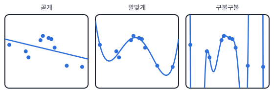

*같은 점들인데 곧은 끈은 많이 비껴가고, 너무 휘는 끈은 점은 다 지나도 모양이 엉망이에요.*

**정확히 말하면**

데이터는 교과서 Example 9.5와 같은 방식으로 만든 $N = 10$개의 점 $(x_n, y_n)$이에요.

$$
x_n \sim \mathcal{U}[-5, 5], \qquad y_n = -\sin(x_n/5) + \cos(x_n) + \epsilon, \qquad \epsilon \sim \mathcal{N}(0, 0.2^2)
$$

$x_n$은 구간 $[-5, 5]$에서 고르게 뽑고, 잡음 $\epsilon$은 표준편차 $0.2$(분산 $0.04$)인 가우시안이에요. 참 함수 $-\sin(x/5) + \cos(x)$는 우리가 모른다고 치고, 점 10개만 보고 곡선을 맞춰요.

모델은 차수 $M$인 다항식이에요. [다항회귀: 입력을 K차원으로 올리기](#s2-polynomial)의 특징 $\boldsymbol{\phi}(x) = [1, x, \dots, x^M]^\top$을 쓰므로 파라미터는 $K = M + 1$개예요.

$$
f(x) = \theta_0 + \theta_1 x + \theta_2 x^2 + \dots + \theta_M x^M = \boldsymbol{\phi}(x)^\top \boldsymbol{\theta}
$$

차수마다 [특징행렬 Φ와 최대우도 해](#s2-feature-matrix)의 공식으로 최대우도(ML) 해를 구해요. 이때 $\boldsymbol{\Phi} \in \mathbb{R}^{10 \times (M+1)}$이에요.

$$
\boldsymbol{\theta}_{\text{ML}} = (\boldsymbol{\Phi}^\top \boldsymbol{\Phi})^{-1} \boldsymbol{\Phi}^\top \mathbf{y}
$$

수업에서는 차수를 $M = 0, 1, 2, 3, 4, \dots$로 키우며 맞춘 곡선을 비교했어요(교과서 Figure 9.5).

1. $M = 0$: 0차, 곧 상수 $f(x) = \theta_0$예요. 기울기 없는 수평선이라 점들을 거의 설명하지 못해요.
2. $M = 1$: 1차, 곧 직선 $f(x) = \theta_0 + \theta_1 x$예요. 여전히 너무 단순해요(underfit).
3. $M = 3, \dots, 6$: 교과서 Figure 9.5 기준으로 곡선이 점들 사이를 매끄럽게 지나요. 이 섹션 위젯의 점들에서는 $M = 3$까지 훈련 RMSE가 0.497로 크고, $M = 4$에서 0.172로 크게 떨어져요. 슬라이드 s19는 차수 4로 맞춘 결과를 보여 줘요. 4차 다항식이면 $K = 5$예요.
4. $M = 9 = N - 1$: 파라미터 10개, 점 10개라 곡선이 모든 점을 정확히 지나요. 대신 점 사이에서 크게 출렁여요.

$M \ge N$이면 파라미터가 점보다 많아 $\boldsymbol{\Phi}^\top \boldsymbol{\Phi}$가 역행렬을 갖지 않아요. 그러면 최대우도 해가 무수히 많아요. 그래서 $N = 10$일 때 따져 볼 차수는 $0 \le M \le 9$예요.

차수를 올릴수록 훈련점에는 더 잘 맞아요. 어느 차수가 좋은지는 [과적합: 훈련 오차와 테스트 오차](#s3-overfitting)에서 따져요.

**교수님 말씀**

다항회귀를 소개하면서 차수는 모델 복잡도이고 정답이 없다고 했어요. 3차로 하려면 $K = 4$, 6차로 하려면 $K = 7$을 넣으면 돼요. "7이 3보다 좋지 않나요?"라는 물음에는 이렇게 답했어요.

> "그건 모르지. 그러니까 따져봐야 돼. 지금부터 따져보는 게 그다음 장에 나오죠."

그 "다음 장"이 이 슬라이드예요. 차수 0인 모델부터 하나씩 올려 가며 그림을 넘겼어요.

> "기울기도 없는 y절편만 있는 직선이죠."

차수 0 모델을 두고 한 말이에요. 곧 $f(x) = \theta_0$인 수평선이에요.

**페이지 요약**

같은 점 10개에 차수 $M$을 바꿔 가며 최대우도 다항식을 맞춰 봐요.

*핵심 식*

- 데이터 생성

  $$
  \begin{aligned}x_n&\sim\mathcal U[-5,5],\\y_n&=-\sin(x_n/5)\\&\quad+\cos(x_n)+\epsilon,\\\epsilon&\sim\mathcal N(0,0.2^2)\end{aligned}
  $$
- 차수 M 모델

  $$
  \begin{aligned}f(x)&=\theta_0+\theta_1x\\&\quad+\theta_2x^2+\dots+\theta_Mx^M\\&=\boldsymbol\phi(x)^\top\boldsymbol\theta\end{aligned}
  $$
- 최대우도 해

  $$
  \boldsymbol{\theta}_{\text{ML}} = (\boldsymbol{\Phi}^\top \boldsymbol{\Phi})^{-1} \boldsymbol{\Phi}^\top \mathbf{y}
  $$

*용어*

- **차수(degree) M** — 다항식의 가장 높은 거듭제곱. $M = 0$은 상수, $M = 1$은 직선이에요.

#### 조건·구분

$K=M+1$이고 $\Phi$는 $10\times(M+1)$이에요. 이 예의 $M=9$는 열 개 점을 보간하지만 점 사이에서 출렁이고, $M\ge10$이면 $\Phi^\top\Phi$가 가역이 아니어서 표시한 역행렬 식을 쓸 수 없어요. 잡음의 0.2는 표준편차이고 분산은 0.04예요.

---

### 과적합: 훈련 오차와 테스트 오차

*0928 수업 · L03 s20*

**쉽게 말하면**

연습 문제 답만 통째로 외우면 연습 문제는 다 맞혀도 처음 보는 문제에서는 틀려요.

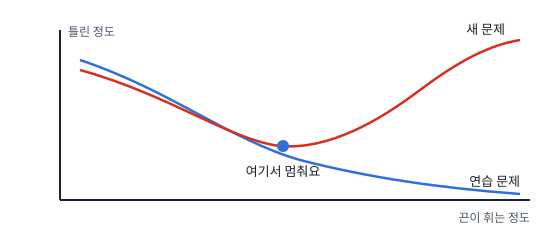

*끈을 더 휘게 할수록 연습 문제 오답은 줄지만, 새 문제 오답은 어느 순간부터 다시 늘어요.*

**정확히 말하면**

곡선이 얼마나 잘 맞는지는 평균제곱근오차(root mean square error, RMSE)로 재요(교과서 식 9.23).

$$
\text{RMSE} = \sqrt{\frac{1}{N} \|\mathbf{y} - \boldsymbol{\Phi}\boldsymbol{\theta}\|^2} = \sqrt{\frac{1}{N} \sum_{n=1}^{N} \left(y_n - \boldsymbol{\phi}(x_n)^\top \boldsymbol{\theta}\right)^2}
$$

$\frac{1}{N}$로 나눠서 데이터 수가 달라도 비교할 수 있어요. 제곱근을 씌워서 $y_n$과 단위가 같아요.

- **훈련 오차(training error)**: $\boldsymbol{\theta}_{\text{ML}}$을 구할 때 쓴 훈련점 10개에서 잰 RMSE예요.
- **테스트 오차(test error)**: 같은 방식으로 새로 만든 점(교과서는 $[-5, 5]$의 격자점 200개)에서 잰 RMSE예요. 처음 보는 데이터를 얼마나 잘 예측하는지(일반화)를 보여 줘요.

슬라이드 s20(교과서 Figure 9.6)이 보여 주는 것은 두 가지예요.

1. 차수 $M$을 올리면 훈련 오차는 줄어요. 줄기만 하고 늘지는 않으며, $M = N - 1 = 9$에서 0이 돼요.
2. 테스트 오차는 처음에는 줄다가 어느 차수부터 커져요. 교과서 예에서는 $M = 4$일 때 가장 작고, $M = 6$부터 크게 늘어요.

훈련 오차가 늘 수 없는 이유는 모델이 겹쳐 있기 때문이에요. 차수 $M + 1$ 모델에서 $\theta_{M+1} = 0$으로 두면 차수 $M$ 모델이 되므로, 최솟값이 더 커질 수 없어요.

**과적합(overfitting)**은 모델이 훈련 데이터에 지나치게 맞춰져서 새 데이터를 잘 예측하지 못하는 상태예요. 고차 다항식은 훈련점을 모두 지나지만 점 사이에서 크게 출렁여요. 그래서 새 $x$가 들어오면 예측값이 실제값과 크게 다를 수 있어요.

차수(모델 복잡도, model complexity)는 이렇게 골라요.

1. $M = 0, 1, \dots, N - 1$마다 $\boldsymbol{\theta}_{\text{ML}}$을 구해요.
2. 차수마다 훈련 오차와 테스트 오차를 계산해요.
3. 두 오차가 함께 줄어드는 마지막 점의 $M$을 골라요(교수님 규칙). 그 뒤로는 훈련 오차만 줄고 테스트 오차는 커져요.

실제로는 테스트 오차가 가장 작은 차수를 골라요. 아래 위젯의 점들에서는 $M = 4$이고, 교과서 Figure 9.6과 같아요. $M = 2 \to 3$에서 테스트 오차가 조금 오르거나 $M = 6 \to 7$에서 두 오차가 조금 내리는 것은 점이 10개뿐이라 생기는 흔들림이에요.

#### 직접 해 보기: 차수를 올리면 두 오차는 어떻게 될까 *(정적 스냅샷 — 직접 조작은 HTML 버전)*

차수 슬라이더를 움직이면 위에는 그 차수로 맞춘 곡선이, 아래에는 차수별 훈련·테스트 RMSE와 지금 차수의 위치가 보여요. 아래 그래프에서 2를 넘는 값은 위 끝에 숫자로 적었어요.

훈련 RMSE **0.172** · 테스트 RMSE **0.375** · **테스트 오차가 가장 작은 차수예요**

범례: 참 함수(점선) · 최대우도 다항식, 아래 그래프의 훈련 RMSE · 훈련점 10개 · 테스트점 50개, 아래 그래프의 테스트 RMSE(붉은 선)

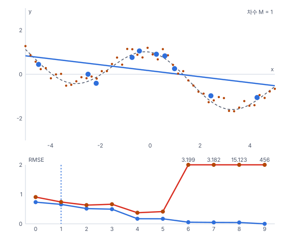

*차수 M = 1: 훈련 RMSE 0.658, 테스트 RMSE 0.740*

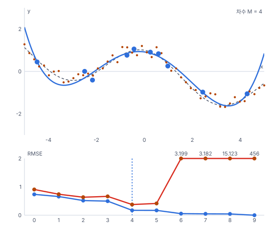

*차수 M = 4: 훈련 RMSE 0.172, 테스트 RMSE 0.375*

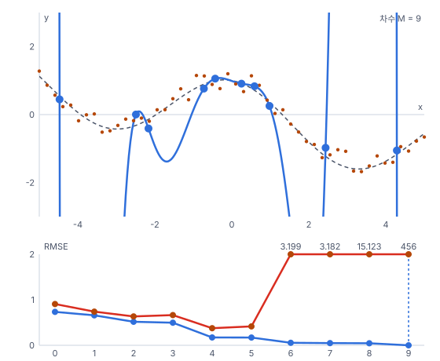

*차수 M = 9: 훈련 RMSE 0.000, 테스트 RMSE 456*

| 차수 | 훈련 RMSE | 테스트 RMSE | 상태 |
|---|---|---|---|
| M = 0 | 0.734 | 0.907 | 과소적합: 훈련점도 잘 못 맞춰요 |
| M = 1 | 0.658 | 0.740 | 과소적합: 훈련점도 잘 못 맞춰요 |
| M = 2 | 0.517 | 0.634 | 조금 나아졌어요 |
| M = 3 | 0.497 | 0.663 | 테스트 오차가 조금 늘었어요(점이 10개뿐이라 생기는 흔들림) |
| M = 4 | 0.172 | 0.375 | 테스트 오차가 가장 작은 차수예요 |
| M = 5 | 0.170 | 0.415 | 훈련 오차는 조금 줄었지만 테스트 오차가 커지기 시작해요 |
| M = 6 | 0.056 | 3.199 | 과적합: 훈련 오차는 작지만 테스트 오차가 커요 |
| M = 7 | 0.048 | 3.182 | 과적합: 두 오차가 조금 줄었지만 흔들림일 뿐, 테스트 오차는 여전히 커요 |
| M = 8 | 0.045 | 15.123 | 과적합: 훈련 오차는 작지만 테스트 오차가 커요 |
| M = 9 | 0.000 | 456 | 과적합: 곡선이 모든 훈련점을 지나요 |

차수를 낮추지 않고 과적합을 누르는 방법은 [MAP: 베이즈 정리와 한 가지 가정](#s4-map-bayes)에서 이어져요.

**교수님 말씀**

차수 9 그림에서 곡선이 모든 점을 정확히 지나는 것을 보여 주고 되물었어요.

> "그렇다고 해서 이게 더 좋은 모델일까?"

이어서 슬라이드 s20의 두 오차 그래프로 모델 복잡도를 어디서 끊을지 짚었어요.

> "트레이닝 에러도 감소하고 테스트 에러도 감소하는 그 마지막 점에서 모델 컴플렉시티를 결정해 주는 게 좋다."

지금 있는 데이터는 오류 없이 맞혔어도, 새 데이터가 들어오면 모델이 내놓는 값과 차이가 엄청 클 수 있다고 했어요.

> "그래서 이게 아주 대표적인 과적합 문제."

**페이지 요약**

차수를 올리면 훈련 오차는 계속 줄지만 테스트 오차는 어느 차수부터 커져요. 실제로는 테스트 오차가 가장 작은 차수를 골라요.

*핵심 식*

- RMSE

  $$
  \text{RMSE} = \sqrt{\frac{1}{N} \|\mathbf{y} - \boldsymbol{\Phi}\boldsymbol{\theta}\|^2} = \sqrt{\frac{1}{N} \sum_{n=1}^{N} \left(y_n - \boldsymbol{\phi}(x_n)^\top \boldsymbol{\theta}\right)^2}
  $$

*용어*

- **과적합(overfitting)** — 훈련 데이터에 지나치게 맞춰져 새 데이터를 잘 예측하지 못하는 상태
- **훈련 오차(training error)** — 훈련점에서 잰 RMSE. 차수를 올리면 줄기만 해요.
- **테스트 오차(test error)** — 새 점에서 잰 RMSE. 어느 차수부터 커져요.

#### 조건·구분

상위 차수 모델이 새 계수를 0으로 두어 하위 모델을 포함하므로 최적 훈련 오차는 늘 수 없어요. RMSE는 제곱합을 데이터 수로 평균하고 제곱근을 취해 출력과 단위를 맞춰요. 여기 테스트 오차는 예제에서 새로 만든 비교점에서 잰 값이며 표본에 따른 국소 흔들림도 있어요.

---

## 4. MAP 추정: 사전분포로 과적합 막기

### MAP: 베이즈 정리와 한 가지 가정

*0928 수업 · L03 s22*

**쉽게 말하면**

데이터가 하는 말과 원래 알던 상식을 저울에 함께 올려서 답을 골라요.

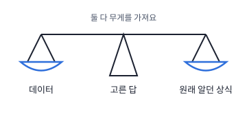

*상식 쪽 접시가 비어 있으면 데이터만 보고 고른 답과 같아져요.*

**정확히 말하면**

최대우도(ML) 추정은 [과적합: 훈련 오차와 테스트 오차](#s3-overfitting)에서 본 것처럼 과적합되기 쉬워요. 과적합되면 파라미터 값의 크기가 커지는 경우가 많아요(MML 9.2.3).

그래서 데이터를 보기 전에 "어떤 $\boldsymbol{\theta}$가 그럴듯한가(plausible)"를 사전분포(prior) $p(\boldsymbol{\theta})$로 정해 둬요. 사전분포에는 데이터와 상관없는 경험, 선호, 의도, 전문가 지식(expert knowledge)이 들어가요.

훈련 데이터 $\mathcal{X}, \mathcal{Y}$를 본 뒤의 사후분포(posterior) $p(\boldsymbol{\theta} \mid \mathcal{X}, \mathcal{Y})$를 가장 크게 만드는 $\boldsymbol{\theta}$를 찾는 방법이 MAP(maximum a posteriori) 추정이에요.

칠판 유도(베이즈 정리):

1. 결합확률로 쓰기:

   $$
   p(\boldsymbol{\theta} \mid \mathcal{X}, \mathcal{Y}) = \frac{p(\boldsymbol{\theta}, \mathcal{X}, \mathcal{Y})}{p(\mathcal{X}, \mathcal{Y})}
   $$
2. 분자와 분모를 조건부확률의 곱으로 풀기:

   $$
   = \frac{p(\mathcal{Y} \mid \mathcal{X}, \boldsymbol{\theta})\, p(\boldsymbol{\theta} \mid \mathcal{X})\, p(\mathcal{X})}{p(\mathcal{Y} \mid \mathcal{X})\, p(\mathcal{X})}
   $$
3. $p(\mathcal{X})$ 약분:

   $$
   = \frac{p(\mathcal{Y} \mid \mathcal{X}, \boldsymbol{\theta})\, p(\boldsymbol{\theta} \mid \mathcal{X})}{p(\mathcal{Y} \mid \mathcal{X})}
   $$
4. 가정 $p(\boldsymbol{\theta} \mid \mathcal{X}) = p(\boldsymbol{\theta})$를 넣기:

   $$
   p(\boldsymbol{\theta} \mid \mathcal{X}, \mathcal{Y}) = \frac{p(\mathcal{Y} \mid \mathcal{X}, \boldsymbol{\theta})\, p(\boldsymbol{\theta})}{p(\mathcal{Y} \mid \mathcal{X})}
   $$

가정 $p(\boldsymbol{\theta} \mid \mathcal{X}) = p(\boldsymbol{\theta})$는 엄밀한 확률론으로는 성립하지 않을 수 있어요. 머신러닝에서는 $\boldsymbol{\theta}$가 입력 $\mathbf{x}$와 출력 $y$가 함께 주어질 때만 추론된다고 봐요. 입력만 봐서는 $\boldsymbol{\theta}$에 대한 사전 믿음이 바뀌지 않는다는 뜻이에요.

ML은 우도 $p(\mathcal{Y} \mid \mathcal{X}, \boldsymbol{\theta})$를, MAP은 사후분포 $p(\boldsymbol{\theta} \mid \mathcal{X}, \mathcal{Y})$를 최대화해요. 분모 $p(\mathcal{Y} \mid \mathcal{X})$는 $\boldsymbol{\theta}$와 무관해요. 로그를 씌우면 곱이 합이 되고, $-\log$를 붙이면 최대화가 최소화로 바뀌어요.

$$
\boldsymbol{\theta}_{\text{MAP}} \in \arg\min_{\boldsymbol{\theta}} \{-\log p(\mathcal{Y} \mid \mathcal{X}, \boldsymbol{\theta}) - \log p(\boldsymbol{\theta})\}
$$

기울기도 두 항으로 나뉘어요.

$$
-\frac{d \log p(\boldsymbol{\theta} \mid \mathcal{X}, \mathcal{Y})}{d\boldsymbol{\theta}} = -\frac{d \log p(\mathcal{Y} \mid \mathcal{X}, \boldsymbol{\theta})}{d\boldsymbol{\theta}} - \frac{d \log p(\boldsymbol{\theta})}{d\boldsymbol{\theta}}
$$

- 앞 항은 음의 로그우도의 기울기예요. [연쇄법칙으로 손실을 파라미터로 미분하기](#s1-chain)에서 구한 것을 그대로 써요.
- 뒤 항 $-\log p(\boldsymbol{\theta})$의 기울기만 새로 계산하면 돼요. 그래서 MAP 식은 ML 항을 안에 품고 있어요.
- 교과서는 MAP 추정을 사전분포(데이터를 보기 전 그럴듯한 값)와 데이터에 기댄 우도 사이의 "타협"이라고 설명해요(MML 식 9.24–9.27).

MAP이 무엇인지 처음 배운 내용은 [0916 정리노트: MAP = MLE + log prior](../../0916/정리노트_0916_MAP_and_Generative_Models.html#s1-map)에 있어요.

**교수님 말씀**

사전분포는 데이터와 상관없이 가진 믿음이라고 하셨어요.

> "모름지기 세타라면 이래야지"

> "x가 주어지나 주어지지 않나 세타에 대한 확률은 변하지 않는다라고 보통 가정해요."

> "요만큼이 아까 우리가 했던 MLE에 해당하는 거죠. … MLE를 포함하고 있어."

**페이지 요약**

MAP은 우도에 사전분포를 곱한 사후분포를 가장 크게 만드는 $\boldsymbol{\theta}$를 찾아요.

*핵심 식*

- 베이즈 정리

  $$
  p(\boldsymbol{\theta} \mid \mathcal{X}, \mathcal{Y}) = \frac{p(\mathcal{Y} \mid \mathcal{X}, \boldsymbol{\theta})\, p(\boldsymbol{\theta})}{p(\mathcal{Y} \mid \mathcal{X})}
  $$
- MAP 추정

  $$
  \boldsymbol{\theta}_{\text{MAP}} \in \arg\min_{\boldsymbol{\theta}} \{-\log p(\mathcal{Y} \mid \mathcal{X}, \boldsymbol{\theta}) - \log p(\boldsymbol{\theta})\}
  $$

*용어*

- **MAP(maximum a posteriori)** — 사후분포를 최대화하는 $\boldsymbol{\theta}$를 고르는 추정
- **사전분포(prior)** — 데이터를 보기 전 그럴듯한 $\boldsymbol{\theta}$에 대한 믿음 $p(\boldsymbol{\theta})$

#### 조건·구분

$p(\theta\mid\mathcal X)=p(\theta)$는 입력만으로 사전 믿음이 바뀌지 않는다는 **가정**이에요. 이 가정에서 계수와 무관한 분모를 제외하고 NLL과 음의 로그 prior의 합을 최소화해요.

---

### 가우시안 사전분포와 음의 로그사후확률

*0928 수업 · L03 s23*

**쉽게 말하면**

"답은 0 근처에 있을 거야"라고 미리 믿어 두면, 0에서 먼 답일수록 벌점이 커져요.

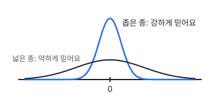

*종이 좁을수록 0에서 먼 값을 더 싫어해요.*

**정확히 말하면**

사전분포를 평균 0인 가우시안으로 둬요: $p(\boldsymbol{\theta}) = \mathcal{N}(\mathbf{0}, b^2 \mathbf{I})$. 모델은 [특징행렬 Φ와 최대우도 해](#s2-feature-matrix)의 $y = \boldsymbol{\phi}(\mathbf{x})^\top \boldsymbol{\theta} + \epsilon$, $\epsilon \sim \mathcal{N}(0, \sigma^2)$이고 $\boldsymbol{\theta} \in \mathbb{R}^K$예요.

- 이 가우시안 사전분포에서는 공분산이 $b^2 \mathbf{I}$이면 각 $\theta_i$가 서로 독립이고 각각 $\mathcal{N}(0, b^2)$를 따라요.

  $$
  p(\boldsymbol{\theta}) = \prod_{i=1}^{K} \frac{1}{\sqrt{2\pi b^2}} \exp\left(-\frac{\theta_i^2}{2b^2}\right)
  $$
- $b$는 사전분포의 폭이에요. 예를 들어 $\mathcal{N}(0, 1)$이면 $\theta$가 대략 $[-2, 2]$(평균에서 표준편차 2배 안)에 있을 거라는 믿음이에요(MML 9.2.3).
- 가우시안 우도에 가우시안 사전분포를 곱하면 사후분포도 가우시안이 돼요. 이런 짝을 켤레(conjugate) 사전분포라고 해요(슬라이드 s23).

음의 로그 사전분포:

1. $$
   -\log p(\boldsymbol{\theta}) = \sum_{i=1}^{K} \frac{\theta_i^2}{2b^2} + \text{const}
   $$
2. $\|\boldsymbol{\theta}\|^2 = \boldsymbol{\theta}^\top \boldsymbol{\theta} = \sum_i \theta_i^2$이므로

   $$
   -\log p(\boldsymbol{\theta}) = \frac{1}{2b^2} \boldsymbol{\theta}^\top \boldsymbol{\theta} + \text{const}
   $$

여기에 음의 로그우도를 더하면 음의 로그사후확률(negative log-posterior)이에요(MML 식 9.28).

$$
-\log p(\boldsymbol{\theta} \mid \mathcal{X}, \mathcal{Y}) = \frac{1}{2\sigma^2} (\mathbf{y} - \boldsymbol{\Phi}\boldsymbol{\theta})^\top (\mathbf{y} - \boldsymbol{\Phi}\boldsymbol{\theta}) + \frac{1}{2b^2} \boldsymbol{\theta}^\top \boldsymbol{\theta} + \text{const}
$$

- 앞 항은 ML 때의 음의 로그우도와 같아요. $\mathbf{X}$ 대신 특징행렬 $\boldsymbol{\Phi}$를 넣었을 뿐이에요.
- 뒤 항은 사전분포에서 왔어요. $\boldsymbol{\theta}$가 0에서 멀수록 커져요.

기울기(행벡터로 나열하는 관례):

1. 앞 항: [연쇄법칙으로 손실을 파라미터로 미분하기](#s1-chain)의 $-2(\mathbf{y}^\top - \boldsymbol{\theta}^\top \boldsymbol{\Phi}^\top)\boldsymbol{\Phi}$에 $\frac{1}{2\sigma^2}$을 곱해요.

   $$
   \frac{1}{\sigma^2} (\boldsymbol{\theta}^\top \boldsymbol{\Phi}^\top \boldsymbol{\Phi} - \mathbf{y}^\top \boldsymbol{\Phi})
   $$
2. 뒤 항: $\boldsymbol{\theta}^\top \boldsymbol{\theta}$를 미분하면 $2\boldsymbol{\theta}^\top$이고 2가 약분돼요.

   $$
   \frac{d}{d\boldsymbol{\theta}} \left(\frac{1}{2b^2} \boldsymbol{\theta}^\top \boldsymbol{\theta}\right) = \frac{1}{b^2} \boldsymbol{\theta}^\top
   $$
3. 더하기(MML 식 9.29):

   $$
   -\frac{d \log p(\boldsymbol{\theta} \mid \mathcal{X}, \mathcal{Y})}{d\boldsymbol{\theta}} = \frac{1}{\sigma^2} (\boldsymbol{\theta}^\top \boldsymbol{\Phi}^\top \boldsymbol{\Phi} - \mathbf{y}^\top \boldsymbol{\Phi}) + \frac{1}{b^2} \boldsymbol{\theta}^\top
   $$

ML의 데이터 항 $\frac1{2\sigma^2}\|\mathbf y-\boldsymbol\Phi\boldsymbol\theta\|^2$은 그대로이고, 평균 0의 prior가 $\frac1{2b^2}\|\boldsymbol\theta\|^2$를 추가해요. 둘을 θ로 미분한 행벡터를 더하는 것이 [다음 MAP 정상조건](#s4-ml-vs-map)이에요. posterior 전체를 먼저 정규화할 필요는 없어요.

**교수님 말씀**

학생이 물을 법한 질문을 스스로 던지고 답하셨어요.

- "아까 하던 거랑 좀 다른데요?"에는 $\mathbf{X}$ 대신 특징행렬을 넣었을 뿐 똑같다고 답하셨어요.
- "세타 놈의 제곱 자리에 왜 이게?"에는 $\|\boldsymbol{\theta}\|^2 = \boldsymbol{\theta}^\top \boldsymbol{\theta}$이기 때문이라고 답하셨어요.
- "왜 가로 벡터로 바뀌나요?"에는 스칼라를 벡터로 미분하면 행벡터로 나열하는 게 관습이라고 답하셨어요.

공분산행렬이 하는 역할은 다음 시간에 더 얘기하겠다고 하셨어요.

> "코베리언스 매트릭스가 하는 역할이 그래요. 그거에 대해서는 다음 시간에"

**보충 · 수업에서 유도하진 않았어요**

**$b^2\mathbf I$는 여러 스칼라 분산을 어떻게 담나요?** 두 파라미터를 묶은 $\boldsymbol{\theta}=[\theta_1,\theta_2]^\top$에서 각 성분의 분산을 $b^2$로 같게 두고, 서로의 공분산을 0으로 두면 다음 표가 돼요. $b^2\gt0$인 가우시안 사전분포를 사용해요.

$$
\mathrm{var}(\theta_1)=\mathrm{var}(\theta_2)=b^2,\qquad \mathrm{cov}(\theta_1,\theta_2)=0
$$

$$
\mathrm{cov}(\boldsymbol{\theta})=\begin{bmatrix}b^2&0\\0&b^2\end{bmatrix}=b^2\mathbf I_2
$$

대각은 각 파라미터의 스칼라 분산이고, 비대각은 성분 사이의 공분산이에요. $K$개 파라미터에서는 $b^2\mathbf I_K$인 $K\times K$ 행렬이 돼요. $b^2$는 숫자 하나이고, $b^2\mathbf I_K$는 그 숫자를 대각선에 놓은 행렬이에요.

**독립이라는 결론에는 가우시안 조건이 있어요.** 여기서는 성분들을 함께 묶은 분포가 가우시안, 즉 공동 가우시안이므로 비대각 공분산이 0이면 성분들이 독립이에요. 일반 분포에서는 공분산이 0이라는 사실만으로 독립이라고 할 수 없어요.

이 설정은 모든 파라미터의 사전 분산이 같은 특별한 경우예요. [일반 사전분포의 $\mathbf S_0$](#s5-general-prior)는 성분별 분산과 성분 사이 공분산을 더 일반적으로 담아요. 공분산 행렬의 정의는 [1007 공분산 보충](../../1007/정리노트_1007_Product_of_Gaussians.html#s1-covariance)에서 확인할 수 있어요.

**페이지 요약**

평균 0인 가우시안 사전분포를 두면 음의 로그사후확률에 $\boldsymbol{\theta}$ 크기 벌점 항이 하나 더 붙어요.

*핵심 식*

- 가우시안 사전분포

  $$
  p(\boldsymbol{\theta}) = \mathcal{N}(\mathbf{0}, b^2 \mathbf{I})
  $$
- 음의 로그사후확률

  $$
  -\log p(\boldsymbol{\theta} \mid \mathcal{X}, \mathcal{Y}) = \frac{1}{2\sigma^2} (\mathbf{y} - \boldsymbol{\Phi}\boldsymbol{\theta})^\top (\mathbf{y} - \boldsymbol{\Phi}\boldsymbol{\theta}) + \frac{1}{2b^2} \boldsymbol{\theta}^\top \boldsymbol{\theta} + \text{const}
  $$
- 기울기

  $$
  -\frac{d \log p(\boldsymbol{\theta} \mid \mathcal{X}, \mathcal{Y})}{d\boldsymbol{\theta}} = \frac{1}{\sigma^2} (\boldsymbol{\theta}^\top \boldsymbol{\Phi}^\top \boldsymbol{\Phi} - \mathbf{y}^\top \boldsymbol{\Phi}) + \frac{1}{b^2} \boldsymbol{\theta}^\top
  $$

*용어*

- **켤레(conjugate) 사전분포** — 우도와 곱했을 때 사후분포가 같은 꼴(여기서는 가우시안)이 되는 사전분포

#### 조건·구분

$b^2>0$인 사전 $\mathcal N(0,b^2I_K)$에서 $\theta$는 길이 $K$, 공분산은 $K\times K$이고 음의 로그 prior 벌점은 $\|\theta\|^2/(2b^2)$예요. 보충: 비대각 공분산 0에서 독립을 결론 내리는 데는 **공동 가우시안** 조건이 필요하며 일반 분포에는 성립하지 않아요. 대각/비대각의 분산·공분산 설명은 수업 밖 보충이에요.

---

### ML vs MAP: σ²/b² 한 항의 차이

*0928 수업 · L03 s24*

**쉽게 말하면**

손잡이 하나로 데이터만 믿을지, 원래 생각도 섞을지 정해요.

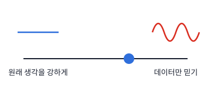

*손잡이를 오른쪽 끝까지 밀면 데이터만 믿은 답과 똑같아져요.*

**정확히 말하면**

[가우시안 사전분포와 음의 로그사후확률](#s4-gaussian-prior)의 기울기를 $\mathbf{0}^\top$으로 두고 풀어요(MML 식 9.30–9.31).

1. $$
   \frac{1}{\sigma^2} (\boldsymbol{\theta}^\top \boldsymbol{\Phi}^\top \boldsymbol{\Phi} - \mathbf{y}^\top \boldsymbol{\Phi}) + \frac{1}{b^2} \boldsymbol{\theta}^\top = \mathbf{0}^\top
   $$
2. 양변에 $\sigma^2$를 곱하고 $\mathbf{y}^\top \boldsymbol{\Phi}$를 넘기기:

   $$
   \boldsymbol{\theta}^\top \boldsymbol{\Phi}^\top \boldsymbol{\Phi} + \frac{\sigma^2}{b^2} \boldsymbol{\theta}^\top = \mathbf{y}^\top \boldsymbol{\Phi}
   $$
3. $\boldsymbol{\theta}^\top$로 묶기:

   $$
   \boldsymbol{\theta}^\top \left(\boldsymbol{\Phi}^\top \boldsymbol{\Phi} + \frac{\sigma^2}{b^2} \mathbf{I}\right) = \mathbf{y}^\top \boldsymbol{\Phi}
   $$
4. 오른쪽에 역행렬 곱하기:

   $$
   \boldsymbol{\theta}^\top = \mathbf{y}^\top \boldsymbol{\Phi} \left(\boldsymbol{\Phi}^\top \boldsymbol{\Phi} + \frac{\sigma^2}{b^2} \mathbf{I}\right)^{-1}
   $$
5. 양변 전치(괄호 안 행렬이 대칭이라 역행렬도 대칭):

   $$
   \boldsymbol{\theta}_{\text{MAP}} = \left(\boldsymbol{\Phi}^\top \boldsymbol{\Phi} + \frac{\sigma^2}{b^2} \mathbf{I}\right)^{-1} \boldsymbol{\Phi}^\top \mathbf{y}
   $$

ML 해와 나란히 놓으면 차이는 $\frac{\sigma^2}{b^2} \mathbf{I}$ 한 항뿐이에요.

$$
\boldsymbol{\theta}_{\text{ML}} = (\boldsymbol{\Phi}^\top \boldsymbol{\Phi})^{-1} \boldsymbol{\Phi}^\top \mathbf{y}
$$

- $b \to \infty$: 사전분포가 옆으로 넓게 퍼져 선호가 없어요. $\frac{\sigma^2}{b^2} \to 0$이라 $\boldsymbol{\theta}_{\text{MAP}} \to \boldsymbol{\theta}_{\text{ML}}$이에요. 데이터만 믿는 셈이에요.
- $b^2 \to 0$: $\frac{\sigma^2}{b^2}$가 매우 커져요. 데이터보다 "$\boldsymbol{\theta}$는 0 근처여야 한다"는 선호를 강하게 반영해서 $\boldsymbol{\theta}_{\text{MAP}}$가 $\mathbf{0}$ 쪽으로 눌려요.
- 그래서 MAP은 ML을 포함해요. $b$를 크게 두면 ML과 같으니, MAP은 ML을 한 가지 경우로 품은 더 넓은 선택지예요.
- $\frac{\sigma^2}{b^2} \mathbf{I}$ 항은 정규화(regularizer) 역할을 해요. $\boldsymbol{\theta}$의 크기를 억눌러 곡선을 매끈하게 만들어요.
- 슬라이드에는 이 항이 $\boldsymbol{\Phi}^\top \boldsymbol{\Phi} + \frac{\sigma^2}{b^2} \mathbf{I}$를 대칭이고 엄밀한 양의 정부호(strictly positive definite)로 만들어 역행렬이 늘 존재하게 한다는 설명도 있어요. 수업에서는 정규화 해석만 말했어요.

교과서 Example 9.6은 $p(\boldsymbol{\theta}) = \mathcal{N}(\mathbf{0}, \mathbf{I})$로 6차와 8차 다항식을 맞춰 봐요. 낮은 차수에서는 사전분포의 영향이 작고, 높은 차수에서는 곡선을 비교적 매끈하게 지켜 줘요. 다만 교과서는 MAP이 과적합의 일반적인 해결책은 아니라고 덧붙여요.

아래 위젯은 [차수를 바꿔 가며 곡선 맞추기](#s3-polyfit)와 같은 방식($x_n \sim \mathcal{U}[-5, 5]$, $y_n = -\sin(x_n/5) + \cos(x_n) + \epsilon$, $\sigma = 0.2$)으로 고정 시드에서 뽑은 훈련점 10개에 8차 다항식을 맞춰요. 수치 안정을 위해 $z = x/5$로 스케일한 특징 $\boldsymbol{\phi}(x) = [1, z, \dots, z^8]^\top$를 써서, 사전분포도 이 특징의 계수에 걸려요.

훈련점은 [과적합: 훈련 오차와 테스트 오차](#s3-overfitting)의 위젯과는 다른 표본이에요(같은 생성 방식).

#### 직접 해 보기: 사전분포 폭 b와 MAP 곡선 *(정적 스냅샷 — 직접 조작은 HTML 버전)*

b를 키우면 MAP 곡선이 고정된 ML 곡선에 겹치고, 줄이면 곡선이 매끈해지다가 0 쪽으로 눌려요.

$b$ = **1.0** · $\frac{\sigma^2}{b^2}$ = **0.0400** · $\|\boldsymbol{\theta}_{\text{MAP}}\|$ = **4.19** (비교: $\|\boldsymbol{\theta}_{\text{ML}}\|$ = 197.73)

범례: 참 함수 −sin(x/5) + cos(x) (점선) · 훈련점 10개 · ML 곡선(8차, 고정) · MAP 곡선 · 그림 밖으로 나간 부분은 잘랐어요

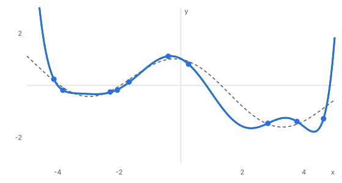

*b = 10000 (log₁₀ b = 4)*

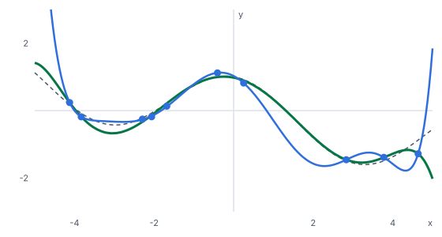

*b = 32 (log₁₀ b = 1.5)*

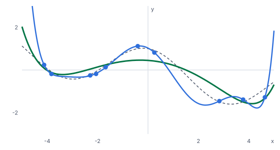

*b = 1 (log₁₀ b = 0)*

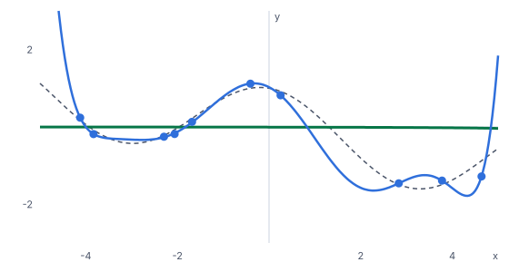

*b = 0.01 (log₁₀ b = -2)*

| 설정 | $\frac{\sigma^2}{b^2}$ | $\Vert \boldsymbol{\theta}_{\text{MAP}}\Vert $ | 참 함수와의 RMSE | 곡선 모습 |
|---|---|---|---|---|
| $b = 10000$ | 4.0e-10 | 197.64 | 1.338 | MAP 곡선이 ML 곡선과 겹쳐요. 점은 거의 모두 지나지만 양 끝에서 크게 휘어요. |
| $b = 32$ | 4.0e-5 | 21.59 | 0.229 | 점 근처를 매끈하게 지나요. 참 함수와 가장 가까워요. |
| $b = 1.0$ | 0.0400 | 4.19 | 0.366 | 더 매끈해지고 봉우리가 낮아져 가운데 점들을 비껴가요. |
| $b = 0.010$ | 400 | 0.01 | 0.856 | 거의 $y = 0$인 평평한 선으로 눌려요. 점을 따라가지 못해요. |
| ML(비교) | 0 | 197.73 | 1.339 | 훈련점 10개를 거의 그대로 지나지만 양 끝에서 크게 휘어요. |

#### 두 해보다, 두 정상조건을 나란히 기억해요

위 유도를 연결한 재표현이에요. $J$는 θ와 무관한 상수를 뺀 음의 로그사후 목적함수예요.

$$
\frac{\partial J}{\partial\boldsymbol\theta}=-\frac1{\sigma^2}(\mathbf y-\boldsymbol\Phi\boldsymbol\theta)^\top\boldsymbol\Phi+\frac1{b^2}\boldsymbol\theta^\top=\mathbf0^\top
$$

1. $\sigma^2$을 곱해 데이터 항과 prior 항을 모아요.

   $$
   \boldsymbol\theta^\top\left(\boldsymbol\Phi^\top\boldsymbol\Phi+\frac{\sigma^2}{b^2}\mathbf I\right)=\mathbf y^\top\boldsymbol\Phi
   $$
2. 양변을 전치해 열벡터 정상조건을 얻어요.

   $$
   \left(\boldsymbol\Phi^\top\boldsymbol\Phi+\frac{\sigma^2}{b^2}\mathbf I\right)\boldsymbol\theta=\boldsymbol\Phi^\top\mathbf y
   $$

| 위치 | ML | MAP에서 바뀐 것 |
|---|---|---|
| 왼쪽 행렬 | $\boldsymbol\Phi^\top\boldsymbol\Phi$ | $+(\sigma^2/b^2)\mathbf I$ |
| 오른쪽 벡터 | $\boldsymbol\Phi^\top\mathbf y$ | 그대로: prior 평균이 0이기 때문 |

$\sigma^2,b^2\gt0$이면 추가 항 덕분에 왼쪽 행렬은 양의 정부호예요. **ML의 왼쪽에 항을 더하고, 전치한 뒤 역행렬로 푼다**고 복원해요.

**교수님 말씀**

**머니볼**: 영화 속 콜라만 마시는 데이터 사이언티스트는 야구인의 감각을 버리고 데이터만 봐요. 이것이 $b \to \infty$, 곧 ML만 하겠다는 태도예요.

**아시안게임의 김도영**: KBO 데이터만 보면 잘해야 해요. 하지만 병역 면제와 메이저리그 계약이 걸린 심리적 부담 때문에 "잘 못할 거야"라고 예상했어요. 데이터에 이런 사전 의도를 섞는 것이 MAP이에요.

> "데이터도 중요한데 … 세타가 모름지기 어때야 된다라는 쪽에"

> "MAP이 왜 ML보다 더 우수할 수 있냐. MAP은 ML을 포함할 수 있으니까."

> "레귤러라이저의 역할을 하는, 정규화하는 역할을 한다는 거야."

**페이지 요약**

MAP 해는 ML 해의 역행렬 안에 $\frac{\sigma^2}{b^2} \mathbf{I}$ 한 항을 더한 것이고, $b \to \infty$이면 ML과 같아져요.

*핵심 식*

- MAP 해

  $$
  \boldsymbol{\theta}_{\text{MAP}} = \left(\boldsymbol{\Phi}^\top \boldsymbol{\Phi} + \frac{\sigma^2}{b^2} \mathbf{I}\right)^{-1} \boldsymbol{\Phi}^\top \mathbf{y}
  $$
- ML 해

  $$
  \boldsymbol{\theta}_{\text{ML}} = (\boldsymbol{\Phi}^\top \boldsymbol{\Phi})^{-1} \boldsymbol{\Phi}^\top \mathbf{y}
  $$

*용어*

- **정규화(regularizer)** — $\frac{\sigma^2}{b^2} \mathbf{I}$ 항처럼 $\boldsymbol{\theta}$의 크기를 억눌러 곡선을 매끈하게 만드는 항

#### 조건·구분

양의 $\sigma^2/b^2$ 항은 행렬을 양의 정부호로 만들어 역행렬을 보장하고, $b^2\to0$이면 계수를 0 쪽으로 눌러요. 이 양의 정부호 성질은 슬라이드에 있고 수업에서는 말하지 않았어요. 교과서도 MAP을 과적합의 일반 해결책으로 보지는 않아요.

---

## 5. 정규화 최소제곱과 MAP은 같은 문제

### 일반 가우시안 사전분포: 다음 시간을 위한 포석

*0928 수업 · L03 s25*

**쉽게 말하면**

지금까지는 "답은 가운데 근처에 둥글게 모여 있을 거야"라고만 믿었어요.

이제는 믿음의 중심 자리와 퍼진 모양까지 마음대로 고를 수 있어요.

*왼쪽 둥근 원은 오른쪽 타원을 가운데에 둥글게 놓은 한 가지 경우예요.*

**정확히 말하면**

일반 사전분포에서도 구하려는 것은 MAP 한 점이에요. 식을 $A_g\theta=q_g$로 줄여 쓰면 $A_g=\Phi^T\Phi+\sigma^2S_0^{-1}$는 제약의 강도를 모은 행렬이고, $q_g=\Phi^Ty+\sigma^2S_0^{-1}m_0$는 데이터와 사전평균의 방향을 모은 벡터예요. 평균 0, 공분산 $b^2I$를 넣으면 $A_b=\Phi^T\Phi+(\sigma^2/b^2)I$, $q_b=\Phi^Ty$로 돌아와요. 여기서 A와 q는 이 긴 식의 두 덩어리에 붙인 임시 이름이에요.

앞에서는 사전분포를 $p(\boldsymbol{\theta}) = \mathcal{N}(\mathbf{0}, b^2\mathbf{I})$로 뒀어요. 이번에는 평균과 공분산을 자유롭게 둔 켤레(conjugate) 가우시안 사전분포를 써요.

$$
p(\boldsymbol{\theta}) = \mathcal{N}(\mathbf{m}_0, \mathbf{S}_0)
$$

모델은 그대로 $y = \boldsymbol{\phi}^\top(\mathbf{x})\boldsymbol{\theta} + \epsilon,\ \epsilon \sim \mathcal{N}(0, \sigma^2)$예요. 음의 로그사후확률(negative log-posterior)은 이렇게 돼요.

$$
-\log p(\boldsymbol{\theta} \mid \mathcal{X}, \mathcal{Y}) = \frac{1}{2\sigma^2}(\mathbf{y} - \boldsymbol{\Phi}\boldsymbol{\theta})^\top(\mathbf{y} - \boldsymbol{\Phi}\boldsymbol{\theta}) + \frac{1}{2}(\boldsymbol{\theta} - \mathbf{m}_0)^\top \mathbf{S}_0^{-1} (\boldsymbol{\theta} - \mathbf{m}_0) + \text{const}
$$

- 앞 항은 데이터 항이에요. 우도에서 나오고, 최대우도(ML)의 최소제곱 항과 같아요.
- 뒤 항 $\frac{1}{2}(\boldsymbol{\theta} - \mathbf{m}_0)^\top \mathbf{S}_0^{-1} (\boldsymbol{\theta} - \mathbf{m}_0)$은 "$\boldsymbol{\theta}$가 어때야 한다"는 선험적 의도 항이에요. 사전분포 $\mathcal{N}(\mathbf{m}_0, \mathbf{S}_0)$의 지수 부분에서 나와요.

$\mathbf{m}_0 = \mathbf{0},\ \mathbf{S}_0 = b^2\mathbf{I}$를 넣으면 뒤 항이 줄어들어요.

1. $\mathbf{S}_0^{-1} = \frac{1}{b^2}\mathbf{I}$
2. $\frac{1}{2}(\boldsymbol{\theta} - \mathbf{0})^\top \frac{1}{b^2}\mathbf{I}\, (\boldsymbol{\theta} - \mathbf{0}) = \frac{1}{2b^2}\boldsymbol{\theta}^\top\boldsymbol{\theta}$

이것이 $\mathcal{N}(\mathbf{0}, b^2\mathbf{I})$ 사전분포의 정규화항이에요. 그래서 앞 슬라이드의 사전분포는 이 일반형의 특수한 경우예요.

수업에서는 식만 보여 줬어요. 이 사전분포로 사후분포를 구하는 계산은 다음 시간에 다뤄요.

위의 대입은 prior의 **특수형/일반형** 관계이며 MAP/FB의 구분이 아니에요. 일반형의 전체 해는 이 날짜의 유도로 추가하지 않고, 후속 [1014 MAP·사후분포 연결](../../1014/정리노트_1014_Bayesian_Posterior_Prediction.html#s1-expand)에서 이어 읽어요.

**교수님 말씀**

교수님은 이 슬라이드를 "다음 시간을 위한 포석"이라고 소개하고 짧게 넘어갔어요.

> "이게 그것의 제너럴 케이스고, 앞장에서 배웠던 게 이거의 스페셜 케이스다."

앞 항은 데이터에서, 뒤 항은 선험적 의도에서 온다고 나눠서 설명했어요. 풀이는 수학적으로 좀 복잡하다며 다음 시간으로 미뤘어요.

**보충 · 수업에서 유도하진 않았어요**

**스칼라 평균과 분산 자리에 무엇이 들어가나요?** $K$개 파라미터를 묶으면 평균은 각 성분의 평균을 모은 벡터이고, 분산은 성분 쌍의 공분산을 모은 행렬이에요.

$$
\mathbf m_0=E[\boldsymbol{\theta}]\in\mathbb R^K
$$

$$
\mathbf S_0=\mathrm{cov}(\boldsymbol{\theta})\in\mathbb R^{K\times K}
$$

$\mathbf S_0$의 대각은 각 파라미터의 분산이고, 비대각은 파라미터 사이의 공분산이에요. $b^2\mathbf I_K$는 대각의 분산이 모두 같고 비대각이 0인 특별한 경우예요.

공분산을 자유롭게 둔다고 아무 행렬이나 넣을 수 있는 것은 아니에요. 본문의 식은 $\mathbf S_0^{-1}$을 사용하므로, 여기서는 **양의 정부호인 공분산 행렬**을 가정해요. 이 조건에서는 역행렬이 존재해요. 성분별 정의는 [1007 공분산 보충](../../1007/정리노트_1007_Product_of_Gaussians.html#s1-covariance)에 있어요. 사후분포 계산은 기존 수업 기록대로 다음 시간 내용으로 남겨 둬요.

**페이지 요약**

사전분포를 $\mathcal{N}(\mathbf{m}_0, \mathbf{S}_0)$로 일반화하면 선험적 의도 항이 바뀌고, $\mathcal{N}(\mathbf{0}, b^2\mathbf{I})$는 그 특수한 경우예요.

*핵심 식*

- 일반 사전분포

  $$
  p(\boldsymbol{\theta}) = \mathcal{N}(\mathbf{m}_0, \mathbf{S}_0)
  $$
- 선험적 의도 항

  $$
  \frac{1}{2}(\boldsymbol{\theta} - \mathbf{m}_0)^\top \mathbf{S}_0^{-1} (\boldsymbol{\theta} - \mathbf{m}_0)
  $$

*용어*

- **음의 로그사후확률(negative log-posterior)** — 데이터 항과 선험적 의도 항의 합이에요.

#### 조건·구분

일반 사전분포도 MAP 한 점에 사용할 수 있어요. 보충에서 $m_0\in\mathbb R^K$, $S_0\in\mathbb R^{K\times K}$이고, 표시한 $S_0^{-1}$을 쓰려면 양의 정부호 공분산을 가정해요. 대각은 분산, 비대각은 공분산이며 이 성분 설명은 수업 밖 보충이고 사후분포 계산은 다음 시간 범위예요.

---

### 정규화 최소제곱(RLS)과 MAP의 동치

*0928 수업 · L03 s26*

**쉽게 말하면**

"데이터에 맞추되 숫자가 너무 커지면 벌점"이라는 규칙과 "미리 가진 믿음을 섞자"는 생각은 알고 보면 똑같은 계산이에요.

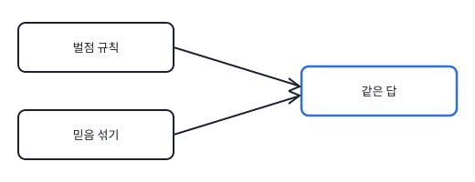

*두 길은 출발점만 다르고 도착하는 답은 같아요.*

**정확히 말하면**

확률 모델 없이 결정론적(deterministic) 함수만으로 학습할 때도 과적합을 막으려고 파라미터 크기에 벌점을 줘요. 이것이 명시적 정규화(explicit regularizer)예요.

정규화 최소제곱(regularized least squares), 줄여서 RLS는 다음 손실을 $\boldsymbol{\theta}$에 대해 최소화해요.

$$
\|\mathbf{y} - \boldsymbol{\Phi}\boldsymbol{\theta}\|^2 + \lambda \|\boldsymbol{\theta}\|^2
$$

- 앞 항은 데이터 적합 항(data-fit term)이에요. 음의 로그우도에 비례해요.
- 뒤 항은 정규화항(regularizer)이고, $\lambda \ge 0$이 정규화의 세기를 정해요.
- 이 방법을 흔히 릿지(ridge)라고도 불러요.

이 손실을 최소화한 해는 다음과 같아요.

$$
\boldsymbol{\theta}_{\text{RLS}} = (\boldsymbol{\Phi}^\top \boldsymbol{\Phi} + \lambda \mathbf{I})^{-1} \boldsymbol{\Phi}^\top \mathbf{y}
$$

사전분포 $p(\boldsymbol{\theta}) = \mathcal{N}(\mathbf{0}, b^2\mathbf{I})$를 둔 MAP 해와 나란히 놓아 봐요.

$$
\boldsymbol{\theta}_{\text{MAP}} = \Big(\boldsymbol{\Phi}^\top \boldsymbol{\Phi} + \frac{\sigma^2}{b^2}\mathbf{I}\Big)^{-1} \boldsymbol{\Phi}^\top \mathbf{y}
$$

두 식은 $\lambda = \frac{\sigma^2}{b^2}$일 때 똑같아요. 그래서 MAP과 명시적 정규화는 수학적으로 같은 문제예요.

**슬라이드의 $\lambda = 1/2b^2$와 다른 이유**

슬라이드에는 음의 로그 가우시안 사전분포가 적혀 있어요.

$$
-\log p(\boldsymbol{\theta}) = \frac{1}{2b^2}\boldsymbol{\theta}^\top\boldsymbol{\theta} + \text{const}
$$

$\lambda = 1/2b^2$는 정규화항 $\lambda\|\boldsymbol{\theta}\|^2$을 이 사전분포 항과 글자 그대로 같게 만드는 값이에요. 그런데 목적함수 전체를 비교하면 데이터 항의 계수가 서로 달라요.

1. 음의 로그사후: $\frac{1}{2\sigma^2}\|\mathbf{y} - \boldsymbol{\Phi}\boldsymbol{\theta}\|^2 + \frac{1}{2b^2}\|\boldsymbol{\theta}\|^2 + \text{const}$
2. RLS: 데이터 항의 계수가 $1$이에요.
3. 음의 로그사후 전체에 $2\sigma^2$를 곱해요(양수를 곱해도 최소점은 그대로예요).
4. $\|\mathbf{y} - \boldsymbol{\Phi}\boldsymbol{\theta}\|^2 + \frac{2\sigma^2}{2b^2}\|\boldsymbol{\theta}\|^2 + \text{const}$
5. $= \|\mathbf{y} - \boldsymbol{\Phi}\boldsymbol{\theta}\|^2 + \frac{\sigma^2}{b^2}\|\boldsymbol{\theta}\|^2 + \text{const}$

데이터 항의 계수를 RLS와 맞추면 $\lambda = \frac{\sigma^2}{b^2}$가 돼요. 두 값은 목적함수의 스케일만 다를 뿐이고, $\sigma^2 = 1/2$이면 서로 같아져요.

**RLS와 MAP의 관계**

- $b \to \infty$이면 $\lambda \to 0$이 되어 둘 다 최대우도 해 $\boldsymbol{\theta}_{\text{ML}} = (\boldsymbol{\Phi}^\top \boldsymbol{\Phi})^{-1} \boldsymbol{\Phi}^\top \mathbf{y}$로 돌아가요.
- RLS는 평균이 0이고 공분산이 $b^2\mathbf{I}$인 가우시안 사전분포를 둔 MAP과 같아요. 이 가정에서는 성분들이 독립이고 분산도 모두 같아요.
- MAP은 [일반 가우시안 사전분포](#s5-general-prior)처럼 더 복잡한 공분산에도 쓸 수 있어요.
- 그래서 MAP 하나로 ML도 포함하고 릿지(ridge)도 설명돼요.

0914처럼 평균손실 $\frac1N\|\mathbf y-\boldsymbol\Phi\boldsymbol\theta\|^2+\lambda\|\boldsymbol\theta\|^2$로 쓴다면 전체에 N을 곱한 뒤 비교해요. 이 경우 $N\lambda=\sigma^2/b^2$여야 위 MAP과 같은 최소점을 가져요. 이 토픽의 제곱합 관례에서는 $\lambda=\sigma^2/b^2$예요. **λ 숫자를 외우기 전에 데이터 항의 배율부터 맞춰요.**

**교수님 말씀**

> "그래서 사실은 맵이나 익스플리시트한 레귤러라이저가 사실은 같은 문제다."

RLS 해는 "이 문제를 풀면 이렇게 되거든요"라며 결과만 보여 줬어요. 직접 유도는 "나중에 그것도 설명할 기회가 있을 거예요"라며 미뤘어요.

오늘의 결론으로 MAP이 ML도 포함하고 릿지도 설명하니 "얘만 잘하면 되네"라고 정리했어요. 이를 더 일반화한 방법은 다음 시간에 다룬다고 했어요.

**보충 · 수업에서 유도하진 않았어요**

RLS 해를 직접 유도해요. 수업의 관례대로 스칼라를 벡터로 미분한 결과는 행벡터로 써요.

$L(\boldsymbol{\theta}) = \|\mathbf{y} - \boldsymbol{\Phi}\boldsymbol{\theta}\|^2 + \lambda \|\boldsymbol{\theta}\|^2$로 두고, $\mathbf{e} = \mathbf{y} - \boldsymbol{\Phi}\boldsymbol{\theta}$로 치환해요.

1. 데이터 항(연쇄법칙): $\frac{\partial \|\mathbf{e}\|^2}{\partial \mathbf{e}} = 2\mathbf{e}^\top,\quad \frac{\partial \mathbf{e}}{\partial \boldsymbol{\theta}} = -\boldsymbol{\Phi}$
2. $\frac{\partial \|\mathbf{y} - \boldsymbol{\Phi}\boldsymbol{\theta}\|^2}{\partial \boldsymbol{\theta}} = -2(\mathbf{y} - \boldsymbol{\Phi}\boldsymbol{\theta})^\top \boldsymbol{\Phi} = -2(\mathbf{y}^\top\boldsymbol{\Phi} - \boldsymbol{\theta}^\top\boldsymbol{\Phi}^\top\boldsymbol{\Phi})$
3. 정규화 항: $\frac{\partial\, \lambda\boldsymbol{\theta}^\top\boldsymbol{\theta}}{\partial \boldsymbol{\theta}} = 2\lambda\boldsymbol{\theta}^\top$
4. 합: $\frac{dL}{d\boldsymbol{\theta}} = 2(\boldsymbol{\theta}^\top\boldsymbol{\Phi}^\top\boldsymbol{\Phi} - \mathbf{y}^\top\boldsymbol{\Phi}) + 2\lambda\boldsymbol{\theta}^\top$
5. $=\mathbf{0}^\top$으로 두고 2로 나눠요: $\boldsymbol{\theta}^\top\boldsymbol{\Phi}^\top\boldsymbol{\Phi} + \lambda\boldsymbol{\theta}^\top = \mathbf{y}^\top\boldsymbol{\Phi}$
6. $\boldsymbol{\theta}^\top$로 묶어요: $\boldsymbol{\theta}^\top(\boldsymbol{\Phi}^\top\boldsymbol{\Phi} + \lambda\mathbf{I}) = \mathbf{y}^\top\boldsymbol{\Phi}$
7. 양변을 전치해요($\boldsymbol{\Phi}^\top\boldsymbol{\Phi} + \lambda\mathbf{I}$는 대칭): $(\boldsymbol{\Phi}^\top\boldsymbol{\Phi} + \lambda\mathbf{I})\boldsymbol{\theta} = \boldsymbol{\Phi}^\top\mathbf{y}$
8. 역행렬을 곱해요: $\boldsymbol{\theta}_{\text{RLS}} = (\boldsymbol{\Phi}^\top \boldsymbol{\Phi} + \lambda \mathbf{I})^{-1} \boldsymbol{\Phi}^\top \mathbf{y}$

MAP 유도와 단계가 같고, $\frac{\sigma^2}{b^2}$ 자리에 $\lambda$가 들어갔을 뿐이에요. 손실이 볼록(convex)한 2차식이라 기울기가 0인 점이 최소점이에요.

역행렬이 있는 이유도 짧게 덧붙여요. 모든 $\mathbf{v} \ne \mathbf{0}$에 대해 $\mathbf{v}^\top(\boldsymbol{\Phi}^\top\boldsymbol{\Phi} + \lambda\mathbf{I})\mathbf{v} = \|\boldsymbol{\Phi}\mathbf{v}\|^2 + \lambda\|\mathbf{v}\|^2 \gt 0$($\lambda \gt 0$)이에요. 그래서 이 행렬은 양의 정부호이고 역행렬이 늘 있어요. $\boldsymbol{\Phi}^\top\boldsymbol{\Phi}$만으로는 역행렬이 없을 수 있는 경우에도 해가 하나로 정해져요.

**페이지 요약**

정규화 최소제곱(RLS, 릿지)은 $\lambda = \frac{\sigma^2}{b^2}$일 때 가우시안 사전분포 MAP과 같은 문제예요.

*핵심 식*

- RLS 손실

  $$
  \|\mathbf{y} - \boldsymbol{\Phi}\boldsymbol{\theta}\|^2 + \lambda \|\boldsymbol{\theta}\|^2
  $$
- RLS 해

  $$
  \boldsymbol{\theta}_{\text{RLS}} = (\boldsymbol{\Phi}^\top \boldsymbol{\Phi} + \lambda \mathbf{I})^{-1} \boldsymbol{\Phi}^\top \mathbf{y}
  $$
- MAP과 같아지는 조건

  $$
  \lambda = \frac{\sigma^2}{b^2}
  $$

*용어*

- **정규화 최소제곱(regularized least squares)** — 데이터 손실에 파라미터 크기 벌점을 더해 최소화하는 방법이에요.
- **릿지(ridge)** — 정규화 최소제곱의 다른 이름이에요.

#### 조건·구분

여기의 데이터 항은 제곱합이므로 $\lambda=\sigma^2/b^2$이고, 슬라이드의 $1/(2b^2)$는 음의 로그 prior 항 자체의 계수예요. 목적함수 전체의 양의 배율을 맞춰 비교해야 해요. 보충의 직접 미분과 $\lambda>0$에서 $\|\Phi v\|^2+\lambda\|v\|^2>0$인 증명은 수업에서 유도하지 않았으며, 이 조건에서 역행렬과 유일해가 보장돼요.

---

## 6. 한 장 요약 · 다음 시간 예고

### 한 장 치트시트

*0928 수업 · L03 s6–s26*

0928 수업을 한 장에 모은 치트시트예요. 각 줄의 제목을 누르면 그 토픽으로 가요.

| 토픽 | 핵심 식 · 용어 | 한 줄 정리 |
|---|---|---|
| [복습: 음의 로그우도에서 최소제곱까지](#s0-recap) | $-\log p(\mathcal{Y} \mid \mathcal{X}, \boldsymbol{\theta}) = \frac{1}{2\sigma^2}\Vert \mathbf{y} - \mathbf{X}\boldsymbol{\theta}\Vert ^2 + \text{const}$ | 자연로그를 씌우면 곱이 합이 되고, 우도 최대화가 최소제곱 문제가 돼요. |
| [그래디언트](#s0-gradient) | $\nabla_{\mathbf{x}} f = \frac{df}{d\mathbf{x}} \in \mathbb{R}^{1 \times n}$, 편미분(partial derivative) | 스칼라 함수의 편미분을 행벡터로 모은 거예요. 행벡터로 쓰는 건 관습이에요. |
| [자코비안과 Ax의 미분](#s0-jacobian) | $\mathbf{J} = \frac{d\mathbf{f}}{d\mathbf{x}} \in \mathbb{R}^{m \times n}$, $\frac{d(\mathbf{A}\mathbf{x})}{d\mathbf{x}} = \mathbf{A}$ | 함수 m개의 그래디언트(행)를 위아래로 쌓은 행렬이에요. 선형변환을 미분하면 그 행렬이 나와요. |
| [연쇄법칙](#s1-chain) | $\frac{\partial L}{\partial \boldsymbol{\theta}} = \frac{\partial L}{\partial \mathbf{e}} \frac{\partial \mathbf{e}}{\partial \boldsymbol{\theta}} = 2\mathbf{e}^\top(-\boldsymbol{\Phi})$ | $\mathbf{e} = \mathbf{y} - \boldsymbol{\Phi}\boldsymbol{\theta}$로 치환해 두 번 나눠 미분해요. 차원은 $1 \times N$ 곱하기 $N \times D$예요. |
| [기울기를 0으로: 최대우도 해](#s1-theta-ml) | $\boldsymbol{\theta}_{\text{ML}} = (\mathbf{X}^\top \mathbf{X})^{-1} \mathbf{X}^\top \mathbf{y}$ | $\mathbf{X}^\top \mathbf{X}$가 대칭행렬이라 전치가 사라져요. ML 추정은 유사역행렬을 구하는 문제예요. |
| [특징 함수](#s2-features) | $y = \boldsymbol{\phi}(\mathbf{x})^\top \boldsymbol{\theta} + \epsilon = \sum_{k=0}^{K-1} \theta_k \phi_k(\mathbf{x}) + \epsilon$ | $\boldsymbol{\theta}$에 대해서만 선형이면 선형회귀예요. $\mathbf{x}$에 대해서는 비선형이어도 돼요. |
| [다항회귀](#s2-polynomial) | $\boldsymbol{\phi}(x) = [1, x, x^2, \dots, x^{K-1}]^\top$ | 스칼라 입력을 K차원으로 확장(expansion)해요. 차수에는 정답이 없어요. |
| [특징행렬 Φ](#s2-feature-matrix) | $\boldsymbol{\Phi} \in \mathbb{R}^{N \times K}$, $\boldsymbol{\theta}_{\text{ML}} = (\boldsymbol{\Phi}^\top \boldsymbol{\Phi})^{-1} \boldsymbol{\Phi}^\top \mathbf{y}$ | i번째 행이 $\boldsymbol{\phi}(\mathbf{x}_i)^\top$이에요. $\boldsymbol{\phi}$가 항등이면 $\boldsymbol{\Phi} = \mathbf{X}$예요. |
| [다항 적합](#s3-polyfit) | $N = 10$, $x_n \sim \mathcal{U}[-5, 5]$, $\epsilon \sim \mathcal{N}(0, 0.2^2)$ | 차수를 0, 1, 2, 3, … 으로 키워 가며 ML로 곡선을 맞춰 봐요. |
| [과적합](#s3-overfitting) | 과적합(overfitting), 훈련 오차, 테스트 오차 | 훈련 오차는 계속 줄지만 테스트 오차는 다시 커져요. 둘 다 줄어드는 마지막 점에서 복잡도를 정해요. |
| [MAP과 베이즈 정리](#s4-map-bayes) | $\boldsymbol{\theta}_{\text{MAP}} \in \arg\min_{\boldsymbol{\theta}} \{-\log p(\mathcal{Y} \mid \mathcal{X}, \boldsymbol{\theta}) - \log p(\boldsymbol{\theta})\}$ | 사후확률을 최대화해요. $p(\boldsymbol{\theta} \mid \mathcal{X}) = p(\boldsymbol{\theta})$로 가정하면 ML 항에 사전 항이 더해져요. |
| [가우시안 사전분포](#s4-gaussian-prior) | $p(\boldsymbol{\theta}) = \mathcal{N}(\mathbf{0}, b^2 \mathbf{I})$, $\frac{1}{2b^2} \boldsymbol{\theta}^\top \boldsymbol{\theta}$ | 음의 로그사후확률에 $\boldsymbol{\theta}$ 크기를 벌하는 항이 붙어요. |
| [ML vs MAP](#s4-ml-vs-map) | $\boldsymbol{\theta}_{\text{MAP}} = \left(\boldsymbol{\Phi}^\top \boldsymbol{\Phi} + \frac{\sigma^2}{b^2} \mathbf{I}\right)^{-1} \boldsymbol{\Phi}^\top \mathbf{y}$ | $\frac{\sigma^2}{b^2} \mathbf{I}$ 한 항만 달라요. $b \to \infty$이면 ML과 같아져요(머니볼). 이 항이 정규화 역할을 해요. |
| [일반 가우시안 사전분포](#s5-general-prior) | $p(\boldsymbol{\theta}) = \mathcal{N}(\mathbf{m}_0, \mathbf{S}_0)$ | 앞의 사전분포는 이 일반형의 특수한 경우예요. 해는 [다음 시간 예고](#s6-next)로 넘어가요. |
| [정규화 최소제곱(RLS)](#s5-rls) | $\Vert \mathbf{y} - \boldsymbol{\Phi}\boldsymbol{\theta}\Vert ^2 + \lambda \Vert \boldsymbol{\theta}\Vert ^2$, $\boldsymbol{\theta}_{\text{RLS}} = (\boldsymbol{\Phi}^\top \boldsymbol{\Phi} + \lambda \mathbf{I})^{-1} \boldsymbol{\Phi}^\top \mathbf{y}$ | 릿지(ridge)라고도 해요. $\lambda = \frac{\sigma^2}{b^2}$이면 MAP 해와 같아서 두 방법은 같은 문제예요. |
| MAP 복원 규칙 | ML 정상조건 왼쪽에 $(\sigma^2/b^2)\mathbf I$ 추가, 오른쪽 유지 → 전치 → 역행렬. λ 비교는 데이터 항의 1/N 여부부터 확인해요. |  |

---

### 다음 시간 예고 (아직 안 배움)

*0928 수업 · L03 로드맵 · s12, s23–s25*

수업에서 제목만 예고했거나 "나중에"로 미룬 내용이에요.

- Bayesian Linear Regression(베이지안 선형회귀): 일반 가우시안 사전분포 $\mathcal{N}(\mathbf{m}_0, \mathbf{S}_0)$에서의 해(사후분포) 계산 포함. 교수님이 "풀리 베이지안"이라 부른 내용으로 수요일 예정이에요 (L03 s25, 로드맵 4번).
- ML as Orthogonal Projection: 최대우도 해를 정사영으로 보는 관점이에요. Linear Regression Part 2 강의 몫이에요 (L03 로드맵 5번).
- 헤시안(Hessian): 그래디언트를 행벡터로 쓰는 이유로 "헤시안도 배울 것"이라고 이름만 언급했어요 (L03 s12).
- 공분산행렬의 역할: 교수님이 "그거에 대해서는 다음 시간에 얘기하도록 하고"라며 미뤘어요 (L03 s23).
- $\boldsymbol{\Phi}^\top \boldsymbol{\Phi} + \frac{\sigma^2}{b^2} \mathbf{I}$가 대칭이고 양의 정부호(positive definite)라는 성질: 슬라이드에만 있고 수업에서는 말하지 않았어요. 노트 보충에서 짧게 설명해요 (L03 s24).

---

### 함께 보면 좋은 자료

*0928 수업 · L03*

- [복습문제 풀러 가기 (0928 Linear Regression)](복습문제_0928_Linear_Regression.md)
- [지난 시간 0923 정리노트: 벡터 미분 보충](../../0923/정리노트_0923_Linear_Regression.html#s3-vector-diff)
- [0916 정리노트: MAP과 정규화](../../0916/정리노트_0916_MAP_and_Generative_Models.html#s1-map-reg)
- [추가 강의 Lecture 12: Statistical Inference Part 3](../../../강의노트/추가%20강의/eli5_lecture12_statistical_inference_part3.html)

복습문제 8문항

- [문제지 PDF](복습문제_0928_Linear_Regression-문제.pdf)
- [해설지 PDF](복습문제_0928_Linear_Regression-답안.pdf)

---

출처: 정방철 교수님 강의자료(Lecture03) · 수업 녹음 전사(0928) · Deisenroth, Faisal, Ong, *Mathematics for Machine Learning* (2020) 5장 · 9장.
