# Bayesian Linear Regression — 5살도 이해하는 정리노트

정방철 교수님 머신러닝기초 · 0930 수업 (Lecture04 앞부분, MML 9.3절 · 6.4~6.5절)

> `정리노트_0930_Bayesian_Linear_Regression.html`를 마크다운으로 옮겼어요. 그림은 `figures_0930/` 폴더의 SVG, 위젯은 대표 설정의 정적 그림으로 바꿨어요. 수식은 `$…$` / `$$…$$`라서 GitHub, Obsidian, Typora에서 보여요.

**목차**

- [0. 준비: 조건부확률과 풀리 베이지안](#s0)
  - [파라미터의 분포에서 예측의 분포로 가요](#s0-learning-map)
  - [조건부확률 복습: 곱셈 법칙의 확장](#s0-cond-prob)
  - [왜 베이지안인가: 가우시안과 확률밀도함수](#s0-why-bayes)
  - [풀리 베이지안: 결정을 유보한다](#s0-fully-bayesian)
- [1. 베이지안 선형회귀 모델](#s1)
  - [그래피컬 모델 읽기](#s1-graphical)
  - [사전분포와 가능도](#s1-prior-likelihood)
  - [조인트 분포와 독립 가정](#s1-joint)
- [2. 사후 예측분포](#s2)
  - [예측 목표를 통계적 추론으로 쓰기](#s2-goal)
  - [하나마나한 짓: 없던 θ를 넣고 주변화하기](#s2-marginalize)
  - [사후 예측분포 유도와 두 가지 가정](#s2-predictive)
  - [조건부 기댓값으로 읽기: ML · MAP은 특수한 경우](#s2-cond-expectation)
- [3. 가우시안과 랜덤 벡터](#s3)
  - [스칼라 가우시안: 숫자 두 개로 전하는 종 모양](#s3-gaussian-scalar)
  - [랜덤 벡터, 조인트 PDF, 평균 벡터](#s3-random-vector)
  - [공분산에서 공분산 행렬로](#s3-covariance)
  - [자기 자신의 공분산 행렬과 대칭성](#s3-variance-matrix)
- [4. 합과 아핀 변환](#s4)
  - [합의 평균과 분산: 조건이 필요해요](#s4-sum)
  - [아핀 변환의 평균과 공분산](#s4-affine)
- [5. 요약 · 예고](#s5)
  - [한 장 치트시트](#s5-cheatsheet)
  - [다음 시간 예고 (아직 안 배움)](#s5-next)
  - [함께 보면 좋은 자료](#s5-links)

## 0. 준비: 조건부확률과 풀리 베이지안

### 파라미터의 분포에서 예측의 분포로 가요

*학습 길잡이 · 기존 내용 재구성*

**먼저 큰 그림**

**오늘의 질문.** 관측 데이터로 가능한 파라미터들의 분포를 갱신하고, 이를 새 출력의 예측에 반영하려 해요.

MAP과 FB는 모두 파라미터에 사전분포를 부여해요. MAP은 사후분포의 최고점 하나를 고르고, FB는 분포를 유지해 예측할 때 파라미터를 적분해 없애요.

| 구분 | 무엇을 하나요? | 무엇이 남나요? |
|---|---|---|
| 사전분포 | 데이터를 보기 전 파라미터의 불확실성 | 입력으로 둔 가정 |
| 사후분포 | 데이터를 본 뒤 파라미터의 불확실성 | 학습으로 갱신한 분포 |
| 예측분포 | 새 관측값의 불확실성 | 모든 가능한 파라미터의 예측을 모은 결과 |

**구할 결과.** 파라미터의 분포와 새 관측값의 분포는 대상이 달라요. 가우시안 분포를 다루기 위해 평균벡터와 공분산행렬을 준비해요.

**수식이 하는 일.** 주변화는 파라미터를 합쳐 없애는 과정이고, 아핀 변환의 평균·공분산 공식은 파라미터의 흔들림이 출력으로 어떻게 전달되는지 계산할 도구예요.

**헷갈리기 쉬운 점.** FB가 파라미터 평균 하나만 골라 대입한다는 뜻은 아니에요. 가능한 예측분포 전체를 가중해 모아요.

이어서 읽기: [풀리 베이지안: 결정을 유보한다](#s0-fully-bayesian) · [사후 예측분포 유도와 두 가지 가정](#s2-predictive) · [아핀 변환의 평균과 공분산](#s4-affine)

**페이지 요약**

파라미터의 분포와 새 관측값의 분포는 대상이 달라요. 가우시안 분포를 다루기 위해 평균벡터와 공분산행렬을 준비해요.

#### 조건·구분

MAP은 사후분포의 최고점 하나를 고르고, FB는 파라미터 분포를 유지해 가능한 예측분포를 가중해 모아요. 파라미터 평균 하나만 대입한다는 뜻은 아니에요.

---

### 조건부확률 복습: 곱셈 법칙의 확장

*0930 수업 · L04 · 칠판*

**쉽게 말하면**

두 가지가 함께 일어날 가능성은, 하나가 일어날 가능성에 그때 다른 하나도 일어날 가능성을 곱한 거예요.

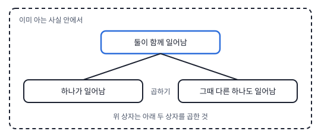

*이미 아는 사실이 하나 더 있어도 곱하는 방법은 똑같아요.*

**정확히 말하면**

**조건부확률**(conditional probability)의 정의는 "조건 자체의 확률 분의, 조건과 결과의 조인트 확률"이에요.

$$
P(A \mid B) = \frac{P(A, B)}{P(B)}
$$

바($\mid$)의 **왼쪽**에는 궁금한 것을, **오른쪽**에는 가정(조건)을 써요.

이 정의의 분모를 넘기면 **곱셈 법칙**(multiplication rule)이에요. 조건이 일어날 확률을 뒤에 곱해 주면 조인트 확률이 돼요.

$$
P(A, B) = P(A \mid B)\,P(B)
$$

이번에는 조건 $C$가 주어진 상태에서 $A$와 $B$가 동시에 일어날 확률 $P(A, B \mid C)$를 생각해요. 목표는 결과 자리에 있던 $B$를 조건 자리로 옮기는 거예요.

1. 조건부확률의 정의를 그대로 써요.

   $$
   P(A, B \mid C) = \frac{P(A, B, C)}{P(C)}
   $$
2. 분자에서 $A$만 남기고 $B$, $C$를 조건으로 빼요. 등호가 성립하려면 곱셈 법칙대로 조건의 확률 $P(B, C)$를 곱해야 해요.

   $$
   P(A, B, C) = P(A \mid B, C)\,P(B, C)
   $$
3. 분모 $P(C)$는 그대로예요.

   $$
   P(A, B \mid C) = P(A \mid B, C)\,\frac{P(B, C)}{P(C)}
   $$
4. 뒤의 분수는 다시 조건부확률의 정의예요.

   $$
   \frac{P(B, C)}{P(C)} = P(B \mid C)
   $$
5. 묶으면 끝나요.

   $$
   P(A, B \mid C) = P(A \mid B, C)\,P(B \mid C)
   $$

읽는 법은 이래요. 결과였던 $B$를 조건으로 옮기면 $P(A \mid B, C)$가 되고, $B$도 원래 궁금한 결과였으니 $B$ 자체가 일어날 확률 $P(B \mid C)$를 뒤에 곱해요. 조건 $C$는 모든 항에 그대로 남아요.

곱셈 법칙 $P(A, B) = P(A \mid B)\,P(B)$의 모든 항에 조건 $C$를 하나씩 붙인 모양이라, 새 법칙이 아니라 곱셈 법칙의 확장이에요.

이 식은 이번 수업의 유도에서 되풀이해 써요. [조인트 분포와 독립 가정](#s1-joint)에서는 $A = y$, $B = \boldsymbol{\theta}$, $C = \mathbf{x}$로 놓고 쓰고, [사후 예측분포 유도와 두 가지 가정](#s2-predictive)에서 한 번 더 써요.

**교수님 말씀**

수업을 조건부확률의 정의로 시작했어요. 외울 것은 정의 하나이고, 나머지는 거기서 만들어 낼 수 있어야 한다고 했어요.

> "요거 하나만 이제 기억하면 되는데" (0930 Part 01 ~00:10)

칠판에서 식을 바꾸는 도중에, 눈치 빠른 학생은 뒤에 남은 분수가 다시 조건부확률이라는 것을 알아챌 거라고 했어요 (0930 Part 01 ~01:25).

> "멀티플리케이션 룰의 확장일 뿐이죠." (0930 Part 01 ~02:30)

이 복습을 맨 앞에 둔 이유도 말했어요. 오늘 풀 머신러닝의 추론 문제가 이 확률 계산으로 유추하는 문제이기 때문이에요.

> "이 얘기를 왜 하냐면 오늘 이제 그 얘기가 주를 이룰 거거든." (0930 Part 01 ~02:33)

**페이지 요약**

결과 자리의 사건을 조건으로 옮기고 그 사건의 확률을 곱하면 되고, 이미 있던 조건은 모든 항에 그대로 남아요.

*핵심 식*

- 조건부확률의 정의

  $$
  P(A \mid B) = \frac{P(A, B)}{P(B)}
  $$
- 곱셈 법칙의 확장

  $$
  P(A, B \mid C) = P(A \mid B, C)\,P(B \mid C)
  $$

*용어*

- **조건부확률(conditional probability)** — 조건 자체의 확률 분의, 조건과 결과의 조인트 확률
- **곱셈 법칙(multiplication rule)** — 조건이 일어날 확률을 곱해 조인트 확률을 만드는 법칙

---

### 왜 베이지안인가: 가우시안과 확률밀도함수

*0930 수업 · L04 · MML 9.3*

**쉽게 말하면**

"일어나요, 안 일어나요" 가운데 하나로 딱 잘라 말하지 않고, 얼마나 그럴듯한지를 그림 한 장으로 보여 주는 방법이에요.

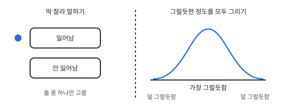

*그런 그림 가운데 가장 다루기 편한 것이 종 모양이에요.*

**정확히 말하면**

이번 수업에서 할 일은 두 가지였는데 첫 번째만 했어요. 첫 번째가 **베이지안 선형회귀**(Bayesian linear regression)예요.

- **선형회귀**: 모델을 선형으로 두고, 데이터가 들어오면 파라미터를 맞춰요.
- **베이지안**: 확률을 도입해요. "일어난다, 안 일어난다"로 판결하는 대신 "이럴 가능성도, 저럴 가능성도 있다"는 말을 정확하게 해요.

랜덤한 현상을 수학적으로 가장 정확하게 설명하는 방법은 **확률변수**(random variable)로 두는 거예요. 확률변수의 특성은 **확률밀도함수(PDF)**에 고스란히 들어 있어요.

그래서 베이지안 러닝은 PDF가 가진 물리적 의미와 수학적 통찰을 끝까지 이용하는 방법이에요. 베이지안으로 예측분포(predictive distribution)를 만들 때 가장 중요한 일도 PDF를 만들어 내는 거예요.

확률변수에는 베르누이, 이항, 균등, 지수, 가우시안 등이 있어요. 그중 가우시안은 쓰기 편하고 수학적 성질이 좋아요. 가우시안을 가정하고 그 식을 조작하고 조합해 문제를 푸는 분야가 **베이지안 머신러닝**이에요. 가우시안 식 자체는 [스칼라 가우시안: 숫자 두 개로 전하는 종 모양](#s3-gaussian-scalar)에서 복습해요.

지난 시간까지 준비한 것은 세 가지예요.

- 선형회귀는 $\boldsymbol{\theta}$에 대해서만 선형이면 돼요.
- $\boldsymbol{\theta}$로 미분해서 $0$이 되는 점을 찾아요.
- 그 점은 ML로도, MAP으로도 찾을 수 있어요.

교과서(MML 9.3절 도입)도 같은 순서로 말해요. ML과 MAP은 파라미터 값 하나를 추정했고, 베이지안 선형회귀는 값 하나를 구하지 않고 파라미터의 분포 전체를 써서 예측해요. 그 뜻은 [풀리 베이지안: 결정을 유보한다](#s0-fully-bayesian)에서 이어져요.

**교수님 말씀**

여러 확률변수를 나열한 뒤 가우시안을 첫손에 꼽았어요.

> "사실 가우시안이 탑 티어죠." (0930 Part 01 ~03:05)

**장군님 비유.** 장군님께 보고할 때 "일어날 것 같아, 아닐 것 같아?"에 모 아니면 도로 판결을 내리는 것이 아니에요. "이럴 가능성도 있고, 저럴 가능성도 배제할 수 없다"는 애매한 말을 정확하게 하고 싶을 때 쓰는 것이 베이지안이라고 했어요 (0930 Part 01 ~03:55).

> "가장 중요한 건 확률 밀도 함수를 만들어 내는 거고." (0930 Part 01 ~04:20)

**연구실 사례.** 베이지안 선형회귀는 이름만 바꿔 여러 영역에서 쓰인다고 했어요. 교수님 연구실은 산불 같은 재난 때 기지국의 빔 방향과 전력을 어떻게 최적화해야 통화가 안 되는(outage) 사용자가 없어지는지를 베이지안 최적화(Bayesian optimization)로 풀고 있어요.

> "베이지안 옵티마이제이션을 이해하려면 오늘 배울 베이지안 리니어 리그레션을 이해해야 돼요." (0930 Part 01 ~05:40)

새로 배울 것이 많아 보여도 준비는 끝나 있다고 했어요.

> "여러분들이 이미 재료 손질은 돼 있다 지난주까지." (0930 Part 01 ~05:50)

**페이지 요약**

베이지안은 확률을 도입해 "이럴 수도, 저럴 수도 있다"를 정확하게 말하는 방법이고, 그 내용은 확률밀도함수(PDF)에 모두 담겨요.

*용어*

- **확률밀도함수(PDF)** — 확률변수의 특성이 고스란히 들어 있는 함수
- **베이지안 선형회귀(Bayesian linear regression)** — 모델은 선형으로 두고 확률을 도입한 회귀

#### 조건·구분

이 회귀의 선형성은 $\boldsymbol{\theta}$에 대한 선형성이에요. ML·MAP은 파라미터 값 하나를 구했고, 베이지안 선형회귀는 분포 전체를 써서 예측해요.

---

### 풀리 베이지안: 결정을 유보한다

*0930 수업 · L04 · MML 9.3*

**쉽게 말하면**

답을 하나로 정하지 않고, 될 수 있는 답을 모두 들고 가요.

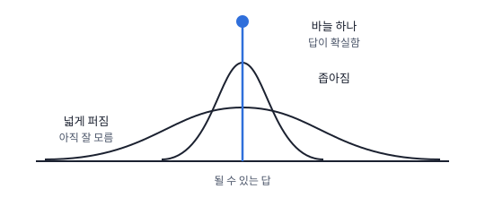

*퍼진 폭을 끝까지 좁히면 언제든 답 하나가 되니까, 망설이는 것이 아니라 힘을 숨기고 있는 거예요.*

**정확히 말하면**

**풀리 베이지안**(fully Bayesian) 방법을 만든다는 것은, 중간에 **decision making**을 하지 않는다는 뜻이에요.

- **ML, MAP**: 의사역행렬(pseudo-inverse) 등으로 $\boldsymbol{\theta}$를 값 하나로 결정했어요. "이 데이터를 가장 잘 설명하는 $\boldsymbol{\theta}$는 이것"이라고 정한 거예요.
- **풀리 베이지안**: 그 결정을 유보해요. $\boldsymbol{\theta}$를 상수 벡터가 아니라 **랜덤 벡터**(random vector)로 봐요.

확률변수는 결정적(deterministic) 상수를 **포함하는** 개념이에요.

- PDF가 옆으로 퍼져 있으면 불확실성이 있는 거예요.
- 분산을 $0$으로 보내면($\sigma^2 \to 0$) PDF가 한 점에 몰린 **델타 함수**(delta function)가 돼요. "이 값이 확실하다"는 상수와 같아요.

그래서 선택하고 최적화해야 하는 변수를 랜덤 벡터로 정의하는 것은 정보를 버리는 일이 아니에요. 분산을 $0$으로 가져가면 언제든 결정적인 값을 만들 수 있고, 그 전까지는 값 하나보다 더 많은 정보를 담고 있어요.

세 방법은 포함 관계예요.

$$
\text{ML} \subset \text{MAP} \subset \text{Bayesian}
$$

- ML 추정(L03 s24): $\boldsymbol{\theta}_{\text{ML}} = (\boldsymbol{\Phi}^\top\boldsymbol{\Phi})^{-1}\boldsymbol{\Phi}^\top\mathbf{y}$
- MAP 추정(L03 s24): $\boldsymbol{\theta}_{\text{MAP}} = \big(\boldsymbol{\Phi}^\top\boldsymbol{\Phi} + \frac{\sigma^2}{b^2}\mathbf{I}\big)^{-1}\boldsymbol{\Phi}^\top\mathbf{y}$. ML 식에 정규화(regularization) 항 $\frac{\sigma^2}{b^2}\mathbf{I}$를 넣은 거예요. 이 항이 "$\boldsymbol{\theta}$는 이랬으면 좋겠다"는 내 의도(preference)를 담아요.
- 베이지안: $\boldsymbol{\theta}$를 값 하나로 정하지 않고 분포로 들고 가요. 값 하나로 정한 ML, MAP은 그 분포가 델타 함수인 특수한 경우예요. 식으로는 [조건부 기댓값으로 읽기: ML · MAP은 특수한 경우](#s2-cond-expectation)에서 확인해요.

풀리 베이지안은 계산이 복잡하지만 더 많은 정보를 쓰므로 성능이 가장 좋을 확률이 높아요.

$\boldsymbol{\theta}$를 랜덤 벡터로 두면 그 분포를 정하는 값이 새로 필요해요. 그 구조는 [그래피컬 모델 읽기](#s1-graphical)에서 봐요.

**교수님 말씀**

> "풀리 베이지안 메소드를 만든다는 뜻은 내가 중간에 디시전 메이킹을 하지 않겠다는 거야." (0930 Part 01 ~06:20)

ML과 MAP이 $\boldsymbol{\theta}$를 "결정을 내려버렸다"고 한 뒤 이렇게 말했어요.

> "그 결정을 유보할 거예요 오늘부터는." (0930 Part 01 ~06:45)

**학생과의 문답.** "또 복잡하게 왜 이러십니까?"라는 반응을 예상하고, 한 학생에게 PDF를 무엇으로 가정하면 상수가 되는지 물었어요. "분산이 0 근처", "D로 시작하는"이라는 힌트 끝에 나온 답이 델타 함수예요 (0930 Part 01 ~07:20).

> "결정을 유보한다는 것은 우유부단한 사람의 전형이 아니에요." (0930 Part 01 ~08:05)

**8기통 엔진 비유.** 우아하고 편안해 보이는 자동차인데 안에 8기통 엔진이 들어 있는 것과 같다고 했어요. 교수님 표현으로는 진짜 힘을 숨기고 있는 "힘숨찐"이에요. 분산을 0으로 가져가는 순간 결정적인 값도 만들어 낼 수 있기 때문이에요 (0930 Part 01 ~08:25).

> "복잡하긴 해도 얘가 성능이 제일 좋겠지. 좋을 확률이 높겠죠." (0930 Part 01 ~09:05)

> "MAP이 그 ML을 포함하는 개념이고, 사실은 베이지안이 이 모든 거를 포함할 수 있는 개념이에요." (0930 Part 01 ~09:40)

**페이지 요약**

풀리 베이지안은 파라미터를 값 하나로 정하지 않고 랜덤 벡터로 두어 결정을 유보해요.

*핵심 식*

- 세 방법의 포함 관계

  $$
  \text{ML} \subset \text{MAP} \subset \text{Bayesian}
  $$

*용어*

- **풀리 베이지안(fully Bayesian)** — 중간에 decision making을 하지 않는 방법
- **랜덤 벡터(random vector)** — 상수 벡터 대신 분포를 가진 벡터
- **델타 함수(delta function)** — 분산을 $0$으로 보낸 PDF, 곧 확실한 상수

---

## 1. 베이지안 선형회귀 모델

### 그래피컬 모델 읽기

*0930 수업 · L04 · MML 9.3.1*

**쉽게 말하면**

동그라미와 화살표로 그린 이야기 지도예요.

화살표를 따라가면 누가 누구에게 영향을 주는지 읽을 수 있어요.

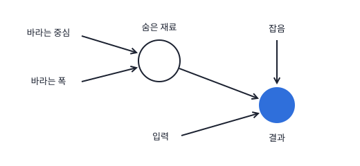

*바라는 중심과 폭이 숨은 재료를 정하고, 숨은 재료가 입력, 잡음과 만나 색칠된 결과를 만들어요.*

**정확히 말하면**

그래피컬 표현(graphical representation)은 확률변수 사이의 관계를 그림으로 나타낸 거예요. 방향 그래프(directed graph)의 화살표는 "출발 노드가 도착 노드에 영향을 준다"는 뜻이에요.

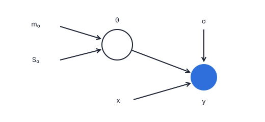

*베이지안 선형회귀의 그래피컬 모델이에요(MML Figure 9.8과 같은 연결).*

| 노드 | 정체 | 그림에서의 모양 |
|---|---|---|
| $y$ | 내가 궁금한 출력이에요. 데이터로 관측되는 확률변수예요. | 색칠된 동그라미 |
| $\mathbf{x}$ | 주어지는 입력 데이터예요. | 동그라미 없는 글자 |
| $\sigma$ | 측정의 불확실성을 노이즈로 모델링한 값이에요. 통제할 수 없어요. | 동그라미 없는 글자 |
| $\boldsymbol{\theta}$ | $\mathbf{x}$를 $y$로 바꿀 때 곱하거나 더하는 재료예요. 보이지 않는 latent variable(hidden parameter)이에요. | 테두리만 있는 동그라미 |
| $\mathbf{m}_0$, $\mathbf{S}_0$ | $\boldsymbol{\theta}$의 분포를 정하는 값이에요. $\mathbf{m}_0$는 벡터, $\mathbf{S}_0$는 행렬이에요. | 동그라미 없는 글자 |

$\boldsymbol{\theta}$가 $\mathbf{x}$와 결합하는 방식이 아래 식이면 선형 모델이에요.

$$
y = \mathbf{x}^\top \boldsymbol{\theta} + \epsilon
$$

$\mathbf{x}$, $\sigma$, $\boldsymbol{\theta}$, $y$ 네 개만 있어도 그림이 돼요. 그것은 $\boldsymbol{\theta}$를 값 하나로 정하는 결정적(deterministic) 모델의 그림이에요.

베이지안에서는 $\mathbf{m}_0$와 $\mathbf{S}_0$에서 $\boldsymbol{\theta}$로 가는 화살표가 추가돼요. $\boldsymbol{\theta}$를 [풀리 베이지안: 결정을 유보한다](#s0-fully-bayesian)에서처럼 랜덤 벡터로 보기 때문이에요. $\boldsymbol{\theta}$가 가우시안이면 $\mathbf{m}_0$는 그 평균, $\mathbf{S}_0$는 그 공분산이에요.

$\boldsymbol{\theta}$는 모델의 파라미터예요. $\mathbf{m}_0$, $\mathbf{S}_0$, $\sigma$처럼 분포의 모양을 밖에서 정해 주는 값이 하이퍼파라미터 쪽이에요.

그림은 이 순서로 읽어요.

1. $\mathbf{m}_0$와 $\mathbf{S}_0$가 $\boldsymbol{\theta}$의 분포를 정해요.
2. 그 $\boldsymbol{\theta}$가 입력 $\mathbf{x}$와 결합해요.
3. 통제할 수 없는 노이즈(크기 $\sigma$)가 더해져요.
4. 그 결과가 $y$예요.

이 그림을 식으로 옮긴 것이 [사전분포와 가능도](#s1-prior-likelihood)와 [조인트 분포와 독립 가정](#s1-joint)이에요.

**교수님 말씀**

교수님은 그림을 볼 때마다 위의 읽는 순서를 스스로 이야기처럼 말해 보라고 했어요.

> "그림 같은 거를 보면서 여러분들이 항상 머릿속에 되뇌어야 되는 히스토리가 이런 거다." (0930 Part 02 ~03:40)

$\boldsymbol{\theta}$는 "$\mathbf{x}$를 $y$로 바꿀 때 곱하거나 더하는 재료"라고 풀어서 설명했어요.

**페이지 요약**

화살표를 따라 $\mathbf{m}_0$, $\mathbf{S}_0$에서 $\boldsymbol{\theta}$로, $\boldsymbol{\theta}$와 $\mathbf{x}$와 노이즈에서 $y$로 이야기를 읽어요.

*핵심 식*

- 선형 모델

  $$
  y = \mathbf{x}^\top \boldsymbol{\theta} + \epsilon
  $$

*용어*

- **그래피컬 표현(graphical representation)** — 확률변수 사이의 관계를 그림으로 나타낸 거예요.
- **latent variable(hidden parameter)** — 보이지 않는 $\boldsymbol{\theta}$예요. $\mathbf{x}$를 $y$로 바꾸는 재료예요.
- **$\mathbf{m}_0$, $\mathbf{S}_0$** — $\boldsymbol{\theta}$가 가우시안일 때의 평균(벡터)과 공분산(행렬)이에요.

#### 조건·구분

$y$는 관측 출력, $\boldsymbol{\theta}$는 숨은 모델 파라미터예요. $\mathbf{m}_0$, $\mathbf{S}_0$, $\sigma$는 분포 모양을 밖에서 정하는 하이퍼파라미터 쪽이에요.

---

### 사전분포와 가능도

*0930 수업 · L04 · MML 9.3.1*

**쉽게 말하면**

답을 보기 전에 품은 짐작과, 결과가 흩어지는 모양을 따로 적어 둬요.

짐작은 "이쯤일 거야" 하는 종 모양이고, 결과는 곧은 줄 둘레에 조금씩 흩어져요.

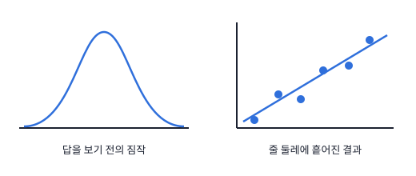

*왼쪽이 미리 품은 짐작이고, 오른쪽이 줄 둘레에 흩어진 결과예요.*

**정확히 말하면**

베이지안 선형회귀의 모델은 분포 두 개로 적어요(MML 식 (9.35)). [그래피컬 모델 읽기](#s1-graphical)의 화살표를 식으로 옮긴 거예요.

**사전분포(prior)**는 데이터를 보기 전에 "$\boldsymbol{\theta}$가 어떠했으면 좋겠다"를 나타내는 확률분포예요. 보통 가우시안으로 줘요.

$$
p(\boldsymbol{\theta}) = \mathcal{N}(\mathbf{m}_0, \mathbf{S}_0)
$$

$\mathbf{m}_0$는 평균 벡터, $\mathbf{S}_0$는 공분산 행렬이에요. 가우시안을 고르는 이유는 수학적으로 다루기 편해서예요.

**가능도(likelihood)**는 $\mathbf{x}$와 $\boldsymbol{\theta}$가 주어졌을 때 $y$의 분포예요. 모델 식에서 바로 나와요.

1. 모델: $y = \boldsymbol{\phi}^\top(\mathbf{x})\boldsymbol{\theta} + \epsilon$
2. 노이즈: $\epsilon \sim \mathcal{N}(0, \sigma^2)$
3. $\mathbf{x}$와 $\boldsymbol{\theta}$가 주어지면 $\boldsymbol{\phi}^\top(\mathbf{x})\boldsymbol{\theta}$는 정해진 숫자예요. 불확실성은 $\epsilon$에만 남아요.
4. 정해진 숫자에 평균 $0$인 가우시안을 더하면 평균만 그 숫자로 옮겨 가요. 분산은 $\sigma^2$ 그대로예요.
5. $p(y \mid \mathbf{x}, \boldsymbol{\theta}) = \mathcal{N}\big(y \mid \boldsymbol{\phi}^\top(\mathbf{x})\boldsymbol{\theta},\, \sigma^2\big)$

그래서 가능도의 평균은 $\boldsymbol{\phi}^\top(\mathbf{x})\boldsymbol{\theta}$이고 분산은 $\sigma^2$예요. 평균이 $0$인 것은 노이즈 $\epsilon$이에요.

피처 함수 $\boldsymbol{\phi}$는 선형일 필요가 없어요. $x$, $x^2$, $x^3$, $x^4$를 써도 돼요. $\boldsymbol{\theta}$에 대해 선형이면 선형회귀예요.

$(\mathbf{x}, y)$가 쌍으로 묶인 데이터가 labeled data예요. 이런 데이터로 배우는 것이 지도학습(supervised learning)이에요.

**교수님 말씀**

사전분포는 "사건이 일어나기 전에 $\boldsymbol{\theta}$가 어떠했으면 좋겠다"는 마음이라고 설명했어요 (0930 Part 02 ~04:10).

가우시안 사전분포가 왜 편한지는 지난 학기 확률론 강의 마지막 2주 내용이라고 했어요. 보충 동영상과 강의노트를 본 사람은 손을 들어 보라고 했는데, 반응은 "예상은 했는데" 정도였어요.

> "라이클리후드는 무조건 하나 나와줬으면 좋겠어." (0930 Part 02 ~06:55)

어떤 식을 유도하든 가능도 $p(y \mid \mathbf{x}, \boldsymbol{\theta})$ 하나는 식 안에 나오게 만들자는 뜻이에요. 가능도는 정규분포라는 것을 이미 알고 있기 때문이에요.

**페이지 요약**

모델은 $\boldsymbol{\theta}$에 대한 사전분포와, $\mathbf{x}$와 $\boldsymbol{\theta}$가 주어졌을 때의 가능도 두 개로 적어요.

*핵심 식*

- 사전분포

  $$
  p(\boldsymbol{\theta}) = \mathcal{N}(\mathbf{m}_0, \mathbf{S}_0)
  $$
- 가능도

  $$
  p(y \mid \mathbf{x}, \boldsymbol{\theta}) = \mathcal{N}\big(y \mid \boldsymbol{\phi}^\top(\mathbf{x})\boldsymbol{\theta},\, \sigma^2\big)
  $$
- 노이즈

  $$
  \epsilon \sim \mathcal{N}(0, \sigma^2)
  $$

*용어*

- **사전분포(prior)** — 데이터를 보기 전에 $\boldsymbol{\theta}$가 어떠했으면 좋겠다를 나타내는 확률분포예요.
- **가능도(likelihood)** — $\mathbf{x}$와 $\boldsymbol{\theta}$가 주어졌을 때 $y$의 분포예요.
- **labeled data** — $(\mathbf{x}, y)$가 쌍으로 묶인 데이터예요.

#### 조건·구분

입력과 $\boldsymbol{\theta}$를 고정하면 가능도의 평균은 $\boldsymbol{\phi}^{\top}(\mathbf{x})\boldsymbol{\theta}$, 분산은 $\sigma^2$예요. 평균 $0$인 것은 잡음이에요. 피처 함수는 비선형이어도 $\boldsymbol{\theta}$에 대해 선형이면 선형회귀예요.

---

### 조인트 분포와 독립 가정

*0930 수업 · L04 · MML 9.3.1*

**쉽게 말하면**

문제만 보고 답을 못 봤다면, 숨은 재료에 대한 짐작은 바뀌지 않아요.

문제와 답을 짝으로 봐야 짐작을 고칠 수 있어요.

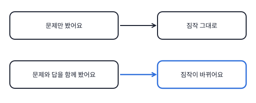

*윗줄은 짐작이 그대로이고, 아랫줄은 짐작이 바뀌어요.*

**정확히 말하면**

조인트 분포(joint distribution)는 관측되는 $y$와 관측되지 않는 $\boldsymbol{\theta}$를 함께 적은 전체 확률 모델이에요. 슬라이드(MML 식 (9.36))에는 결과만 적혀 있어요.

$$
p(y, \boldsymbol{\theta} \mid \mathbf{x}) = p(y \mid \mathbf{x}, \boldsymbol{\theta})\,p(\boldsymbol{\theta})
$$

칠판에서는 이 식을 조건부확률의 정의만으로 유도했어요. [조건부확률 복습: 곱셈 법칙의 확장](#s0-cond-prob)의 식 $P(A, B \mid C) = P(A \mid B, C)\,P(B \mid C)$에 $A = y$, $B = \boldsymbol{\theta}$, $C = \mathbf{x}$를 넣은 거예요.

1. 조건부확률의 정의: $p(y, \boldsymbol{\theta} \mid \mathbf{x}) = \dfrac{p(y, \boldsymbol{\theta}, \mathbf{x})}{p(\mathbf{x})}$
2. 분자에 곱셈 법칙: $p(y, \boldsymbol{\theta} \mid \mathbf{x}) = \dfrac{p(y \mid \mathbf{x}, \boldsymbol{\theta})\,p(\mathbf{x}, \boldsymbol{\theta})}{p(\mathbf{x})}$
3. $\dfrac{p(\mathbf{x}, \boldsymbol{\theta})}{p(\mathbf{x})} = p(\boldsymbol{\theta} \mid \mathbf{x})$로 묶기: $p(y, \boldsymbol{\theta} \mid \mathbf{x}) = p(y \mid \mathbf{x}, \boldsymbol{\theta})\,p(\boldsymbol{\theta} \mid \mathbf{x})$
4. 가정: 입력 $\mathbf{x}$만으로는 $\boldsymbol{\theta}$가 영향을 받지 않아요. $\boldsymbol{\theta}$와 $\mathbf{x}$는 통계적으로 독립이에요. $p(\boldsymbol{\theta} \mid \mathbf{x}) = p(\boldsymbol{\theta})$
5. 결론: $p(y, \boldsymbol{\theta} \mid \mathbf{x}) = p(y \mid \mathbf{x}, \boldsymbol{\theta})\,p(\boldsymbol{\theta})$

- 3단계까지는 가정 없이 항상 맞는 식이에요. 수학적으로 정확한 식은 $p(y \mid \mathbf{x}, \boldsymbol{\theta})\,p(\boldsymbol{\theta} \mid \mathbf{x})$예요.
- 슬라이드 식의 뒤 항이 $p(\boldsymbol{\theta} \mid \mathbf{x})$가 아니라 $p(\boldsymbol{\theta})$인 것은 오타가 아니에요. 4단계의 독립 가정이 섞인 결과예요.
- 이 독립은 모델에 따라 달라요. $\boldsymbol{\theta}$가 입력 신호 자체의 영향을 받도록 설계했다면 4단계로 넘어갈 수 없어요.
- 지도학습에서는 $\mathbf{x}$와 $y$가 쌍으로 주어져야 $\boldsymbol{\theta}$가 영향을 받아요. 입력만 봐서는 $\boldsymbol{\theta}$에 대한 믿음이 바뀌지 않아요.

결론 식의 앞 항은 가능도, 뒤 항은 사전분포예요. 두 분포는 [사전분포와 가능도](#s1-prior-likelihood)에서 정한 그대로예요.

같은 가정이 L03 s22에도 한 줄로 적혀 있어요. 사전분포는 입력에 의존하지 않는다는 문장이에요.

**교수님 말씀**

교수님은 3단계 식을 적고 나서 이쪽이 수학적으로 맞는 식이라고 먼저 짚었어요.

> "실제 수학적으로 보면 이게 정답이에요. 이게 맞잖아. 정확해 이게." (0930 Part 02 ~08:59)

슬라이드 식과 다르게 보이는 것을 두고 "오타니? 이거 오타다." 하고 농담한 뒤, 오타가 아니라 가정이라고 설명했어요 (0930 Part 02 ~08:49).

> "이거는 이제 모델에 따라 달라요." (0930 Part 02 ~09:33)

**페이지 요약**

조인트는 조건부확률의 정의로 풀고, 입력만으로는 $\boldsymbol{\theta}$가 바뀌지 않는다는 독립 가정을 넣어 가능도와 사전분포의 곱으로 써요.

*핵심 식*

- 조인트 분포

  $$
  p(y, \boldsymbol{\theta} \mid \mathbf{x}) = p(y \mid \mathbf{x}, \boldsymbol{\theta})\,p(\boldsymbol{\theta})
  $$
- 독립 가정

  $$
  p(\boldsymbol{\theta} \mid \mathbf{x}) = p(\boldsymbol{\theta})
  $$

*용어*

- **조인트 분포(joint distribution)** — 관측되는 $y$와 관측되지 않는 $\boldsymbol{\theta}$를 함께 적은 전체 확률 모델이에요.
- **통계적으로 독립** — 입력 $\mathbf{x}$만으로는 $\boldsymbol{\theta}$가 영향을 받지 않는다는 가정이에요.

#### 조건·구분

독립 가정 전의 정확한 둘째 항은 $p(\boldsymbol{\theta}\mid\mathbf{x})$예요. 이 항을 $p(\boldsymbol{\theta})$로 바꾸는 것은 모델에 따라 달라지는 가정이에요.

---

## 2. 사후 예측분포

### 예측 목표를 통계적 추론으로 쓰기

*0930 수업 · L04 · MML 9.3.4*

**쉽게 말하면**

처음 보는 문제의 답을 맞히고 싶을 때는, 지금까지 풀어 본 문제와 답을 모두 손에 쥐고 짐작해요.

*답을 딱 하나로 말할 수 없어서, 답마다 얼마나 그럴듯한지를 말해요.*

**정확히 말하면**

풀리 베이지안으로 문제를 푼다는 것은 슬라이드에 별표로 표시한 식 하나를 계산하는 일이에요. 오늘부터 다음 주까지 이 부분만 공부해요.

- **목표**: 학습할 때 보지 못한(unseen) 입력 $\mathbf{x}_*$가 들어왔을 때 출력 $y_*$를 예측해요.
- **손에 쥔 것**: 학습 데이터 $\mathcal{X}$(입력들)와 $\mathcal{Y}$(출력들), 그리고 새 입력 $\mathbf{x}_*$예요. $\mathcal{X}$와 $\mathcal{Y}$를 묶어 $\mathcal{D}$로 봐도 돼요.
- **통계적 추론(statistical inference)의 원칙**: 손에 가진 것은 전부 조건(바의 오른쪽)에, 추론하고 싶은 것은 결과(바의 왼쪽)에 써요. 바의 양쪽을 읽는 법은 [조건부확률 복습: 곱셈 법칙의 확장](#s0-cond-prob)과 같아요.

이 원칙대로 쓰면 구할 것은 식 하나예요.

$$
p(y_* \mid \mathbf{x}_*, \mathcal{X}, \mathcal{Y})
$$

$y_*$를 정확히 맞힐 수는 없어요. 그래서 값 하나가 아니라 $y_*$의 확률밀도함수(PDF)를 구해요. 이 분포를 사후 예측분포(posterior predictive distribution)라고 불러요.

교수님은 이 자리에서 머신러닝의 기초 체력도 짚었어요.

- 둘만 고르면 확률과 선형대수(linear algebra)예요.
- 조금 더 나가면 미적분이에요. 기울기(gradient), 야코비안(Jacobian), 다차원 적분이 여기에 들어가요.
- 해석기하도 필요하지만 미적분을 잘하면 따라와요.

**교수님 말씀**

별표 식은 "가진 것은 조건으로, 궁금한 것은 결과로"라는 통계적 추론의 말투로 상황을 그대로 옮긴 것이에요.

> "스테티스티컬 인퍼런스로 이 환경을 설명하면 이 수식 하나로 끝나요." (0930 Part 03 ~02:30)

> "두 가지만 추린다면 확률하고 리니어 엘지브라 하고 조금 더 나가면 미적분학을 잘해야 돼." (0930 Part 03 ~03:07)

**페이지 요약**

가진 것은 모두 조건에, 궁금한 $y_*$는 결과에 쓰면 예측 목표가 식 하나로 정리돼요.

*핵심 식*

- 예측 목표

  $$
  p(y_* \mid \mathbf{x}_*, \mathcal{X}, \mathcal{Y})
  $$

*용어*

- **통계적 추론(statistical inference)** — 손에 가진 것은 조건에, 추론하고 싶은 것은 결과에 쓰는 방식
- **사후 예측분포(posterior predictive distribution)** — 학습 데이터와 새 입력이 주어졌을 때 $y_*$의 분포

---

### 하나마나한 짓: 없던 θ를 넣고 주변화하기

*0930 수업 · L04 · 칠판*

**쉽게 말하면**

사과 열 개를 빨간 사과와 초록 사과로 나눠 세었다가 다시 더해도 전체 개수는 그대로예요.

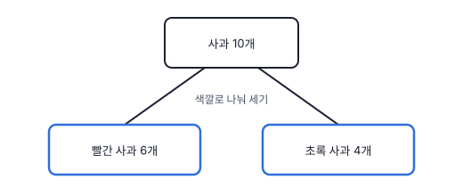

*쓸데없어 보여도, 나눠 세어 두면 색깔마다 따로 살펴볼 수 있어요.*

**정확히 말하면**

[예측 목표를 통계적 추론으로 쓰기](#s2-goal)에서 세운 식에는 조절하고 싶은 파라미터 $\boldsymbol{\theta}$가 보이지 않아요. 그래서 없던 $\boldsymbol{\theta}$를 일부러 식에 넣어요. 이때 쓰는 도구가 주변화(marginalization)예요.

**주변화 복습.** 조인트 PDF를 한 변수로 적분하면 남은 변수의 PDF(marginal PDF)가 돼요.

$$
f_Y(y) = \int_{-\infty}^{\infty} f_{X,Y}(x, y)\,dx
$$

적분 변수 $x$는 적분과 함께 사라져요. 이 식은 두 방향으로 읽어요.

1. 오른쪽에서 왼쪽: 조인트를 적분해 marginal을 얻어요. 쉬운 방향이에요.
2. 왼쪽에서 오른쪽: marginal에 없던 변수를 도입해 조인트의 적분으로 되돌려 써요. 더 중요한 방향이에요.

**적용.** 둘째 방향으로 $\boldsymbol{\theta}$를 넣어요.

$$
p(y_* \mid \mathbf{x}_*, \mathcal{X}, \mathcal{Y}) = \int p(y_*, \boldsymbol{\theta} \mid \mathbf{x}_*, \mathcal{X}, \mathcal{Y})\,d\boldsymbol{\theta}
$$

- $\boldsymbol{\theta}$처럼 원래 식에는 없다가 일부러 도입하는 변수를 hidden parameter 또는 잠재 변수(latent variable)라고 불러요.
- $\boldsymbol{\theta}$는 바의 왼쪽, 곧 주인공 자리에 넣어요. 적분은 주인공 자리의 변수를 없애요. 조건 자리(바의 오른쪽)에 넣으면 적분해도 사라지지 않아서 등식이 성립하지 않아요.
- 조건이 붙은 PDF에서도 주변화는 그대로 성립해요.

  $$
  \int p(x, y \mid z)\,dy = p(x \mid z)
  $$

  $z$는 조건으로 고정된 채 남고, 적분한 $y$의 영향만 사라져요. (수업 중 이 대목에서 "미분"이라고 말했는데, 적분이 맞아요.)
- 위 적용 식은 이 식에서 $x$ 자리에 $y_*$, $y$ 자리에 $\boldsymbol{\theta}$, $z$ 자리에 $(\mathbf{x}_*, \mathcal{X}, \mathcal{Y})$를 넣은 것이에요.

넣은 $\boldsymbol{\theta}$를 어떻게 쓰는지는 [사후 예측분포 유도와 두 가지 가정](#s2-predictive)에서 이어져요.

**교수님 말씀**

**하나마나한 짓**: 교수님은 수학을 잘하려면 하나마나한 짓을 잘해야 한다고 했어요. 짧고 깔끔한 식에 없던 파라미터를 일부러 넣어 더 길게 쓰는 일이에요. (0930 Part 03 ~04:15)

> "얘를 이렇게 바꾸는 게 더 중요해요, 어떨 때는." (0930 Part 03 ~05:21)

> "여기서 이걸 만들어 낼 수 있는 학생과 없는 학생이 나눠지는 거야." (0930 Part 03 ~06:27)

**스스로 묻고 답하기**: "교수님, $\boldsymbol{\theta}$를 조건에다 넣으면 안 되나요?" 답은 "안 되지. 주인공에 대해서 적분을 해야 사라지니까."였어요.

**복습 습관**: 조건이 붙은 주변화의 증명은 확률 및 랜덤변수 수업에서 배웠다며 넘어갔어요. 이해가 안 된 부분을 강의노트에서 찾아보고, GPT에 캡처를 보여 주며 증명을 물어보는 학생이 빨리 따라온다고 했어요.

> "지난 시간에 배웠던 걸 복습하는 게 … 거기서부터 이렇게 벌어져 실력이." (0930 Part 03 ~08:58)

**보충 · 수업에서 유도하진 않았어요**

수업에서 미룬 $\int p(x, y \mid z)\,dy = p(x \mid z)$의 증명이에요. $p(z) \gt 0$이라고 두고, 조건부 PDF의 정의와 조건 없는 주변화만 써요.

1. 조건부 PDF의 정의로 풀어 쓰기:

   $$
   p(x, y \mid z) = \frac{p(x, y, z)}{p(z)}
   $$
2. 양변을 $y$로 적분하기. $p(z)$에는 $y$가 없으니 적분 밖으로 나와요.

   $$
   \int p(x, y \mid z)\,dy = \frac{1}{p(z)} \int p(x, y, z)\,dy
   $$
3. 조건 없는 주변화를 쓰기. 세 변수의 조인트를 $y$로 적분하면 $y$만 사라져요.

   $$
   \int p(x, y, z)\,dy = p(x, z)
   $$
4. 대입하고 조건부 PDF의 정의로 다시 묶기:

   $$
   \int p(x, y \mid z)\,dy = \frac{p(x, z)}{p(z)} = p(x \mid z)
   $$

조건 $z$는 네 단계 내내 같은 값으로 고정돼 있어요. 그래서 조건이 있어도 주변화는 조건이 없을 때와 같은 방식으로 작동해요.

**페이지 요약**

없던 $\boldsymbol{\theta}$를 바의 왼쪽(주인공 자리)에 넣고 적분하면 원래 식과 같아요.

*핵심 식*

- 주변화

  $$
  f_Y(y) = \int_{-\infty}^{\infty} f_{X,Y}(x, y)\,dx
  $$
- θ를 넣은 예측 목표

  $$
  p(y_* \mid \mathbf{x}_*, \mathcal{X}, \mathcal{Y}) = \int p(y_*, \boldsymbol{\theta} \mid \mathbf{x}_*, \mathcal{X}, \mathcal{Y})\,d\boldsymbol{\theta}
  $$
- 조건이 붙은 주변화

  $$
  \int p(x, y \mid z)\,dy = p(x \mid z)
  $$

*용어*

- **주변화(marginalization)** — 조인트 PDF를 한 변수로 적분해 그 변수를 없애는 일
- **잠재 변수(latent variable)** — 원래 식에는 없다가 일부러 도입하는 변수

#### 조건·구분

조건 $z$는 고정해 남겨 두고 결과 자리의 $y$를 적분해 없애요. 수업 외 보충 증명은 $p(z)\gt0$에서 조건부 정의를 풀고 $p(z)$를 적분 밖으로 꺼낸 뒤 $\int p(x,y,z)\,dy=p(x,z)$를 써요.

---

### 사후 예측분포 유도와 두 가지 가정

*0930 수업 · L04 · MML 9.3.4*

**쉽게 말하면**

새 문제의 답은 풀이법을 하나로 정하지 않고, 두 가지를 곱해서 모두 모아 짐작해요.

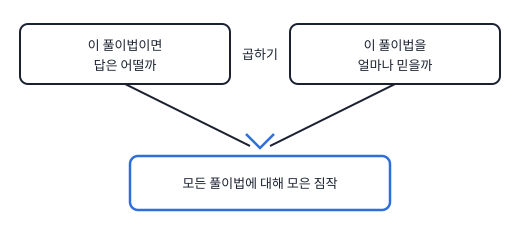

*믿는 정도는 지금까지 풀어 본 문제와 답을 보고 정해요.*

**정확히 말하면**

[하나마나한 짓: 없던 θ를 넣고 주변화하기](#s2-marginalize)에서 얻은 적분 안의 조인트를 둘로 쪼개요. likelihood를 만들려면 바의 왼쪽에 $y_*$만 남기고 $\boldsymbol{\theta}$를 조건으로 넘겨야 해요. 쓰는 식은 [조건부확률 복습: 곱셈 법칙의 확장](#s0-cond-prob)의 $P(A, B \mid C) = P(A \mid B, C)\,P(B \mid C)$ 하나예요.

1. $A = y_*$, $B = \boldsymbol{\theta}$, $C = (\mathbf{x}_*, \mathcal{X}, \mathcal{Y})$로 두기. 여기까지는 가정 없이 정확한 식이에요.

   $$
   p(y_*, \boldsymbol{\theta} \mid \mathbf{x}_*, \mathcal{X}, \mathcal{Y}) = p(y_* \mid \boldsymbol{\theta}, \mathbf{x}_*, \mathcal{X}, \mathcal{Y})\,p(\boldsymbol{\theta} \mid \mathbf{x}_*, \mathcal{X}, \mathcal{Y})
   $$
2. 가정 ① (앞 항): $\boldsymbol{\theta}$와 입력이 주어지면 학습 데이터는 더 필요 없어요.

   $$
   p(y_* \mid \boldsymbol{\theta}, \mathbf{x}_*, \mathcal{X}, \mathcal{Y}) = p(y_* \mid \mathbf{x}_*, \boldsymbol{\theta})
   $$
3. 가정 ② (뒤 항): 출력 없이 새 입력 $\mathbf{x}_*$만으로는 $\boldsymbol{\theta}$가 바뀌지 않아요.

   $$
   p(\boldsymbol{\theta} \mid \mathbf{x}_*, \mathcal{X}, \mathcal{Y}) = p(\boldsymbol{\theta} \mid \mathcal{X}, \mathcal{Y})
   $$
4. 두 가정을 넣고 $\boldsymbol{\theta}$로 적분하기(MML 식 9.57a):

   $$
   p(y_* \mid \mathbf{x}_*, \mathcal{X}, \mathcal{Y}) = \int p(y_* \mid \mathbf{x}_*, \boldsymbol{\theta})\,p(\boldsymbol{\theta} \mid \mathcal{X}, \mathcal{Y})\,d\boldsymbol{\theta}
   $$

**가정 ①의 근거.** 선형 모델 $y = \boldsymbol{\phi}^\top(\mathbf{x})\boldsymbol{\theta} + \epsilon$에서는 $\boldsymbol{\theta}$와 입력만 있으면 $y$의 분포가 정해져요. 남는 불확실성은 잡음 $\epsilon$뿐이에요. 학습 데이터 $(\mathcal{X}, \mathcal{Y})$는 $\boldsymbol{\theta}$를 만드는 데 이미 역할을 다했어요.

**가정 ②의 근거.** 지도학습에서는 입력과 출력이 쌍으로 주어져야 $\boldsymbol{\theta}$가 영향을 받아요. $y_*$ 없이 $\mathbf{x}_*$만 있으면 $\boldsymbol{\theta}$와 통계적으로 독립이에요. [조인트 분포와 독립 가정](#s1-joint)에서 $p(\boldsymbol{\theta} \mid \mathbf{x}) = p(\boldsymbol{\theta})$로 둔 것과 같은 논리예요.

**두 항의 이름.**

- 앞 항 $p(y_* \mid \mathbf{x}_*, \boldsymbol{\theta})$: 가능도(likelihood)예요. 이 항은 항상 들어가요.
- 뒤 항 $p(\boldsymbol{\theta} \mid \mathcal{X}, \mathcal{Y})$: 학습 데이터가 주어졌을 때 $\boldsymbol{\theta}$가 어떻게 정해지는지를 보정해 주는 조건부 PDF예요. 파라미터의 사후분포(posterior)예요.

**ML · MAP과의 차이.** ML과 MAP은 학습 데이터에서 $\boldsymbol{\theta}$를 값 하나로 결정했어요. 풀리 베이지안은 그 결정을 유보해요. "이럴 수도, 저럴 수도 있다"는 여지를 PDF로 남기고 $\boldsymbol{\theta}$ 전체에 대해 적분해요. 결정을 유보한다는 뜻은 [풀리 베이지안: 결정을 유보한다](#s0-fully-bayesian)에 있어요.

유도 전체에 쓴 도구는 조건부확률의 정의 하나뿐이에요. 나머지는 모델에서 나온 두 가정이에요.

수업은 이 적분식까지 유도했어요. 뒤 항과 적분을 실제로 계산하는 일은 [다음 시간 예고 (아직 안 배움)](#s5-next)로 남았어요.

**교수님 말씀**

> "여기서 이제 뭐가 필요해요? 모델 또는 가정이 필요해요." (0930 Part 04 ~00:37)

**스스로 묻고 답하기 1**: "그럼 $\mathcal{X}$, $\mathcal{Y}$는 없어도 되나요?" 답은 "없어도 돼요. 세타가 주어지는 순간."이었어요. "그러면 아무 역할이 없나요?"에는 "세타 자체를 만드는 데 걔가 좋은 역할을 한 거야."라고 답했어요.

**스스로 묻고 답하기 2**: "$\mathbf{x}_*$는 왜 무시하셨나요?" 입력만으로는 $\boldsymbol{\theta}$가 바뀌지 않기 때문이에요.

> "이 1번이 likelihood다. Likelihood가 항상 들어간다." (0930 Part 04 ~04:05)

> "fully Bayesian에서는 그 결정을 뭐 한다? 유보한다." (0930 Part 04 ~04:35)

**페이지 요약**

조인트를 곱셈 법칙으로 쪼개고 두 가정을 넣으면, 사후 예측분포는 likelihood와 $\boldsymbol{\theta}$의 조건부 PDF를 곱해 $\boldsymbol{\theta}$로 적분한 식이 돼요.

*핵심 식*

- 가정 ①

  $$
  \begin{aligned}&p(y_*\mid\boldsymbol\theta,\mathbf x_*,\mathcal X,\mathcal Y)\\&=p(y_*\mid\mathbf x_*,\boldsymbol\theta)\end{aligned}
  $$
- 가정 ②

  $$
  \begin{aligned}&p(\boldsymbol\theta\mid\mathbf x_*,\mathcal X,\mathcal Y)\\&=p(\boldsymbol\theta\mid\mathcal X,\mathcal Y)\end{aligned}
  $$
- 사후 예측분포

  $$
  \begin{aligned}&p(y_*\mid\mathbf x_*,\mathcal X,\mathcal Y)\\&=\int p(y_*\mid\mathbf x_*,\boldsymbol\theta)\\&\quad{}\cdot p(\boldsymbol\theta\mid\mathcal X,\mathcal Y)\,d\boldsymbol\theta\end{aligned}
  $$

*용어*

- **가능도(likelihood)** — 앞 항 $p(y_* \mid \mathbf{x}_*, \boldsymbol{\theta})$. 항상 들어가요
- **유보** — $\boldsymbol{\theta}$를 값 하나로 결정하지 않고 PDF로 남겨 두는 것

---

### 조건부 기댓값으로 읽기: ML · MAP은 특수한 경우

*0930 수업 · L04 · MML 9.3.4*

**쉽게 말하면**

여러 친구의 짐작을 믿는 만큼씩 섞으면 하나의 짐작이 돼요.

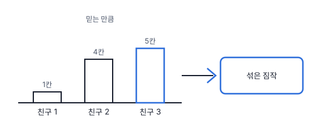

*한 친구만 믿기로 정하면 그 친구의 짐작이 그대로 답이 돼요.*

**정확히 말하면**

[사후 예측분포 유도와 두 가지 가정](#s2-predictive)의 결론 식을 기댓값의 눈으로 다시 읽어요.

**기댓값 복습.** 가능한 값마다 그 값이 나올 확률(PMF)을 곱해 모두 더한 가중합(weighted sum)이에요. 확률변수를 한마디로 요약하는 연산(summarizing operation)이에요.

$$
\mathbb{E}[X] = \sum_x x\,p_X(x)
$$

주사위 눈 $X$는 각 값의 확률이 $\frac{1}{6}$이라 $\mathbb{E}[X] = \frac{1}{6}(1 + 2 + 3 + 4 + 5 + 6) = 3.5$예요.

**조건부 기댓값.** 확률 자리에 조건부 확률을 넣어요. 연속이면 합이 적분으로, PMF가 PDF로 바뀌어요.

$$
\mathbb{E}[X \mid Y = 3] = \sum_x x\,p_{X \mid Y}(x \mid 3)
$$

$$
\mathbb{E}[X \mid Y = 3] = \int x\,f_{X \mid Y}(x \mid 3)\,dx
$$

**함수의 조건부 기댓값.** $x$ 자리에 함수 $g(x)$를 넣어요. $X^2$, $X^3$, $\log X$ 모두 같은 방법이에요.

$$
\mathbb{E}[g(X) \mid Y = 3] = \sum_x g(x)\,p_{X \mid Y}(x \mid 3)
$$

**결론 식에 맞춰 보기.** 사후 예측분포의 적분식은 이 식과 모양이 같아요.

| 함수의 조건부 기댓값 | 사후 예측분포의 적분식 |
|---|---|
| 확률변수 $X$ | 파라미터 $\boldsymbol{\theta}$ |
| 함수 $g(x)$ | $\boldsymbol{\theta}$의 함수로 본 likelihood $p(y_* \mid \mathbf{x}_*, \boldsymbol{\theta})$ |
| 조건 $Y = 3$ | 손에 쥔 학습 데이터 $\mathcal{X}, \mathcal{Y}$ |
| 가중치 $p_{X \mid Y}(x \mid 3)$ | $p(\boldsymbol{\theta} \mid \mathcal{X}, \mathcal{Y})$ |
| $x$에 대한 합 | $\boldsymbol{\theta}$에 대한 적분 |

그래서 사후 예측분포는 학습 데이터가 주어졌을 때 likelihood의 조건부 기댓값(conditional expectation)이에요(MML 9.3.4 Remark).

$$
p(y_* \mid \mathbf{x}_*, \mathcal{X}, \mathcal{Y}) = \mathbb{E}_{\boldsymbol{\theta} \mid \mathcal{X}, \mathcal{Y}}\big[p(y_* \mid \mathbf{x}_*, \boldsymbol{\theta})\big]
$$

**이산 예시.** $\boldsymbol{\theta}$가 $\boldsymbol{\theta}_1, \boldsymbol{\theta}_2, \boldsymbol{\theta}_3$ 셋 중 하나이고 확률이 $0.1, 0.4, 0.5$라면 적분이 세 항의 합이 돼요.

$$
0.1\,p(y_* \mid \mathbf{x}_*, \boldsymbol{\theta}_1) + 0.4\,p(y_* \mid \mathbf{x}_*, \boldsymbol{\theta}_2) + 0.5\,p(y_* \mid \mathbf{x}_*, \boldsymbol{\theta}_3)
$$

아래 위젯은 이 예시를 그림으로 옮긴 거예요. 새 입력 하나를 고정하고, 세 후보의 likelihood를 평균이 $-2, 0, 2$이고 표준편차가 $0.6$인 [스칼라 가우시안: 숫자 두 개로 전하는 종 모양](#s3-gaussian-scalar)으로 두었어요. 이 숫자들은 그림을 위해 이 노트가 정한 값이에요. 실제 $\boldsymbol{\theta}$는 연속이라 합이 아니라 적분이에요.

#### 직접 해 보기: 가중치가 한 후보로 몰리면 *(정적 스냅샷 — 직접 조작은 HTML 버전)*

손잡이를 오른쪽으로 밀면 가중치가 후보 θ₃으로 몰리고, 굵은 예측분포 곡선이 점선인 θ₃의 종 모양 하나에 겹쳐요.

가중치 (θ₁, θ₂, θ₃) = **0.10, 0.40, 0.50** · 예측분포의 평균 = **0.80**

범례: 가중치를 곱한 세 후보의 종 모양 · 예측분포(세 곡선의 합) · θ₃ 하나로 결정했을 때의 종 모양(점선) · 세로 점선은 예측분포의 평균

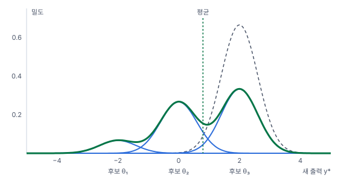

*몰린 정도 0.00 (수업의 예시 가중치)*

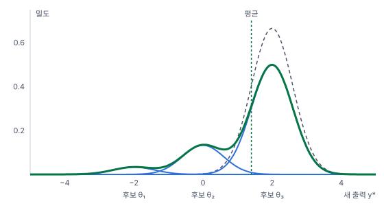

*몰린 정도 0.50*

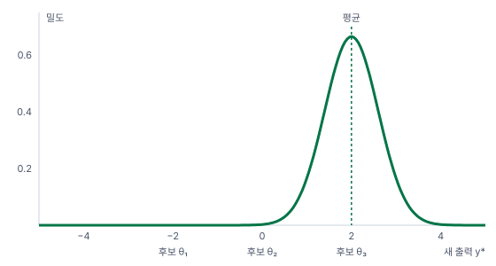

*몰린 정도 1.00 (한 후보에 전부)*

| 설정 | 가중치 (θ₁, θ₂, θ₃) | 예측분포의 평균 | 예측분포의 표준편차 | 곡선 모습 |
|---|---|---|---|---|
| 몰린 정도 0.00 (수업의 예시 가중치) | 0.10, 0.40, 0.50 | 0.80 | 1.46 | 봉우리가 셋이에요. 가장 높은 봉우리의 높이는 0.333으로, θ₃의 종 모양 높이 0.665의 절반이에요. |
| 몰린 정도 0.50 | 0.05, 0.20, 0.75 | 1.40 | 1.26 | 왼쪽 두 봉우리가 낮아지고 오른쪽 봉우리가 0.499까지 높아져요. |
| 몰린 정도 1.00 (한 후보에 전부) | 0.00, 0.00, 1.00 | 2.00 | 0.60 | 봉우리가 하나예요. θ₃의 종 모양과 같아서 높이가 0.665예요. |

- 손잡이가 0이면 수업의 예시 가중치 $(0.1, 0.4, 0.5)$예요. 예측분포는 세 종 모양을 모두 품어 넓게 퍼져요.
- 손잡이가 1이면 가중치가 $(0, 0, 1)$이에요. 더할 것이 없어 예측분포가 $\boldsymbol{\theta}_3$의 종 모양 하나와 같아요.

**ML · MAP은 특수한 경우.** $\boldsymbol{\theta}$를 $\boldsymbol{\theta}_{\text{ML}}$이나 $\boldsymbol{\theta}_{\text{MAP}}$ 하나로 결정해 버리는 것은 $p(\boldsymbol{\theta} \mid \mathcal{X}, \mathcal{Y})$를 그 값에만 서 있는 델타 함수로 두는 것과 같아요. 이때는 평균 낼 후보가 하나뿐이라 그 값에서의 likelihood, 예를 들어 $p(y_* \mid \mathbf{x}_*, \boldsymbol{\theta}_{\text{MAP}})$만 계산해요. 분산을 0으로 보내면 PDF가 델타 함수가 된다는 이야기는 [풀리 베이지안: 결정을 유보한다](#s0-fully-bayesian)에 있어요.

**풀리 베이지안의 결과물.** 적분으로 $\boldsymbol{\theta}$의 영향만 사라지고, $y_*$의 불확실성은 PDF로 남아요. 값 하나가 필요하면 그 PDF의 최대점이나 평균으로 마지막에 한 번 결정(decision making)해요.

**남은 일.** likelihood가 정규분포라는 것은 이미 배웠어요. 남은 것은 별표로 표시해 둔 부분, 곧 뒤 항 $p(\boldsymbol{\theta} \mid \mathcal{X}, \mathcal{Y})$와 적분의 계산이에요. 수업은 이 계산에 쓸 가우시안 복습으로 넘어갔고, 계산 자체는 [다음 시간 예고 (아직 안 배움)](#s5-next)로 남았어요.

**교수님 말씀**

**색안경**: 적분식을 그냥 보지 말고, "이 식이 무슨 일을 하는가"라는 색안경을 끼고 보라고 했어요. 그러면 조건부 기댓값이 보여요.

> "색안경을 딱 끼고 이 수식을 잘 봐야 돼. … 어 벌써 소름." (0930 Part 04 ~07:19)

> "likelihood function의 conditional expectation을 계산하고 있는 거지, 사실은." (0930 Part 04 ~09:14)

**장군님**: 장군님은 정답만 원해요. ML과 MAP은 값 하나를 결정해서 알려 줘요. 풀리 베이지안은 가능성 전부를 계산해 PDF로 들고 있다가, 마지막에 장군님이 원하는 답(최대점이나 평균)을 드려요.

> "지금부터 우리가 해야 될 일 중에 딱 하나 남았어." (0930 Part 05 ~02:34)

**페이지 요약**

사후 예측분포는 likelihood를 $\boldsymbol{\theta}$의 분포로 평균 낸 조건부 기댓값이고, ML · MAP은 그 분포가 델타 함수인 경우예요.

*핵심 식*

- 기댓값

  $$
  \mathbb{E}[X] = \sum_x x\,p_X(x)
  $$
- 함수의 조건부 기댓값

  $$
  \mathbb{E}[g(X) \mid Y = 3] = \sum_x g(x)\,p_{X \mid Y}(x \mid 3)
  $$
- 사후 예측분포

  $$
  p(y_* \mid \mathbf{x}_*, \mathcal{X}, \mathcal{Y}) = \mathbb{E}_{\boldsymbol{\theta} \mid \mathcal{X}, \mathcal{Y}}\big[p(y_* \mid \mathbf{x}_*, \boldsymbol{\theta})\big]
  $$

*용어*

- **요약하는 연산(summarizing operation)** — 확률변수를 값 하나로 요약하는 기댓값의 역할
- **조건부 기댓값(conditional expectation)** — 조건부 확률을 가중치로 쓴 기댓값
- **델타 함수** — 값 하나에만 서 있는 PDF. $\boldsymbol{\theta}$를 하나로 결정한 경우

#### 조건·구분

적분으로 사라지는 것은 $\boldsymbol{\theta}$이고 새 출력 $y_*$의 불확실성은 PDF로 남아요. 값 하나가 필요하면 마지막에 이 PDF의 최대점이나 평균으로 결정해요. 세 후보의 평균 $-2,0,2$와 표준편차 $0.6$은 위젯을 위해 노트가 정한 예시예요.

---

## 3. 가우시안과 랜덤 벡터

### 스칼라 가우시안: 숫자 두 개로 전하는 종 모양

*0930 수업 · L04 · MML 6.5*

**쉽게 말하면**

종 모양 그림은 꼭대기가 어디 있는지와 얼마나 넓은지, 숫자 두 개만 알려 주면 누구나 똑같이 그릴 수 있어요.

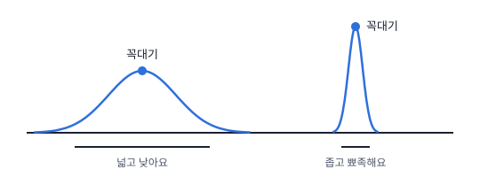

*너비를 줄이면 종이 압정처럼 뾰족해져요.*

**정확히 말하면**

[조건부 기댓값으로 읽기: ML · MAP은 특수한 경우](#s2-cond-expectation)에서 남겨 둔 계산을 하려면 가우시안(Gaussian)을 다룰 줄 알아야 해요. 그래서 스칼라 가우시안부터 복습했어요.

표준정규(standard normal) $\mathcal{N}(0, 1)$은 평균 0, 분산 1인 가우시안이에요.

$$
p(x) = \frac{1}{\sqrt{2\pi}}\exp\!\Big(-\frac{x^2}{2}\Big)
$$

평균 $\mu$, 분산 $\sigma^2$인 일반형 $\mathcal{N}(\mu, \sigma^2)$의 확률밀도함수(PDF)는 다음과 같아요.

$$
p(x \mid \mu, \sigma^2) = \frac{1}{\sqrt{2\pi\sigma^2}}\exp\!\Big(-\frac{(x - \mu)^2}{2\sigma^2}\Big)
$$

이때 $\mathbb{E}[X] = \mu$, $\mathbb{V}[X] = \sigma^2$이에요.

가우시안 PDF는 종 모양(bell shape)이에요. 모양을 읽는 법은 두 가지예요.

- 꼭대기 위치는 평균 $\mu$예요.
- 종의 너비는 분산 $\sigma^2$(표준편차 $\sigma$)이 정해요.

그래서 PDF 전체를 실수 두 개, 평균과 분산으로 전달할 수 있어요. 이것이 가우시안의 장점이에요.

식에 $x = \mu$를 넣으면 지수 부분이 1이 되므로 꼭대기 높이는 $1/\sqrt{2\pi\sigma^2}$이에요. $\sigma$가 작을수록 종은 좁아지고 꼭대기는 높아져요.

수업의 예는 $\mu = 3$, $\sigma = 0.1$이에요. 꼭대기가 3에 있고 뾰족한 모양이에요. 이때 꼭대기 높이는 약 3.989예요.

#### 직접 해 보기: 평균과 표준편차로 종 모양 바꾸기 *(정적 스냅샷 — 직접 조작은 HTML 버전)*

평균을 움직이면 꼭대기가 좌우로 옮겨 가고, 표준편차를 줄이면 종이 좁아지면서 꼭대기가 높아져요.

꼭대기 위치(평균) = **0.0** · 꼭대기 높이 $1/\sqrt{2\pi\sigma^2}$ = **0.399**

범례: 지금 곡선 · 기준 곡선(평균 0, 표준편차 1) · 꼭대기 · 세로 점선: 평균 자리 · 평균 3, 표준편차 0.1로 맞추면 수업의 압정 모양이 나와요

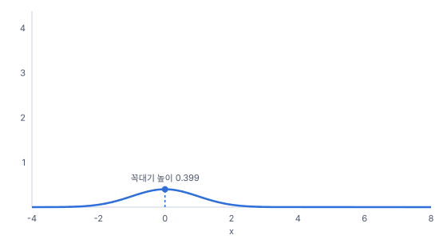

*평균 0, 표준편차 1*

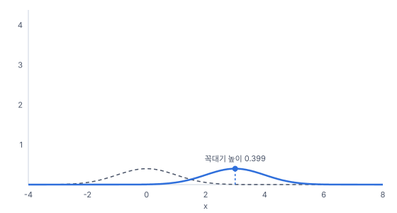

*평균 3, 표준편차 1*

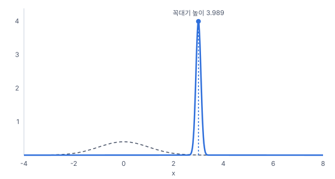

*평균 3, 표준편차 0.1*

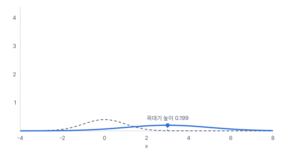

*평균 3, 표준편차 2*

| 설정 | 꼭대기 위치(평균) | 꼭대기 높이 | 모양 |
|---|---|---|---|
| 평균 0, 표준편차 1 | 0.0 | 0.399 | 기준 곡선과 같아요 |
| 평균 3, 표준편차 1 | 3.0 | 0.399 | 너비는 그대로, 자리만 옮겨 가요 |
| 평균 3, 표준편차 0.1 | 3.0 | 3.989 | 압정처럼 뾰족해요 |
| 평균 3, 표준편차 2 | 3.0 | 0.199 | 넓고 납작해요 |

**교수님 말씀**

풀리 베이지안의 결과는 PDF예요. 이 PDF를 장군님께 넘길 때 모양을 손으로 다 그려 드리면 데이터양이 너무 많아요.

가우시안이면 숫자 두 개만 알려 드리면 돼요. 이과 출신 장군님은 머릿속에서 종 모양을 그려요.

> "평균이 얼마고 분산이 얼마인지만 알려 주면 … bell shape를 그릴 수 있겠지." (0930 Part 05 ~04:30)

분산이 작은 가우시안은 "압정처럼 뾰족한" 모양이라고 했어요.

**페이지 요약**

가우시안 PDF는 종 모양이라서 평균과 분산, 숫자 두 개로 전체를 전할 수 있어요.

*핵심 식*

- 가우시안 PDF

  $$
  p(x \mid \mu, \sigma^2) = \frac{1}{\sqrt{2\pi\sigma^2}}\exp\!\Big(-\frac{(x - \mu)^2}{2\sigma^2}\Big)
  $$
- 표준정규

  $$
  p(x) = \frac{1}{\sqrt{2\pi}}\exp\!\Big(-\frac{x^2}{2}\Big)
  $$

*용어*

- **종 모양(bell shape)** — 꼭대기 위치가 평균, 너비가 분산인 가우시안 PDF의 모양
- **표준정규(standard normal)** — 평균 0, 분산 1인 가우시안 $\mathcal{N}(0, 1)$

#### 조건·구분

꼭대기는 $\mu$, 높이는 $1/\sqrt{2\pi\sigma^2}$예요. 표준편차 $\sigma$를 줄이면 좁고 높아져요. 본문 예의 $\sigma=0.1$과 분산 $\sigma^2$를 구별해요.

---

### 랜덤 벡터, 조인트 PDF, 평균 벡터

*0930 수업 · L04 · MML 6.4.1*

**쉽게 말하면**

숫자 여러 개를 세로로 쌓아 한 묶음으로 다루고, 그 묶음이 어떻게 나오는지 다 적힌 그림을 설계도라고 불러요.

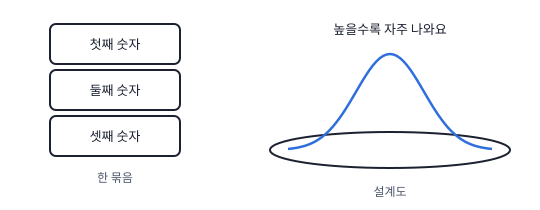

*숫자가 두 개면 설계도는 산 모양이에요.*

**정확히 말하면**

확률밀도함수(PDF)는 확률을 만들어 내는 강도(intensity)예요. 어떤 확률변수든 PDF를 알면 그 변수에 대한 모든 것을 아는 거예요.

랜덤 벡터(random vector)는 확률변수 $n$개를 세로로 쌓은 것이에요.

$$
\mathbf{X} = [X_1, \dots, X_n]^\top
$$

목표는 이 $n$개가 함께 어떻게 나오는지를 담은 joint PDF $p(x_1, \dots, x_n)$을 만드는 거예요. 추정(estimation), 파라미터 최적화, 추론(inference) 문제는 모두 joint PDF를 알면 설계도를 아는 것과 같아요.

1. 변수가 2개일 때: $f(x, y)$를 높이로 그리면 3차원 곡면, 산 모양이 돼요. 그 부피가 1이에요.

   $$
   \int_{-\infty}^{\infty}\int_{-\infty}^{\infty} f(x, y)\,dx\,dy = 1
   $$
2. 변수가 $n$개일 때: 그림으로 그릴 수 없고 상상만 할 수 있어요. $-\infty$부터 $\infty$까지 $n$번 적분하면 1이 되어야 해요.

   $$
   \int_{-\infty}^{\infty}\cdots\int_{-\infty}^{\infty} p(x_1, \dots, x_n)\,dx_1\cdots dx_n = 1
   $$

평균 벡터(mean vector)는 성분마다 평균을 구해 같은 순서로 쌓은 벡터예요.

$$
\mathbb{E}[\mathbf{X}] = \boldsymbol{\mu} = [\mu_1, \dots, \mu_n]^\top
$$

여기서 $\mu_i = \mathbb{E}[X_i]$예요. [스칼라 가우시안: 숫자 두 개로 전하는 종 모양](#s3-gaussian-scalar)의 평균 $\mu$가 벡터로 늘어난 거예요.

가우시안 랜덤 벡터의 joint PDF 식 자체는 이날 쓰지 않았어요. 이어지는 내용은 [다음 시간 예고 (아직 안 배움)](#s5-next)에 있어요.

**교수님 말씀**

변수 2개의 joint PDF는 "분화구처럼", "산 모양"으로 그려지고 그 체적이 1이라고 했어요.

> "조인트 PDF를 만들어 내는 게 우리의 목표예요. 최종 골이야, 항상." (0930 Part 05 ~06:21)

확률밀도함수 하나만 알면 설계도를 다 아는 것과 같다고 강조했어요. (0930 Part 05 ~06:38)

**페이지 요약**

확률변수 여러 개를 쌓으면 랜덤 벡터가 되고, 그 joint PDF가 모든 문제의 설계도예요.

*핵심 식*

- 랜덤 벡터

  $$
  \mathbf{X} = [X_1, \dots, X_n]^\top
  $$
- 평균 벡터

  $$
  \mathbb{E}[\mathbf{X}] = \boldsymbol{\mu} = [\mu_1, \dots, \mu_n]^\top
  $$

*용어*

- **랜덤 벡터(random vector)** — 확률변수 $n$개를 세로로 쌓은 것
- **joint PDF** — $n$개가 함께 어떻게 나오는지를 담은 PDF. $n$번 적분하면 1
- **평균 벡터(mean vector)** — 성분마다 평균을 구해 쌓은 벡터

---

### 공분산에서 공분산 행렬로

*0930 수업 · L04 · MML 6.4.1*

**쉽게 말하면**

아들 둘인 집과 딸 둘인 집이 얼마나 친한지는 한 명씩 짝지은 네 쌍을 모두 따져 봐야 알 수 있어요.

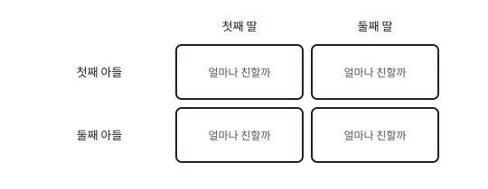

*네 쌍의 답을 표 네 칸에 하나씩 적어요.*

**정확히 말하면**

공분산(covariance)은 두 확률변수가 얼마나 함께 움직이는지를 숫자 하나로 나타내는 척도예요.

1. 평균을 빼서 가운데를 0으로 맞춰요.

   $$
   \tilde X = X - \mathbb{E}[X], \qquad \tilde Y = Y - \mathbb{E}[Y]
   $$
2. 그 둘을 곱해 평균을 내요.

   $$
   \operatorname{Cov}[X, Y] = \mathbb{E}\big[(X - \mathbb{E}[X])(Y - \mathbb{E}[Y])\big]
   $$
3. 전개하면 같은 값을 더 짧게 쓸 수 있어요.

   $$
   \operatorname{Cov}[X, Y] = \mathbb{E}[XY] - \mathbb{E}[X]\,\mathbb{E}[Y]
   $$

마지막 식은 "곱의 평균 빼기 평균의 곱"으로 외워요. 값이 양수이고 클수록 양의 상관이고, 음수이면 한쪽이 커질 때 다른 쪽이 작아지는 관계예요.

이제 벡터로 넓혀요. gradient를 성분별 편미분을 모아 정의했듯이, 두 랜덤 벡터의 연관성도 성분 쌍마다 공분산을 계산해 행렬 자리에 넣어요.

$\mathbf{x} = [X_1, X_2]^\top$, $\mathbf{y} = [Y_1, Y_2]^\top$일 때 $\operatorname{Cov}[\mathbf{x}, \mathbf{y}]$의 원소는 다음 표와 같아요. $i$번째 줄, $j$번째 칸이 $\operatorname{Cov}[X_i, Y_j]$예요.

| 줄 \ 칸 | $Y_1$ | $Y_2$ |
|---|---|---|
| $X_1$ | $\operatorname{Cov}[X_1, Y_1]$ | $\operatorname{Cov}[X_1, Y_2]$ |
| $X_2$ | $\operatorname{Cov}[X_2, Y_1]$ | $\operatorname{Cov}[X_2, Y_2]$ |

이 표 전체를 식 하나로 쓰면 스칼라 식과 같은 꼴이에요.

$$
\operatorname{Cov}[\mathbf{x}, \mathbf{y}] = \mathbb{E}[\mathbf{x}\mathbf{y}^\top] - \mathbb{E}[\mathbf{x}]\,\mathbb{E}[\mathbf{y}]^\top \in \mathbb{R}^{n \times m}
$$

$\mathbf{x}$의 성분이 $n$개, $\mathbf{y}$의 성분이 $m$개이면 결과는 $n \times m$ 행렬이에요.

두 정의가 일치하는지 $2 \times 2$로 확인해요. 수업에서 칠판에 직접 계산했어요.

1. 앞 항 $\mathbb{E}[\mathbf{x}\mathbf{y}^\top]$: 열벡터에 행벡터를 곱하면 행렬이에요.

   $$
   \mathbf{x}\mathbf{y}^\top = \begin{bmatrix} X_1 \\ X_2 \end{bmatrix}\begin{bmatrix} Y_1 \;\; Y_2 \end{bmatrix}
   $$

   이 행렬의 $(i, j)$ 원소는 $X_iY_j$예요.
2. 행렬의 기댓값은 원소별 기댓값이에요. 그래서 $\mathbb{E}[\mathbf{x}\mathbf{y}^\top]$의 $(i, j)$ 원소는 $\mathbb{E}[X_iY_j]$예요.
3. 뒤 항 $\mathbb{E}[\mathbf{x}]\,\mathbb{E}[\mathbf{y}]^\top$: 같은 방식으로 곱해요.

   $$
   \mathbb{E}[\mathbf{x}]\,\mathbb{E}[\mathbf{y}]^\top = \begin{bmatrix} \mathbb{E}[X_1] \\ \mathbb{E}[X_2] \end{bmatrix}\begin{bmatrix} \mathbb{E}[Y_1] \;\; \mathbb{E}[Y_2] \end{bmatrix}
   $$

   이 행렬의 $(i, j)$ 원소는 $\mathbb{E}[X_i]\,\mathbb{E}[Y_j]$예요.
4. 앞 항에서 뒤 항을 빼면 $(i, j)$ 원소는

   $$
   \mathbb{E}[X_iY_j] - \mathbb{E}[X_i]\,\mathbb{E}[Y_j] = \operatorname{Cov}[X_i, Y_j]
   $$

   성분별 정의와 같아요.

네 자리를 하나씩 적으면 다음과 같아요.

| 자리 $(i, j)$ | 앞 항의 원소 | 뒤 항의 원소 | 앞 항 − 뒤 항 |
|---|---|---|---|
| $(1, 1)$ | $\mathbb{E}[X_1Y_1]$ | $\mathbb{E}[X_1]\,\mathbb{E}[Y_1]$ | $\operatorname{Cov}[X_1, Y_1]$ |
| $(1, 2)$ | $\mathbb{E}[X_1Y_2]$ | $\mathbb{E}[X_1]\,\mathbb{E}[Y_2]$ | $\operatorname{Cov}[X_1, Y_2]$ |
| $(2, 1)$ | $\mathbb{E}[X_2Y_1]$ | $\mathbb{E}[X_2]\,\mathbb{E}[Y_1]$ | $\operatorname{Cov}[X_2, Y_1]$ |
| $(2, 2)$ | $\mathbb{E}[X_2Y_2]$ | $\mathbb{E}[X_2]\,\mathbb{E}[Y_2]$ | $\operatorname{Cov}[X_2, Y_2]$ |

**교수님 말씀**

공분산의 동기는 미국 대학 랭킹과 연봉의 상관관계예요. 이 관계를 숫자 하나로 표현하고 싶다는 거예요.

벡터로 넓힐 때는 두 집 비유를 썼어요. 이 집에 아들 둘, 저 집에 딸 둘이 있어요. "두 집이 얼마나 친한가"는 너무 추상적이에요. 첫째 아들과 첫째 딸, 첫째 아들과 둘째 딸, 둘째 아들과 첫째 딸, 둘째 아들과 둘째 딸을 각각 계산해 행렬로 만들어야 완전한 답이에요.

한 학생의 표정을 보고 "진짜 일치하는지 한 번만 해볼까요?" 하며 $2 \times 2$ 예시를 칠판에서 계산했어요.

> "수학이 어려운 게 아니고 수학은 항상 논리적인 언어야. 말이 돼야 돼." (0930 Part 06 ~07:40)

상상이 안 되는 것은 "한 땀 한 땀 레고로 조합하듯" 만든 것이라고 했어요.

기댓값은 행렬에 적용하든 벡터에 적용하든 차원과 상관없이 원소 하나하나를 평균 낸 것과 같다고 했어요. (0930 Part 06 ~05:47)

**페이지 요약**

공분산은 곱의 평균 빼기 평균의 곱이고, 벡터끼리는 성분 쌍마다 계산해 행렬에 넣어요.

*핵심 식*

- 스칼라 공분산

  $$
  \operatorname{Cov}[X, Y] = \mathbb{E}[XY] - \mathbb{E}[X]\,\mathbb{E}[Y]
  $$
- 두 벡터의 공분산 행렬

  $$
  \operatorname{Cov}[\mathbf{x}, \mathbf{y}] = \mathbb{E}[\mathbf{x}\mathbf{y}^\top] - \mathbb{E}[\mathbf{x}]\,\mathbb{E}[\mathbf{y}]^\top \in \mathbb{R}^{n \times m}
  $$

*용어*

- **공분산(covariance)** — 두 확률변수가 얼마나 함께 움직이는지를 숫자 하나로 나타내는 척도
- **$(i, j)$ 원소** — $\operatorname{Cov}[X_i, Y_j]$

---

### 자기 자신의 공분산 행렬과 대칭성

*0930 수업 · L04 · MML 6.4.1*

**쉽게 말하면**

우리 집안 형제끼리 얼마나 친한지 표로 적으면, 첫째와 둘째 칸과 둘째와 첫째 칸은 같은 값이에요.

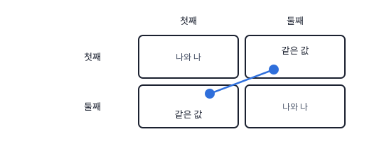

*마주 보는 두 칸은 같은 값이에요.*

**정확히 말하면**

랜덤 벡터의 분산은 자기 자신과의 공분산이에요. [공분산에서 공분산 행렬로](#s3-covariance)의 식에서 $\mathbf{y}$ 자리에 $\mathbf{x}$를 넣어요.

$$
\mathbb{V}[\mathbf{x}] = \operatorname{Cov}[\mathbf{x}, \mathbf{x}] = \mathbb{E}[\mathbf{x}\mathbf{x}^\top] - \mathbb{E}[\mathbf{x}]\,\mathbb{E}[\mathbf{x}]^\top
$$

이것을 $\mathbf{x}$의 공분산 행렬(covariance matrix)이라고 불러요.

$\mathbf{x} \in \mathbb{R}^n$이면 $\mathbb{V}[\mathbf{x}]$는 $n \times n$ 정방행렬이에요. $(i, j)$ 원소는 $\operatorname{Cov}[X_i, X_j]$예요. $n = 2$이면 다음 표와 같아요.

| 줄 \ 칸 | $X_1$ | $X_2$ |
|---|---|---|
| $X_1$ | $\operatorname{Cov}[X_1, X_1]$ | $\operatorname{Cov}[X_1, X_2]$ |
| $X_2$ | $\operatorname{Cov}[X_2, X_1]$ | $\operatorname{Cov}[X_2, X_2]$ |

대각 원소 $\operatorname{Cov}[X_i, X_i]$는 성분 $X_i$의 분산 $\mathbb{V}[X_i]$예요.

공분산 행렬은 항상 대칭(symmetric)이에요. 대칭행렬은 $\mathbf{A}^\top = \mathbf{A}$인 행렬, 즉 주대각선을 기준으로 마주 보는 원소가 같은 행렬이에요. 대각행렬(diagonal matrix)이나 대각화(diagonalization)와는 다른 개념이에요.

1. $(1, n)$ 원소:

   $$
   \operatorname{Cov}[X_1, X_n] = \mathbb{E}[X_1X_n] - \mathbb{E}[X_1]\,\mathbb{E}[X_n]
   $$
2. $(n, 1)$ 원소:

   $$
   \operatorname{Cov}[X_n, X_1] = \mathbb{E}[X_nX_1] - \mathbb{E}[X_n]\,\mathbb{E}[X_1]
   $$
3. 곱셈은 순서를 바꿔도 같으므로 두 식은 같아요.

   $$
   \operatorname{Cov}[X_1, X_n] = \operatorname{Cov}[X_n, X_1]
   $$
4. 모든 $(i, j)$에서 같으므로

   $$
   \mathbb{V}[\mathbf{x}]^\top = \mathbb{V}[\mathbf{x}]
   $$

정리하면 공분산 행렬은 대칭이고 정방행렬이에요. 이 행렬이 합과 선형 변환에서 어떻게 바뀌는지는 [합의 평균과 분산: 조건이 필요해요](#s4-sum)와 [아핀 변환의 평균과 공분산](#s4-affine)으로 이어져요.

**교수님 말씀**

두 집 비유를 "우리 집안"으로 바꿨어요. 첫째가 자기 자신과, 첫째가 둘째와, 둘째가 첫째와, 둘째가 자기 자신과 얼마나 친한가의 네 경우예요.

첨자를 바꿔도 같은 식이 되는 것은 "by definition으로 같아요"라고 했어요.

> "covariance matrix는 그것 때문에 항상 symmetric하다. symmetric하고 정방행렬을 갖게 된다." (0930 Part 07 ~01:50)

**페이지 요약**

랜덤 벡터의 분산은 자기 자신과의 공분산 행렬이고, 항상 대칭인 정방행렬이에요.

*핵심 식*

- 공분산 행렬

  $$
  \mathbb{V}[\mathbf{x}] = \operatorname{Cov}[\mathbf{x}, \mathbf{x}] = \mathbb{E}[\mathbf{x}\mathbf{x}^\top] - \mathbb{E}[\mathbf{x}]\,\mathbb{E}[\mathbf{x}]^\top
  $$
- 대칭성

  $$
  \mathbb{V}[\mathbf{x}]^\top = \mathbb{V}[\mathbf{x}]
  $$

*용어*

- **공분산 행렬(covariance matrix)** — $(i, j)$ 원소가 $\operatorname{Cov}[X_i, X_j]$인 $n \times n$ 정방행렬
- **대칭(symmetric)** — $\mathbf{A}^\top = \mathbf{A}$, 주대각선을 기준으로 마주 보는 원소가 같음

#### 조건·구분

대각 원소는 각 성분의 분산이에요. 대칭은 마주 보는 공분산이 같다는 뜻이며 대각행렬·대각화와는 달라요.

---

## 4. 합과 아핀 변환

### 합의 평균과 분산: 조건이 필요해요

*0930 수업 · L04 · MML 6.4.4*

**쉽게 말하면**

두 친구가 각자 주사위를 던져 눈을 더하면, 평균은 두 평균을 그냥 더한 값이에요.

들쭉날쭉한 정도도 더하면 되는데, 두 친구가 서로 눈치를 보지 않고 따로 던지면 그래요.

*위의 테두리 막대 두 개를 이으면 맨 아래 막대 길이가 돼요.*

**정확히 말하면**

$\mathbf{x}$와 $\mathbf{y}$는 크기가 같은 랜덤 벡터(random vector)예요. 즉 $\mathbf{x}, \mathbf{y} \in \mathbb{R}^n$이에요.

**합의 평균**은 조건 없이 늘 성립해요.

$$
\mathbb{E}[\mathbf{x} + \mathbf{y}] = \mathbb{E}[\mathbf{x}] + \mathbb{E}[\mathbf{y}]
$$

기댓값이 선형 연산자(linear operator)이기 때문이에요. 벡터의 기댓값은 성분마다 기댓값을 낸 것이라서, $i$번째 성분이 $\mathbb{E}[X_i + Y_i] = \mathbb{E}[X_i] + \mathbb{E}[Y_i]$로 하나씩 맞아요.

**합의 분산**은 $\mathbf{z} = \mathbf{x} + \mathbf{y}$의 공분산 행렬(covariance matrix)을 묻는 거예요. 공분산 행렬의 정의는 [자기 자신의 공분산 행렬과 대칭성](#s3-variance-matrix)에 있어요.

$$
\mathbb{V}[\mathbf{x} + \mathbf{y}] = \mathbb{V}[\mathbf{x}] + \mathbb{V}[\mathbf{y}]
$$

이 식이 늘 성립하는 것은 아니에요. 아래 두 조건 가운데 하나가 있어야 해요.

- $\mathbf{x}$와 $\mathbf{y}$가 통계적으로 독립(statistically independent)이에요.
- 적어도 두 벡터 사이의 공분산 행렬이 영행렬이에요. 즉 $\operatorname{Cov}[\mathbf{x}, \mathbf{y}] = \mathbf{0}$이에요.

$\operatorname{Cov}[\mathbf{x}, \mathbf{y}]$는 성분 쌍마다 공분산을 모은 행렬이에요. 정의는 [공분산에서 공분산 행렬로](#s3-covariance)에 있어요.

이 조건은 슬라이드에 없고 교수님이 말로 덧붙인 내용이에요. 교수님은 강의노트에 이 내용이 빠져 있을 것 같다고 했어요.

**교수님 말씀**

평균 식은 기댓값이 linear operator라서 당연하다고 짧게 넘어갔어요. 분산 식에서 멈춰 조건을 강조했어요.

> "이 두 번째 게 중요한데" (0930 Part 07 ~02:52)

> "근데 그게 조건이 필요해요. … 이게 늘 성립하는 게 아니고" (0930 Part 07 ~03:13)

증명은 수업에서 하지 않았어요. $X_1, X_2, Y_1, Y_2$를 넣고 한 땀 한 땀 풀면 된다고 하면서 "나중에 증명해보세요"로 남겼어요.

**꼭 기억해요**

> "아 이거 중간고사 문제로 낼까? … 요거 증명할 수 있습니다. 언제 이렇게 되는지." (0930 Part 07 ~03:53)

$\mathbb{V}[\mathbf{x} + \mathbf{y}] = \mathbb{V}[\mathbf{x}] + \mathbb{V}[\mathbf{y}]$가 **언제** 성립하는지, 그리고 왜 그런지를 직접 증명할 수 있어야 해요.

**보충 · 수업에서 유도하진 않았어요**

교과서 MML 식 (6.48)은 조건이 없는 일반형이에요.

$$
\mathbb{V}[\mathbf{x} + \mathbf{y}] = \mathbb{V}[\mathbf{x}] + \mathbb{V}[\mathbf{y}] + \operatorname{Cov}[\mathbf{x}, \mathbf{y}] + \operatorname{Cov}[\mathbf{y}, \mathbf{x}]
$$

정의 $\mathbb{V}[\mathbf{z}] = \mathbb{E}[\mathbf{z}\mathbf{z}^\top] - \mathbb{E}[\mathbf{z}]\,\mathbb{E}[\mathbf{z}]^\top$에 $\mathbf{z} = \mathbf{x} + \mathbf{y}$를 넣으면 나와요.

1. 곱을 펼쳐요.

   $$
   (\mathbf{x} + \mathbf{y})(\mathbf{x} + \mathbf{y})^\top = \mathbf{x}\mathbf{x}^\top + \mathbf{x}\mathbf{y}^\top + \mathbf{y}\mathbf{x}^\top + \mathbf{y}\mathbf{y}^\top
   $$
2. 기댓값은 linear operator라서 항마다 따로 낼 수 있어요.

   $$
   \mathbb{E}[\mathbf{z}\mathbf{z}^\top] = \mathbb{E}[\mathbf{x}\mathbf{x}^\top] + \mathbb{E}[\mathbf{x}\mathbf{y}^\top] + \mathbb{E}[\mathbf{y}\mathbf{x}^\top] + \mathbb{E}[\mathbf{y}\mathbf{y}^\top]
   $$
3. 평균의 곱도 같은 모양으로 펼쳐요. $\mathbb{E}[\mathbf{z}] = \mathbb{E}[\mathbf{x}] + \mathbb{E}[\mathbf{y}]$를 써요.

   $$
   \mathbb{E}[\mathbf{z}]\,\mathbb{E}[\mathbf{z}]^\top = \mathbb{E}[\mathbf{x}]\,\mathbb{E}[\mathbf{x}]^\top + \mathbb{E}[\mathbf{x}]\,\mathbb{E}[\mathbf{y}]^\top + \mathbb{E}[\mathbf{y}]\,\mathbb{E}[\mathbf{x}]^\top + \mathbb{E}[\mathbf{y}]\,\mathbb{E}[\mathbf{y}]^\top
   $$
4. 2번에서 3번을 같은 자리끼리 빼요. 첫째 쌍과 넷째 쌍은 분산이에요.

   $$
   \mathbb{E}[\mathbf{x}\mathbf{x}^\top] - \mathbb{E}[\mathbf{x}]\,\mathbb{E}[\mathbf{x}]^\top = \mathbb{V}[\mathbf{x}]
   $$

   $$
   \mathbb{E}[\mathbf{y}\mathbf{y}^\top] - \mathbb{E}[\mathbf{y}]\,\mathbb{E}[\mathbf{y}]^\top = \mathbb{V}[\mathbf{y}]
   $$
5. 둘째 쌍과 셋째 쌍은 교차 공분산이에요.

   $$
   \mathbb{E}[\mathbf{x}\mathbf{y}^\top] - \mathbb{E}[\mathbf{x}]\,\mathbb{E}[\mathbf{y}]^\top = \operatorname{Cov}[\mathbf{x}, \mathbf{y}]
   $$

   $$
   \mathbb{E}[\mathbf{y}\mathbf{x}^\top] - \mathbb{E}[\mathbf{y}]\,\mathbb{E}[\mathbf{x}]^\top = \operatorname{Cov}[\mathbf{y}, \mathbf{x}]
   $$
6. 네 조각을 더하면 일반형 (6.48)이에요.

교수님 말씀대로 성분으로 풀어도 같은 결과예요. $\mathbb{V}[\mathbf{x} + \mathbf{y}]$의 $(i, j)$ 원소는 아래와 같아요.

$$
\operatorname{Cov}[X_i + Y_i,\, X_j + Y_j] = \operatorname{Cov}[X_i, X_j] + \operatorname{Cov}[X_i, Y_j] + \operatorname{Cov}[Y_i, X_j] + \operatorname{Cov}[Y_i, Y_j]
$$

**교수님 식이 되는 이유.** 두 교차 공분산은 서로 전치 관계예요.

$$
\operatorname{Cov}[\mathbf{y}, \mathbf{x}] = \operatorname{Cov}[\mathbf{x}, \mathbf{y}]^\top
$$

그래서 $\operatorname{Cov}[\mathbf{x}, \mathbf{y}] = \mathbf{0}$이면 $\operatorname{Cov}[\mathbf{y}, \mathbf{x}]$도 영행렬이에요. 뒤의 두 항이 함께 사라져서 $\mathbb{V}[\mathbf{x} + \mathbf{y}] = \mathbb{V}[\mathbf{x}] + \mathbb{V}[\mathbf{y}]$만 남아요.

**독립이면 왜 영행렬인가.** $\mathbf{x}$와 $\mathbf{y}$가 독립이면 모든 성분 쌍에서 곱의 평균이 평균의 곱과 같아요.

$$
\mathbb{E}[X_i Y_j] = \mathbb{E}[X_i]\,\mathbb{E}[Y_j]
$$

$$
\operatorname{Cov}[X_i, Y_j] = \mathbb{E}[X_i Y_j] - \mathbb{E}[X_i]\,\mathbb{E}[Y_j] = 0
$$

거꾸로는 성립하지 않아요. 공분산이 영행렬이어도 독립이 아닐 수 있어요(MML 6.4.5). 그래서 독립은 충분조건이고, 식에 실제로 필요한 것은 교차 공분산 두 항의 합이 영행렬인 것이에요.

**페이지 요약**

합의 평균은 늘 더하면 되지만, 합의 분산은 독립이거나 공분산이 영행렬이면 더하면 돼요.

*핵심 식*

- 합의 평균 (조건 없음)

  $$
  \mathbb{E}[\mathbf{x} + \mathbf{y}] = \mathbb{E}[\mathbf{x}] + \mathbb{E}[\mathbf{y}]
  $$
- 합의 분산 (조건 필요)

  $$
  \mathbb{V}[\mathbf{x} + \mathbf{y}] = \mathbb{V}[\mathbf{x}] + \mathbb{V}[\mathbf{y}]
  $$
- 충분조건

  $$
  \operatorname{Cov}[\mathbf{x}, \mathbf{y}] = \mathbf{0}
  $$

*용어*

- **선형 연산자(linear operator)** — 합을 넣으면 각각의 결과를 더한 값이 나오는 연산이에요. 기댓값이 여기에 속해요.
- **통계적 독립(statistically independent)** — 이 조건이 있으면 두 벡터 사이의 공분산 행렬이 영행렬이 돼요.

#### 조건·구분

수업 외 보충의 일반형에는 $\operatorname{Cov}[\mathbf{x},\mathbf{y}]+\operatorname{Cov}[\mathbf{y},\mathbf{x}]$가 더 붙어요. 분산을 그냥 더하려면 이 두 교차항의 합이 영행렬이어야 해요. 교차공분산 자체가 영행렬이면 충분하고 독립도 충분하지만, 공분산이 영행렬이라고 독립인 것은 아니에요.

---

### 아핀 변환의 평균과 공분산

*0930 수업 · L04 · MML 6.4.4*

**쉽게 말하면**

점 무리를 늘리고 옮기면, 가운데 자리와 퍼진 모양이 정해진 규칙대로 바뀌어요.

옮기기만 하면 퍼진 모양은 그대로고, 두 배로 늘리면 퍼진 정도는 두 배를 두 번 곱한 네 배가 돼요.

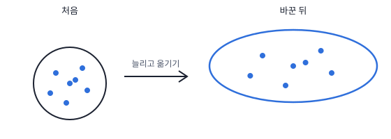

*왼쪽의 색칠된 점 무리를 옆으로 늘린 뒤 옮기면 오른쪽 점 무리가 돼요.*

**정확히 말하면**

**설정.** $\mathbf{x} \in \mathbb{R}^n$은 랜덤 벡터, $\mathbf{A} \in \mathbb{R}^{m \times n}$은 상수 행렬(constant matrix), $\mathbf{b} \in \mathbb{R}^m$은 상수 벡터예요. 아래 변환을 아핀 변환(affine transformation)이라고 해요.

$$
\mathbf{y} = \mathbf{A}\mathbf{x} + \mathbf{b}
$$

$\mathbf{x}$가 랜덤 벡터라서 $\mathbf{y}$도 랜덤 벡터예요. 딥러닝과 심층 강화학습은 이런 선형(아핀) 함수를 많이 쓰고, 베이지안 머신러닝은 변수를 확률변수로 두기 때문에 이 성질이 필요해요.

**평균.**

$$
\mathbb{E}[\mathbf{y}] = \mathbf{A}\,\mathbb{E}[\mathbf{x}] + \mathbf{b}
$$

칠판에서는 $\mathbf{x} = [X_1, X_2]^\top$이고 $\mathbf{A}$가 $2 \times 2$인 경우로 확인했어요. $a_{ij}$는 $\mathbf{A}$의 $i$행 $j$열 원소예요.

1. $\mathbf{A}\mathbf{x}$를 성분으로 써요.

   $$
   \mathbf{A}\mathbf{x} = \begin{bmatrix} a_{11}X_1 + a_{12}X_2 \\ a_{21}X_1 + a_{22}X_2 \end{bmatrix}
   $$
2. 벡터의 기댓값은 성분마다 기댓값을 낸 거예요. 상수 $a_{ij}$는 기댓값 밖으로 나와요.

   $$
   \mathbb{E}[\mathbf{A}\mathbf{x}] = \begin{bmatrix} a_{11}\,\mathbb{E}[X_1] + a_{12}\,\mathbb{E}[X_2] \\ a_{21}\,\mathbb{E}[X_1] + a_{22}\,\mathbb{E}[X_2] \end{bmatrix}
   $$
3. 오른쪽은 $\mathbf{A}$에 평균 벡터를 곱한 것과 같아요.

   $$
   \mathbb{E}[\mathbf{A}\mathbf{x}] = \mathbf{A}\begin{bmatrix} \mathbb{E}[X_1] \\ \mathbb{E}[X_2] \end{bmatrix} = \mathbf{A}\,\mathbb{E}[\mathbf{x}]
   $$
4. 상수 벡터의 기댓값은 자기 자신이에요. $\mathbb{E}[\mathbf{b}] = \mathbf{b}$를 더하면 평균 식이 돼요.

(수업 중 둘째 행을 $a_{12}X_1$로 말했다가 $a_{21}X_1$로 정정)

**공분산 행렬.**

$$
\mathbb{V}[\mathbf{y}] = \mathbf{A}\,\mathbb{V}[\mathbf{x}]\,\mathbf{A}^\top
$$

중간 단계까지 쓰면 아래와 같아요.

$$
\mathbb{V}[\mathbf{A}\mathbf{x} + \mathbf{b}] = \mathbb{V}[\mathbf{A}\mathbf{x}] = \mathbf{A}\,\mathbb{V}[\mathbf{x}]\,\mathbf{A}^\top
$$

- 상수 $\mathbf{b}$는 분산에 영향을 주지 않아요. 분산은 평균에서 얼마나 퍼졌는지를 재는 값이고, $\mathbf{b}$는 전체를 똑같이 옮기기만 해요.
- 스칼라에서는 곱해진 상수가 제곱해서 나와요. $X$의 분산이 $\sigma^2$이면 $\mathbb{V}[aX] = a^2\,\mathbb{V}[X]$, 즉 $a^2\sigma^2$이에요.
- 행렬에서는 "제곱" 자리를 왼쪽의 $\mathbf{A}$와 오른쪽의 $\mathbf{A}^\top$가 맡아요.

**행렬 곱의 순서를 유지해요.** $\Sigma=\mathbb{V}[\mathbf{x}]$로 놓아요. 스칼라에서는 $a\,\mathbb{V}[X]\,a=a^2\mathbb{V}[X]$로 모을 수 있지만, 행렬에서는 곱셈 순서를 일반적으로 바꿀 수 없어요. 정확한 대응은 **$\Sigma$의 왼쪽에 $\mathbf{A}$, 오른쪽에 $\mathbf{A}^\top$를 붙이는 것**이에요. $\mathbf{A}\Sigma\mathbf{A}^\top$를 일반적으로 $\mathbf{A}\mathbf{A}^\top\Sigma$로 합치면 안 돼요. [1007 아핀 변환 보충의 일반 규칙과 비교 예제](../../1007/정리노트_1007_Product_of_Gaussians.html#s1-affine)에서 스칼라 가중합으로도 확인할 수 있어요.

**칠판 증명 스케치.** $\mathbf{b}$를 뺀 $\mathbf{y} = \mathbf{A}\mathbf{x}$로 봐요. $\mathbf{a}_i^\top$를 $\mathbf{A}$의 $i$번째 행이라고 하면 $\mathbf{y}$의 $i$번째 성분은 스칼라 확률변수 $Y_i = \mathbf{a}_i^\top\mathbf{x}$예요.

$\mathbb{V}[\mathbf{y}]$의 $(i, j)$ 원소는 $\operatorname{Cov}[Y_i, Y_j]$예요. "곱의 평균 빼기 평균의 곱"으로 쓰면 아래와 같아요.

$$
\operatorname{Cov}[Y_i, Y_j] = \mathbb{E}[\mathbf{a}_i^\top\mathbf{x}\mathbf{x}^\top\mathbf{a}_j] - \mathbb{E}[\mathbf{a}_i^\top\mathbf{x}]\,\mathbb{E}[\mathbf{x}^\top\mathbf{a}_j]
$$

여기서 $\mathbf{x}\mathbf{x}^\top$는 행렬이고, 양옆에 행벡터와 열벡터가 곱해져 전체는 스칼라예요. 모든 $(i, j)$를 모으면 $\mathbf{A}\,\mathbb{V}[\mathbf{x}]\,\mathbf{A}^\top$가 돼요. 수업은 여기까지 하고 나머지 정리는 직접 해 보라고 남겼어요.

**숙제.** $\mathbf{x}$와 $\mathbf{A}\mathbf{x} + \mathbf{b}$ 사이의 공분산 행렬이 왜 슬라이드의 식처럼 주어지는지 확인하는 것을 숙제로 남겼어요. 수업에서는 그 식을 다루지 않았어요. [다음 시간 예고 (아직 안 배움)](#s5-next)에 이어져요.

**교수님 말씀**

합의 분산 다음에 바로 이 성질로 넘어가면서 더 무게를 뒀어요.

> "자, 그다음에 더 중요한 게 있어요." (0930 Part 07 ~04:01)

평균 증명에서는 스스로 묻고 답했어요. "교수님 이건 왜 그래요?"라고 물은 뒤, 상수 $a_{11}$은 기댓값을 낼 때 밖으로 나가도 된다고 답했어요. 이어서 "A라는 매트릭스는 밖으로 나가도 된다, 안 된다?"라고 묻고 평균을 계산할 때는 된다고 정리했어요.

> "… 곱해져 있는 콘스탄트는 나올 때 어떻게 나와야 된다? 제곱해서 나와야 된다." (0930 Part 07 ~07:50)

스칼라 식도 "한 땀 한 땀" 하면 증명할 수 있다고만 하고 넘어갔어요.

> "요거 여러분 증명 한번 해보세요. … 숙제로 요 밑에 것까지 … 체크 한번 해보세요." (0930 Part 08 ~00:26)

수업을 마치며, 가우시안 확률변수를 이야기하려다 선형대수만 설명했다고 했어요. 이 부분이 되어야 뒤의 설명이 가능하다고 덧붙였어요.

> "요거가 좀 더 돼야 뒤에 이제 올바른 설명이 가능합니다 뒤에." (0930 Part 08 ~00:50)

**보충 · 수업에서 유도하진 않았어요**

**증명의 마무리.** $\boldsymbol{\mu} = \mathbb{E}[\mathbf{x}]$로 쓰고, 칠판 스케치의 식에서 이어 가요.

1. 첫째 항에서 상수 $\mathbf{a}_i^\top$와 $\mathbf{a}_j$를 기댓값 밖으로 꺼내요. 평균 증명과 같은 이유예요.

   $$
   \mathbb{E}[\mathbf{a}_i^\top\mathbf{x}\mathbf{x}^\top\mathbf{a}_j] = \mathbf{a}_i^\top\,\mathbb{E}[\mathbf{x}\mathbf{x}^\top]\,\mathbf{a}_j
   $$
2. 둘째 항도 같은 방법으로 정리해요.

   $$
   \mathbb{E}[\mathbf{a}_i^\top\mathbf{x}]\,\mathbb{E}[\mathbf{x}^\top\mathbf{a}_j] = \mathbf{a}_i^\top\boldsymbol{\mu}\boldsymbol{\mu}^\top\mathbf{a}_j
   $$
3. 두 항을 빼고 양옆의 $\mathbf{a}_i^\top$, $\mathbf{a}_j$로 묶어요.

   $$
   \operatorname{Cov}[Y_i, Y_j] = \mathbf{a}_i^\top\big(\mathbb{E}[\mathbf{x}\mathbf{x}^\top] - \boldsymbol{\mu}\boldsymbol{\mu}^\top\big)\mathbf{a}_j
   $$
4. 괄호 안은 $\mathbf{x}$의 공분산 행렬의 정의예요.

   $$
   \operatorname{Cov}[Y_i, Y_j] = \mathbf{a}_i^\top\,\mathbb{V}[\mathbf{x}]\,\mathbf{a}_j
   $$
5. 행렬 곱 $\mathbf{A}\,\mathbb{V}[\mathbf{x}]\,\mathbf{A}^\top$의 $(i, j)$ 원소는 $\mathbf{A}$의 $i$번째 행, $\mathbb{V}[\mathbf{x}]$, $\mathbf{A}^\top$의 $j$번째 열을 곱한 값이에요. $\mathbf{A}^\top$의 $j$번째 열은 $\mathbf{a}_j$라서 이 값은 $\mathbf{a}_i^\top\,\mathbb{V}[\mathbf{x}]\,\mathbf{a}_j$예요.
6. 모든 $(i, j)$에서 원소가 같으므로 두 행렬이 같아요.

   $$
   \mathbb{V}[\mathbf{A}\mathbf{x}] = \mathbf{A}\,\mathbb{V}[\mathbf{x}]\,\mathbf{A}^\top
   $$

**$\mathbf{b}$가 사라지는 이유.** $\mathbf{b}$의 $i$번째 성분을 $b_i$라고 하면 $\mathbf{A}\mathbf{x} + \mathbf{b}$의 $i$번째 성분은 $\mathbf{a}_i^\top\mathbf{x} + b_i$예요. 평균을 빼면 $b_i$가 지워져요.

$$
\big(\mathbf{a}_i^\top\mathbf{x} + b_i\big) - \big(\mathbf{a}_i^\top\boldsymbol{\mu} + b_i\big) = \mathbf{a}_i^\top\mathbf{x} - \mathbf{a}_i^\top\boldsymbol{\mu}
$$

공분산은 평균을 뺀 값끼리 곱해 평균을 낸 것이라서, $\mathbf{b}$가 있든 없든 모든 원소가 같아요. 그래서 $\mathbb{V}[\mathbf{A}\mathbf{x} + \mathbf{b}] = \mathbb{V}[\mathbf{A}\mathbf{x}]$예요.

**스칼라 식의 증명.** 분산을 "제곱의 평균 빼기 평균의 제곱"으로 써요.

1. $$
   \mathbb{V}[aX] = \mathbb{E}[(aX)^2] - \big(\mathbb{E}[aX]\big)^2
   $$
2. 상수 $a$를 기댓값 밖으로 꺼내요. 첫째 항에서는 $a^2$이, 둘째 항에서는 $a$가 나온 뒤 제곱돼요.

   $$
   \mathbb{V}[aX] = a^2\,\mathbb{E}[X^2] - a^2\big(\mathbb{E}[X]\big)^2
   $$
3. $a^2$으로 묶으면 괄호 안이 $X$의 분산이에요.

   $$
   \mathbb{V}[aX] = a^2\big(\mathbb{E}[X^2] - (\mathbb{E}[X])^2\big) = a^2\,\mathbb{V}[X]
   $$

행렬 식에서 $\mathbf{A}$가 숫자 하나 $a$이면 $a\,\mathbb{V}[X]\,a$가 되어 같은 결과예요.

**페이지 요약**

아핀 변환을 하면 평균은 같은 변환을 그대로 따르고, 공분산 행렬은 양옆에 행렬이 곱해져요.

*핵심 식*

- 아핀 변환

  $$
  \mathbf{y} = \mathbf{A}\mathbf{x} + \mathbf{b}
  $$
- 평균

  $$
  \mathbb{E}[\mathbf{y}] = \mathbf{A}\,\mathbb{E}[\mathbf{x}] + \mathbf{b}
  $$
- 공분산 행렬

  $$
  \mathbb{V}[\mathbf{y}] = \mathbf{A}\,\mathbb{V}[\mathbf{x}]\,\mathbf{A}^\top
  $$

*용어*

- **아핀 변환(affine transformation)** — 상수 행렬을 곱하고 상수 벡터를 더하는 변환이에요.
- **상수 행렬(constant matrix)** — 확률변수가 아닌 고정된 행렬이에요. 기댓값 밖으로 꺼낼 수 있어요.

#### 조건·구분

$\mathbf{x}\in\mathbb{R}^n$, $\mathbf{A}\in\mathbb{R}^{m\times n}$, $\mathbf{b}\in\mathbb{R}^m$이고 $\mathbf{A},\mathbf{b}$는 상수예요. 평균에서 $\mathbf{b}$를 빼면 이동이 지워져 분산에 영향이 없어요. 행렬 곱 순서를 지켜 $\mathbf{A}\Sigma\mathbf{A}^{\top}$로 쓰며 일반적으로 $\mathbf{A}\mathbf{A}^{\top}\Sigma$로 바꾸지 않아요. 수업 외 보충은 각 공분산 원소를 $\mathbf{a}_i^{\top}\mathbb{V}[\mathbf{x}]\mathbf{a}_j$로 모아 행렬식을 완성하고, 스칼라에서는 $a^2\mathbb{V}[X]$가 됨을 증명해요.

---

## 5. 요약 · 예고

### 한 장 치트시트

*0930 수업 · L04*

0930 수업에서 쓴 식을 한 장에 모았어요. 이름을 누르면 그 식을 설명한 토픽으로 가요.

| 이름 | 식 | 한 줄 설명 |
|---|---|---|
| [조건부확률](#s0-cond-prob) | $P(A \mid B) = \frac{P(A, B)}{P(B)}$ | 궁금한 것은 바 왼쪽에, 가정은 오른쪽에 써요. |
| [곱셈 법칙 확장](#s0-cond-prob) | $P(A, B \mid C) = P(A \mid B, C)\,P(B \mid C)$ | 결과였던 $B$를 조건으로 옮겨요. 이날 모든 유도가 이 식 하나를 되풀이해요. |
| [포함 관계](#s0-fully-bayesian) | $\text{ML} \subset \text{MAP} \subset \text{Bayesian}$ | 풀리 베이지안은 $\boldsymbol{\theta}$를 랜덤 벡터로 두고 결정을 유보해요. 분산을 0으로 보내면 델타 함수가 되어 값 하나로 돌아가요. |
| [선형 모델](#s1-graphical) | $y = \mathbf{x}^\top \boldsymbol{\theta} + \epsilon$ | $\boldsymbol{\theta}$는 숨은 변수(latent variable)이고, $\mathbf{m}_0$와 $\mathbf{S}_0$가 $\boldsymbol{\theta}$에 영향을 줘요. |
| [사전분포](#s1-prior-likelihood) | $p(\boldsymbol{\theta}) = \mathcal{N}(\mathbf{m}_0, \mathbf{S}_0)$ | 데이터를 보기 전에 $\boldsymbol{\theta}$가 어떠했으면 좋겠는지를 가우시안으로 적어요. |
| [노이즈](#s1-prior-likelihood) | $\epsilon \sim \mathcal{N}(0, \sigma^2)$ | 통제할 수 없는 측정 불확실성을 평균 0인 가우시안으로 둬요. |
| [가능도](#s1-prior-likelihood) | $p(y \mid \mathbf{x}, \boldsymbol{\theta}) = \mathcal{N}\big(y \mid \boldsymbol{\phi}^\top(\mathbf{x})\boldsymbol{\theta},\, \sigma^2\big)$ | $\mathbf{x}$와 $\boldsymbol{\theta}$가 주어지면 불확실성은 노이즈에만 남아요. |
| [독립 가정](#s1-joint) | $p(\boldsymbol{\theta} \mid \mathbf{x}) = p(\boldsymbol{\theta})$ | 입력 $\mathbf{x}$만으로는 $\boldsymbol{\theta}$가 바뀌지 않아요. 모델에 따라 달라지는 가정이에요. |
| [조인트 분포](#s1-joint) | $p(y, \boldsymbol{\theta} \mid \mathbf{x}) = p(y \mid \mathbf{x}, \boldsymbol{\theta})\,p(\boldsymbol{\theta})$ | 곱셈 법칙 확장에 독립 가정을 더한 결과예요. 가능도 곱하기 사전분포예요. |
| [예측 목표](#s2-goal) | $p(y_* \mid \mathbf{x}_*, \mathcal{X}, \mathcal{Y})$ | 손에 쥔 것은 전부 조건으로, 추론하고 싶은 것은 결과로 써요. |
| [주변화](#s2-marginalize) | $f_Y(y) = \int_{-\infty}^{\infty} f_{X,Y}(x, y)\,dx$ | 적분 변수는 적분과 함께 사라져요. |
| [조건부 주변화](#s2-marginalize) | $\int p(x, y \mid z)\,dy = p(x \mid z)$ | 조건 $z$는 고정된 채 $y$의 영향만 사라져요. |
| [θ 도입](#s2-marginalize) | $p(y_* \mid \mathbf{x}_*, \mathcal{X}, \mathcal{Y}) = \int p(y_*, \boldsymbol{\theta} \mid \mathbf{x}_*, \mathcal{X}, \mathcal{Y})\,d\boldsymbol{\theta}$ | 없던 $\boldsymbol{\theta}$를 바 왼쪽에 넣고 적분으로 되돌려요. 교수님의 "하나마나한 짓"이에요. |
| [가정 1](#s2-predictive) | $p(y_* \mid \boldsymbol{\theta}, \mathbf{x}_*, \mathcal{X}, \mathcal{Y}) = p(y_* \mid \mathbf{x}_*, \boldsymbol{\theta})$ | $\boldsymbol{\theta}$와 입력이 주어지면 학습 데이터는 더 필요 없어요. |
| [가정 2](#s2-predictive) | $p(\boldsymbol{\theta} \mid \mathbf{x}_*, \mathcal{X}, \mathcal{Y}) = p(\boldsymbol{\theta} \mid \mathcal{X}, \mathcal{Y})$ | $y_*$ 없이 새 입력 $\mathbf{x}_*$만으로는 $\boldsymbol{\theta}$가 바뀌지 않아요. |
| [사후 예측분포](#s2-predictive) | $p(y_* \mid \mathbf{x}_*, \mathcal{X}, \mathcal{Y}) = \int p(y_* \mid \mathbf{x}_*, \boldsymbol{\theta})\,p(\boldsymbol{\theta} \mid \mathcal{X}, \mathcal{Y})\,d\boldsymbol{\theta}$ | 가능도(likelihood)에 $\boldsymbol{\theta}$의 조건부 분포를 곱해 $\boldsymbol{\theta}$로 적분해요. |
| [기댓값](#s2-cond-expectation) | $\mathbb{E}[X] = \sum_x x\,p_X(x)$ | 값에 확률을 곱해 더한 요약(summarizing operation)이에요. 주사위 눈은 3.5예요. |
| [조건부 기댓값](#s2-cond-expectation) | $\mathbb{E}[g(X) \mid Y = 3] = \sum_x g(x)\,p_{X \mid Y}(x \mid 3)$ | $x$ 자리에 함수를 넣고 조건부 확률로 평균 내요. |
| [예측분포 해석](#s2-cond-expectation) | $\mathbb{E}_{\boldsymbol{\theta} \mid \mathcal{X}, \mathcal{Y}}\big[p(y_* \mid \mathbf{x}_*, \boldsymbol{\theta})\big]$ | 사후 예측분포는 가능도의 조건부 기댓값이에요. ML과 MAP은 $\boldsymbol{\theta}$ 분포가 델타 함수인 특수한 경우예요. |
| [스칼라 가우시안](#s3-gaussian-scalar) | $p(x \mid \mu, \sigma^2) = \frac{1}{\sqrt{2\pi\sigma^2}}\exp\!\Big(-\frac{(x - \mu)^2}{2\sigma^2}\Big)$ | 종 모양(bell shape)이에요. 꼭대기 위치가 평균, 너비가 분산이라 숫자 두 개로 전해요. |
| [표준정규](#s3-gaussian-scalar) | $\mathcal{N}(0, 1)$ | 평균 0, 분산 1인 가우시안이에요. |
| [랜덤 벡터](#s3-random-vector) | $\mathbf{X} = [X_1, \dots, X_n]^\top$ | 확률변수 $n$개를 세로로 쌓아요. 조인트 PDF(joint PDF)를 알면 설계도를 아는 것과 같아요. |
| [평균 벡터](#s3-random-vector) | $\mathbb{E}[\mathbf{X}] = \boldsymbol{\mu} = [\mu_1, \dots, \mu_n]^\top$ | 성분마다 평균을 내서 모아요. |
| [공분산](#s3-covariance) | $\operatorname{Cov}[X, Y] = \mathbb{E}[XY] - \mathbb{E}[X]\,\mathbb{E}[Y]$ | 곱의 평균 빼기 평균의 곱이에요. |
| [벡터 공분산](#s3-covariance) | $\operatorname{Cov}[\mathbf{x}, \mathbf{y}] = \mathbb{E}[\mathbf{x}\mathbf{y}^\top] - \mathbb{E}[\mathbf{x}]\,\mathbb{E}[\mathbf{y}]^\top$ | 성분 쌍마다 공분산을 계산해 넣은 $\mathbb{R}^{n \times m}$ 행렬이에요. |
| [공분산 행렬](#s3-variance-matrix) | $\mathbb{V}[\mathbf{x}] = \operatorname{Cov}[\mathbf{x}, \mathbf{x}] = \mathbb{E}[\mathbf{x}\mathbf{x}^\top] - \mathbb{E}[\mathbf{x}]\,\mathbb{E}[\mathbf{x}]^\top$ | 자기 자신과의 공분산이에요. 랜덤 벡터의 분산(covariance matrix)이에요. |
| [대칭](#s3-variance-matrix) | $\mathbf{A}^\top = \mathbf{A}$ | 공분산 행렬은 항상 대칭(symmetric)인 정방행렬이에요. |
| [합의 평균](#s4-sum) | $\mathbb{E}[\mathbf{x} + \mathbf{y}] = \mathbb{E}[\mathbf{x}] + \mathbb{E}[\mathbf{y}]$ | 기댓값이 선형 연산자(linear operator)라서 항상 성립해요. |
| [합의 분산](#s4-sum) | $\mathbb{V}[\mathbf{x} + \mathbf{y}] = \mathbb{V}[\mathbf{x}] + \mathbb{V}[\mathbf{y}]$ | 조건이 있어야 성립해요. 교수님이 중간고사 문제로 낼까 하신 식이에요. |
| [합의 분산 조건](#s4-sum) | $\operatorname{Cov}[\mathbf{x}, \mathbf{y}] = \mathbf{0}$ | 두 벡터가 독립이거나 적어도 공분산이 영행렬이어야 해요. |
| [아핀 변환](#s4-affine) | $\mathbf{y} = \mathbf{A}\mathbf{x} + \mathbf{b}$ | $\mathbf{x}$는 랜덤 벡터, $\mathbf{A}$와 $\mathbf{b}$는 상수예요. |
| [아핀 평균](#s4-affine) | $\mathbb{E}[\mathbf{y}] = \mathbf{A}\,\mathbb{E}[\mathbf{x}] + \mathbf{b}$ | 상수 행렬은 기댓값 밖으로 나가요. |
| [아핀 분산](#s4-affine) | $\mathbb{V}[\mathbf{y}] = \mathbf{A}\,\mathbb{V}[\mathbf{x}]\,\mathbf{A}^\top$ | 상수 $\mathbf{b}$는 분산에 영향이 없고, $\mathbf{A}$는 좌우에 붙어 나와요. |
| [스칼라 분산](#s4-affine) | $\mathbb{V}[aX] = a^2\,\mathbb{V}[X]$ | 곱해진 상수는 제곱해서 나와요. 아핀 분산의 스칼라 대응이에요. |

---

### 다음 시간 예고 (아직 안 배움)

*0930 수업 · L03 s25 · L04*

수업에서 제목만 나왔거나 뒤로 미룬 내용이에요. 다음 수업은 다음 주 수요일이에요(0930 Part 08 ~00:45).

- 파라미터 사후분포 $p(\boldsymbol{\theta}\mid\mathcal{X},\mathcal{Y})=\mathcal{N}(\mathbf{m}_N,\mathbf{S}_N)$ 계산: 교수님이 "스타"로 표시해 남긴 계산이에요(0930 Part 05 ~02:34).
- 예측분포 적분의 실제 계산: 적분식 유도와 해석까지만 했어요(0930 Part 05 ~02:34).
- 다변량 가우시안 PDF 식: 평균 벡터와 조인트 PDF 개념까지만 했어요(0930 Part 05 ~05:25, Part 08 ~00:45).
- 가우시안의 주변·조건부 분포: 이날 시작하지 않았어요.
- 가우시안 곱(MML 6.5.2): 이날 시작하지 않았어요.
- 사전 예측분포(Prior predictions, MML (9.37)~(9.38)): 이날 시작하지 않았어요.
- 주변 가능도(marginal likelihood): 이날 시작하지 않았어요.
- 숙제: 랜덤 벡터 $\mathbf{x}$와 $\mathbf{A}\mathbf{x}+\mathbf{b}$ 사이의 공분산 행렬이 왜 그렇게 주어지는지 확인하기(0930 Part 08 ~00:26).
- "증명해 보세요"로 남긴 것: 합의 분산이 성립하는 조건(0930 Part 07 ~03:53), 아핀 변환 분산(0930 Part 08 ~00:26).
- L03 s25 일반 가우시안 사전분포의 negative log-posterior: 사전분포 설정만 모델에 나왔고 식은 언급하지 않았어요(0930 Part 02 ~02:35).
- "오늘 할 두 가지" 중 두 번째 주제: 교수님이 첫 번째만 한다고 하셨고, 내용은 말하지 않았어요(0930 Part 01 ~03:33).
- ML as Orthogonal Projection(최대우도의 정사영 해석): 지난 0928 정리노트에서 예고했고 이날도 다루지 않았어요(L03 목차 5번).

---

### 함께 보면 좋은 자료

*0930 수업 · L04*

- [복습문제 풀러 가기 (0930 수업 범위 8문제)](복습문제_0930_Bayesian_Linear_Regression.md)
- [지난 시간 0928 정리노트: 일반 가우시안 사전분포](../../0928/정리노트_0928_Linear_Regression.html#s5-general-prior)
- [0921 정리노트: 베이지안 추론](../../0921/정리노트_0921_Bayesian_Inference_Model_Selection.html#s0-inference)
- [0916 정리노트: 예측분포](../../0916/정리노트_0916_MAP_and_Generative_Models.html#s3-predictive)
- [추가 강의 Lecture 10: Statistical Inference Part 1 (통계적 추론 1)](../../../강의노트/추가%20강의/eli5_lecture10_statistical_inference_part1.html)
- [추가 강의 Lecture 11: Statistical Inference Part 2 (통계적 추론 2)](../../../강의노트/추가%20강의/eli5_lecture11_statistical_inference_part2.html)
- [추가 강의 Lecture 12: Statistical Inference Part 3 (통계적 추론 3)](../../../강의노트/추가%20강의/eli5_lecture12_statistical_inference_part3.html)

복습문제 8문항

- [문제지 PDF](복습문제_0930_Bayesian_Linear_Regression-문제.pdf)
- [해설지 PDF](복습문제_0930_Bayesian_Linear_Regression-답안.pdf)

---

출처: 정방철 교수님 강의자료(Lecture03–04) · 수업 녹음 전사(0930) · Deisenroth, Faisal, Ong, *Mathematics for Machine Learning* (2020) 6장 · 9장.
