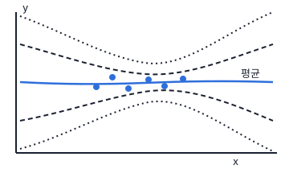

# 복습문제 8선 — 1007 수업 범위

교과서 본문 예제를 바꾼 문제 **5개**와 6장 연습문제 **3개**예요. 먼저 풀어 보고, 막히면 힌트를 열어 보세요.

> `복습문제_1007_Product_of_Gaussians.html`를 마크다운으로 옮겼어요. 원문, 힌트, 풀이는 접혀 있어요. 먼저 풀어 보고 펼쳐 보세요.

**목차**

- [A. 교과서 예제 변형](#partA)
  - [P1. 사전분포가 만드는 함수들](#p1)
  - [P2. 한 점에서 본 함수값의 평균과 분산](#p2)
  - [P3. 사후분포로 그린 함수 그림 읽기](#p3)
  - [P4. 2차원 가우시안에서 한 변수만 보기](#p4)
  - [P5. 독립인 가우시안의 가중합 구하기](#p5)
- [B. 교과서 연습문제](#partB)
  - [P6. 가우시안 혼합의 차원별 주변분포](#p6)
  - [P7. 가우시안 혼합의 평균](#p7)
  - [P8. 두 가우시안 밀도의 곱: 완전제곱식으로 유도하기](#p8)

## A. 교과서 예제 변형

### P1. 사전분포가 만드는 함수들

5차 다항식으로 베이지안 선형회귀를 해요. 특징 함수는 $\boldsymbol{\phi}(x) = [1, x, x^2, x^3, x^4, x^5]^\top$이고, 함수는 $f(x) = \boldsymbol{\theta}^\top\boldsymbol{\phi}(x)$예요. 파라미터 사전분포는 $p(\boldsymbol{\theta}) = \mathcal{N}\left(\mathbf{0}, \frac{1}{4}\mathbf{I}\right)$로 골라요. 입력 $x_* \in [-5, 5]$에서 200개 점을 골라 특징 함수를 적용하고, 노이즈 없는 함수값 $f(x_*) = \boldsymbol{\phi}(x_*)^\top\boldsymbol{\theta}$의 분포를 그림으로 그려요. 그림에는 평균 함수(선), 음영 두 겹(진한 회색 67%, 옅은 회색 95% 신뢰 구간), 그리고 사전분포에서 뽑은 함수 표본 몇 개가 있어요.

- (a) 함수 표본 하나를 얻는 두 단계를 적어 보세요.
- (b) 파라미터 벡터 $\boldsymbol{\theta}$는 몇 차원인가요?
- (c) 그림의 음영(불확실성)은 어디에서 오나요?

교과서 원문 보기

"A function sample is obtained by first sampling a parameter vector $\boldsymbol{\theta}_i \sim p(\boldsymbol{\theta})$ and then computing $f_i(\cdot) = \boldsymbol{\theta}_i^\top\boldsymbol{\phi}(\cdot)$." — Example 9.7

힌트 보기

함수는 $\boldsymbol{\theta}$ 하나만 정해지면 통째로 정해져요. 그리고 이 그림의 함수값에는 측정 노이즈 $\epsilon$이 더해지지 않았어요.

풀이 보기

1. 함수 $f(x) = \boldsymbol{\theta}^\top\boldsymbol{\phi}(x)$에서 랜덤한 것은 $\boldsymbol{\theta}$뿐이에요. $\boldsymbol{\phi}(x)$는 $x$만 알면 정해지는 값이에요.
2. (a) 그래서 먼저 사전분포에서 파라미터 벡터 하나를 뽑아요.

   $$
   \boldsymbol{\theta}_i \sim p(\boldsymbol{\theta}) = \mathcal{N}\left(\mathbf{0}, \frac{1}{4}\mathbf{I}\right)
   $$

   다음으로 이 값을 넣어 함수 하나를 만들어요.

   $$
   f_i(\cdot) = \boldsymbol{\theta}_i^\top\boldsymbol{\phi}(\cdot)
   $$

   200개 입력 $x_*$마다 $\boldsymbol{\theta}_i^\top\boldsymbol{\phi}(x_*)$를 계산해 이으면 곡선 하나가 돼요.
3. (b) $\boldsymbol{\phi}(x) = [1, x, x^2, x^3, x^4, x^5]^\top$의 성분은 상수항부터 $x^5$까지 6개예요. 내적 $\boldsymbol{\theta}^\top\boldsymbol{\phi}(x)$가 되려면 $\boldsymbol{\theta}$도 같은 크기여야 해요. 그래서 $\boldsymbol{\theta} \in \mathbb{R}^6$, 6차원이에요.
4. (c) 여기서 그린 것은 노이즈 없는 함수값 $f(x_*) = \boldsymbol{\phi}(x_*)^\top\boldsymbol{\theta}$예요. 노이즈 분산 $\sigma^2$이 들어가지 않아요.
5. 남은 랜덤한 재료는 $\boldsymbol{\theta}$ 하나뿐이에요. 따라서 음영의 불확실성은 모두 파라미터 $\boldsymbol{\theta}$의 불확실성에서 와요.

**정답:** (a) $\boldsymbol{\theta}_i \sim p(\boldsymbol{\theta})$를 뽑고 $f_i(\cdot) = \boldsymbol{\theta}_i^\top\boldsymbol{\phi}(\cdot)$를 계산해요. (b) $\boldsymbol{\theta} \in \mathbb{R}^6$, 6차원이에요. (c) 노이즈 없는 함수값이라서 음영은 파라미터 불확실성에서만 와요.

---

### P2. 한 점에서 본 함수값의 평균과 분산

5차 다항식으로 베이지안 선형회귀를 해요. 특징 함수는 $\boldsymbol{\phi}(x) = [1, x, x^2, x^3, x^4, x^5]^\top$이에요. 파라미터 사전분포는 $p(\boldsymbol{\theta}) = \mathcal{N}\left(\mathbf{0}, \frac{1}{2}\mathbf{I}\right)$로 골라요. 노이즈 없는 함수값은 $f(x_*) = \boldsymbol{\phi}(x_*)^\top\boldsymbol{\theta}$예요.

$f(x_*)$의 평균과 분산을 $x_* = 0$일 때와 $x_* = 1$일 때 각각 구해 보세요.

교과서 원문 보기

"Let us consider a Bayesian linear regression problem with polynomials of degree 5. We choose a parameter prior $p(\boldsymbol{\theta}) = \mathcal{N}\left(\mathbf{0}, \frac{1}{4}\mathbf{I}\right)$." — Example 9.7

힌트 보기

$x_*$를 고정하면 행벡터 $\boldsymbol{\phi}(x_*)^\top$는 상수예요. 이걸 $\mathbf{A}$로 보면 $f(x_*) = \mathbf{A}\boldsymbol{\theta}$는 아핀 변환이에요.

풀이 보기

1. $x_*$를 고정하면 $\mathbf{A} = \boldsymbol{\phi}(x_*)^\top$ ($1 \times 6$ 행벡터), $\mathbf{b} = 0$으로 놓을 수 있어요. 그러면 $f(x_*) = \mathbf{A}\boldsymbol{\theta} + \mathbf{b}$예요.
2. 평균은 $E[\mathbf{A}\mathbf{X} + \mathbf{b}] = \mathbf{A}E[\mathbf{X}] + \mathbf{b}$로 구해요.

   $$
   E[f(x_*)] = \boldsymbol{\phi}(x_*)^\top E[\boldsymbol{\theta}] = \boldsymbol{\phi}(x_*)^\top\mathbf{0} = 0
   $$

   어느 $x_*$에서든 평균은 0이에요.
3. 분산은 $\mathbf{A}\Sigma_{\mathbf{X}}\mathbf{A}^\top$로 구해요. $\Sigma_{\boldsymbol{\theta}} = \frac{1}{2}\mathbf{I}$이니까

   $$
   \mathrm{var}[f(x_*)] = \boldsymbol{\phi}(x_*)^\top\left(\frac{1}{2}\mathbf{I}\right)\boldsymbol{\phi}(x_*) = \frac{1}{2}\boldsymbol{\phi}(x_*)^\top\boldsymbol{\phi}(x_*) = \frac{1}{2}\sum_{k=0}^{5} x_*^{2k}
   $$
4. $x_* = 0$이면 $\boldsymbol{\phi}(0) = [1, 0, 0, 0, 0, 0]^\top$이라서 $\boldsymbol{\phi}(0)^\top\boldsymbol{\phi}(0) = 1$이에요.

   $$
   \mathrm{var}[f(0)] = \frac{1}{2} \cdot 1 = \frac{1}{2}
   $$
5. $x_* = 1$이면 $\boldsymbol{\phi}(1) = [1, 1, 1, 1, 1, 1]^\top$이라서 $\boldsymbol{\phi}(1)^\top\boldsymbol{\phi}(1) = 6$이에요.

   $$
   \mathrm{var}[f(1)] = \frac{1}{2} \cdot 6 = 3
   $$
6. 가우시안의 아핀 변환은 가우시안이니까 $p(f(0)) = \mathcal{N}\left(0, \frac{1}{2}\right)$, $p(f(1)) = \mathcal{N}(0, 3)$이에요.

**정답:** 평균은 두 점 모두 $E[f(x_*)] = 0$이에요. 분산은 $\mathrm{var}[f(0)] = \frac{1}{2}$, $\mathrm{var}[f(1)] = 3$이에요.

---

### P3. 사후분포로 그린 함수 그림 읽기

5차 다항식과 사전분포 $p(\boldsymbol{\theta}) = \mathcal{N}\left(\mathbf{0}, \frac{1}{4}\mathbf{I}\right)$로 베이지안 선형회귀(BLR)를 해요. 훈련 데이터 $\mathbf{X}, \mathbf{y}$를 보고 나면 파라미터 사후분포 $p(\boldsymbol{\theta} \mid \mathbf{X}, \mathbf{y})$를 얻어요. 이 사후분포는 가우시안 $\mathcal{N}(\boldsymbol{\theta} \mid \mathbf{m}_N, \mathbf{S}_N)$이에요. 결과 그림은 세 칸이에요. (a)는 훈련 데이터, (b)는 함수 위의 사후분포, (c)는 곡선 여러 개를 겹쳐 그린 그림이에요. (b)에는 최대가능도 추정으로 얻은 함수(MLE), MAP 추정으로 얻은 함수(MAP), BLR의 평균 함수가 선으로 있고, 그 둘레에 음영이 두 겹(진한 회색, 옅은 회색) 있어요.

*그림 (b)를 간단히 그린 것이에요. 색칠된 점은 훈련 데이터, 실선은 BLR 평균 함수예요. 긴 점선은 진한 음영의 경계, 짧은 점선은 옅은 음영의 경계예요.*

- (a) MAP 추정으로 얻은 함수 $\boldsymbol{\theta}_{\mathrm{MAP}}^\top\boldsymbol{\phi}(\cdot)$는 BLR에서 무엇과 같나요?
- (b) 그림 (b)의 음영 두 겹은 무엇을 뜻하나요?
- (c) 그림 (c)의 곡선 여러 개는 무엇을 보여 주나요?

교과서 원문 보기

"The function we obtain using the MAP estimate also corresponds to the posterior mean function" — Example 9.8

힌트 보기

가우시안은 평균에서 가장 높아요. 그리고 $\boldsymbol{\phi}(x_*)^\top\boldsymbol{\theta}$의 평균은 아핀 변환의 평균 공식으로 구할 수 있어요.

풀이 보기

1. (a) MAP 추정값은 사후분포 $p(\boldsymbol{\theta} \mid \mathbf{X}, \mathbf{y})$를 가장 크게 하는 $\boldsymbol{\theta}$예요. 이 사후분포는 가우시안 $\mathcal{N}(\boldsymbol{\theta} \mid \mathbf{m}_N, \mathbf{S}_N)$이고, 가우시안은 평균에서 가장 높아요. 그래서 $\boldsymbol{\theta}_{\mathrm{MAP}} = \mathbf{m}_N$이에요.
2. BLR의 평균 함수는 각 $x_*$에서 $\boldsymbol{\phi}(x_*)^\top\boldsymbol{\theta}$의 평균이에요. 아핀 변환의 평균 공식으로

   $$
   E[\boldsymbol{\phi}(x_*)^\top\boldsymbol{\theta} \mid \mathbf{X}, \mathbf{y}] = \boldsymbol{\phi}(x_*)^\top\mathbf{m}_N = \boldsymbol{\theta}_{\mathrm{MAP}}^\top\boldsymbol{\phi}(x_*)
   $$

   그러니 MAP 함수는 BLR의 사후 평균 함수와 같아요. 사전분포를 쓰지 않는 MLE 함수 $\boldsymbol{\theta}_{\mathrm{ML}}^\top\boldsymbol{\phi}(\cdot)$는 이것과 다를 수 있어요.
3. (b) 음영은 함수값이 얼마나 불확실한지 보여 줘요. 교과서는 진한 회색을 67%, 옅은 회색을 95% 예측 신뢰 구간이라고 적어요. 평균에서 표준편차 1배(1σ), 2배(2σ)만큼 벌린 구간이에요. 데이터가 있는 가운데에서는 좁고 양 끝으로 갈수록 넓어져요.
4. (c) BLR은 함수 하나가 아니라 함수 위의 분포를 줘요. 그림 (c)의 곡선들은 이 사후분포 아래에서 그럴듯한 함수 표본(realization)들이에요.
5. 곡선 하나는 사후분포에서 파라미터 $\boldsymbol{\theta}_i \sim p(\boldsymbol{\theta} \mid \mathbf{X}, \mathbf{y})$를 뽑아 $\boldsymbol{\theta}_i^\top\boldsymbol{\phi}(\cdot)$로 만든 것이에요. 데이터가 있는 곳에서는 곡선들이 서로 가깝고, 양 끝에서는 많이 벌어져요.

**정답:** (a) MAP 함수는 BLR의 사후 평균 함수 $\mathbf{m}_N^\top\boldsymbol{\phi}(\cdot)$와 같아요. (b) 진한 음영은 67%, 옅은 음영은 95% 예측 신뢰 구간이에요. (c) 함수 위의 사후분포에서 나온 그럴듯한 함수 표본들이에요.

---

### P4. 2차원 가우시안에서 한 변수만 보기

두 변수 $x_1, x_2$의 결합분포가 2차원 가우시안이에요.

$$
p(x_1, x_2) = \mathcal{N}\left(\left[\begin{matrix}1 \\ 2\end{matrix}\right], \left[\begin{matrix}0.5 \\ -1\end{matrix}\;\;\begin{matrix}-1 \\ 4\end{matrix}\right]\right)
$$

결합 가우시안에서 한 변수만 남긴 주변분포는 가우시안이고, 평균은 평균 벡터의 해당 성분, 분산은 공분산 행렬의 해당 대각 성분이라고 알려져 있어요. 그대로 써도 돼요.

$x_2$를 적분해서 없앤 주변분포 $p(x_1)$을 구해 보세요.

교과서 원문 보기

"The marginal distribution $p(x_1)$, in contrast, can be obtained by applying (6.68)" — Example 6.6

힌트 보기

결합 가우시안의 주변분포도 가우시안이에요. 평균 벡터와 공분산 행렬에서 $x_1$에 해당하는 칸만 읽으면 돼요.

풀이 보기

1. 결합 가우시안을 주변화해도 가우시안이에요. 그래서 $p(x_1)$은 평균과 분산만 정하면 돼요.
2. 평균 벡터 $E[\mathbf{x}] = [E[x_1], E[x_2]]^\top$의 첫 성분이 $x_1$의 평균이에요. $E[x_1] = 1$이에요.
3. 공분산 행렬의 대각 성분은 각 변수의 분산이에요. $(1,1)$ 성분이 $\mathrm{cov}(x_1, x_1) = \mathrm{var}[x_1] = 0.5$예요.
4. 비대각 성분 $-1$은 $x_1$과 $x_2$의 관계를 나타내요. $x_2$를 적분해 없애면 이 관계는 $x_1$만의 분포에 남지 않아요.
5. 따라서

   $$
   p(x_1) = \mathcal{N}(1, 0.5)
   $$

**정답:** $p(x_1) = \mathcal{N}(1, 0.5)$

---

### P5. 독립인 가우시안의 가중합 구하기

서로 독립인 두 가우시안 확률변수가 있어요.

$$
x \sim \mathcal{N}(1, 2), \qquad y \sim \mathcal{N}(-1, 3)
$$

상수 $a = 2$, $b = -1$로 가중합 $ax + by = 2x - y$를 만들어요.

$2x - y$의 분포를 구해 보세요. 평균과 분산을 함께 적어 보세요.

교과서 원문 보기

"Since expectations are linear operations, we can obtain the weighted sum of independent Gaussian random variables" — Example 6.7

힌트 보기

독립인 가우시안의 합은 가우시안이에요. 평균은 상수가 그대로 나오고, 분산은 상수가 제곱해서 나와요.

풀이 보기

1. $2x$와 $-y$는 각각 가우시안의 상수배라서 가우시안이고, 서로 독립이에요. 독립인 가우시안의 합도 가우시안이니까 $2x - y$는 가우시안이에요. 평균과 분산만 구하면 돼요.
2. 기댓값은 선형이에요.

   $$
   E[2x - y] = 2E[x] - E[y] = 2 \cdot 1 - (-1) = 3
   $$
3. 상수배는 분산에서 제곱해서 나와요. $\mathrm{var}[2x] = 2^2 \cdot 2 = 8$, $\mathrm{var}[-y] = (-1)^2 \cdot 3 = 3$이에요.
4. $x$와 $y$가 독립이라 공분산이 0이에요. 그래서 합의 분산은 분산의 합이에요.

   $$
   \mathrm{var}[2x - y] = a^2\sigma_x^2 + b^2\sigma_y^2 = 8 + 3 = 11
   $$
5. 따라서

   $$
   2x - y \sim \mathcal{N}(3, 11)
   $$

**정답:** $2x - y \sim \mathcal{N}(3, 11)$ (평균 $3$, 분산 $11$)

---

## B. 교과서 연습문제

### P6. 가우시안 혼합의 차원별 주변분포

두 가우시안을 섞은 2차원 분포 $\mathbf{x} = [x_1, x_2]^\top$가 있어요.

$$
p(\mathbf{x}) = 0.4\,\mathcal{N}\left(\left[\begin{matrix}10 \\ 2\end{matrix}\right], \left[\begin{matrix}1 \\ 0\end{matrix}\;\;\begin{matrix}0 \\ 1\end{matrix}\right]\right) + 0.6\,\mathcal{N}\left(\left[\begin{matrix}0 \\ 0\end{matrix}\right], \left[\begin{matrix}8.4 \\ 2.0\end{matrix}\;\;\begin{matrix}2.0 \\ 1.7\end{matrix}\right]\right)
$$

이 식은 성분 가우시안 둘을 $p_1(\mathbf{x})$, $p_2(\mathbf{x})$라 할 때 $p(\mathbf{x}) = 0.4\,p_1(\mathbf{x}) + 0.6\,p_2(\mathbf{x})$라는 뜻이에요. $\mathbf{x}$가 40% 확률로 첫째 성분에서, 60% 확률로 둘째 성분에서 나온다는 말이에요. 이런 가중합에 대한 적분과 기댓값은 각 성분에 대한 적분과 기댓값의 가중합으로 나뉘어요. 결합 가우시안에서 한 변수만 남긴 주변분포는 가우시안이고, 평균은 평균 벡터의 해당 성분, 분산은 공분산 행렬의 해당 대각 성분이라고 알려져 있어요. 그대로 써도 돼요.

각 차원의 주변분포 $p(x_1)$과 $p(x_2)$를 구해 보세요.

교과서 원문 보기

"Consider a mixture of two Gaussian distributions" … "a. Compute the marginal distributions for each dimension." — Exercise 6.2

힌트 보기

적분은 합과 상수배를 그대로 통과시켜요. 그러면 성분 가우시안 하나씩 주변화하면 되고, 각각은 평균과 대각 분산만 읽으면 돼요.

풀이 보기

1. $p(x_1)$은 $x_2$를 적분해서 얻어요. 적분은 선형이라서 가중치가 그대로 밖으로 나와요.

   $$
   p(x_1) = \int p(\mathbf{x})\,dx_2 = 0.4\int \mathcal{N}_1(\mathbf{x})\,dx_2 + 0.6\int \mathcal{N}_2(\mathbf{x})\,dx_2
   $$

   여기서 $\mathcal{N}_1$, $\mathcal{N}_2$는 첫째, 둘째 성분 가우시안이에요.
2. 결합 가우시안을 주변화하면 가우시안이고, 평균 벡터의 해당 성분과 공분산 행렬의 해당 대각 성분을 그대로 가져와요.
3. 첫째 성분에서 $x_1$의 평균은 $10$, 분산은 $1$이에요. 둘째 성분에서는 평균 $0$, 분산 $8.4$예요. 그래서

   $$
   p(x_1) = 0.4\,\mathcal{N}(10, 1) + 0.6\,\mathcal{N}(0, 8.4)
   $$
4. $x_2$도 같은 방법으로 $x_1$을 적분해요. 첫째 성분에서 평균 $2$, 분산 $1$, 둘째 성분에서 평균 $0$, 분산 $1.7$이에요. 그래서

   $$
   p(x_2) = 0.4\,\mathcal{N}(2, 1) + 0.6\,\mathcal{N}(0, 1.7)
   $$
5. 비대각 성분 $2.0$은 $x_1$과 $x_2$의 관계라서 한 차원만 남긴 주변분포에는 들어가지 않아요. 두 결과 모두 가중치 합이 $0.4 + 0.6 = 1$이라 확률분포가 맞아요.

**정답:** $p(x_1) = 0.4\,\mathcal{N}(10, 1) + 0.6\,\mathcal{N}(0, 8.4)$, $p(x_2) = 0.4\,\mathcal{N}(2, 1) + 0.6\,\mathcal{N}(0, 1.7)$

---

### P7. 가우시안 혼합의 평균

두 가우시안을 섞은 2차원 분포 $\mathbf{x} = [x_1, x_2]^\top$가 있어요.

$$
p(\mathbf{x}) = 0.4\,\mathcal{N}\left(\left[\begin{matrix}10 \\ 2\end{matrix}\right], \left[\begin{matrix}1 \\ 0\end{matrix}\;\;\begin{matrix}0 \\ 1\end{matrix}\right]\right) + 0.6\,\mathcal{N}\left(\left[\begin{matrix}0 \\ 0\end{matrix}\right], \left[\begin{matrix}8.4 \\ 2.0\end{matrix}\;\;\begin{matrix}2.0 \\ 1.7\end{matrix}\right]\right)
$$

이 식은 성분 가우시안 둘을 $p_1(\mathbf{x})$, $p_2(\mathbf{x})$라 할 때 $p(\mathbf{x}) = 0.4\,p_1(\mathbf{x}) + 0.6\,p_2(\mathbf{x})$라는 뜻이에요. $\mathbf{x}$가 40% 확률로 첫째 성분에서, 60% 확률로 둘째 성분에서 나온다는 말이에요. 이런 가중합에 대한 적분과 기댓값은 각 성분에 대한 적분과 기댓값의 가중합으로 나뉘어요.

- (a) 각 차원의 평균 $E[x_1]$, $E[x_2]$를 구해 보세요.
- (b) 2차원 분포의 평균 벡터 $E[\mathbf{x}]$를 적어 보세요.

교과서 원문 보기

"Consider a mixture of two Gaussian distributions" … "Compute the mean" — Exercise 6.2

힌트 보기

$E[\mathbf{x}] = \int \mathbf{x}\,p(\mathbf{x})\,d\mathbf{x}$에 혼합식을 넣으면 적분이 두 개로 나뉘어요. 각 적분은 성분 가우시안의 평균이에요.

풀이 보기

1. 평균의 정의에 혼합식을 넣고, 적분의 선형성으로 나눠요.

   $$
   E[\mathbf{x}] = \int \mathbf{x}\,p(\mathbf{x})\,d\mathbf{x} = 0.4\int \mathbf{x}\,\mathcal{N}_1(\mathbf{x})\,d\mathbf{x} + 0.6\int \mathbf{x}\,\mathcal{N}_2(\mathbf{x})\,d\mathbf{x}
   $$
2. 각 적분은 성분 가우시안의 평균 벡터예요. 그래서

   $$
   E[\mathbf{x}] = 0.4\left[\begin{matrix}10 \\ 2\end{matrix}\right] + 0.6\left[\begin{matrix}0 \\ 0\end{matrix}\right]
   $$
3. (a) 랜덤 벡터의 평균은 성분마다 평균이에요. 성분별로 계산하면

   $$
   E[x_1] = 0.4 \cdot 10 + 0.6 \cdot 0 = 4
   $$

   $$
   E[x_2] = 0.4 \cdot 2 + 0.6 \cdot 0 = 0.8
   $$
4. (b) 두 값을 세로로 모으면 평균 벡터예요.

   $$
   E[\mathbf{x}] = [4, 0.8]^\top
   $$

**정답:** (a) $E[x_1] = 4$, $E[x_2] = 0.8$ (b) $E[\mathbf{x}] = [4, 0.8]^\top$

---

### P8. 두 가우시안 밀도의 곱: 완전제곱식으로 유도하기

$\mathbf{x} \in \mathbb{R}^D$에 대한 두 가우시안 밀도 $\mathcal{N}(\mathbf{x} \mid \mathbf{a}, \mathbf{A})$와 $\mathcal{N}(\mathbf{x} \mid \mathbf{b}, \mathbf{B})$가 있어요. $\mathbf{A}$, $\mathbf{B}$는 공분산 행렬이라 대칭이고 역행렬이 있어요. $\mathbf{A}^{-1} + \mathbf{B}^{-1}$도 대칭이고 양의 정부호(그래서 역행렬이 있음)라는 사실은 그대로 써도 돼요. 두 밀도의 곱은 정규화되지 않은 가우시안이에요.

$$
\mathcal{N}(\mathbf{x} \mid \mathbf{a}, \mathbf{A})\,\mathcal{N}(\mathbf{x} \mid \mathbf{b}, \mathbf{B}) \propto \mathcal{N}(\mathbf{x} \mid \mathbf{c}, \mathbf{C})
$$

여기서 $\propto$는 "$\mathbf{x}$와 무관한 상수 배를 빼면 같다"는 뜻이에요.

완전제곱식을 만들어서 아래 두 식이 성립함을 보여 보세요.

$$
\mathbf{C} = (\mathbf{A}^{-1} + \mathbf{B}^{-1})^{-1}
$$

$$
\mathbf{c} = \mathbf{C}(\mathbf{A}^{-1}\mathbf{a} + \mathbf{B}^{-1}\mathbf{b})
$$

교과서 원문 보기

"The product of two Gaussians $\mathcal{N}(\mathbf{x} \mid \mathbf{a}, \mathbf{A})\,\mathcal{N}(\mathbf{x} \mid \mathbf{b}, \mathbf{B})$ is an unnormalized Gaussian distribution" … "a. By completing the square" — Exercise 6.10

힌트 보기

지수 안을 $\mathbf{x}^\top\mathbf{M}\mathbf{x} - 2\mathbf{v}^\top\mathbf{x} + \text{상수}$ 꼴로 묶어 보세요. 교과서에는 이런 꼴을 완전제곱식으로 바꾸는 방법이 정리되어 있어요. $\mathbf{M}$이 대칭이고 양의 정부호이면

$$
\mathbf{x}^\top\mathbf{M}\mathbf{x} - 2\mathbf{v}^\top\mathbf{x} + \text{상수}_1 = (\mathbf{x} - \boldsymbol{\mu})^\top\mathbf{M}(\mathbf{x} - \boldsymbol{\mu}) + \text{상수}_2
$$

이고, 이때

$$
\boldsymbol{\mu} = \mathbf{M}^{-1}\mathbf{v}
$$

예요. 스칼라 렘마 $\alpha x^2 - 2\beta x + \gamma \Rightarrow \mathcal{N}\left(\frac{\beta}{\alpha}, \frac{1}{\alpha}\right)$에서 $\alpha$가 $\mathbf{M}$, $\beta$가 $\mathbf{v}$로 바뀐 모양이에요.

풀이 보기

1. $\mathbf{x}$와 무관한 앞쪽 상수는 버려요. 곱은 지수끼리 더한 것이에요.

   $$
   \mathcal{N}(\mathbf{x} \mid \mathbf{a}, \mathbf{A})\,\mathcal{N}(\mathbf{x} \mid \mathbf{b}, \mathbf{B}) \propto \exp\left(-\frac{1}{2}\Big[(\mathbf{x} - \mathbf{a})^\top\mathbf{A}^{-1}(\mathbf{x} - \mathbf{a}) + (\mathbf{x} - \mathbf{b})^\top\mathbf{B}^{-1}(\mathbf{x} - \mathbf{b})\Big]\right)
   $$
2. 첫째 이차형식을 펼쳐요. $\mathbf{A}^{-1}$이 대칭이라 $\mathbf{x}^\top\mathbf{A}^{-1}\mathbf{a} = \mathbf{a}^\top\mathbf{A}^{-1}\mathbf{x}$예요.

   $$
   (\mathbf{x} - \mathbf{a})^\top\mathbf{A}^{-1}(\mathbf{x} - \mathbf{a}) = \mathbf{x}^\top\mathbf{A}^{-1}\mathbf{x} - 2(\mathbf{A}^{-1}\mathbf{a})^\top\mathbf{x} + \mathbf{a}^\top\mathbf{A}^{-1}\mathbf{a}
   $$

   둘째도 같은 꼴이에요.

   $$
   (\mathbf{x} - \mathbf{b})^\top\mathbf{B}^{-1}(\mathbf{x} - \mathbf{b}) = \mathbf{x}^\top\mathbf{B}^{-1}\mathbf{x} - 2(\mathbf{B}^{-1}\mathbf{b})^\top\mathbf{x} + \mathbf{b}^\top\mathbf{B}^{-1}\mathbf{b}
   $$
3. 더해서 묶어요. $\boldsymbol{\Lambda} = \mathbf{A}^{-1} + \mathbf{B}^{-1}$, $\boldsymbol{\eta} = \mathbf{A}^{-1}\mathbf{a} + \mathbf{B}^{-1}\mathbf{b}$로 두면

   $$
   [\cdots] = \mathbf{x}^\top\boldsymbol{\Lambda}\mathbf{x} - 2\boldsymbol{\eta}^\top\mathbf{x} + \gamma
   $$

   이고, 상수항은

   $$
   \gamma = \mathbf{a}^\top\mathbf{A}^{-1}\mathbf{a} + \mathbf{b}^\top\mathbf{B}^{-1}\mathbf{b}
   $$

   스칼라 렘마의 $\alpha$ 자리에 $\boldsymbol{\Lambda}$, $\beta$ 자리에 $\boldsymbol{\eta}$가 왔어요.
4. 완전제곱식을 만들어요. $\mathbf{m} = \boldsymbol{\Lambda}^{-1}\boldsymbol{\eta}$로 두고 펼쳐 봐요. $\boldsymbol{\Lambda}$가 대칭이라 $\mathbf{m}^\top\boldsymbol{\Lambda} = \boldsymbol{\eta}^\top$이에요.

   $$
   (\mathbf{x} - \mathbf{m})^\top\boldsymbol{\Lambda}(\mathbf{x} - \mathbf{m}) = \mathbf{x}^\top\boldsymbol{\Lambda}\mathbf{x} - 2\boldsymbol{\eta}^\top\mathbf{x} + \boldsymbol{\eta}^\top\boldsymbol{\Lambda}^{-1}\boldsymbol{\eta}
   $$

   그래서 같은 수를 더하고 빼면

   $$
   \mathbf{x}^\top\boldsymbol{\Lambda}\mathbf{x} - 2\boldsymbol{\eta}^\top\mathbf{x} + \gamma = (\mathbf{x} - \mathbf{m})^\top\boldsymbol{\Lambda}(\mathbf{x} - \mathbf{m}) + \left(\gamma - \boldsymbol{\eta}^\top\boldsymbol{\Lambda}^{-1}\boldsymbol{\eta}\right)
   $$
5. 괄호 안 상수는 $\mathbf{x}$와 무관하니 앞쪽 상수로 넘겨요.

   $$
   \mathcal{N}(\mathbf{x} \mid \mathbf{a}, \mathbf{A})\,\mathcal{N}(\mathbf{x} \mid \mathbf{b}, \mathbf{B}) \propto \exp\left(-\frac{1}{2}(\mathbf{x} - \mathbf{m})^\top\boldsymbol{\Lambda}(\mathbf{x} - \mathbf{m})\right)
   $$
6. 가우시안 PDF의 지수 $-\frac{1}{2}(\mathbf{x} - \boldsymbol{\mu})^\top\Sigma^{-1}(\mathbf{x} - \boldsymbol{\mu})$와 맞춰 보면 $\Sigma^{-1} = \boldsymbol{\Lambda}$, $\boldsymbol{\mu} = \mathbf{m}$이에요. 그러니

   $$
   \mathbf{C} = \boldsymbol{\Lambda}^{-1} = (\mathbf{A}^{-1} + \mathbf{B}^{-1})^{-1}
   $$

   $$
   \mathbf{c} = \mathbf{m} = \boldsymbol{\Lambda}^{-1}\boldsymbol{\eta} = \mathbf{C}(\mathbf{A}^{-1}\mathbf{a} + \mathbf{B}^{-1}\mathbf{b})
   $$
7. 1차원으로 확인해요. $\mathbf{A} = \nu_0$, $\mathbf{B} = \nu_1$, $\mathbf{a} = \mu_0$, $\mathbf{b} = \mu_1$을 넣으면

   $$
   C = \left(\frac{1}{\nu_0} + \frac{1}{\nu_1}\right)^{-1} = \frac{\nu_0\nu_1}{\nu_0 + \nu_1}
   $$

   $$
   c = \frac{\nu_0\nu_1}{\nu_0 + \nu_1}\left(\frac{\mu_0}{\nu_0} + \frac{\mu_1}{\nu_1}\right) = \frac{\nu_1\mu_0 + \nu_0\mu_1}{\nu_0 + \nu_1}
   $$

   스칼라 곱 공식과 같은 결과가 나와요.

**정답:** $\mathbf{C} = (\mathbf{A}^{-1} + \mathbf{B}^{-1})^{-1}$, $\mathbf{c} = \mathbf{C}(\mathbf{A}^{-1}\mathbf{a} + \mathbf{B}^{-1}\mathbf{b})$

---

출처: Deisenroth, Faisal, Ong, *Mathematics for Machine Learning* (Cambridge University Press, 2020). 풀이는 자체 작성이며 수치는 Python으로 검증했습니다.
