# 가우시안의 곱과 베이지안 선형회귀 — 5살도 이해하는 정리노트

정방철 교수님 머신러닝기초 · 1007 수업 (Lecture04 s5–s15, MML 6.4–6.5절 · 9.3절)

> `정리노트_1007_Product_of_Gaussians.html`를 마크다운으로 옮겼어요. 그림은 `figures_1007/` 폴더의 SVG, 위젯은 대표 설정의 정적 그림으로 바꿨어요. 수식은 `$…$` / `$$…$$`라서 GitHub, Obsidian, Typora에서 보여요.

**목차**

- [0. 큰 그림: 왜 베이지안인가](#s0)
  - [ML · MAP · 풀리 베이지안: 장군님께 보고하기](#s0-factory)
  - [특징 함수와 주인공](#s0-features)
  - [θ를 넣었다 빼기: 사후예측분포](#s0-predictive)
- [1. 재료 손질: 랜덤 벡터의 평균과 공분산](#s1)
  - [평균 벡터: 성분마다 평균](#s1-mean)
  - [분산은 공분산의 특수한 경우](#s1-covariance)
  - [아핀 변환과 이번 주 숙제](#s1-affine)
- [2. 가우시안 랜덤 벡터](#s2)
  - [가우시안 랜덤 벡터의 PDF](#s2-pdf)
  - [무엇을 해도 가우시안](#s2-closure)
- [3. 가우시안 밀도의 곱](#s3)
  - [렘마: 지수 안이 2차식이면 가우시안](#s3-lemma)
  - [두 가우시안의 곱: 스칼라 증명](#s3-product-scalar)
  - [행렬판 곱과 스칼라와의 대응](#s3-product-matrix)
- [4. 베이지안 선형회귀의 결론](#s4)
  - [사후분포도 가우시안이다](#s4-posterior)
  - [회색 띠는 불확실성](#s4-blr-figure)
- [5. 요약 · 예고](#s5)
  - [한 장 치트시트](#s5-cheatsheet)
  - [다음 시간 예고 (아직 안 배움)](#s5-next)
  - [함께 보면 좋은 자료](#s5-links)

## 0. 큰 그림: 왜 베이지안인가

### ML · MAP · 풀리 베이지안: 장군님께 보고하기

*1007 수업 · L04 s5 · L03 s22*

**먼저 큰 그림**

**오늘의 질문.** 데이터를 본 뒤의 파라미터 분포를 실제로 구하려 해요. 가우시안을 쓰면 이 계산을 평균과 공분산으로 정리할 수 있어요.

ML은 고정된 미지의 파라미터를 추정해요. MAP과 FB는 사전분포를 두지만, MAP은 최고점 하나를 고르고 FB는 분포 전체를 유지해요.

| 구분 | 무엇을 하나요? | 무엇이 남나요? |
|---|---|---|
| ML | 데이터의 우도 최대화 | 파라미터 하나 |
| MAP | 우도와 사전분포로 최고점 선택 | 파라미터 하나 |
| FB | 사후분포를 계산하고 예측에 반영 | 평균과 공분산을 포함한 분포 |

**구할 결과.** 가우시안 사후분포를 구하면 평균과 공분산이 핵심 결과예요. 이 경우에 한해 사후평균과 MAP 위치가 같아요.

오늘 외울 연결은 **지수의 이차항·일차항을 모으기 → 완전제곱으로 중심·퍼짐 읽기 → 두 가우시안의 곱에 대입**이에요. 뒤의 사후분포 예고도 이 결과를 재사용한다는 점을 연결해서 봐요.

**수식이 하는 일.** 우도와 사전분포의 곱을 펼치면 지수 안의 이차식이 돼요. 완전제곱과 계수 비교로 새 가우시안의 평균·공분산을 읽으려는 것이 오늘 계산의 목적이에요.

**헷갈리기 쉬운 점.** 파라미터에 관한 가우시안들의 곱은 정규화 상수를 제외하면 가우시안 모양이에요. 곱 자체가 이미 적분값 1인 밀도라고 가정하면 안 돼요.

이어서 읽기: [θ를 넣었다 빼기: 사후예측분포](#s0-predictive) · [행렬판 곱과 스칼라와의 대응](#s3-product-matrix) · [사후분포도 가우시안이다](#s4-posterior)

**쉽게 말하면**

곡선을 통째로 만들어 두면, 장군님이 원할 때 답 하나도 언제든 뽑아 드릴 수 있어요.

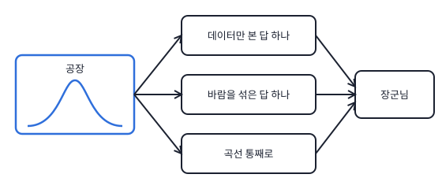

*곡선을 만드는 쪽이 공장이고, 답 하나는 거기서 찍어 낸 물건이에요.*

**정확히 말하면**

선형회귀의 파라미터 $\boldsymbol{\theta}$를 다루는 방법은 세 가지예요. 앞의 둘은 지난 수업(L03 s9–s26)에서 배웠어요.

- **ML**(maximum likelihood): 데이터만 보고 $\boldsymbol{\theta}$ 값 하나를 정해요.

  $$
  \boldsymbol{\theta}_{\text{ML}} = \arg\max_{\boldsymbol{\theta}}\, p(\mathbf{y} \mid \mathbf{X}, \boldsymbol{\theta})
  $$
- **MAP**(maximum a posteriori): 데이터가 말하는 것에 "$\boldsymbol{\theta}$는 이랬으면 좋겠다"는 선호(prior) $p(\boldsymbol{\theta})$를 섞어 값 하나를 정해요(L03 s22).

  $$
  \boldsymbol{\theta}_{\text{MAP}} = \arg\min_{\boldsymbol{\theta}} \big(-\log p(\mathbf{y} \mid \mathbf{X}, \boldsymbol{\theta}) - \log p(\boldsymbol{\theta})\big)
  $$
- **풀리 베이지안**(fully Bayesian): 값 하나를 고르지 않고 PDF 자체를 분포로 유지해 예측에 반영해요. 넘기는 것은 처음 보는 입력 $\mathbf{x}_*$에 대한 예측의 PDF예요.

  $$
  p(y_* \mid \mathbf{x}_*, \mathbf{X}, \mathbf{y})
  $$

**왜 공장인가.** PDF를 통째로 가지고 있으면 값 하나는 거기서 언제든 뽑을 수 있어요.

- MAP은 파라미터 사후분포 $p(\boldsymbol{\theta} \mid \mathbf{X}, \mathbf{y})$가 가장 큰 $\boldsymbol{\theta}$예요.
- ML은 사전분포 없이 우도를 최대화해요. 사전밀도가 상수이면 MAP의 최적점도 ML과 같아져요. 무한한 공간의 상수 밀도는 정규화된 사전분포가 아닐 수 있어요.
- 사후분포를 알면 그 최고점으로 MAP을 얻을 수 있어요. ML과 MAP의 위치가 같아지는 것은 사전밀도가 상수여서 최적점에 영향을 주지 않는 등의 조건이 있을 때예요.

MAP은 파라미터 사후분포 $p(\boldsymbol\theta\mid\mathbf X,\mathbf y)$의 밀도가 최대가 되는 파라미터 위치예요.

**왜 가우시안인가.** 이번 수업의 선형 가우시안 모형은 사후분포와 예측분포를 닫힌 식으로 구할 수 있어요. 가우시안 밀도의 곱은 정규화 전 가우시안 모양이고, 결합 가우시안 벡터의 선형결합도 가우시안이에요. FB 자체가 가우시안 분포에 한정되는 것은 아니에요. 그 성질은 [무엇을 해도 가우시안](#s2-closure)에서 정리해요.

풀리 베이지안이 왜 결정을 유보하는지, ML과 MAP이 어떻게 포함 관계인지는 0930 수업에서 자세히 다뤘어요. 1007 수업은 그 내용을 "공장"이라는 한 단어로 다시 묶었어요.

**교수님 말씀**

**장군님께 보고하는 엔지니어.** 베이지안을 떠올릴 때마다 생각하라고 늘 말하는 그림이에요.

> "베이지안을 생각하면 장군님께 보고하는 엔지니어를 생각해라."

장군님이 단답형의 답을 원하면 결정을 내려 "입에다가 먹여줘야" 해요. 데이터만 중요하게 여기는 데이터 사이언티스트는 ML로, 내 선호를 절묘하게 섞고 싶은 사람은 MAP으로 그 답을 만들어요. 풀리 베이지안은 말로 다 표현할 수 없는 마음속의 "원함수" 자체를 원자료로 건네는 거예요.

**공장.**

> "풀리 베이지안 러닝을 해놓으면 … ML도 MAP도 만들어 낼 수 있거든. … 얘가 공장이야, 공장."

**가우시안은 첫사랑.** 교수님은 가우시안을 "첫사랑, 두 번째 사랑, 영원한 사랑, 마지막 사랑"이라고 불렀어요. 베이즈(Bayes)도 가우스(Gauss)도 사람 이름이에요. 베이즈는 규칙과 틀을 만들었고, 그 안의 확률밀도함수로는 주로 가우시안을 써요.

> "95.8% 정도의 확률로 … 가우시안 분포를 갖고 장난을 치고 있을 거다, 단언컨대."

> "가우시안이 아니면 분석이 잘 안 돼. 공장 만들기가 어렵단 말이야."

**왜 이렇게 어렵게 배우나.** 학부에서 선형회귀를 이 정도로 깊게 다루는 이유를 이렇게 말했어요.

> "이 정도를 할 줄 알아야 … 베이지안 머신러닝을 좀 해봤다라고 얘기할 수 있다."

요즘 대세가 베이지안이라는 말도 덧붙였어요. 의학 드라마에서 집도의가 약어로 "이거 줘, 저거 줘" 하듯, 전문가가 된다는 것은 그 분야의 용어, 논리 흐름, 관점, 관습에 익숙해지는 거라고 했어요. 머리가 쪼개질 듯한 경험을 수백 번 반복해야 그렇게 된대요. 이해가 안 되는 곳은 대개 예전 개념(확률및랜덤변수)이 흐릿해서 생기니, 수업 뒤 GPT나 Claude에게 물어보며 "프로액티브하게" 공부하라고 했어요.

중간고사 전에 여기까지 이해하는 데 필요한 수학 문제를 골라 숙제로 내고 풀어 주겠다고 했어요. 퀴즈는 보지 않기로 했어요.

**페이지 요약**

풀리 베이지안은 사후분포를 유지해 예측에 반영하고, MAP은 같은 사후분포에서 최고점 하나를 골라요.

*핵심 식*

- ML

  $$
  \boldsymbol{\theta}_{\text{ML}} = \arg\max_{\boldsymbol{\theta}}\, p(\mathbf{y} \mid \mathbf{X}, \boldsymbol{\theta})
  $$
- MAP

  $$
  \boldsymbol{\theta}_{\text{MAP}} = \arg\min_{\boldsymbol{\theta}} \big(-\log p(\mathbf{y} \mid \mathbf{X}, \boldsymbol{\theta}) - \log p(\boldsymbol{\theta})\big)
  $$
- 풀리 베이지안이 건네는 것

  $$
  p(y_* \mid \mathbf{x}_*, \mathbf{X}, \mathbf{y})
  $$

*용어*

- **풀리 베이지안(fully Bayesian)** — 값 하나 대신 PDF 자체를 원자료로 넘기는 방법
- **MAP(maximum a posteriori)** — 데이터에 선호(prior)를 섞어 정한 값 하나

#### 조건·구분

MAP은 출력의 사후예측분포가 아니라 파라미터 사후분포의 최고점이에요. 사전밀도가 상수여서 최적점에 영향이 없을 때 MAP과 ML이 같아지며, 무한 공간의 상수 밀도는 정규화된 prior가 아닐 수 있어요. 가우시안 사후분포인 이 경우에 평균과 MAP 위치가 같고, FB 자체가 가우시안에 한정되지는 않아요.

---

### 특징 함수와 주인공

*1007 수업 · L03 s17 · L04 s5*

**쉽게 말하면**

같은 셈이라도 누구를 주인공으로 보느냐에 따라 구불구불한 곡선이 되기도 하고 곧은 직선이 되기도 해요.

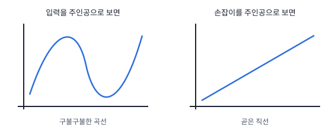

*손잡이 쪽에서 보면 곧은 직선이라서 다루기 쉬워요.*

**정확히 말하면**

가장 기본적인 선형회귀는 $y = \mathbf{x}^\top\boldsymbol{\theta} + \epsilon$이에요. 입력을 특징 함수(features) $\boldsymbol{\phi}(\cdot)$로 한 번 바꾸면 일반형이 돼요(L03 s17).

$$
y = \boldsymbol{\phi}(\mathbf{x})^\top\boldsymbol{\theta} + \epsilon, \qquad \epsilon \sim \mathcal{N}(0, \sigma^2)
$$

**다항 특징 예시.** 스칼라 입력 $x$를 4차원으로 올려요.

$$
\boldsymbol{\phi}(x) = [1, x, x^2, x^3]^\top \in \mathbb{R}^4, \qquad \boldsymbol{\theta} \in \mathbb{R}^4
$$

1. 내적을 풀어 쓰기:

   $$
   \boldsymbol{\phi}(x)^\top\boldsymbol{\theta} = \theta_1 + \theta_2 x + \theta_3 x^2 + \theta_4 x^3
   $$
2. $x$가 주인공(변수)이면 이 식은 $x$의 3차식이에요.
3. $\boldsymbol{\theta}$가 주인공이면 $1, x, x^2, x^3$은 모두 상수예요. 그래서 이 식은 $\boldsymbol{\theta}$에 대해 선형이에요.
4. 선형회귀(linear regression)의 "선형"은 $\boldsymbol{\theta}$에 대해 선형이라는 뜻이에요. $\boldsymbol{\phi}$가 비선형이어도 괜찮아요.

$\boldsymbol{\phi}$ 자리에는 다항식 말고도 가우시안, 지수, 로그, sigmoid 같은 함수를 쓸 수 있어요. 특징 함수만 바꾸면 여러 추론 문제를 같은 틀로 풀 수 있어요. (수업에서는 $\boldsymbol{\phi}$를 "polynomial kernel", "커널 함수"라고 불렀어요. 슬라이드 용어는 features(특징 함수)이고, 커널 방법의 kernel $k(\mathbf{x}, \mathbf{x}')$과는 다른 것이에요.)

**그래프 표현(칠판).** 식과 이 그림을 함께 떠올릴 수 있어야 해요.

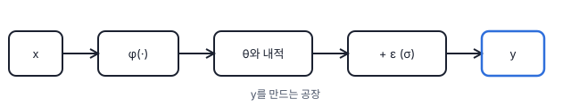

*입력 $\mathbf{x}$가 $\boldsymbol{\phi}(\cdot)$를 거쳐 $\boldsymbol{\theta}$와 내적되고, 표준편차 $\sigma$인 잡음 $\epsilon$이 더해져 $y$가 나와요.*

**결정적 모델에서 확률적 모델로.** 여기까지는 잡음을 빼면 결정적(deterministic) 모델이에요. $\boldsymbol{\theta}$를 랜덤 벡터로 만들고 prior를 줄 때 비로소 확률적(probabilistic) 머신러닝 모델이 돼요. 그 prior는 [θ를 넣었다 빼기: 사후예측분포](#s0-predictive)에서 이어져요.

(수업 중 $\boldsymbol{\theta}$를 "하이퍼파라미터"라고도 불렀지만, $\boldsymbol{\theta}$는 학습할 파라미터예요. 하이퍼파라미터는 prior의 $\mathbf{m}_0, \mathbf{S}_0$나 잡음의 $\sigma^2$ 같은 값이에요.)

**교수님 말씀**

**주인공이 중요하다.** "교수님, $x$ 도메인에서는 3차식인데요?"라는 질문을 스스로 던지고 이렇게 답했어요.

> "주인공이 중요하다니까. … 세타 입장에서는 이 x들이 … 상수 역할을 하는 거."

> "linear regression이라고 하면 이런 수식을 항상 기억해라."

특징 함수만 바꾸면 여러 문제를 풀 수 있으니, 선형회귀를 잘하면 웬만한 머신러닝을 다 이해한다고 했어요. 칠판의 그래프 그림을 보면 식이 떠오르고, 식을 보면 그림이 떠올라야 한다고도 했어요.

실제 대형 언어모델은 $\boldsymbol{\theta}$가 엄청나게 많고, 수업에서는 $4 \times 1$짜리로 설명한다고 했어요.

**페이지 요약**

특징 함수로 $x$의 3차식을 만들어도, $\boldsymbol{\theta}$를 주인공으로 보면 선형이라서 선형회귀예요.

*핵심 식*

- 선형회귀 모델

  $$
  y = \boldsymbol{\phi}(\mathbf{x})^\top\boldsymbol{\theta} + \epsilon, \qquad \epsilon \sim \mathcal{N}(0, \sigma^2)
  $$
- 다항 특징

  $$
  \boldsymbol{\phi}(x) = [1, x, x^2, x^3]^\top \in \mathbb{R}^4, \qquad \boldsymbol{\theta} \in \mathbb{R}^4
  $$

*용어*

- **특징 함수(features)** — 입력을 새 공간으로 올리는 함수, 비선형이어도 돼요
- **선형회귀(linear regression)** — $\boldsymbol{\theta}$에 대해 선형인 회귀 모델

#### 조건·구분

여기서 특징 함수 $\phi$와 커널 방법의 $k(\mathbf{x},\mathbf{x}^\prime)$는 달라요. $\boldsymbol{\theta}$는 학습 파라미터이며 prior의 $\mathbf{m}_0,\mathbf{S}_0$와 잡음의 $\sigma^2$가 하이퍼파라미터 쪽이에요.

---

### θ를 넣었다 빼기: 사후예측분포

*1007 수업 · L04 s5*

**쉽게 말하면**

숨은 손잡이를 잠깐 꺼내 계산을 돕게 하고 다시 모두 더해 넣으면, 답은 처음 그대로예요.

*헛걸음 같아도, 손잡이를 꺼내 둔 덕분에 계산할 길이 열려요.*

**정확히 말하면**

**모델(L04 s5).** 데이터와 상관없이 $\boldsymbol{\theta}$는 가우시안 랜덤 벡터에서 나왔다고 가정해요(prior).

$$
p(\boldsymbol{\theta}) = \mathcal{N}(\mathbf{m}_0, \mathbf{S}_0)
$$

$y$가 스칼라라서 가능도(likelihood)는 평균과 분산이 모두 스칼라인 1차원 가우시안이에요.

$$
p(y \mid \mathbf{x}, \boldsymbol{\theta}) = \mathcal{N}\big(y \mid \boldsymbol{\phi}(\mathbf{x})^\top\boldsymbol{\theta}, \sigma^2\big)
$$

**랜덤 벡터는 joint PDF예요.** 두 변수의 joint PDF $f_{X,Y}(x, y)$는 평면 위의 "부피"로 그려요. 모든 점에서 $0$ 이상이고, 전체 부피(이중 적분)는 $1$이에요. (joint PMF는 평면 위에 세운 막대기예요.) $X, Y$를 $x_1, x_2$로 바꿔 부르면 $\mathbf{x} = [x_1, x_2]^\top$의 PDF가 돼요. $\boldsymbol{\theta} \in \mathbb{R}^4$이면 4차원 공간의 joint PDF이고, 4중 적분하면 $1$이에요. 베이지안에서는 이 랜덤 벡터를 보통 가우시안으로 두어요. 평균과 분산만 알면 모양을 머릿속에 그릴 수 있어서예요.

**확률 기본식(칠판 복습).**

$$
P(A \mid B) = \frac{P(A, B)}{P(B)} \quad\Longleftrightarrow\quad P(A, B) = P(A \mid B)\,P(B)
$$

$$
\int f_{X,Y}(x, y)\,dx = f_Y(y)
$$

둘째 식이 주변화(marginalization)예요. $x$로 적분하면 $x$의 영향이 사라지고 $y$만 남아요.

**joint 분해(칠판).** 조건부확률의 정의를 두 번 써요.

$$
p(y, \boldsymbol{\theta} \mid \mathbf{x}) = \frac{p(\mathbf{x}, y, \boldsymbol{\theta})}{p(\mathbf{x})} = p(y \mid \mathbf{x}, \boldsymbol{\theta})\,p(\boldsymbol{\theta} \mid \mathbf{x})
$$

앞 인자는 가능도예요. 뒤 인자는 L03 s22의 가정(입력만 봐서는 $\boldsymbol{\theta}$에 대한 믿음이 바뀌지 않는다)으로 $p(\boldsymbol{\theta} \mid \mathbf{x}) = p(\boldsymbol{\theta})$가 돼요.

**목표.** 훈련 데이터 $(\mathbf{X}, \mathbf{y})$와 처음 보는 입력 $\mathbf{x}_*$가 주어졌을 때의 사후예측분포(posterior predictive distribution)를 구해요. 이 PDF를 통째로 건네면 fully Bayesian이에요.

$$
p(y_* \mid \mathbf{x}_*, \mathbf{X}, \mathbf{y})
$$

이 식에는 $\boldsymbol{\theta}$가 없어요. $\boldsymbol{\theta}$는 엔지니어가 $y$를 잘 추론하려고 만든 숨은 파라미터(hidden parameter)이고, 사용자는 이 확률만 궁금해요.

**하나 마나 한 짓.** 없던 $\boldsymbol{\theta}$를 넣고 주변화하면 원래 식으로 돌아와요.

$$
p(\mathbf{x}, y) = \int p(\mathbf{x}, y, \boldsymbol{\theta})\,d\boldsymbol{\theta}
$$

같은 방법을 목표 식에 써요.

1. $\boldsymbol{\theta}$를 넣고 주변화:

   $$
   p(y_* \mid \mathbf{x}_*, \mathbf{X}, \mathbf{y}) = \int p(y_*, \boldsymbol{\theta} \mid \mathbf{x}_*, \mathbf{X}, \mathbf{y})\,d\boldsymbol{\theta}
   $$
2. joint 분해:

   $$
   = \int p(y_* \mid \mathbf{x}_*, \boldsymbol{\theta}, \mathbf{X}, \mathbf{y})\,p(\boldsymbol{\theta} \mid \mathbf{x}_*, \mathbf{X}, \mathbf{y})\,d\boldsymbol{\theta}
   $$
3. $\boldsymbol{\theta}$가 주어지면 $y_*$는 훈련 데이터와 무관하고, $\boldsymbol{\theta}$는 $\mathbf{x}_*$만 봐서는 바뀌지 않아요:

   $$
   p(y_* \mid \mathbf{x}_*, \mathbf{X}, \mathbf{y}) = \int p(y_* \mid \mathbf{x}_*, \boldsymbol{\theta})\,p(\boldsymbol{\theta} \mid \mathbf{X}, \mathbf{y})\,d\boldsymbol{\theta}
   $$

1007 수업에서는 이 단계를 "지난 시간에 설명했다"며 넘어갔어요. 주변화로 $\boldsymbol{\theta}$를 넣는 자세한 설명은 [0930 정리노트: 하나마나한 짓, 없던 θ를 넣고 주변화하기](../../0930/정리노트_0930_Bayesian_Linear_Regression.html#s2-marginalize)에 있어요.

**남은 일은 하나예요.**

- 앞 인자 $p(y_* \mid \mathbf{x}_*, \boldsymbol{\theta}) = \mathcal{N}\big(y_* \mid \boldsymbol{\phi}(\mathbf{x}_*)^\top\boldsymbol{\theta}, \sigma^2\big)$는 누가 봐도 가능도이고 가우시안이에요.
- 그래서 뒤 인자인 파라미터 사후분포(parameter posterior) $p(\boldsymbol{\theta} \mid \mathbf{X}, \mathbf{y})$만 계산하면 돼요.
- 이 분포는 데이터 $\mathbf{X}, \mathbf{y}$를 어떤 $\boldsymbol{\theta}$가 가장 잘 설명하는지 알려 줘요. prior를 넣느냐 마느냐로 MAP과 ML이 갈렸던 바로 그 계산이에요.

이 계산에는 가우시안 랜덤 벡터와 "가우시안의 곱도 가우시안"이라는 도구가 필요해요. 도착점은 [사후분포도 가우시안이다](#s4-posterior)예요.

**교수님 말씀**

**prior는 가스라이팅.** $\boldsymbol{\theta}$를 랜덤 변수로 만들어 prior를 주는 것은, 모델이 내가 원하는 대로 움직이도록 몰아가는 일이라고 했어요.

> "가스라이팅하고 싶은 거지. '세타는 모름지기 이래야 돼' 그러면서."

**장군님은 $\boldsymbol{\theta}$를 모른다.** 장군님은 "데이터가 이렇게 주어졌으니 $y$가 뭔지 추론해"라고만 해요. $\boldsymbol{\theta}$는 원래 없는데 엔지니어가 고안해 낸 것일 뿐이에요.

> "수학을 잘하려면 뭘 잘해야 된다고요? 하나 마나 한 짓을 잘해야 된다고 그랬죠?"

이 말은 렘마의 완전제곱식에서 다시 나와요([렘마: 지수 안이 2차식이면 가우시안](#s3-lemma)).

**큰 그림을 잊지 말기.** 산 넘고 물 건너 서울 종로나 이태원에 가려면 어느 루트로 갈지 알아야 해요. 지금 무엇을 계산하려는지 잊지 말라는 뜻이에요. 그 계산의 결과는 PDF이고, 그 PDF를 장군님 입에 먹여 드리는 것이 fully Bayesian이에요.

> "여기서 조금 고급 기술이 몇 개 들어가야 돼. … 큰 그림을 잊어버리면 안 돼요."

**페이지 요약**

없던 $\boldsymbol{\theta}$를 넣고 주변화하면, 사후예측분포는 가능도와 파라미터 사후분포의 적분이 되고 남은 일은 사후분포 계산뿐이에요.

*핵심 식*

- prior

  $$
  p(\boldsymbol{\theta}) = \mathcal{N}(\mathbf{m}_0, \mathbf{S}_0)
  $$
- 사후예측분포

  $$
  p(y_* \mid \mathbf{x}_*, \mathbf{X}, \mathbf{y}) = \int p(y_* \mid \mathbf{x}_*, \boldsymbol{\theta})\,p(\boldsymbol{\theta} \mid \mathbf{X}, \mathbf{y})\,d\boldsymbol{\theta}
  $$

*용어*

- **주변화(marginalization)** — joint PDF를 한 변수로 적분해 그 변수를 없애는 일
- **사후예측분포(posterior predictive distribution)** — 훈련 데이터를 보고 난 뒤 새 입력의 출력에 대한 PDF
- **파라미터 사후분포(parameter posterior)** — 데이터를 어떤 $\boldsymbol{\theta}$가 잘 설명하는지 나타내는 분포

#### 조건·구분

joint 분해의 $p(\boldsymbol{\theta}\mid\mathbf{x})$를 prior로 바꾸는 것은 입력만으로 믿음이 바뀌지 않는다는 가정이에요. 예측 적분에서는 $\boldsymbol{\theta}$가 주어지면 새 출력은 훈련자료와 무관하고, 새 입력만으로는 파라미터 posterior가 바뀌지 않는다는 가정을 써요.

---

## 1. 재료 손질: 랜덤 벡터의 평균과 공분산

### 평균 벡터: 성분마다 평균

*1007 수업 · L04 s6*

**쉽게 말하면**

숫자 여러 개를 한 줄로 묶은 상자의 평균은, 칸마다 평균을 따로 구해 같은 모양 상자에 담은 거예요.

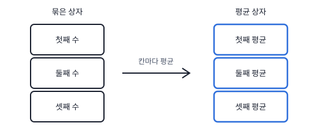

*왼쪽 테두리 상자의 칸마다 평균을 내서 오른쪽 강조색 테두리 상자의 같은 칸에 적어요.*

**정확히 말하면**

**출발점.** 가우시안 랜덤 변수 $X \sim \mathcal{N}(\mu, \sigma^2)$는 평균 $E[X] = \mu$와 분산 $\mathrm{var}[X] = \sigma^2$만 알면 모양이 정해져요. $\sigma$가 작으면 뾰족하고 크면 넓게 퍼지며, $\mu$를 바꾸면 중심만 옮겨 가요(L04 s6).

**스칼라 복습.** 칠판에 다시 적은 정의예요.

$$
E[X] = \int x\,p(x)\,dx, \qquad E[g(X)] = \int g(x)\,p(x)\,dx
$$

분산은 평균에서 벗어난 정도(편차)를 제곱해 평균 낸 값, 즉 퍼짐의 정도(degree of spread)예요. 전개하면 짧은 꼴이 나와요.

1. $$
   \mathrm{var}[X] = E[(X - \mu)^2]
   $$
2. $$
   = E[X^2] - 2\mu E[X] + \mu^2
   $$
3. $E[X] = \mu$를 넣어요.

   $$
   = E[X^2] - \mu^2
   $$
4. $$
   \mathrm{var}[X] = E[X^2] - (E[X])^2
   $$

**랜덤 벡터로 넓히기.** 랜덤 변수 $n$개를 세로로 묶은 것을 랜덤 벡터(random vector)라고 해요.

$$
\mathbf{X} = [X_1, \dots, X_n]^\top
$$

랜덤 벡터의 평균은 성분마다 평균을 내서 같은 크기의 벡터로 모은 것으로 정의해요. $:=$는 "이렇게 정의한다"는 표시예요.

$$
E[\mathbf{X}] := [E(X_1), \dots, E(X_n)]^\top
$$

**남은 질문.** 분산도 성분마다 $E[(X_i - \mu_i)^2]$를 모아 벡터로 정의할 수 있어요. 수업에서는 "정의의 문제니까 나쁘지 않다"고 열어 두었어요. 그런데 이렇게 하면 $X_1$과 $X_2$가 서로 얼마나 닮았는지가 빠져요. 그래서 [분산은 공분산의 특수한 경우](#s1-covariance)로 넘어가요.

**교수님 말씀**

여기서 다시 의학 드라마 비유를 꺼냈어요. 집도의가 약어로 "이거 줘, 저거 줘" 하듯, $E[\mathbf{X}]$ 같은 머신러닝의 수학 용어에 익숙해지는 과정이 전문가가 되는 과정이라는 거예요.

> "평균과 분산을 알면 … 얘의 모양을 상상할 수 있다."

분산은 "내가 얼마나 나대는가"를 재는 값이라고 표현했어요.

평균 벡터의 정의는 "수학자들이 이렇게 정한 것"이라고 했어요.

> "요 정도까지만 이해하고 나면 거의 머신러닝에서 쓰는 가장 복잡한 이론을 다 이해하는 거거든."

분산 공식을 묻다가 한 학생에게 확률및랜덤변수를 누구에게 배웠는지 물었어요. 교수님 본인에게 배웠다는 답에 "어쩐지 눈빛이 살아 있더라고"라며 웃었어요.

**페이지 요약**

랜덤 벡터의 평균은 성분마다 평균을 내서 같은 크기의 벡터로 모은 거예요.

*핵심 식*

- 분산

  $$
  \mathrm{var}[X] = E[X^2] - (E[X])^2
  $$
- 평균 벡터

  $$
  E[\mathbf{X}] := [E(X_1), \dots, E(X_n)]^\top
  $$

*용어*

- **랜덤 벡터(random vector)** — 랜덤 변수 $n$개를 세로로 묶은 것
- **퍼짐의 정도(degree of spread)** — 분산이 재는 것. 편차 제곱의 평균

---

### 분산은 공분산의 특수한 경우

*1007 수업 · L04 s6–s7*

**쉽게 말하면**

혼자 얼마나 들쭉날쭉한지는, 자기 자신과 얼마나 닮았는지를 잰 것과 같아요.

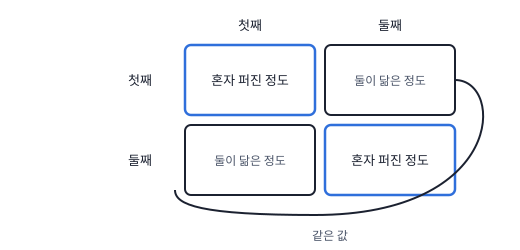

*강조색 테두리 두 칸은 혼자 퍼진 정도이고, 나머지 두 칸은 둘이 닮은 정도라서 서로 같은 값이에요.*

**정확히 말하면**

**스칼라 공분산.** 공분산(covariance)은 두 랜덤 변수가 얼마나 닮았는지, 함께 움직이는지를 재요.

1. $$
   \mathrm{cov}(X, Y) = E\big[(X - \mu_X)(Y - \mu_Y)\big]
   $$
2. $$
   \mathrm{cov}(X, Y) = E[XY] - E[X]E[Y]
   $$

**분산은 공분산의 특수한 경우예요.** $Y$ 자리에 $X$를 넣어요.

1. $$
   \mathrm{cov}(X, X) = E[X \cdot X] - E[X]E[X]
   $$
2. $$
   = E[X^2] - (E[X])^2 = \mathrm{var}[X]
   $$

**두 랜덤 벡터의 공분산.** $\mathbf{X} \in \mathbb{R}^n$, $\mathbf{Y} \in \mathbb{R}^m$이면 스칼라 식과 같은 꼴로 정의해요.

$$
\mathrm{cov}(\mathbf{X}, \mathbf{Y}) = E[\mathbf{X}\mathbf{Y}^\top] - E[\mathbf{X}]E[\mathbf{Y}]^\top \in \mathbb{R}^{n \times m}
$$

- $n \times 1$ 열벡터에 $1 \times m$ 행벡터를 곱하면 $n \times m$ 행렬이 돼요. 그래서 결과의 크기가 $n \times m$이에요.
- $(i, j)$ 성분은 $E[X_iY_j] - E[X_i]E[Y_j] = \mathrm{cov}(X_i, Y_j)$예요.

$2 \times 2$에서 성분을 하나씩 맞춰 보는 계산은 0930 수업에서 했어요. [0930 정리노트 · 공분산에서 공분산 행렬로](../../0930/정리노트_0930_Bayesian_Linear_Regression.html#s3-covariance)

**공분산 행렬.** $\mathbf{Y}$ 자리에 $\mathbf{X}$를 넣으면 $\mathbf{X}$의 분산이 돼요. 이것을 공분산 행렬(covariance matrix) $\Sigma_{\mathbf{X}}$로 써요.

$$
\Sigma_{\mathbf{X}} := \mathrm{var}(\mathbf{X}) = \mathrm{cov}(\mathbf{X}, \mathbf{X}) \in \mathbb{R}^{n \times n}, \qquad [\Sigma_{\mathbf{X}}]_{ij} = \mathrm{cov}(X_i, X_j)
$$

칠판의 2차원 예시 $\mathbf{X} = [X_1, X_2]^\top$에서는 다음과 같아요.

| $\Sigma_{\mathbf{X}}$ | $X_1$ | $X_2$ |
|---|---|---|
| $X_1$ | $\mathrm{cov}(X_1, X_1) = \mathrm{var}[X_1]$ | $\mathrm{cov}(X_1, X_2)$ |
| $X_2$ | $\mathrm{cov}(X_2, X_1)$ | $\mathrm{cov}(X_2, X_2) = \mathrm{var}[X_2]$ |

- 대각(diagonal) 성분은 각 변수의 분산이에요.
- 비대각(off-diagonal) 성분은 두 변수의 연관도예요.
- $\mathrm{cov}(X_1, X_2) = \mathrm{cov}(X_2, X_1)$이라서 $\Sigma_{\mathbf{X}}$는 대칭(symmetric) 행렬이에요.

(수업에서 공분산은 "교환법칙이 성립"한다고 말했어요. 스칼라에서는 맞고, 벡터에서는 $\mathrm{cov}(\mathbf{X}, \mathbf{Y}) = \mathrm{cov}(\mathbf{Y}, \mathbf{X})^\top$이에요.)

**합의 평균과 분산.** $\mathbf{X}, \mathbf{Y} \in \mathbb{R}^n$일 때 평균은 언제나 더해져요.

$$
E(\mathbf{X} + \mathbf{Y}) = E(\mathbf{X}) + E(\mathbf{Y}) \in \mathbb{R}^n
$$

분산은 조건이 있어야 더해져요. $\mathbf{X}$와 $\mathbf{Y}$가 독립이거나, 최소한 교차 공분산 $\mathrm{cov}(\mathbf{X}, \mathbf{Y})$가 영행렬이어야 해요.

$$
\mathrm{var}(\mathbf{X} + \mathbf{Y}) = \mathrm{var}(\mathbf{X}) + \mathrm{var}(\mathbf{Y}) \in \mathbb{R}^{n \times n}
$$

슬라이드 s7에는 이 식이 조건 없이 적혀 있어요. 조건은 수업에서 덧붙였어요.

**교수님 말씀**

> "여러분 사실은요, 베리언스는 코베리언스의 스페셜 케이스입니다."

성분별 분산만 모으면 $X_1$과 $X_2$가 얼마나 닮았는지 알 수 없다며 공분산으로 넘어갔어요.

두 학생에게 공분산을 배웠는지 물은 뒤, 공분산은 "두 랜덤 변수가 얼마나 닮았나, 관련 있나, 독립이냐"를 표현할 때 쓴다고 정리했어요.

합의 분산에서는 슬라이드 식을 그대로 읽지 않고, 독립이거나 최소한 교차 공분산이 영행렬일 때만 성립한다고 짚었어요.

**보충 · 수업에서 유도하진 않았어요**

**스칼라에서 하던 계산을 모든 성분 쌍에 적용해요.** 스칼라 공분산은 평균에서 벗어난 값끼리 곱해 평균을 낸 것이에요.

$$
\mathrm{cov}(x,y)=E[(x-E[x])(y-E[y])]
$$

벡터에서도 같은 연산을 해요. 실수 열벡터를 사용하고, 각 성분의 이차 모멘트가 유한하다고 가정해요. 편차를 $\widetilde{\mathbf{X}}=\mathbf{X}-E[\mathbf{X}]$, $\widetilde{\mathbf{Y}}=\mathbf{Y}-E[\mathbf{Y}]$로 쓰면, 2차원에서는 다음 표가 돼요.

$$
\widetilde{\mathbf{X}}\widetilde{\mathbf{Y}}^\top= \begin{bmatrix}\widetilde X_1\\\widetilde X_2\end{bmatrix} \begin{bmatrix}\widetilde Y_1&\widetilde Y_2\end{bmatrix} =\begin{bmatrix}\widetilde X_1\widetilde Y_1&\widetilde X_1\widetilde Y_2\\\widetilde X_2\widetilde Y_1&\widetilde X_2\widetilde Y_2\end{bmatrix}
$$

각 칸의 평균을 내면 $(i,j)$ 칸은 $E[\widetilde X_i\widetilde Y_j]=\mathrm{cov}(X_i,Y_j)$예요. 첫 입력의 성분이 행을, 둘째 입력의 성분이 열을 정해요.

$$
\mathrm{cov}(\mathbf{X},\mathbf{Y})=E[\widetilde{\mathbf{X}}\widetilde{\mathbf{Y}}^\top]\in\mathbb R^{n\times m}
$$

스칼라에서는 성분 쌍이 하나라 숫자 하나가 나왔어요. 벡터에서는 첫 입력의 각 성분과 둘째 입력의 각 성분을 모두 짝지으므로 표가 나와요. 그 표를 행렬 곱으로 쓰려고 두 번째 벡터를 전치해요. 이것이 외적이에요. 같은 크기의 두 벡터에서 내적 $\widetilde{\mathbf{X}}^\top\widetilde{\mathbf{Y}}$을 쓰면 숫자 하나로 합쳐지므로 이 표를 대신할 수 없어요.

**분산도 같은 정의 안에서 이어져요.** 성분별 분산만 모으면 각 성분의 퍼짐은 알 수 있어요.

$$
\begin{bmatrix}\mathrm{var}(X_1)\\\mathrm{var}(X_2)\end{bmatrix}
$$

하지만 두 성분이 함께 움직이는 정보는 빠져 있어요. 그래서 이 수업에서는 벡터의 분산을 자기 공분산 행렬로 표현해요.

$$
\mathrm{var}(\mathbf{X})=\mathrm{cov}(\mathbf{X},\mathbf{X})=\Sigma_{\mathbf{X}} =\begin{bmatrix}\mathrm{var}(X_1)&\mathrm{cov}(X_1,X_2)\\\mathrm{cov}(X_2,X_1)&\mathrm{var}(X_2)\end{bmatrix}
$$

대각은 익숙한 스칼라 분산이고, 비대각은 성분 사이의 공분산이에요. 스칼라의 $\mathrm{var}(x)=\mathrm{cov}(x,x)$ 관계가 벡터에서도 그대로 이어져요.

**페이지 요약**

분산은 자기 자신과의 공분산이에요. 벡터 공분산은 익숙한 스칼라 계산을 모든 성분 쌍에 적용한 표예요.

*핵심 식*

- 스칼라 공분산

  $$
  \mathrm{cov}(X, Y) = E[XY] - E[X]E[Y]
  $$
- 두 랜덤 벡터의 공분산

  $$
  \begin{aligned}\mathrm{cov}(\mathbf X,\mathbf Y)&=E[\mathbf X\mathbf Y^\top]\\&-E[\mathbf X]E[\mathbf Y]^\top\\&\in\mathbb R^{n\times m}\end{aligned}
  $$
- 공분산 행렬

  $$
  \begin{aligned}\Sigma_{\mathbf X}&:=\mathrm{var}(\mathbf X)\\&=\mathrm{cov}(\mathbf X,\mathbf X)\\&\in\mathbb R^{n\times n},\\{}[\Sigma_{\mathbf X}]_{ij}&=\mathrm{cov}(X_i,X_j)\end{aligned}
  $$

*용어*

- **공분산 행렬(covariance matrix)** — 대각은 분산, 비대각은 연관도인 대칭 행렬
- **대칭(symmetric)** — $\mathrm{cov}(X_1, X_2) = \mathrm{cov}(X_2, X_1)$이라서 성립해요

#### 조건·구분

벡터에서는 $\mathrm{cov}(\mathbf{X},\mathbf{Y})=\mathrm{cov}(\mathbf{Y},\mathbf{X})^\top$으로 입력 순서를 바꾸면 전치돼요. 합의 평균은 더해지고, 합의 분산을 더하는 식에는 독립 또는 영교차공분산 조건이 있어요. 수업 외 보충은 실수 열벡터와 유한한 이차 모멘트에서 편차의 외적을 쓰며, 내적 하나나 성분별 분산만으로는 성분 사이의 공분산 표를 대신하지 못함을 보여요.

---

### 아핀 변환과 이번 주 숙제

*1007 수업 · L04 s7*

**쉽게 말하면**

점 무리를 늘리고 옮기면, 가운데 자리도 똑같이 늘리고 옮긴 곳으로 가요.

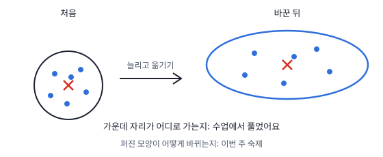

*가운데 엑스 표시가 어디로 가는지는 수업에서 풀었고, 퍼진 모양이 어떻게 바뀌는지는 이번 주 숙제예요.*

**정확히 말하면**

**설정.** $\mathbf{X} \in \mathbb{R}^n$은 랜덤 벡터, $\mathbf{A} \in \mathbb{R}^{m \times n}$은 상수 행렬, $\mathbf{b} \in \mathbb{R}^m$은 상수 벡터예요. 랜덤한 것은 $\mathbf{X}$뿐이에요. 아래 변환을 아핀 변환(affine transformation)이라고 하고, 머신러닝에는 이런 선형(아핀) 형태가 자주 나와요.

$$
\mathbf{Y} = \mathbf{A}\mathbf{X} + \mathbf{b}
$$

**평균(칠판 유도).** 기댓값은 선형 연산자예요.

1. 합의 기댓값은 기댓값의 합이에요.

   $$
   E[\mathbf{Y}] = E[\mathbf{A}\mathbf{X}] + E[\mathbf{b}]
   $$
2. 상수 행렬 $\mathbf{A}$는 기댓값 밖으로 나오고, 상수 벡터의 기댓값은 자기 자신이에요.

   $$
   E[\mathbf{A}\mathbf{X} + \mathbf{b}] = \mathbf{A}E[\mathbf{X}] + \mathbf{b}
   $$

스칼라에서 $E[aX + b] = aE[X] + b$인 것과 똑같아요.

**분산.** 출발점은 [분산은 공분산의 특수한 경우](#s1-covariance)에서 본 정의예요.

$$
\mathrm{var}(\mathbf{Y}) = \mathrm{cov}(\mathbf{Y}, \mathbf{Y}) = E[\mathbf{Y}\mathbf{Y}^\top] - E[\mathbf{Y}]E[\mathbf{Y}]^\top
$$

여기에 $\mathbf{Y} = \mathbf{A}\mathbf{X} + \mathbf{b}$를 넣어 정리하면 다음 결과가 나와요. 상수 $\mathbf{b}$는 분산에 영향을 주지 않아요(슬라이드는 $\mathrm{var}(\mathbf{A}\mathbf{X})$를 거쳐요).

$$
\mathrm{var}(\mathbf{A}\mathbf{X} + \mathbf{b}) = \mathbf{A}\Sigma_{\mathbf{X}}\mathbf{A}^\top
$$

**$\mathbf{X}$와 $\mathbf{Y}$의 공분산** (슬라이드 "Please prove").

$$
\mathrm{cov}(\mathbf{X}, \mathbf{Y}) = \Sigma_{\mathbf{X}}\mathbf{A}^\top
$$

크기를 맞춰 보면 두 식 모두 앞의 정의와 어긋나지 않아요.

| 식 | 곱의 크기 | 결과 |
|---|---|---|
| $\mathbf{A}\Sigma_{\mathbf{X}}\mathbf{A}^\top$ | $(m \times n)(n \times n)(n \times m)$ | $m \times m$, $\mathbf{Y}$의 공분산 행렬 크기 |
| $\Sigma_{\mathbf{X}}\mathbf{A}^\top$ | $(n \times n)(n \times m)$ | $n \times m$, $\mathrm{cov}(\mathbf{X}, \mathbf{Y})$의 크기 |

**숙제.** 두 식 $\mathrm{var}(\mathbf{A}\mathbf{X} + \mathbf{b}) = \mathbf{A}\Sigma_{\mathbf{X}}\mathbf{A}^\top$와 $\mathrm{cov}(\mathbf{X}, \mathbf{Y}) = \Sigma_{\mathbf{X}}\mathbf{A}^\top$의 증명은 이번 주 숙제로 남았어요. 다음 시간에 조교가 첫 번째 토픽으로 증명해요. 1007 수업에서는 유도하지 않았어요.

0930 수업에서 칠판에 그린 분산 식의 증명 스케치는 [0930 정리노트 · 아핀 변환의 평균과 공분산](../../0930/정리노트_0930_Bayesian_Linear_Regression.html#s4-affine)에 있어요.

평균·공분산 규칙을 이후 밀도 계산의 준비물로 가져가요. 변환계수는 고정값이고 이차 모멘트가 존재해야 하며, 모멘트 규칙 자체에는 가우시안 가정이 필요 없어요. 가우시안이라고 가정하면 평균·공분산에서 분포 전체의 모양까지 결정할 수 있다는 것이 다음 단계의 차이예요.

**교수님 말씀**

머신러닝에서는 선형(아핀) 형태가 많이 나온다며 이 성질을 짚었어요. $\mathbf{A}$와 $\mathbf{b}$는 상수이고 $\mathbf{X}$만 랜덤이라고 강조했어요.

평균은 "상수를 곱하면 평균에도 상수가 곱해진다"는 스칼라 경우와 똑같다고 했어요.

> "이번 주 숙제예요. … 우리 조교가 다음 시간에 해줄 거거든요, 증명. 이게 더 어려워, 사실."

> "요 두 개는 꼭 손으로 한번 해보시고 … 조교가 첫 번째로 요거를 증명해 줄 거예요."

수업 첫머리에 "오늘 두 가지는 내가 유도하지 않고 조교에게 시킬 생각"이라고 예고했는데, 이 두 식이 그 첫 번째예요.

**보충 · 수업에서 유도하진 않았어요**

**1. 행렬 곱을 스칼라 가중합으로 풀어요.** $\mathbf{X}=[X_1,X_2]^\top$, $\mathbf{A}=[2\;\;3]$이면 다음과 같아요.

$$
\mathbf{A}\mathbf{X}=2X_1+3X_2
$$

상수 계수에 대한 스칼라 공분산의 선형성으로 한 성분씩 계산할 수 있어요.

$$
\mathrm{cov}(X_1,\mathbf{A}\mathbf{X})=2\mathrm{var}(X_1)+3\mathrm{cov}(X_1,X_2)
$$

$X_2$에 대해서도 계산한 뒤 두 값을 열로 모으면 $\mathrm{cov}(\mathbf{X},\mathbf{A}\mathbf{X})$가 돼요. 스칼라 계산을 모아 행렬로 쓰는 것이에요.

**2. 두 입력의 변환을 한 규칙으로 다뤄요.** 이 일반 규칙에서는 $\mathbf{X}\in\mathbb R^n$, $\mathbf{Y}\in\mathbb R^m$를 각각 임의의 실수 열벡터로 놓아요. 여기서 $\mathbf{Y}$는 앞 설정의 $\mathbf{A}\mathbf{X}+\mathbf{b}$로 제한하지 않아요. 각 성분의 이차 모멘트는 유한하고, $\mathbf{A}\in\mathbb R^{p\times n}$, $\mathbf{B}\in\mathbb R^{q\times m}$, $\mathbf{b}\in\mathbb R^p$, $\mathbf{c}\in\mathbb R^q$는 모두 상수예요.

편차를 $\widetilde{\mathbf{X}}=\mathbf{X}-E[\mathbf{X}]$, $\widetilde{\mathbf{Y}}=\mathbf{Y}-E[\mathbf{Y}]$로 쓰면, 평균을 뺄 때 상수 이동이 사라져요. 둘째 입력도 같은 방식이에요.

$$
\mathbf{A}\mathbf{X}+\mathbf{b}-E[\mathbf{A}\mathbf{X}+\mathbf{b}]=\mathbf{A}(\mathbf{X}-E[\mathbf{X}])=\mathbf{A}\widetilde{\mathbf{X}}
$$

1. 공분산의 정의에 변환된 편차를 넣어요.

   $$
   \mathrm{cov}(\mathbf{A}\mathbf{X}+\mathbf{b},\mathbf{B}\mathbf{Y}+\mathbf{c})=E[(\mathbf{A}\widetilde{\mathbf{X}})(\mathbf{B}\widetilde{\mathbf{Y}})^\top]
   $$
2. 곱을 전치하면 순서가 뒤집혀요. $(\mathbf{B}\widetilde{\mathbf{Y}})^\top=\widetilde{\mathbf{Y}}^\top\mathbf{B}^\top$이므로

   $$
   =E[\mathbf{A}\widetilde{\mathbf{X}}\widetilde{\mathbf{Y}}^\top\mathbf{B}^\top].
   $$
3. 상수 행렬을 기대값 밖으로 꺼내요. $\mathbf{C}_{XY}=\mathrm{cov}(\mathbf{X},\mathbf{Y})$로 놓으면

   $$
   =\mathbf{A}E[\widetilde{\mathbf{X}}\widetilde{\mathbf{Y}}^\top]\mathbf{B}^\top=\mathbf{A}\mathbf{C}_{XY}\mathbf{B}^\top.
   $$

**첫 입력의 계수는 왼쪽, 둘째 입력의 계수는 전치해서 오른쪽. 더한 상수는 사라진다.** 교차 공분산 $\mathbf{C}_{XY}$와 자기 공분산 $\Sigma_{\mathbf{X}}$를 구별해요.

$$
(p\times n)(n\times m)(m\times q)=p\times q
$$

차원 검사는 계산을 점검하는 도구예요. 크기가 맞는다는 사실만으로 식의 정확성이 증명되지는 않아요. 위 정의의 유도가 계수의 위치와 순서를 정해 줘요. 계수가 랜덤이면 이 상수 계수 규칙을 그대로 적용할 수 없어요.

**3. 같은 재료로 세 질문을 비교해요.** 이제 비교 예제에서는 $\mathbf{Y}=\mathbf{A}\mathbf{X}$로 다시 놓고, $\Sigma=\Sigma_{\mathbf{X}}$로 줄여 써요.

$$
\mathbf{A}=\begin{bmatrix}2&3\end{bmatrix},\qquad \Sigma=\begin{bmatrix}4&1\\1&9\end{bmatrix}
$$

값을 계산하기 전에 결과가 열인지, 행인지, 숫자 하나인지 먼저 구별해 보세요.

| 질문 | 계산 규칙 | 크기 | 결과 |
|---|---|---|---|
| $\mathrm{cov}(\mathbf{X},\mathbf{A}\mathbf{X})$ | $\Sigma\mathbf{A}^\top$ | $2\times1$ | $\begin{bmatrix}11\\29\end{bmatrix}$ |
| $\mathrm{cov}(\mathbf{A}\mathbf{X},\mathbf{X})$ | $\mathbf{A}\Sigma$ | $1\times2$ | $\begin{bmatrix}11&29\end{bmatrix}$ |
| $\mathrm{var}(\mathbf{A}\mathbf{X})$ | $\mathbf{A}\Sigma\mathbf{A}^\top$ | $1\times1$ | $109$ |

첫 질문은 첫 입력의 계수가 항등행렬인 경우라 $\Sigma\mathbf{A}^\top$예요. 둘째 질문은 첫 입력만 변환했으므로 $\mathbf{A}\Sigma$이고, 셋째 질문은 두 입력이 모두 $\mathbf{A}\mathbf{X}$여서 양쪽에 계수가 붙어요. 이 예제의 셋째 결과는 스칼라 분산이에요.

$$
\mathrm{cov}(X_1,2X_1+3X_2)=2\cdot4+3\cdot1=11
$$

$$
\mathrm{cov}(X_2,2X_1+3X_2)=2\cdot1+3\cdot9=29
$$

첫 질문에서는 이 두 값을 열로 모아요. 입력 순서를 뒤집으면 전치 관계이므로 둘째 질문에서는 행이 돼요. 변환 결과의 분산은 익숙한 스칼라 식으로도 확인할 수 있어요.

$$
\mathrm{var}(2X_1+3X_2)=2^2\cdot4+2\cdot2\cdot3\cdot1+3^2\cdot9=109
$$

교차항을 빼면 $97$이 돼요. 비대각 공분산 $1$이 $12$만큼 기여해요. 이 예제에서는 두 성분이 독립이라고 가정하지 않았어요. [0930 아핀 변환의 곱 순서 주의](../../0930/정리노트_0930_Bayesian_Linear_Regression.html#s4-affine)처럼 $\mathbf{A}\Sigma\mathbf{A}^\top$의 순서도 유지해야 해요.

**페이지 요약**

아핀 변환에서 평균은 같은 변환을 따르고, 분산과 교차 공분산 식의 증명은 이번 주 숙제로 남았어요. 보충의 기억 규칙은 첫 입력의 계수는 왼쪽, 둘째 입력의 계수는 전치해서 오른쪽이에요.

*핵심 식*

- 평균

  $$
  E[\mathbf{A}\mathbf{X} + \mathbf{b}] = \mathbf{A}E[\mathbf{X}] + \mathbf{b}
  $$
- 분산

  $$
  \mathrm{var}(\mathbf{A}\mathbf{X} + \mathbf{b}) = \mathbf{A}\Sigma_{\mathbf{X}}\mathbf{A}^\top
  $$
- 교차 공분산

  $$
  \mathrm{cov}(\mathbf{X}, \mathbf{Y}) = \Sigma_{\mathbf{X}}\mathbf{A}^\top
  $$

*용어*

- **아핀 변환(affine transformation)** — 상수 행렬을 곱하고 상수 벡터를 더하는 변환 $\mathbf{Y} = \mathbf{A}\mathbf{X} + \mathbf{b}$
- **숙제** — 분산·교차 공분산 식의 증명. 다음 시간 조교가 첫 토픽으로 증명

#### 조건·구분

상수 $\mathbf{A}:m\times n$, $\mathbf{b}:m$에서 자기분산 $\mathbf{A}\Sigma\mathbf{A}^\top$는 $m\times m$, 교차공분산 $\Sigma\mathbf{A}^\top$는 $n\times m$예요. 수업 외 보충의 일반형은 $\mathrm{cov}(A\mathbf{X}+b,B\mathbf{Y}+c)=A\mathrm{cov}(\mathbf{X},\mathbf{Y})B^\top$이며, 이동은 편차에서 사라져요. 상수 계수와 유한 이차 모멘트를 전제하며 차원이 맞는 것만으로 증명되지는 않아요. 비교 예제의 열·행 공분산은 각각 $[11,29]^\top$, $[11,29]$이고 자기분산은 $109$예요. 교차항을 빼면 $97$이므로 독립을 가정하지 않은 예에서 교차항을 버리지 않아요.

---

## 2. 가우시안 랜덤 벡터

### 가우시안 랜덤 벡터의 PDF

*1007 수업 · L04 s8 · MML 6.5*

**쉽게 말하면**

한 줄 위에 솟아 있던 종 모양 언덕이 이제 넓은 땅 위에 솟아 있어요.

가운데 자리와 퍼진 모양만 알면 어느 자리의 높이든 숫자 하나로 계산할 수 있어요.

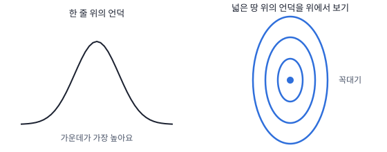

*왼쪽은 한 줄 위의 언덕이고, 오른쪽 테두리 고리들은 같은 높이끼리 이은 선이에요.*

**정확히 말하면**

**설정.** 랜덤 벡터 $\mathbf{X} = (X_1, X_2, \dots, X_n)^\top$의 평균 벡터를 $\boldsymbol{\mu} = (\mathbb{E}[X_1], \dots, \mathbb{E}[X_n])^\top$, 공분산 행렬(covariance matrix)을 $\Sigma$라고 해요. 이번 수업에서는 가우시안을 사용하며, 가우시안은 평균 벡터와 공분산 행렬만 있으면 정해져요. 지금까지 랜덤 벡터의 평균과 공분산을 배운 이유가 이거예요.

**정의.** $\mathbf{X}$의 결합 PDF(joint pdf)가 아래 꼴이면 $\mathbf{X}$를 가우시안 랜덤 벡터(Gaussian random vector)라고 해요. 여기서 $\Sigma$는 대칭(symmetric)이고 양의 정부호(positive definite)예요.

$$
f_{\mathbf{X}}(\mathbf{x}) = \frac{1}{\sqrt{(2\pi)^n|\Sigma|}}\exp\!\Big(-\frac{1}{2}(\mathbf{x} - \boldsymbol{\mu})^\top\Sigma^{-1}(\mathbf{x} - \boldsymbol{\mu})\Big)
$$

이것을 $\mathbf{X} \sim \mathcal{N}(\boldsymbol{\mu}, \Sigma)$ 또는 $p_{\mathbf{X}}(\mathbf{x}) = \mathcal{N}(\mathbf{x} \mid \boldsymbol{\mu}, \Sigma)$로 써요. $X_1, \dots, X_n$이 함께 있는 분포라서 "결합(joint)"이라는 말이 붙어요.

**스칼라 경우와 비교.** 평균 $\mu$, 분산 $\sigma^2$인 가우시안 랜덤 변수의 PDF는 $\frac{1}{\sqrt{2\pi\sigma^2}}\exp\!\big(-\frac{(x - \mu)^2}{2\sigma^2}\big)$예요. 자리마다 짝을 지으면 아래와 같아요.

| 자리 | 스칼라 | 벡터 |
|---|---|---|
| 상수의 $2\pi$ | $2\pi$ | $(2\pi)^n$: 상수가 $n$번 곱해진 꼴 |
| 상수의 퍼짐 | $\sigma^2$ | $\vert \Sigma\vert $: 공분산 행렬의 행렬식 |
| 지수의 거리 제곱 | $(x - \mu)^2$ | $(\mathbf{x} - \boldsymbol{\mu})^\top(\mathbf{x} - \boldsymbol{\mu})$: 노름(norm)의 제곱 |
| 지수의 나누기 | $1/\sigma^2$ | $\Sigma^{-1}$: 가운데에 끼워 넣어요 |

**행렬식.** $|\Sigma|$는 행렬의 절댓값이 아니라 행렬식(determinant)이에요. 행렬식은 숫자 하나예요.

- $2 \times 2$ 행렬 $\begin{bmatrix} a & b \\ c & d \end{bmatrix}$의 행렬식은 $ad - bc$예요. 역행렬을 구할 때 분모에 들어가는 그 값이에요.
- $3 \times 3$ 이상은 식이 길어지니 계산 도구에 맡겨도 된다고 했어요.
- $\Sigma$가 양의 정부호이면 고유값(eigenvalue)이 모두 $0$보다 커요. 행렬식은 고유값의 곱이라서 $|\Sigma| \gt 0$이에요. 그래서 상수 $\frac{1}{\sqrt{(2\pi)^n|\Sigma|}}$도 양수예요.
- 공분산 행렬은 일반적으로 양의 준정부호(positive semi-definite, 고유값 $\ge 0$)라서 $|\Sigma| \ge 0$까지만 보장돼요. 위 PDF를 쓰려면 양의 정부호여서 $|\Sigma| \gt 0$이어야 해요. (수업 중 "positive semi-definite"와 "고유값이 모두 0보다 큰"을 함께 말했는데, 고유값이 모두 $0$보다 크면 positive definite예요.)

**지수 부분은 숫자예요.** $n = 2$이면 크기가 (행벡터)(정방행렬)(열벡터) $= (1 \times 2)(2 \times 2)(2 \times 1)$이라 결과는 $1 \times 1$, 즉 스칼라예요. 그래서 $\mathbf{x} = (x_1, x_2)$를 넣으면 PDF 값은 숫자 하나로 나와요.

**칠판 예제.** $\mathbf{X} = (X_1, X_2)^\top$, $\boldsymbol{\mu} = \mathbf{0}$, $\Sigma = \begin{bmatrix} 1 & 0.1 \\ 0.1 & 3 \end{bmatrix}$일 때 결합 PDF를 구해요. 정의에 대입하면 돼요.

1. 차원은 $n = 2$예요.
2. 행렬식을 $ad - bc$로 구해요.

   $$
   |\Sigma| = 1 \cdot 3 - 0.1 \cdot 0.1 = 3 - 0.01 = 2.99
   $$
3. 앞의 상수를 구해요.

   $$
   \frac{1}{\sqrt{(2\pi)^2 \cdot 2.99}} = \frac{1}{2\pi\sqrt{2.99}}
   $$
4. 역행렬은 $\frac{1}{ad - bc}$를 앞에 두고, $a$와 $d$의 자리를 바꾸고, $b$와 $c$의 부호를 바꿔요.

   $$
   \Sigma^{-1} = \frac{1}{2.99}\begin{bmatrix} 3 & -0.1 \\ -0.1 & 1 \end{bmatrix}
   $$
5. 평균이 영벡터라서 $\mathbf{x} - \boldsymbol{\mu} = [x_1, x_2]^\top$예요.
6. 정의에 넣어요.

   $$
   f_{\mathbf{X}}(\mathbf{x}) = \frac{1}{2\pi\sqrt{2.99}}\exp\!\Big(-\frac{1}{2}[x_1, x_2]\,\Sigma^{-1}[x_1, x_2]^\top\Big)
   $$
7. 가운데 곱을 전개하면 스칼라 하나예요.

   $$
   [x_1, x_2]\,\Sigma^{-1}[x_1, x_2]^\top = \frac{3x_1^2 - 0.2x_1x_2 + x_2^2}{2.99}
   $$
8. 정리하면 아래와 같아요.

   $$
   f_{\mathbf{X}}(\mathbf{x}) = \frac{1}{2\pi\sqrt{2.99}}\exp\!\Big(-\frac{3x_1^2 - 0.2x_1x_2 + x_2^2}{2 \cdot 2.99}\Big)
   $$
9. 확인: 원점에서는 지수가 $0$이라 $f_{\mathbf{X}}(\mathbf{0}) = \frac{1}{2\pi\sqrt{2.99}} \approx 0.092$예요.

가우시안 랜덤 벡터의 PDF를 계산하는 예제는 다음 시간에 조교가 몇 개 더 풀어 줘요. 이 분포가 왜 베이지안에서 편한지는 [무엇을 해도 가우시안](#s2-closure)에서 이어져요.

**교수님 말씀**

랜덤 벡터의 평균과 공분산 행렬을 설명한 이유를 길을 잃지 않기 위해서라고 했어요.

> "Bayesian 하면 무슨 분포가 왔다다? 가우시안 분포가 왔다다."

식이 복잡해 보여도 스칼라 경우와 늘 비교해 보라고 했어요. 분모의 $\sigma^2$ 자리에 $\Sigma$의 역행렬이 가운데 들어갔을 뿐이라는 거예요.

> "그러니까 꼬라지가 거의 똑같다는 거지."

공분산 행렬의 행렬식이 양수라는 것은 수학적 특성이니 그냥 외워 둬도 된다고 했어요. 정확한 조건은 정확히 말하면의 양의 정부호 설명을 보면 돼요.

> "covariance matrix의 determinant는 항상 양수다. 그냥 이렇게 외워 놔도 돼."

예제를 마치며 조교가 예제를 더 만들어 줄 거라고 했고, 랜덤 벡터 준비는 여기서 마무리했어요.

> "자, 이제 재료 손질은 다 끝났어요."

**페이지 요약**

가우시안 랜덤 벡터는 평균 벡터와 공분산 행렬만 있으면 PDF가 정해져요.

*핵심 식*

- 가우시안 랜덤 벡터 PDF

  $$
  f_{\mathbf{X}}(\mathbf{x}) = \frac{1}{\sqrt{(2\pi)^n|\Sigma|}}\exp\!\Big(-\frac{1}{2}(\mathbf{x} - \boldsymbol{\mu})^\top\Sigma^{-1}(\mathbf{x} - \boldsymbol{\mu})\Big)
  $$
- 칠판 예제의 행렬식

  $$
  |\Sigma| = 1 \cdot 3 - 0.1 \cdot 0.1 = 3 - 0.01 = 2.99
  $$
- 칠판 예제의 역행렬

  $$
  \Sigma^{-1} = \frac{1}{2.99}\begin{bmatrix} 3 & -0.1 \\ -0.1 & 1 \end{bmatrix}
  $$

*용어*

- **$\mathcal{N}(\boldsymbol{\mu}, \Sigma)$** — 평균 벡터 $\boldsymbol{\mu}$, 공분산 행렬 $\Sigma$인 가우시안 랜덤 벡터
- **행렬식(determinant)** — $|\Sigma|$, $2 \times 2$에서는 $ad - bc$
- **양의 정부호(positive definite)** — 고유값이 모두 $0$보다 커서 $|\Sigma| \gt 0$인 대칭 행렬

#### 조건·구분

일반 공분산은 양의 준정부호까지만 보장돼요. 이 역행렬·행렬식 PDF를 쓰려면 대칭 양의 정부호여서 $|\Sigma|\gt0$이어야 해요. 행렬식은 절댓값이 아닌 스칼라이고 지수의 이차형식도 $(1\times n)(n\times n)(n\times1)$인 스칼라예요. 예제의 앞 계수는 $1/(2\pi\sqrt{2.99})$로 루트와 $2\pi$를 빠뜨리지 않아요.

---

### 무엇을 해도 가우시안

*1007 수업 · L04 s9 · MML 6.5.1–6.5.3*

**쉽게 말하면**

종 모양 언덕은 잘라 보고, 겹치고, 늘리고 옮겨도 다시 종 모양 언덕이 돼요.

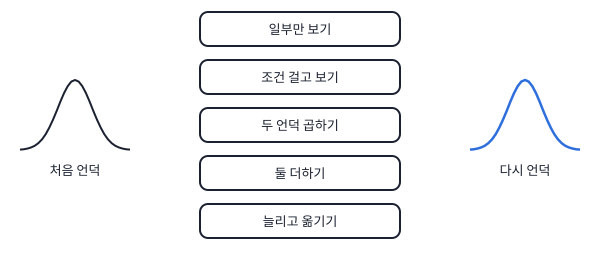

*다섯 가지 손질 중 무엇을 거쳐도 오른쪽에 다시 종 모양 언덕이 나와요.*

**정확히 말하면**

**왜 베이지안은 가우시안을 쓰나.** 가우시안에는 아래 성질이 있어서, 계산을 거듭해도 결과가 다시 가우시안으로 남아요(L04 s9).

1. **주변분포(marginal).** 결합 가우시안에서 일부 변수를 적분해 없애도(주변화) 남은 변수의 분포는 가우시안이에요.
2. **조건부분포(conditional).** 결합 가우시안에서 일부 변수의 값을 알고 나머지를 보는 조건부 PDF도 가우시안이에요.
3. **밀도의 곱(product of densities).** 같은 변수 $x$에 대한 두 가우시안 밀도 함수를 곱하면, 상수배를 다시 맞추기만 하면(up to rescaling) 가우시안이에요.
4. **독립 합(sum).** 두 가우시안 랜덤 변수가 독립이면 그 합은 가우시안이에요.
5. **아핀 변환(affine transformation).** 가우시안을 선형(아핀) 변환해도 가우시안이에요.

**곱하는 것은 밀도예요.** 세 번째 성질에서 곱하는 대상은 랜덤 변수가 아니라 밀도 함수 $\mathcal{N}(x \mid \mu_0, \nu_0)$와 $\mathcal{N}(x \mid \mu_1, \nu_1)$예요. 독립인 두 가우시안 랜덤 변수의 곱 $X_1X_2$는 일반적으로 가우시안이 아니에요. (수업 중 "독립인 두 가우시안 density를 곱한 것"이라고 말했는데, 곱하는 것은 같은 $x$의 밀도이고 독립 조건은 필요 없어요.) 증명은 [두 가우시안의 곱: 스칼라 증명](#s3-product-scalar)에서 해요.

**스칼라 예.** $X_1 \sim \mathcal{N}(\mu_1, \sigma_1^2)$, $X_2 \sim \mathcal{N}(\mu_2, \sigma_2^2)$가 서로 독립이고 $Y = aX_1 + bX_2$이면 아래와 같아요.

$$
Y \sim \mathcal{N}\big(a\mu_1 + b\mu_2,\ a^2\sigma_1^2 + b^2\sigma_2^2\big)
$$

1. 평균은 기댓값의 선형성에서 나와요.

   $$
   \mathbb{E}[Y] = a\,\mathbb{E}[X_1] + b\,\mathbb{E}[X_2] = a\mu_1 + b\mu_2
   $$
2. 상수는 분산 밖으로 제곱해서 나오고, 독립이라 공분산 항이 $0$이에요.

   $$
   \mathrm{var}[Y] = a^2\sigma_1^2 + b^2\sigma_2^2
   $$
3. $\mathbf{X} = [X_1, X_2]^\top$, $A = [a \ \ b]$로 두면 [아핀 변환과 이번 주 숙제](#s1-affine)의 $A\,\mathrm{var}(\mathbf{X})\,A^\top$에서 대각 공분산 행렬을 넣은 것과 같아요.
4. 가우시안이라는 사실은 독립 합과 아핀 변환 성질에서 와요.

**원래 목표로.** 사전분포와 가능도가 가우시안이니, 이 성질들 덕분에 파라미터 사후분포 $p(\boldsymbol{\theta} \mid \mathbf{X}, \mathbf{y})$도 가우시안 랜덤 벡터의 분포일 거라고 기대할 수 있어요. 이것을 보이는 길이 [렘마: 지수 안이 2차식이면 가우시안](#s3-lemma)에서 시작해 [사후분포도 가우시안이다](#s4-posterior)로 이어져요.

**교수님 말씀**

"왜 Bayesian 하면 꼭 가우시안 분포를 쓰시려고 하는 겁니까?"라는 질문을 스스로 던지고, 가우시안에 좋은 특성이 많아서라고 답했어요.

> "매우 독특하고 매우 행복한 특성을 만들어낸다는 거예요."

가우시안을 갖고 "지지고 볶고" 별의별 짓을 다 해도 결과가 다시 가우시안이 된다고 했어요. 그러고는 원래 하려던 일을 잊지 말자며 랜덤 벡터 준비를 김밥 재료 손질에 빗댔어요.

> "이제 재료 손질 진짜 끝났다. 김밥만 싸면 돼."

김밥을 싸는 일은 파라미터 사후분포가 정말 가우시안이 되는지 증명하는 것이라고 했어요.

**페이지 요약**

가우시안은 주변화, 조건 걸기, 밀도의 곱, 독립 합, 아핀 변환을 거쳐도 가우시안이라서 베이지안 계산이 닫혀요.

*핵심 식*

- 독립 가우시안의 일차결합

  $$
  Y \sim \mathcal{N}\big(a\mu_1 + b\mu_2,\ a^2\sigma_1^2 + b^2\sigma_2^2\big)
  $$

*용어*

- **주변분포(marginal)** — 결합 가우시안에서 일부 변수를 적분해 없앤 분포, 여전히 가우시안
- **조건부분포(conditional)** — 일부 변수의 값을 알고 본 나머지의 분포, 여전히 가우시안
- **밀도의 곱(product of densities)** — 두 가우시안 밀도 함수의 곱, 상수배를 맞추면 가우시안

#### 조건·구분

곱하는 것은 같은 변수에 대한 밀도 함수예요. 랜덤 변수의 곱 $X_1X_2$는 일반적으로 가우시안이 아니며 밀도 곱에는 독립 조건이 필요하지 않아요. 주변·조건부 성질은 결합 가우시안에 대한 것이고, 제시한 가중합 공식에는 두 가우시안의 독립을 써요.

---

## 3. 가우시안 밀도의 곱

### 렘마: 지수 안이 2차식이면 가우시안

*1007 수업 · L04 s10*

**쉽게 말하면**

산처럼 볼록한 곡선은 꼭대기 위치와 폭만 알면 어떤 종 모양인지 정해져요.

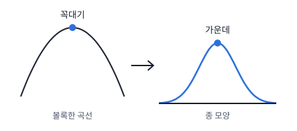

*왼쪽 곡선의 꼭대기를 찾으면 오른쪽 종의 가운데가 바로 나와요.*

**정확히 말하면**

렘마(lemma)는 본 증명에 앞서 알아 둘 보조 정리예요. 교수님은 메인 요리 앞의 에피타이저라고 불렀어요.

**렘마.** $\alpha \gt 0$일 때, 다음 꼴의 PDF는 평균 $\frac{\beta}{\alpha}$, 분산 $\frac{1}{\alpha}$인 가우시안이에요.

$$
c\cdot\exp\left(-\frac{1}{2}(\alpha x^2 - 2\beta x + \gamma)\right) \;\Longrightarrow\; \mathcal{N}\left(\frac{\beta}{\alpha}, \frac{1}{\alpha}\right)
$$

지수 안이 $x$에 대한 임의의 2차식 $\alpha x^2 - 2\beta x + \gamma$이기만 하면 돼요. 증명은 고등학교 때 2차 함수의 꼭짓점을 구하던 완전제곱식 만들기예요.

1. $\alpha$를 밖으로 묶어요.

   $$
   \exp\left(-\frac{\alpha}{2}\left(x^2 - \frac{2\beta}{\alpha}x + \frac{\gamma}{\alpha}\right)\right)
   $$
2. $\left(\frac{\beta}{\alpha}\right)^2$을 더하고 같은 값을 빼요. 값은 그대로이고 완전제곱식이 생겨요.

   $$
   = \exp\left(-\frac{\alpha}{2}\left[\left(x - \frac{\beta}{\alpha}\right)^2 - \left(\frac{\beta}{\alpha}\right)^2 + \frac{\gamma}{\alpha}\right]\right)
   $$
3. $x$와 상관없는 부분을 앞으로 빼서 상수 $c'$에 넣어요.

   $$
   c\cdot\exp(\cdots) = c'\exp\left(-\frac{(x - \beta/\alpha)^2}{2\cdot(1/\alpha)}\right), \qquad c' = c\,e^{-\frac{1}{2}\left(\gamma - \frac{\beta^2}{\alpha}\right)}
   $$
4. 가우시안 PDF와 비교하면 $\mu = \frac{\beta}{\alpha}$, $\sigma^2 = \frac{1}{\alpha}$ 자리예요.

   $$
   \mathcal{N}(\mu, \sigma^2) \sim \frac{1}{\sqrt{2\pi\sigma^2}}\exp\left(-\frac{(x - \mu)^2}{2\sigma^2}\right)
   $$
5. 앞의 상수가 $\frac{1}{\sqrt{2\pi(1/\alpha)}} = \sqrt{\frac{\alpha}{2\pi}}$가 되도록 $c$를 고르면 끝이에요.

   $$
   c = \sqrt{\frac{\alpha}{2\pi}}\,e^{\frac{1}{2}\left(\gamma - \frac{\beta^2}{\alpha}\right)}
   $$

읽는 법: $x^2$의 계수 $\alpha$가 분산 $\frac{1}{\alpha}$을 정하고, $x$의 계수 $-2\beta$가 평균 $\frac{\beta}{\alpha}$를 정해요. 상수항 $\gamma$는 $c$에 흡수되어 모양에 영향을 주지 않아요.

교과서 9.3절의 Remark(완전제곱의 일반적 방법, 식 9.51–9.54)는 같은 일을 벡터로 해요. $\mathbf{x}^\top A\mathbf{x} - 2\mathbf{a}^\top\mathbf{x} + \text{const}$를 $(\mathbf{x} - \boldsymbol{\mu})^\top A(\mathbf{x} - \boldsymbol{\mu}) + \text{const}$로 바꾸면 $\boldsymbol{\mu} = A^{-1}\mathbf{a}$예요. 스칼라로 줄이면 $A = \alpha$, $\mathbf{a} = \beta$라서 평균 $\frac{\beta}{\alpha}$, 분산 $\frac{1}{\alpha}$과 같아요.

**다음 증명에 가져갈 결과:** 지수의 괄호가 $\alpha x^2-2\beta x+\gamma$이면 $\alpha\gt0$에서 평균은 $\beta/\alpha$, 분산은 $1/\alpha$예요. 두 가우시안의 곱에서는 새 완전제곱을 처음부터 외우지 않고, [곱한 지수의 계수](#s3-product-scalar)를 α와 β 자리에 넣으면 돼요. 정규화 전 함수의 모양과 적분값 1인 밀도는 앞의 상수로 구별해요.

**교수님 말씀**

렘마를 코스 요리에 빗댔어요. 진짜 증명이 메인 디시이고, 렘마는 그 앞에 나오는 전채 요리라는 뜻이에요.

> "진짜 메인 디시가 있는데, 전채 요리, 에피타이저."

같은 수를 넣었다 빼는 완전제곱식 만들기를 "하나 마나 한 짓"이라고 불렀어요. 고등학교 때 꼭짓점을 그리던 방법과 같다고 했어요.

> "수학을 잘하려면 뭘 잘해야 돼? 하나 마나 한 짓을 잘해야 되는데"

완전제곱식이 드러나자 $\frac{\beta}{\alpha}$가 $\mu$ 역할, $\frac{1}{\alpha}$이 $\sigma^2$ 역할을 "아름답게" 한다고 했어요.

**페이지 요약**

지수 안이 $x$의 2차식이면 완전제곱식으로 바꿔서 평균과 분산을 바로 읽어요.

*핵심 식*

- 렘마

  $$
  c\cdot\exp\left(-\frac{1}{2}(\alpha x^2 - 2\beta x + \gamma)\right) \;\Longrightarrow\; \mathcal{N}\left(\frac{\beta}{\alpha}, \frac{1}{\alpha}\right)
  $$
- 정규화 상수

  $$
  c = \sqrt{\frac{\alpha}{2\pi}}\,e^{\frac{1}{2}\left(\gamma - \frac{\beta^2}{\alpha}\right)}
  $$

*용어*

- **렘마(lemma)** — 본 증명 전에 알아 둘 보조 정리예요.
- **완전제곱식(completing the square)** — 같은 수를 더하고 빼서 $(x - \cdot)^2$ 꼴을 만드는 방법이에요.

#### 조건·구분

$\alpha\gt0$이어야 분산 $1/\alpha$인 적분 가능한 가우시안이 돼요. 상수항 $\gamma$는 모양이 아니라 정규화 상수 $c$에 반영돼요.

---

### 두 가우시안의 곱: 스칼라 증명

*1007 수업 · L04 s10*

**쉽게 말하면**

두 사람의 짐작을 곱해서 합치면, 더 자신 있는 사람 쪽으로 기울고 폭은 더 좁아져요.

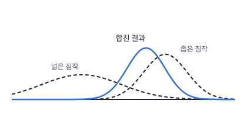

*넓은 점선과 좁은 점선을 곱하면, 좁은 쪽 가까이에 더 뾰족한 강조색 선이 생겨요.*

**정확히 말하면**

$\mathcal{N}(\mu_0, \nu_0)$와 $\mathcal{N}(\mu_1, \nu_1)$의 **밀도 함수**를 곱해요. $\nu_0$는 첫 번째, $\nu_1$은 두 번째 가우시안의 분산이에요. 곱하는 것은 랜덤 변수가 아니라 PDF예요(독립인 $X_0X_1$ 자체는 가우시안이 아니에요).

앞의 정규화 상수 $c_1, c_2$(첫 번째, 두 번째 PDF의 상수)는 나중에 스케일링으로 맞추면 되므로 무시해요. 결과는 상수배를 빼면 가우시안(Gaussian up to rescaling)이에요.

1. 지수를 하나로 합쳐요.

   $$
   e^{-(x-\mu_0)^2/2\nu_0}\cdot e^{-(x-\mu_1)^2/2\nu_1} = \exp\left[-\frac{1}{2}\left(\frac{(x-\mu_0)^2}{\nu_0} + \frac{(x-\mu_1)^2}{\nu_1}\right)\right]
   $$
2. 괄호 안을 전개해요.

   $$
   \frac{(x-\mu_0)^2}{\nu_0} + \frac{(x-\mu_1)^2}{\nu_1} = \frac{x^2 - 2\mu_0 x + \mu_0^2}{\nu_0} + \frac{x^2 - 2\mu_1 x + \mu_1^2}{\nu_1}
   $$
3. $x^2$, $x$, 상수항끼리 묶어요.

   $$
   = \left(\frac{1}{\nu_0} + \frac{1}{\nu_1}\right)x^2 - 2\left(\frac{\mu_0}{\nu_0} + \frac{\mu_1}{\nu_1}\right)x + \left(\frac{\mu_0^2}{\nu_0} + \frac{\mu_1^2}{\nu_1}\right)
   $$
4. [렘마: 지수 안이 2차식이면 가우시안](#s3-lemma)의 $\alpha x^2 - 2\beta x + \gamma$ 꼴이에요.

   $$
   \alpha = \frac{1}{\nu_0} + \frac{1}{\nu_1}, \qquad \beta = \frac{\mu_0}{\nu_0} + \frac{\mu_1}{\nu_1}, \qquad \gamma = \frac{\mu_0^2}{\nu_0} + \frac{\mu_1^2}{\nu_1}
   $$
5. 분산은 $\frac{1}{\alpha}$이에요. 분자와 분모에 $\nu_0\nu_1$을 곱해요.

   $$
   \frac{1}{\alpha} = \frac{1}{\frac{1}{\nu_0} + \frac{1}{\nu_1}} = \frac{\nu_0\nu_1}{\nu_0 + \nu_1}
   $$
6. 평균은 $\frac{\beta}{\alpha} = \beta\cdot\frac{1}{\alpha}$이에요.

   $$
   \frac{\beta}{\alpha} = \left(\frac{\mu_0}{\nu_0} + \frac{\mu_1}{\nu_1}\right)\frac{\nu_0\nu_1}{\nu_0 + \nu_1} = \frac{\nu_1\mu_0 + \nu_0\mu_1}{\nu_0 + \nu_1}
   $$

**결론.** 두 가우시안 밀도의 곱은 상수배를 빼면 다음 가우시안이에요.

$$
\mathcal{N}(\mu_0, \nu_0)\cdot\mathcal{N}(\mu_1, \nu_1) \;\propto\; \mathcal{N}\left(\frac{\nu_1\mu_0 + \nu_0\mu_1}{\nu_0 + \nu_1}, \frac{\nu_0\nu_1}{\nu_0 + \nu_1}\right)
$$

이것으로 L04 s9의 가우시안 성질 중 "두 가우시안 밀도의 곱도 가우시안"이 증명돼요.

**결과 읽기**

- 평균은 가중평균이에요. $\mu_0$에 붙는 가중치가 상대편 분산 $\nu_1$이라서, 분산이 작은 쪽 평균으로 끌려가요.

  $$
  \frac{\nu_1\mu_0 + \nu_0\mu_1}{\nu_0 + \nu_1} = \frac{\nu_1}{\nu_0 + \nu_1}\mu_0 + \frac{\nu_0}{\nu_0 + \nu_1}\mu_1
  $$
- 곱의 분산은 두 분산보다 항상 작아요. $\frac{\nu_1}{\nu_0 + \nu_1} \lt 1$이기 때문이에요.

  $$
  \frac{\nu_0\nu_1}{\nu_0 + \nu_1} = \nu_0\cdot\frac{\nu_1}{\nu_0 + \nu_1} \lt \nu_0, \qquad \frac{\nu_0\nu_1}{\nu_0 + \nu_1} \lt \nu_1
  $$
- 분산의 역수인 정밀도(precision)끼리 더해져요: $\alpha = \frac{1}{\nu_0} + \frac{1}{\nu_1}$. 교과서 식 (6.74) $C = (A^{-1} + B^{-1})^{-1}$의 스칼라판이에요.

#### 직접 해 보기: 두 가우시안 밀도의 곱 *(정적 스냅샷 — 직접 조작은 HTML 버전)*

두 밀도의 평균과 분산을 움직이면, 곱을 정규화한 굵은 곡선과 그 평균 위치(세로 점선)가 함께 바뀌어요.

곱: **평균 (ν₁μ₀+ν₀μ₁)/(ν₀+ν₁) = -0.571, 분산 ν₀ν₁/(ν₀+ν₁) = 0.429**

범례: 첫 번째 밀도 N(μ₀, ν₀), 점선 · 두 번째 밀도 N(μ₁, ν₁), 점선 · 곱을 정규화한 밀도

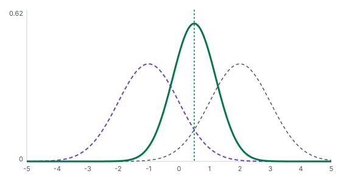

*대표 설정 1: μ₀=-1, ν₀=1, μ₁=2, ν₁=1*

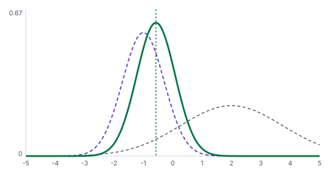

*대표 설정 2: μ₀=-1, ν₀=0.5, μ₁=2, ν₁=3*

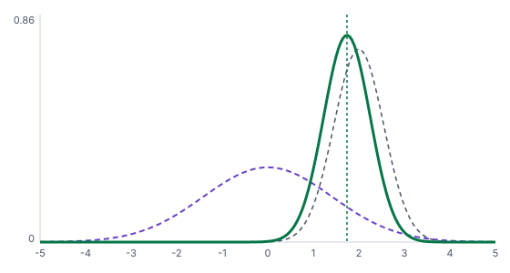

*대표 설정 3: μ₀=0, ν₀=2, μ₁=2, ν₁=0.3*

| 설정 | 곱의 평균 | 곱의 분산 | 읽을 점 |
|---|---|---|---|
| μ₀=-1, ν₀=1, μ₁=2, ν₁=1 | 0.500 | 0.500 | 분산이 같아 평균은 한가운데, 분산은 절반 |
| μ₀=-1, ν₀=0.5, μ₁=2, ν₁=3 | -0.571 | 0.429 | ν₀가 작아 μ₀ 쪽으로 끌림, 분산은 둘보다 작음 |
| μ₀=0, ν₀=2, μ₁=2, ν₁=0.3 | 1.739 | 0.261 | ν₁이 작아 μ₁ 쪽으로 끌림, 분산은 둘보다 작음 |

앞 렘마의 자리에 $\alpha=1/\nu_0+1/\nu_1$, $\beta=\mu_0/\nu_0+\mu_1/\nu_1$를 넣은 결과예요. 여기서 $\nu_0,\nu_1$은 표준편차가 아니라 **분산**이에요. 따라서 **분산의 역수를 더한 뒤 다시 역수, 평균은 그 분산에 일차항 계수를 곱한다**고 복원할 수 있어요.

**교수님 말씀**

정규화 상수를 어떻게 하느냐는 가상의 질문에, 스케일링으로 나중에 맞추면 되니 일단 무시하자고 답했어요.

> "교수님, $c_1$과 $c_2$는요?" 나중에 스케일링으로 튜닝해 줄 수 있으니 무시하자.

전개 과정은 직접 해 보라고 남겼어요.

> "두 개 곱하면 지지고 볶고 하면 이렇게 만들 수 있거든요? … 산수니까."

$x^2$, $x$, 상수항 꼴을 보고 렘마의 $\alpha$, $\beta$ 자리에 넣으면 끝난다고 했어요. 그리고 이것이 가우시안 성질 슬라이드의 예를 증명한 것이라고 정리했어요.

> "그래서 9페이지에서 나왔던 예를 증명한 거지."

**페이지 요약**

두 가우시안 밀도를 곱하면 상수배를 빼고 다시 가우시안이 되고, 평균은 분산이 작은 쪽으로 끌려가고 분산은 더 작아져요.

*핵심 식*

- α·β 묶기

  $$
  \alpha = \frac{1}{\nu_0} + \frac{1}{\nu_1}, \qquad \beta = \frac{\mu_0}{\nu_0} + \frac{\mu_1}{\nu_1}, \qquad \gamma = \frac{\mu_0^2}{\nu_0} + \frac{\mu_1^2}{\nu_1}
  $$
- 곱의 결과

  $$
  \mathcal{N}(\mu_0, \nu_0)\cdot\mathcal{N}(\mu_1, \nu_1) \;\propto\; \mathcal{N}\left(\frac{\nu_1\mu_0 + \nu_0\mu_1}{\nu_0 + \nu_1}, \frac{\nu_0\nu_1}{\nu_0 + \nu_1}\right)
  $$

*용어*

- **정밀도(precision)** — 분산의 역수예요. 곱하면 정밀도끼리 더해져요.
- **Gaussian up to rescaling** — 상수배만 맞추면 가우시안이라는 뜻이에요.

---

### 행렬판 곱과 스칼라와의 대응

*1007 수업 · L04 s11*

**쉽게 말하면**

숫자 하나일 때 찾은 규칙이 숫자 여러 개를 묶었을 때도 그대로 짝을 이뤄요.

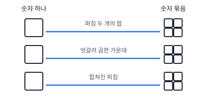

*왼쪽의 칸 하나와 오른쪽의 칸 묶음이 한 줄씩 짝을 이뤄요.*

**정확히 말하면**

가우시안 랜덤 벡터 $\mathcal{N}(\boldsymbol{\mu}_0, \Sigma_0)$의 PDF는 다음과 같아요. $\boldsymbol{\mu}_0$ 대신 $\boldsymbol{\mu}_1$, $\Sigma_0$ 대신 $\Sigma_1$을 넣으면 두 번째 PDF예요.

$$
f(\mathbf{x}) = (2\pi)^{-n/2}|\Sigma_0|^{-1/2}\exp\left(-\frac{1}{2}(\mathbf{x} - \boldsymbol{\mu}_0)^\top\Sigma_0^{-1}(\mathbf{x} - \boldsymbol{\mu}_0)\right)
$$

$n$차원 가우시안 밀도의 정규화 계수에는 $(2\pi)^{-n/2}$가 들어가요.

**결과(L04 s11).** 두 PDF의 곱은 상수배를 빼면 다음 가우시안 랜덤 벡터의 PDF예요.

$$
\mathcal{N}\left(\Sigma_1(\Sigma_0 + \Sigma_1)^{-1}\boldsymbol{\mu}_0 + \Sigma_0(\Sigma_0 + \Sigma_1)^{-1}\boldsymbol{\mu}_1,\ \Sigma_1(\Sigma_0 + \Sigma_1)^{-1}\Sigma_0\right)
$$

평균은 $n$차원 벡터, 공분산은 $n\times n$ 행렬이에요.

**스칼라와의 대응.** [두 가우시안의 곱: 스칼라 증명](#s3-product-scalar)의 결과와 한 항씩 맞춰 봐요.

$$
\mathcal{N}\left(\frac{\nu_1\mu_0 + \nu_0\mu_1}{\nu_0 + \nu_1}, \frac{\nu_0\nu_1}{\nu_0 + \nu_1}\right)
$$

| 스칼라 | 행렬 | 뜻 |
|---|---|---|
| 분모 $\nu_0 + \nu_1$ | $(\Sigma_0 + \Sigma_1)^{-1}$ | 두 분산의 합으로 나누기가 공분산 행렬 합의 역행렬이 돼요. |
| $\nu_1\mu_0$ | $\Sigma_1(\Sigma_0 + \Sigma_1)^{-1}\boldsymbol{\mu}_0$ | 두 번째의 분산 × 첫 번째의 평균 |
| $\nu_0\mu_1$ | $\Sigma_0(\Sigma_0 + \Sigma_1)^{-1}\boldsymbol{\mu}_1$ | 첫 번째의 분산 × 두 번째의 평균 |
| $\frac{\nu_0\nu_1}{\nu_0 + \nu_1}$ | $\Sigma_1(\Sigma_0 + \Sigma_1)^{-1}\Sigma_0$ | 두 분산의 곱을 합으로 나누기 |

평균은 두 항 모두 "상대편 분산 × 자기 평균"으로 엇갈려(cross) 곱해요. 행렬은 곱하는 순서를 바꿀 수 없어서, 나누기 대신 역행렬 $(\Sigma_0 + \Sigma_1)^{-1}$을 두 행렬 사이에 끼워요.

교과서 6.5.2절은 같은 곱을 $\mathcal{N}(\mathbf{x} \mid \mathbf{a}, A)\,\mathcal{N}(\mathbf{x} \mid \mathbf{b}, B) = c\,\mathcal{N}(\mathbf{x} \mid \mathbf{c}, C)$로 쓰고, $C = (A^{-1} + B^{-1})^{-1}$, $\mathbf{c} = C(A^{-1}\mathbf{a} + B^{-1}\mathbf{b})$를 줘요(식 6.74–6.75). 스칼라로 줄이면 $\frac{1}{C} = \frac{1}{\nu_0} + \frac{1}{\nu_1}$이라서 수업의 $\alpha$, $\beta$와 같은 꼴이에요. 앞의 상수 $c$는 식 (6.76)이고, 수업에서 "스케일만 맞추면"이라고 한 부분이에요.

**미룬 유도.** 행렬판 결과가 왜 이렇게 되는지는 다음 시간에 조교가 세 번째 토픽으로 증명해요. 미리 해 와도 좋다고 했어요.

#### 스칼라에서 기억한 두 자리를 행렬로 바꿔요

강의 공식을 연결하기 위한 재표현이에요. 임시 계수 $A=\Sigma_0^{-1}+\Sigma_1^{-1}$, $\mathbf b=\Sigma_0^{-1}\boldsymbol\mu_0+\Sigma_1^{-1}\boldsymbol\mu_1$를 두면 지수의 괄호가 $\mathbf x^\top A\mathbf x-2\mathbf b^\top\mathbf x+\text{const}$가 돼요. A는 대칭 양의 정부호인 행렬, b는 열벡터예요. 이 A,b는 아핀 변환의 계수와 다른 임시 이름이에요.

| 읽을 자리 | 스칼라 | 행렬 |
|---|---|---|
| 이차항 계수의 역 | 분산 $1/\alpha$ | 공분산 $A^{-1}$ |
| 위 결과×일차항 계수 | 평균 $(1/\alpha)\beta$ | 평균 $A^{-1}\mathbf b$ |

행렬에서는 곱 순서를 바꿀 수 없어요. 완전제곱과 강의 표기로의 상세 변형은 후속 [1012 행렬 곱 증명](../../1012/정리노트_1012_Several_Mathematical_Proofs.html#s2-product)에서 이어져요.

**교수님 말씀**

> "우리 조교가 세 번째 토픽으로 다음 시간에 요거를 증명해 줄 거예요."

> "요 증명을 사실 여러분들이 미리 해와도 좋겠죠?"

스칼라 식과 행렬 식을 나란히 놓고, 분모의 분산 합이 역행렬로 바뀌고 평균은 엇갈려 곱하는 구조가 같다고 짚었어요. 대응 정리는 집에 가서 해 보라고 했어요.

> "얘가 사실 얘랑 딱 일대일 대응돼 버린다."

$\nu_0$는 첫 번째, $\nu_1$은 두 번째 가우시안의 분산이에요.

**페이지 요약**

행렬판 곱의 결과는 스칼라 결과와 한 항씩 대응하고, 증명은 다음 시간에 조교가 해요.

*핵심 식*

- 행렬판 곱

  $$
  \mathcal{N}\left(\Sigma_1(\Sigma_0 + \Sigma_1)^{-1}\boldsymbol{\mu}_0 + \Sigma_0(\Sigma_0 + \Sigma_1)^{-1}\boldsymbol{\mu}_1,\ \Sigma_1(\Sigma_0 + \Sigma_1)^{-1}\Sigma_0\right)
  $$
- 스칼라판

  $$
  \mathcal{N}\left(\frac{\nu_1\mu_0 + \nu_0\mu_1}{\nu_0 + \nu_1}, \frac{\nu_0\nu_1}{\nu_0 + \nu_1}\right)
  $$

*용어*

- **공분산 행렬(covariance matrix)** — 스칼라 분산 $\nu$ 자리에 들어가는 $n\times n$ 행렬 $\Sigma$예요.

#### 조건·구분

같은 변수의 두 PDF 곱은 상수배를 맞춘 결과이고, 평균은 $n$벡터·공분산은 $n\times n$이에요. 행렬 곱 순서를 바꾸지 않아요. 본문의 정밀도 형태는 $C=(A^{-1}+B^{-1})^{-1}$, $\mathbf{c}=C(A^{-1}\mathbf{a}+B^{-1}\mathbf{b})$예요.

---

## 4. 베이지안 선형회귀의 결론

### 사후분포도 가우시안이다

*1007 수업 · L04 s12–s14*

**쉽게 말하면**

데이터를 보고 나면, 넓게 퍼져 있던 짐작이 한곳으로 좁게 모여요.

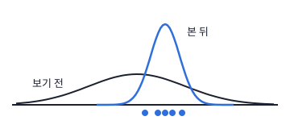

*모양은 그대로 종 모양이고, 폭이 좁아지고 가운데가 옮겨 가요.*

**정확히 말하면**

원래 증명하려던 것은 이거예요. 데이터 $(\mathbf{X}, \mathbf{y})$가 주어졌을 때 파라미터 $\boldsymbol{\theta}$는 가우시안 랜덤 벡터(Gaussian random vector)가 돼요.

$$
p(\boldsymbol{\theta} \mid \mathbf{X}, \mathbf{y}) = \mathcal{N}(\boldsymbol{\theta} \mid \mathbf{m}_N, \mathbf{S}_N)
$$

- 이것을 파라미터 사후분포(parameter posterior distribution)라고 해요.
- $\mathbf{m}_N$은 평균 벡터, $\mathbf{S}_N$은 공분산 행렬이에요. 아래첨자 $N$은 훈련 데이터의 개수예요.
- 사전분포 $p(\boldsymbol{\theta}) = \mathcal{N}(\mathbf{m}_0, \mathbf{S}_0)$도 가우시안이었으니, 데이터를 보기 전과 뒤 모두 가우시안이고 평균 벡터와 공분산 행렬만 바뀌어요.

수업에서 증명해 오라고 한 것들(아핀 변환, 가우시안 곱 등)을 해 보면 이 결과는 자연스럽게 유도돼요. 수업에서는 이 결론만 말하고 식은 읽지 않았어요.

같은 방법으로 L04 s14의 사후예측분포(posterior predictive distribution) $p(y_* \mid \mathbf{x}_*, \mathbf{X}, \mathbf{y})$도 가우시안 PDF가 돼요([θ를 넣었다 빼기: 사후예측분포](#s0-predictive)). $y_*$가 스칼라라서 스칼라 평균과 분산 하나씩을 갖는 가우시안이에요.

**결론:** 베이지안 선형회귀(Bayesian linear regression, BLR)는 추정치를 값 하나가 아니라 평균과 분산을 갖는 가우시안 랜덤 변수로 줘요.

이 토픽의 기존 사후분포 식은 후속 계산을 위한 예고·보충이에요. 앞 렘마의 자리에 넣을 이차항 계수는 $\mathbf S_0^{-1}+\sigma^{-2}\boldsymbol\Phi^\top\boldsymbol\Phi$, 일차항 벡터는 $\mathbf S_0^{-1}\mathbf m_0+\sigma^{-2}\boldsymbol\Phi^\top\mathbf y$예요. **첫 계수를 역행렬로 바꾸면 S_N, 그것을 둘째 벡터에 곱하면 m_N**으로 읽어요. likelihood가 θ에 관한 정규화된 밀도일 필요는 없고, 양의 정부호 prior와 고정 $\sigma^2\gt0$가 사후 이차항을 양의 정부호로 만들어요. 실제 전개는 [1014 사후평균·공분산](../../1014/정리노트_1014_Bayesian_Posterior_Prediction.html#s1-match)에서 이어 읽어요.

**교수님 말씀**

장군님 입에 정답 하나만 넣어 드리지 말고, 확률밀도함수를 통째로 드리자고 했던 이야기의 결론이에요([ML · MAP · 풀리 베이지안: 장군님께 보고하기](#s0-factory)). 장군님께 드리는 것은 평균과 분산을 갖는 가우시안 하나예요.

> "그 증명 한번 해 보시면 이거는 그냥 자연스럽게 유도돼요."

> "평균과 분산을 갖는 Gaussian random variable로 추정치를 이렇게 주는 거다."

**보충 · 수업에서 유도하진 않았어요**

슬라이드 L04 s12–s14와 교과서(MML Theorem 9.1, 9.3.4)에 적힌 흐름과 결과만 옮겨요. 계수 맞추기 같은 유도 전개는 하지 않아요. 수업에서는 이 식들을 읽지 않았어요.

왜 가우시안이 되는지의 흐름은 이래요(L04 s12 Proof Sketch, MML 9.3.3).

1. 가능도는 $p(\mathbf{y} \mid \mathbf{X}, \boldsymbol{\theta}) = \mathcal{N}(\mathbf{y} \mid \boldsymbol{\Phi}\boldsymbol{\theta}, \sigma^2\mathbf{I})$, 사전분포는 $p(\boldsymbol{\theta}) = \mathcal{N}(\boldsymbol{\theta} \mid \mathbf{m}_0, \mathbf{S}_0)$예요.
2. 사후분포는 둘의 곱에 비례해요. $p(\boldsymbol{\theta} \mid \mathbf{X}, \mathbf{y}) \propto p(\mathbf{y} \mid \mathbf{X}, \boldsymbol{\theta})\, p(\boldsymbol{\theta})$
3. 가능도는 $\boldsymbol{\theta}$에 대한 밀도가 아니라서 두 가우시안 밀도의 곱 공식을 바로 쓰지는 않아요. 대신 두 지수를 합치면 지수 안이 $\boldsymbol{\theta}$의 2차식이 돼요(MML (9.47b)).
4. 지수 안이 2차식이므로 렘마에 따라 가우시안이에요([렘마: 지수 안이 2차식이면 가우시안](#s3-lemma)). 2차항과 1차항의 계수를 맞추면 아래 $\mathbf{S}_N$, $\mathbf{m}_N$이 나와요.

$$
\mathbf{S}_N = (\mathbf{S}_0^{-1} + \sigma^{-2}\boldsymbol{\Phi}^\top\boldsymbol{\Phi})^{-1}
$$

$$
\mathbf{m}_N = \mathbf{S}_N(\mathbf{S}_0^{-1}\mathbf{m}_0 + \sigma^{-2}\boldsymbol{\Phi}^\top\mathbf{y})
$$

- $\mathbf{m}_0, \mathbf{S}_0$는 사전분포의 평균 벡터와 공분산 행렬, $\sigma^2$은 잡음의 분산이에요.
- $\boldsymbol{\Phi}$는 $n$번째 행이 $\boldsymbol{\phi}(\mathbf{x}_n)^\top$인 특징 행렬(feature matrix)이에요.
- 사후 정밀도 $\mathbf S_N^{-1}$에서 데이터 항의 계수는 잡음 분산의 역수 $\sigma^{-2}$예요(MML (9.43b)).
- 사후분포가 $\mathcal{N}(\mathbf{m}_N, \mathbf{S}_N)$이므로 최댓값 위치는 평균이에요. 그래서 $\boldsymbol{\theta}_{\text{MAP}} = \mathbf{m}_N$이에요.

사후예측분포의 결과는 이래요(L04 s14, MML (9.57c)).

$$
p(y_* \mid \mathbf{x}_*, \mathbf{X}, \mathbf{y}) = \mathcal{N}\big(y_* \mid \boldsymbol{\phi}(\mathbf{x}_*)^\top\mathbf{m}_N,\ \boldsymbol{\phi}(\mathbf{x}_*)^\top\mathbf{S}_N\boldsymbol{\phi}(\mathbf{x}_*) + \sigma^2\big)
$$

- 평균 $\boldsymbol{\phi}(\mathbf{x}_*)^\top\mathbf{m}_N$은 MAP 추정치로 낸 예측과 같아요.
- 분산의 $\boldsymbol{\phi}(\mathbf{x}_*)^\top\mathbf{S}_N\boldsymbol{\phi}(\mathbf{x}_*)$는 파라미터에 대한 불확실성, $\sigma^2$은 측정 잡음에서 와요.

**페이지 요약**

데이터를 본 뒤의 파라미터도 평균 벡터와 공분산 행렬을 갖는 가우시안이에요.

*핵심 식*

- 파라미터 사후분포

  $$
  p(\boldsymbol{\theta} \mid \mathbf{X}, \mathbf{y}) = \mathcal{N}(\boldsymbol{\theta} \mid \mathbf{m}_N, \mathbf{S}_N)
  $$

*용어*

- **파라미터 사후분포(parameter posterior distribution)** — 데이터를 본 뒤 파라미터의 분포
- **사후예측분포(posterior predictive distribution)** — 새 입력의 출력에 대한 분포, 스칼라 가우시안

#### 조건·구분

수업 외 보충 결과는 $\mathbf{S}_N=(\mathbf{S}_0^{-1}+\sigma^{-2}\Phi^\top\Phi)^{-1}$, $\mathbf{m}_N=\mathbf{S}_N(\mathbf{S}_0^{-1}\mathbf{m}_0+\sigma^{-2}\Phi^\top\mathbf{y})$예요. 슬라이드의 $\sigma^2$ 대신 전개식·교과서에 맞는 $\sigma^{-2}$를 쓰며, 이 식과 유도는 수업에서 읽지 않았어요. 가능도는 $\boldsymbol{\theta}$의 밀도가 아니므로 같은 변수의 밀도곱 공식을 바로 쓰지 않고 이차식을 비교해요. 이 가우시안에서 $\theta_{\mathrm{MAP}}=\mathbf{m}_N$이고, 예측평균은 $\phi_*^\top\mathbf{m}_N$, 분산은 $\phi_*^\top\mathbf{S}_N\phi_*+\sigma^2$로 파라미터 불확실성과 측정잡음을 구별해요.

---

### 회색 띠는 불확실성

*1007 수업 · L04 s15*

**쉽게 말하면**

한 줄로만 답하는 대신, "이 띠 안 어딘가에 있을 거예요" 하고 폭까지 알려 줘요.

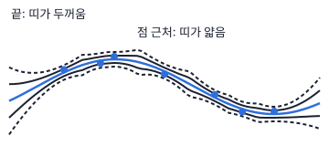

*이미 본 점 근처에서는 띠가 얇고, 아무 점도 없는 양 끝에서는 띠가 두꺼워요.*

**정확히 말하면**

L04 s15(교과서 Figure 9.10)는 세 칸으로 되어 있어요.

1. 왼쪽: 훈련 데이터(+ 표시)예요.
2. 가운데: MLE(파란 선)와 MAP(주황 선)의 예측 함수, 그리고 BLR이 주는 회색 띠예요.
3. 오른쪽: 사후분포에서 함수를 여러 번 뽑은 표본(빨간 선)이에요.

- **MLE·MAP**은 처음 보는 입력 $\mathbf{x}_*$에 값 하나를 줘요. 그래서 그림에서는 선 하나(함수)로 보여요. 두 추정은 서로 조금 다른 값을 내기도 해요.
- **BLR**은 값이 아니라 PDF를 줘요. 분포를 통째로 주니까 거기서 여러 번 뽑을 수 있고, 그렇게 뽑은 것이 빨간 선들이에요.

각 입력에서 예측분포의 평균을 $\mu$, 표준편차를 $\sigma$라고 하면, 짙은 회색은 $\mu \pm \sigma$, 옅은 회색은 $\mu \pm 2\sigma$ 구간이에요. 가우시안이면 이 구간에 드는 비율이 정해져 있어요(68–95–99.7 규칙).

$$
P(\mu - \sigma \le y \le \mu + \sigma) \approx 0.683
$$

$$
P(\mu - 2\sigma \le y \le \mu + 2\sigma) \approx 0.954
$$

$$
P(\mu - 3\sigma \le y \le \mu + 3\sigma) \approx 0.997
$$

(수업 중에는 1σ 안 65~66%, 2σ 안 95~96%, 3σ 안 98.몇 %라고 말했어요. 정확한 값은 위와 같아요. 교과서 그림 설명은 이 두 띠를 67%와 95% 구간이라고 적어요.)

- **훈련 데이터 근처에서는 분산이 확 줄어요.** 비슷한 점을 이미 측정했으니 불확실성(uncertainty)이 줄어든 거예요.
- 데이터가 없는 양 끝에서는 띠가 넓어져요. 그만큼 불확실성이 커요.
- 띠의 가운데 선은 예측분포의 평균이에요. 이것이 MAP 곡선과 같다는 결과는 [사후분포도 가우시안이다](#s4-posterior)의 보충에 있어요.

**교수님 말씀**

> "BLR, Bayesian linear regression은 어떻게 추정치를 주냐면 PDF로 줘요, PDF."

"짙은 회색과 옅은 회색의 물리적 의미가 뭡니까?"라는 가상의 학생 질문을 던지고, σ 구간으로 답했어요.

> "야, 쟤는 3 sigma 밖에 있는 놈이야." 이게 무슨 뜻이야? 4차원이야.

3σ 밖은 전체의 0.3%쯤이에요. 평균에서 한참 벗어난 엉뚱한 사람, 곧 "4차원"이라는 우스개예요.

> "매우 비슷한 놈을 이미 measure를 했기 때문에 … variance는 굉장히 줄죠."

**페이지 요약**

MLE·MAP은 선 하나를 주고, BLR은 평균 둘레의 띠로 불확실성까지 줘요.

*핵심 식*

- 1σ 구간

  $$
  P(\mu - \sigma \le y \le \mu + \sigma) \approx 0.683
  $$
- 2σ 구간

  $$
  P(\mu - 2\sigma \le y \le \mu + 2\sigma) \approx 0.954
  $$

*용어*

- **불확실성(uncertainty)** — 예측분포의 퍼짐, 데이터 근처에서 작아요
- **MLE · MAP** — 값 하나(함수 하나)를 주는 점추정

#### 조건·구분

그림의 빨간 곡선은 posterior에서 뽑은 함수 표본이에요. 이 그림에서 훈련점 근처 띠는 좁고 데이터 없는 양 끝은 넓으며, 띠 가운데는 예측평균이자 이 모형의 MAP 곡선이에요. $3\sigma$ 구간은 약 $0.997$이고 밖은 약 $0.3\%$예요.

---

## 5. 요약 · 예고

### 한 장 치트시트

*1007 수업 · L04 s5–s15*

1007 수업에서 쓴 식을 한 장에 모았어요. 이름을 누르면 그 식을 설명한 토픽으로 가요.

| 이름 | 식 | 한 줄 설명 |
|---|---|---|
| [공장](#s0-factory) | ML, MAP, fully Bayesian | ML과 MAP는 $\boldsymbol{\theta}$ 값 하나를 주고, fully Bayesian은 PDF 자체를 줘요. PDF가 있으면 ML과 MAP를 찍어 낼 수 있어요. |
| [선형 모델](#s0-features) | $y = \boldsymbol{\phi}(\mathbf{x})^\top\boldsymbol{\theta} + \epsilon$ | 특징 함수 $\boldsymbol{\phi}$를 거친 입력과 $\boldsymbol{\theta}$를 내적하고 노이즈를 더해요. |
| [다항 특징](#s0-features) | $\boldsymbol{\phi}(x) = [1, x, x^2, x^3]^\top$ | $x$에는 3차식이지만 $\boldsymbol{\theta}$가 주인공이면 선형이에요. |
| [노이즈](#s0-features) | $\epsilon \sim \mathcal{N}(0, \sigma^2)$ | 평균 0인 가우시안 노이즈예요. |
| [사전분포](#s0-predictive) | $p(\boldsymbol{\theta}) = \mathcal{N}(\mathbf{m}_0, \mathbf{S}_0)$ | 데이터를 보기 전에 $\boldsymbol{\theta}$를 가우시안 랜덤 벡터로 둬요. |
| [사후예측](#s0-predictive) | $p(y_* \mid \mathbf{x}_*, \mathbf{X}, \mathbf{y}) = \int p(y_* \mid \mathbf{x}_*, \boldsymbol{\theta})\,p(\boldsymbol{\theta} \mid \mathbf{X}, \mathbf{y})\,d\boldsymbol{\theta}$ | 없던 $\boldsymbol{\theta}$를 넣었다가 주변화로 빼요. 앞은 가능도, 뒤의 $p(\boldsymbol{\theta} \mid \mathbf{X}, \mathbf{y})$만 구하면 돼요. |
| [평균 벡터](#s1-mean) | $E[\mathbf{X}] = [E(X_1), \dots, E(X_n)]^\top$ | 랜덤 벡터의 성분마다 평균을 내서 모아요. |
| [분산](#s1-mean) | $\mathrm{var}[X] = E[X^2] - (E[X])^2$ | 편차 제곱의 평균, 퍼짐의 정도예요. |
| [공분산](#s1-covariance) | $\mathrm{cov}(X, Y) = E[XY] - E[X]E[Y]$ | $Y = X$를 넣으면 분산이 돼요. 분산은 공분산의 특수한 경우예요. |
| [벡터 공분산](#s1-covariance) | $\mathrm{cov}(\mathbf{X}, \mathbf{Y}) = E[\mathbf{X}\mathbf{Y}^\top] - E[\mathbf{X}]E[\mathbf{Y}]^\top$ | 열벡터 곱하기 행벡터라 행렬이 나와요. |
| [공분산 행렬](#s1-covariance) | $\Sigma_{\mathbf{X}} = \mathrm{cov}(\mathbf{X}, \mathbf{X})$ | 대각은 분산, 비대각은 공분산이고 대칭 행렬이에요. |
| [아핀 평균](#s1-affine) | $E[\mathbf{A}\mathbf{X} + \mathbf{b}] = \mathbf{A}E[\mathbf{X}] + \mathbf{b}$ | 기댓값은 선형 연산자라 상수가 밖으로 나와요. |
| [아핀 분산](#s1-affine) | $\mathrm{var}(\mathbf{A}\mathbf{X} + \mathbf{b}) = \mathbf{A}\Sigma_{\mathbf{X}}\mathbf{A}^\top$ | $\mathbf{b}$는 사라지고 $\mathbf{A}$가 양옆에 붙어요. 증명은 이번 주 숙제예요. |
| [교차 공분산](#s1-affine) | $\mathrm{cov}(\mathbf{X}, \mathbf{A}\mathbf{X} + \mathbf{b}) = \Sigma_{\mathbf{X}}\mathbf{A}^\top$ | 원래 벡터와 변환된 벡터의 공분산이에요. 증명은 숙제예요. 보충 규칙: 첫 입력 계수는 왼쪽, 둘째 입력 계수는 전치해서 오른쪽. |
| [벡터 PDF](#s2-pdf) | $f_{\mathbf{X}}(\mathbf{x}) = \frac{1}{\sqrt{(2\pi)^n\vert \Sigma\vert }}\exp\left(-\frac{1}{2}(\mathbf{x} - \boldsymbol{\mu})^\top\Sigma^{-1}(\mathbf{x} - \boldsymbol{\mu})\right)$ | $\mathbf{X} \sim \mathcal{N}(\boldsymbol{\mu}, \Sigma)$의 PDF예요. $\vert \Sigma\vert $는 행렬식, $\Sigma^{-1}$은 $1/\sigma^2$ 자리예요. |
| [행렬식 예](#s2-pdf) | $\vert \Sigma\vert  = 1 \cdot 3 - 0.1 \cdot 0.1 = 2.99$ | 대각 1, 3이고 비대각 0.1인 공분산 행렬의 예제예요. |
| [닫힌 성질](#s2-closure) | 주변분포, 조건부분포, 곱, 독립 합, 아핀 변환 | 가우시안으로 무엇을 해도 가우시안이에요. |
| [선형 결합](#s2-closure) | $aX_1 + bX_2 \sim \mathcal{N}(a\mu_1 + b\mu_2,\, a^2\sigma_1^2 + b^2\sigma_2^2)$ | 독립인 두 가우시안의 선형 결합이에요. |
| [렘마](#s3-lemma) | $c\exp\left(-\frac{1}{2}(\alpha x^2 - 2\beta x + \gamma)\right) \Rightarrow \mathcal{N}\left(\frac{\beta}{\alpha}, \frac{1}{\alpha}\right)$ | 지수 안이 2차식이면 완전제곱식으로 바꿔 가우시안을 읽어요. |
| [곱의 계수](#s3-product-scalar) | $\alpha = \frac{1}{\nu_0} + \frac{1}{\nu_1}, \quad \beta = \frac{\mu_0}{\nu_0} + \frac{\mu_1}{\nu_1}$ | 두 지수를 더해 $x^2$, $x$ 계수를 모아요. |
| [스칼라 곱](#s3-product-scalar) | $\mathcal{N}\left(\frac{\nu_1\mu_0 + \nu_0\mu_1}{\nu_0 + \nu_1}, \frac{\nu_0\nu_1}{\nu_0 + \nu_1}\right)$ | $\mathcal{N}(\mu_0, \nu_0)$와 $\mathcal{N}(\mu_1, \nu_1)$ 밀도의 곱을 스케일만 맞춘 결과예요. |
| [행렬판 평균](#s3-product-matrix) | $\Sigma_1(\Sigma_0 + \Sigma_1)^{-1}\boldsymbol{\mu}_0 + \Sigma_0(\Sigma_0 + \Sigma_1)^{-1}\boldsymbol{\mu}_1$ | 분모 $\nu_0 + \nu_1$이 $(\Sigma_0 + \Sigma_1)^{-1}$로 바뀌어요. |
| [행렬판 분산](#s3-product-matrix) | $\Sigma_1(\Sigma_0 + \Sigma_1)^{-1}\Sigma_0$ | 스칼라의 $\frac{\nu_0\nu_1}{\nu_0 + \nu_1}$에 대응해요. 증명은 조교 몫이에요. |
| [사후분포](#s4-posterior) | $p(\boldsymbol{\theta} \mid \mathbf{X}, \mathbf{y}) = \mathcal{N}(\boldsymbol{\theta} \mid \mathbf{m}_N, \mathbf{S}_N)$ | 데이터를 본 뒤의 $\boldsymbol{\theta}$도 가우시안 랜덤 벡터예요. |
| [사후 공분산](#s4-posterior) | $\mathbf{S}_N = (\mathbf{S}_0^{-1} + \sigma^{-2}\boldsymbol{\Phi}^\top\boldsymbol{\Phi})^{-1}$ | 교과서 (9.43b) 식이에요. 데이터 항에는 잡음 분산의 역수가 곱해져요. 유도는 수업에서 하지 않았어요. |
| [회색 띠](#s4-blr-figure) | $\pm 1\sigma \approx 68\%, \quad \pm 2\sigma \approx 95\%$ | 짙은 회색은 1σ, 옅은 회색은 2σ 구간이에요. 훈련 데이터 근처에서 띠가 좁아져요. |
| 계수에서 복원 | 곱한 지수의 이차항 계수를 역으로 → 공분산. 그 공분산×일차항 벡터 → 평균. 정규화 상수는 별도로 맞춰요. |  |

---

### 다음 시간 예고 (아직 안 배움)

*1007 수업 · L04 s11–s23*

수업에서 제목만 나왔거나 뒤로 미룬 내용이에요. 다음 주 월요일에 조교가 세 가지를 풀어 줘요.

- 조교 토픽 ①: $\mathbf{A}\mathbf{X} + \mathbf{b}$의 분산 $\mathbf{A}\Sigma_{\mathbf{X}}\mathbf{A}^\top$과 $\mathrm{cov}(\mathbf{X}, \mathbf{Y}) = \Sigma_{\mathbf{X}}\mathbf{A}^\top$ 증명이에요. 이번 주 숙제로 먼저 손으로 해 봐요.
- 조교 토픽 ②: 가우시안 랜덤 벡터 PDF 계산 예제예요.
- 조교 토픽 ③: 행렬판 가우시안 곱 증명이에요. 미리 해 와도 좋다고 하셨어요.
- 스칼라 곱의 전개("산수니까 해 보세요")와 행렬판 대응 정리: 학생 몫으로 남겼어요.
- 손으로 푸는 숙제: 다음 주 월요일쯤 나가고, 중간고사 전에 풀이해 줘요.
- 파라미터 사후분포의 $\mathbf{m}_N$, $\mathbf{S}_N$ 유도(L04 s12–s13): 결과가 가우시안이라는 것만 말했어요.
- 사후예측분포 적분의 실제 계산(L04 s14): 스칼라 가우시안이 된다는 결론만 말했어요.
- 주변 가능도(marginal likelihood, L04 s16): 이날 시작하지 않았어요.
- 최대우도의 정사영 해석(ML as Orthogonal Projection, L04 s17–s23): 이날 시작하지 않았어요.

---

### 함께 보면 좋은 자료

*1007 수업 · L04*

- [복습문제 풀러 가기 (1007 수업 범위 8문제)](복습문제_1007_Product_of_Gaussians.md)
- [지난 시간 0930 정리노트: 함께 보면 좋은 자료](../../0930/정리노트_0930_Bayesian_Linear_Regression.html#s5-links)
- [추가 강의 Lecture 12: Statistical Inference Part 3 (통계적 추론 3)](../../../강의노트/추가%20강의/eli5_lecture12_statistical_inference_part3.html)

복습문제 8문항

- [문제지 PDF](../복습문제_1007_Product_of_Gaussians-문제.pdf)
- [해설지 PDF](../복습문제_1007_Product_of_Gaussians-답안.pdf)

---

출처: 정방철 교수님 강의자료(Lecture04) · 수업 녹음 전사(1007) · Deisenroth, Faisal, Ong, *Mathematics for Machine Learning* (2020) 6장 · 9장.
