# 조교 증명 세 개 — 5살도 이해하는 정리노트

정방철 교수님 머신러닝기초 · 1012 조교 수업 (TA Lecture #1, Lecture04 s7–s11, MML 6장)

> `정리노트_1012_Several_Mathematical_Proofs.html`를 마크다운으로 옮겼어요. 그림은 `figures_1012/` 폴더의 SVG, 위젯은 대표 설정의 정적 그림으로 바꿨어요. 수식은 `$…$` / `$$…$$`라서 GitHub, Obsidian, Typora에서 보여요.

## 먼저 큰 그림: 가우시안 계산에 필요한 세 도구를 증명해요

**오늘의 질문.** 다음에 사후분포와 예측분포를 계산할 수 있도록, 평균·공분산의 변환과 가우시안 밀도의 모양을 확인해요.

이번 시간의 증명은 서로 다른 역할을 해요. 선형변환은 불확실성의 전달, 변수변환은 밀도의 크기, 가우시안의 곱은 데이터와 사전분포의 결합을 담당해요.

| 구분 | 무엇을 하나요? | 무엇이 남나요? |
|---|---|---|
| 아핀 변환 | 확률벡터를 늘리고 옮김 | 바뀐 평균·공분산 |
| 변수변환 | 좌표의 부피가 바뀜 | 적분값을 보존하는 밀도 |
| 가우시안의 곱 | 두 이차식을 결합 | 정규화 전 새 가우시안 모양 |

**구할 결과.** 이 공식을 암기하는 데서 끝내지 않고, 어느 계산에 어떤 도구가 필요한지 구별하는 것이 목표예요.

**수식이 하는 일.** 평균의 선형성은 중심을 옮기고, 공분산의 양쪽 행렬은 흔들림의 전달을 계산해요. 행렬식은 부피 배율을, 완전제곱은 분포의 중심과 퍼짐을 찾아요.

**헷갈리기 쉬운 점.** 분산은 표준편차가 아니에요. 행렬 공분산에는 양쪽 계수와 전치가 필요하고, 밀도 변환에는 절대 부피 배율이 필요해요.

**목차**

- [먼저 큰 그림](#s0-learning-map)

- [0. 아핀 변환의 평균·분산·교차공분산](#s0)
  - [평균은 같은 꼴로 따라가요](#s0-mean)
  - [분산은 양쪽에 A와 A의 전치](#s0-variance)
  - [교차공분산은 A의 전치가 한 번](#s0-cross)
- [1. 다변량 가우시안 PDF 유도](#s1)
  - [목표 식과 표준정규에서 출발](#s1-goal)
  - [X = LZ + μ로 원하는 가우시안 만들기](#s1-lz)
  - [넓이가 6배면 밀도는 6분의 1](#s1-area)
  - [determinant는 크기 배율, 일반화는 Jacobian](#s1-jacobian)
  - [역변환으로 지수부 정리](#s1-inverse)
  - [det Σ = (det L)²로 완성](#s1-det)
- [2. 두 가우시안의 곱](#s2)
  - [스칼라 Lemma: 완전제곱](#s2-lemma)
  - [스칼라 가우시안 두 개의 곱](#s2-scalar)
  - [행렬판 Lemma](#s2-matrix-lemma)
  - [두 다변량 가우시안의 곱](#s2-product)
  - [강의자료 모양으로 다시 쓰기](#s2-rewrite)
- [3. 요약 · 예고](#s3)
  - [한 장 요약](#s3-cheatsheet)
  - [다음에 이어질 내용 (아직 안 배움)](#s3-next)
  - [함께 보면 좋은 자료](#s3-links)

## 0. 아핀 변환의 평균·분산·교차공분산

### 평균은 같은 꼴로 따라가요

*1012 수업 · TA1 s3 · L04 s7*

**쉽게 말하면**

점 무리를 늘리고 옮기면, 무리의 가운데도 똑같이 늘리고 옮긴 자리로 가요.

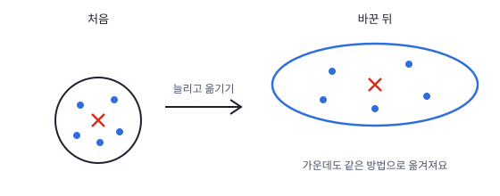

*엑스 표시는 무리의 가운데이고, 점들과 같은 규칙으로 따라가요.*

**정확히 말하면**

**문제 설정 (TA1 s3).** 지난주(1007) L04 s7에 "Please prove"로 남은 아핀 변환(affine transformation) 성질을 조교가 증명했어요.

$$
\mathbf{Y} = \mathbf{A}\mathbf{X} + \mathbf{b}
$$

- $\mathbf{X} \in \mathbb{R}^n$: 확률벡터(random vector)
- $\mathbf{A} \in \mathbb{R}^{m\times n}$: 상수 행렬(deterministic matrix)
- $\mathbf{b} \in \mathbb{R}^m$: 상수 벡터(deterministic vector)

$\mathbf{X}$의 평균 벡터와 공분산 행렬은 유한하다고 가정하고 다음처럼 써요.

$$
\boldsymbol{\mu}_X = \mathbb{E}[\mathbf{X}]
$$

$$
\boldsymbol{\Sigma}_X = \mathbb{E}[(\mathbf{X}-\boldsymbol{\mu}_X)(\mathbf{X}-\boldsymbol{\mu}_X)^T]
$$

**(1) 평균의 유도.** 기댓값은 적분으로 정의되므로 선형 연산자(linear operator)예요.

$$
\mathbb{E}[\mathbf{U}+\mathbf{V}] = \mathbb{E}[\mathbf{U}] + \mathbb{E}[\mathbf{V}]
$$

1. 정의대로 기댓값을 취하고 합을 나눠요.

   $$
   \mathbb{E}[\mathbf{Y}] = \mathbb{E}[\mathbf{A}\mathbf{X} + \mathbf{b}] = \mathbb{E}[\mathbf{A}\mathbf{X}] + \mathbb{E}[\mathbf{b}]
   $$
2. $\mathbf{A}$는 deterministic이라 기댓값 밖으로 나와요.

   $$
   \mathbb{E}[\mathbf{Y}] = \mathbf{A}\mathbb{E}[\mathbf{X}] + \mathbb{E}[\mathbf{b}]
   $$
3. 상수 벡터의 기댓값은 자기 자신이에요.

   $$
   \mathbb{E}[\mathbf{Y}] = \mathbf{A}\mathbb{E}[\mathbf{X}] + \mathbf{b}
   $$

크기도 맞아요. $\mathbf{A}\mathbb{E}[\mathbf{X}]$는 $(m\times n)(n\times 1)$이라 $m\times 1$이고, $\mathbf{b}$와 더할 수 있어요.

**결과의 뜻.** 평균은 원래 변환과 같은 아핀 꼴로 그대로 이동해요. 스칼라에서 $\mathbb{E}[aX+b] = a\mathbb{E}[X]+b$인 것과 같은 모양이에요.

**교수님 말씀**

1012 수업은 교수님 대신 조교가 진행했어요(TA Lecture #1). 지난주 강의자료의 세 토픽을 하나씩 증명하겠다고 하며 이 아핀 변환부터 시작했어요.

> "본인 스스로 유도해 보는 것도 괜찮을 것 같아서" (1012 Part 01 ~00:10)

조교는 기댓값이 적분으로 정의되어 있으니 linear operator라서 덧셈을 나눌 수 있다고 했어요. 또 기댓값은 랜덤한 것에만 의미가 있는 연산이라, 여기서 랜덤한 것은 $\mathbf{X}$뿐이라고 짚었어요.

> "random variable에 대해서만 의미가 있는 오퍼레이터" (1012 Part 01 ~00:33)

그래서 $\mathbf{A}$는 밖으로 나오고, $\mathbf{b}$는 deterministic이라 기댓값을 취해도 그대로 $\mathbf{b}$가 나온다고 설명했어요.

**페이지 요약**

기댓값은 선형이라 상수 행렬은 밖으로 나오고 상수 벡터는 그대로 남아요.

*핵심 식*

- 선형성

  $$
  \mathbb{E}[\mathbf{U}+\mathbf{V}] = \mathbb{E}[\mathbf{U}] + \mathbb{E}[\mathbf{V}]
  $$
- 아핀 변환의 평균

  $$
  \mathbb{E}[\mathbf{Y}] = \mathbf{A}\mathbb{E}[\mathbf{X}] + \mathbf{b}
  $$

*용어*

- **선형 연산자(linear operator)** — 합을 나누고 상수를 밖으로 꺼낼 수 있는 연산이에요.
- **상수(deterministic)** — 랜덤하지 않은 값으로, 기댓값 밖으로 나와요.

---

### 분산은 양쪽에 A와 A의 전치

*1012 수업 · TA1 s4 · L04 s7*

**쉽게 말하면**

점 무리를 늘리면 퍼진 정도가 커지지만, 통째로 옮기기만 하면 퍼진 정도는 그대로예요.

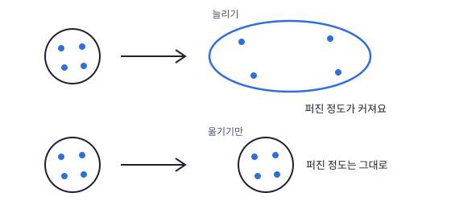

*위쪽은 늘려서 테두리가 커졌고, 아래쪽은 옮기기만 해서 테두리 크기가 같아요.*

**정확히 말하면**

**스칼라에서 출발해요.** 스칼라 확률변수 $x$와 상수 $a$, $b$에 대해 다음이 성립해요.

$$
\mathrm{Var}(ax+b) = a^2\,\mathrm{Var}(x) = a\,\mathrm{Var}(x)\,a
$$

평균을 뺄 때 $b$가 사라지고, 계수 $a$는 두 편차에서 하나씩 나와요. 벡터에서도 같은 일이 일어나는데, 계수가 행렬이라 곱하는 자리가 중요해져요.

**(2) 분산의 정의 (TA1 s4).**

$$
\mathrm{Var}[\mathbf{Y}] = \mathbb{E}[(\mathbf{Y}-\mathbb{E}[\mathbf{Y}])(\mathbf{Y}-\mathbb{E}[\mathbf{Y}])^T]
$$

1. [평균은 같은 꼴로 따라가요](#s0-mean)의 결과를 빼면 $\mathbf{b}$가 지워져요.

   $$
   \mathbf{Y} - \mathbb{E}[\mathbf{Y}] = \mathbf{A}\mathbf{X} + \mathbf{b} - (\mathbf{A}\mathbb{E}[\mathbf{X}] + \mathbf{b})
   $$

   $$
   \mathbf{Y} - \mathbb{E}[\mathbf{Y}] = \mathbf{A}(\mathbf{X} - \mathbb{E}[\mathbf{X}])
   $$
2. 정의에 대입해요.

   $$
   \mathrm{Var}[\mathbf{Y}] = \mathbb{E}\left[\mathbf{A}(\mathbf{X}-\boldsymbol{\mu}_X)\{\mathbf{A}(\mathbf{X}-\boldsymbol{\mu}_X)\}^T\right]
   $$
3. 곱의 전치는 순서가 뒤집혀요.

   $$
   (\mathbf{A}\mathbf{B})^T = \mathbf{B}^T\mathbf{A}^T
   $$

   $$
   \mathrm{Var}[\mathbf{Y}] = \mathbb{E}\left[\mathbf{A}(\mathbf{X}-\boldsymbol{\mu}_X)(\mathbf{X}-\boldsymbol{\mu}_X)^T\mathbf{A}^T\right]
   $$
4. $\mathbf{A}$와 $\mathbf{A}^T$는 deterministic이라 기댓값 밖으로 나와요. 왼쪽 것은 왼쪽으로, 오른쪽 것은 오른쪽으로 나와요.

   $$
   \mathrm{Var}[\mathbf{Y}] = \mathbf{A}\,\mathbb{E}\left[(\mathbf{X}-\boldsymbol{\mu}_X)(\mathbf{X}-\boldsymbol{\mu}_X)^T\right]\mathbf{A}^T
   $$

   $$
   \mathrm{Var}[\mathbf{Y}] = \mathbf{A}\,\mathrm{Var}[\mathbf{X}]\,\mathbf{A}^T = \mathbf{A}\boldsymbol{\Sigma}_X\mathbf{A}^T
   $$

**결과의 뜻.** 분산은 평행이동 $\mathbf{b}$와 무관해요. 그리고 $\mathbf{A}$가 두 번 곱해지므로 $\mathbf{A}$에 대해 2차(quadratic)로 커져요. 스칼라의 $a^2$에 해당하는 부분이에요.

**스칼라 대응에서 조심할 점.** 스칼라의 $a\,\mathrm{Var}(x)\,a$가 벡터에서 $\mathbf{A}\boldsymbol{\Sigma}_X\mathbf{A}^T$가 돼요. "$a^2$를 $\mathbf{A}\mathbf{A}^T$로 바꾼다"고만 외우면 $\boldsymbol{\Sigma}_X$의 자리를 잃어요. 행렬 곱은 순서를 바꿀 수 없으니, $\boldsymbol{\Sigma}_X$는 언제나 $\mathbf{A}$와 $\mathbf{A}^T$ 사이에 있어요.

(수업 밖 확인 예제)

**성분 가중합으로 확인하기.** 행렬식을 잊어도 성분으로 풀면 스칼라 계산으로 돌아가요. $\mathbf{X}=[X_1,X_2]^T$이고 다음과 같다고 해 볼게요($m=1$, $n=2$).

$$
{\mathbf{A}=\begin{bmatrix}2 & 3\end{bmatrix}},\qquad{\boldsymbol{\Sigma}_X=\begin{bmatrix}4 & 1 \\ 1 & 9\end{bmatrix}}
$$

그러면 $Y=2X_1+3X_2+b$는 스칼라 하나예요. 스칼라 분산의 성질로 직접 계산하면 교차항이 함께 들어가요.

$$
\mathrm{Var}(2X_1+3X_2) = 2^2\cdot 4 + 2\cdot 2\cdot 3\cdot 1 + 3^2\cdot 9 = 109
$$

행렬식으로 계산해도 같아요.

$$
\mathbf{A}\boldsymbol{\Sigma}_X\mathbf{A}^T = \begin{bmatrix}11 & 29\end{bmatrix}\begin{bmatrix}2 \\ 3\end{bmatrix} = 109
$$

가운데 항 $12$는 $\mathrm{Cov}(X_1,X_2)=1$에서 나와요. 이를 빼고 $97$로 계산했다면 대각 밖 원소를 빠뜨린 거예요.

**크기 검사.** $\mathbf{A}\in\mathbb{R}^{m\times n}$이면 $(m\times n)(n\times n)(n\times m)$이라 $\mathrm{Var}[\mathbf{Y}]$는 $m\times m$이에요. $\mathbf{Y}$ 성분끼리의 표이므로 $(i,j)$ 원소는 $\mathrm{Cov}(Y_i,Y_j)$예요. 같은 벡터끼리의 공분산(자기 공분산)이라 대칭이에요. 크기가 맞는다는 것만으로 식이 옳다고 증명되지는 않으니, 유도의 점검 도구로 써요.

**교수님 말씀**

조교는 평균 때처럼 정의에 "곧이곧대로" 넣어 보자고 했어요. 앞에서 구한 $\mathbb{E}[\mathbf{Y}]$를 그대로 빼서 편차를 만들었어요.

"transpose 같은 경우는 이제 순서가 바뀌잖아요"라며 ${(\mathbf{A}\mathbf{B})^T = \mathbf{B}^T\mathbf{A}^T}$를 썼어요. 그다음 랜덤한 것은 $\mathbf{X}$에 관한 부분뿐이니 deterministic한 $\mathbf{A}$는 밖으로 나온다고 했어요.

증명을 마친 뒤, 이 변환이 뒤의 증명에 중요하다며 칠판에 결과식을 다시 정리했어요.

분산은 평행이동하는 양 $\mathbf{b}$와 관계가 없고, 선형변환 $\mathbf{A}$에 대해 2차식, 즉 quadratic 형태로 커진다고 정리했어요(1012 Part 01 ~05:52).

**꼭 기억해요**

> "affine transformation이 뒤에 있는 증명에 굉장히 중요" (1012 Part 01 ~05:52)

**페이지 요약**

편차에서 b가 지워지고, A는 왼쪽에, A의 전치는 오른쪽에 붙어요.

*핵심 식*

- 편차

  $$
  \mathbf{Y} - \mathbb{E}[\mathbf{Y}] = \mathbf{A}(\mathbf{X} - \mathbb{E}[\mathbf{X}])
  $$
- 전치 규칙

  $$
  (\mathbf{A}\mathbf{B})^T = \mathbf{B}^T\mathbf{A}^T
  $$
- 아핀 변환의 분산

  $$
  \mathrm{Var}[\mathbf{Y}] = \mathbf{A}\,\mathrm{Var}[\mathbf{X}]\,\mathbf{A}^T = \mathbf{A}\boldsymbol{\Sigma}_X\mathbf{A}^T
  $$

*용어*

- **2차(quadratic)** — 분산은 A가 두 번 곱해져 A에 대해 2차로 커지고, b와는 무관해요.

---

### 교차공분산은 A의 전치가 한 번

*1012 수업 · TA1 s5 · L04 s7*

**쉽게 말하면**

처음 값이 커질 때 바뀐 값이 얼마나 같이 커지거나 작아지는지 재는 거예요.

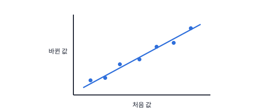

*색칠된 점들이 오른쪽 위로 늘어서 있으면 처음 값이 클 때 바뀐 값도 커요.*

**정확히 말하면**

**(3) 교차공분산의 정의 (TA1 s5).** 두 확률벡터 $\mathbf{X}\in\mathbb{R}^n$, $\mathbf{Y}\in\mathbb{R}^m$의 교차공분산(cross-covariance) 행렬이에요.

$$
\mathrm{Cov}(\mathbf{X},\mathbf{Y}) = \mathbb{E}[(\mathbf{X}-\boldsymbol{\mu}_X)(\mathbf{Y}-\boldsymbol{\mu}_Y)^T]
$$

열벡터 $(n\times 1)$ 곱하기 행벡터 $(1\times m)$이라 결과는 $n\times m$ 표예요. 첫 입력이 행을, 둘째 입력이 열을 정해요.

$$
[\mathrm{Cov}(\mathbf{X},\mathbf{Y})]_{ij} = \mathrm{Cov}(X_i,Y_j)
$$

1. [평균은 같은 꼴로 따라가요](#s0-mean)에서 ${\boldsymbol{\mu}_Y = \mathbf{A}\boldsymbol{\mu}_X + \mathbf{b}}$이므로

   $$
   \mathbf{Y} - \boldsymbol{\mu}_Y = \mathbf{A}(\mathbf{X}-\boldsymbol{\mu}_X)
   $$
2. 정의에 대입해요. $\mathbf{X}$ 쪽은 그대로 두어요.

   $$
   \mathrm{Cov}(\mathbf{X},\mathbf{Y}) = \mathbb{E}\left[(\mathbf{X}-\boldsymbol{\mu}_X)\{\mathbf{A}(\mathbf{X}-\boldsymbol{\mu}_X)\}^T\right]
   $$
3. ${(\mathbf{A}\mathbf{B})^T = \mathbf{B}^T\mathbf{A}^T}$로 전치를 풀어요.

   $$
   \mathrm{Cov}(\mathbf{X},\mathbf{Y}) = \mathbb{E}\left[(\mathbf{X}-\boldsymbol{\mu}_X)(\mathbf{X}-\boldsymbol{\mu}_X)^T\mathbf{A}^T\right]
   $$
4. $\mathbf{A}^T$는 deterministic이라 오른쪽으로 나와요.

   $$
   \mathrm{Cov}(\mathbf{X},\mathbf{Y}) = \mathbb{E}\left[(\mathbf{X}-\boldsymbol{\mu}_X)(\mathbf{X}-\boldsymbol{\mu}_X)^T\right]\mathbf{A}^T
   $$

   $$
   \mathrm{Cov}(\mathbf{X},\mathbf{Y}) = \boldsymbol{\Sigma}_X\mathbf{A}^T
   $$

**전치가 왜 오른쪽에 붙을까요.** 정의에서 둘째 입력의 편차는 전치되어 행벡터가 돼요. 그 편차가 $\mathbf{A}(\mathbf{X}-\boldsymbol{\mu}_X)$이니, 전치하면 순서가 뒤집혀 $\mathbf{A}^T$가 맨 오른쪽 끝에 와요. 첫 입력 $\mathbf{X}$에는 변환이 없으니 왼쪽에는 아무것도 붙지 않아요. 그래서 분산과 달리 $\mathbf{A}$가 한 번만, 전치된 채로 곱해져요.

기억할 문장: 첫 입력의 계수는 왼쪽에, 둘째 입력의 계수는 전치해서 오른쪽에 붙고, 더한 상수는 사라져요. [분산은 양쪽에 A와 A의 전치](#s0-variance)는 두 입력이 모두 $\mathbf{Y}$인 경우예요.

(수업 밖 확인 예제)

**성분 가중합으로 확인하기.** [분산은 양쪽에 A와 A의 전치](#s0-variance)와 같은 예, $\mathbf{A}=[2\;\;3]$와 $\boldsymbol{\Sigma}_X$의 대각이 $4, 9$, 대각 밖이 $1$인 경우예요. $Y=2X_1+3X_2+b$이므로 스칼라 공분산의 선형성으로 한 성분씩 구해요.

$$
\mathrm{Cov}(X_1,Y) = 2\,\mathrm{Var}(X_1) + 3\,\mathrm{Cov}(X_1,X_2) = 8 + 3 = 11
$$

$$
\mathrm{Cov}(X_2,Y) = 2\,\mathrm{Cov}(X_2,X_1) + 3\,\mathrm{Var}(X_2) = 2 + 27 = 29
$$

두 값을 열로 모으면 $2\times 1$ 행렬이고, $\boldsymbol{\Sigma}_X\mathbf{A}^T$를 직접 곱한 값과 같아요.

$$
\boldsymbol{\Sigma}_X\mathbf{A}^T = \begin{bmatrix}4 & 1 \\ 1 & 9\end{bmatrix}\begin{bmatrix}2 \\ 3\end{bmatrix} = \begin{bmatrix}11 \\ 29\end{bmatrix}
$$

**크기 검사.** $\mathbf{A}\in\mathbb{R}^{m\times n}$일 때 세 결과의 크기를 비교해요.

| 양 | 곱의 크기 | 결과 크기 |
|---|---|---|
| $\mathbb{E}[\mathbf{Y}]$ | $(m\times n)(n\times 1)$ | $m\times 1$ |
| $\mathrm{Var}[\mathbf{Y}]$ | $(m\times n)(n\times n)(n\times m)$ | $m\times m$ |
| $\mathrm{Cov}(\mathbf{X},\mathbf{Y})$ | $(n\times n)(n\times m)$ | $n\times m$ |

**교차 공분산과 자기 공분산은 달라요.** ${\boldsymbol{\Sigma}_X=\mathrm{Cov}(\mathbf{X},\mathbf{X})}$와 $\mathrm{Var}[\mathbf{Y}]$는 같은 벡터끼리라 정사각이고 대칭이에요. 교차공분산 $\mathrm{Cov}(\mathbf{X},\mathbf{Y})$는 $m\ne n$이면 직사각형이고, 정사각이어도 대칭일 필요가 없어요. 그래서 교차공분산을 $\boldsymbol{\Sigma}$로 부르지 않아요. 입력 순서를 바꾸면 행과 열이 바뀌어요.

$$
\mathrm{Cov}(\mathbf{Y},\mathbf{X}) = \mathrm{Cov}(\mathbf{X},\mathbf{Y})^T
$$

$\boldsymbol{\Sigma}_X$가 대칭이므로 ${(\boldsymbol{\Sigma}_X\mathbf{A}^T)^T = \mathbf{A}\boldsymbol{\Sigma}_X^T = \mathbf{A}\boldsymbol{\Sigma}_X}$예요. 위 예에서는 $[11\;\;29]$인 $1\times 2$ 행렬이에요. 이 순서 바꾼 식은 수업에서 따로 다루지 않았고, 정의와 전치 규칙으로 확인한 거예요.

$$
\mathrm{Cov}(\mathbf{Y},\mathbf{X}) = \mathbf{A}\boldsymbol{\Sigma}_X \in \mathbb{R}^{m\times n}
$$

**covariance와 correlation.** 교차공분산은 "$X_i$가 커질 때 $Y_j$가 같이 커지는지 작아지는지"를 재요. 조교는 이를 "정확하게는 correlation"이라고 덧붙였지만, 두 양은 달라요. 여기서 계산한 것은 covariance예요. correlation은 covariance를 두 표준편차로 나눠 정규화한 값이에요.

$$
\rho(X_i,Y_j) = \frac{\mathrm{Cov}(X_i,Y_j)}{\sqrt{\mathrm{Var}(X_i)}\sqrt{\mathrm{Var}(Y_j)}}
$$

부호(같이 커지는지 반대로 가는지)는 둘이 같아요. 크기는 covariance는 단위에 따라 달라지고, correlation은 $-1$에서 $1$ 사이로 맞춰져요.

**스스로 확인해 볼 점.** $(i,j)$ 원소가 어느 성분끼리의 공분산인지, 결과가 $n\times m$인지 $m\times n$인지, $\mathbf{A}^T$가 왜 오른쪽에 붙는지를 기호 없이 말로 설명할 수 있는지 점검해요.

**교수님 말씀**

조교는 cross-covariance가 $\mathbf{X}$의 편차와 $\mathbf{Y}$의 편차로 정의된다고 하고, 그 뜻을 이렇게 설명했어요.

> "x가 예를 들어 이만큼 증가할 때 y는 얼마만큼 증가할까, 혹은 감소할까" (1012 Part 01 ~04:24)

이어서 "정확하게는 correlation이라고 생각하시면 됩니다"라고 했어요. 계산한 양은 covariance이고, correlation은 이를 표준편차로 정규화한 값이에요(말실수 정정).

유도는 분산과 같은 순서였어요. 대입하고, transpose 순서를 바꾸고, deterministic한 $\mathbf{A}^T$를 밖으로 꺼냈어요. 결과식을 정리하며 교차공분산은 $\mathbf{X}$의 분산에 $\mathbf{A}$만큼이 곱해진 형태라고 했어요.

세 결과식은 이어지는 다변량 가우시안 PDF 유도에서 증명 없이 그대로 쓰여요.

**꼭 기억해요**

> "뒤부터는 증명 없이 다 쓸 거니까, 요 형태를 좀 기억해 두시면" (1012 Part 01 ~06:53)

평균, 분산, 교차공분산 세 결과식은 이후 유도에서 증명 없이 바로 쓰여요.

**페이지 요약**

둘째 입력의 편차만 변환되니 A의 전치가 오른쪽에 한 번 붙고, 결과는 대칭이 아닐 수 있는 n×m 행렬이에요.

*핵심 식*

- 교차공분산

  $$
  \mathrm{Cov}(\mathbf{X},\mathbf{Y}) = \boldsymbol{\Sigma}_X\mathbf{A}^T
  $$
- 원소 배치

  $$
  [\mathrm{Cov}(\mathbf{X},\mathbf{Y})]_{ij} = \mathrm{Cov}(X_i,Y_j)
  $$
- 순서 바꾸기

  $$
  \mathrm{Cov}(\mathbf{Y},\mathbf{X}) = \mathrm{Cov}(\mathbf{X},\mathbf{Y})^T
  $$

*용어*

- **교차공분산(cross-covariance)** — 서로 다른 두 확률벡터의 성분끼리 공분산을 모은 표예요.
- **상관(correlation)** — covariance를 두 표준편차로 나눠 정규화한 값이에요.

---

## 1. 다변량 가우시안 PDF 유도

### 목표 식과 표준정규에서 출발

*1012 수업 · TA1 s6 · L04 s8*

**쉽게 말하면**

가장 기본 모양의 종 하나에서 시작해, 늘리고 옮겨서 원하는 종을 만들어요.

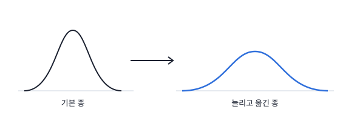

*기본 종 하나만 잘 알면 어떤 종이든 거기서 만들 수 있어요.*

**정확히 말하면**

목표는 $n$차원 가우시안 확률벡터 $\mathbf{X} \sim \mathcal{N}(\boldsymbol{\mu}, \boldsymbol{\Sigma})$의 PDF를 유도하는 거예요. $\boldsymbol{\mu} \in \mathbb{R}^n$은 평균 벡터, $\boldsymbol{\Sigma} \in \mathbb{R}^{n\times n}$은 positive-definite 공분산 행렬이에요.

$$
f_{\mathbf{X}}(\mathbf{x}) = \frac{1}{\sqrt{(2\pi)^n|\boldsymbol{\Sigma}|}}\exp\left(-\frac{1}{2}(\mathbf{x}-\boldsymbol{\mu})^T\boldsymbol{\Sigma}^{-1}(\mathbf{x}-\boldsymbol{\mu})\right)
$$

증명법은 여러 가지예요. 조교는 앞에서 증명한 affine 변환의 평균·분산 공식([분산은 양쪽에 A와 A의 전치](#s0-variance))을 그대로 쓰는 방법을 골랐어요.

1. 표준 가우시안 $Z \sim \mathcal{N}(0,1)$에서 출발해요.

   $$
   f_Z(z) = \frac{1}{\sqrt{2\pi}}e^{-\frac{z^2}{2}}
   $$
2. 서로 독립인 $Z_1, Z_2, \ldots, Z_n$을 모아 확률벡터를 만들어요. 각 성분의 분산은 1이고 서로 독립이라 $\mathrm{Var}[\mathbf{Z}] = \mathbf{I}$예요.

   $$
   {\mathbf{Z} = [Z_1, Z_2, \cdots, Z_n]^T \sim \mathcal{N}(\mathbf{0}, \mathbf{I})}
   $$
3. 독립이므로 결합 PDF는 각 PDF의 곱이에요. 지수끼리 곱하면 지수가 더해져요.

   $$
   f_{\mathbf{Z}}(\mathbf{z}) = \prod_{i=1}^{n}\frac{1}{\sqrt{2\pi}}e^{-\frac{z_i^2}{2}} = \frac{1}{(2\pi)^{n/2}}e^{-\frac{1}{2}\sum_{i=1}^{n} z_i^2}
   $$
4. 제곱합을 내적으로 바꿔요: ${\sum_{i=1}^{n} z_i^2 = \mathbf{z}^T\mathbf{z}}$.

   $$
   f_{\mathbf{Z}}(\mathbf{z}) = \frac{1}{(2\pi)^{n/2}}e^{-\frac{1}{2}\mathbf{z}^T\mathbf{z}}
   $$

(조교 슬라이드 TA1 s6에는 $[Z_1, Z_1, \cdots, Z_n]^T$로 적혀 있는데, 두 번째 성분은 $Z_2$의 오타예요.)

**스칼라 복습.** 확률 및 랜덤변수 과목에서 본 규칙을 먼저 떠올려요. $\mathrm{Var}(X) = \sigma_x^2$일 때:

1. $Y = aX$이면 $\mathrm{Var}(Y) = a^2\sigma_x^2$예요.
2. $Y = aX + b$이면 편차가 ${(aX+b) - (a\mathbb{E}X + b) = a(X - \mathbb{E}X)}$라서 $b$가 사라져요. 그래서 분산은 그대로 $a^2\sigma_x^2$이고, 평균은 $\mathbb{E}Y = a\mathbb{E}X + b$예요.
3. 같은 식을 $\mathrm{Var}(aX+b) = a\,\sigma_x^2\,a$로 읽으면, 계수 $a$가 $\sigma_x^2$의 양쪽에 하나씩 붙은 모양이에요. 벡터로 넘어가면 이 양쪽 자리에 행렬과 그 전치가 들어가요([X = LZ + μ로 원하는 가우시안 만들기](#s1-lz)).
4. $\mathbb{E}X = 0$, $\sigma_x^2 = 1$인 표준정규에 적용하면 $\mathrm{Var}(Y) = a^2$, $\mathbb{E}Y = b$예요. 그래서 $a = \sigma = \sqrt{\sigma^2}$, $b = \mu$로 고르면 원하는 평균·분산을 가진 정규분포가 돼요.

벡터에서는 $\sqrt{\boldsymbol{\Sigma}}$ 대신 ${\mathbf{L}\mathbf{L}^T = \boldsymbol{\Sigma}}$를 만족하는 행렬 $\mathbf{L}$을 써요. 이 생각을 벡터로 넓히는 것이 오늘 유도의 출발점이에요.

**교수님 말씀**

1012 수업은 조교가 진행했어요. 조교는 이 유도가 왜 중요한지 정보이론과 연결해 말했어요. 다만 그 내용은 "오늘은 뒤에까지는 안 할 거고"라며 넘겼어요.

> "나중에 정보이론이라는 과목을 배울 텐데, 그때 이 형태가 굉장히 나오게 되고" (1012 Part 01 ~07:15)

> "multivariate PDF에서 determinant가 왜 등장하는지 그것만 정리를 해 두는 게 중요" (1012 Part 01 ~07:46)

스칼라 복습은 질문으로 진행했어요. 조교가 $Y = aX$의 분산을 묻자 학생이 답했고, 조교가 "정답이에요. $a^2\sigma_x^2$"로 확인했어요(1012 Part 02 ~00:29). $b$는 관계없느냐는 물음에는 이렇게 답했어요.

> "Variance 입장에서는 관계가 없죠. Variance의 정의가 편차의 제곱이잖아요" (1012 Part 02 ~00:55)

**페이지 요약**

표준정규 벡터의 PDF에서 출발해, 스칼라처럼 늘리고 옮겨 원하는 가우시안을 만들어요.

*핵심 식*

- 목표 PDF

  $$
  f_{\mathbf{X}}(\mathbf{x}) = \frac{1}{\sqrt{(2\pi)^n|\boldsymbol{\Sigma}|}}\exp\left(-\frac{1}{2}(\mathbf{x}-\boldsymbol{\mu})^T\boldsymbol{\Sigma}^{-1}(\mathbf{x}-\boldsymbol{\mu})\right)
  $$
- 표준정규 벡터

  $$
  f_{\mathbf{Z}}(\mathbf{z}) = \frac{1}{(2\pi)^{n/2}}e^{-\frac{1}{2}\mathbf{z}^T\mathbf{z}}
  $$
- 스칼라 분산

  $$
  \mathrm{Var}(aX+b) = a\,\sigma_x^2\,a
  $$

*용어*

- **표준 가우시안(standard Gaussian)** — 평균 0, 분산 1인 정규분포
- **positive-definite** — 공분산 행렬 Σ가 가져야 하는 성질

---

### X = LZ + μ로 원하는 가우시안 만들기

*1012 수업 · TA1 s7 · TA1 s8*

**쉽게 말하면**

동그랗게 모인 점들을 늘리고 기울이고 옮기면, 원하는 방향으로 길쭉한 점 구름이 돼요.

*색칠된 점들이 비스듬히 퍼지면, 가로로 멀리 간 점은 세로로도 멀리 가는 경향이 생겨요.*

**정확히 말하면**

표준정규 벡터 $\mathbf{Z}$에 affine 변환을 걸어요. $\mathbf{L} \in \mathbb{R}^{n\times n}$은 가역(invertible) 행렬, $\boldsymbol{\mu} \in \mathbb{R}^n$은 확률적이지 않은 상수 벡터예요.

$$
\mathbf{X} = \mathbf{L}\mathbf{Z} + \boldsymbol{\mu}
$$

1. 평균: $\mathbb{E}[\mathbf{Z}] = \mathbf{0}$이라서 $\boldsymbol{\mu}$가 $\mathbf{X}$의 평균을 정해요.

   $$
   \mathbb{E}[\mathbf{X}] = \mathbf{L}\mathbb{E}[\mathbf{Z}] + \boldsymbol{\mu} = \boldsymbol{\mu}
   $$
2. 공분산: affine 변환의 분산 공식 ${\mathrm{Var}[\mathbf{A}\mathbf{X}+\mathbf{b}] = \mathbf{A}\boldsymbol{\Sigma}_X\mathbf{A}^T}$에 $\mathbf{A} = \mathbf{L}$, ${\boldsymbol{\Sigma}_X = \mathrm{Var}[\mathbf{Z}] = \mathbf{I}}$를 넣어요.

   $$
   \mathrm{Var}[\mathbf{X}] = \mathbf{L}\,\mathrm{Var}[\mathbf{Z}]\,\mathbf{L}^T = \mathbf{L}\mathbf{I}\mathbf{L}^T = \mathbf{L}\mathbf{L}^T
   $$
3. 그래서 원하는 공분산은 ${\boldsymbol{\Sigma} = \mathbf{L}\mathbf{L}^T}$가 되도록 $\mathbf{L}$을 고르면 얻어요. 표준정규 하나에서 $\boldsymbol{\mu}$와 $\mathbf{L}$만 골라 임의의 정규분포를 만들 수 있어요.

**스칼라 규칙과의 대응.** 스칼라 $\mathrm{Var}(aX+b) = a\,\sigma_x^2\,a$에서 계수가 분산 양쪽에 붙었듯, 벡터에서도 일반 규칙은 "$\boldsymbol{\Sigma}_X$의 왼쪽에 $\mathbf{A}$, 오른쪽에 $\mathbf{A}^T$"예요. "$a^2$ 자리에 $\mathbf{L}\mathbf{L}^T$"라는 대응은 가운데 $\mathrm{Var}[\mathbf{Z}]$가 $\mathbf{I}$라서 사라졌기 때문에 성립하는 특별한 경우예요. 가운데 공분산이 $\mathbf{I}$가 아니면 그 행렬을 양쪽 계수 사이에 두어야 하고, 순서를 바꾼 곱은 일반적으로 다른 값이 돼요.

**조교 예제.** 조교가 고른 값이에요.

$$
{\mathbf{L} = \begin{bmatrix}2 & 0\\ 1 & 3\end{bmatrix}},\quad{\boldsymbol{\mu} = \begin{bmatrix}1\\ -1\end{bmatrix}}
$$

성분별로 쓰면 다음과 같아요. 평균은 $\mathbb{E}[\mathbf{X}] = [1, -1]^T$예요.

$$
X_1 = 2Z_1 + 1
$$

$$
X_2 = Z_1 + 3Z_2 - 1
$$

공분산 행렬은 행렬 곱으로 바로 나와요.

$$
\boldsymbol{\Sigma} = \mathbf{L}\mathbf{L}^T = \begin{bmatrix}2 & 0\\ 1 & 3\end{bmatrix}\begin{bmatrix}2 & 1\\ 0 & 3\end{bmatrix} = \begin{bmatrix}4 & 2\\ 2 & 10\end{bmatrix}
$$

**성분 가중합으로 맞춰 보기.** 각 성분은 $Z_1, Z_2$의 가중합이라서 스칼라 규칙 ${\mathrm{Cov}(aU+b,\,cV+e) = ac\,\mathrm{Cov}(U,V)}$만으로 원소를 하나씩 구할 수 있어요. 여기서 ${\mathrm{Var}(Z_1) = \mathrm{Var}(Z_2) = 1}$이고 $\mathrm{Cov}(Z_1, Z_2) = 0$이에요. 이 0은 $\mathrm{Var}[\mathbf{Z}] = \mathbf{I}$에서 온 것이지, $\mathbf{X}$의 성분에 대한 가정이 아니에요.

1. ${\mathrm{Var}(X_1) = \mathrm{Var}(2Z_1 + 1) = 2^2 \cdot 1 = 4}$
2. $$
   \mathrm{Var}(X_2) = 1^2 \cdot 1 + 3^2 \cdot 1 + 2 \cdot 1 \cdot 3\,\mathrm{Cov}(Z_1, Z_2)
   $$

   $$
   = 1 + 9 + 0 = 10
   $$
3. $$
   \mathrm{Cov}(X_1, X_2) = \mathrm{Cov}(2Z_1 + 1,\, Z_1 + 3Z_2 - 1)
   $$

   $$
   = 2 \cdot 1\,\mathrm{Var}(Z_1) + 2 \cdot 3\,\mathrm{Cov}(Z_1, Z_2) = 2
   $$

원소 배치는 ${[\boldsymbol{\Sigma}]_{ij} = \mathrm{Cov}(X_i, X_j)}$예요. 행 번호는 첫 번째 입력의 성분, 열 번호는 두 번째 입력의 성분이에요. 대각선의 4와 10은 각 성분 자신의 분산(자기 공분산)이고, (1, 2) 자리와 (2, 1) 자리의 2는 서로 다른 성분 $X_1, X_2$ 사이의 공분산이에요. 자기 공분산 행렬이라 ${\mathrm{Cov}(X_2, X_1) = \mathrm{Cov}(X_1, X_2)}$여서 대칭이에요. 세 값이 $\mathbf{L}\mathbf{L}^T$의 원소와 그대로 맞아요.

**관찰.** $Z_1$과 $Z_2$는 독립이지만, $X_1$과 $X_2$는 둘 다 $Z_1$을 포함해서 독립이 아니에요. 공분산 행렬의 off-diagonal 원소 2가 그 증거예요. affine 변환을 거치면 독립이던 성분 사이에 상관이 생길 수 있어요. 그래서 공분산 행렬의 off-diagonal 원소를 0이라고 가정하면 안 돼요.

(수업 중 "$z_1$은 2배로… $z_2$는 3배로"라고 말한 부분은, $z_1$이 $x_1$에 2배, $x_2$에 1배로 들어가고 $z_2$가 $x_2$에 3배로 들어간다는 뜻이에요.)

**교수님 말씀**

조교는 변환을 정의하면서 질문 하나를 미리 던졌어요. "공분산은 $\boldsymbol{\Sigma}$라고 나와 있는데 왜 뒤에는 $\mathbf{L}$로 나와 있어요?" 그 답이 ${\boldsymbol{\Sigma} = \mathbf{L}\mathbf{L}^T}$예요(1012 Part 02 ~02:59).

> "x에 대한 분포가 일단 평균은 μ가 돼야 됩니다." (1012 Part 02 ~06:00)

예제 행렬은 조교가 임의로 골랐어요. "꼭 이렇게 해야 되나요? 제 마음이에요"라고 했어요. 스칼라와의 대응은 이렇게 말했어요.

> "그 a 제곱 하는 거? 걔랑 완전히 똑같아요" (1012 Part 02 ~07:19)

off-diagonal 원소는 두 성분이 얼마나 닮은지를 나타낸다고 설명했어요.

> "x1과 x2가 얼마나 닮았냐… 이 숫자가 결국엔 닮은 계수다" (1012 Part 03 ~00:00)

**페이지 요약**

표준정규에 L을 곱하고 μ를 더하면 평균은 μ, 공분산은 LLᵀ인 가우시안이 돼요.

*핵심 식*

- 변환

  $$
  \mathbf{X} = \mathbf{L}\mathbf{Z} + \boldsymbol{\mu}
  $$
- 공분산

  $$
  \mathrm{Var}[\mathbf{X}] = \mathbf{L}\,\mathrm{Var}[\mathbf{Z}]\,\mathbf{L}^T = \mathbf{L}\mathbf{I}\mathbf{L}^T = \mathbf{L}\mathbf{L}^T
  $$
- 조교 예제

  $$
  \boldsymbol{\Sigma} = \mathbf{L}\mathbf{L}^T = \begin{bmatrix}2 & 0\\ 1 & 3\end{bmatrix}\begin{bmatrix}2 & 1\\ 0 & 3\end{bmatrix} = \begin{bmatrix}4 & 2\\ 2 & 10\end{bmatrix}
  $$

*용어*

- **off-diagonal 원소** — 서로 다른 성분 사이의 공분산, 0이 아니면 두 성분이 닮아 움직여요
- **가역 행렬(invertible matrix)** — 역행렬이 있어 변환을 되돌릴 수 있는 행렬

---

### 넓이가 6배면 밀도는 6분의 1

*1012 수업 · TA1 s9*

**쉽게 말하면**

같은 양의 모래를 6배 넓게 펴면 높이는 6분의 1이 돼요.

*모래 양은 그대로라서, 넓어진 만큼 낮아져요.*

**정확히 말하면**

$\boldsymbol{\mu}$는 평균을 옮기기만 해서 역할이 끝났어요. 까다로운 쪽은 $\mathbf{L}$이에요. $\mathbf{L}$은 성분 사이에 상관을 만들고, 축을 늘리거나 줄여요.

조교 예제($x_1 = 2z_1 + 1$, $x_2 = z_1 + 3z_2 - 1$)로 z-공간의 넓이 1인 단위정사각형을 보내 봐요.

| $\mathbf{z}$ | $\mathbf{x}$ |
|---|---|
| $(0, 0)$ | $(1, -1)$ |
| $(1, 0)$ | $(3, 0)$ |
| $(0, 1)$ | $(1, 2)$ |
| $(1, 1)$ | $(3, 3)$ |

결과는 넓이 6인 평행사변형이에요. 넓이는 $\mathbf{L}$의 행렬식(determinant)으로 구해요.

$$
\text{Area} = \left|\det\begin{bmatrix}2 & 0\\ 1 & 3\end{bmatrix}\right| = 6
$$

1. PDF 값 자체는 확률이 아니에요. 어떤 영역 위에서 PDF를 적분한 값(PDF 아래 넓이)이 그 영역의 확률이에요. $f_{\mathbf{Z}}$와 $f_{\mathbf{X}}$ 모두 그래요.
2. z-공간의 영역 $R$에 들어가는 사건과, 그 영역을 옮긴 x-공간의 영역에 들어가는 사건은 같은 사건이에요. 가역 변환에서는 확률이 보존돼요.
3. 밀도를 그대로 두면 영역이 6배로 넓어진 만큼 확률도 6배가 돼요. z 쪽에서 0.3이던 사건이 x 쪽에서 $0.3 \times 6 = 1.8$이 되는데, 확률은 1을 넘을 수 없어요.
4. 그래서 밀도를 같은 배율만큼 줄여야 해요. 넓이 × 밀도 배율 $= 6 \times \frac{1}{6} = 1$이면 확률이 보존돼요.

   $$
   f_{\mathbf{X}}(\mathbf{x}) = f_{\mathbf{Z}}(\mathbf{z})\frac{1}{|\det(\mathbf{L})|}
   $$
5. 전체 확률도 그대로 ${\int f_{\mathbf{X}}(\mathbf{x})\,d\mathbf{x} = 1}$이에요.

(수업 중 "$z$는 확률이에요", "확률은 1이어야 돼요, 최대가"라고 말한 부분은, PDF 아래 넓이가 확률이고 전체 확률이 1이라는 뜻이에요.)

#### 직접 해 보기: L을 바꾸면 넓이와 밀도 배율이 함께 바뀌어요 *(정적 스냅샷 — 직접 조작은 HTML 버전)*

a, c, d를 움직이면 왼쪽 단위정사각형이 오른쪽 평행사변형으로 바뀌고, 넓이가 커진 만큼 밀도 배율이 작아져 둘의 곱은 늘 1이에요.

L = [[a, 0], [c, d]] = **[[2, 0], [1, 3]]** · 넓이 |det L| = |ad| = **6** · 밀도 배율 1/|det L| = **1/6 ≈ 0.167** · 넓이 × 밀도 배율 = **1** · Σ = LLᵀ = **[[4, 2], [2, 10]]**

범례: 검은 선: z 공간의 단위정사각형 · x 공간의 평행사변형 · 정사각형 가운데 격자선이 옮겨진 모습(점선) · 색칠된 점: μ = (1, −1)

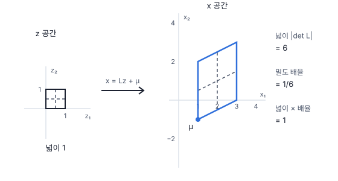

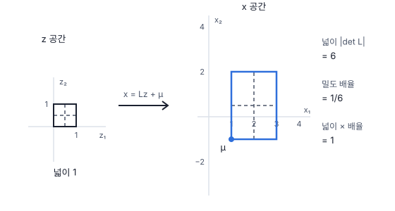

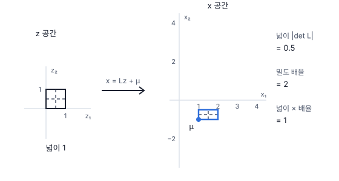

| 설정 | 평행사변형 꼭짓점 | 넓이 | 밀도 배율 | 넓이 × 배율 | Σ = LLᵀ |
|---|---|---|---|---|---|
| 조교 예제 (a=2, c=1, d=3) | (1, −1), (3, 0), (3, 3), (1, 2) | 6 | 1/6 | 1 | [[4, 2], [2, 10]] |
| c만 0으로 (a=2, c=0, d=3) | (1, −1), (3, −1), (3, 2), (1, 2) | 6 | 1/6 | 1 | [[4, 0], [0, 9]] |
| 세로로 눌러 반으로 (a=1, c=0, d=0.5) | (1, −1), (2, −1), (2, −0.5), (1, −0.5) | 0.5 | 2 | 1 | [[1, 0], [0, 0.25]] |

위젯에서 $c$만 바꾸면 평행사변형이 기울어질 뿐 넓이 $|ad|$는 그대로예요. $c$는 넓이가 아니라 두 성분이 닮은 정도(공분산 행렬의 off-diagonal 원소 $ac$)를 바꿔요.

**교수님 말씀**

조교는 이 슬라이드를 "다음 페이지가 조금 중요한데"라며 시작했어요(1012 Part 03 ~00:37). x-공간을 "동네"로 불러 z-공간과 대비했어요. z 동네에서 0.3의 확률로 일어난 일은 x 동네에서도 0.3이어야 한다는 설명이에요.

> "x라는 놈이 살고 있는 그 동네" (1012 Part 03 ~04:45)

이 관계식을 왜 보는지도 짚었어요. "이게 왜 중요하냐면, 어 그냥, 그냥 만들어 본 거예요, 이 관계식이 있으니까."(1012 Part 03 ~01:44)

넓이가 6배가 되면 확률도 6배가 되느냐고 묻고 "이건 말이 되는 소리예요, 안 되는 소리예요?"에 "안 되는 소리죠"로 정리했어요(1012 Part 03 ~04:27). 칠판에서는 $z$가 조금 변할 때 $x$는 6배 더 변하니, 1을 넘지 않도록 거꾸로 6분의 1로 줄인다고 그렸어요(1012 Part 03 ~06:25–07:05).

**꼭 기억해요**

> "크기는 변했지만 확률은 동일해요. 왜냐면 x는 지 혼자 있는 게 아니에요." (1012 Part 03 ~04:34)

변환으로 넓이가 바뀌어도 같은 사건의 확률은 그대로라서, 밀도가 넓이 배율만큼 줄어요.

**페이지 요약**

L이 넓이를 |det L|배로 키우니, 확률을 지키려면 밀도를 1/|det L|배로 줄여요.

*핵심 식*

- 넓이 배율

  $$
  \text{Area} = \left|\det\begin{bmatrix}2 & 0\\ 1 & 3\end{bmatrix}\right| = 6
  $$
- 밀도 변환

  $$
  f_{\mathbf{X}}(\mathbf{x}) = f_{\mathbf{Z}}(\mathbf{z})\frac{1}{|\det(\mathbf{L})|}
  $$

*용어*

- **단위정사각형(unit square)** — z-공간에서 넓이 1인 기준 영역
- **평행사변형(parallelogram)** — 단위정사각형이 L로 옮겨진 모양

---

### determinant는 크기 배율, 일반화는 Jacobian

*1012 수업 · TA1 s9*

**쉽게 말하면**

늘리거나 기울인 뒤 크기가 몇 배가 됐는지 알려 주는 숫자가 있어요.

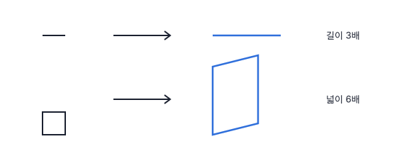

*선이면 길이, 판이면 넓이, 상자면 부피가 몇 배인지 알려 줘요.*

**정확히 말하면**

고등학교에서는 행렬식(determinant)을 공식으로 외웠어요. $|\mathbf{A}|$도 같은 뜻의 표기예요.

$$
\det\begin{bmatrix}a & b\\ c & d\end{bmatrix} = ad - bc
$$

determinant에는 기하학적 의미가 있어요. 변환된 공간의 크기 배율이에요.

- 1차원이면 길이, 2차원이면 넓이, 3차원이면 부피의 배율이에요. 예를 들어 $1\times1$ 행렬 $[3]$의 determinant는 3이고, 길이 1이 길이 3이 돼요.
- 각 방향으로 얼마나 늘었는지는 알려 주지 않아요. 전체 크기 변화만 알려 줘요.

**일반화: Jacobian.** 엄밀히 크기 변화를 구하려면 각 출력이 각 입력에 따라 얼마나 변하는지 모두 알아야 해요. 편미분(partial derivative)을 모은 행렬이 Jacobian이에요.

$$
\mathbf{J} = \frac{\partial \mathbf{x}}{\partial \mathbf{z}} = \begin{bmatrix}\partial x_1/\partial z_1 & \partial x_1/\partial z_2\\ \partial x_2/\partial z_1 & \partial x_2/\partial z_2\end{bmatrix}
$$

1. 크기 배율은 Jacobian의 determinant예요. 정확한 밀도 변환은 다음과 같아요.

   $$
   f_{\mathbf{X}}(\mathbf{x}) = f_{\mathbf{Z}}(\mathbf{z}) \Big/ \left|\det\frac{\partial \mathbf{x}}{\partial \mathbf{z}}\right|
   $$
2. 조교 예제에서는 $\partial x_1/\partial z_1 = 2$, $\partial x_1/\partial z_2 = 0$, $\partial x_2/\partial z_1 = 1$, $\partial x_2/\partial z_2 = 3$이라 Jacobian이 $\mathbf{L}$과 똑같아요.
3. 일반적으로 ${\mathbf{x} = \mathbf{L}\mathbf{z} + \boldsymbol{\mu}}$이면 ${\frac{\partial \mathbf{x}}{\partial \mathbf{z}} = \mathbf{L}}$이에요(벡터 미적분 내용). 그래서 앞의 식에서 $\det(\mathbf{L})$을 바로 썼어요([넓이가 6배면 밀도는 6분의 1](#s1-area)).

이 슬라이드의 두 요점이에요.

1. 공간이 바뀌어도 $\mathbf{x}$와 $\mathbf{z}$ 모두 확률을 나타내므로 밀도를 정규화(scaling)해야 해요.
2. determinant는 크기를 나타내고, 공간 변환의 크기 변화는 Jacobian의 determinant로 구해요.

(수업 중 "판별식"이라고 말한 부분은 행렬식(determinant), "국소 미분"은 편미분이에요. STT의 "g₁, g₂"는 $z_1, z_2$예요.)

**교수님 말씀**

> "determinant는 사실 기하학적인 의미가 있어요" (1012 Part 03 ~07:58)

조교가 "3차원일 때는 뭐가 돼요?"라고 묻자 학생들이 답했고, "그렇죠, 부피죠"로 받았어요(1012 Part 04 ~00:05). 칠판에서는 원래 공간을 "z들이 살고 있는 세상", 새 공간을 "x라는 새로운 공간"으로 불렀어요.

> "자코비안의 값을 갖다 써야 돼요." (1012 Part 04 ~04:11)

**꼭 기억해요**

> "지금 요 슬라이드에서는 딱 두 가지를 아셔야 되는데" (1012 Part 04 ~04:48)

두 가지는 공간이 바뀌면 밀도를 정규화해야 한다는 점, 그리고 크기 변화는 Jacobian의 determinant로 구한다는 점이에요.

**페이지 요약**

determinant는 길이·넓이·부피의 배율이고, 일반 변환에서는 Jacobian의 determinant를 써요.

*핵심 식*

- Jacobian

  $$
  \mathbf{J} = \frac{\partial \mathbf{x}}{\partial \mathbf{z}} = \begin{bmatrix}\partial x_1/\partial z_1 & \partial x_1/\partial z_2\\ \partial x_2/\partial z_1 & \partial x_2/\partial z_2\end{bmatrix}
  $$
- 밀도 변환

  $$
  f_{\mathbf{X}}(\mathbf{x}) = f_{\mathbf{Z}}(\mathbf{z}) \Big/ \left|\det\frac{\partial \mathbf{x}}{\partial \mathbf{z}}\right|
  $$

*용어*

- **행렬식(determinant)** — 변환된 공간의 크기 배율
- **Jacobian** — 각 출력을 각 입력으로 편미분해 모은 행렬

---

### 역변환으로 지수부 정리

*1012 수업 · TA1 s10*

**쉽게 말하면**

도착한 자리에서 거꾸로 되짚어 가면 출발한 자리를 찾을 수 있어요.

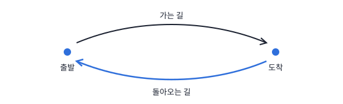

*출발 자리를 알면 처음 그림에서 높이를 그대로 읽어 올 수 있어요.*

**정확히 말하면**

$\mathbf{L}$이 가역이므로 ${\mathbf{x} = \mathbf{L}\mathbf{z} + \boldsymbol{\mu}}$를 $\mathbf{z}$에 대해 풀 수 있어요.

$$
\mathbf{z} = \mathbf{L}^{-1}(\mathbf{x}-\boldsymbol{\mu})
$$

밀도 변환 식에 대입해요.

$$
f_{\mathbf{X}}(\mathbf{x}) = \frac{1}{|\det(\mathbf{L})|}f_{\mathbf{Z}}(\mathbf{z}) = \frac{1}{|\det(\mathbf{L})|}f_{\mathbf{Z}}(\mathbf{L}^{-1}(\mathbf{x}-\boldsymbol{\mu}))
$$

표준정규 벡터의 PDF ${f_{\mathbf{Z}}(\mathbf{z}) = \frac{1}{(2\pi)^{n/2}}e^{-\frac{1}{2}\mathbf{z}^T\mathbf{z}}}$에서 지수부 $\mathbf{z}^T\mathbf{z}$를 정리해요.

1. 대입:

   $$
   \mathbf{z}^T\mathbf{z} = \{\mathbf{L}^{-1}(\mathbf{x}-\boldsymbol{\mu})\}^T\{\mathbf{L}^{-1}(\mathbf{x}-\boldsymbol{\mu})\}
   $$
2. ${(\mathbf{A}\mathbf{B})^T = \mathbf{B}^T\mathbf{A}^T}$로 전치를 풀어요.

   $$
   = (\mathbf{x}-\boldsymbol{\mu})^T(\mathbf{L}^{-1})^T\mathbf{L}^{-1}(\mathbf{x}-\boldsymbol{\mu})
   $$
3. 가운데 행렬을 정리해요. 역행렬의 전치는 전치의 역행렬이에요: ${(\mathbf{L}^{-1})^T = (\mathbf{L}^T)^{-1}}$.

   $$
   (\mathbf{L}^{-1})^T\mathbf{L}^{-1} = (\mathbf{L}^T)^{-1}\mathbf{L}^{-1}
   $$
4. ${(\mathbf{A}\mathbf{B})^{-1} = \mathbf{B}^{-1}\mathbf{A}^{-1}}$로 묶어요.

   $$
   (\mathbf{L}^T)^{-1}\mathbf{L}^{-1} = (\mathbf{L}\mathbf{L}^T)^{-1} = \boldsymbol{\Sigma}^{-1}
   $$
5. 따라서

   $$
   \mathbf{z}^T\mathbf{z} = (\mathbf{x}-\boldsymbol{\mu})^T\boldsymbol{\Sigma}^{-1}(\mathbf{x}-\boldsymbol{\mu})
   $$

여기까지의 결과예요.

$$
f_{\mathbf{X}}(\mathbf{x}) = \frac{1}{|\det(\mathbf{L})|}\cdot\frac{1}{(2\pi)^{n/2}}e^{-\frac{1}{2}(\mathbf{x}-\boldsymbol{\mu})^T\boldsymbol{\Sigma}^{-1}(\mathbf{x}-\boldsymbol{\mu})}
$$

지수부는 목표 식과 같아졌지만 앞의 계수에 아직 $\mathbf{L}$이 남아 있어요. 이것을 $\boldsymbol{\Sigma}$로 바꾸는 일은 [det Σ = (det L)²로 완성](#s1-det)에서 해요.

(STT의 "d에 대한 치환"은 $\mathbf{z}$에 대한 치환이에요.)

**교수님 말씀**

조교 슬라이드는 $(\mathbf{L}^{-1})^T\mathbf{L}^{-1}$에 빨간 밑줄을 긋고, 그 아래 줄에서 이 부분을 $\boldsymbol{\Sigma}^{-1}$로 정리했어요. 지수부를 정리한 뒤에는 아직 끝이 아니라고 짚었어요.

> "끝이 아니죠. 왜? L은 내가 가져온 거잖아요" (1012 Part 04 ~05:49)

**페이지 요약**

z를 x로 되돌려 넣으면 지수부 zᵀz가 (x−μ)ᵀΣ⁻¹(x−μ)가 돼요.

*핵심 식*

- 역변환

  $$
  \mathbf{z} = \mathbf{L}^{-1}(\mathbf{x}-\boldsymbol{\mu})
  $$
- 가운데 행렬

  $$
  (\mathbf{L}^T)^{-1}\mathbf{L}^{-1} = (\mathbf{L}\mathbf{L}^T)^{-1} = \boldsymbol{\Sigma}^{-1}
  $$
- 지수부

  $$
  \mathbf{z}^T\mathbf{z} = (\mathbf{x}-\boldsymbol{\mu})^T\boldsymbol{\Sigma}^{-1}(\mathbf{x}-\boldsymbol{\mu})
  $$

---

### det Σ = (det L)²로 완성

*1012 수업 · TA1 s11 · L04 s8*

**쉽게 말하면**

종이를 세워 두든 눕혀 두든 넓이는 같아요.

*눕혀도 넓이 배율은 같아서, 같은 수를 두 번 곱하면 돼요.*

**정확히 말하면**

남은 일은 계수 $\frac{1}{|\det(\mathbf{L})|}$를 $\boldsymbol{\Sigma}$로 쓰는 거예요. ${\boldsymbol{\Sigma} = \mathbf{L}\mathbf{L}^T}$를 써요.

1. 곱의 determinant는 determinant의 곱이에요.

   $$
   \det(\boldsymbol{\Sigma}) = \det(\mathbf{L}\mathbf{L}^T) = \det(\mathbf{L})\det(\mathbf{L}^T)
   $$
2. 정방행렬은 전치해도 determinant가 그대로예요.

   $$
   \det(\mathbf{L}^T) = \det(\mathbf{L})
   $$

   조교 예제로 보면 ${\mathbf{L} = \begin{bmatrix}2 & 0\\ 1 & 3\end{bmatrix}}$, ${\mathbf{L}^T = \begin{bmatrix}2 & 1\\ 0 & 3\end{bmatrix}}$이고 둘 다 determinant가 6이에요.
3. 따라서

   $$
   \det(\boldsymbol{\Sigma}) = \det(\mathbf{L})^2
   $$

   $$
   \sqrt{|\boldsymbol{\Sigma}|} = |\det(\mathbf{L})|
   $$

   $\boldsymbol{\Sigma}$는 positive-definite라 ${|\boldsymbol{\Sigma}| = \det(\boldsymbol{\Sigma}) \gt 0}$이에요.
4. 대입하면 목표 식이 나와요.

   $$
   f_{\mathbf{X}}(\mathbf{x}) = \frac{1}{\sqrt{|\boldsymbol{\Sigma}|}}\cdot\frac{1}{(2\pi)^{n/2}}e^{-\frac{1}{2}(\mathbf{x}-\boldsymbol{\mu})^T\boldsymbol{\Sigma}^{-1}(\mathbf{x}-\boldsymbol{\mu})}
   $$

   $$
   = \frac{1}{\sqrt{(2\pi)^n|\boldsymbol{\Sigma}|}}e^{-\frac{1}{2}(\mathbf{x}-\boldsymbol{\mu})^T\boldsymbol{\Sigma}^{-1}(\mathbf{x}-\boldsymbol{\mu})}
   $$

이 증명에 쓴 것은 affine 변환의 성질, 그리고 determinant를 크기 배율로 쓰는 scaling 두 가지뿐이에요([목표 식과 표준정규에서 출발](#s1-goal)).

**교수님 말씀**

조교는 곱의 determinant를 "어떤 곱한 애의 크기는 각각의 크기와 곱과 같다"고 풀었어요. 전치해도 크기가 같은 이유는 이렇게 설명했어요.

> "어떤 사각형이 요렇게 있으나 누워 있으나 크기는 똑같죠" (1012 Part 04 ~07:46)

${\det(\mathbf{L}\mathbf{L}^T) = \det(\mathbf{L})\det(\mathbf{L}^T)}$는 "앞에 L 있으니까 그거 집어넣어서 풀어보시면" 쉽게 유도된다며 학생에게 맡겼어요(1012 Part 04 ~07:26). "직접 한번 해보시면서 공부해 보시면 좋을 것 같고요"라고 덧붙였어요(1012 Part 04 ~08:36).

**꼭 기억해요**

> "머릿속에 디터미넌트, 크기라는 걸 갖고 있어야 돼요." (1012 Part 04 ~07:46)

**보충 · 수업에서 유도하진 않았어요**

조교가 넘긴 ${\det(\mathbf{L}\mathbf{L}^T) = \det(\mathbf{L})\det(\mathbf{L}^T)}$를 조교 예제의 숫자로 확인해요.

1. ${\boldsymbol{\Sigma} = \mathbf{L}\mathbf{L}^T = \begin{bmatrix}4 & 2\\ 2 & 10\end{bmatrix}}$이므로 ${\det(\boldsymbol{\Sigma}) = 4 \cdot 10 - 2 \cdot 2 = 36}$이에요.
2. ${\det(\mathbf{L})\det(\mathbf{L}^T) = 6 \cdot 6 = 36 = 6^2}$이라 같아요.
3. 그래서 ${\sqrt{|\boldsymbol{\Sigma}|} = \sqrt{36} = 6 = |\det(\mathbf{L})|}$이에요.

**페이지 요약**

det Σ가 (det L)²이라서 1/|det L|을 1/√|Σ|로 바꾸면 목표 식이 완성돼요.

*핵심 식*

- 전치와 determinant

  $$
  \det(\mathbf{L}^T) = \det(\mathbf{L})
  $$
- 계수 바꾸기

  $$
  \det(\boldsymbol{\Sigma}) = \det(\mathbf{L})^2
  $$

  $$
  \sqrt{|\boldsymbol{\Sigma}|} = |\det(\mathbf{L})|
  $$
- 다변량 가우시안 PDF

  $$
  f_{\mathbf{X}}(\mathbf{x}) = \frac{1}{\sqrt{(2\pi)^n|\boldsymbol{\Sigma}|}}e^{-\frac{1}{2}(\mathbf{x}-\boldsymbol{\mu})^T\boldsymbol{\Sigma}^{-1}(\mathbf{x}-\boldsymbol{\mu})}
  $$

---

## 2. 두 가우시안의 곱

### 스칼라 Lemma: 완전제곱

*1012 수업 · TA1 s12 · L04 s10*

**쉽게 말하면**

흐트러진 식을 잘 묶으면 산꼭대기가 어디인지 바로 보여요.

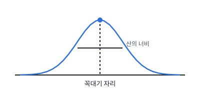

*묶고 나면 꼭대기 자리와 산의 너비를 그대로 읽어요.*

**정확히 말하면**

1007 정리노트에서 이 결과를 소개했어요. 여기서는 조교가 보여 준 증명을 단계마다 따라가요.

**Lemma.** 지수 안이 $x$에 대한 2차식인 함수를 생각해요.

$$
p(x) = c\exp\left[-\frac{1}{2}(\alpha x^2 - 2\beta x + \gamma)\right]
$$

조건은 $\alpha \gt 0$, $\beta, \gamma \in \mathbb{R}$이고, $c \gt 0$은 정규화 상수(normalization constant)예요.

비교할 가우시안 PDF는 지수 안이 완전제곱이에요.

$$
\mathcal{N}(x;\mu,\sigma^2) = \frac{1}{\sqrt{2\pi\sigma^2}}e^{-\frac{(x-\mu)^2}{2\sigma^2}}
$$

그래서 지수 안을 완전제곱으로 바꿔요(completing the square).

1. $\alpha$로 묶어요.

   $$
   \alpha x^2 - 2\beta x + \gamma = \alpha\left(x^2 - 2\frac{\beta}{\alpha}x\right) + \gamma
   $$
2. 괄호 안을 제곱으로 만들고, 더한 만큼 빼요.

   $$
   = \alpha\left(x - \frac{\beta}{\alpha}\right)^2 + \gamma - \frac{\beta^2}{\alpha}
   $$
3. $x$가 없는 항 $\gamma - \frac{\beta^2}{\alpha}$는 exp 밖으로 나가 상수가 돼요. 이 상수는 정규화 상수 $c$와 함께 처리해요.

   $$
   p(x) \propto \exp\left[-\frac{\alpha}{2}\left(x - \frac{\beta}{\alpha}\right)^2\right] = e^{-\frac{(x-\beta/\alpha)^2}{2\cdot\frac{1}{\alpha}}}
   $$
4. 가우시안 PDF의 지수와 한 자리씩 맞춰요. 분자의 $(x-\mu)^2$와 분모의 $2\sigma^2$를 보면 돼요.

   $$
   \mu = \frac{\beta}{\alpha}, \qquad \sigma^2 = \frac{1}{\alpha}
   $$

1–2단계를 한 줄로 쓰면 이래요.

$$
\alpha x^2 - 2\beta x + \gamma = \alpha\left(x - \frac{\beta}{\alpha}\right)^2 + \gamma - \frac{\beta^2}{\alpha}
$$

결론은 이래요. 지수 안이 $x$에 대한 2차식이고 $x^2$의 계수가 양수이면, 그 함수는 $\mathcal{N}\!\left(\frac{\beta}{\alpha}, \frac{1}{\alpha}\right)$에 비례하는 가우시안이에요.

TA1 s12의 "We identity"는 "We identify"의 오타예요.

**교수님 말씀**

1012 수업은 교수님 대신 조교가 진행했어요. 조교는 시간이 없어서 조금 빨리 하겠다며 이 부분을 시작했어요. 스칼라 경우를 먼저 복습하고, 같은 방식으로 행렬로 넓힌다고 했어요.

조교는 완전제곱을 만들고 남는 상수는 정규화에 "퉁 친다"고 했어요. 상수는 평균과 분산을 읽는 데 쓰이지 않아요.

조교는 스칼라 곱으로 넘어가며 Lemma의 결론을 한 번 더 짚었어요.

**꼭 기억해요**

> "x에 대한 2차식으로 exponential 그 지수로 주어지면 얘는 무조건 가우시안으로 모델링할 수 있다." (1012 Part 05 ~01:41)

**페이지 요약**

지수 안의 2차식을 완전제곱으로 묶으면 평균과 분산을 바로 읽어요.

*핵심 식*

- 완전제곱

  $$
  \alpha x^2 - 2\beta x + \gamma = \alpha\left(x - \frac{\beta}{\alpha}\right)^2 + \gamma - \frac{\beta^2}{\alpha}
  $$
- 읽어 내는 평균과 분산

  $$
  \mu = \frac{\beta}{\alpha}, \qquad \sigma^2 = \frac{1}{\alpha}
  $$

*용어*

- **완전제곱(completing the square)** — 2차식을 제곱 한 덩어리와 상수로 바꾸는 것
- **정규화 상수(normalization constant)** — 적분이 1이 되게 맞추는 상수 $c$

---

### 스칼라 가우시안 두 개의 곱

*1012 수업 · TA1 s13 · TA1 s14 · L04 s10*

**쉽게 말하면**

종 모양 두 개를 곱하면 다시 종 모양이 돼요.

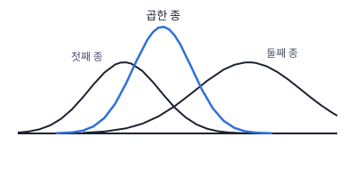

*새 종은 두 종 사이에 생기고, 둘보다 더 홀쭉해요.*

**정확히 말하면**

두 가우시안 $p_0(x) = \mathcal{N}(x;\mu_0,\nu_0)$, $p_1(x) = \mathcal{N}(x;\mu_1,\nu_1)$를 곱해요. 여기서 $\nu_0, \nu_1$은 분산이에요.

$$
p_0(x) = \frac{1}{\sqrt{2\pi\nu_0}}e^{-\frac{(x-\mu_0)^2}{2\nu_0}}, \qquad p_1(x) = \frac{1}{\sqrt{2\pi\nu_1}}e^{-\frac{(x-\mu_1)^2}{2\nu_1}}
$$

1. 곱하면 지수끼리 더해져요.

   $$
   p_0(x)p_1(x) = \frac{1}{2\pi\sqrt{\nu_0\nu_1}}\exp\left[-\frac{1}{2}\left(\frac{(x-\mu_0)^2}{\nu_0} + \frac{(x-\mu_1)^2}{\nu_1}\right)\right]
   $$
2. 괄호 안은 $x$에 대한 2차식이에요. 전개해요.

   $$
   \frac{(x-\mu_0)^2}{\nu_0} + \frac{(x-\mu_1)^2}{\nu_1} = \frac{x^2}{\nu_0} + \frac{x^2}{\nu_1} - 2\frac{\mu_0}{\nu_0}x - 2\frac{\mu_1}{\nu_1}x + \frac{\mu_0^2}{\nu_0} + \frac{\mu_1^2}{\nu_1}
   $$
3. $x^2$, $x$, 상수끼리 묶어요.

   $$
   = \underbrace{\left(\frac{1}{\nu_0} + \frac{1}{\nu_1}\right)}_{\alpha}x^2 - 2\underbrace{\left(\frac{\mu_0}{\nu_0} + \frac{\mu_1}{\nu_1}\right)}_{\beta}x + \underbrace{\left(\frac{\mu_0^2}{\nu_0} + \frac{\mu_1^2}{\nu_1}\right)}_{\gamma}
   $$
4. [스칼라 Lemma: 완전제곱](#s2-lemma)의 $\sigma^2 = \frac{1}{\alpha}$를 써요. 분모와 분자에 $\nu_0\nu_1$을 곱해 정리해요.

   $$
   \nu = \frac{1}{\alpha} = \frac{1}{\frac{1}{\nu_0} + \frac{1}{\nu_1}} = \frac{\nu_0\nu_1}{\nu_0 + \nu_1}
   $$
5. $\mu = \frac{\beta}{\alpha}$도 같은 방법으로 정리해요.

   $$
   \mu = \frac{\beta}{\alpha} = \frac{\frac{\mu_0}{\nu_0} + \frac{\mu_1}{\nu_1}}{\frac{1}{\nu_0} + \frac{1}{\nu_1}} = \frac{\nu_1\mu_0 + \nu_0\mu_1}{\nu_0 + \nu_1}
   $$

그래서 두 가우시안의 곱은 다시 가우시안에 비례해요.

$$
p_0(x)p_1(x) \propto \mathcal{N}\left(x; \frac{\nu_1\mu_0 + \nu_0\mu_1}{\nu_0 + \nu_1}, \frac{\nu_0\nu_1}{\nu_0 + \nu_1}\right)
$$

등호가 아니라 $\propto$예요. 곱의 앞 계수 $\frac{1}{2\pi\sqrt{\nu_0\nu_1}}$와 $\gamma$에서 나온 상수가 새 가우시안의 정규화 상수와 다르기 때문이에요.

새 분산 $\frac{\nu_0\nu_1}{\nu_0 + \nu_1}$은 $\nu_0$보다도, $\nu_1$보다도 작아요. 새 평균은 $\mu_0$와 $\mu_1$의 가중평균이에요. 분산이 작은 쪽 평균에 더 큰 가중치가 붙어요.

TA1 s13 슬라이드에는 $p_0$가 $\nu_0^2$로 적혀 있어요. $\nu_0$를 분산으로 두었으므로 $\nu_0$가 맞아요. 곱한 식의 $\frac{(x-\mu_0)^2}{\nu_0}$와도 이쪽이 맞아요. $p_1$도 같아요.

**교수님 말씀**

조교는 곱의 지수 안이 $x$에 대한 2차식이라는 점을 짚었어요. 슬라이드에서는 $\alpha$, $\beta$, $\gamma$ 자리를 색깔 밑줄로 나눠 보여 줬어요.

그다음은 Lemma 공식에 넣기만 하면 된다고 했어요. 이 순서(곱한다, 2차식으로 묶는다, Lemma에 넣는다)가 행렬판에서도 그대로 반복돼요.

**페이지 요약**

두 가우시안을 곱하면 지수가 2차식이 되어, Lemma로 새 평균과 분산을 읽어요.

*핵심 식*

- 새 분산

  $$
  \nu = \frac{1}{\alpha} = \frac{1}{\frac{1}{\nu_0} + \frac{1}{\nu_1}} = \frac{\nu_0\nu_1}{\nu_0 + \nu_1}
  $$
- 새 평균

  $$
  \mu = \frac{\beta}{\alpha} = \frac{\frac{\mu_0}{\nu_0} + \frac{\mu_1}{\nu_1}}{\frac{1}{\nu_0} + \frac{1}{\nu_1}} = \frac{\nu_1\mu_0 + \nu_0\mu_1}{\nu_0 + \nu_1}
  $$

*용어*

- **2차식** — 지수 안이 $x^2$, $x$, 상수로 이루어진 식
- **비례($\propto$)** — 상수배만 다르다는 뜻

---

### 행렬판 Lemma

*1012 수업 · TA1 s15 · TA1 s16 · TA1 s17*

**쉽게 말하면**

숫자가 여러 칸인 식도 같은 방법으로 묶으면 돼요.

*펼친 식을 묶은 식으로 바꾸면 가운데와 퍼짐이 보여요.*

**정확히 말하면**

스칼라 2차식을 행렬 이차형식(quadratic form)으로 바꿔요.

$$
p(\mathbf{x}) = c\exp\left[-\frac{1}{2}(\mathbf{x}^T\mathbf{A}\mathbf{x} - 2\mathbf{b}^T\mathbf{x} + \gamma)\right]
$$

$\mathbf{A} \in \mathbb{R}^{n\times n}$은 symmetric positive-definite 행렬, $\mathbf{b} \in \mathbb{R}^n$은 deterministic 벡터, $\gamma \in \mathbb{R}$는 스칼라, $c \gt 0$은 정규화 상수예요.

여기의 $\mathbf{A}$, $\mathbf{b}$는 이차형식의 계수이고, [평균은 같은 꼴로 따라가요](#s0-mean)의 아핀 변환 $\mathbf{A}$, $\mathbf{b}$와는 다른 기호예요.

목표는 다변량 가우시안 PDF의 지수 꼴이에요.

$$
\mathcal{N}(\mathbf{x};\boldsymbol{\mu},\boldsymbol{\Sigma}) = \frac{1}{\sqrt{(2\pi)^n|\boldsymbol{\Sigma}|}}\exp\left[-\frac{1}{2}(\mathbf{x}-\boldsymbol{\mu})^T\boldsymbol{\Sigma}^{-1}(\mathbf{x}-\boldsymbol{\mu})\right]
$$

벡터는 제곱할 수 없으니 $(\mathbf{x}-\boldsymbol{\mu})^T\mathbf{A}(\mathbf{x}-\boldsymbol{\mu})$가 완전제곱 역할을 해요. 일반형을 표준형으로 바꾸는 작업이에요.

1. 원하는 꼴을 먼저 전개해요.

   $$
   (\mathbf{x}-\boldsymbol{\mu})^T\mathbf{A}(\mathbf{x}-\boldsymbol{\mu}) = \mathbf{x}^T\mathbf{A}\mathbf{x} - \mathbf{x}^T\mathbf{A}\boldsymbol{\mu} - \boldsymbol{\mu}^T\mathbf{A}\mathbf{x} + \boldsymbol{\mu}^T\mathbf{A}\boldsymbol{\mu}
   $$
2. $\mathbf{x}^T\mathbf{A}\boldsymbol{\mu}$는 스칼라예요. 스칼라는 전치해도 값이 같아요.

   $$
   \mathbf{x}^T\mathbf{A}\boldsymbol{\mu} = (\mathbf{x}^T\mathbf{A}\boldsymbol{\mu})^T = \boldsymbol{\mu}^T\mathbf{A}^T\mathbf{x}
   $$
3. $\mathbf{A}$가 symmetric이라 $\mathbf{A}^T = \mathbf{A}$예요. 가운데 두 항이 같아져요.

   $$
   (\mathbf{x}-\boldsymbol{\mu})^T\mathbf{A}(\mathbf{x}-\boldsymbol{\mu}) = \mathbf{x}^T\mathbf{A}\mathbf{x} - 2\boldsymbol{\mu}^T\mathbf{A}\mathbf{x} + \boldsymbol{\mu}^T\mathbf{A}\boldsymbol{\mu}
   $$
4. 원래 식 $\mathbf{x}^T\mathbf{A}\mathbf{x} - 2\mathbf{b}^T\mathbf{x} + \gamma$와 비교해요. 2차항은 이미 같아요. 1차항이 같아야 해요.

   $$
   -2\boldsymbol{\mu}^T\mathbf{A}\mathbf{x} = -2\mathbf{b}^T\mathbf{x}
   $$
5. ${\boldsymbol{\mu}^T\mathbf{A} = \mathbf{b}^T}$이고, 양변을 전치해요.

   $$
   \mathbf{A}^T\boldsymbol{\mu} = \mathbf{b}
   $$
6. symmetric이니 $\mathbf{A}\boldsymbol{\mu} = \mathbf{b}$이고, 양변에 $\mathbf{A}^{-1}$을 곱해요.

   $$
   \boldsymbol{\mu} = \mathbf{A}^{-1}\mathbf{b}
   $$
7. 원래 식에 없던 $\boldsymbol{\mu}^T\mathbf{A}\boldsymbol{\mu}$를 더해서 묶었으니 다시 빼요. $\gamma$는 상수로 남아요.

   $$
   \mathbf{x}^T\mathbf{A}\mathbf{x} - 2\mathbf{b}^T\mathbf{x} + \gamma = (\mathbf{x}-\boldsymbol{\mu})^T\mathbf{A}(\mathbf{x}-\boldsymbol{\mu}) + \gamma - \boldsymbol{\mu}^T\mathbf{A}\boldsymbol{\mu}
   $$
8. 뺀 항을 $\mathbf{b}$로 써요. symmetric 행렬의 역행렬도 symmetric이라 $(\mathbf{A}^{-1})^T = \mathbf{A}^{-1}$이에요.

   $$
   \boldsymbol{\mu}^T\mathbf{A}\boldsymbol{\mu} = (\mathbf{A}^{-1}\mathbf{b})^T\mathbf{A}(\mathbf{A}^{-1}\mathbf{b}) = \mathbf{b}^T(\mathbf{A}^{-1})^T\mathbf{A}\mathbf{A}^{-1}\mathbf{b} = \mathbf{b}^T\mathbf{A}^{-1}\mathbf{b}
   $$
9. 상수항을 exp 밖으로 꺼내요.

   $$
   p(\mathbf{x}) = c\exp\left[-\frac{1}{2}(\gamma - \mathbf{b}^T\mathbf{A}^{-1}\mathbf{b})\right]\cdot\exp\left[-\frac{1}{2}(\mathbf{x}-\mathbf{A}^{-1}\mathbf{b})^T\mathbf{A}(\mathbf{x}-\mathbf{A}^{-1}\mathbf{b})\right]
   $$
10. 표준형 $\mathcal{N}(\mathbf{x};\boldsymbol{\mu},\boldsymbol{\Sigma})$의 지수와 맞춰요.

    $$
    \boldsymbol{\mu} = \mathbf{A}^{-1}\mathbf{b}, \qquad \boldsymbol{\Sigma}^{-1} = \mathbf{A}
    $$

평균 ${\boldsymbol{\mu} = \mathbf{A}^{-1}\mathbf{b}}$는 다시 묶기 전, 1차항을 맞추는 단계에서 이미 나와요. 공분산은 $\boldsymbol{\Sigma} = \mathbf{A}^{-1}$이에요.

정규화 상수 $c$의 식은 슬라이드(TA1 s17)에 있지만, 조교가 중요하지 않다며 넘겼어요.

스칼라판과 나란히 보면 $\alpha \leftrightarrow \mathbf{A}$, $\beta \leftrightarrow \mathbf{b}$예요. $\mu = \frac{\beta}{\alpha}$가 ${\boldsymbol{\mu} = \mathbf{A}^{-1}\mathbf{b}}$로, $\frac{1}{\sigma^2} = \alpha$가 $\boldsymbol{\Sigma}^{-1} = \mathbf{A}$로 바뀌어요.

**교수님 말씀**

조교는 중학교 때 2차함수를 일반형에서 표준형으로 바꾸던 연습을 떠올리라고 했어요. 전개한 뒤 가장 닮은 완전제곱 꼴로 묶는 일을 벡터와 행렬에서 똑같이 한다는 거예요(1012 Part 05 ~04:13).

벡터와 행렬은 제곱을 할 수 없어서, $(\mathbf{x}-\boldsymbol{\mu})^T\mathbf{A}(\mathbf{x}-\boldsymbol{\mu})$가 제곱 자리에 들어간다고 했어요(1012 Part 05 ~08:32).

조교가 "$\mathbf{x}^T\mathbf{A}\boldsymbol{\mu}$는 벡터일까요, 행렬일까요, 스칼라일까요?"라고 물었어요. 답은 스칼라였고, 스칼라 3을 전치해도 3이라고 덧붙였어요(1012 Part 05 ~04:40).

계산 중간에 목표를 놓치지 말라고 했어요.

> "우리가 원래 하려고 했던 게 뭐였는지 잘 기억하고 있어야 돼요." (1012 Part 05 ~05:35)

표준형과 맞춰 볼 때는 지수 안의 이차형식을 가리키며 이렇게 말했어요.

> "중요하게 봐야 될 것은 얘." (1012 Part 06 ~00:00)

> "사실상 이 μ와 Σ 얘가 중요한 거지." (1012 Part 06 ~00:20)

**페이지 요약**

행렬 이차형식도 완전제곱 꼴로 묶으면 평균과 공분산을 바로 읽어요.

*핵심 식*

- 다시 묶은 꼴

  $$
  \mathbf{x}^T\mathbf{A}\mathbf{x} - 2\mathbf{b}^T\mathbf{x} + \gamma = (\mathbf{x}-\boldsymbol{\mu})^T\mathbf{A}(\mathbf{x}-\boldsymbol{\mu}) + \gamma - \boldsymbol{\mu}^T\mathbf{A}\boldsymbol{\mu}
  $$
- 표준형과 맞춘 결과

  $$
  \boldsymbol{\mu} = \mathbf{A}^{-1}\mathbf{b}, \qquad \boldsymbol{\Sigma}^{-1} = \mathbf{A}
  $$

*용어*

- **symmetric** — $\mathbf{A}^T = \mathbf{A}$인 행렬
- **표준형** — $(\mathbf{x}-\boldsymbol{\mu})^T\mathbf{A}(\mathbf{x}-\boldsymbol{\mu})$처럼 완전제곱으로 묶은 꼴

---

### 두 다변량 가우시안의 곱

*1012 수업 · TA1 s18 · TA1 s19 · L04 s11*

**쉽게 말하면**

둥근 산 두 개를 곱해도 또 둥근 산 하나가 돼요.

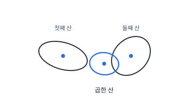

*곱한 산은 두 산 사이쯤에 더 작게 생겨요.*

**정확히 말하면**

${p_0(\mathbf{x}) = \mathcal{N}(\mathbf{x};\boldsymbol{\mu}_0,\boldsymbol{\Sigma}_0)}$, ${p_1(\mathbf{x}) = \mathcal{N}(\mathbf{x};\boldsymbol{\mu}_1,\boldsymbol{\Sigma}_1)}$를 곱해요.

$$
p_0(\mathbf{x}) = \frac{1}{\sqrt{(2\pi)^n|\boldsymbol{\Sigma}_0|}}\exp\left[-\frac{1}{2}(\mathbf{x}-\boldsymbol{\mu}_0)^T\boldsymbol{\Sigma}_0^{-1}(\mathbf{x}-\boldsymbol{\mu}_0)\right]
$$

$$
p_1(\mathbf{x}) = \frac{1}{\sqrt{(2\pi)^n|\boldsymbol{\Sigma}_1|}}\exp\left[-\frac{1}{2}(\mathbf{x}-\boldsymbol{\mu}_1)^T\boldsymbol{\Sigma}_1^{-1}(\mathbf{x}-\boldsymbol{\mu}_1)\right]
$$

1. 곱하면 지수 안의 두 quadratic form이 더해져요.

   $$
   p_0(\mathbf{x})p_1(\mathbf{x}) = \frac{1}{(2\pi)^n\sqrt{|\boldsymbol{\Sigma}_0||\boldsymbol{\Sigma}_1|}}\exp\left[-\frac{1}{2}\left\{\underbrace{(\mathbf{x}-\boldsymbol{\mu}_0)^T\boldsymbol{\Sigma}_0^{-1}(\mathbf{x}-\boldsymbol{\mu}_0)}_{(1)} + \underbrace{(\mathbf{x}-\boldsymbol{\mu}_1)^T\boldsymbol{\Sigma}_1^{-1}(\mathbf{x}-\boldsymbol{\mu}_1)}_{(2)}\right\}\right]
   $$
2. $\boldsymbol{\Sigma}_0^{-1}$은 symmetric이에요. [행렬판 Lemma](#s2-matrix-lemma)의 전개를 그대로 써서 (1)을 펼쳐요.

   $$
   (\mathbf{x}-\boldsymbol{\mu}_0)^T\boldsymbol{\Sigma}_0^{-1}(\mathbf{x}-\boldsymbol{\mu}_0) = \mathbf{x}^T\boldsymbol{\Sigma}_0^{-1}\mathbf{x} - 2\boldsymbol{\mu}_0^T\boldsymbol{\Sigma}_0^{-1}\mathbf{x} + \boldsymbol{\mu}_0^T\boldsymbol{\Sigma}_0^{-1}\boldsymbol{\mu}_0
   $$
3. (2)도 같은 꼴이에요.

   $$
   (\mathbf{x}-\boldsymbol{\mu}_1)^T\boldsymbol{\Sigma}_1^{-1}(\mathbf{x}-\boldsymbol{\mu}_1) = \mathbf{x}^T\boldsymbol{\Sigma}_1^{-1}\mathbf{x} - 2\boldsymbol{\mu}_1^T\boldsymbol{\Sigma}_1^{-1}\mathbf{x} + \boldsymbol{\mu}_1^T\boldsymbol{\Sigma}_1^{-1}\boldsymbol{\mu}_1
   $$
4. 1차항의 $\boldsymbol{\mu}_0^T\boldsymbol{\Sigma}_0^{-1}$은 전치하면 $(\boldsymbol{\Sigma}_0^{-1}\boldsymbol{\mu}_0)^T$예요. 이것을 쓰고 $\mathbf{x}$에 대해 묶어요.

   $$
   (1) + (2) = \mathbf{x}^T(\boldsymbol{\Sigma}_0^{-1} + \boldsymbol{\Sigma}_1^{-1})\mathbf{x} - 2(\boldsymbol{\Sigma}_0^{-1}\boldsymbol{\mu}_0 + \boldsymbol{\Sigma}_1^{-1}\boldsymbol{\mu}_1)^T\mathbf{x} + \gamma
   $$

   $$
   \gamma = \boldsymbol{\mu}_0^T\boldsymbol{\Sigma}_0^{-1}\boldsymbol{\mu}_0 + \boldsymbol{\mu}_1^T\boldsymbol{\Sigma}_1^{-1}\boldsymbol{\mu}_1
   $$
5. 행렬판 Lemma의 $\mathbf{x}^T\mathbf{A}\mathbf{x} - 2\mathbf{b}^T\mathbf{x} + \gamma$와 한 자리씩 맞춰요.

   $$
   \mathbf{A} = \boldsymbol{\Sigma}_0^{-1} + \boldsymbol{\Sigma}_1^{-1}, \qquad \mathbf{b} = \boldsymbol{\Sigma}_0^{-1}\boldsymbol{\mu}_0 + \boldsymbol{\Sigma}_1^{-1}\boldsymbol{\mu}_1
   $$
6. Lemma의 $\boldsymbol{\Sigma} = \mathbf{A}^{-1}$을 써요.

   $$
   \boldsymbol{\Sigma} = (\boldsymbol{\Sigma}_0^{-1} + \boldsymbol{\Sigma}_1^{-1})^{-1}
   $$
7. Lemma의 ${\boldsymbol{\mu} = \mathbf{A}^{-1}\mathbf{b}}$를 써요.

   $$
   \boldsymbol{\mu} = (\boldsymbol{\Sigma}_0^{-1} + \boldsymbol{\Sigma}_1^{-1})^{-1}(\boldsymbol{\Sigma}_0^{-1}\boldsymbol{\mu}_0 + \boldsymbol{\Sigma}_1^{-1}\boldsymbol{\mu}_1)
   $$

그래서 곱은 다시 가우시안에 비례해요.

$$
p_0(\mathbf{x})p_1(\mathbf{x}) \propto \mathcal{N}(\mathbf{x};\boldsymbol{\mu},\boldsymbol{\Sigma})
$$

순서는 스칼라 때와 같아요. 곱하고, 2차 형태로 묶고, Lemma 공식에 넣어요. 스칼라 ${\alpha = \frac{1}{\nu_0} + \frac{1}{\nu_1}}$이 ${\mathbf{A} = \boldsymbol{\Sigma}_0^{-1} + \boldsymbol{\Sigma}_1^{-1}}$로, ${\beta = \frac{\mu_0}{\nu_0} + \frac{\mu_1}{\nu_1}}$이 $\mathbf{b}$로 바뀌었어요.

TA1 s18 슬라이드의 (2)항과 전개식 좌변에는 첫 괄호의 전치 $^T$가 빠져 있어요. 여기서는 $(\mathbf{x}-\boldsymbol{\mu}_1)^T$처럼 바로잡아 적었어요.

**교수님 말씀**

조교는 (1), (2)의 전개를 "간단하게 그냥 퉁쳤어"라며 빠르게 넘어갔어요. 행렬판 Lemma에서 한 전개와 같기 때문이에요.

조교가 "A 대신, B 대신"이라고 부른 것은 행렬 $\mathbf{A}$와 소문자 벡터 $\mathbf{b}$예요.

> "혼자 쭉 전개해 보고 다시 묶어 보고… 해보면 되게 편하게 보실 수 있어요." (1012 Part 06 ~03:32)

슬라이드 밖 조언도 했어요. 논문에서 $\mathbf{x}^T$(정방행렬)$\mathbf{x}$ 꼴을 보면 "이거는 2차식이구나"라고 생각하면 된다고 했어요.

**꼭 기억해요**

> "왜 평균과 코베리언스가 이렇게 되는지는 그 앞쪽에 렘마에서 다 증명했어요." (1012 Part 06 ~02:39)

**페이지 요약**

두 가우시안을 곱해 2차 형태로 묶고 행렬판 Lemma에 넣으면 새 평균과 공분산이 나와요.

*핵심 식*

- 계수 맞추기

  $$
  \mathbf{A} = \boldsymbol{\Sigma}_0^{-1} + \boldsymbol{\Sigma}_1^{-1}, \qquad \mathbf{b} = \boldsymbol{\Sigma}_0^{-1}\boldsymbol{\mu}_0 + \boldsymbol{\Sigma}_1^{-1}\boldsymbol{\mu}_1
  $$
- 새 공분산

  $$
  \boldsymbol{\Sigma} = (\boldsymbol{\Sigma}_0^{-1} + \boldsymbol{\Sigma}_1^{-1})^{-1}
  $$
- 새 평균

  $$
  \boldsymbol{\mu} = (\boldsymbol{\Sigma}_0^{-1} + \boldsymbol{\Sigma}_1^{-1})^{-1}(\boldsymbol{\Sigma}_0^{-1}\boldsymbol{\mu}_0 + \boldsymbol{\Sigma}_1^{-1}\boldsymbol{\mu}_1)
  $$

*용어*

- **이차형식(quadratic form)** — $\mathbf{x}^T\mathbf{A}\mathbf{x}$처럼 벡터 양쪽에 행렬을 끼운 2차식

---

### 강의자료 모양으로 다시 쓰기

*1012 수업 · TA1 s20 · L04 s11*

**쉽게 말하면**

같은 케이크를 다른 접시에 옮겨 담듯, 값은 그대로 두고 모양만 바꿔요.

*겉모습은 달라도 두 식은 같은 값이에요.*

**정확히 말하면**

[두 다변량 가우시안의 곱](#s2-product)의 결과도 정답이에요. 강의자료 L04 s11에는 다른 모양으로 적혀 있어서, 값은 그대로 두고 표현만 바꿔요.

**공분산**

1. 각 항에 항등행렬을 곱해요.

   $$
   \boldsymbol{\Sigma}_1^{-1} + \boldsymbol{\Sigma}_0^{-1} = \mathbf{I}\boldsymbol{\Sigma}_1^{-1} + \boldsymbol{\Sigma}_0^{-1}\mathbf{I}
   $$
2. ${\mathbf{I} = \boldsymbol{\Sigma}_0^{-1}\boldsymbol{\Sigma}_0}$, ${\mathbf{I} = \boldsymbol{\Sigma}_1\boldsymbol{\Sigma}_1^{-1}}$을 끼워 넣어요.

   $$
   = \boldsymbol{\Sigma}_0^{-1}\boldsymbol{\Sigma}_0\boldsymbol{\Sigma}_1^{-1} + \boldsymbol{\Sigma}_0^{-1}\boldsymbol{\Sigma}_1\boldsymbol{\Sigma}_1^{-1}
   $$
3. 왼쪽의 $\boldsymbol{\Sigma}_0^{-1}$과 오른쪽의 $\boldsymbol{\Sigma}_1^{-1}$로 묶어요.

   $$
   = \boldsymbol{\Sigma}_0^{-1}(\boldsymbol{\Sigma}_0 + \boldsymbol{\Sigma}_1)\boldsymbol{\Sigma}_1^{-1}
   $$
4. 세 행렬 곱의 역행렬은 순서를 뒤집어요.

   $$
   (\mathbf{A}\mathbf{B}\mathbf{C})^{-1} = \mathbf{C}^{-1}\mathbf{B}^{-1}\mathbf{A}^{-1}
   $$

   여기의 $\mathbf{A}$, $\mathbf{B}$, $\mathbf{C}$는 임의의 가역 정방행렬이에요.
5. 이 규칙을 써요.

   $$
   \boldsymbol{\Sigma} = \left[\boldsymbol{\Sigma}_0^{-1}(\boldsymbol{\Sigma}_0 + \boldsymbol{\Sigma}_1)\boldsymbol{\Sigma}_1^{-1}\right]^{-1} = \boldsymbol{\Sigma}_1(\boldsymbol{\Sigma}_0 + \boldsymbol{\Sigma}_1)^{-1}\boldsymbol{\Sigma}_0
   $$

**평균**

1. ${\boldsymbol{\mu} = \boldsymbol{\Sigma}\mathbf{b}}$를 두 항으로 나눠요.

   $$
   \boldsymbol{\mu} = \boldsymbol{\Sigma}(\boldsymbol{\Sigma}_0^{-1}\boldsymbol{\mu}_0 + \boldsymbol{\Sigma}_1^{-1}\boldsymbol{\mu}_1) = \boldsymbol{\Sigma}\boldsymbol{\Sigma}_0^{-1}\boldsymbol{\mu}_0 + \boldsymbol{\Sigma}\boldsymbol{\Sigma}_1^{-1}\boldsymbol{\mu}_1
   $$
2. 첫 항에 ${\boldsymbol{\Sigma} = \boldsymbol{\Sigma}_1(\boldsymbol{\Sigma}_0 + \boldsymbol{\Sigma}_1)^{-1}\boldsymbol{\Sigma}_0}$를 넣으면 ${\boldsymbol{\Sigma}_0\boldsymbol{\Sigma}_0^{-1} = \mathbf{I}}$가 지워져요.

   $$
   \boldsymbol{\Sigma}\boldsymbol{\Sigma}_0^{-1}\boldsymbol{\mu}_0 = \boldsymbol{\Sigma}_1(\boldsymbol{\Sigma}_0 + \boldsymbol{\Sigma}_1)^{-1}\boldsymbol{\mu}_0
   $$
3. 둘째 항에서는 $\boldsymbol{\Sigma}_1^{-1}$을 지우고 싶어요. 그러려면 $\boldsymbol{\Sigma}$의 오른쪽 끝이 $\boldsymbol{\Sigma}_1$이어야 해요. 공분산 $\boldsymbol{\Sigma}$는 symmetric이니 전치해서 바꿔 써요.

   $$
   \boldsymbol{\Sigma} = \boldsymbol{\Sigma}^T = \boldsymbol{\Sigma}_0^T(\boldsymbol{\Sigma}_0 + \boldsymbol{\Sigma}_1)^{-T}\boldsymbol{\Sigma}_1^T = \boldsymbol{\Sigma}_0(\boldsymbol{\Sigma}_0 + \boldsymbol{\Sigma}_1)^{-1}\boldsymbol{\Sigma}_1
   $$
4. 마지막 등호에는 $\boldsymbol{\Sigma}_0$, $\boldsymbol{\Sigma}_1$이 symmetric이라는 점과, symmetric 행렬 $\boldsymbol{\Sigma}_0 + \boldsymbol{\Sigma}_1$의 역행렬도 symmetric이라는 점을 써요.

   $$
   (\boldsymbol{\Sigma}_0 + \boldsymbol{\Sigma}_1)^{-T} = (\boldsymbol{\Sigma}_0 + \boldsymbol{\Sigma}_1)^{-1}
   $$
5. 그러면 ${\boldsymbol{\Sigma}_1\boldsymbol{\Sigma}_1^{-1} = \mathbf{I}}$가 지워져요.

   $$
   \boldsymbol{\Sigma}\boldsymbol{\Sigma}_1^{-1}\boldsymbol{\mu}_1 = \boldsymbol{\Sigma}_0(\boldsymbol{\Sigma}_0 + \boldsymbol{\Sigma}_1)^{-1}\boldsymbol{\mu}_1
   $$

공분산이 symmetric인 이유는 [X = LZ + μ로 원하는 가우시안 만들기](#s1-lz)에서 봤듯 ${\boldsymbol{\Sigma} = \mathbf{L}\mathbf{L}^T}$ 꼴이기 때문이에요. ${(\mathbf{L}\mathbf{L}^T)^T = \mathbf{L}\mathbf{L}^T}$예요.

최종식은 강의자료 L04 s11과 같아요.

$$
p_0(\mathbf{x})p_1(\mathbf{x}) \propto \mathcal{N}\left(\boldsymbol{\Sigma}_1(\boldsymbol{\Sigma}_0 + \boldsymbol{\Sigma}_1)^{-1}\boldsymbol{\mu}_0 + \boldsymbol{\Sigma}_0(\boldsymbol{\Sigma}_0 + \boldsymbol{\Sigma}_1)^{-1}\boldsymbol{\mu}_1,\ \boldsymbol{\Sigma}_1(\boldsymbol{\Sigma}_0 + \boldsymbol{\Sigma}_1)^{-1}\boldsymbol{\Sigma}_0\right)
$$

L04 s11의 "Compare… Why?"는 스칼라 결과와 비교하라는 질문이었어요. 조교가 직접 비교하진 않았지만, 나란히 놓으면 같은 구조예요.

- $\boldsymbol{\Sigma}_1(\boldsymbol{\Sigma}_0 + \boldsymbol{\Sigma}_1)^{-1}\boldsymbol{\Sigma}_0$ 와 $\frac{\nu_0\nu_1}{\nu_0 + \nu_1}$
- $\boldsymbol{\Sigma}_1(\boldsymbol{\Sigma}_0 + \boldsymbol{\Sigma}_1)^{-1}\boldsymbol{\mu}_0 + \boldsymbol{\Sigma}_0(\boldsymbol{\Sigma}_0 + \boldsymbol{\Sigma}_1)^{-1}\boldsymbol{\mu}_1$ 와 $\frac{\nu_1\mu_0 + \nu_0\mu_1}{\nu_0 + \nu_1}$

스칼라에서 나눗셈 $\frac{1}{\nu_0 + \nu_1}$이던 자리가 행렬에서는 역행렬 $(\boldsymbol{\Sigma}_0 + \boldsymbol{\Sigma}_1)^{-1}$이 돼요. 행렬은 곱하는 순서가 중요해서 왼쪽과 오른쪽 자리를 지켜 적어요.

조교는 $(\boldsymbol{\Sigma}_0 + \boldsymbol{\Sigma}_1)^{-T}$를 두고 "정방이니까 transpose해도 자기 자신"이라고 했어요. 정방행렬이라서 전치가 같아지는 것은 아니에요. 옳은 근거는 symmetric 행렬의 역행렬도 symmetric이라는 점이에요.

**교수님 말씀**

한 학생이 강의자료의 식과 다르다고 하자, 조교는 강의자료에는 조금 다르게 나왔다고 답했어요(1012 Part 06 ~04:48). 그래서 이 재표현을 보여 줬어요.

항등행렬을 곱하고 ${\boldsymbol{\Sigma}_0^{-1}\boldsymbol{\Sigma}_0 = \mathbf{I}}$를 끼워 넣는 일을 조교는 "하나마나 한 짓"이라고 불렀어요. 값은 바뀌지 않고 표현만 바뀌기 때문이에요.

> "그냥 하나마나 한 짓을 통해서 표현만 바꾼 거다." (1012 Part 06 ~09:29)

둘째 항에서 $\boldsymbol{\Sigma}$를 전치해 바꿔 쓸 때는 "왜 이 짓을 할까요? 나중에 요거 없애려고요"라고 했어요. $\boldsymbol{\Sigma}_1\boldsymbol{\Sigma}_1^{-1}$을 지우려는 거예요.

수업 끝에 조교는 오늘 문제를 내일 카톡방에 올리겠다고 공지했어요(1012 Part 06 ~09:50).

**페이지 요약**

항등행렬을 끼워 넣는 "하나마나 한 짓"으로 결과를 강의자료 모양으로 바꿔요.

*핵심 식*

- 역행렬 순서 규칙

  $$
  (\mathbf{A}\mathbf{B}\mathbf{C})^{-1} = \mathbf{C}^{-1}\mathbf{B}^{-1}\mathbf{A}^{-1}
  $$
- 공분산 다시 쓰기

  $$
  \boldsymbol{\Sigma} = \left[\boldsymbol{\Sigma}_0^{-1}(\boldsymbol{\Sigma}_0 + \boldsymbol{\Sigma}_1)\boldsymbol{\Sigma}_1^{-1}\right]^{-1} = \boldsymbol{\Sigma}_1(\boldsymbol{\Sigma}_0 + \boldsymbol{\Sigma}_1)^{-1}\boldsymbol{\Sigma}_0
  $$
- 강의자료 모양의 결과

  $$
  p_0(\mathbf{x})p_1(\mathbf{x}) \propto \mathcal{N}\left(\boldsymbol{\Sigma}_1(\boldsymbol{\Sigma}_0 + \boldsymbol{\Sigma}_1)^{-1}\boldsymbol{\mu}_0 + \boldsymbol{\Sigma}_0(\boldsymbol{\Sigma}_0 + \boldsymbol{\Sigma}_1)^{-1}\boldsymbol{\mu}_1,\ \boldsymbol{\Sigma}_1(\boldsymbol{\Sigma}_0 + \boldsymbol{\Sigma}_1)^{-1}\boldsymbol{\Sigma}_0\right)
  $$

*용어*

- **하나마나 한 짓** — 값은 그대로 두고 표현만 바꾸는 계산(조교의 말)

---

## 3. 요약 · 예고

### 한 장 요약

*1012 수업 · TA1 s3–20*

조교가 증명한 세 가지의 결론만 모았어요. 각 줄의 토픽으로 가면 유도 과정을 볼 수 있어요.

| 증명 | 결론 | 토픽 |
|---|---|---|
| 아핀 변환의 평균 | ${\mathbb{E}[\mathbf{Y}] = \mathbf{A}\mathbb{E}[\mathbf{X}] + \mathbf{b}}$ (평균은 같은 아핀 꼴로 따라가요) | [평균은 같은 꼴로 따라가요](#s0-mean) |
| 아핀 변환의 분산 | ${\mathrm{Var}[\mathbf{Y}] = \mathbf{A}\,\mathrm{Var}[\mathbf{X}]\,\mathbf{A}^T}$ (평행이동 $\mathbf{b}$와 무관해요) | [분산은 양쪽에 A와 A의 전치](#s0-variance) |
| 아핀 변환의 교차공분산 | ${\mathrm{Cov}(\mathbf{X},\mathbf{Y}) = \boldsymbol{\Sigma}_X\mathbf{A}^T}$ ($\mathbf{A}^T$가 한 번만 곱해져요) | [교차공분산은 A의 전치가 한 번](#s0-cross) |
| 다변량 가우시안 만들기 | ${\mathbf{X} = \mathbf{L}\mathbf{Z} + \boldsymbol{\mu}}$이면 평균은 $\boldsymbol{\mu}$, 공분산은 $\boldsymbol{\Sigma} = \mathbf{L}\mathbf{L}^T$ | [X = LZ + μ로 원하는 가우시안 만들기](#s1-lz) |
| 밀도 배율 | 넓이가 $\vert \det(\mathbf{L})\vert $배가 되므로 밀도에 $\frac{1}{\vert \det(\mathbf{L})\vert }$를 곱해요 | [넓이가 6배면 밀도는 6분의 1](#s1-area) |
| 지수부 정리 | ${\mathbf{z} = \mathbf{L}^{-1}(\mathbf{x}-\boldsymbol{\mu})}$, ${(\mathbf{L}\mathbf{L}^T)^{-1} = \boldsymbol{\Sigma}^{-1}}$ | [역변환으로 지수부 정리](#s1-inverse) |
| 최종 PDF | ${\det(\boldsymbol{\Sigma}) = \det(\mathbf{L})^2}$이라 ${\sqrt{\vert \boldsymbol{\Sigma}\vert } = \vert \det(\mathbf{L})\vert }$, 따라서 ${f_{\mathbf{X}}(\mathbf{x}) = \frac{1}{\sqrt{(2\pi)^n\vert \boldsymbol{\Sigma}\vert }}\exp\left(-\frac{1}{2}(\mathbf{x}-\boldsymbol{\mu})^T\boldsymbol{\Sigma}^{-1}(\mathbf{x}-\boldsymbol{\mu})\right)}$ | [det Σ = (det L)²로 완성](#s1-det) |
| 스칼라 Lemma | 지수 안이 $\alpha x^2 - 2\beta x + \gamma$이면 $\mu = \frac{\beta}{\alpha}$, $\sigma^2 = \frac{1}{\alpha}$ | [스칼라 Lemma: 완전제곱](#s2-lemma) |
| 스칼라 가우시안의 곱 | 분산 $\frac{\nu_0\nu_1}{\nu_0 + \nu_1}$, 평균 $\frac{\nu_1\mu_0 + \nu_0\mu_1}{\nu_0 + \nu_1}$ | [스칼라 가우시안 두 개의 곱](#s2-scalar) |
| 행렬판 Lemma | 지수 안이 ${\mathbf{x}^T\mathbf{A}\mathbf{x} - 2\mathbf{b}^T\mathbf{x} + \gamma}$이면 $\boldsymbol{\mu} = \mathbf{A}^{-1}\mathbf{b}$, $\boldsymbol{\Sigma}^{-1} = \mathbf{A}$ | [행렬판 Lemma](#s2-matrix-lemma) |
| 다변량 가우시안의 곱 (Lemma 대입) | ${\boldsymbol{\Sigma} = (\boldsymbol{\Sigma}_0^{-1} + \boldsymbol{\Sigma}_1^{-1})^{-1}}$, ${\boldsymbol{\mu} = \boldsymbol{\Sigma}(\boldsymbol{\Sigma}_0^{-1}\boldsymbol{\mu}_0 + \boldsymbol{\Sigma}_1^{-1}\boldsymbol{\mu}_1)}$ | [두 다변량 가우시안의 곱](#s2-product) |
| 다변량 가우시안의 곱 (강의자료 모양) | ${\boldsymbol{\Sigma} = \boldsymbol{\Sigma}_1(\boldsymbol{\Sigma}_0 + \boldsymbol{\Sigma}_1)^{-1}\boldsymbol{\Sigma}_0}$, ${\boldsymbol{\mu} = \boldsymbol{\Sigma}_1(\boldsymbol{\Sigma}_0 + \boldsymbol{\Sigma}_1)^{-1}\boldsymbol{\mu}_0 + \boldsymbol{\Sigma}_0(\boldsymbol{\Sigma}_0 + \boldsymbol{\Sigma}_1)^{-1}\boldsymbol{\mu}_1}$ | [강의자료 모양으로 다시 쓰기](#s2-rewrite) |

두 표현은 값이 같고 모양만 달라요.

---

### 다음에 이어질 내용 (아직 안 배움)

*1012 수업 · TA1 s6, s20*

이번 수업에서 언급만 하고 넘긴 것들이에요. 다음 강의 내용은 아직 알려지지 않았어요.

- **정보이론의 capacity와 determinant**: 조교는 다변량 PDF 유도가 중요한 이유로, 나중에 정보이론 과목의 capacity에서 determinant가 많이 나온다고 했어요. 어떻게 나오는지는 다루지 않았어요(1012 Part 01 ~07:46).
- **과제 공지**: 조교가 "오늘 문제는 내일 카톡방에 올려놓도록 하겠습니다"라고 했어요(1012 Part 06 ~09:50). 문제는 카톡방에서 확인하면 돼요.
- **다른 증명법**: 다변량 가우시안 PDF는 "여러 가지 증명법이 있어요"라고만 하고, 이번에는 아핀 변환 성질을 쓰는 방법 하나만 보였어요(1012 Part 01 ~08:05).

---

### 함께 보면 좋은 자료

*1012 수업*

- [복습문제 8선 — 1012 수업 범위](복습문제_1012_Several_Mathematical_Proofs.md): 교과서 예제 5개(그중 4개는 숫자를 바꾼 변형)와 연습문제 3개로 오늘 증명을 직접 써 봐요.
- [1007 정리노트: 아핀 변환 성질](../../1007/정리노트_1007_Product_of_Gaussians.html#s1-affine): 오늘 증명한 평균·분산·교차공분산 공식을 처음 소개한 토픽이에요.
- [1007 정리노트: 다변량 가우시안 PDF](../../1007/정리노트_1007_Product_of_Gaussians.html#s2-pdf): 오늘 유도한 목표 식이 처음 나온 토픽이에요.
- [1007 정리노트: 행렬판 가우시안 곱](../../1007/정리노트_1007_Product_of_Gaussians.html#s3-product-matrix): 강의자료의 "Why?"가 남아 있던 곱 공식이에요.

복습문제 8문항

- [문제지 PDF](복습문제_1012_Several_Mathematical_Proofs-문제.pdf)
- [해설지 PDF](복습문제_1012_Several_Mathematical_Proofs-답안.pdf)

---

출처: 정방철 교수님 강의자료(Lecture04)와 조교 강의자료(TA Lecture #1) · 수업 녹음 전사(1012) · Deisenroth, Faisal, Ong, *Mathematics for Machine Learning* (2020) 4·6장.
