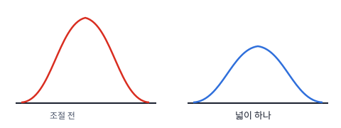
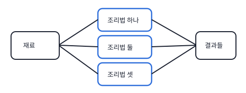
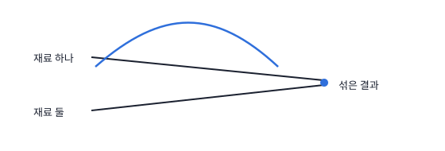
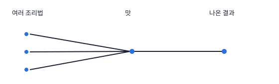
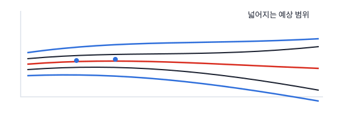
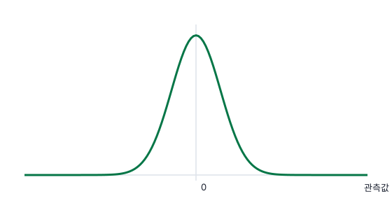
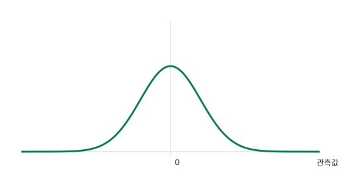
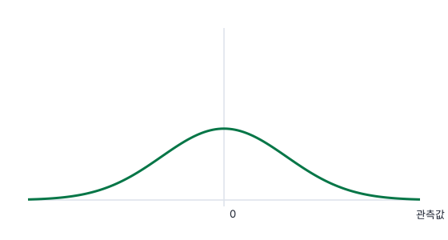

# 베이지안 선형회귀의 완성 — 5살도 이해하는 정리노트

정방철 교수님 머신러닝기초 · 1014 수업 (Lecture04 s5–15, MML 6·9장)

> `정리노트_1014_Bayesian_Posterior_Prediction.html`를 마크다운으로 옮겼어요. 그림은 `figures_1014/` 폴더의 SVG, 위젯은 대표 설정의 정적 그림으로 바꿨어요. 수식은 `$…$` / `$$…$$`라서 GitHub, Obsidian, Typora에서 보여요.

**목차**

- [0. 정규화와 확률 모델](#s0)
  - [θ의 사후분포를 구하고, 새 y의 분포로 옮겨요](#s0-learning-map)
  - [종 모양의 넓이를 1로 맞춰요](#s0-normalize)
  - [고정된 입력, 불확실한 가중치](#s0-model)
- [1. 사후분포를 직접 구해요](#s1)
  - [음의 로그를 이차식으로 펼쳐요](#s1-expand)
  - [계수를 맞춰 평균과 공분산을 찾아요](#s1-match)
- [2. 새 입력의 예측분포](#s2)
  - [가중합의 분산을 행렬로 묶어요](#s2-weighted)
  - [벡터 적분을 스칼라 하나로 줄여요](#s2-integral)
  - [회색 띠와 남아 있는 잡음](#s2-uncertainty)
- [3. 요약 · 예고](#s3)
  - [한 장 요약](#s3-cheatsheet)
  - [다음 시간 예고](#s3-next)
  - [함께 보면 좋은 자료](#s3-links)

## 0. 정규화와 확률 모델

### θ의 사후분포를 구하고, 새 y의 분포로 옮겨요

*학습 길잡이 · 기존 내용 재구성*

**먼저 큰 그림**

**오늘의 질문.** 정규화와 이차식 전개는 목적 자체가 아니에요. 데이터로 갱신한 파라미터 분포와 새 관측값의 예측분포를 구하려는 계산이에요.

ML은 고정된 미지의 θ를 추정해요. MAP과 FB는 θ에 사전분포를 부여해요. MAP은 사후분포의 최고점 하나, FB는 분포 전체를 이용해요.

| 구분 | 무엇을 하나요? | 무엇이 남나요? |
|---|---|---|
| ML | 데이터의 우도 최대화 | θ 하나 |
| MAP | 사후분포의 밀도가 최고인 위치 | θ_MAP 하나 |
| FB | 사후분포를 유지해 주변화 | θ의 분포와 y의 예측분포 |

**구할 결과.** 가우시안 사후분포의 평균 mₙ은 MAP 위치와 같아요. FB는 여기에 사후공분산 Sₙ을 남겨 예측의 불확실성에 반영해요.

**수식이 하는 일.** 정규화는 밀도의 적분값을 1로 맞춰요. 이차식의 계수 비교는 mₙ과 Sₙ을 찾고, 가중합의 평균·분산 공식은 이를 새 y의 평균·분산으로 옮겨요.

**헷갈리기 쉬운 점.** N(0, b²I)와 N(m₀, S₀)의 차이는 사전분포의 선택이지 MAP과 FB의 구분이 아니에요. 선형 가우시안 모형에서는 예측평균이 같아도 예측분산은 달라요.

이어서 읽기: [고정된 입력, 불확실한 가중치](#s0-model) · [계수를 맞춰 평균과 공분산을 찾아요](#s1-match) · [회색 띠와 남아 있는 잡음](#s2-uncertainty)

**페이지 요약**

가우시안 사후분포의 평균 mₙ은 MAP 위치와 같아요. FB는 여기에 사후공분산 Sₙ을 남겨 예측의 불확실성에 반영해요.

#### 조건·구분

$\mathcal{N}(0,b^2I)$와 $\mathcal{N}(m_0,S_0)$는 사전분포 선택의 차이예요. MAP·FB를 나누는 기준은 최고점 하나를 고르는지, 사후분포를 유지해 주변화하는지예요.

---

### 종 모양의 넓이를 1로 맞춰요

*1014 수업 · L04 s6·s8·s10–11*

**쉽게 말하면**

종 모양의 선을 그대로 두고 높이만 조절해서, 선 아래의 넓이를 딱 하나로 맞춰요.

*높이를 맞추면 선 아래 넓이가 하나가 돼요.*

**정확히 말하면**

확률밀도함수(PDF, probability density function)는 음이 아니고 전체 정의역에서 적분한 값이 1이어야 해요. 연속형 확률변수의 한 점에서 밀도값 자체가 확률인 것은 아니며, 구간의 확률은 그 구간 아래 넓이로 계산해요.

1. 스칼라 변수 $x\in\mathbb R$, 평균 $\mu\in\mathbb R$, 분산 $\sigma^2\gt0$에 대해 정규분포 밀도를 써요.

   $$
   p(x)=\frac{1}{\sqrt{2\pi\sigma^2}}\exp\!\left(-\frac{(x-\mu)^2}{2\sigma^2}\right).
   $$
2. PDF의 정규화 조건을 적용해요.

   $$
   1=\int_{-\infty}^{\infty}p(x)\,dx=\frac{1}{\sqrt{2\pi\sigma^2}}\int_{-\infty}^{\infty}\exp\!\left(-\frac{(x-\mu)^2}{2\sigma^2}\right)dx.
   $$
3. 앞의 상수는 $x$와 무관하므로 적분 밖에 둘 수 있어요. 양변에 $\sqrt{2\pi\sigma^2}$를 곱하면 지수부만의 넓이를 얻어요.

   $$
   \int_{-\infty}^{\infty}\exp\!\left(-\frac{(x-\mu)^2}{2\sigma^2}\right)dx=\sqrt{2\pi\sigma^2}.
   $$

따라서 $\exp\!\left(-(x-\mu)^2/(2\sigma^2)\right)$는 종 모양을 정하고, $1/\sqrt{2\pi\sigma^2}$는 그 넓이를 1로 만드는 정규화 상수예요. 정규화 전의 지수부만을 PDF라고 부를 수는 없어요.

벡터에서도 같은 원리가 작동해요. $\mathbf u,\boldsymbol{\mu}\in\mathbb R^d$이고 $\Sigma\in\mathbb R^{d\times d}$가 대칭 양의 정부호인 공분산행렬이면 다변량 가우시안 밀도는 다음과 같아요.

$$
p(\mathbf u)=\frac{1}{\sqrt{(2\pi)^d|\Sigma|}}\exp\!\left(-\frac12(\mathbf u-\boldsymbol{\mu})^T\Sigma^{-1}(\mathbf u-\boldsymbol{\mu})\right).
$$

행렬식(determinant) $|\Sigma|$는 스칼라예요. 지수 안의 이차형식은 $(1\times d)(d\times d)(d\times1)$의 곱이라 스칼라예요. 따라서 PDF의 값도 스칼라이고, $d$개 성분을 모두 적분하면 1이 돼요. 앞 상수를 제외한 지수부의 전체 적분값은 $\sqrt{(2\pi)^d|\Sigma|}$예요. 이 사실은 뒤에서 가우시안 모양을 정규화할 때 다시 써요.

Part 03에서는 두 가우시안 밀도의 곱도 복습했어요. $p_0(x)=\mathcal N(x\mid\mu_0,v_0)$, $p_1(x)=\mathcal N(x\mid\mu_1,v_1)$에서 $\mu_0,\mu_1\in\mathbb R$는 평균, $v_0,v_1\gt0$은 분산이에요. 같은 변수 $x$에 관한 두 PDF를 곱하면 평균 $m$, 분산 $v$인 가우시안 모양이지만, 아직 PDF는 아니에요.

$$
v=(v_0^{-1}+v_1^{-1})^{-1},\qquad m=v\left(\frac{\mu_0}{v_0}+\frac{\mu_1}{v_1}\right).
$$

곱의 전체 적분값 $c=\int_{-\infty}^{\infty}p_0(x)p_1(x)\,dx$는 양의 상수예요. 따라서 다음 식에서 $c$는 곱을 정규화하기 전의 전체 넓이이고, $\mathcal N(x\mid m,v)$ 안의 $1/\sqrt{2\pi v}$는 정규화된 가우시안 PDF 자체의 앞 계수예요.

$$
p_0(x)p_1(x)=c\,\mathcal N(x\mid m,v),\qquad \frac{p_0(x)p_1(x)}{c}=\mathcal N(x\mid m,v).
$$

다변량 가우시안 곱에도 이 원리가 이어져요. 행렬판의 자세한 증명은 이날 다시 유도하지 않았으므로 [1012 가우시안 곱 증명 노트](../1012/정리노트_1012_Several_Mathematical_Proofs.html)에서 확인해요.

**교수님 말씀**

> “PDF, PDF의 값은 항상 스칼라예요.”

(1014 Part 02; 정확한 시각 없음) 교수님은 행렬식과 이차형식의 크기를 확인하며, 복잡해 보이는 식도 마지막에는 숫자 하나여야 한다고 강조했어요. Part 01에서는 종 모양의 넓이를 1로 맞추는 계수가 뒤의 유도에 쓰인다고 예고했어요.

**꼭 기억해요**

> “이 세 번째 게 우리 지금 이 챕터에서 가장 중요한 이론.”

(1014 Part 03; 정확한 시각 없음) 두 가우시안 밀도의 곱은 정규화 전에는 가우시안 모양에 비례해요. 전체 넓이로 나누어야 PDF가 돼요.

**페이지 요약**

종 모양의 지수부나 두 밀도의 곱은 전체 넓이로 정규화해야 PDF가 돼요.

*핵심 식*

- 스칼라 정규화

  $$
  \int_{-\infty}^{\infty}\exp\!\left(-\frac{(x-\mu)^2}{2\sigma^2}\right)dx=\sqrt{2\pi\sigma^2}.
  $$
- 다변량 밀도

  $$
  p(\mathbf u)=\frac{1}{\sqrt{(2\pi)^d|\Sigma|}}\exp\!\left(-\frac12(\mathbf u-\boldsymbol{\mu})^T\Sigma^{-1}(\mathbf u-\boldsymbol{\mu})\right).
  $$
- 가우시안 곱

  $$
  p_0(x)p_1(x)=c\,\mathcal N(x\mid m,v),\qquad \frac{p_0(x)p_1(x)}{c}=\mathcal N(x\mid m,v).
  $$

*용어*

- **확률밀도함수(PDF)** — 음이 아니며 전체 적분값이 1인 함수예요.
- **정규화** — 함수의 전체 넓이를 1로 맞추는 일이에요.

#### 조건·구분

PDF 값은 스칼라 밀도이며 한 점의 확률이 아니에요. 스칼라는 $\sigma^2\gt0$, $d$차원은 $\Sigma\in\mathbb{R}^{d\times d}$ 대칭 양의 정부호를 전제해요. $|\Sigma|$와 이차형식은 스칼라예요. 스칼라 곱에서는 $v=(v_0^{-1}+v_1^{-1})^{-1}$, $m=v(\mu_0/v_0+\mu_1/v_1)$이고 $c=\int p_0(x)p_1(x)\,dx$예요. 곱의 전체면적 $c$와 정규화된 가우시안 자체의 앞 계수 $1/\sqrt{2\pi v}$를 구별해요.

---

### 고정된 입력, 불확실한 가중치

*1014 수업 · L04 s5*

**쉽게 말하면**

같은 재료를 넣어도 조리법을 확신하지 못하면 결과가 여러 가지일 수 있어요.

*재료는 정해져 있어도 조리법 후보가 여럿이면 결과도 달라져요.*

**정확히 말하면**

베이지안 선형회귀(Bayesian linear regression)의 한 관측값 모델은 다음과 같아요. $x$는 주어진 입력, $\phi(x)\in\mathbb R^K$는 입력에서 결정적으로 만드는 특징벡터(feature vector), $\theta\in\mathbb R^K$는 $K$개 가중치의 열벡터, $\epsilon\sim\mathcal N(0,\sigma^2)$는 분산 $\sigma^2\gt0$인 관측 잡음, $y\in\mathbb R$는 스칼라 출력이에요.

$$
y=\phi(x)^T\theta+\epsilon.
$$

여기서 내적 $\phi(x)^T\theta$는 $(1\times K)(K\times1)$이므로 스칼라예요. 특징벡터가 $\phi(x)=(1,x,x^2,x^3)^T$처럼 입력 $x$에 비선형이어도, 가중치 $\theta$에 선형이면 선형회귀라고 해요. $x$와 $\theta$를 모두 고정하면 출력의 조건부 밀도인 우도(likelihood)는 다음과 같아요.

$$
p(y\mid x,\theta)=\mathcal N\!\left(y\mid\phi(x)^T\theta,\sigma^2\right).
$$

베이지안 모델은 가중치를 미지의 확률벡터로 두고 사전분포(prior) $p(\theta)=\mathcal N(\theta\midm_0,S_0)$를 정해요. $m_0\in\mathbb R^K$는 사전평균, $S_0\in\mathbb R^{K\times K}$는 사전 공분산행렬이에요. 한 관측에 대한 결합밀도(joint density)는 $p(y,\theta\mid x)=p(y\mid x,\theta)p(\theta)$예요.

훈련 입력 $x_1,\ldots,x_N$과 정답 $y_1,\ldots,y_N$을 각각 $X,Y$라고 부르고, $y=(y_1,\ldots,y_N)^T\in\mathbb R^N$로 모아요. 특징행렬 $\Phi\in\mathbb R^{N\times K}$는 각 행을 $\phi(x_i)^T$로 쌓은 행렬이에요. 따라서 $\Phi\theta\in\mathbb R^N$이고, $\Phi$는 정방행렬일 필요가 없어요. 새 입력 $x_*$에 대해서는 $\phi_*:=\phi(x_*)\in\mathbb R^K$라고 써요. $\phi_*^T\theta$는 새 출력의 스칼라 평균이에요.

훈련자료를 본 뒤 가중치의 사후분포(posterior) $p(\theta\mid X,Y)$를 구하고, 새 출력의 사후예측분포(posterior predictive distribution)를 구하는 것이 목표예요.

$$
p(y_*\mid x_*,X,Y)=\int_{\mathbb R^K}p(y_*\mid x_*,\theta)p(\theta\mid X,Y)\,d\theta.
$$

$y_*$는 새 관측 출력이에요. 이 적분은 가능한 가중치마다 새 출력의 조건부 밀도를 계산하고, 사후분포로 가중평균해요. 우도 $p(Y\mid X,\theta)$는 관측값 $Y$에 관한 밀도이며, $\theta$의 함수로 볼 때 $\theta$에 대해 정규화된 PDF라는 뜻은 아니에요. 베이즈 규칙에서 $p(\theta\mid X,Y)\propto p(Y\mid X,\theta)p(\theta)$라는 곱은 정규화 전의 모양을 나타내고, 정규화한 뒤에야 적분값이 1인 사후밀도가 돼요. 서로 다른 변수에 관한 두 밀도를 곱하는 위 예측 적분도, 같은 변수에 관한 가우시안 곱 공식만으로 바로 끝나지 않아요.

**교수님 말씀**

> “그 linear하다는 말이 θ에 대해서만 linear하면 된다.”

(1014 Part 01; 정확한 시각 없음) 입력을 변환해도 가중치에 대한 선형성이 핵심이라는 뜻이에요. Part 02에서는 새 입력의 정답을 숫자 하나로 단정하기보다, 가중치에 관한 사후분포를 적분해 예측분포를 얻는 목표를 다시 짚었어요.

**페이지 요약**

입력에서 특징은 고정되고, 가중치의 불확실성을 평균해 새 출력의 분포를 구해요.

*핵심 식*

- 관측 모델

  $$
  y=\phi(x)^T\theta+\epsilon.
  $$
- 예측 목표

  $$
  p(y_*\mid x_*,X,Y)=\int_{\mathbb R^K}p(y_*\mid x_*,\theta)p(\theta\mid X,Y)\,d\theta.
  $$

*용어*

- **특징벡터(feature vector)** — 주어진 입력에서 결정적으로 만든 $K$차원 벡터예요.
- **사전분포(prior)** — 훈련자료를 보기 전 가중치에 둔 확률분포예요.
- **사후분포(posterior)** — 훈련자료를 본 뒤 가중치에 대해 갱신한 확률분포예요.

#### 조건·구분

$\theta,\phi(x)\in\mathbb{R}^K$, $\Phi\in\mathbb{R}^{N\times K}$이며 각 행은 $\phi(x_i)^T$예요. 피처가 입력에 비선형이어도 가중치에 선형이면 선형회귀예요. 우도는 관측값에 대한 밀도이지 $\theta$에 관해 정규화된 PDF가 아니에요. 예측 적분의 두 밀도는 서로 다른 변수에 관한 것이므로 같은 변수의 가우시안 곱 공식만으로 끝나지 않아요.

---

## 1. 사후분포를 직접 구해요

### 음의 로그를 이차식으로 펼쳐요

*1014 수업 · L04 s12*

**쉽게 말하면**

서로 다른 두 힌트를 한 장의 계산표에 모아요.

*두 힌트를 더하면 한 가지 모양이 보여요.*

**정확히 말하면**

훈련 입력 $X$의 수를 $N$, 특징 수를 $K$라 해요. 특징행렬 $\Phi\in\mathbb R^{N\times K}$, 관측 벡터 $y\in\mathbb R^N$, 파라미터 $\theta\in\mathbb R^K$를 써요. 잡음 분산 $\sigma^2\gt0$과 단위행렬 $I_N$을 두면 우도(likelihood)는 $p(Y\mid X,\theta)=\mathcal N(y\mid\Phi\theta,\sigma^2I_N)$예요. 사전분포(prior)는 평균 $m_0\in\mathbb R^K$, 대칭 양의 정부호 공분산 $S_0\in\mathbb R^{K\times K}$를 갖는 $p(\theta)=\mathcal N(\theta\mid m_0,S_0)$예요. 여기서 $Y$는 관측값 전체를 뜻해요.

베이즈 규칙에서 $p(\theta\mid X,Y)\propto p(Y\mid X,\theta)p(\theta)$예요. 따라서 곱을 음의 로그로 바꾸면 지수의 두 이차식을 더할 수 있어요. $\mathrm{const}$는 $\theta$와 무관한 정규화 항이에요.

1. 음의 로그의 출발점이에요.

   $$
   -\log p(\theta\mid X,Y)=\frac{1}{2\sigma^2}(y-\Phi\theta)^T(y-\Phi\theta)+\frac12(\theta-m_0)^TS_0^{-1}(\theta-m_0)+\mathrm{const}
   $$
2. $(\Phi\theta)^T=\theta^T\Phi^T$로 순서를 뒤집어 우도 부분을 네 항으로 펼쳐요.

   $$
   (y-\Phi\theta)^T(y-\Phi\theta)=y^Ty-y^T\Phi\theta-\theta^T\Phi^Ty+\theta^T\Phi^T\Phi\theta
   $$
3. 사전분포 부분도 네 항으로 펼쳐요.

   $$
   (\theta-m_0)^TS_0^{-1}(\theta-m_0)=\theta^TS_0^{-1}\theta-\theta^TS_0^{-1}m_0-m_0^TS_0^{-1}\theta+m_0^TS_0^{-1}m_0
   $$
4. 우도의 두 교차항은 스칼라예요. $y^T\Phi\theta\in\mathbb R$이므로 전치해도 값이 같아요.

   $$
   (y^T\Phi\theta)^T=\theta^T\Phi^Ty=y^T\Phi\theta
   $$

   사전분포의 두 교차항도 스칼라이고, $S_0^{-1}$가 대칭이므로 같아요.

   $$
   (\theta^TS_0^{-1}m_0)^T=m_0^T(S_0^{-1})^T\theta=m_0^TS_0^{-1}\theta=\theta^TS_0^{-1}m_0
   $$
5. 두 항씩 합친 뒤 $\theta$에 관한 이차항, 일차항, 상수항을 모아요.

   $$
   -\log p(\theta\mid X,Y)=\frac12\theta^T(\sigma^{-2}\Phi^T\Phi+S_0^{-1})\theta-\theta^T(\sigma^{-2}\Phi^Ty+S_0^{-1}m_0)+\mathrm{const}
   $$

   여기서 $y^Ty$와 $m_0^TS_0^{-1}m_0$는 $\theta$가 없는 상수항이에요. $\Phi^T\Phi$와 $S_0^{-1}$는 모두 $K\times K$이고, $\Phi^Ty$와 $S_0^{-1}m_0$는 모두 $K\times1$이에요. 그래서 가로벡터, 행렬, 세로벡터의 곱은 스칼라가 돼요.

우도 $p(Y\mid X,\theta)$는 고정된 $\theta$에서 $y$에 관해 정규화된 밀도예요. 이를 $\theta$의 함수로 본 것만으로는 $\theta$에 관해 정규화된 밀도가 되지 않아요. 사전분포와 곱하고 정규화한 결과가 사후분포예요.

**교수님 말씀**

교수님은 네 항씩 직접 펼쳐 $\theta$의 차수별로 묶고, 손으로 계산해 보라고 권했어요. “이거 어렵지 않아요, 복잡할 뿐이지.” (1014 Part 04; 정확한 시각 없음)

**페이지 요약**

두 이차식을 펼쳐 같은 교차항을 합치면 계수 비교가 쉬워져요.

*핵심 식*

- 음의 로그

  $$
  -\log p(\theta\mid X,Y)=\frac12\theta^T(\sigma^{-2}\Phi^T\Phi+S_0^{-1})\theta-\theta^T(\sigma^{-2}\Phi^Ty+S_0^{-1}m_0)+\mathrm{const}
  $$

*용어*

- **스칼라(scalar)** — 행렬 곱의 결과로 얻는 숫자 하나예요.
- **우도(likelihood)** — 주어진 파라미터에서 관측값의 밀도를 나타내요.

#### 조건·구분

$\sigma^2\gt0$, $S_0$ 대칭 양의 정부호에서 우도 공분산은 $\sigma^2I_N$, 사전 공분산은 $K\times K$인 $S_0$예요. 두 교차항은 스칼라의 전치와 $S_0^{-1}$의 대칭성으로 같아요. 이차계수는 $K\times K$, 일차계수는 $K\times1$이며 const는 $\theta$와 무관해요.

---

### 계수를 맞춰 평균과 공분산을 찾아요

*1014 수업 · L04 s13*

**쉽게 말하면**

같은 그림을 두 장의 설명서로 그렸다면, 같은 자리의 숫자도 같아야 해요.

*같은 칸끼리 맞추면 숨은 값을 찾을 수 있어요.*

**정확히 말하면**

이번 계수 비교가 구하는 것은 θ의 사후평균과 사후공분산이에요. 일반 MAP 식과 평균 식은 $(cA)^{-1}=c^{-1}A^{-1}$로 연결돼요. 평균에서는 앞의 $\sigma^2$와 뒤의 $1/\sigma^2$가 상쇄되지만, 공분산에는 뒤의 벡터가 없어서 $S_N=\sigma^2[\Phi^T\Phi+\sigma^2S_0^{-1}]^{-1}$의 앞 계수가 남아요. A와 q로 줄여 쓰는 표기는 각각 행렬 대괄호와 오른쪽 벡터의 임시 이름일 뿐이에요.

[음의 로그 전개](#s1-expand)에서 얻은 $\theta$의 이차식과 가우시안의 이차식을 비교해요. 사후평균 $m_N\in\mathbb R^K$와 사후공분산 $S_N\in\mathbb R^{K\times K}$를 아직 모르는 값으로 두어요. $S_N^{-1}$는 정밀도(precision), 즉 공분산의 역행렬이에요. 아래에서 $A:=S_0^{-1}+\sigma^{-2}\Phi^T\Phi$, $b:=S_0^{-1}m_0+\sigma^{-2}\Phi^Ty$로 줄여 써요.

1. 완전제곱을 목표로 하는 사후 가우시안의 음의 로그를 네 항으로 펼쳐요. $S_N^{-1}$는 대칭이에요.

   $$
   -\log\mathcal N(\theta\mid m_N,S_N)=\frac12(\theta-m_N)^TS_N^{-1}(\theta-m_N)+\mathrm{const}
   $$

   $$
   =\frac12\left(\theta^TS_N^{-1}\theta-\theta^TS_N^{-1}m_N-m_N^TS_N^{-1}\theta+m_N^TS_N^{-1}m_N\right)+\mathrm{const}
   $$
2. 두 교차항은 서로 전치인 스칼라이고 정밀도의 대칭성 때문에 같아요.

   $$
   (\theta^TS_N^{-1}m_N)^T=m_N^T(S_N^{-1})^T\theta=m_N^TS_N^{-1}\theta
   $$

   따라서 일차항을 하나로 모아요.

   $$
   -\log\mathcal N(\theta\mid m_N,S_N)=\frac12\theta^TS_N^{-1}\theta-\theta^TS_N^{-1}m_N+\mathrm{const}
   $$
3. 이차항의 계수를 맞추면 $S_N^{-1}=A$예요.

   $$
   S_N^{-1}=S_0^{-1}+\sigma^{-2}\Phi^T\Phi
   $$

   $$
   S_N=(S_0^{-1}+\sigma^{-2}\Phi^T\Phi)^{-1}
   $$

   슬라이드 s12의 머리 부분은 잡음 분산과 정밀도 표기가 어긋나지만, 음의 로그 전개 및 계수 비교에 필요한 계수는 $\sigma^{-2}=1/\sigma^2$예요.
4. 일차항은 $S_N^{-1}m_N=b$예요. 양변의 왼쪽에 $S_N$을 곱하면 평균을 얻어요.

   $$
   S_N^{-1}m_N=S_0^{-1}m_0+\sigma^{-2}\Phi^Ty
   $$

   $$
   m_N=S_N(S_0^{-1}m_0+\sigma^{-2}\Phi^Ty)
   $$

   가로벡터 형태로 비교하면 $m_N^TS_N^{-1}=b^T$예요. 오른쪽에 $S_N$을 곱해 $m_N^T=b^TS_N$을 얻고 전치하면 같은 $m_N=S_Nb$가 나와요. 이때 $S_N^T=S_N$을 썼어요.
5. 이 결과를 완전제곱 형태에 대입해 확인해요.

   $$
   \theta^TA\theta-2b^T\theta=(\theta-A^{-1}b)^TA(\theta-A^{-1}b)-b^TA^{-1}b
   $$

   마지막 항은 $\theta$와 무관해 정규화 상수에 들어가요. $S_0$가 양의 정부호이므로 $S_0^{-1}$도 양의 정부호예요. $\sigma^2\gt0$에서 $\sigma^{-2}\Phi^T\Phi$는 양의 준정부호이므로 합 $A$는 대칭 양의 정부호예요. 따라서 $A^{-1}=S_N$이 존재하고, 이 가우시안 커널을 $\theta$에 관해 정규화할 수 있어요. 결론은 $p(\theta\mid X,Y)=\mathcal N(\theta\mid m_N,S_N)$예요.

MAP 식을 사후평균 식으로 바꾸는 과정을 [한 줄씩 쓰는 수식 노트](%EC%9D%B8%ED%84%B0%EB%A0%89%ED%8B%B0%EB%B8%8C_03_MAP%EC%97%90%EC%84%9C_%EC%82%AC%ED%9B%84%ED%8F%89%EA%B7%A0%EA%B9%8C%EC%A7%80_%ED%95%9C%EC%A4%84%EC%94%A9.html)에서 따라가 보세요.

데이터 개수와 사전분산을 바꿀 때 사후분포가 어떻게 달라지는지 [사전분포와 사후분포 실험](%EC%9D%B8%ED%84%B0%EB%A0%89%ED%8B%B0%EB%B8%8C_01_%EC%82%AC%EC%A0%84%EB%B6%84%ED%8F%AC%EC%99%80_%EC%82%AC%ED%9B%84%EB%B6%84%ED%8F%AC.html)에서 비교해 보세요.

**교수님 말씀**

교수님은 일차항에서 평균을 꺼내는 부분을 다시 써 주며, 고등학교의 계수비교와 같은 원리라고 설명했어요. “다시 써볼까요, 그럼?” (1014 Part 05; 정확한 시각 없음)

**페이지 요약**

이차항과 일차항의 계수를 맞추면 사후공분산과 평균을 구해요.

*핵심 식*

- 사후 정밀도

  $$
  S_N^{-1}=S_0^{-1}+\sigma^{-2}\Phi^T\Phi
  $$
- 사후평균

  $$
  m_N=S_N(S_0^{-1}m_0+\sigma^{-2}\Phi^Ty)
  $$

*용어*

- **정밀도(precision)** — 공분산 행렬의 역행렬이에요.
- **완전제곱(completing the square)** — 이차식의 중심과 퍼짐을 드러내는 정리예요.

#### 조건·구분

$S_0$가 양의 정부호이고 $\sigma^2\gt0$이면 $S_0^{-1}+\sigma^{-2}\Phi^T\Phi$도 양의 정부호라 역행렬이 존재해요. 슬라이드 머리의 잡음 표기와 달리 여기 필요한 계수는 $\sigma^{-2}=1/\sigma^2$예요. 평균을 MAP 식으로 바꿀 때는 앞뒤 $\sigma^2$가 상쇄되지만, 공분산은 $S_N=\sigma^2[\Phi^T\Phi+\sigma^2S_0^{-1}]^{-1}$의 앞 계수가 남아요.

---

## 2. 새 입력의 예측분포

### 가중합의 분산을 행렬로 묶어요

*1014 수업 · L04 s7, s14*

**쉽게 말하면**

두 재료를 섞은 결과가 얼마나 흔들릴지는 각 재료의 흔들림과 둘이 함께 움직이는 정도를 봐야 해요.

*재료 사이의 곡선도 결과의 흔들림에 영향을 줘요.*

**정확히 말하면**

새 입력 $x_*$의 특징 열벡터를 $\phi_*=\phi(x_*)\in\mathbb R^K$라 하고, 훈련자료 $X,Y$를 본 뒤의 파라미터 열벡터를 $\theta\mid X,Y\sim\mathcal N(m_N,S_N)$라고 해요. $m_N\in\mathbb R^K$는 사후평균, $S_N\in\mathbb R^{K\times K}$는 사후 자기 공분산행렬이에요. $K$는 특징의 개수이고, 잡음 없는 출력 $z=\phi_*^T\theta$는 스칼라예요.

스칼라 가중합부터 시작해요. $K=2$, $\phi_*=(a,b)^T$, $\theta=(\theta_1,\theta_2)^T$이면 $z=a\theta_1+b\theta_2$예요. 여기서 $a,b$는 주어진 상수이고, $S_{ij}=\operatorname{Cov}(\theta_i,\theta_j\mid X,Y)$예요.

1. 스칼라 정의를 써요. $\operatorname{Cov}(u,v)=\mathbb{E}[(u-\mathbb{E}[u])(v-\mathbb{E}[v])]$이고 $\operatorname{Var}(u)=\operatorname{Cov}(u,u)$예요. $\mathbb{E}$는 기대값이에요.
2. 가중합을 펼치면

   $$
   \operatorname{Var}(z)=a^2S_{11}+abS_{12}+abS_{21}+b^2S_{22}.
   $$
3. 자기 공분산행렬은 대칭이므로 $S_{12}=S_{21}$이에요. 따라서

   $$
   \operatorname{Var}(z)=a^2S_{11}+2abS_{12}+b^2S_{22}.
   $$

   두 성분이 함께 움직이는 교차항을 버리면 일반적으로 틀려요.
4. 이 성분 계산을 행렬로 묶어요. 편차 $\widetilde{\theta}=\theta-m_N$에 대해

   $$
   \operatorname{Var}(z)=\mathbb{E}[(\phi_*^T\widetilde{\theta})(\phi_*^T\widetilde{\theta})]
   $$

   $$
   =\phi_*^T\mathbb{E}[\widetilde{\theta}\widetilde{\theta}^T]\phi_*=\phi_*^T S_N\phi_*.
   $$

차원은 $(1\times K)(K\times K)(K\times1)=1\times1$이에요. L04 s7에서 복습한 일반 규칙도 편차의 정의로 확인할 수 있어요. 이 문단의 $\mathbf X\in\mathbb R^n$, $\mathbf Y\in\mathbb R^m$는 훈련자료 $X,Y$와 별개의 일반 확률벡터예요. 상수 행렬 $A\in\mathbb R^{p\times n}$, $B\in\mathbb R^{q\times m}$와 상수 벡터 $b\in\mathbb R^p$, $c\in\mathbb R^q$를 놓고, $\widetilde{\mathbf X}=\mathbf X-\mathbb{E}[\mathbf X]$, $\widetilde{\mathbf Y}=\mathbf Y-\mathbb{E}[\mathbf Y]$라 해요. 상수 이동은 편차에서 사라지고, 둘째 편차의 전치가 $B^T$를 오른쪽에 놓아요.

$$
\operatorname{Cov}(A\mathbf X+b,B\mathbf Y+c)=\mathbb{E}[(A\widetilde{\mathbf X})(B\widetilde{\mathbf Y})^T]=A\operatorname{Cov}(\mathbf X,\mathbf Y)B^T.
$$

첫 입력의 계수는 왼쪽, 둘째 입력의 계수는 전치해서 오른쪽이에요. 결과 차원은 $(p\times n)(n\times m)(m\times q)=p\times q$예요. 이는 두 입력 사이의 교차 공분산이에요. 특히 $n=m=K$, $\mathbf X=\mathbf Y=\theta$, $A=B$로 놓은 자기 공분산은 $\operatorname{Cov}(A\theta)=AS_NA^T\in\mathbb R^{p\times p}$예요. 지금은 $A=\phi_*^T$이고, $\operatorname{Cov}(\theta,z)=S_N\phi_*\in\mathbb R^{K\times1}$는 교차 공분산, $\operatorname{Var}(z)=\phi_*^T S_N\phi_*$는 자기 공분산이에요.

관측 잡음 $\epsilon\sim\mathcal N(0,\sigma^2)$는 $\theta$와 독립이라고 가정해요. 따라서 $y_*=z+\epsilon$의 분산에는 뒤에서 $\sigma^2$를 더해요.

**교수님 말씀**

> “벡터를 내적하면 스칼라잖아요.”

(1014 Part 06; 정확한 시각 없음) 가중합의 결과와 분산이 스칼라인지 확인하며 차원을 짚었어요. 일반 정리의 별도 증명은 미뤘지만 공분산을 이용한 계산은 칠판에서 보여 주었어요.

**페이지 요약**

성분별 교차항을 포함해 계산한 분산이 행렬 표현 하나로 묶여요.

*핵심 식*

- 가중합의 분산

  $$
  \operatorname{Var}(z)=\phi_*^T S_N\phi_*
  $$
- 일반 선형변환

  $$
  \operatorname{Cov}(A\theta)=AS_NA^T
  $$

*용어*

- **자기 공분산(self-covariance)** — 한 벡터의 성분들이 함께 움직이는 정도를 나타내는 행렬이에요.

#### 조건·구분

$K=2$이면 분산은 $a^2S_{11}+2abS_{12}+b^2S_{22}$로 교차항을 버리지 않아요. 상수 변환의 교차공분산은 $\operatorname{Cov}(A\mathbf{X}+b,B\mathbf{Y}+c)=A\operatorname{Cov}(\mathbf{X},\mathbf{Y})B^T$이며 결과 차원은 $p\times q$예요. $\operatorname{Cov}(\theta,z)=S_N\phi_*\in\mathbb{R}^{K\times1}$와 스칼라 자기분산 $\phi_*^TS_N\phi_*$를 구별해요. $\theta$와 독립인 관측잡음을 더하면 분산에 $\sigma^2$를 더해요.

---

### 벡터 적분을 스칼라 하나로 줄여요

*1014 수업 · L04 s14*

**쉽게 말하면**

가능한 여러 조리법이 같은 맛을 낼 수 있어요. 그 맛이 얼마나 자주 나오는지 모은 다음, 마지막에 섞이는 잡음까지 합쳐요.

*여러 출발점이 같은 중간 결과로 모일 수 있어요.*

**정확히 말하면**

새 입력에서의 사후예측분포(posterior predictive distribution)는 모든 파라미터 가능성을 합친 것이에요.

$$
p(y_*\mid x_*,X,Y)=\int_{\mathbb R^K}p(y_*\mid x_*,\theta)p(\theta\mid X,Y)\,d\theta.
$$

여기서 $y_*$는 새 관측값, $p(y_*\mid x_*,\theta)=\mathcal N(y_*\mid\phi_*^T\theta,\sigma^2)$는 $y_*$의 조건부 밀도, $p(\theta\mid X,Y)$는 파라미터 밀도예요.

$z=\phi_*^T\theta$에 의해 만들어지는 분포를 먼저 구해요. 선형 가우시안 변환 성질과 [가중합의 분산을 행렬로 묶어요](#s2-weighted)의 결과에 따라

$$
z\mid x_*,X,Y\sim\mathcal N(\mu,\nu),\qquad \mu=\phi_*^Tm_N,\quad \nu=\phi_*^T S_N\phi_*.
$$

여기서 $\mu$는 스칼라 평균이고 $\nu$는 스칼라 분산이에요. 이 단계는 벡터 분포를 $z$로 밀어 보낸 유도분포(pushforward distribution)를 얻는 일이에요. 여러 $\theta$가 같은 $z$를 만들 수 있으므로 일대일 변수변환의 Jacobian 하나만 붙이는 계산이 아니에요.

관측 잡음 $\epsilon\sim\mathcal N(0,\sigma^2)$가 $z$와 독립이고 $y_*=z+\epsilon$이라고 해요. $z$에 조건을 걸면 새 관측값의 분포는 $\mathcal N(y_*\mid z,\sigma^2)$예요. 따라서 벡터 적분을 한 변수의 주변화(marginalization)로 바꿔요.

$$
p(y_*\mid x_*,X,Y)=\int_{\mathbb R}\mathcal N(y_*\mid z,\sigma^2)\mathcal N(z\mid\mu,\nu)\,dz.
$$

독립인 두 정규변수의 합을 계산하는 합성곱(convolution) 적분이에요. 서로 다른 변수에 대한 두 밀도의 곱을 바로 정규화된 $y_*$ 밀도라고 부르는 단계가 아니에요.

$\nu\gt0$인 경우 스칼라 적분을 완전제곱해요. $a=1/\sigma^2$, $b=1/\nu$, $A=a+b$, $B=ay_*+b\mu$, $C=ay_*^2+b\mu^2$로 놓아요.

1. 지수부의 제곱합을 전개해요.

   $$
   a(y_*-z)^2+b(z-\mu)^2=Az^2-2Bz+C.
   $$
2. $z$의 중심을 $\bar z=B/A=(\nu y_*+\sigma^2\mu)/(\nu+\sigma^2)$라고 하면

   $$
   Az^2-2Bz+C=A(z-\bar z)^2+C-\frac{B^2}{A}.
   $$
3. 남은 상수를 계산해요.

   $$
   C-\frac{B^2}{A}=\frac{(y_*-\mu)^2}{\nu+\sigma^2},\qquad A=\frac{\nu+\sigma^2}{\sigma^2\nu}.
   $$
4. 두 원래 밀도의 앞 계수는 $1/(2\pi\sqrt{\sigma^2\nu})$예요. $z$ 부분의 가우시안 적분은 $\sqrt{2\pi/A}$이므로 곱하면

   $$
   \frac{1}{2\pi\sqrt{\sigma^2\nu}}\sqrt{\frac{2\pi}{A}}=\frac{1}{\sqrt{2\pi(\nu+\sigma^2)}}.
   $$

   이 계수가 전체 $y_*$ 밀도의 면적을 1로 만드는 정규화 상수예요.

결론은

$$
p(y_*\mid x_*,X,Y)=\mathcal N(y_*\mid\mu,\nu+\sigma^2)=\mathcal N(y_*\mid\phi_*^Tm_N,\phi_*^T S_N\phi_*+\sigma^2).
$$

$\nu=0$이면 $z=\mu$가 확률 1인 퇴화 분포예요. 이때 $1/\nu$ 계산을 쓰지 않고 직접 $y_*=\mu+\epsilon$으로부터 $\mathcal N(y_*\mid\mu,\sigma^2)$를 얻어요.

**교수님 말씀**

> “얘도 스칼라고 얘도 스칼라잖아, 이제.”

(1014 Part 07; 정확한 시각 없음) 적분의 결과를 예측분포로 연결했어요. 새 입력의 $\phi_*$와 훈련자료에서 구한 $m_N,S_N$의 역할을 구분해 설명했어요.

**페이지 요약**

파라미터를 평균내면 새 관측값의 예측분포가 나와요.

*핵심 식*

- 중간 분포

  $$
  z\mid x_*,X,Y\sim\mathcal N(\mu,\nu)
  $$
- 예측분포

  $$
  p(y_*\mid x_*,X,Y)=\mathcal N(y_*\mid\mu,\nu+\sigma^2)
  $$

*용어*

- **주변화(marginalization)** — 관심 없는 중간 변수를 적분해 원하는 변수의 분포를 얻어요.
- **정규화(normalization)** — 밀도의 전체 면적이 1이 되도록 앞 계수를 맞춰요.

#### 조건·구분

$z=\phi_*^T\theta$의 유도분포는 $\mu=\phi_*^Tm_N$, $\nu=\phi_*^TS_N\phi_*$예요. 여러 $\theta$가 같은 $z$를 만들 수 있어 일대일 Jacobian 하나를 붙이는 변환이 아니에요. 독립 잡음과의 합성곱 $\int\mathcal{N}(y_*\mid z,\sigma^2)\mathcal{N}(z\mid\mu,\nu)\,dz$를 계산해 분산 $\nu+\sigma^2$를 얻어요. $\nu\gt0$일 때 완전제곱과 정규화 상수를 쓰며, $\nu=0$이면 $1/\nu$ 대신 $y_*=\mu+\epsilon$에서 직접 $\mathcal{N}(\mu,\sigma^2)$를 얻어요.

---

### 회색 띠와 남아 있는 잡음

*1014 수업 · L04 s15*

**쉽게 말하면**

길을 이미 걸어 본 곳에서는 예상 경로가 좁아질 수 있어요. 그래도 매번 달라지는 바람 때문에 도착점은 조금씩 흔들려요.

*데이터 근처에서도 예상 범위가 완전히 사라지지는 않아요.*

**정확히 말하면**

잡음 없는 함수값 $f(x_*)=z$의 조건부 평균은 $\mu$이고 분산은 $\nu=\phi_*^T S_N\phi_*$예요. 새 관측값 $y_*=z+\epsilon$의 분산은 독립인 잡음 때문에 $\nu+\sigma^2$예요. 따라서 파라미터 불확실성(parameter uncertainty) $\nu$와 관측 잡음(observation noise) $\sigma^2$를 구별해야 해요.

$\sigma^2\gt0$을 고정하면 관측값 예측분산은 $\nu+\sigma^2\geq\sigma^2$예요. 훈련 입력 근처에서 $\nu$가 작아져도 잡음 하한이 남아요. 잡음 없는 함수의 분산 $\nu$는 데이터와 모델에 따라 작아질 수 있어요. 정확히 관측한 점에서 불확실성이 0이라는 설명은 $\sigma^2\to0$ 같은 잡음 없는 극한과 충분한 식별 조건을 함께 전제해야 해요.

정규분포에서 평균 주위 $\pm1$ 표준편차와 $\pm2$ 표준편차 띠를 그릴 수 있어요. 관측값의 표준편차는 $\sqrt{\nu+\sigma^2}$이고 함수값의 표준편차는 $\sqrt{\nu}$예요. 가우시안의 평균 중심 1, 2 표준편차 구간에는 각각 약 68%, 95%가 들어가요. 슬라이드의 회색 띠는 위치에 따른 예측 불확실성을 나타내요. 띠가 어떤 대상을 그렸는지 확인한 뒤 해당 분산으로 폭을 해석해야 해요. 점추정 ML/MAP는 파라미터 한 점의 예측선을 주며, 이 모형의 MAP 예측선은 사후평균선 $\phi_*^T m_N$과 같아요.

파라미터 사후분포에서 서로 다른 $\theta$를 뽑아 $\phi(x)^T\theta$를 그리면 함수 표본들이 나와요. 수업의 생성 모델 언급은 “분포를 이용해 결과를 만든다”는 직관적 비유예요. Bayesian optimization에서 불확실성이 큰 곳을 살펴보는 것은 탐험의 한 방법이지만, 최대 분산 지점이 언제나 최선의 다음 실험이라는 뜻은 아니에요. 예상 성과와 탐험·활용의 균형도 판단에 들어가요.

#### 직접 해 보기: 파라미터 불확실성과 종 모양 *(정적 스냅샷 — 직접 조작은 HTML 버전)*

파라미터 불확실성을 움직이면 새 관측값의 분산과 종 모양의 폭이 어떻게 바뀌는지 볼 수 있어요.

고정 잡음 분산 1, 전체 분산 **2**, 표준편차 **1.414**

범례: 새 관측값의 밀도

*파라미터 분산 0일 때도 잡음 때문에 폭이 남아요.*

*파라미터 분산이 1이면 곡선이 더 넓어요.*

*파라미터 분산이 4이면 곡선이 가장 넓어요.*

| 파라미터 분산 | 잡음 분산 | 전체 분산 | 표준편차 |
|---|---|---|---|
| 0 | 1 | 1 | 1.000 |
| 1 | 1 | 2 | 1.414 |
| 4 | 1 | 5 | 2.236 |

입력 위치와 잡음 분산을 바꾸며 함수값과 새 관측값의 예측 띠를 [함수와 관측값의 예측분포 실험](%EC%9D%B8%ED%84%B0%EB%A0%89%ED%8B%B0%EB%B8%8C_02_%ED%95%A8%EC%88%98%EC%99%80_%EA%B4%80%EC%B8%A1%EA%B0%92%EC%9D%98_%EC%98%88%EC%B8%A1%EB%B6%84%ED%8F%AC.html)에서 비교해 보세요.

**교수님 말씀**

> “노이즈가 있었잖아.”

(1014 Part 08; 정확한 시각 없음) 훈련자료가 있는 곳에서도 관측 잡음이 남는다는 설명이에요.

**페이지 요약**

새 관측값의 불확실성은 파라미터 불확실성과 관측 잡음을 더한 값이에요.

*핵심 식*

- 관측값 분산

  $$
  \nu+\sigma^2
  $$
- 잡음 없는 함수 분산

  $$
  \nu=\phi_*^T S_N\phi_*
  $$

*용어*

- **파라미터 불확실성(parameter uncertainty)** — 사후분포에 남은 파라미터 변동이 예측에 주는 흔들림이에요.
- **관측 잡음(observation noise)** — 같은 함수값에서도 새 관측값을 흔드는 오차예요.

#### 조건·구분

$\sigma^2\gt0$ 고정이면 관측분산 $\nu+\sigma^2\geq\sigma^2$로 잡음 하한이 남아요. 불확실성 $0$은 잡음 없는 극한과 식별 조건을 함께 확인해야 해요. 관측 띠의 표준편차는 $\sqrt{\nu+\sigma^2}$, 함수 띠는 $\sqrt{\nu}$이며 정규분포의 $\pm1,\pm2$ 표준편차는 약 68%, 95%예요. 이 모형의 MAP 예측선은 $\phi_*^Tm_N$과 같아요. 최대 분산 지점이 항상 최선의 다음 실험이라는 뜻은 아니며 탐험·활용의 균형도 필요해요.

---

## 3. 요약 · 예고

### 한 장 요약

| 계산 대상 | 결과와 의미 |
|---|---|
| 사후분포 | $\theta\mid X,Y\sim\mathcal N(m_N,S_N)$ |
| 사후 공분산 | $S_N=(S_0^{-1}+\sigma^{-2}\Phi^T\Phi)^{-1}$ |
| 사후 평균 | $m_N=S_N(S_0^{-1}m_0+\sigma^{-2}\Phi^Ty)$ |
| 예측분포 | $y_*\mid x_*,X,Y\sim\mathcal N(\phi_*^Tm_N,\phi_*^TS_N\phi_*+\sigma^2)$ |
| 가중치의 불확실성 | $\nu=\phi_*^TS_N\phi_*$ |
| 관측의 불확실성 | $\nu+\sigma^2$로 잡음까지 포함해요. |

$\phi_*:=\phi(x_*)$, $\Phi\in\mathbb R^{N\times K}$, $m_N\in\mathbb R^K$, $S_N\in\mathbb R^{K\times K}$예요. 훈련 정답 $y$로 사후분포를 만들고, 새 입력 $x_*$로 예측분포를 계산해요.

---

### 다음 시간 예고

- 최대우도 추정의 직교투영 해석 — L04 s17–23, 다음 월요일 수업으로 예고했어요.
- 주변우도 — L04 s16, 이번 전사에서는 시작하지 않았어요.
- Kalman 필터 — 마지막에 연결 방향만 언급했어요.

Part 01에서 교수님은 이번 강의노트와 다음 월요일 직교투영 내용까지를 중간고사 범위로 예고했어요. 오늘 실제 진도와 시험 범위 예고를 구분해요.

---

### 함께 보면 좋은 자료

이번 복습문제는 정규화와 계수 비교에 집중해요. BLR 종합 예제는 0930 팩에서 이어서 풀 수 있어요. 이전 팩과 출처 중복을 피하고 수업 범위를 지키기 위해 이번에는 2문항을 실었어요.

- [복습문제_1014_Bayesian_Posterior_Prediction](복습문제_1014_Bayesian_Posterior_Prediction.md)
- [정리노트_1007_Product_of_Gaussians](../1007/정리노트_1007_Product_of_Gaussians.html)
- [정리노트_1012_Several_Mathematical_Proofs](../1012/정리노트_1012_Several_Mathematical_Proofs.html)
- [복습문제_0930_Bayesian_Linear_Regression](../0930/복습문제_0930_Bayesian_Linear_Regression.html)
- [eli5_lecture10_statistical_inference_part1](../../강의노트/추가%20강의/eli5_lecture10_statistical_inference_part1.html)
- [eli5_lecture11_statistical_inference_part2](../../강의노트/추가%20강의/eli5_lecture11_statistical_inference_part2.html)
- [eli5_lecture12_statistical_inference_part3](../../강의노트/추가%20강의/eli5_lecture12_statistical_inference_part3.html)

복습문제 2문항

- [문제지 PDF](복습문제_1014_Bayesian_Posterior_Prediction-문제.pdf)
- [해설지 PDF](복습문제_1014_Bayesian_Posterior_Prediction-답안.pdf)

---

출처: 정방철 교수님 강의자료(Lecture04) · 수업 녹음 전사(1014) · Deisenroth, Faisal, Ong, *Mathematics for Machine Learning* (2020) 6·9장. STT에 분·초가 없어 인용은 Part로 표시해요.
