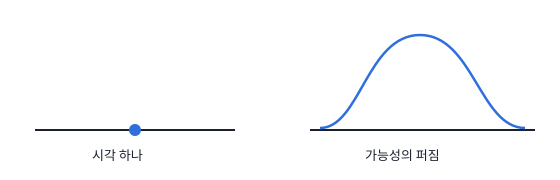
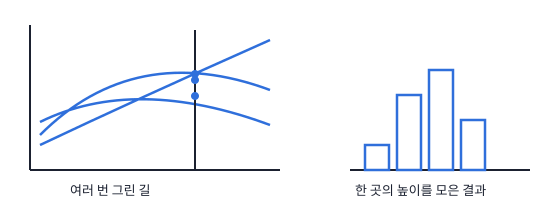
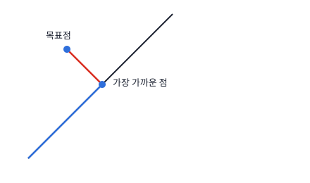
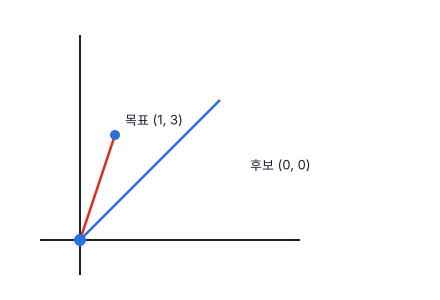
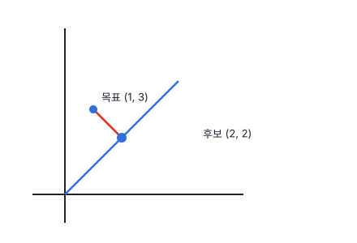
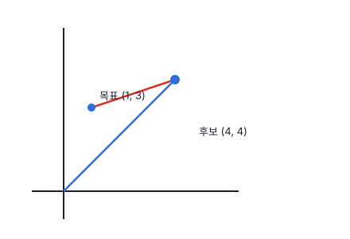
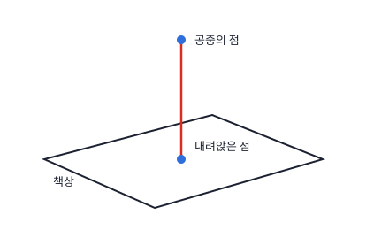
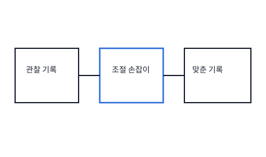

# 예측분포와 직교투영 — 5살도 이해하는 정리노트

정방철 교수님 머신러닝기초 · 1019 수업 (Lecture04 개정 HO s14·16–17·19–24, MML 9.3–9.4·3.8)

> `정리노트_1019_Prediction_and_Projection.html`를 마크다운으로 옮겼어요. 그림은 `figures_1019/` 폴더의 SVG, 위젯은 대표 설정의 정적 그림으로 바꿨어요. 수식은 `$…$` / `$$…$$`라서 GitHub, Obsidian, Typora에서 보여요.

### 같은 예측평균이라도 불확실성은 다를 수 있어요

*학습 길잡이 · 기존 내용 재구성*

**먼저 큰 그림**

**오늘의 질문.** 새 관측값의 평균뿐 아니라 얼마나 흔들릴지도 이해하고, 이어서 모델 비교와 최소제곱의 기하학적 의미를 살펴봐요.

가우시안 사후분포에서는 MAP과 사후평균이 같아요. 선형 예측의 평균도 같지만, FB는 파라미터의 불확실성을 예측분산에 추가로 반영해요.

| 이미 구한 것 | 새 입력에 적용 | 무엇이 남나요? |
|---|---|---|
| MAP 한 점 $\boldsymbol\theta_{\rm MAP}=\mathbf m_N$ | 관측 모형에 그 점을 대입 | 평균 $\boldsymbol\phi_*^{\mathsf T}\mathbf m_N$, 잡음 분산 $\sigma^2$ |
| FB 사후분포 $\mathcal N(\mathbf m_N,\mathbf S_N)$ | 선형변환 후 독립 잡음 추가 | 같은 평균, 분산 $\boldsymbol\phi_*^{\mathsf T}\mathbf S_N\boldsymbol\phi_*+\sigma^2$ |

출발점은 [1014의 사후평균·공분산](../../1014/정리노트_1014_Bayesian_Posterior_Prediction.html#s1-match)이에요. 관측 모형은 ML 때의 $y_*=\boldsymbol\phi_*^{\mathsf T}\boldsymbol\theta+\epsilon$ 그대로이고, 이제 θ 한 값 대신 그 사후분포를 넣어요. 평균·공분산의 선형변환 규칙을 적용하면 새 관측의 평균과 분산이 나와요.

**구할 결과.** θ의 사후공분산과 y의 예측분산을 구별해요. 사영에서는 회귀계수 θ와 데이터 공간의 예측벡터도 구별해야 해요.

**수식이 하는 일.** φ\*ᵀSₙφ\*는 파라미터 불확실성이 출력으로 전달된 분산이고, σ²은 새 관측 잡음이에요. Evidence는 파라미터를 적분해 모델을 비교하고, 정규방정식은 잔차의 직교 조건을 나타내요.

**헷갈리기 쉬운 점.** FB에서 가중평균하는 대상은 예측분포예요. 파라미터 평균을 대입한 예측과 일반적으로 같지 않으며, 여기서는 선형성 때문에 예측평균만 일치해요.

이어서 읽기: [예측의 평균과 두 가지 불확실성](#s0-predictive) · [파라미터를 적분하고 모델을 비교해요](#s1-evidence) · [회귀계수와 예측벡터를 구별해요](#s2-regression)

**페이지 요약**

θ의 사후공분산과 y의 예측분산을 구별해요. 사영에서는 회귀계수 θ와 데이터 공간의 예측벡터도 구별해야 해요.

---

**목차**

- [먼저 큰 그림](#s0-learning-map)

- [1. 값 하나에서 예측분포로](#s0)
  - [예측의 평균과 두 가지 불확실성](#s0-predictive)
  - [함수를 뽑는다는 말의 뜻](#s0-sampling)
- [2. 주변우도로 모델 고르기](#s1)
  - [파라미터를 적분하고 모델을 비교해요](#s1-evidence)
- [3. 최소제곱을 그림으로 보기](#s2)
  - [직선 위에서 가장 가까운 점](#s2-line)
  - [평면과 열공간으로 확장해요](#s2-plane)
  - [회귀계수와 예측벡터를 구별해요](#s2-regression)
- [4. 요약 · 예고](#s3)
  - [핵심 식 한 장](#s3-cheatsheet)
  - [수업 마무리와 시험 안내](#s3-next)
  - [함께 보면 좋은 자료](#s3-links)

## 1. 값 하나에서 예측분포로

### 예측의 평균과 두 가지 불확실성

*1019 수업 · L04 rev_HO s14·16*

**쉽게 말하면**

내일 도착할 시각 하나만 말하는 대신, 어느 시각쯤 도착하기 쉬운지도 알려 줘요.

*퍼짐까지 알면 예상이 얼마나 흔들릴지도 볼 수 있어요.*

**정확히 말하면**

학습 데이터 $\mathcal D=(\mathbf X,\mathbf y)$와 새 입력 $\mathbf{x}_*$가 주어졌을 때, 사후예측분포(posterior predictive distribution)는 새 관측값 $y_*$의 조건부 분포예요. 여기서 사후는 이미 얻은 학습 데이터를 조건으로 삼는다는 뜻이에요. 관측 잡음은 파라미터와 독립이고, 평균이 0인 가우시안이라고 가정해요.

$$
\boldsymbol{\phi}_*=\boldsymbol{\phi}(\mathbf{x}_*),\qquad y_*=\boldsymbol{\phi}_*^{\mathsf T}\boldsymbol{\theta}+\epsilon,\qquad \epsilon\sim\mathcal N(0,\sigma^2).
$$

$$
p(\boldsymbol{\theta}\mid\mathcal D)=\mathcal N(\boldsymbol{\theta}\mid\mathbf m_N,\mathbf{S}_N).
$$

1. 파라미터 하나를 고정하는 대신, 가능한 파라미터의 예측을 사후확률로 가중해 모아요.

   $$
   p(y_*\mid\mathbf{x}_*,\mathcal D)=\int p(y_*\mid\mathbf{x}_*,\boldsymbol{\theta})p(\boldsymbol{\theta}\mid\mathcal D)\,d\boldsymbol{\theta}.
   $$
2. #### 기억할 공식에 이번 문제를 대입해요

   일반 선형변환 공식은 $\mathbb E[LZ+c]=L\mathbb E[Z]+c$, $\operatorname{Cov}(LZ+c)=L\operatorname{Cov}(Z)L^{\mathsf T}$예요. 여기서 일반 확률벡터 $Z=\boldsymbol\theta$, 고정 행렬 $L=\boldsymbol\phi_*^{\mathsf T}$로 놓고 학습 데이터에 조건을 걸어요. 상수 이동 $c$는 0이고, 랜덤 잡음은 별도로 더해요.

   1. 평균은 선형변환 밖으로 계수를 꺼내요. 새 잡음의 평균은 0이에요.

      $$
      \mathbb E[y_*\mid\mathbf x_*,\mathcal D]=\boldsymbol\phi_*^{\mathsf T}\mathbb E[\boldsymbol\theta\mid\mathcal D]+\mathbb E[\epsilon]=\boldsymbol\phi_*^{\mathsf T}\mathbf m_N
      $$
   2. 공분산은 계수를 왼쪽과 전치한 오른쪽에 곱해요.

      $$
      \operatorname{Var}(\boldsymbol\phi_*^{\mathsf T}\boldsymbol\theta\mid\mathcal D)=\boldsymbol\phi_*^{\mathsf T}\mathbf S_N(\boldsymbol\phi_*^{\mathsf T})^{\mathsf T}=\boldsymbol\phi_*^{\mathsf T}\mathbf S_N\boldsymbol\phi_*
      $$
   3. 파라미터와 새 잡음이 독립이므로 두 분산을 더해요.

      $$
      \operatorname{Var}(y_*\mid\mathbf x_*,\mathcal D)=\boldsymbol\phi_*^{\mathsf T}\mathbf S_N\boldsymbol\phi_*+\sigma^2
      $$

   이 모멘트 공식 자체는 가우시안이 아니어도 이차 모멘트가 존재하면 성립해요. 분포 전체까지 가우시안이라고 결론 내릴 때는 가우시안 사후분포와 독립 가우시안 잡음이라는 가정이 필요해요.

   가우시안 사후분포를 선형변환하고 독립인 가우시안 잡음을 더하므로 결과도 가우시안이에요.

   $$
   p(y_*\mid\mathbf{x}_*,\mathcal D)=\mathcal N(y_*\mid\mu_*,v_*).
   $$

   $$
   \mu_*=\boldsymbol{\phi}_*^{\mathsf T}\mathbf m_N.
   $$

   $$
   v_*=\boldsymbol{\phi}_*^{\mathsf T}\mathbf{S}_N\boldsymbol{\phi}_*+\sigma^2.
   $$

| 항 | 무엇이 불확실한가 |
|---|---|
| $\boldsymbol{\phi}_*^{\mathsf T}\mathbf{S}_N\boldsymbol{\phi}_*$ | 파라미터를 아직 정확히 모르기 때문에 생기는 함수값의 불확실성이에요. 입력 위치에 따라 크기가 달라져요. |
| $\sigma^2$ | 새 관측에 섞일 측정 잡음의 분산이에요. 이 모델에서는 입력 위치와 관계없이 일정해요. |

분산 항을 외우기 전에 가중합으로 읽어 봐요. 두 성분만 쓰면 잡음 없는 함수값은 $f_*=a\theta_1+b\theta_2$예요. 이때 $a,b$는 고정된 새 입력의 특징값이에요. 스칼라 공분산의 선형성으로 다음을 얻어요.

$$
\operatorname{Var}(f_*\mid\mathcal D)=a^2\operatorname{Var}(\theta_1\mid\mathcal D)+2ab\operatorname{Cov}(\theta_1,\theta_2\mid\mathcal D)+b^2\operatorname{Var}(\theta_2\mid\mathcal D).
$$

$\mathbf{S}_N$은 파라미터 벡터 자신의 공분산 행렬이에요. 대각 원소가 각 성분의 분산이고, 대각 밖 원소가 서로 다른 성분의 공분산이에요. 따라서 두 성분의 공분산을 임의로 0으로 지우지 않아요. 위 가중합의 분산을 행렬로 묶은 것이 다음 식이에요.

$$
\operatorname{Var}(f_*\mid\mathcal D)=\boldsymbol{\phi}_*^{\mathsf T}\mathbf{S}_N\boldsymbol{\phi}_*.
$$

일반 규칙 $\operatorname{Cov}(\mathbf A\boldsymbol{\theta})=\mathbf A\mathbf{S}_N\mathbf A^{\mathsf T}$에 $\mathbf A=\boldsymbol{\phi}_*^{\mathsf T}$를 넣은 자기 공분산이에요. 첫 번째 가중합의 계수는 왼쪽에, 두 번째 가중합의 계수는 전치하여 오른쪽에 와요. 교차 공분산 벡터를 구하는 계산과 달리, 여기서는 같은 스칼라 함수값의 분산을 구해요.

$$
\boldsymbol{\phi}_*\in\mathbb R^M,\quad\mathbf{S}_N\in\mathbb R^{M\times M},\quad(1\times M)(M\times M)(M\times1)=1\times1.
$$

잡음 없는 $f_*$를 예측할 때는 이 분산만 쓰고, 실제 관측값 $y_*$를 예측할 때는 $\sigma^2$를 더해요. $\mathbf m_N,\mathbf S_N$ 안의 $\sigma^2$와 여기 더하는 $\sigma^2$는 같은 모형의 잡음 분산이에요. 앞에서는 학습 데이터의 신뢰도를 반영했고, 뒤에서는 새 관측에 생기는 독립 잡음을 반영하므로 이중 계산이 아니에요. 이는 독립인 두 원인의 분산을 더한 결과예요.

최대우도(ML)와 최대사후확률(MAP)의 점추정은 파라미터 한 개를 골라 예측 곡선 하나를 만들어요. 이 가우시안 사후분포에서는 $\boldsymbol{\theta}_{\mathrm{MAP}}=\mathbf m_N$이므로 MAP 곡선과 베이지안 예측의 평균 곡선이 같아요. 평균이 같아도 전체 예측분포가 같다는 뜻은 아니에요. 점추정 파라미터를 우도에 넣어 잡음이 있는 분포를 만들 수도 있지만, 그 방식만으로는 위의 파라미터 불확실성 항을 적분하여 반영하지 않아요.

#### MAP 결과를 기억한다면 여기까지 복원할 수 있어요

이 문단은 강의 공식을 연결하기 위한 동치 재표현이에요. 임시 기호 $A_g=\boldsymbol\Phi^{\mathsf T}\boldsymbol\Phi+\sigma^2\mathbf S_0^{-1}$, $q_g=\boldsymbol\Phi^{\mathsf T}\mathbf y+\sigma^2\mathbf S_0^{-1}\mathbf m_0$를 쓰면, 앞서 구한 $\mathbf m_N=A_g^{-1}q_g$, $\mathbf S_N=\sigma^2A_g^{-1}$를 그대로 대입해요. $A_g$는 특징 개수만큼의 정방행렬, $q_g$는 같은 크기의 열벡터예요.

$$
\mu_*=\boldsymbol\phi_*^{\mathsf T}A_g^{-1}q_g
$$

$$
v_*=\sigma^2\left(1+\boldsymbol\phi_*^{\mathsf T}A_g^{-1}\boldsymbol\phi_*\right)
$$

**평균은 사후평균에 특징 행벡터를 곱하고, 분산은 사후공분산을 특징벡터로 양쪽에서 감싼 뒤 새 잡음을 더해요.** θ를 정확히 알아 $\mathbf S_N$이 0으로 가도 새 관측의 분산 $\sigma^2$는 남아요.

근거: Lecture04 rev_HO s14·16; MML 9.3.4, 식 (9.57)–(9.59), PDF 314–315쪽.

행벡터 미분부터 사후분포와 예측분포까지 이어지는 과정을 [ML → MAP → FB → 예측분포 수식 노트](../../1014/%EC%9D%B8%ED%84%B0%EB%A0%89%ED%8B%B0%EB%B8%8C_04_ML_MAP_FB_%EC%98%88%EC%B8%A1%EB%B6%84%ED%8F%AC_%ED%95%9C%EC%A4%84%EC%94%A9.html)에서 한 줄씩 전개해 보세요.

MAP과 사후평균의 관계에서 예측 평균·분산까지 이어지는 식을 [한 줄씩 쓰는 수식 노트](../../1014/%EC%9D%B8%ED%84%B0%EB%A0%89%ED%8B%B0%EB%B8%8C_03_MAP%EC%97%90%EC%84%9C_%EC%82%AC%ED%9B%84%ED%8F%89%EA%B7%A0%EA%B9%8C%EC%A7%80_%ED%95%9C%EC%A4%84%EC%94%A9.html)에서 비교해 보세요.

**교수님 말씀**

> “Bayesian 메소드 같은 경우는 뭐를 준다? … 분포를 줘요, 분포를.” (1019 Part 01)

교수님은 새 입력이 1일 때 단답 하나를 내는 것과, 출력의 평균·분산을 갖춘 확률밀도를 주는 것을 비교했어요. 밀도는 연속값 하나의 확률 자체가 아니라 구간 확률을 계산하는 재료예요. 원전사에 세부 시간이 없어 Part 번호로 인용해요.

**페이지 요약**

예측분산에는 파라미터의 불확실성과 새 관측의 잡음이 함께 들어가요.

*핵심 식*

- 예측 평균

  $$
  \mu_*=\boldsymbol{\phi}_*^{\mathsf T}\mathbf m_N.
  $$
- 예측 분산

  $$
  v_*=\boldsymbol{\phi}_*^{\mathsf T}\mathbf{S}_N\boldsymbol{\phi}_*+\sigma^2.
  $$

*용어*

- **사후예측분포(posterior predictive distribution)** — 학습 데이터를 조건으로 새 관측값을 예측하는 분포예요.

---

### 함수를 뽑는다는 말의 뜻

*1019 수업 · L04 rev_HO s16*

**쉽게 말하면**

그럴듯한 길을 하나씩 여러 번 그려 보면, 어느 곳에서 길들이 모이고 흩어지는지 알 수 있어요.

*같은 곳의 높이를 많이 모으면 자주 나오는 높이를 볼 수 있어요.*

**정확히 말하면**

함수 표본(function sample)은 입력마다 아무 값이나 독립적으로 뽑아 연결한 선이 아니에요. 사후분포에서 파라미터 벡터 하나를 뽑고, 그 벡터를 모든 입력 위치에 공통으로 사용해 함수 하나를 만들어요.

1. 사후분포에서 $i$번째 파라미터를 뽑아요.

   $$
   \boldsymbol{\theta}^{(i)}\sim p(\boldsymbol{\theta}\mid\mathcal D).
   $$
2. 같은 파라미터로 입력 위치 전체의 함수값을 계산해요.

   $$
   f^{(i)}(\mathbf x)=\boldsymbol{\phi}(\mathbf x)^{\mathsf T}\boldsymbol{\theta}^{(i)}.
   $$
3. 여러 번 반복한 뒤 한 위치 $\mathbf{x}_*$만 고정해서 $f^{(i)}(\mathbf{x}_*)$들을 모아요. 히스토그램은 그 위치의 잡음 없는 함수값 분포를 근사해요. 관측값의 예측분포를 재현하려면 각 함수값에 독립인 관측 잡음도 더해요.

   $$
   y_*^{(i)}=f^{(i)}(\mathbf{x}_*)+\epsilon^{(i)},\qquad\epsilon^{(i)}\sim\mathcal N(0,\sigma^2).
   $$

강의 그림의 선들은 가능한 함수들이고 회색 띠는 각 입력 위치에서의 불확실성을 나타내요. 가우시안의 평균을 중심으로 표준편차 1배·2배·3배 범위 안에 들어갈 확률은 각각 약 68.27%·95.45%·99.73%예요. 수업에서 구두로 언급된 비율은 이 표준값으로 정리했어요. 이 띠는 각 위치의 구간이며, 뽑은 함수 전체가 모든 위치에서 띠 안에 들어갈 확률을 그대로 뜻하지는 않아요. 잡음 없는 함수의 띠인지 관측값의 띠인지에 따라서 사용할 분산도 달라져요.

교수님은 가능한 값을 만드는 과정을 생성(generation)이라고 연결했어요. 확률밀도를 알고 있으면 그 분포를 따르는 표본을 만들 수 있어요. 균등분포에서 수를 뽑는 `rand`도 같은 취지의 예시였어요. GPT의 답 생성 이야기는 분포로부터 결과를 만드는 발상을 설명한 비유예요. 여기의 가우시안 선형회귀가 GPT의 구조라는 뜻은 아니에요.

불확실성은 다음 실험을 고르는 데도 쓰여요. 교수님은 비용이 큰 실험에서 예측 평균이 높고 불확실성도 큰 위치를 다시 시도해 볼 후보로 설명했어요. 이미 보상이 높게 나온 곳을 활용하는 활용(exploitation)과, 아직 불확실한 곳을 알아보는 탐색(exploration)을 함께 생각하는 베이지안 최적화(Bayesian optimization)의 직관이에요. 하이퍼파라미터를 바꾸며 비싼 평가를 반복하는 경우를 사용 예로 들었어요. 강화학습에서도 이 둘을 조절한다는 연결을 제시했어요. 구체적인 획득함수나 최적화 알고리즘은 이번 수업에서 유도하지 않았어요.

강의 그림에서는 관측이 주변에 모인 곳의 띠가 좁고, 데이터가 드문 곳의 띠가 넓었어요. 이는 선택한 특징함수와 사전분포를 포함한 모델 아래의 결과예요. 모든 모델에서 거리만으로 분산이 결정된다는 규칙은 아니에요.

근거: 1019 Part 01–02; Lecture04 rev_HO s16; MML PDF 315–317쪽의 함수 표본과 예측 띠 설명.

**교수님 말씀**

> “장군님은 정답만 원하지만 엔지니어인 우리들은 뭘 가지고 있어야 된다? raw data를 갖고 있어야 된다.” (1019 Part 01)

교수님은 장군님에게 단답을 줄 수도 있고, 자세히 묻는 사람에게는 가능한 결과를 만들어 보는 ‘공장’까지 줄 수 있어야 한다고 비유했어요. 여기서 단답과 함께 갖고 있어야 할 수학적 대상은 전체 예측분포예요. 원자료 자체와 확률분포는 같은 대상은 아니에요.

> “수학을 잘한다는 거는 논리적인 사고가 된다는 거예요.” (1019 Part 02)

코드를 실행해 그래프를 만드는 데서 그치지 않고, 그 결과를 만든 가정과 불확실성을 이해해야 한다는 학습 이유도 강조했어요. 전사에 없는 세부 시간은 붙이지 않았어요.

**페이지 요약**

파라미터 한 번의 추출이 함수 하나를 만들고, 같은 입력에서 모은 값들이 분포를 보여 줘요.

*핵심 식*

- 함수 표본

  $$
  f^{(i)}(\mathbf x)=\boldsymbol{\phi}(\mathbf x)^{\mathsf T}\boldsymbol{\theta}^{(i)}.
  $$

*용어*

- **함수 표본(function sample)** — 사후분포에서 뽑은 파라미터 하나로 만든 함수예요.
- **히스토그램** — 고정한 입력에서 생성한 값들의 빈도를 모은 그림이에요.
- **탐색(exploration)** — 아직 불확실한 곳을 시도하여 알아보는 일이에요.

---

## 2. 주변우도로 모델 고르기

### 파라미터를 적분하고 모델을 비교해요

*1019 수업 · L04 rev_HO s17 · 원판 s16*

**쉽게 말하면**

한 가지 설정만 믿지 말고, 가능한 설정들을 얼마나 믿는지에 따라 골고루 살펴봐요.

*점이 클수록 더 믿는 설정이에요.*

**정확히 말하면**

우도(likelihood)는 파라미터를 고정했을 때 관측 데이터가 얼마나 그럴듯한지 나타내요. 주변우도(marginal likelihood)는 파라미터를 하나로 고정하지 않고 그 사전분포에 따라 우도를 평균내요. 입력 $\mathbf{X}$는 주어진 값으로 다뤄요.

1. **없앨 변수를 결합분포 안에 드러내요.**

   $$
   p(\mathbf{y}\mid\mathbf{X})=\int p(\mathbf{y},\boldsymbol{\theta}\mid\mathbf{X})\,d\boldsymbol{\theta}.
   $$

   적분하는 변수는 조건 뒤에 고정된 값이 아니라, 함께 확률을 묻는 변수로 들어 있어야 해요.
2. **곱셈 규칙으로 우도와 가중치를 분리해요.**

   $$
   p(\mathbf{y},\boldsymbol{\theta}\mid\mathbf{X})=p(\mathbf{y}\mid\mathbf{X},\boldsymbol{\theta})p(\boldsymbol{\theta}\mid\mathbf{X}).
   $$

   이번 모델에서는 입력만으로 파라미터의 사전분포가 변하지 않는다고 가정해요. 즉 $p(\boldsymbol{\theta}\mid\mathbf{X})=p(\boldsymbol{\theta})$예요. 이는 모델의 가정이며, 모든 문제에서 자동으로 성립하지 않아요.
3. **사전분포로 가중평균해요.**

   $$
   p(\mathbf{y}\mid\mathbf{X})=\int p(\mathbf{y}\mid\mathbf{X},\boldsymbol{\theta})p(\boldsymbol{\theta})\,d\boldsymbol{\theta}.
   $$

   $$
   p(\mathbf{y}\mid\mathbf{X})=\mathbb{E}_{p(\boldsymbol{\theta})}\!\left[p(\mathbf{y}\mid\mathbf{X},\boldsymbol{\theta})\right].
   $$

   학습 데이터 전체가 나올 밀도를 계산하므로 가중치는 **사전분포**예요. 새 출력을 예측할 때 쓰는 $p(\boldsymbol{\theta}\mid\mathbf{X},\mathbf{y})$와 구별해요. 주변화는 파라미터 선택의 불확실성을 반영하는 계산이에요. 모든 불확실성이 사라진다는 뜻은 아니에요.

#### 가우시안 선형모델에서는 어떤 밀도가 되나요?

특징행렬 $\boldsymbol{\Phi}\in\mathbb{R}^{N\times K}$는 고정된 입력에서 만들어요. 파라미터와 잡음은 서로 독립이고, 잡음의 각 성분도 서로 독립인 등분산 가우시안이라고 가정해요.

$$
\boldsymbol{\theta}\sim\mathcal{N}(\mathbf{m}_0,\mathbf{S}_0),\qquad\boldsymbol{\varepsilon}\sim\mathcal{N}(\mathbf{0},\sigma^2\mathbf{I}_N).
$$

$$
\mathbf{y}=\boldsymbol{\Phi}\boldsymbol{\theta}+\boldsymbol{\varepsilon}.
$$

$\mathbf{m}_0$는 $K$차원 평균이고, $\mathbf{S}_0$는 파라미터 자신의 $K\times K$ 공분산 행렬이에요. 슬라이드의 주변우도 결과는 다음과 같아요.

$$
p(\mathbf{y}\mid\mathbf{X})=\mathcal{N}(\mathbf{y}\mid\boldsymbol{\Phi}\mathbf{m}_0,\mathbf{C}).
$$

$$
\mathbf{C}=\boldsymbol{\Phi}\mathbf{S}_0\boldsymbol{\Phi}^{\mathsf T}+\sigma^2\mathbf{I}_N.
$$

곱의 의미는 출력 하나가 파라미터들의 **가중합**이라는 데 있어요. 예를 들어 두 파라미터를 쓰는 한 출력의 잡음 없는 부분은 $\phi_{i1}\theta_1+\phi_{i2}\theta_2$예요. 스칼라에서 $\operatorname{Var}(a\theta)=a^2\operatorname{Var}(\theta)$였던 것이 여러 성분의 가중합으로 늘어난 모습이에요. 두 파라미터가 함께 움직이는 정도도 $\mathbf{S}_0$ 안에 남아 있어요.

두 출력의 공분산을 구할 때는 첫 출력의 계수가 왼쪽, 두 번째 출력의 계수가 전치되어 오른쪽에 와요. 그래서 $\mathbf{S}_0$ 양쪽에 $\boldsymbol{\Phi}$와 $\boldsymbol{\Phi}^{\mathsf T}$가 붙어요. 이는 출력벡터 *자신의* 공분산을 구하는 식이며, 파라미터와 출력의 교차 공분산을 구하는 질문과 달라요.

| 양 | 크기 | 뜻 |
|---|---|---|
| $\boldsymbol{\Phi}\mathbf{m}_0$ | $N\times1$ | 출력별 사전예측 평균 |
| $\boldsymbol{\Phi}\mathbf{S}_0\boldsymbol{\Phi}^{\mathsf T}$ | $(N\times K)(K\times K)(K\times N)=N\times N$ | 파라미터 불확실성이 출력에 미치는 공분산 |
| $\sigma^2\mathbf{I}_N$ | $N\times N$ | 독립 잡음이 더하는 공분산 |
| $\mathbf{C}$ | $N\times N$ | 출력벡터 전체의 공분산 |

행렬에서 스칼라의 제곱을 단순히 $\boldsymbol{\Phi}\boldsymbol{\Phi}^{\mathsf T}$로 바꿔 붙이면 안 돼요. 가운데 $\mathbf{S}_0$의 위치와 곱의 순서를 유지해요. 수업에서는 이 가우시안 밀도의 결과를 모델 비교에 사용했고, 적분을 항별로 계산하는 유도는 새로 하지 않았어요.

#### 주변우도가 모델 비교로 이어지는 과정

모델 $M_1$은 원입력의 선형조합, 모델 $M_2$는 다항식처럼 변환한 특징의 선형조합일 수 있어요. 각 모델마다 특징행렬과 파라미터 사전분포가 달라지고, 그에 따른 주변우도도 달라져요. 모델마다 그 모델에 해당하는 $p(\boldsymbol{\theta}\mid M_k)$로 적분해요.

1. **데이터를 보기 전의 모델 선호를 비로 써요.**

   $$
   \text{prior odds}=\frac{p(M_1)}{p(M_2)}.
   $$
2. **각 모델의 주변우도를 비교해요.**

   $$
   \text{Bayes factor}=\frac{p(\mathcal{D}\mid M_1)}{p(\mathcal{D}\mid M_2)}.
   $$

   여기서 $\mathcal{D}$는 관측한 입력과 출력 데이터예요. 입력을 조건으로 고정한 회귀에서는 각 항을 $p(\mathbf{y}\mid\mathbf{X},M_k)$로 계산해요. 파라미터 최적값 하나의 우도 비와 주변우도 비를 혼동하지 않아요.
3. **베이즈 규칙에서 공통 분모를 약분해요.**

   $$
   \frac{p(M_1\mid\mathcal{D})}{p(M_2\mid\mathcal{D})}=\frac{p(M_1)}{p(M_2)}\frac{p(\mathcal{D}\mid M_1)}{p(\mathcal{D}\mid M_2)}.
   $$

   이 값이 posterior odds예요. 1보다 크면 모델 1의 사후확률이 더 크고, 1보다 작으면 모델 2가 더 커요. 사전확률이 같을 때만 Bayes factor 자체를 1과 비교해 같은 판정을 내려요.

교수님은 기존 데이터 100개 이후 새 데이터 100개가 들어오는 상황으로 사전 판단의 갱신을 설명했어요. 이미 쓴 데이터를 다시 새 증거처럼 곱하지 않고, 새 자료가 주는 정보로 갱신한다는 뜻이에요.

**교수님 말씀**

> “결정하지 말고 이 세타도 결정을 유보할 수도 있지 않나?” (1019 Part 02 · 세부 시각 미제공)

추정한 파라미터가 유일한 정답이라는 보장이 없으므로, 가능한 값들의 영향을 모아 평균낸다고 설명했어요.

> “조건은 조건으로 주어진 거니까 marginalization이 말이 안 돼요.” (1019 Part 03 · 세부 시각 미제공)

조건에 있는 파라미터를 우도에서 무턱대고 적분하지 말고, 결합분포와 가중밀도를 먼저 써야 한다는 주의예요.

> “marginal likelihood가 사실은 model selection에서 굉장히 중요한 역할을” (1019 Part 03 · 세부 시각 미제공)

모델 자체를 평가할 때는 한 파라미터 선택만 믿는 부담을 줄이고, 사전분포가 허용하는 값들에서 데이터를 얼마나 잘 설명하는지 살펴봐요.

**페이지 요약**

주변우도는 가능한 파라미터의 우도를 사전분포로 평균내어 모델 비교에 사용해요.

*핵심 식*

- 주변우도

  $$
  p(\mathbf{y}\mid\mathbf{X})=\int p(\mathbf{y}\mid\mathbf{X},\boldsymbol{\theta})p(\boldsymbol{\theta})\,d\boldsymbol{\theta}.
  $$
- 출력 공분산

  $$
  \mathbf{C}=\boldsymbol{\Phi}\mathbf{S}_0\boldsymbol{\Phi}^{\mathsf T}+\sigma^2\mathbf{I}_N.
  $$
- 모델 사후비

  $$
  \frac{p(M_1\mid\mathcal{D})}{p(M_2\mid\mathcal{D})}=\frac{p(M_1)}{p(M_2)}\frac{p(\mathcal{D}\mid M_1)}{p(\mathcal{D}\mid M_2)}.
  $$

*용어*

- **주변우도** — 파라미터를 주변화한 데이터의 밀도예요.
- **Bayes factor** — 두 모델의 주변우도 비예요.
- **posterior odds** — 관측 후 두 모델의 확률 비예요.

---

## 3. 최소제곱을 그림으로 보기

### 직선 위에서 가장 가까운 점

*1019 수업 · L04 rev_HO s19–21*

**쉽게 말하면**

줄 위에서만 움직일 수 있다면, 목표점에서 곧게 내려온 자리가 가장 가까워요.

비스듬히 가면 더 멀어져요.

**정확히 말하면**

방향벡터 $\mathbf{b}\ne\mathbf{0}$가 만드는 직선 $U=\operatorname{span}(\mathbf{b})$ 위에서 목표 $\mathbf{v}\in\mathbb R^N$와 가장 가까운 점을 찾아요. 직선 위의 후보는 $\lambda\mathbf{b}$예요.

1. 최단거리에서는 잔차가 직선에 직교해요.

   $$
   \mathbf{b}^{\mathsf T}(\mathbf{v}-\lambda\mathbf{b})=0
   $$
2. 괄호를 풀고 스칼라 계수를 구해요.

   $$
   \mathbf{b}^{\mathsf T}\mathbf{v}=\lambda\mathbf{b}^{\mathsf T}\mathbf{b}
   $$

   $$
   \lambda=\frac{\mathbf{b}^{\mathsf T}\mathbf{v}}{\mathbf{b}^{\mathsf T}\mathbf{b}}
   $$
3. 다시 원공간의 벡터로 만들어요.

   $$
   \pi_U(\mathbf{v})=\lambda\mathbf{b}=\frac{\mathbf{b}\mathbf{b}^{\mathsf T}}{\mathbf{b}^{\mathsf T}\mathbf{b}}\mathbf{v}
   $$

   $$
   \mathbf{P}=\frac{\mathbf{b}\mathbf{b}^{\mathsf T}}{\|\mathbf{b}\|^2}\in\mathbb R^{N\times N}
   $$

$\mathbf{b}^{\mathsf T}\mathbf{b}$는 $1\times1$ 스칼라, $\mathbf{b}\mathbf{b}^{\mathsf T}$는 $N\times N$ 바깥곱이에요. 분모는 길이 자체가 아니라 **길이의 제곱**이에요. 투영행렬은 직교행렬과 구별해요. 여기서는 $\mathbf{P}^{\mathsf T}=\mathbf{P}$, $\mathbf{P}^2=\mathbf{P}$이며, 일반적으로 $\mathbf{P}^{\mathsf T}\mathbf{P}=\mathbf I$는 아니에요.

피타고라스로 최소임을 확인할 수 있어요. 임의의 다른 점 $a\mathbf{b}$에 대해 수직인 두 성분으로 나뉘어요.

$$
\|\mathbf{v}-a\mathbf{b}\|^2=\|\mathbf{v}-\lambda\mathbf{b}\|^2+\|(\lambda-a)\mathbf{b}\|^2
$$

뒤 항이 0인 $a=\lambda$에서 가장 작아요.

#### 수업의 숫자를 따라가요

$$
\mathbf{b}=\begin{bmatrix}1\\2\\2\end{bmatrix},\quad\mathbf{v}=\begin{bmatrix}1\\1\\1\end{bmatrix}
$$

$$
\mathbf{b}^{\mathsf T}\mathbf{b}=9,\quad\mathbf{b}^{\mathsf T}\mathbf{v}=5,\quad\lambda=\frac59
$$

$$
\mathbf{P}=\frac19\begin{bmatrix}1&2&2\\2&4&4\\2&4&4\end{bmatrix}
$$

$$
\pi_U(\mathbf{v})=\frac19\begin{bmatrix}5\\10\\10\end{bmatrix}=\frac59\mathbf{b}
$$

숫자 하나 $5/9$는 기저의 배율이고, 세 성분을 가진 결과가 투영벡터예요. 스칼라 입력 회귀에서는 이 배율이 ML 파라미터 역할을 해요.

위젯에서는 $\mathbf{b}=(1,1)^{\mathsf T}$, $\mathbf{v}=(1,3)^{\mathsf T}$예요. $E(\theta)=(1-\theta)^2+(3-\theta)^2=2(\theta-2)^2+2$이므로 최소는 $\theta=2$, $E=2$예요.

#### 직접 해 보기: 직선 위에서 가장 가까운 점 *(정적 스냅샷 — 직접 조작은 HTML 버전)*

배율을 움직이면 후보점과 목표점 사이의 제곱거리가 바뀌어요.

제곱거리 **2** · 가장 작은 값은 배율 2에서 2예요.

범례: 대각선은 움직일 수 있는 직선, 두 점을 잇는 선은 현재 차이예요.

*배율 0, 후보 (0, 0), 제곱거리 10*

*배율 2, 후보 (2, 2), 제곱거리 2*

*배율 4, 후보 (4, 4), 제곱거리 10*

| 배율 | 후보 | 제곱거리 |
|---|---|---|
| 0 | (0, 0) | 10 |
| 2 | (2, 2) | 2 |
| 4 | (4, 4) | 10 |

**교수님 말씀**

> “빗변의 길이는 높이 변보다 항상 기니까.”

(1019 Part 05, 시각 미제공) 교수님은 피타고라스로 수직 잔차가 가장 짧다는 이유를 설명했어요. 수업의 분모 표현은 길이의 제곱으로 정확히 읽어요.

**페이지 요약**

직선에 직교하는 잔차가 최단거리를 만들어요.

*핵심 식*

- 투영행렬

  $$
  \mathbf{P}=\frac{\mathbf{b}\mathbf{b}^{\mathsf T}}{\|\mathbf{b}\|^2}
  $$
- 직선 위 좌표

  $$
  \lambda=\frac{\mathbf{b}^{\mathsf T}\mathbf{v}}{\mathbf{b}^{\mathsf T}\mathbf{b}}
  $$

*용어*

- **직교투영** — 잔차가 직선에 수직이 되도록 고른 가장 가까운 점

---

### 평면과 열공간으로 확장해요

*1019 수업 · L04 rev_HO s22–23*

**쉽게 말하면**

공중의 점을 책상 위로 곧게 내려놓으면 가장 가까운 자리를 찾을 수 있어요.

책상 위 자리는 두 방향으로 움직여 정해요.

**정확히 말하면**

책상처럼 두 방향이 만드는 평면으로 넓혀요. 서로 독립인 기저를 열로 모아요.

$$
\mathbf{B}=[\mathbf{b}_1\ \cdots\ \mathbf{b}_m]\in\mathbb R^{N\times m},\quad\boldsymbol{\lambda}\in\mathbb R^m
$$

$$
\pi_U(\mathbf{v})=\mathbf{B}\boldsymbol{\lambda}\in\mathbb R^N
$$

1. 잔차가 모든 기저벡터에 직교해야 해요.

   $$
   \mathbf{B}^{\mathsf T}(\mathbf{v}-\mathbf{B}\boldsymbol{\lambda})=\mathbf0
   $$
2. 좌표를 구하는 정규방정식이에요.

   $$
   \mathbf{B}^{\mathsf T}\mathbf{B}\boldsymbol{\lambda}=\mathbf{B}^{\mathsf T}\mathbf{v}
   $$

   $$
   \boldsymbol{\lambda}=(\mathbf{B}^{\mathsf T}\mathbf{B})^{-1}\mathbf{B}^{\mathsf T}\mathbf{v}
   $$
3. 좌표를 구하는 행렬과 원공간으로 되돌리는 행렬을 구별해요.

   $$
   \mathbf{B}^{+}=(\mathbf{B}^{\mathsf T}\mathbf{B})^{-1}\mathbf{B}^{\mathsf T}\in\mathbb R^{m\times N}
   $$

   $$
   \mathbf{P}=\mathbf{B}\mathbf{B}^{+}=\mathbf{B}(\mathbf{B}^{\mathsf T}\mathbf{B})^{-1}\mathbf{B}^{\mathsf T}\in\mathbb R^{N\times N}
   $$

**유사역행렬(pseudo-inverse)** $\mathbf{B}^+$는 목표벡터를 $m$개 좌표로 바꿔요. **투영행렬** $\mathbf{P}$는 $N$차원 벡터를 같은 $N$차원의 투영벡터로 바꿔요. 열들이 독립인 full column rank일 때 위 역행렬 공식을 쓸 수 있어요. 독립이지 않은 생성벡터가 주어지면 먼저 기저를 골라야 해요.

#### 평면 투영 예제

$$
\mathbf{B}=\begin{bmatrix}1&0\\1&1\\1&2\end{bmatrix},\quad\mathbf{v}=\begin{bmatrix}6\\0\\0\end{bmatrix}
$$

$$
\mathbf{B}^{\mathsf T}\mathbf{B}=\begin{bmatrix}3&3\\3&5\end{bmatrix},\quad\mathbf{B}^{\mathsf T}\mathbf{v}=\begin{bmatrix}6\\0\end{bmatrix}
$$

$$
\boldsymbol{\lambda}=\begin{bmatrix}5\\-3\end{bmatrix},\quad\pi_U(\mathbf{v})=\mathbf{B}\boldsymbol{\lambda}=\begin{bmatrix}5\\2\\-1\end{bmatrix}
$$

$$
\mathbf{P}=\frac16\begin{bmatrix}5&2&-1\\2&2&2\\-1&2&5\end{bmatrix}
$$

좌표 $5,-3$과 투영벡터 $5,2,-1$은 서로 다른 공간의 값이에요. 차이벡터 $(1,-2,1)^{\mathsf T}$는 두 기저벡터 모두에 직교해요. 좌표 계산은 교과서 Example 3.11로 확인했으며 수업은 투영 결과를 중심으로 설명했어요.

**교수님 말씀**

> “자 요 책상을 span하는 x_1이라는 데이터와 x_2라는 데이터가 있어요.”

(1019 Part 05, 시각 미제공) 교수님은 책상 밖의 점을 가장 잘 근사하는 책상 위의 점이 수직으로 내린 점이라고 설명했어요.

**페이지 요약**

좌표를 먼저 구하고 기저를 곱하면 평면 위의 투영벡터를 얻어요.

*핵심 식*

- 기저 좌표

  $$
  \boldsymbol{\lambda}=(\mathbf{B}^{\mathsf T}\mathbf{B})^{-1}\mathbf{B}^{\mathsf T}\mathbf{v}
  $$
- 투영행렬

  $$
  \mathbf{P}=\mathbf{B}\mathbf{B}^{+}=\mathbf{B}(\mathbf{B}^{\mathsf T}\mathbf{B})^{-1}\mathbf{B}^{\mathsf T}\in\mathbb R^{N\times N}
  $$

*용어*

- **유사역행렬(pseudo-inverse)** — 목표벡터에서 기저 좌표를 구하는 행렬

---

### 회귀계수와 예측벡터를 구별해요

*1019 수업 · L04 rev_HO s19·24*

**쉽게 말하면**

관찰 기록을 보고 손잡이를 맞춘 뒤, 그 손잡이로 기록마다 가장 가까운 답을 만들어요.

손잡이 값과 완성된 답 목록은 서로 달라요.

**정확히 말하면**

독립이고 같은 분산의 Gaussian 관측오차를 쓰는 선형회귀에서 ML 추정은 최소제곱과 같아요. 표본마다 입력벡터 $\mathbf{x}_n\in\mathbb R^D$를 행으로 눕혀 쌓아요.

$$
\mathbf{X}=\begin{bmatrix}\mathbf{x}_1^{\mathsf T}\\\vdots\\\mathbf{x}_N^{\mathsf T}\end{bmatrix}\in\mathbb R^{N\times D},\quad\boldsymbol{\theta}\in\mathbb R^D,\quad\mathbf{y}\in\mathbb R^N
$$

$$
\mathbf{X}\boldsymbol{\theta}=\begin{bmatrix}\mathbf{x}_1^{\mathsf T}\boldsymbol{\theta}\\\vdots\\\mathbf{x}_N^{\mathsf T}\boldsymbol{\theta}\end{bmatrix}
$$

$$
\sum_{n=1}^N(y_n-\mathbf{x}_n^{\mathsf T}\boldsymbol{\theta})^2=\|\mathbf{y}-\mathbf{X}\boldsymbol{\theta}\|^2
$$

$$
\boldsymbol{\theta}_{\mathrm{ML}}=\arg\min_{\boldsymbol{\theta}}\frac{1}{2\sigma^2}\|\mathbf{y}-\mathbf{X}\boldsymbol{\theta}\|^2
$$

$$
\boldsymbol{\theta}_{\mathrm{ML}}=(\mathbf{X}^{\mathsf T}\mathbf{X})^{-1}\mathbf{X}^{\mathsf T}\mathbf{y}
$$

수업에서는 $N=D=3$으로 행을 쌓는 모습을 확인한 뒤, 각 입력이 숫자 하나인 경우로 줄였어요. 위 역행렬 공식은 $\mathbf{X}$가 full column rank일 때예요.

#### 숫자 하나씩 넣는 모델은 직선이에요

$\mathbf{x}=(x_1,\ldots,x_N)^{\mathsf T}\in\mathbb R^{N\times1}$, $\theta\in\mathbb R$로 두면, 입력 개수가 여러 개여도 조절하는 계수는 하나예요.

$$
\theta_{\mathrm{ML}}=\frac{\mathbf{x}^{\mathsf T}\mathbf{y}}{\mathbf{x}^{\mathsf T}\mathbf{x}},\quad\widehat{\mathbf{y}}=\mathbf{x}\theta_{\mathrm{ML}}
$$

$$
\widehat{\mathbf{y}}=\frac{\mathbf{x}\mathbf{x}^{\mathsf T}}{\mathbf{x}^{\mathsf T}\mathbf{x}}\mathbf{y}
$$

$\mathbf{x}^{\mathsf T}\mathbf{x}$는 스칼라여서 나눗셈으로 써도 돼요. 분자의 $\mathbf{x}\mathbf{x}^{\mathsf T}$는 $N\times N$ 행렬이에요. 개별 $\theta x_n=x_n\theta$는 둘 다 스칼라여서 순서를 바꿀 수 있어요. 일반 행렬곱의 순서를 마음대로 바꿀 수 있다는 뜻은 아니에요.

#### 여러 특징을 쓰면 열공간에 투영해요

$$
\widehat{\mathbf{y}}=\mathbf{X}(\mathbf{X}^{\mathsf T}\mathbf{X})^{-1}\mathbf{X}^{\mathsf T}\mathbf{y}
$$

$\mathbf{X}$의 열들로 만들 수 있는 모든 출력 중 $\mathbf{y}$와 가장 가까운 벡터를 고른 거예요. 특징변환을 쓰면 $\boldsymbol{\phi}(\mathbf{x}_n)\in\mathbb R^K$를 행으로 쌓은 특징행렬 $\boldsymbol{\Phi}\in\mathbb R^{N\times K}$로 바꿔요.

$$
\boldsymbol{\theta}_{\mathrm{ML}}=(\boldsymbol{\Phi}^{\mathsf T}\boldsymbol{\Phi})^{-1}\boldsymbol{\Phi}^{\mathsf T}\mathbf{y}
$$

$$
\mathbf{P}_{\Phi}=\boldsymbol{\Phi}(\boldsymbol{\Phi}^{\mathsf T}\boldsymbol{\Phi})^{-1}\boldsymbol{\Phi}^{\mathsf T}
$$

$$
\widehat{\mathbf{y}}=\mathbf{P}_{\Phi}\mathbf{y}
$$

$\boldsymbol{\Phi}$도 full column rank라고 가정해요. 유사역행렬 $(\boldsymbol{\Phi}^{\mathsf T}\boldsymbol{\Phi})^{-1}\boldsymbol{\Phi}^{\mathsf T}$의 크기는 $K\times N$, 투영행렬의 크기는 $N\times N$이에요. s24의 분수 표기는 특징 열이 하나일 때만 스칼라 나눗셈으로 읽고, 여러 열이면 위처럼 역행렬을 가운데 두는 순서를 유지해요. 수업의 kernel domain 표현은 여기서는 명시적 특징벡터를 바꾸는 설명이에요.

#### 파라미터와 예측을 구별해요

| 대상 | 식 | 차원 |
|---|---|---|
| 학습한 계수 | $\boldsymbol{\theta}_{\mathrm{ML}}$ | $K$ |
| 학습 입력에서의 적합값 | $\widehat{\mathbf{y}}=\boldsymbol{\Phi}\boldsymbol{\theta}_{\mathrm{ML}}$ | $N$ |
| 새 입력 한 개의 점 예측 | $\widehat y_*=\boldsymbol{\phi}(\mathbf{x}_*)^{\mathsf T}\boldsymbol{\theta}_{\mathrm{ML}}$ | 스칼라 |

$\mathbf{P}_{\Phi}\mathbf{y}$는 학습 입력에서 얻은 적합벡터예요. 새 입력 한 개를 예측할 때는 그 입력의 특징벡터를 계수와 내적해요.

**교수님 말씀**

> “least square problem에서 배우던 거랑 똑같은 거죠.”

(1019 Part 05, 시각 미제공) 교수님은 미분으로 구한 ML 추정을 열공간에서 가장 가까운 벡터를 찾는 과정으로 다시 읽었어요. 개별 숫자의 곱 순서를 바꾼 것은 투영행렬을 드러내기 위해서였어요(Part 04).

**페이지 요약**

계수는 좌표이고, 학습 입력의 적합벡터는 출력공간으로 되돌린 투영이에요.

*핵심 식*

- 학습한 계수

  $$
  \boldsymbol{\theta}_{\mathrm{ML}}=(\boldsymbol{\Phi}^{\mathsf T}\boldsymbol{\Phi})^{-1}\boldsymbol{\Phi}^{\mathsf T}\mathbf{y}
  $$
- 적합벡터

  $$
  \widehat{\mathbf{y}}=\mathbf{P}_{\Phi}\mathbf{y}
  $$

*용어*

- **열공간(column space)** — 설계행렬의 열들을 조합해 만들 수 있는 모든 벡터

---

## 4. 요약 · 예고

### 핵심 식 한 장

| 무엇을 구하나요 | 핵심 식과 조건 |
|---|---|
| 예측분포 | 평균 $\boldsymbol{\phi}_*^{\mathsf T}\mathbf m_N$, 분산 $\boldsymbol{\phi}_*^{\mathsf T}\mathbf S_N\boldsymbol{\phi}_*+\sigma^2$. 앞 항은 파라미터, 뒤 항은 독립 관측잡음의 불확실성이에요. |
| 주변우도 | $p(\mathbf y\mid\mathbf X,M)=\int p(\mathbf y\mid\mathbf X,\boldsymbol\theta,M)p(\boldsymbol\theta\mid M)\,d\boldsymbol\theta$ 모델의 사전분포로 가능도를 평균해요. |
| 직교투영 | $\mathbf P=\mathbf B(\mathbf B^{\mathsf T}\mathbf B)^{-1}\mathbf B^{\mathsf T}$ 열이 독립인 기저 행렬에서 성립해요. 투영은 $\mathbf P\mathbf x$, 좌표는 $(\mathbf B^{\mathsf T}\mathbf B)^{-1}\mathbf B^{\mathsf T}\mathbf x$예요. |
| 최소제곱 회귀 | $\widehat{\mathbf y}=\boldsymbol\Phi(\boldsymbol\Phi^{\mathsf T}\boldsymbol\Phi)^{-1}\boldsymbol\Phi^{\mathsf T}\mathbf y$ 훈련 정답 벡터를 특징행렬의 열공간으로 옮겨요. 새 입력의 예측은 별도로 $\boldsymbol\phi_*^{\mathsf T}\boldsymbol\theta_{\mathrm{ML}}$을 계산해요. |
| MAP 식에서 예측 복원 | $\mu_*=\boldsymbol\phi_*^{\mathsf T}A_g^{-1}q_g$, $v_*=\sigma^2(1+\boldsymbol\phi_*^{\mathsf T}A_g^{-1}\boldsymbol\phi_*)$. 임시 기호의 정의와 대입은 [예측분포 본문](#s0-predictive)에 있어요. |

---

### 수업 마무리와 시험 안내

- 교수님은 오늘 마친 직교투영까지를 중간고사 범위로 안내했어요(1019 Part 05).
- “한 50% 정도는 … 숙제에서 냈던 것들 비슷하게” 낸다고 했어요(1019 Part 05). 비율은 수업 중 안내이며 확정 배점표는 아니에요.
- 나머지는 모델을 따라가며 이론적으로 분석하는 형식으로 설명했어요. 숙제와 교과서 문제를 함께 복습해요.
- 다음 새 주제에 대한 구체적인 예고는 없었어요.

---

### 함께 보면 좋은 자료

- [복습문제 8선](복습문제_1019_Prediction_and_Projection.md)
- [이전 수업: 사후분포](../../1014/정리노트_1014_Bayesian_Posterior_Prediction.html)
- [통계적 추론 추가강의 3](../../../강의노트/추가%20강의/eli5_lecture10_statistical_inference_part1.html)
- [통계적 추론 추가강의 4](../../../강의노트/추가%20강의/eli5_lecture11_statistical_inference_part2.html)
- [통계적 추론 추가강의 5](../../../강의노트/추가%20강의/eli5_lecture12_statistical_inference_part3.html)

복습문제 8문항

- [문제지 PDF](복습문제_1019_Prediction_and_Projection-문제.pdf)
- [해설지 PDF](복습문제_1019_Prediction_and_Projection-답안.pdf)

---

출처: 정방철 교수님 강의자료(Lecture04 개정 HO s14·16–17·19–24) · 수업 녹음 전사(1019) · Deisenroth, Faisal, Ong, Mathematics for Machine Learning (2020) 3·9장. 전사에 세부 시간이 없어 발언은 Part 번호로 표시해요.
