# PCA 문제 설정 — 5살도 이해하는 정리노트

정방철 교수님 머신러닝기초 · 1028 수업 (Lecture05 PCA Part1 s3–s12, MML 10.1장)

> `정리노트_1028_PCA.html`를 마크다운으로 옮겼어요. 그림은 `figures_1028/` 폴더의 SVG, 위젯은 대표 설정의 정적 그림으로 바꿨어요. 수식은 `$…$` / `$$…$$`라서 GitHub, Obsidian, Typora에서 보여요.

**목차**

- [0. 오늘의 큰 그림](#s0)
  - [줄였다가 되살리기: code와 복원](#s0-learning-map)
- [1. 차원 축소가 필요한 이유](#s1)
  - [1.1 주성분이란](#s1-principal)
  - [1.2 차원의 저주와 압축](#s1-curse)
  - [1.3 축 하나 버리기: 특징 추출과 디노이징](#s1-drop-axis)
  - [1.4 예시: 집값 데이터 5차원에서 2차원으로](#s1-housing)
- [2. PCA 알고리즘 다섯 단계](#s2)
  - [2.1 S1–S5 한눈에 보기](#s2-steps)
  - [2.2 그림으로 보는 전처리](#s2-preprocess)
- [3. 공분산 행렬](#s3)
  - [3.1 공분산 행렬의 정의와 대칭성](#s3-cov-def)
  - [3.2 데이터 행렬과 표본 공분산 행렬](#s3-data-cov)
- [4. 사영으로 보는 저차원 표현](#s4)
  - [4.1 직교 원리로 다시 보는 사영](#s4-projection-recall)
  - [4.2 code: 정규직교 기저의 좌표](#s4-code)
- [5. 인코더와 디코더](#s5)
  - [5.1 줄이고 되살리기: MNIST 예시](#s5-encoder-decoder)
- [6. 요약 · 예고](#s6)
  - [한 장 요약](#s6-cheatsheet)
  - [다음 시간 예고](#s6-next)
  - [함께 보면 좋은 자료](#s6-links)

## 0. 오늘의 큰 그림

### 줄였다가 되살리기: code와 복원

*1028 수업 · L05 s3–s12*

**먼저 큰 그림**

오늘의 질문은 이거예요. $D$차원 데이터 $\mathbf{x}_n \in \mathbb{R}^D$를 $M$개의 숫자($M \lt D$)로 줄였다가 다시 $D$차원으로 되살리려면, 문제를 어떻게 세워야 할까요? 줄인 숫자 묶음을 code라고 부르고 ${\mathbf{z}_n = \mathbf{B}^T\mathbf{x}_n}$로 계산해요. 되살린 벡터는 $\tilde{\mathbf{x}}$로 쓰고 ${\tilde{\mathbf{x}} = \mathbf{B}\mathbf{z}}$로 만들어요. 데이터를 그대로 두면 저장·분석·해석이 모두 어려워서(차원의 저주) 압축이 필요해요. 오늘은 PCA의 문제 설정(problem setting)까지만 했어요.

이 틀은 L04에서 본 "ML 추정 = 열공간으로의 직교사영"과 같은 뼈대예요. 같은 점은 두 가지예요. 잔차가 기저에 수직이라는 직교 원리(orthogonal principle)로 가장 가까운 점을 찾고, 그 결과가 사영 공식 $\mathbf{B}(\mathbf{B}^T\mathbf{B})^{-1}\mathbf{B}^T\mathbf{x}$라는 점이에요. 다른 점도 두 가지예요. PCA에서는 $\mathbf{B}$의 열 $\mathbf{b}_1,\dots,\mathbf{b}_M$을 정규직교(orthonormal)로 잡아서 $\mathbf{B}^T\mathbf{B} = \mathbf{I}$가 되고, 계수가 code $\mathbf{z}_n$으로 단순해져요. 그리고 L04에서는 열공간이 주어져 있었지만, 여기서 $\mathbf{B}$는 아직 고르는 대상이에요.

| 단계 | 기호 | 차원 | 이번 수업에서 한 일 |
|---|---|---|---|
| 원래 데이터 | $\mathbf{x}_n$, ${\mathbf{X} = [\mathbf{x}_1 \cdots \mathbf{x}_N]}$ | $D \times 1$, $D \times N$ | 각 데이터를 열로 쌓아 데이터 행렬을 만들었어요. |
| 전처리 | centering, standardization | $D \times 1$ | 평균을 빼고 각 축을 표준편차로 나눠 평균 0, 분산 1로 맞췄어요. |
| 데이터의 경향 담기 | 데이터 공분산 행렬 $\mathbf{S}$ | $D \times D$ | 분포를 모르니 기댓값 대신 표본 평균으로 정의했어요. |
| 줄이기(encoder) | code $\mathbf{z}_n = \mathbf{B}^T\mathbf{x}_n$ | $M \times 1$ | 직교사영의 계수 $\boldsymbol{\lambda}$에 해당하는 것이 code라고 했어요($\mathbf{B}^T\mathbf{B} = \mathbf{I}$ 대입은 재표현). |
| 되살리기(decoder) | ${\tilde{\mathbf{x}} = \mathbf{B}\mathbf{z}}$ | $D \times 1$ | 목표를 $\mathbf{x}$와 $\tilde{\mathbf{x}}$의 차이를 줄이는 $\mathbf{B}$ 찾기로 세웠어요. |
| 기저 고르기 | ${\mathbf{B} = [\mathbf{b}_1,\dots,\mathbf{b}_M]}$ | $D \times M$ | 결론만 들었어요. 증명은 다음 시간이에요. |

구하는 것은 값이에요. 데이터마다 code $\mathbf{z}_n \in \mathbb{R}^M$과 복원 벡터 ${\tilde{\mathbf{x}}_n = \mathbf{B}\mathbf{B}^T\mathbf{x}_n \in \mathbb{R}^D}$를 얻어요. 재료로는 데이터 공분산 행렬 ${\mathbf{S} = \frac{1}{N}\mathbf{X}\mathbf{X}^T \in \mathbb{R}^{D \times D}}$를 계산해요(centering된 데이터 기준). 이 행렬은 성분 쌍마다의 경향·패턴·연관성을 담고 있어요. MNIST라면 $D = 784$를 $M = 50$으로 줄였다가 다시 784차원으로 되살리는 셈이에요. PCA의 목표는 아래 문제를 푸는 $\mathbf{B}$예요.

$$
\min_{\mathbf{B}} \|\mathbf{x} - \tilde{\mathbf{x}}\|, \qquad \tilde{\mathbf{x}} = \mathbf{B}\mathbf{B}^T\mathbf{x}
$$

뒤의 계산은 이 틀의 부품을 하나씩 만들어요. [3.1 공분산 행렬의 정의와 대칭성](#s3-cov-def)은 "곱의 평균 빼기 평균의 곱"을 벡터로 옮겨 공분산 행렬을 정의하고, [3.2 데이터 행렬과 표본 공분산 행렬](#s3-data-cov)은 기댓값을 표본 평균으로 바꿔 $\mathbf{S}$를 만들어요. [4.1 직교 원리로 다시 보는 사영](#s4-projection-recall)은 미분 없이 직교 원리만으로 사영 계수를 구해요. [4.2 code: 정규직교 기저의 좌표](#s4-code)는 일반 계수 공식 $(\mathbf{B}^T\mathbf{B})^{-1}\mathbf{B}^T\mathbf{x}$에 $\mathbf{B}^T\mathbf{B} = \mathbf{I}$를 대입해 code를 얻어요. 이 대입은 강의 공식을 연결하기 위한 재표현이에요. [5.1 줄이고 되살리기: MNIST 예시](#s5-encoder-decoder)는 $\mathbf{B}^T$를 encoder, $\mathbf{B}$를 decoder로 읽어요. $\mathbf{B}$를 어떻게 고르는지는 교수님이 결론만 말했어요. $\mathbf{S}$의 고윳값이 큰 순서로 $M$개의 고유벡터를 골라 $\mathbf{b}_1,\dots,\mathbf{b}_M$으로 쓴다는 것이고, 왜 그런지는 다음 시간에 증명해요.

혼동하기 쉬운 점은 ${\mathbf{z}_n = \mathbf{B}^T\mathbf{x}_n}$이 언제나 사영 계수인 것은 아니라는 거예요. $\mathbf{B}$의 열이 정규직교여서 $\mathbf{B}^T\mathbf{B} = \mathbf{I}$일 때만 일반 공식 $(\mathbf{B}^T\mathbf{B})^{-1}\mathbf{B}^T\mathbf{x}$와 같아져요. 이름도 조심해요. L04에서는 $\mathbf{B}(\mathbf{B}^T\mathbf{B})^{-1}\mathbf{B}^T$를 projection matrix라 했지만, PCA 슬라이드에서는 $\mathbf{B}$ 자체를 그렇게 부르기도 해요. 그리고 "$\mathbf{S}$의 큰 고윳값 고유벡터가 답"이라는 말은 이번 수업에서 증명하지 않은 결론이에요.

**페이지 요약**

$D$차원 데이터를 code $\mathbf{z}_n$으로 줄였다가 $\tilde{\mathbf{x}}$로 되살리고, 둘의 차이를 줄이는 $\mathbf{B}$를 찾는 문제로 PCA를 세워요.

*핵심 식*

- code(encoder)

  $$
  \mathbf{z}_n = \mathbf{B}^T\mathbf{x}_n
  $$
- 복원(decoder)

  $$
  {\tilde{\mathbf{x}} = \mathbf{B}\mathbf{z}}
  $$
- PCA 목표

  $$
  \min_{\mathbf{B}} \|\mathbf{x} - \tilde{\mathbf{x}}\|, \qquad \tilde{\mathbf{x}} = \mathbf{B}\mathbf{B}^T\mathbf{x}
  $$
- 데이터 공분산 행렬

  $$
  \mathbf{S} = \frac{1}{N}\mathbf{X}\mathbf{X}^T
  $$
- 정규직교 조건

  $$
  \mathbf{B}^T\mathbf{B} = \mathbf{I}
  $$

*용어*

- **code** — $\mathbf{x}_n$을 줄인 $M$개의 숫자, 정규직교 기저 위의 좌표예요.
- **직교사영(orthogonal projection)** — 잔차가 기저에 수직이 되도록 가장 가까운 점을 찾는 방법이에요. L04 ML 추정과 같은 뼈대예요.
- **데이터 공분산 행렬(data covariance matrix)** — 표본 평균으로 만든 $D \times D$ 행렬로, 데이터의 경향을 담아요.
- **encoder / decoder** — $\mathbf{B}^T$로 줄이고 $\mathbf{B}$로 되살려요.
- **$\mathbf{B}$ 고르기** — $\mathbf{S}$의 큰 고윳값 고유벡터라는 결론만 들었고, 증명은 다음 시간이에요.

---

## 1. 차원 축소가 필요한 이유

### 1.1 주성분이란

*1028 수업 · L05 s3–s5*

**쉽게 말하면**

김밥을 잘라 보면 가장 많이 들어간 재료가 그 김밥의 대표예요.

*색칠된 부분이 가장 많이 들어간 재료이고, 데이터에서 이런 대표 재료를 찾는 방법을 오늘부터 배워요.*

**정확히 말하면**

PCA는 Principal Component Analysis의 약자예요. principal component는 우리말로 **주성분**이에요.

PCA는 데이터의 주된 성분이 무엇인지 자동으로 추출하는 알고리즘이에요. 김밥 비유로 옮기면 데이터 하나가 김밥 한 줄이고, 주성분은 그 안에서 비중이 가장 큰 재료예요.

PCA는 머신러닝에서 처음 나온 기법이 아니에요. 통계적 신호처리 분야에서 이미 널리 쓰이던, 공학의 펀더멘털한 기법이에요.

주성분을 제대로 이해하려면 선형대수의 eigenvalue decomposition, 즉 eigenvalue–eigenvector 문제로 돌아가야 해요. 다만 이번 수업에서 고윳값 자체를 다시 다루지는 않았어요. 고윳값 복습과 "왜 공분산 행렬의 고유벡터인가"는 다음 시간 범위예요.

이번 수업에서 다룬 것은 다음과 같아요.

- 차원 축소(dimensionality reduction)의 큰 그림
- 이를 이해하기 위한 직교사영(orthogonal projection), 인코딩·디코딩, 복원(reconstruction)

PCA의 이론적 분석은 다음 주 월요일 수업으로 넘겼어요.

**Warm-up (L05 s3)**: Luis Serrano의 PCA 튜토리얼 영상(약 26분)을 보라고 했어요. 수업 전에 봐도 되고, 수업 뒤에 복습으로 봐도 효과적이라고 했어요.

**Roadmap (L05 s4–s5)**: PCA는 여섯 토픽으로 약 2주 동안 다뤄요.

- (1) Problem Setting — 오늘 다룬 부분
- (2) 다음 시간 주제
- (3) Projection Perspective
- (4) Eigenvector Computation and Low-Rank Approximations
- (5) PCA in High Dimensions
- (6) Key Steps of PCA in Practice

(1)과 (2)는 이번 주와 다음 주, (3)–(6)은 그다음 주에 다룰 예정이에요.

**교수님 말씀**

**김밥 비유**: 밥만 잔뜩 든 김밥의 주성분은 밥이에요. 우엉이 밥보다 많이 든 김가네 김밥이라면 주성분은 우엉이에요. PCA도 다르지 않아서, 데이터의 주된 성분이 무엇인지 찾는다고 했어요. (1028 P01 00:26–01:20) 뒤에서는 직경의 80%가 오이인 오이 김밥으로 같은 비유를 다시 들었어요. (1028 P03 01:53)

PCA는 통계적 신호처리에서 유명했던 펀더멘털 기법이라고 소개했어요. 그리고 오늘 이야기 대부분이 결국 고윳값·고유벡터 이야기라고 강조했어요.

> "대부분의 이야기가 사실은 Linear Algebra에서 eigenvalue eigenvector에 관련된 이야기예요" (1028 P01 02:38)

중간고사 직후라 바로 수학으로 몰아붙이지 않고, 오늘은 큰 그림 위주로 가겠다고 했어요. (1028 P01 03:51) 고윳값 복습도 "좀 이따" 하겠다고 했지만 이번 수업에서는 하지 않았어요. (1028 P04 03:03)

**페이지 요약**

PCA는 김밥에서 가장 많이 든 재료를 찾듯, 데이터의 주된 성분인 주성분을 자동으로 추출하는 알고리즘이에요.

*용어*

- **주성분(principal component)** — 데이터에서 비중이 가장 큰 주된 성분
- **PCA(Principal Component Analysis)** — 주성분을 자동으로 추출하는 알고리즘, 통계적 신호처리의 펀더멘털 기법
- **eigenvalue decomposition** — 주성분을 이해하려면 돌아가야 할 선형대수 도구, 이번 수업에서는 다루지 않았어요
- **Roadmap** — 오늘은 (1) Problem Setting, (2) 다음 시간 주제, (3)–(6)은 그다음 주

---

### 1.2 차원의 저주와 압축

*1028 수업 · L05 s6*

**쉽게 말하면**

사진이 너무 크면 담기도 보내기도 힘들어서, 꼭 필요한 것만 남기고 작게 줄여요.

*크기는 확 줄어도 사진 속 중요한 모습은 그대로 남아요.*

**정확히 말하면**

강의노트 원래 제목은 "Dimension reduction with PCA"였어요. 차원 축소가 왜 필요한지부터 출발해요.

**차원의 저주(curse of dimensionality)**: 빅데이터를 raw data 그대로 다루면 데이터가 무엇을 말하는지 파악하기 어려워요. 저장·분석·해석·프로세싱이 모두 힘들어져요. (이 용어는 슬라이드에는 없고 수업에서 말로 설명했어요.)

대응은 두 가지예요.

1. 포기한다.
2. 쥐어짜서 **압축**(compression)한다.

압축의 목표는 원래 데이터의 크기를 줄이되 액기스만 남기는 거예요. 차원 축소는 이런 압축의 한 방식이에요.

이 내용은 정보이론, 통신이론, 디지털 통신, 영상신호처리·영상 압축, sparse signal processing에서 두루 쓰이는 펀더멘털 수학이에요.

**사진 예**: DSLR raw 사진 한 장은 RGB 세 값 × 픽셀 수만큼의 숫자라서 약 48MB였어요. JPEG로 압축하면 약 1MB가 돼요. 크기는 약 1/48로 줄지만 사진으로서 필요한 정보는 대부분 남아요.

**스마트 글래스 예**: 안경에 GPT가 들어가 보이는 것을 실시간으로 인식·검색하려면 영상 스트리밍을 실시간 처리해야 해요. raw data 그대로는 불가능해서 차원의 저주의 대표 예가 돼요.

교과서(MML 10장 도입)도 같은 동기로 시작해요. 이미지 같은 고차원 데이터는 분석·해석·시각화·저장이 어렵고, 차원 축소를 jpeg나 mp3 같은 압축 기법처럼 볼 수 있다고 설명해요.

**교수님 말씀**

**48MB 사진 일화**: 2007–08년쯤 DSLR로 raw 사진을 찍었더니 한 장이 48MB였다고 했어요. JPEG로 바꾸면 1MB 남짓이었어요. 정보이론에서 Huffman 코딩과 ZIP을 공부했는데도, 그때 처음 압축과 차원의 저주를 실감했다고 했어요. (1028 P01 06:28–08:34)

**스마트 글래스**: 보이는 영상을 실시간으로 처리해야 하는데, raw data로는 불가능하다는 예로 들었어요. (1028 P01 08:34 – P02 00:36)

> "쥐어짜서" 줄이되 "액기스만 남기는" 것이 목표 (1028 P01 06:08, P02 01:35)

**페이지 요약**

raw data 그대로는 저장·분석·처리가 힘든 차원의 저주 때문에, 크기는 줄이고 액기스만 남기는 압축이 필요해요.

*용어*

- **차원의 저주(curse of dimensionality)** — raw data가 너무 커서 파악·저장·분석·처리가 어려운 문제
- **압축(compression)** — 크기를 줄이되 액기스만 남기는 대응
- **48MB 사진** — raw 사진 약 48MB가 JPEG로 약 1MB가 되는 예

---

### 1.3 축 하나 버리기: 특징 추출과 디노이징

*1028 수업 · L05 s6*

**쉽게 말하면**

옆으로 길게 늘어선 점들은 높이가 거의 같아서, 높이를 버려도 서로 구별할 수 있어요.

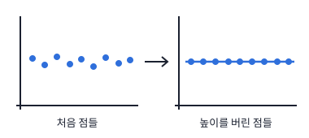

*위아래로 흔들리던 게 쓸데없는 떨림이었다면, 높이를 버릴 때 그 떨림도 함께 사라져요.*

**정확히 말하면**

**왜 버려도 되나**: 슬라이드 그림의 점들은 ${(x_1,x_2)\in\mathbb{R}^2}$이에요. $x_1$ 방향으로는 넓게 퍼져 있고, $x_2$ 방향으로는 거의 한 값에 모여 있어요. 그래서 $x_2$ 축은 점들을 구별하거나 특징을 묘사하는 데 별 차이를 만들지 못해요.

**버리는 연산**: 모든 점의 $x_2$ 값을 강제로 0으로 만들어요.

$$
(x_1,x_2)\ \mapsto\ (x_1,0)
$$

이렇게 얻은 점들을 **compressed dataset** 또는 **projected dataset**이라고 불러요. $x_2$ 정보는 원래 없던 게 아니라, 있는데 없앤 거예요. 그래서 압축이에요. 점 하나를 숫자 두 개 대신 한 개로 나타내니 데이터 양은 1/2이 돼요.

"projected"라는 이름은 이 연산이 $x_1$ 축 위로 점을 수직으로 내리는 사영이기 때문이에요. 이 연결은 [직교사영 복습](#s4-projection-recall)에서 식으로 다시 이어져요(학습용 연결).

**feature extraction(특징 추출)**: $x_1$ 축 정보만 feature로 골라 쓰는 것을 말해요.

**denoising(디노이징)**: 이론적으로는 raw data가 항상 더 많은 정보를 가져요. 하드웨어가 충분하다면 raw data를 그대로 살려 두는 것이 늘 optimal이에요. 하지만 머신러닝에서는 꼭 그렇지 않아요. 버린 $x_2$의 흔들림이 원래 노이즈였다면, 압축이 곧 노이즈 제거가 돼요. 그래서 압축된 정보가 학습 성능을 오히려 올리기도 해요. (denoising 설명은 슬라이드에 없고 수업에서 말로 덧붙였어요.)

**슬라이드 s6의 정리**

- 고차원 데이터는 analyze와 visualize가 어려워요.
- 고차원 데이터는 많은 경우 **overcomplete**해요. 정보가 없는 차원까지 다 보고 있어서 많은 차원이 **redundant**해요. 교과서(MML 10장 도입)는 redundant한 차원을 다른 차원들의 조합으로 설명될 수 있는 차원이라고 풀어 써요.
- 그래서 압축처럼 compact한 data representation이 항상 선호돼요.
- raw data를 저차원의 compact한 데이터로 바꾸는 systematic한 알고리즘의 대표가 PCA예요.

**수학은 정의로부터**: 주성분을 찾는 첫 단계는 "주성분"이라는 용어를 정의하는 거예요. 사람마다 주성분의 개념이 다를 수 있으니, 일을 시작하기 전에 용어부터 통일해야 해요. 이 정의 작업이 [code](#s4-code)와 [인코더와 디코더](#s5-encoder-decoder)의 수식으로 이어져요.

**다른 차원 축소 방법**(슬라이드 외 언급): 뉴럴넷 기반 차원 축소도 많고, 대표가 autoencoder예요. 기말 전에 실습할 수 있으면 좋겠다고 했어요. Transformer도 query, key, value를 행렬로 처리할 때 사실상 차원 축소와 주성분 추출을 한다고 설명했어요.

**교수님 말씀**

**골프장갑**: 아내처럼 손가락이 긴 여성용 골프장갑은 국내에서 찾기 어렵다고 했어요. 회사는 대중적인 제품을 위해 비대중적인 고객층을 "버린다", 즉 고객으로 생각하지 않아요. 소수를 버리는 이것도 일종의 압축이라고 했어요. (1028 P02 05:33–06:44)

**소 뒷걸음질 치다 쥐 잡기**: 정보가 없어서 축을 날렸을 뿐인데, 알고 보니 그 축에는 잡음만 있었던 경우가 denoising이라고 했어요. (1028 P02 09:45 – P03 00:14)

> "raw data가 늘 optimal이냐? 꼭 그렇지 않아요." (1028 P02 09:10)

> "어떨 때는 압축된 정보가 학습 성능을 더 올리기도 해요." (1028 P03 00:14)

**"수학은 뭘로부터 시작해?"**: 주성분을 알려면 무엇부터 해야 하냐는 질문에 여러 학생이 "가정", "언어", "음수사원" 등으로 답했어요. 마지막에 한 학생이 "정의"라고 답했고, 교수님은 정의로부터 시작하는 것이 맞다고 했어요. (1028 P03 02:38–04:10)

> "용어부터 통일해야 돼요, 일을 시작하기 전에." (1028 P03 04:40)

**페이지 요약**

거의 변하지 않는 $x_2$ 축을 버리면 데이터가 절반으로 압축되고, 그 흔들림이 노이즈였다면 디노이징까지 덤으로 얻어요.

*핵심 식*

- 축 버리기

  $$
  (x_1,x_2)\ \mapsto\ (x_1,0)
  $$

*용어*

- **compressed / projected dataset** — $x_2$ 값을 0으로 만든 점들
- **feature extraction(특징 추출)** — $x_1$ 축 정보만 feature로 골라 쓰기
- **denoising(디노이징)** — 버린 축의 흔들림이 노이즈였다면 압축이 곧 노이즈 제거, raw data가 늘 optimal은 아니에요
- **overcomplete / redundant** — 정보 없는 차원까지 보고 있어 많은 차원이 군더더기인 상태
- **정의로부터** — 첫 단계는 "주성분"이라는 용어를 정의해 통일하기

---

### 1.4 예시: 집값 데이터 5차원에서 2차원으로

*1028 수업 · L05 s7*

**쉽게 말하면**

집값을 볼 때 살피는 다섯 가지를 '집 자체'와 '동네' 두 묶음으로 모으면 훨씬 간단해져요.

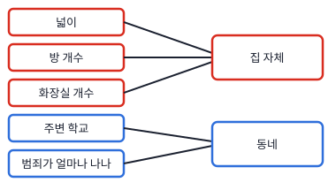

*왼쪽 위 세 칸은 '집 자체'로, 아래 두 칸은 '동네'로 모여요.*

**정확히 말하면**

부동산 가격을 결정하는 데이터 하나를 5차원 벡터 ${\mathbf{x}\in\mathbb{R}^5}$로 볼 수 있어요. 각 성분은 다음과 같아요.

1. Size(평수)
2. Number of rooms
3. Number of bathrooms
4. Schools around
5. crime rate(범죄율, 유해시설 포함)

슬라이드의 글자 색에 의미가 있어요. 빨간 글씨 1–3은 집 자체의 feature이고, 초록 글씨 4–5는 주변 환경, 즉 입지 feature예요.

그래서 이 다섯 숫자를 **size feature**(집 자체)와 **location feature**(입지) 두 실수로 압축할 수 있다면 훨씬 효과적이에요. 데이터 하나가 5개 숫자에서 2개 숫자, 즉 $\mathbb{R}^5$에서 $\mathbb{R}^2$로 줄어요.

한국이라면 distance from the (subway) station, 즉 지하철역까지의 거리도 들어가야 한다고 했어요. 슬라이드에는 빠져 있다고 직접 짚었어요.

raw data와 압축 데이터 사이에 성능 차이는 있을 수 있어요. 분류(classification)인지 회귀(regression)인지 같은 task에 따라 차이가 날 수도, 안 날 수도 있어요.

여기서 두 묶음은 사람이 의미를 보고 나눈 예시예요. PCA는 이런 압축을 데이터로부터 systematic하게 찾는 알고리즘이고, 그 방법은 [PCA 알고리즘 다섯 단계](#s2-steps)에서 이어져요.

**교수님 말씀**

> "10년 후에 이 부동산이 얼마나 오를지를 결정짓는 아주 스테이블한 피처겠죠." (주변 학교, 1028 P03 06:30)

범죄율과 주변 유해시설도 사실은 되게 중요하다고 했어요. (1028 P03 06:43)

> "교수님이 강의노트를 만들 때 글씨 색깔도 유의한다 그랬죠?" (1028 P03 07:13)

> "지하철로부터 몇 미터 떨어져 있느냐도 되게 중요한 입지죠." (1028 P03 08:06)

**페이지 요약**

집값 데이터의 5개 성분을 집 자체의 size feature와 입지의 location feature 두 실수로 압축하면 훨씬 효과적이에요.

*용어*

- **size feature** — Size, Number of rooms, Number of bathrooms(빨간 글씨)를 모은 집 자체 feature
- **location feature** — Schools around, crime rate(초록 글씨)를 모은 입지 feature
- **5차원에서 2차원** — $\mathbb{R}^5$에서 $\mathbb{R}^2$로 압축, 성능 차이는 task에 따라 달라요

---

## 2. PCA 알고리즘 다섯 단계

### 2.1 S1–S5 한눈에 보기

*1028 수업 · L05 s8*

**쉽게 말하면**

짐을 작게 싸서 보냈다가 받는 쪽에서 다시 푸는 것처럼, 다섯 단계를 차례로 밟아요.

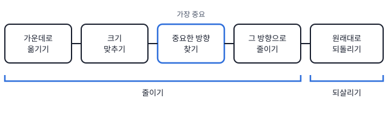

*앞의 네 단계는 줄이는 쪽이고, 마지막 한 단계는 되살리는 쪽이에요.*

**정확히 말하면**

PCA는 $D$차원 데이터를 $M$개의 숫자로 줄였다가 다시 $D$차원으로 되돌려요($M \lt D$). 슬라이드 s8은 이 절차를 S1–S5 다섯 단계로 적어요.

표기부터 정해요. 데이터는 $N$개이고, $n$번째 데이터 $\mathbf{x}_n \in \mathbb{R}^D$는 열벡터예요. 그 $d$번째 성분(원래 feature) $x_{d,n}$은 실수 하나예요($d=1,\dots,D$). 슬라이드 관례대로 feature 번호 $d$를 먼저, 데이터 번호 $n$을 나중에 써요.

1. **S1. centering** — 평균을 빼서 데이터의 평균을 0으로 만들어요. feature마다 평균 $\mu_d$를 구해 빼요.

   $$
   \mu_d = \frac{1}{N}\sum_{n=1}^{N} x_{d,n}
   $$

   $$
   x_{d,n} - \mu_d
   $$

   확률및랜덤변수에서 공분산(covariance)을 정의할 때 쓴 기법과 같아요. 평균을 뺀 두 확률변수의 곱의 평균이 공분산이었어요.

   $$
   \operatorname{cov}(X,Y) = E[\tilde{X}\tilde{Y}]
   $$

   $$
   \tilde{X} = X - E[X],\quad \tilde{Y} = Y - E[Y]
   $$

   벡터로 넓힌 정의는 [3.1 공분산 행렬의 정의와 대칭성](#s3-cov-def)에서 다뤄요.
2. **S2. standardization** — feature $d=1,\dots,D$마다 표준편차 $\sigma_d$로 나눠요. S1과 합치면 각 feature가 평균 0, 표준편차 1이 돼요. 슬라이드 문장을 식으로 옮긴 재표현은 다음과 같아요.

   $$
   \hat{x}_{d,n} = \frac{x_{d,n} - \mu_d}{\sigma_d}
   $$

   이유는 feature마다 값의 크기(스케일)가 크게 다르기 때문이에요. 집값 예시의 다섯 feature는 아래처럼 범위가 달라요.

   | feature | 값의 대략적 범위 |
   |---|---|
   | 면적(size, ㎡) | 100 이상 |
   | 방 개수 | 2–6 |
   | 화장실 개수 | 1–3 |
   | 주변 학교 유무 | 0 또는 1 |
   | crime rate | 0.007 수준 |

   그대로 쓰면 값이 큰 면적이 가격을 다 결정하는 것처럼 보이고, crime rate는 영향이 없는 것처럼 착각하기 쉬워요. 그래서 모든 feature를 같은 눈금에 올려요.
3. **S3. 고유값·고유벡터** — 다섯 단계 중 가장 중요한 단계예요. 데이터 공분산 행렬(data covariance matrix) $\mathbf{S} \in \mathbb{R}^{D \times D}$의 고유값(eigenvalue) 중 가장 큰 $M$개와, 그에 대응하는 고유벡터(eigenvector) $\mathbf{b}_1,\dots,\mathbf{b}_M \in \mathbb{R}^D$를 구해요. $M$은 줄여서 남길 차원 수예요. $\mathbf{S}$를 만드는 법은 3장에서 다뤄요. 왜 하필 공분산 행렬의 고유벡터인지는 이번 수업에서 설명하지 않았고 다음 시간에 다뤄요.
4. **S4. projection** — 모든 데이터 점을 $\mathbf{b}_1,\dots,\mathbf{b}_M$이 만드는 공간, 곧 principal subspace로 사영해요. 사영된 점은 여전히 $D$차원 공간 안에 있지만, 그 부분공간 안의 좌표 $M$개만 알면 다시 찾을 수 있어요. 이 $M$개 좌표가 code이고, 계산식은 [4.2 code: 정규직교 기저의 좌표](#s4-code)에서 다뤄요.
5. **S5. standardization과 centering 되돌리기** — 줄인 결과를 원래 단위로 되돌려요. S2를 거꾸로 해서 $\sigma_d$를 다시 곱하고, S1을 거꾸로 해서 $\mu_d$를 다시 더해요. 원래 분산과 원래 평균으로 돌아가요.

| 구간 | 단계 | 하는 일 |
|---|---|---|
| encoding | S1–S4 | $D$차원 데이터를 principal subspace 위의 $M$개 좌표로 줄여요 |
| decoding | S5 | 줄인 결과를 원래 평균·분산의 $D$차원 데이터로 되돌려요 |

S1과 S2는 무엇을 줄일지 고르기 전에 데이터를 고르게 만드는 준비 단계예요. 실제로 방향을 고르는 일은 S3, 줄이는 일은 S4가 해요.

**교수님 말씀**

> “센터링이라는 게 그냥 평균을 0으로 만드는 수학적 기법” (1028 P03 09:45)

교수님은 centering이 새 기법이 아니라 확률및랜덤변수에서 공분산을 배울 때 이미 쓴 기법이라고 짚었어요.

> “모두 다 평등해, 모두 다 중요해라는 의미를 만들기 위해서” (1028 P04 02:18)

집값을 정하는 다섯 feature가 똑같이 중요하다는 뜻을 담으려고 평균은 0, 표준편차는 1로 맞춘다고 했어요.

> “세 번째로 가장 중요한 일을 하는데, 그게 바로 eigenvalue와 eigenvector를 만들어내는 거예요.” (1028 P04 02:41)

> “이게 왜 covariance matrix를 또 쓸까? 요게 또 재밌는 수학적인 비밀이 숨겨져 있어요” (1028 P04 03:41)

공분산 행렬을 쓰는 이유는 다음 시간으로 미뤘어요. 고유값·고유벡터 복습도 “좀 이따”라고 했지만 이번 수업에서는 하지 않았어요. 마지막으로 S1–S4가 encoding, S5가 decoding이라고 정리했어요. 시각은 각 녹음 파트 시작 기준의 추정값이에요.

**페이지 요약**

PCA는 평균 빼기, 표준편차로 나누기, 공분산 행렬의 큰 고유값 $M$개의 고유벡터 찾기, 그 공간으로 사영, 되돌리기의 다섯 단계예요.

*핵심 식*

- S1 feature 평균

  $$
  \mu_d = \frac{1}{N}\sum_{n=1}^{N} x_{d,n}
  $$
- S1·S2 합친 재표현

  $$
  \hat{x}_{d,n} = \frac{x_{d,n} - \mu_d}{\sigma_d}
  $$
- centering을 쓴 공분산 정의

  $$
  \operatorname{cov}(X,Y) = E[\tilde{X}\tilde{Y}]
  $$

*용어*

- **centering** — S1. 평균을 빼서 평균 0으로 만들어요.
- **standardization** — S2. feature마다 표준편차로 나눠 스케일을 맞춰요.
- **데이터 공분산 행렬(data covariance matrix)** — S3. 가장 큰 고유값 $M$개의 고유벡터를 구하는 대상이에요. 왜 이 행렬인지는 다음 시간에 다뤄요.
- **principal subspace** — S4. $\mathbf{b}_1,\dots,\mathbf{b}_M$이 만드는 공간으로, 데이터를 여기에 사영해요.
- **encoding** — S1–S4. $D$차원을 $M$개 좌표로 줄여요.
- **decoding** — S5. 원래 평균·분산으로 되돌려요.

---

### 2.2 그림으로 보는 전처리

*1028 수업 · L05 s9*

**쉽게 말하면**

흩어진 점들을 가운데로 옮기고, 가로세로 크기를 맞춘 다음, 한 줄 위로 모아요.

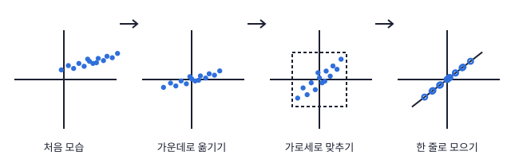

*한 줄 위의 점은 방향 하나와 길이 하나만 알면 다시 찾을 수 있어요.*

**정확히 말하면**

슬라이드 s9는 2차원 데이터로 S1–S5를 한 장에 보여 줘요. 각 데이터는 ${\mathbf{x}_n = [x_{1,n},\ x_{2,n}]^T \in \mathbb{R}^{2}}$인 $2\times 1$ 벡터예요($D=2$). 칠판 예시는 데이터 40개였어요($N=40$).

먼저 centering이 평행이동이라는 것을 한 단계씩 보여요.

1. 첫 번째 성분을 모두 더해 40으로 나눠요.

   $$
   \mu_1 = \frac{1}{40}\sum_{n=1}^{40} x_{1,n}
   $$
2. 두 번째 성분도 같은 방식이에요.

   $$
   \mu_2 = \frac{1}{40}\sum_{n=1}^{40} x_{2,n}
   $$
3. 평균 벡터 $\boldsymbol{\mu} = [\mu_1,\ \mu_2]^T$를 모든 점에서 빼요. 점 구름 전체가 원점으로 평행이동해서 좌우·위아래 offset이 사라져요.

   $$
   \mathbf{x}_n - \boldsymbol{\mu}
   $$
4. 가운데로 옮긴 구름은 $x_1$ 방향으로 더 넓고 $x_2$ 방향으로 덜 퍼져 있어요. 두 방향의 표준편차 $\sigma_1$, $\sigma_2$가 다르기 때문이에요. 각 축을 자기 표준편차로 나눠요(standardization).

   $$
   \hat{x}_{1,n} = \frac{x_{1,n} - \mu_1}{\sigma_1}
   $$

   $$
   \hat{x}_{2,n} = \frac{x_{2,n} - \mu_2}{\sigma_2}
   $$
5. 그러면 데이터가 정사각형 안에 모인 모양이 돼요. 각 축을 확률변수로 보면 평균 0, 분산 1이에요. 여기까지를 data preprocessing이라고 불러요.

칠판에서는 처음에 데이터 번호를 먼저 쓰다가 마지막 식에서 feature 번호를 먼저 써서 인덱스 순서가 섞였어요. 여기서는 슬라이드 관례 $x_{d,n}$으로 통일했어요.

교수님은 이 전처리를 부르는 두 이름을 구별했어요.

| 이름 | 하는 일 | 결과 |
|---|---|---|
| normalization | 가장 큰 값으로 전체를 나눠요 | 값이 $-1$에서 $+1$ 사이에 들어와요 |
| standardization | 평균을 빼고 표준편차로 나눠요 | 평균 0, 분산 1이 돼요 |

어느 쪽이 맞는지는 머신러닝 task의 종류에 따라 달라요. 이 강의노트는 standardization만 써요.

전처리 뒤에는 S3–S5가 이어져요.

1. S3: 2차원 데이터라서 고유벡터는 2개뿐이에요. 가장 큰 고유값의 고유벡터가 첫 방향 $\mathbf{b}_1$, 다른 하나가 두 번째 방향이에요.
2. S4: 점들을 $\mathbf{b}_1$ 방향(principal subspace, $M=1$)으로 사영해요. 슬라이드의 파란 점이 주황 점이 되는 과정이 PCA예요.
3. 사영된 점은 여전히 $(x_1, x_2)$ 평면 위의 점이지만 모두 직선 하나 위에 있어요. 그래서 벡터 하나 $\mathbf{b}_1$에 상수 하나 $z_n$을 곱해 $z_n\mathbf{b}_1$로 나타낼 수 있어요. 상수 $z_n$을 구하는 식은 [4.2 code: 정규직교 기저의 좌표](#s4-code)에서 다뤄요.
4. S5: 각 축에 $\sigma_1$, $\sigma_2$를 다시 곱하고(de-standardization) $\boldsymbol{\mu}$를 다시 더해요. 직선은 늘어나고 옮겨지지만, 점들이 직선 하나로 설명된다는 성질은 그대로예요.

**교수님 말씀**

교수님은 슬라이드 그림 옆 칠판에 데이터 40개짜리 예를 직접 쓰며 $\mu_1$, $\mu_2$를 구했어요. 평균을 빼는 일을 “평행이동”으로 설명했어요.

> “마치 정사각형 안에 데이터들이 모여 있는 것처럼 느껴지는 데이터로 바뀐 거죠.” (1028 P04 08:20)

$\sigma_1$, $\sigma_2$로 나누면 가로로 길던 구름이 정사각형 안으로 들어온다고 했어요.

> “어떤 데이터 프리프로세싱이 어떤 머신러닝 태스크에 더 적절한지는 … 태스크의 종류에 따라 다를 수 있어요.” (1028 P04 09:30)

> “어떤 벡터 하나에다가 constant 하나를 곱해서 표현할 수 있다는 거.” (1028 P05 01:40)

사영된 점들이 왜 직선 하나로 표현되는지는 뒤에서 수학적으로 설명하겠다고 했어요. 시각은 각 녹음 파트 시작 기준의 추정값이에요.

**페이지 요약**

centering은 평균만큼의 평행이동이고, standardization은 각 축을 표준편차로 나눠 정사각형 안으로 모으는 일이며, 둘을 합쳐 data preprocessing이라고 해요.

*핵심 식*

- 40개 데이터의 첫 성분 평균

  $$
  \mu_1 = \frac{1}{40}\sum_{n=1}^{40} x_{1,n}
  $$
- 평행이동

  $$
  \mathbf{x}_n - \boldsymbol{\mu}
  $$
- 첫 축 standardization

  $$
  \hat{x}_{1,n} = \frac{x_{1,n} - \mu_1}{\sigma_1}
  $$

*용어*

- **data preprocessing** — centering과 standardization까지의 준비 단계예요.
- **normalization** — 가장 큰 값으로 나눠 $-1$에서 $+1$ 사이에 넣어요.
- **standardization** — 평균 0, 분산 1로 맞춰요. 이 강의노트는 이쪽만 써요.
- **사영된 점** — 직선 하나 위에 있어 $z_n\mathbf{b}_1$처럼 벡터 하나와 상수 하나로 나타내요. 되돌린 뒤에도 직선 하나로 설명돼요.

---

## 3. 공분산 행렬

### 3.1 공분산 행렬의 정의와 대칭성

*1028 수업 · L05 s10*

**쉽게 말하면**

두 묶음의 항목을 하나씩 짝지어, 함께 움직이는 정도를 표 한 장에 모아요.

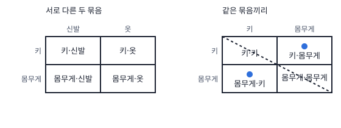

*왼쪽은 서로 다른 두 묶음을 짝지은 표예요. 오른쪽처럼 같은 묶음끼리 짝지으면 점 찍힌 두 칸의 값이 똑같아요.*

**정확히 말하면**

PCA 알고리즘의 3단계는 데이터 공분산 행렬을 고유분해해요. 그 행렬이 무엇인지, 이미 아는 스칼라 공분산의 **정의**에서 출발해 세워요. 여기서 벡터는 모두 세로(열)벡터예요.

1. #### 출발점: 스칼라 공분산

   두 확률변수 $x$, $y$의 공분산은 편차의 곱의 평균이에요. 기댓값의 선형성으로 펼치면 "곱의 평균 빼기 평균의 곱"이 돼요(MML 식 6.35–6.36).

   $$
   \operatorname{cov}(x,y)=E[(x-E[x])(y-E[y])]
   $$

   $$
   \operatorname{cov}(x,y)=E[xy]-E[x]E[y]
   $$

   두 입력이 같으면 ${\operatorname{cov}(x,x)=\operatorname{Var}(x)}$, 곧 분산이에요.
2. #### 성분 쌍마다 하나씩: 표로 정의해요

   칠판의 예는 ${\mathbf{x}=[x_1,x_2]^T}$, ${\mathbf{y}=[y_1,y_2]^T}$예요. 성분이 2개씩이라 짝은 $2\times 2=4$개이고, 짝마다 스칼라 공분산을 하나씩 계산해 칸에 넣어요.

   $$
   \operatorname{cov}(\mathbf{x},\mathbf{y})=\begin{bmatrix}\operatorname{cov}(x_1,y_1) & \operatorname{cov}(x_1,y_2)\\ \operatorname{cov}(x_2,y_1) & \operatorname{cov}(x_2,y_2)\end{bmatrix}
   $$

   칸의 위치 규칙은 이것 하나예요. 행 번호 $i$는 첫째 입력 $\mathbf{x}$의 성분, 열 번호 $j$는 둘째 입력 $\mathbf{y}$의 성분이 정해요.

   $$
   [\operatorname{cov}(\mathbf{x},\mathbf{y})]_{ij}=\operatorname{cov}(x_i,y_j)
   $$
3. #### 표를 식 하나로: 세로 × 가로

   각 칸의 스칼라 공분산은 $E[x_iy_j]-E[x_i]E[y_j]$예요. 그러니 칸 $(i,j)$에 곱 $x_iy_j$가 놓인 행렬이 필요해요. 세로벡터 $\mathbf{x}$에 가로로 눕힌 $\mathbf{y}^T$를 곱하면 바로 그 행렬이 나와요.

   $$
   \mathbf{x}\mathbf{y}^T=\begin{bmatrix}x_1\\ x_2\end{bmatrix}\begin{bmatrix}y_1 & y_2\end{bmatrix}=\begin{bmatrix}x_1y_1 & x_1y_2\\ x_2y_1 & x_2y_2\end{bmatrix}
   $$
4. #### 기댓값은 칸마다 따로 취해요

   $$
   E[\mathbf{x}\mathbf{y}^T]=\begin{bmatrix}E[x_1y_1] & E[x_1y_2]\\ E[x_2y_1] & E[x_2y_2]\end{bmatrix}
   $$

   $$
   E[\mathbf{x}]E[\mathbf{y}]^T=\begin{bmatrix}E[x_1]\\ E[x_2]\end{bmatrix}\begin{bmatrix}E[y_1] & E[y_2]\end{bmatrix}=\begin{bmatrix}E[x_1]E[y_1] & E[x_1]E[y_2]\\ E[x_2]E[y_1] & E[x_2]E[y_2]\end{bmatrix}
   $$
5. #### 빼면 정의가 나와요

   두 행렬을 칸끼리 빼면 칸 $(i,j)$가 ${E[x_iy_j]-E[x_i]E[y_j]=\operatorname{cov}(x_i,y_j)}$가 돼요. 그래서 일반적인 정의는 다음과 같아요(L05 s10).

   $$
   \operatorname{cov}(\mathbf{x},\mathbf{y})=E[\mathbf{x}\mathbf{y}^T]-E[\mathbf{x}]E[\mathbf{y}]^T\in\mathbb{R}^{n\times m}
   $$

   여기서 $\mathbf{x}\in\mathbb{R}^n$, $\mathbf{y}\in\mathbb{R}^m$이에요. 크기는 $(n\times 1)(1\times m)=n\times m$이에요. 스칼라 공식과 모양이 같고, 곱이 외적으로 바뀐 것만 달라요.
6. #### 왜 둘째 쪽에 전치가 붙을까요

   전치를 첫째 쪽에 붙인 $\mathbf{x}^T\mathbf{y}$는 가로 × 세로라서 $1\times 1$ 스칼라 $x_1y_1+x_2y_2$예요. 네 짝 중 두 짝만 더해 버리니 표가 사라져요. 둘째 입력을 가로로 눕혀야 첫째 입력이 행을, 둘째 입력이 열을 맡아요.

#### 교차 공분산과 자기 공분산

입력 두 개가 서로 다른 벡터인지, 같은 벡터인지에 따라 성질이 달라요. 교차 공분산(cross-covariance)은 MML이 쓰는 이름이에요(MML 6.4.1).

| 항목 | 교차 공분산 $\operatorname{cov}(\mathbf{x},\mathbf{y})$ | 자기 공분산 $\Sigma_{\mathbf{x}}$ |
|---|---|---|
| 크기 | $n\times m$ (정사각형이 아닐 수 있어요) | $n\times n$ |
| 칸 $(i,j)$ | $\operatorname{cov}(x_i,y_j)$ | $\operatorname{cov}(x_i,x_j)$ |
| 대각선 | 분산이 아니에요($n=m$이면 $\operatorname{cov}(x_i,y_i)$) | 분산 $\operatorname{Var}(x_i)$ |
| 대칭 | 일반적으로 아니에요 | 항상 symmetric matrix |

둘째 자리에 $\mathbf{x}$를 넣으면 자기 공분산이에요.

$$
\Sigma_{\mathbf{x}}=\operatorname{cov}(\mathbf{x},\mathbf{x})=E[\mathbf{x}\mathbf{x}^T]-E[\mathbf{x}]E[\mathbf{x}]^T
$$

스칼라 곱은 순서를 바꿔도 같아서($x_ix_j=x_jx_i$) ${\operatorname{cov}(x_i,x_j)=\operatorname{cov}(x_j,x_i)}$예요. 그래서 대각선 밖의 칸이 마주 보며 같고, $\Sigma_{\mathbf{x}}$는 symmetric matrix예요.

교차 공분산에서 입력 순서를 바꾸면 행과 열이 바뀌어 전치가 돼요(MML 6.4.1). 예를 들어 $\mathbf{x}\in\mathbb{R}^2$, $\mathbf{y}\in\mathbb{R}^3$이면 $\operatorname{cov}(\mathbf{x},\mathbf{y})$는 $2\times 3$, $\operatorname{cov}(\mathbf{y},\mathbf{x})$는 $3\times 2$예요.

$$
\operatorname{cov}(\mathbf{y},\mathbf{x})=\operatorname{cov}(\mathbf{x},\mathbf{y})^T
$$

#### centering이 뒤 항을 없애요

평균을 미리 빼서 $E[\mathbf{x}]=\mathbf{0}$으로 만들면 $E[\mathbf{x}]E[\mathbf{x}]^T$가 영행렬이 돼요. PCA 1단계에서 centering을 하는 이유가 이것이에요.

$$
E[\mathbf{x}]=\mathbf{0}\ \Rightarrow\ \Sigma_{\mathbf{x}}=E[\mathbf{x}\mathbf{x}^T]
$$

#### 스스로 확인

- $\operatorname{cov}(\mathbf{x},\mathbf{y})$의 $(2,1)$ 칸에는 무엇이 들어갈까요? 답: $\operatorname{cov}(x_2,y_1)$이에요. 행은 첫째 입력, 열은 둘째 입력이 정해요.
- $\mathbf{x}\in\mathbb{R}^2$, $\mathbf{y}\in\mathbb{R}^3$일 때 $\operatorname{cov}(\mathbf{x},\mathbf{y})$는 대칭일 수 있을까요? 답: $2\times 3$이라 정사각형도 아니어서 대칭을 따질 수 없어요.
- 왜 $E[\mathbf{x}^T\mathbf{y}]$가 아니라 $E[\mathbf{x}\mathbf{y}^T]$일까요? 답: 앞의 것은 스칼라 하나라 성분 쌍마다 칸을 줄 수 없어요.

**교수님 말씀**

공분산 행렬도 스칼라 공분산의 정의에서 출발해 만들었어요. 칠판에 두 세로벡터를 쓰고, 원소마다 스칼라 공분산 4개를 계산해 행렬에 넣었어요.

> "수학은 정의로부터" (1028 P05 03:24)

$\mathbf{x}$, $\mathbf{y}$가 세로벡터인 이유는 "transpose 취해져 있으니까"라고 짚었어요(1028 P05 02:39).

> "원래 곱의 평균 빼기 평균의 곱이 covariance의 정의였거든요?" (1028 P05 03:32)

바로 이어서 "variance의 정의"라고도 말했는데, 곱의 평균 빼기 평균의 곱은 covariance의 정의예요. variance는 두 입력이 같은 특수한 경우예요.

$\mathbf{y}$ 자리에 $\mathbf{x}$를 넣으면 교환법칙 때문에 대각선 밖이 같아져 symmetric matrix가 된다고 했어요(1028 P05 05:18).

$E[\mathbf{x}]=\mathbf{0}$이면 뒤 항이 사라지는데, 이것이 centering을 하는 이유라고 했어요. PCA 단계를 설명할 때 "미리 얘기했어요, 예고했어"라고 덧붙였어요(1028 P05 07:25).

**페이지 요약**

공분산 행렬은 두 벡터의 성분 쌍마다 스칼라 공분산을 하나씩 모은 표예요. 행은 첫째 입력, 열은 둘째 입력이 정하고, 자기 공분산만 항상 대칭이에요.

*핵심 식*

- 스칼라 공분산

  $$
  \operatorname{cov}(x,y)=E[xy]-E[x]E[y]
  $$
- 칸의 위치

  $$
  [\operatorname{cov}(\mathbf{x},\mathbf{y})]_{ij}=\operatorname{cov}(x_i,y_j)
  $$
- 공분산 행렬의 정의

  $$
  \operatorname{cov}(\mathbf{x},\mathbf{y})=E[\mathbf{x}\mathbf{y}^T]-E[\mathbf{x}]E[\mathbf{y}]^T\in\mathbb{R}^{n\times m}
  $$
- 자기 공분산

  $$
  \Sigma_{\mathbf{x}}=\operatorname{cov}(\mathbf{x},\mathbf{x})=E[\mathbf{x}\mathbf{x}^T]-E[\mathbf{x}]E[\mathbf{x}]^T
  $$
- 순서 교환

  $$
  \operatorname{cov}(\mathbf{y},\mathbf{x})=\operatorname{cov}(\mathbf{x},\mathbf{y})^T
  $$
- centering 뒤

  $$
  E[\mathbf{x}]=\mathbf{0}\ \Rightarrow\ \Sigma_{\mathbf{x}}=E[\mathbf{x}\mathbf{x}^T]
  $$

*용어*

- **외적 $\mathbf{x}\mathbf{y}^T$** — 세로 × 가로라서 칸 $(i,j)$에 $x_iy_j$가 놓인 행렬이에요. $\mathbf{x}^T\mathbf{y}$는 스칼라예요.
- **교차 공분산(cross-covariance)** — 서로 다른 두 벡터의 공분산으로, $n\times m$이고 일반적으로 대칭이 아니에요.
- **symmetric matrix** — 자기 공분산 $\Sigma_{\mathbf{x}}$는 ${\operatorname{cov}(x_i,x_j)=\operatorname{cov}(x_j,x_i)}$라서 대칭이에요.
- **centering** — 평균을 빼서 $E[\mathbf{x}]=\mathbf{0}$으로 만들어 뒤 항을 없애요.

---

### 3.2 데이터 행렬과 표본 공분산 행렬

*1028 수업 · L05 s10*

**쉽게 말하면**

학생마다 한 장씩인 기록 카드를 옆으로 풀칠해 큰 표 하나를 만들어요.

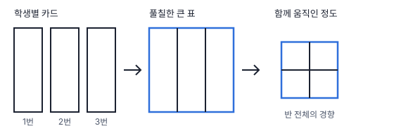

*큰 표에서 항목끼리 함께 움직인 정도를 평균 내면, 작은 네모 표 하나에 반 전체의 경향이 담겨요.*

**정확히 말하면**

목표는 [3.1 공분산 행렬의 정의와 대칭성](#s3-cov-def)의 자기 공분산 $\Sigma_{\mathbf{x}}$를 실제 데이터로 계산하는 것이에요. 분포 대신 데이터만 있으니 기댓값을 sample mean으로 바꿔요.

1. #### 데이터 행렬: 열로 풀칠해요

   $N$은 표본 수, $D$는 측정값(원래 feature) 수예요. 표본 하나 $\mathbf{x}_n\in\mathbb{R}^D$를 세로로 세우고 $N$개를 옆으로 붙이면 데이터 행렬 $\mathbf{X} \in \mathbb{R}^{D \times N}$이 돼요.

   $$
   \mathbf{X}=[\mathbf{x}_1\ \cdots\ \mathbf{x}_N]=\begin{bmatrix}x_{1,1} & x_{1,2} & \cdots & x_{1,N}\\ x_{2,1} & x_{2,2} & \cdots & x_{2,N}\\ \vdots & \vdots & \ddots & \vdots\\ x_{D,1} & x_{D,2} & \cdots & x_{D,N}\end{bmatrix}
   $$

   원소 $x_{d,n}$은 $n$번째 표본의 $d$번째 feature예요. 열 하나가 표본 하나, 행 하나가 feature 하나예요. 데이터는 이미 centering되어 feature마다 평균이 $0$이라고 가정해요(L05 s10).
2. #### 원래 계산하려던 것

   centering했으니 구할 것은 ${\Sigma_{\mathbf{x}}=E[\mathbf{x}\mathbf{x}^T]}$예요. 그런데 기댓값을 계산하려면 PDF(이산이면 PMF)가 필요해요.

   $$
   E[x]=\int_{-\infty}^{\infty}x\,f_X(x)\,dx
   $$

   가진 것은 데이터 $N$개뿐이고 분포 $f_X$는 몰라요.
3. #### 기댓값 대신 sample mean

   각 표본으로 $\mathbf{x}_n\mathbf{x}_n^T$($D\times D$)를 만들고, $N$개를 더해 $N$으로 나눠요. 이것이 data covariance matrix, 곧 sample covariance matrix $\mathbf{S}$예요.

   $$
   \mathbf{S} = \frac{1}{N}\sum_{n=1}^{N}\mathbf{x}_n\mathbf{x}_n^T
   $$

   칸 $(i,j)$를 보면 정의와 바로 이어져요. ${[\mathbf{x}_n\mathbf{x}_n^T]_{ij}=x_{i,n}x_{j,n}}$이므로 다음과 같아요.

   $$
   [\mathbf{S}]_{ij}=\frac{1}{N}\sum_{n=1}^{N}x_{i,n}x_{j,n}
   $$

   이것은 $E[x_ix_j]$, 곧 centering된 데이터의 $\operatorname{cov}(x_i,x_j)$를 표본 평균으로 바꾼 값이에요. 그래서 $\mathbf{S}$의 칸 $(i,j)$는 feature $i$와 feature $j$가 함께 움직인 정도예요.
4. #### 행렬 곱 한 번으로 쓰기

   같은 행렬을 데이터 행렬 하나로 쓸 수 있어요. 수업에서는 "계산하면 같다"고 결과만 말했어요. 칸별 확인은 이 토픽의 보충에 있어요.

   $$
   \mathbf{S} = \frac{1}{N}\mathbf{X}\mathbf{X}^T\in\mathbb{R}^{D\times D}
   $$

   크기는 $(D\times N)(N\times D)=D\times D$예요. feature 수만큼의 정사각형이고, 표본 수 $N$은 크기에 남지 않아요.

#### 성질: 대칭이고 positive semi-definite

${(\mathbf{X}\mathbf{X}^T)^T=\mathbf{X}\mathbf{X}^T}$라서 $\mathbf{S}$는 symmetric matrix예요. 또 $\mathbf{S}$는 positive semi-definite라서 고윳값이 모두 $0$ 이상이에요. 수업에서는 "0보다 크다"고 말했지만, 정확히는 $\ge 0$이에요. 모두 $0$보다 크면 positive definite라고 따로 불러요. 이 성질이 PCA에서 하는 역할은 다음에 다룬다고 했어요.

#### 코드에서 보는 모습

코드에서는 데이터 행렬에 자기 전치를 곱해 $N$으로 나눈 뒤 고유분해(EVD)하는 장면을 자주 봐요. feature끼리의 상관 특성을 담은 행렬을 분해하려는 것이에요. 아래는 그 흐름을 옮긴 예시예요.

`# X: D x N, centering 끝난 데이터
S = X @ X.T / N
lam, V = np.linalg.eigh(S)`

#### 참고: 교과서의 표기

미리 centering하지 않은 데이터에는 MML의 일반형(평균을 빼는 식)을 써요. MML은 이것을 empirical covariance라고 불러요(MML 식 6.42). $\bar{\mathbf{x}}=\mathbf{0}$이면 수업의 $\mathbf{S}$와 같아요.

$$
\boldsymbol{\Sigma}=\frac{1}{N}\sum_{n=1}^{N}(\mathbf{x}_n-\bar{\mathbf{x}})(\mathbf{x}_n-\bar{\mathbf{x}})^T
$$

MML은 $N$으로 나누는 이 추정이 biased이고, $N-1$로 나누면 unbiased라고 적어요(MML 6.4.2). 수업과 MML 10장(식 10.1)은 모두 $N$으로 나눠요.

**교수님 말씀**

표본 벡터를 열로 하나씩 "풀칠해서 붙인" 것이 데이터 행렬이라고 했어요(1028 P05 08:17).

sample mean을 학점으로 설명했어요. 한 학생에게 평점을 물었더니 4학년 2학기에 4.3이었어요. 이 4.3은 "4.3을 내는 공장" 같은 확률변수의 진짜 평균이 아니에요. 지금까지 들은 과목 학점을 학점 수로 가중평균한 표본 평균이에요(1028 P06 02:47–04:21).

중간고사 평균 64점도 같은 예로 들었어요. 만 번 시험을 본 기댓값이 아니라 이번에 시험 본 50명 점수의 평균이에요.

$\frac{1}{N}\mathbf{X}\mathbf{X}^T$와 합 형태는 "계산하다 보면 같은 결과가 나온다"고 했고, 합 형태가 더 직관적이라고 했어요(1028 P06 06:43).

강조한 말이에요.

> "raw data가 가지고 있었던 경향성, 패턴, 어떤 연관성 같은 것들을 고스란히 가지고 있는 매트릭스" (1028 P06 07:14)

$x_1$과 $x_1$, $x_1$과 $x_2$, $x_1$과 $x_3$처럼 feature 쌍의 연관성을 모두 담는다는 뜻이에요.

> "에너지적인 요소를 다 머금고 있는 매트릭스다." (1028 P06 08:34)

공분산 행렬이 positive semi-definite이고 symmetric하다고 하며 "eigenvalue들이 다 0보다 크고"라고 했어요(1028 P06 08:12). 정확히는 $0$ 이상이에요. 이 성질이 중요한 역할을 하는데, 그 이야기는 나중에 하겠다고 했어요(1028 P06 08:34).

코드에서 데이터 행렬에 자기 transpose를 곱하고 $N$으로 나눈 뒤 EVD하는 장면을 자주 보게 될 거라고 했어요(1028 P06 08:44).

**보충 · 수업에서 유도하진 않았어요**

수업에서 "계산하면 같다"고만 한 등식을 칸별로 확인해요.

$$
\frac{1}{N}\sum_{n=1}^{N}\mathbf{x}_n\mathbf{x}_n^T=\frac{1}{N}\mathbf{X}\mathbf{X}^T
$$

두 쪽 모두 $\frac{1}{N}$이 곱해져 있으니 $\sum_{n}\mathbf{x}_n\mathbf{x}_n^T$와 $\mathbf{X}\mathbf{X}^T$가 같은지만 보면 돼요. 작은 예 $D=2$, $N=3$으로 해요.

1. #### 데이터 행렬

   $$
   \mathbf{X}=\begin{bmatrix}x_{1,1} & x_{1,2} & x_{1,3}\\ x_{2,1} & x_{2,2} & x_{2,3}\end{bmatrix}
   $$
2. #### 합 형태: 표본마다 외적

   표본 $\mathbf{x}_n=[x_{1,n},x_{2,n}]^T$의 외적은 $2\times 2$예요.

   $$
   \mathbf{x}_n\mathbf{x}_n^T=\begin{bmatrix}x_{1,n}^2 & x_{1,n}x_{2,n}\\ x_{2,n}x_{1,n} & x_{2,n}^2\end{bmatrix}
   $$

   세 개를 칸끼리 더해요.

   $$
   \sum_{n=1}^{3}\mathbf{x}_n\mathbf{x}_n^T=\begin{bmatrix}\sum_n x_{1,n}^2 & \sum_n x_{1,n}x_{2,n}\\ \sum_n x_{2,n}x_{1,n} & \sum_n x_{2,n}^2\end{bmatrix}
   $$
3. #### 행렬 곱 형태: 행 · 행

   $\mathbf{X}\mathbf{X}^T$의 칸 $(i,j)$는 $\mathbf{X}$의 $i$행과 $\mathbf{X}^T$의 $j$열, 곧 $\mathbf{X}$의 $j$행의 내적이에요.

   $$
   \mathbf{X}\mathbf{X}^T=\begin{bmatrix}x_{1,1}^2+x_{1,2}^2+x_{1,3}^2 & x_{1,1}x_{2,1}+x_{1,2}x_{2,2}+x_{1,3}x_{2,3}\\ x_{2,1}x_{1,1}+x_{2,2}x_{1,2}+x_{2,3}x_{1,3} & x_{2,1}^2+x_{2,2}^2+x_{2,3}^2\end{bmatrix}
   $$

   네 칸 모두 합 형태와 같아요.
4. #### 일반 $D$, $N$으로

   행렬 곱의 정의 ${[\mathbf{X}\mathbf{X}^T]_{ij}=\sum_{n}[\mathbf{X}]_{in}[\mathbf{X}^T]_{nj}}$에 $[\mathbf{X}^T]_{nj}=x_{j,n}$을 넣어요.

   $$
   [\mathbf{X}\mathbf{X}^T]_{ij}=\sum_{n=1}^{N}x_{i,n}x_{j,n}
   $$

   $$
   =\sum_{n=1}^{N}[\mathbf{x}_n\mathbf{x}_n^T]_{ij}
   $$

   모든 칸이 같으니 두 행렬이 같아요. $\mathbf{X}\mathbf{X}^T$는 "열 하나와 그 전치의 곱"을 열마다 더한 것이에요.
5. #### 숫자로 확인

   각 행의 합이 $0$이라 centering된 데이터예요.

   $$
   \mathbf{X}=\begin{bmatrix}1 & -1 & 0\\ 2 & 0 & -2\end{bmatrix}
   $$

   $$
   \mathbf{x}_1\mathbf{x}_1^T+\mathbf{x}_2\mathbf{x}_2^T+\mathbf{x}_3\mathbf{x}_3^T=\begin{bmatrix}1 & 2\\ 2 & 4\end{bmatrix}+\begin{bmatrix}1 & 0\\ 0 & 0\end{bmatrix}+\begin{bmatrix}0 & 0\\ 0 & 4\end{bmatrix}=\begin{bmatrix}2 & 2\\ 2 & 8\end{bmatrix}
   $$

   $$
   \mathbf{X}\mathbf{X}^T=\begin{bmatrix}1+1+0 & 2+0+0\\ 2+0+0 & 4+0+4\end{bmatrix}=\begin{bmatrix}2 & 2\\ 2 & 8\end{bmatrix}
   $$

   따라서 ${\mathbf{S}=\frac{1}{3}\begin{bmatrix}2 & 2\\ 2 & 8\end{bmatrix}}$이고, 대칭이에요.

**페이지 요약**

분포를 모르니 기댓값 대신 sample mean을 써서, 표본 외적의 평균으로 공분산 행렬을 계산해요. 이것이 데이터 행렬 하나로 쓴 ${\mathbf{S} = \frac{1}{N}\mathbf{X}\mathbf{X}^T}$예요.

*핵심 식*

- 데이터 행렬

  $$
  \mathbf{X}=[\mathbf{x}_1\ \cdots\ \mathbf{x}_N]
  $$
- 표본 공분산(합 형태)

  $$
  \mathbf{S} = \frac{1}{N}\sum_{n=1}^{N}\mathbf{x}_n\mathbf{x}_n^T
  $$
- 표본 공분산(행렬 곱)

  $$
  \mathbf{S} = \frac{1}{N}\mathbf{X}\mathbf{X}^T\in\mathbb{R}^{D\times D}
  $$
- 칸의 뜻

  $$
  [\mathbf{S}]_{ij}=\frac{1}{N}\sum_{n=1}^{N}x_{i,n}x_{j,n}
  $$

*용어*

- **데이터 행렬** — 표본 $\mathbf{x}_n$을 열로 붙인 $\mathbf{X} \in \mathbb{R}^{D \times N}$이에요. 행은 feature, 열은 표본이에요.
- **sample mean** — 분포를 몰라 기댓값 대신 쓰는 데이터 평균이에요. 평점 4.3이 그 예예요.
- **sample covariance matrix** — data covariance matrix라고도 불러요. centering된 데이터로 계산하고 $D\times D$예요.
- **positive semi-definite** — 고윳값이 모두 $0$ 이상이에요. 수업의 "0보다 크다"는 정확히는 $\ge 0$이에요.
- **biased 추정** — MML은 $N$으로 나누는 추정을 biased, $N-1$로 나누는 것을 unbiased라고 해요.

---

## 4. 사영으로 보는 저차원 표현

### 4.1 직교 원리로 다시 보는 사영

*1028 수업 · L05 s11*

**쉽게 말하면**

막대 하나만으로 목표 점을 흉내 내야 한다면, 목표에서 막대로 곧게 내린 자리가 가장 가까워요.

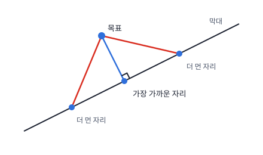

*비스듬한 선보다 곧게 내린 선이 가장 짧아요.*

**정확히 말하면**

오늘의 목표는 압축, 곧 $D$차원 데이터를 훨씬 작은 차원으로 줄이는 것이에요. 그 첫 단계로, L04에서 ML 추정을 직교사영(orthogonal projection)으로 설명할 때 쓴 식을 다시 꺼내요. 이 토픽에서는 벡터 하나를 다른 벡터의 배수로 가장 잘 근사하는 계수를 구하고, 그것을 여러 방향으로 넓혀요.

머신러닝에서 "표현한다", "가장 잘 설명한다", "근사한다"는 모두 같은 뜻이에요. 벡터 하나를 다른 벡터들로 근사(approximation)한다는 말이에요.

#### 방향 하나로 근사하기

목표는 데이터 $\mathbf{x}\in\mathbb{R}^D$(열벡터)를 표현하는 것이에요. 재료는 방향벡터 $\mathbf{b}\in\mathbb{R}^D$ 하나예요($\mathbf{b}\ne\mathbf{0}$, 수업에서는 정규화된 방향벡터로 두었어요). $\mathbf{b}$ 자체로는 $\mathbf{x}$를 설명할 수 없으니 스칼라 $\lambda$를 곱한 $\lambda\mathbf{b}$로 근사해요. $\lambda\mathbf{b}$들이 모인 직선이 $U=\operatorname{span}[\mathbf{b}]$예요.

후보 배율 $\lambda_1$, $\lambda_2$, $\lambda^*$ 가운데 $\mathbf{x}$에서 직선으로 직각이 되게 내린 $\lambda^*\mathbf{b}$가 차이가 가장 짧아요. 수학으로 쓰면 차이의 길이를 가장 작게 만드는 $\lambda$를 고르는 문제예요.

$$
\lambda^*=\arg\min_\lambda\|\mathbf{x}-\lambda\mathbf{b}\|
$$

수업에서는 이 argmin을 미분하지 않고, 직교 조건 하나로 풀었어요.

1. **차이벡터에 이름을 붙여요.**

   목표에서 근사를 뺀 벡터가 잔차(residual) $\mathbf{r}$이에요.

   $$
   \mathbf{r}=\mathbf{x}-\lambda\mathbf{b}
   $$
2. **orthogonal principle을 적용해요.**

   가장 좋은 근사에서는 잔차가 재료 $\mathbf{b}$와 수직이에요. 수직이면 내적이 0이에요. 열벡터 $\mathbf{x}$ 앞에 $\mathbf{b}^T$를 곱해 내적을 써요.

   $$
   \mathbf{b}^T(\mathbf{x}-\lambda\mathbf{b})=0
   $$
3. **선형성으로 괄호를 풀어요.**

   내적은 선형이고 $\lambda$는 상수이므로 밖으로 나와요.

   $$
   \mathbf{b}^T\mathbf{x}-\lambda\,\mathbf{b}^T\mathbf{b}=0
   $$
4. **$\lambda$ 항을 오른쪽으로 옮겨요.**

   $\mathbf{b}^T\mathbf{b}$는 $(1\times D)(D\times1)$ 곱이라서 $1\times1$ 스칼라예요.

   $$
   \mathbf{b}^T\mathbf{x}=\lambda\,\mathbf{b}^T\mathbf{b}
   $$
5. **양변을 $\mathbf{b}^T\mathbf{b}$로 나눠요.**

   $\mathbf{b}\ne\mathbf{0}$이므로 ${\mathbf{b}^T\mathbf{b}=\|\mathbf{b}\|^2\gt 0}$이에요.

   $$
   \lambda^* = \frac{\mathbf{b}^T\mathbf{x}}{\mathbf{b}^T\mathbf{b}}
   $$
6. **배율을 재료에 곱해 사영점을 만들어요.**

   사영점은 직선 $U$ 위의 점이라서 반드시 $\lambda\mathbf{b}$ 꼴이에요. 그중 $\mathbf{x}$에 가장 가까운 점, 곧 최적 배율 $\lambda^*$를 재료 $\mathbf{b}$에 곱한 점을 $\pi_U(\mathbf{x})$라고 써요.

   $$
   \pi_U(\mathbf{x})=\lambda^*\mathbf{b}
   $$

   $\lambda^*$를 대입해요. $\lambda^*$는 스칼라라서 $\mathbf{b}$와 자리를 바꿔도 돼요. 그다음 결합법칙으로 $\mathbf{b}(\mathbf{b}^T\mathbf{x})$를 $(\mathbf{b}\mathbf{b}^T)\mathbf{x}$로 다시 묶어요. $\mathbf{x}$를 맨 오른쪽으로 보내야 “행렬 $\times\,\mathbf{x}$” 꼴이 되기 때문이에요.

   $$
   \begin{aligned}\pi_U(\mathbf{x})&=\frac{\mathbf{b}^T\mathbf{x}}{\mathbf{b}^T\mathbf{b}}\,\mathbf{b}=\frac{\mathbf{b}\,(\mathbf{b}^T\mathbf{x})}{\mathbf{b}^T\mathbf{b}}\\&=\frac{(\mathbf{b}\mathbf{b}^T)\,\mathbf{x}}{\mathbf{b}^T\mathbf{b}}=P_\pi\mathbf{x}\end{aligned}
   $$

   $\mathbf{x}$ 앞에 곱해지는 부분 ${P_\pi=\dfrac{\mathbf{b}\mathbf{b}^T}{\mathbf{b}^T\mathbf{b}}\in\mathbb{R}^{D\times D}}$를 projection matrix라고 불러요. 분자 $\mathbf{b}\mathbf{b}^T$는 $D\times D$ 행렬이고 분모 $\mathbf{b}^T\mathbf{b}$는 스칼라예요. 자리를 바꿀 수 있는 건 스칼라 $\lambda^*$뿐이고, 벡터끼리의 곱은 순서를 바꾸면 안 돼요.

왜 직각이 가장 짧은지는 피타고라스로 확인해요. 다른 후보 $\lambda\mathbf{b}$까지의 차이는 직각 잔차와 직선 방향 성분의 합으로 나뉘고, 두 성분은 수직이에요.

$$
\mathbf{x}-\lambda\mathbf{b}=(\mathbf{x}-\lambda^*\mathbf{b})+(\lambda^*-\lambda)\mathbf{b}
$$

$$
\|\mathbf{x}-\lambda\mathbf{b}\|^2=\|\mathbf{x}-\lambda^*\mathbf{b}\|^2+(\lambda^*-\lambda)^2\|\mathbf{b}\|^2
$$

뒤 항은 0 이상이고 $\lambda=\lambda^*$일 때만 0이에요. 그래서 $\lambda^*$가 argmin이에요.

#### 방향 여러 개로 넓히기

이번에는 재료가 $\mathbf{b}_1,\mathbf{b}_2$처럼 여러 개예요. $\mathbf{x}$를 $\mathbf{b}_1$, $\mathbf{b}_2$가 span하는 면에 직각으로 사영하면 한 점이 생겨요. 그 점을 만들려면 $\mathbf{b}_1$, $\mathbf{b}_2$에 각각 무엇을 곱해야 하는지를 모은 것이 행렬 공식이에요. 독립인 $m$개 방향을 열로 모아 ${\mathbf{B}=[\mathbf{b}_1,\dots,\mathbf{b}_m]\in\mathbb{R}^{D\times m}}$로 두고, 배율 $m$개를 $\boldsymbol{\lambda}\in\mathbb{R}^m$로 모아요. 슬라이드는 $\mathbb{R}^n$, $m$으로 적었고 여기서는 PCA 표기에 맞춰 $D$를 써요.

이번 수업은 s11 박스의 공식을 그림으로 상기했어요. 공식은 같은 직교 원리를 모든 방향에 한꺼번에 적용해서 얻어요(1019 수업에서 유도).

$$
\mathbf{B}^T(\mathbf{x}-\mathbf{B}\boldsymbol{\lambda})=\mathbf{0}
$$

$$
\mathbf{B}^T\mathbf{B}\boldsymbol{\lambda}=\mathbf{B}^T\mathbf{x}
$$

$$
\boldsymbol{\lambda}=(\mathbf{B}^T\mathbf{B})^{-1}\mathbf{B}^T\mathbf{x}
$$

$$
\pi_U(\mathbf{x})=\mathbf{B}\boldsymbol{\lambda}=\mathbf{B}(\mathbf{B}^T\mathbf{B})^{-1}\mathbf{B}^T\mathbf{x},\qquad P_\pi=\mathbf{B}(\mathbf{B}^T\mathbf{B})^{-1}\mathbf{B}^T
$$

스칼라로 나누던 자리에 역행렬 $(\mathbf{B}^T\mathbf{B})^{-1}$이 들어가요. 열들이 독립이면 이 역행렬이 존재해요. $m=1$, $\mathbf{B}=\mathbf{b}$로 두면 방향 하나의 공식으로 돌아가요.

| 항목 | 방향 하나 | 방향 $m$개 |
|---|---|---|
| 재료 | $\mathbf{b}\in\mathbb{R}^D$ | $\mathbf{B}\in\mathbb{R}^{D\times m}$ |
| 직교 조건 | ${\mathbf{b}^T(\mathbf{x}-\lambda\mathbf{b})=0}$ | ${\mathbf{B}^T(\mathbf{x}-\mathbf{B}\boldsymbol{\lambda})=\mathbf{0}}$ |
| 계수 | ${\lambda^* = \frac{\mathbf{b}^T\mathbf{x}}{\mathbf{b}^T\mathbf{b}}}$ | ${\boldsymbol{\lambda}=(\mathbf{B}^T\mathbf{B})^{-1}\mathbf{B}^T\mathbf{x}}$ |
| projection matrix | ${P_\pi=\frac{\mathbf{b}\mathbf{b}^T}{\mathbf{b}^T\mathbf{b}}}$ | ${P_\pi=\mathbf{B}(\mathbf{B}^T\mathbf{B})^{-1}\mathbf{B}^T}$ |

방향 하나의 공식은 [1019 정리노트의 직선 위에서 가장 가까운 점](../../1019/정리노트_1019_Prediction_and_Projection.html#s2-line)과 같은 식이에요. 1019에서도 잔차가 방향벡터에 수직이라는 조건으로 배율을 구하고, 그 배율을 방향벡터에 곱해 투영벡터를 만들었어요. 1019 수업은 이 사영을 열공간으로 넓혀 회귀를 설명했고, 오늘은 같은 식을 데이터 압축의 언어로 다시 읽어요.

#### 차원 축소와의 관계

2차원 점 $\mathbf{x}$도 주성분 방향 $\mathbf{b}_1$과 숫자 $\lambda^*$ 하나만 알려 주면 $\lambda^*\mathbf{b}_1$로 근사할 수 있어요. 방향을 $M$개로 늘리면 근사는 ${\lambda_1\mathbf{b}_1+\dots+\lambda_M\mathbf{b}_M=\mathbf{B}\boldsymbol{\lambda}}$, 곧 소수 벡터의 weighted sum이에요. 차이의 길이 ${\|\mathbf{x}-\mathbf{B}\boldsymbol{\lambda}\|}$를 가장 작게 하는 $\boldsymbol{\lambda}$를 고르는 일이므로 least squares 문제예요.

정리하면 저차원 표현(low-dimensional representation)은 $D$차원 벡터를 적은 수의 벡터의 weighted sum으로 근사하는 least squares 문제예요. 남은 질문은 어떤 벡터 $\mathbf{b}_i$를 쓰고 각각에 무엇을 곱할지예요. 이것을 체계적으로 찾게 해 주는 도구가 eigenvalue decomposition이라는 결론만 이번 수업에서 밝혔고, 이유는 다음 시간에 다뤄요.

**다시 만드는 법:** 잔차가 재료 방향에 수직(내적 0) → 괄호를 풀어 계수 → 계수를 재료에 곱해 사영. 방향이 여러 개면 나눗셈 대신 $(\mathbf{B}^T\mathbf{B})^{-1}$을 곱해요.

**교수님 말씀**

> "근데 진짜 압축의 굉장히 중요한 특징이 여기서 설명돼요." (1028 P06 09:50)

> "이 수식이 정말 얼마나 중요한 수식인지를 … 잠깐 설명을 해 볼게요." (1028 P07 00:09)

교수님은 근사를 "목표도 주어져 있고 연장도 주어져 있다"는 그림으로 설명했어요. 목표는 $\mathbf{x}$, 연장(재료)은 $\mathbf{b}$예요. 세 사람이 각자 $\lambda_1$, $\lambda_2$, $\lambda^*$로 근사했을 때 직각으로 사영한 세 번째 사람이 피타고라스 정리에 의해 가장 짧다고 했어요 (1028 P07 01:10–01:59).

잔차가 재료와 항상 수직으로 만나야 한다는 성질을 orthogonal principle, 줄여서 OP라고 불렀어요 (1028 P07 02:42). 교과서에서는 보통 orthogonality principle(직교성 원리)이라고 해요. 조교가 이미 OP를 설명했다는 이야기 끝에 다시 설명해 달라는 말이 나오자, 교수님은 "지금 설명하고 있잖아요, 내가?"라며 칠판 유도를 이어 갔어요 (1028 P07 03:13).

"이게 dimension reduction하고 뭔 관계가 있느냐"는 질문을 스스로 던지고, "관계가 매우 크죠"라고 답했어요 (1028 P07 05:48).

> "D라는 dimension에 있는 어떤 벡터를 … 벡터 몇 개의 weighted sum으로 approximation 하는 least squares 문제에 불과" (1028 P07 06:19)

> "systematic하게 공식으로 찾게 만들어 주는 게 바로 eigenvalue decomposition이다." (1028 P07 06:53)

**페이지 요약**

잔차가 재료 방향에 수직이라는 orthogonal principle로, 미분 없이 가장 가까운 근사의 계수를 구해요.

*핵심 식*

- 근사 문제

  $$
  \lambda^*=\arg\min_\lambda\|\mathbf{x}-\lambda\mathbf{b}\|
  $$
- 직교 조건

  $$
  \mathbf{b}^T(\mathbf{x}-\lambda\mathbf{b})=0
  $$
- 방향 하나의 계수

  $$
  \lambda^* = \frac{\mathbf{b}^T\mathbf{x}}{\mathbf{b}^T\mathbf{b}}
  $$
- 방향 하나의 사영

  $$
  \pi_U(\mathbf{x})=\lambda^*\mathbf{b}=\frac{\mathbf{b}\mathbf{b}^T}{\mathbf{b}^T\mathbf{b}}\mathbf{x}=P_\pi\mathbf{x}
  $$
- 방향 m개의 계수

  $$
  \boldsymbol{\lambda}=(\mathbf{B}^T\mathbf{B})^{-1}\mathbf{B}^T\mathbf{x}
  $$
- 방향 m개의 projection matrix

  $$
  P_\pi=\mathbf{B}(\mathbf{B}^T\mathbf{B})^{-1}\mathbf{B}^T
  $$

*용어*

- **orthogonal principle(OP)** — 가장 좋은 근사에서 잔차는 재료 방향과 수직(내적 0)이라는 성질
- **잔차(residual)** — 목표에서 근사를 뺀 벡터 $\mathbf{r}=\mathbf{x}-\lambda\mathbf{b}$
- **weighted sum** — 소수 벡터에 계수를 곱해 더한 근사 $\mathbf{B}\boldsymbol{\lambda}$
- **least squares** — ${\|\mathbf{x}-\mathbf{B}\boldsymbol{\lambda}\|}$를 가장 작게 하는 계수를 고르는 문제. 저차원 표현이 바로 이 문제예요.

$\mathbf{b}^T\mathbf{b}$는 스칼라라서 나눌 수 있고, 방향이 여러 개면 그 자리에 $(\mathbf{B}^T\mathbf{B})^{-1}$이 들어가요. 어떤 벡터를 쓸지 체계적으로 찾게 해 주는 것이 eigenvalue decomposition이라는 결론만 밝혔고 이유는 다음 시간이에요.

---

### 4.2 code: 정규직교 기저의 좌표

*1028 수업 · L05 s11*

**쉽게 말하면**

서로 직각인 막대 몇 개를 정해 두면, 점의 자리를 "막대마다 몇 칸"이라는 숫자 몇 개로 적을 수 있어요.

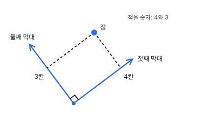

*긴 목록 대신 짧은 숫자 몇 개만 남겨요.*

**정확히 말하면**

교수님이 "오늘의 결론"이라고 한 부분이에요. [4.1 직교 원리로 다시 보는 사영](#s4-projection-recall)에서 구한 계수 공식이 PCA에서는 code라는 이름으로 한 줄이 돼요. 여기서는 그 계수를 구하는 식이 정규직교 조건에서 어떻게 줄어드는지 보여요.

#### 재료를 orthonormal하게 고르기

$\mathbf{B}$를 만들 때 서로 orthonormal(정규직교)한 벡터 ${\mathbf{b}_1,\dots,\mathbf{b}_M\in\mathbb{R}^D}$를 먼저 두고 열로 모아요. 서로 다른 벡터끼리는 수직이고, 각 벡터의 길이는 1이에요.

$$
\mathbf{b}_i^T\mathbf{b}_j=0\ (i\ne j),\qquad \mathbf{b}_i^T\mathbf{b}_i=1
$$

$$
\mathbf{B}=[\mathbf{b}_1,\dots,\mathbf{b}_M]\in\mathbb{R}^{D \times M}
$$

$\mathbf{B}^T\mathbf{B}$의 $(i,j)$ 성분은 $\mathbf{b}_i^T\mathbf{b}_j$예요. 그래서 위 두 조건을 행렬 하나로 쓰면 $M\times M$ 단위행렬이 돼요.

$$
\mathbf{B}^T\mathbf{B} = \mathbf{I}
$$

#### code의 정의

데이터 $\mathbf{x}_n\in\mathbb{R}^D$를 $\mathbf{B}^T$에 통과시켜 얻는 저차원 압축 표현을 code라고 불러요. 슬라이드의 식이에요.

$$
\mathbf{z}_n = \mathbf{B}^T\mathbf{x}_n\in\mathbb{R}^M
$$

4.1의 계수 $\lambda$, $\boldsymbol{\lambda}$에 해당하는 것이 $\mathbf{z}_n$이에요. 슬라이드는 $\mathbf{z}_n$을 $\mathbf{B}$의 기저벡터에 대한 좌표(coordinates)라고 설명해요. 사영된 데이터 $\tilde{\mathbf{x}}_n$은 $\dim(U)=M\lt D$인 부분공간 ${U\subseteq\mathbb{R}^D}$ 안에 있어요.

#### 일반 공식과 연결하기

아래 대입은 교수님이 칠판에 쓰지 않았어요. $\mathbf{z}$가 $\boldsymbol{\lambda}$에 해당한다는 말을 확인하려고, 강의 공식을 연결하기 위한 재표현으로 덧붙여요.

1. **일반 공식에서 출발해요.**

   열이 독립인 어떤 $\mathbf{B}$에서도 성립하는 사영 계수예요.

   $$
   \boldsymbol{\lambda}=(\mathbf{B}^T\mathbf{B})^{-1}\mathbf{B}^T\mathbf{x}
   $$
2. **정규직교 조건을 대입해요.**

   $\mathbf{B}^T\mathbf{B}$ 자리에 $\mathbf{I}$를 넣어요.

   $$
   \boldsymbol{\lambda}=\mathbf{I}^{-1}\mathbf{B}^T\mathbf{x}
   $$
3. **단위행렬의 역행렬은 자기 자신이에요.**

   $$
   \boldsymbol{\lambda}=\mathbf{B}^T\mathbf{x}
   $$

   $\mathbf{x}=\mathbf{x}_n$으로 두면 바로 $\mathbf{z}_n = \mathbf{B}^T\mathbf{x}_n$이에요. 역행렬 계산이 사라지고 내적만 남아요.

방향이 하나($M=1$)이고 수업처럼 $\mathbf{b}$를 정규화했다면 $\mathbf{b}^T\mathbf{b}=1$이므로 ${\lambda^*=\mathbf{b}^T\mathbf{x}}$가 돼요. 같은 대입의 특수한 경우예요.

주의할 점은 $\mathbf{z}_n = \mathbf{B}^T\mathbf{x}_n$이 열이 정규직교일 때만 사영 계수와 같다는 것이에요. 예를 들어 $\mathbf{b}=[2,\ 0]^T$, $\mathbf{x}=[1,\ 0]^T$이면 $\mathbf{b}^T\mathbf{x}=2$이지만 사영 계수는 ${\lambda^*=2/4=1/2}$예요. 길이가 1이 아니면 내적값은 계수가 아니에요.

#### 차원 계산

$$
\mathbf{B}^T\in\mathbb{R}^{M\times D},\qquad \mathbf{x}_n\in\mathbb{R}^{D\times1}
$$

$$
\mathbf{z}_n=\mathbf{B}^T\mathbf{x}_n\in\mathbb{R}^{M\times1}
$$

예를 들어 $D=768$, $M=50$이면 $768\times1$ 벡터가 $50\times1$ 벡터로 줄어들어요. 데이터 하나를 50개 숫자만으로 기록하는 셈이에요.

#### 용어 주의: projection matrix

L04에서는 ${P_\pi=\mathbf{B}(\mathbf{B}^T\mathbf{B})^{-1}\mathbf{B}^T\in\mathbb{R}^{D\times D}}$를 projection matrix라고 불렀어요. PCA 슬라이드와 교과서는 $\mathbf{B}\in\mathbb{R}^{D \times M}$ 자체를 projection matrix라고 부르기도 해요. 이름은 같지만 크기와 역할이 다른 행렬이에요.

#### 교과서 예로 보는 좌표

MML Example 10.1의 예예요. $\mathbb{R}^2$의 표준기저 $\mathbf{e}_1=[1,\ 0]^T$, $\mathbf{e}_2=[0,\ 1]^T$로 $[5,\ 3]^T=5\mathbf{e}_1+3\mathbf{e}_2$처럼 써요. 그런데 $\tilde{\mathbf{x}}=[0,\ z]^T$ 꼴의 벡터는 항상 $0\mathbf{e}_1+z\mathbf{e}_2$이므로 숫자 $z$ 하나만 저장하면 돼요. 이 벡터들은 $U=\operatorname{span}[\mathbf{e}_2]$, $\dim(U)=1$인 부분공간을 이뤄요. 오늘 표기로는 $\mathbf{B}=\mathbf{e}_2$($D=2$, $M=1$)이고, code는 $z=\mathbf{e}_2^T\tilde{\mathbf{x}}$예요.

어떤 $\mathbf{B}$를 고를지는 아직 정하지 않았어요. 교수님은 $\mathbf{z}_n$을 이용한 자세한 설명을 뒤로 미뤘어요.

**다시 만드는 법:** 직교 원리로 얻은 ${\boldsymbol{\lambda}=(\mathbf{B}^T\mathbf{B})^{-1}\mathbf{B}^T\mathbf{x}}$ → 정규직교면 $\mathbf{B}^T\mathbf{B} = \mathbf{I}$ → $\mathbf{z}_n = \mathbf{B}^T\mathbf{x}_n$, 크기는 $(M\times D)(D\times1)=M\times1$.

**교수님 말씀**

> "이게 이제 오늘의 결론인데, low-dimensional representation이라는 건 뭐냐면" (1028 P07 07:12)

교수님은 $\mathbf{B}$를 만들 때 서로 orthonormal한 벡터를 먼저 둔다고 강조하고, 계수 $\mathbf{z}_n$을 code라고 불렀어요.

> "약간 정의가 다르긴 해요." (1028 P07 08:06)

L04의 projection matrix와 PCA에서 $\mathbf{B}$를 projection matrix라고 부르는 용법이 다르다는 점을 짚은 말이에요.

> "이 z_n이라는 놈을 이용해 뒤에 조금 더 자세히 설명할 거거든요" (1028 P07 08:40)

차원은 "$M$ by $D$ 행렬 뒤에 $D$ by 1 벡터를 곱하면 $M$ by 1"로 셌고, $D=768$, $M=50$을 예로 들었어요 (1028 P07 09:17–09:32).

**페이지 요약**

정규직교 기저로 모은 $\mathbf{B}$에서는 사영 계수가 $\mathbf{z}_n = \mathbf{B}^T\mathbf{x}_n$ 하나로 줄어들고, 이것을 code라고 불러요.

*핵심 식*

- orthonormal 조건

  $$
  \mathbf{b}_i^T\mathbf{b}_j=0\ (i\ne j),\qquad \mathbf{b}_i^T\mathbf{b}_i=1
  $$
- 기저 행렬

  $$
  \mathbf{B}=[\mathbf{b}_1,\dots,\mathbf{b}_M]\in\mathbb{R}^{D \times M}
  $$
- 행렬로 쓴 조건

  $$
  \mathbf{B}^T\mathbf{B} = \mathbf{I}
  $$
- code

  $$
  \mathbf{z}_n = \mathbf{B}^T\mathbf{x}_n\in\mathbb{R}^M
  $$
- 일반 공식에 대입(재표현)

  $$
  \boldsymbol{\lambda}=(\mathbf{B}^T\mathbf{B})^{-1}\mathbf{B}^T\mathbf{x}
  $$

  $$
  \boldsymbol{\lambda}=\mathbf{B}^T\mathbf{x}
  $$

*용어*

- **code** — 데이터의 저차원 압축 표현이자 $\mathbf{B}$의 기저벡터에 대한 좌표
- **orthonormal(정규직교)** — 서로 수직이고 길이가 1인 벡터들
- **projection matrix** — L04에서는 ${P_\pi=\mathbf{B}(\mathbf{B}^T\mathbf{B})^{-1}\mathbf{B}^T}$, PCA에서는 $\mathbf{B}$ 자체를 부르기도 해요.

$\mathbf{z}_n = \mathbf{B}^T\mathbf{x}_n$은 열이 정규직교일 때만 사영 계수와 같아요. 대입 과정은 교수님이 쓰지 않은 강의 공식 연결용 재표현이에요. 크기는 $(M\times D)(D\times1)=M\times1$이고, $D=768$, $M=50$이면 $768\times1$이 $50\times1$로 줄어요.

---

## 5. 인코더와 디코더

### 5.1 줄이고 되살리기: MNIST 예시

*1028 수업 · L05 s12*

**쉽게 말하면**

큰 그림을 숫자 몇 개로 줄여 담았다가, 다시 펼쳐서 그림을 되살리는 거예요.

되살린 그림이 원래 그림과 비슷할수록 잘 줄인 거예요.

*가운데 상자에는 숫자 몇 개만 들어가요.*

**정확히 말하면**

[4.2 code: 정규직교 기저의 좌표](#s4-code)에서 데이터 $\mathbf{x}$를 code $\mathbf{z} = \mathbf{B}^T\mathbf{x}$로 줄였어요. 이번에는 그 code에서 원래 차원의 벡터를 되살려요. 그리고 되살린 벡터가 원래 $\mathbf{x}$와 얼마나 가까운지를 $\mathbf{B}$를 고르는 기준으로 삼아요.

기호를 먼저 정해요.

- $\mathbf{x} \in \mathbb{R}^D$: centering한 데이터 하나예요.
- ${\mathbf{B} = [\mathbf{b}_1,\dots,\mathbf{b}_M]} \in \mathbb{R}^{D \times M}$: 열이 서로 정규직교(orthonormal)인 기저 행렬이에요. 아직 고르는 대상이에요.
- $\mathbf{z} \in \mathbb{R}^M$: code예요. $M \lt D$개의 숫자예요.
- $\tilde{\mathbf{x}} \in \mathbb{R}^D$: code에서 되살린 벡터(reconstruction)예요.

1. 줄이기(encoding): $D$차원을 $M$차원으로 보내요.

   $$
   \mathbf{z} = \mathbf{B}^T\mathbf{x}, \qquad (M \times D)(D \times 1) = M \times 1
   $$
2. 되살리기(decoding): $M$차원을 다시 $D$차원으로 보내요. ${\tilde{\mathbf{x}} = \mathbf{B}\mathbf{z}}$예요.

   $$
   (D \times M)(M \times 1) = D \times 1
   $$
3. 1번의 $\mathbf{z}$를 2번에 대입해요.

   $$
   {\tilde{\mathbf{x}} = \mathbf{B}\mathbf{z}}
   $$

   $$
   = \mathbf{B}\mathbf{B}^T\mathbf{x}
   $$

그래서 $\mathbf{B}^T$를 encoder, $\mathbf{B}$를 decoder라고 불러요(L05 s12). [2.1 S1–S5 한눈에 보기](#s2-steps)의 encoding·decoding 단계를 행렬 곱으로 쓴 거예요.

강의 공식을 연결하기 위한 재표현이에요. L04 사영 공식 $\mathbf{B}(\mathbf{B}^T\mathbf{B})^{-1}\mathbf{B}^T\mathbf{x}$에 $\mathbf{B}^T\mathbf{B} = \mathbf{I}$를 넣으면 $\mathbf{B}\mathbf{B}^T\mathbf{x}$가 돼요. 즉 $\tilde{\mathbf{x}}$는 $\mathbf{b}_1,\dots,\mathbf{b}_M$이 펼치는 공간으로 $\mathbf{x}$를 직교사영한 점이에요. $\tilde{\mathbf{x}}$는 $D$차원 벡터지만 $M$차원 공간 안에 있어서, $M \lt D$이면 보통 $\mathbf{x}$와 같지 않아요.

**예시: MNIST.** 0부터 9까지 손글씨 숫자 이미지 $N = 60{,}000$장이에요. 한 장이 $28 \times 28$ 픽셀이므로 픽셀을 한 줄로 세우면 $D = 28 \times 28 = 784$차원 벡터예요. $M = 50$으로 잡으면 차원은 이렇게 바뀌어요.

| 단계 | 기호 | 크기 |
|---|---|---|
| 원래 이미지 | $\mathbf{x}$ | $784 \times 1$ |
| encoder | $\mathbf{B}^T$ | $50 \times 784$ |
| code | $\mathbf{z} = \mathbf{B}^T\mathbf{x}$ | $50 \times 1$ |
| decoder | $\mathbf{B}$ | $784 \times 50$ |
| 되살린 이미지 | ${\tilde{\mathbf{x}} = \mathbf{B}\mathbf{z}}$ | $784 \times 1$ |

(수업 중 code를 "50 by M 매트릭스"라고 말했다가 이어서 $50 \times 1$ 벡터 $\mathbf{z}$라고 했어요. $\mathbf{z}$는 $M \times 1 = 50 \times 1$ 벡터예요.)

**PCA의 목표.** 줄였다가 되살린 $\tilde{\mathbf{x}}$가 원래 $\mathbf{x}$와 가장 가깝도록 $\mathbf{B}$를 고르는 거예요.

$$
\min_{\mathbf{B}} \|\mathbf{x} - \tilde{\mathbf{x}}\|, \qquad \tilde{\mathbf{x}} = \mathbf{B}\mathbf{B}^T\mathbf{x}
$$

수업 식은 $\mathbf{x}$ 하나로 썼지만 모든 데이터에 같은 $\mathbf{B}$를 써요. 아래 위젯은 데이터 전체를 보려고 차이의 제곱을 평균낸 값을 보여 줘요. 이것은 수업 식을 데이터 전체로 넓혀 본 학습용 재표현이에요.

$$
\frac{1}{N}\sum_{n=1}^{N}\|\mathbf{x}_n - \tilde{\mathbf{x}}_n\|^2
$$

#### 직접 해 보기: 어느 방향으로 줄여야 덜 잃을까 *(정적 스냅샷 — 직접 조작은 HTML 버전)*

방향 $\mathbf{b}$의 각도를 움직이면, 각 점을 직선 위로 줄였다가 되살린 점과 오차 선분, 평균 재구성 오차가 함께 바뀌어요.

$\mathbf{b} = (\cos\theta, \sin\theta)$ = **(1.000, 0.000)**, 평균 재구성 오차 $\frac{1}{N}\sum_{n}\|\mathbf{x}_n - \tilde{\mathbf{x}}_n\|^2$ = **1.51**

범례: 원래 점 $\mathbf{x}_n$ · 되살린 점 $\tilde{\mathbf{x}}_n$ · 방향 $\mathbf{b}$의 직선 · 오차 선분

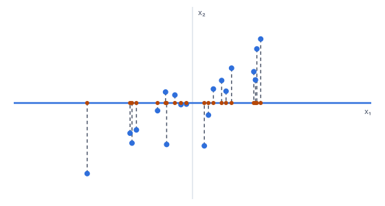

*θ = 0°: 평균 재구성 오차 1.51*

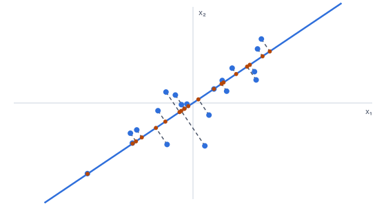

*θ = 34°: 평균 재구성 오차 0.30 (가장 작아요)*

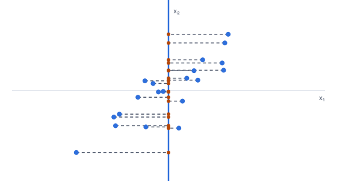

*θ = 90°: 평균 재구성 오차 3.02*

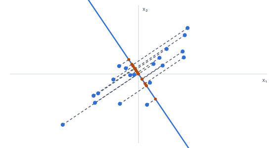

*θ = 124°: 평균 재구성 오차 4.23 (가장 커요)*

| 각도 θ | $\mathbf{b}$ | 평균 재구성 오차 |
|---|---|---|
| 0° | (1.000, 0.000) | 1.51 |
| 34° | (0.829, 0.559) | 0.30 |
| 90° | (0.000, 1.000) | 3.02 |
| 124° | (−0.559, 0.829) | 4.23 |

위젯은 $D = 2$, $M = 1$인 경우예요. $\mathbf{B}$가 단위벡터 $\mathbf{b}$ 하나이므로 code는 숫자 하나 $z = \mathbf{b}^T\mathbf{x}$이고, 되살린 점은 ${\tilde{\mathbf{x}} = \mathbf{b}\mathbf{b}^T\mathbf{x} = z\,\mathbf{b}}$예요. 점 20개는 평균이 0이 되도록 맞춘(centered) 고정 데이터예요. 오차는 θ = 34° 근처에서 가장 작고(0.30), 거기에 수직인 124° 근처에서 가장 커요(4.23). 점들이 길게 늘어선 방향에 직선을 맞출수록 줄였다 되살려도 덜 잃어요. 그 방향을 계산으로 찾는 방법은 다음 시간에 배워요.

**$\mathbf{b}_1,\dots,\mathbf{b}_M$은 순차적으로 찾아요.** $\mathbf{B}$가 $\mathbf{b}_1,\dots,\mathbf{b}_M$으로 이루어져 있으므로 $\mathbf{b}_1$부터 하나씩 차례로(sequential) 찾아요.

**결론만 미리 들었어요.** 교수님은 답을 먼저 알려 줬어요. [3.2 데이터 행렬과 표본 공분산 행렬](#s3-data-cov)의 데이터 공분산 행렬 ${\mathbf{S} = \frac{1}{N}\mathbf{X}\mathbf{X}^T}$를 고윳값 분해(EVD)해요. 고윳값(eigenvalue)이 큰 순서로 $M$개의 고유벡터(eigenvector)를 고르면 그것이 $\mathbf{b}_1,\dots,\mathbf{b}_M$이에요. 이번 수업에서는 결론만 들었고, 왜 그런지는 다음 시간에 유도해요.

**슬라이드 그림의 $\boldsymbol{\mu}$.** 그림에는 ${\mathbf{z} = \mathbf{B}^T(\mathbf{x} - \boldsymbol{\mu})}$로 적혀 있어요. $\boldsymbol{\mu}$를 빼는 것은 centering이에요. 데이터를 미리 centering했다면 $\boldsymbol{\mu} = \mathbf{0}$이라서 $\mathbf{z} = \mathbf{B}^T\mathbf{x}$와 같아요.

**왜 줄여서 쓰나요.** 50차원 code로 0–9를 분류하면 784차원 원본으로 분류한 것과 성능이 거의 같다고 했어요. 그러면 $M$차원에서 푸는 쪽이 훨씬 효율적이에요. 성능을 유지하는 가장 작은 $M$(smallest $M$)을 찾는 것은 trade-off 문제예요. $M$이 작을수록 되살린 이미지가 흐릿해지고 성능이 떨어질 수 있어요.

수업 앞부분에서 신경망 기반 차원 축소의 대표로 언급한 autoencoder도 같은 줄이기·되살리기 구조예요.

**교수님 말씀**

줄였다 되살린 차이를 줄이는 $\mathbf{B}$ 찾기가 곧 PCA라고 강조했어요.

> "…압축했다가 다시 복원했을 때 … x라는 벡터와 x 틸다라는 벡터 사이의 차이가 미니마이즈가 되도록 만드는 B라는 매트릭스…" (1028 P08 01:37)

50차원 code로 분류한 결과가 784차원 원본과 "99%" 일치한다고 했어요. 그 성능을 지키는 가장 작은 $M$이 40인지, 50인지, 60인지는 직접 실험해 보라고 권했어요. (1028 P08 03:08–04:10)

"여기까지 problem setting이 끝났다"며 오늘 수업을 마무리했어요. (1028 P08 04:10)

**페이지 요약**

$\mathbf{B}^T$로 줄이고 $\mathbf{B}$로 되살린 $\tilde{\mathbf{x}}$가 원래 $\mathbf{x}$와 가장 가깝도록 $\mathbf{B}$를 고르는 것이 PCA의 목표예요.

*핵심 식*

- encoder

  $$
  \mathbf{z} = \mathbf{B}^T\mathbf{x}
  $$
- decoder

  $$
  {\tilde{\mathbf{x}} = \mathbf{B}\mathbf{z}}
  $$
- 대입하면

  $$
  \tilde{\mathbf{x}} = \mathbf{B}\mathbf{B}^T\mathbf{x}
  $$
- PCA 목표

  $$
  \min_{\mathbf{B}} \|\mathbf{x} - \tilde{\mathbf{x}}\|
  $$
- MNIST 차원

  $$
  784 \times 1 \to 50 \times 1 \to 784 \times 1
  $$

*용어*

- **encoder** — $\mathbf{B}^T$: $D$차원 $\mathbf{x}$를 $M$차원 code로 줄여요.
- **decoder** — $\mathbf{B}$: code를 $D$차원 $\tilde{\mathbf{x}}$로 되살려요. $\mathbf{B}^T\mathbf{B} = \mathbf{I}$라서 $\tilde{\mathbf{x}}$는 직교사영이에요.
- **MNIST** — 손글씨 숫자 $N = 60{,}000$장, $D = 28 \times 28 = 784$예요.
- **순차적 탐색** — $\mathbf{b}_1$부터 하나씩 찾아요. 결론(공분산 행렬의 고윳값 큰 순 고유벡터)만 들었고 이유는 다음 시간이에요.
- **smallest $M$** — 성능을 유지하는 가장 작은 $M$을 찾는 trade-off예요.

---

## 6. 요약 · 예고

### 한 장 요약

*1028 수업 · L05 s8–s12*

| 항목 | 식 | 기억할 점 |
|---|---|---|
| [PCA 5단계](#s2-steps) | S1 centering, S2 standardization, S3 고윳값·고유벡터, S4 projection, S5 되돌리기 | S3에서 데이터 공분산 행렬의 가장 큰 고윳값 $M$개와 그 고유벡터를 구하고, S4에서 그 고유벡터가 만드는 principal subspace로 사영해요. S1–S4가 encoding, S5가 decoding이에요. |
| [데이터 행렬](#s3-data-cov) | ${\mathbf{X} = [\mathbf{x}_1\ \cdots\ \mathbf{x}_N] \in \mathbb{R}^{D \times N}}$ | 표본 $\mathbf{x}_n \in \mathbb{R}^D$를 열로 붙여요. $N$은 표본 수, $D$는 feature 수예요. 이미 centering되어 평균이 $\mathbf{0}$이라고 가정해요. |
| [공분산 행렬의 정의](#s3-cov-def) | ${\operatorname{cov}(\mathbf{x},\mathbf{y}) = E[\mathbf{x}\mathbf{y}^T] - E[\mathbf{x}]E[\mathbf{y}]^T}$ | "곱의 평균 빼기 평균의 곱"을 성분 쌍마다 모은 표예요. $\mathbf{y}$ 자리에 $\mathbf{x}$를 넣은 자기 공분산은 symmetric matrix예요. $E[\mathbf{x}] = \mathbf{0}$이면 뒤 항이 사라져요(centering을 하는 이유). |
| [데이터(표본) 공분산 행렬](#s3-data-cov) | ${\mathbf{S} = \frac{1}{N}\sum_{n=1}^{N}\mathbf{x}_n\mathbf{x}_n^T}$ ${\mathbf{S} = \frac{1}{N}\mathbf{X}\mathbf{X}^T}$ | 분포를 모르니 기댓값 $E[\mathbf{x}\mathbf{x}^T]$를 sample mean으로 바꿔요. $\mathbf{S} \in \mathbb{R}^{D \times D}$는 symmetric이고 positive semi-definite라서 고윳값이 0 이상이에요. |
| [직교 원리와 1차원 사영](#s4-projection-recall) | ${\mathbf{b}^T(\mathbf{x} - \lambda\mathbf{b}) = 0}$ ${\lambda^* = \frac{\mathbf{b}^T\mathbf{x}}{\mathbf{b}^T\mathbf{b}}}$ | 잔차 $\mathbf{r} = \mathbf{x} - \lambda\mathbf{b}$가 $\mathbf{b}$에 수직일 때 $\Vert \mathbf{x} - \lambda\mathbf{b}\Vert $가 가장 짧아요. 미분 없이 직교 조건만으로 풀어요. |
| [여러 벡터로의 사영](#s4-projection-recall) | ${\pi_U(\mathbf{x}) = \mathbf{B}(\mathbf{B}^T\mathbf{B})^{-1}\mathbf{B}^T\mathbf{x}}$ ${\boldsymbol{\lambda} = (\mathbf{B}^T\mathbf{B})^{-1}\mathbf{B}^T\mathbf{x}}$ | 저차원 표현은 $\mathbf{x}$를 소수 벡터의 weighted sum으로 근사하는 least squares 문제예요. $\boldsymbol{\lambda}$는 각 벡터에 곱할 계수예요. |
| [code](#s4-code) | ${\mathbf{z}_n = \mathbf{B}^T\mathbf{x}_n}$ ${\mathbf{B} = [\mathbf{b}_1,\dots,\mathbf{b}_M] \in \mathbb{R}^{D \times M}}$ | $\mathbf{b}_1,\dots,\mathbf{b}_M$이 orthonormal이면 $\mathbf{B}^T\mathbf{B} = \mathbf{I}$라서 $\boldsymbol{\lambda}$ 공식이 $\mathbf{B}^T\mathbf{x}$로 줄어요. $\mathbf{z}_n \in \mathbb{R}^M$은 $D$차원을 $M$개 숫자로 줄인 결과예요. |
| [인코더와 디코더](#s5-encoder-decoder) | ${\mathbf{z} = \mathbf{B}^T\mathbf{x}},\quad{\tilde{\mathbf{x}} = \mathbf{B}\mathbf{z}}$ | $\mathbf{B}^T$가 encoder, $\mathbf{B}$가 decoder예요. 복원은 ${\tilde{\mathbf{x}} = \mathbf{B}\mathbf{B}^T\mathbf{x}}$이고, PCA는 $\Vert \mathbf{x} - \tilde{\mathbf{x}}\Vert $를 가장 작게 만드는 $\mathbf{B}$를 찾아요. MNIST에서는 $D = 784$, $M = 50$이에요. |
| 헷갈리기 쉬운 점 | projection matrix | L04에서는 $\mathbf{B}(\mathbf{B}^T\mathbf{B})^{-1}\mathbf{B}^T$를 projection matrix라 했지만, PCA 슬라이드에서는 $\mathbf{B}$ 자체를 그렇게 부르기도 해요. |
| 아직 남은 질문 | $\mathbf{b}_1,\dots,\mathbf{b}_M$ 고르기 | 교수님은 "$\mathbf{S}$의 큰 고윳값 순서로 고른 고유벡터"라는 결론만 말했어요. 왜 그런지는 다음 시간에 유도해요. |

---

### 다음 시간 예고

*1028 수업 · L05 s13–s25*

다음 시간에는 Roadmap (2) maximum variance perspective에서 고윳값 분해로 PCA를 설계해요. 아래는 슬라이드 제목만 옮긴 것이에요.

- (2) Maximum Variance Perspective (s13)
- Idea (s14)
- Recall: Eigenvalue & Eigenvector (s16)
- Recall: Diagonal Matrix & Diagonalization (s17)
- Recall: Eigenvalue Decomposition (EVD) (s18)
- Recall: Spectral Theorem (s19)
- What We Will Do Is … (s20)
- Step 1: Finding $\mathbf{b}_1$ (s21–s22)
- Step k: Finding $\mathbf{b}_k$ (s23–s25)
- 그다음 주: (3) Projection Perspective, (4) Eigenvector Computation and Low-Rank Approximations, (5) PCA in High Dimensions, (6) Key Steps of PCA in Practice

---

### 함께 보면 좋은 자료

*1028 수업 · L05 s3*

- [1028 PCA 복습문제](복습문제_1028_PCA.md): 오늘 배운 식을 직접 풀어 봐요.
- [1019 정리노트: 평면으로의 직교사영](../../1019/정리노트_1019_Prediction_and_Projection.html#s2-plane): 사영 공식 $\mathbf{B}(\mathbf{B}^T\mathbf{B})^{-1}\mathbf{B}^T\mathbf{x}$를 처음 유도한 곳이에요.
- Warm-Up 영상(L05 s3): Luis Serrano의 PCA 튜토리얼 영상(약 26분)이에요. 수업 전에 봐도, 수업 뒤에 봐도 좋다고 했어요.

복습문제 4문항

- [문제지 PDF](복습문제_1028_PCA-문제.pdf)
- [해설지 PDF](복습문제_1028_PCA-답안.pdf)

---

출처: 정방철 교수님 강의자료(Lecture05) · 수업 녹음 전사(1028) · Deisenroth, Faisal, Ong, *Mathematics for Machine Learning* (2020) 3·6·10장.
