# 이산 동역학계와 고윳값·고유벡터 (Discrete Dynamical Systems - Eigenvalues and Eigenvectors) — Serrano.Academy 영상 정리

- **영상**: [Discrete Dynamical Systems - Eigenvalues and Eigenvectors](https://www.youtube.com/watch?v=7SfocUa8gis) (Luis Serrano, Serrano.Academy × DeepLearning.AI, 26:15)
- **위치**: `복습노트/1102` — 사용자가 지정한 날짜 (`pick_date` method=argument). 1102 PCA Part 1 수업의 "2. 고윳값과 대각화 복습"과 직접 이어진다.
- **정리 방식**: 6초 간격 프레임 시트 30장(프레임 약 263장)을 직접 보고 전사본 [`STT/Discrete_Dynamical_Systems_Eigenvalues_and_Eigenvectors.md`](../../../../STT/Discrete_Dynamical_Systems_Eigenvalues_and_Eigenvectors.md)와 맞춰 정리했다. 타임스탬프는 6초 단위 근삿값이다.
- **전사 모델**: gemini-3.5-flash (Vertex AI), 3개 파트 모두 성공

> **한 줄 요약**: 날씨 전이행렬 $\mathbf{A}=\begin{bmatrix}0.8&0.3\\0.2&0.7\end{bmatrix}$을 계속 곱하면 어디서 시작하든 확률이 $(0.6,0.4)$로 수렴한다. 그 이유는 $\mathbf{A}$의 고유벡터 $(0.6,0.4)$의 고윳값이 1이고, 다른 고유벡터 $(1,-1)$의 고윳값이 0.5라서 그 방향 성분만 매번 절반으로 줄기 때문이다.

---

## 1. 도입 (00:00–00:24)

| 시각 | 화면 | 내용 |
|---|---|---|
| 00:00 | 제목 "Discrete Dynamical Systems / Linear Transformations, Eigenvalues, and Eigenvectors", Luis Serrano | 이산 동역학계를 행렬·선형변환·고윳값·고유벡터와 연결해 처음부터 설명하겠다고 한다. |
| 00:18 | 검은 화면 "Discrete dynamical systems" | DeepLearning.AI 강좌의 맛보기 영상이라고 소개한다. |

---

## 2. 날씨 모델과 전이행렬 (00:24–01:48)

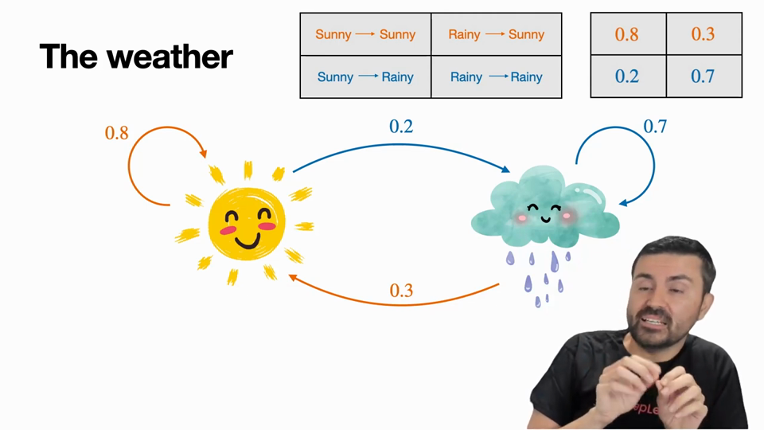

**화면 설명**

| 시각 | 화면 | 내용 |
|---|---|---|
| 00:24 | "The weather", 해와 비구름 그림 | 하루는 맑음(sunny) 또는 비(rainy) 둘 중 하나라고 단순화한다. 상태가 100개, 200개여도 방법은 같다고 한다. |
| 01:00 | 해 위 자기 화살표 0.8, 해→구름 0.2 | 오늘 맑으면 내일도 맑을 확률 0.8, 비로 바뀔 확률 0.2 |
| 01:06 | 구름 자기 화살표 0.7, 구름→해 0.3 | 오늘 비면 내일도 비 0.7, 맑음으로 바뀔 확률 0.3 |
| 01:18 | 표 (윗줄) Sunny→Sunny, Rainy→Sunny / (아랫줄) Sunny→Rainy, Rainy→Rainy | 행렬 칸의 뜻: **열 = 오늘 상태, 행 = 내일 상태** |
| 01:24 | 숫자 표 `0.8 0.3 / 0.2 0.7` | 전이행렬(transition matrix) |
| 01:42 | "Question: What's the probability of sun or rain on a random day?" | 이전 날을 모를 때 아무 날의 맑음·비 확률은? |

**핵심**

$$
\mathbf{A}=\begin{bmatrix}0.8&0.3\\0.2&0.7\end{bmatrix},\qquad a_{ij}=P(\text{내일 }i\mid\text{오늘 }j)
$$

- 각 **열의 합이 1**이다. 오늘 상태 하나에서 내일 가능한 모든 상태로 가는 확률이기 때문이다. 100×100이어도 열마다 합이 1이다.
- 영상은 이 행렬에 이름을 붙이지 않는다. 이 노트에서는 정리노트의 일반 행렬 기호에 맞춰 $\mathbf{A}$라고 쓴다.

---

## 3. 맑은 날에서 시작해 하루씩 곱하기 (01:48–06:18)

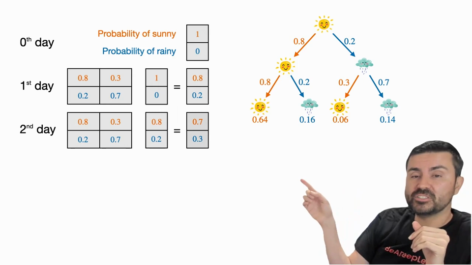

**화면 설명**

| 시각 | 화면 | 내용 |
|---|---|---|
| 02:06 | "0th day", Probability of sunny = 1, Probability of rainy = 0 | 오늘(0일차) 창밖을 보니 맑다. 상태벡터 $\mathbf{x}_0=(1,0)^T$ |
| 02:42 | `1st day: [0.8 0.3; 0.2 0.7][1;0] = [0.8;0.2]`, 나무 0.8 / 0.2 | 행렬×벡터 계산법: 첫 성분은 $0.8\cdot1+0.3\cdot0=0.8$, 둘째 성분은 $0.2\cdot1+0.7\cdot0=0.2$ (빨간 테두리로 짚음) |
| 03:18–03:48 | 2단 나무: 0.64, 0.16, 0.06, 0.14 | 경로 확률은 곱한다: 맑-맑-맑 $0.8\cdot0.8=0.64$, 맑-맑-비 $0.8\cdot0.2=0.16$, 맑-비-맑 $0.2\cdot0.3=0.06$, 맑-비-비 $0.2\cdot0.7=0.14$ |
| 04:18 | `2nd day: A[0.8;0.2] = [0.7;0.3]` | 서로소인 경로끼리 더한다: 맑음 $0.64+0.06=0.7$, 비 $0.16+0.14=0.3$. 나무 계산과 행렬 곱이 같다. |
| 04:36 | `3rd day: A[0.7;0.3] = [0.65;0.35]` | 날이 갈수록 첫날 맑음의 영향이 줄어 맑음 확률이 조금씩 내려간다. |
| 05:06–05:48 | 각 줄 행렬 위 지수 1, 2, 3, …, n과 벡터 $(1,0)$ | 매일 벡터에 곱하는 대신 $\mathbf{A}^n$을 $\mathbf{x}_0$에 한 번 곱하는 꼴로 바꿔 쓴다. |
| 06:00–06:12 | `nth day: A^n[1;0] = [0.6;0.4]`, "Probability of sunny = 0.6 / Probability of rainy = 0.4" | 계속 곱하면 $(0.6,0.4)$에서 안정된다. |

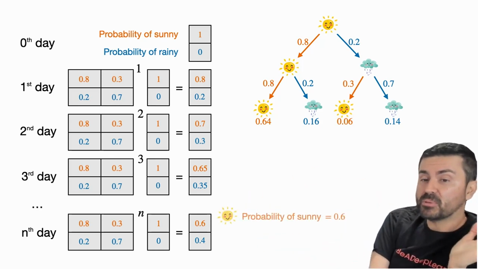

**핵심**

$$
\mathbf{x}_{k+1}=\mathbf{A}\mathbf{x}_k\quad\Longrightarrow\quad \mathbf{x}_n=\mathbf{A}^n\mathbf{x}_0
$$

- 이것이 **이산 동역학계**다. 다음 상태가 현재 상태에 행렬을 한 번 곱한 결과로 정해진다.
- 영상의 말 실수: 05:20쯤 "third day is the matrix to the 3 times the vector of day 1"이라고 말하지만, 화면대로 **0일차 벡터** $(1,0)^T$에 곱하는 것이 맞다.
- 왜 $(0.6,0.4)$에서 멈추는지는 이 시점에는 설명하지 않고 7절로 미룬다.

---

## 4. 비 오는 날에서 시작해도, 모르는 날에서 시작해도 (06:18–07:48)

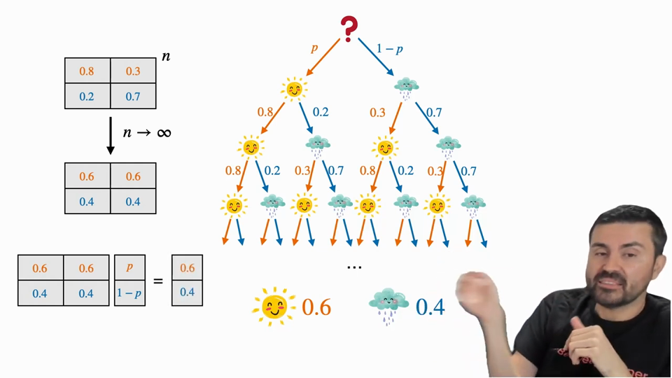

**화면 설명**

| 시각 | 화면 | 내용 |
|---|---|---|
| 06:18–06:42 | 0일차 $(0,1)$, 나무 0.24 / 0.06 / 0.21 / 0.49 | 비에서 시작: 1일차 $(0.3,0.7)$, 2일차 $(0.45,0.55)$, 3일차 $(0.525,0.475)$ |
| 06:48 | `nth day: A^n[0;1] = [0.6;0.4]` | 이번에도 $(0.6,0.4)$로 수렴한다. |
| 06:54–07:00 | 빨간 "?"에서 $p$, $1-p$ 가지 | 오늘을 모르면 맑음 $p$, 비 $1-p$로 둔다. |
| 07:30 | `[0.8 0.3; 0.2 0.7]^n`, $n\to\infty$, `[0.6 0.6; 0.4 0.4]` | 거듭제곱 행렬 자체가 두 열이 모두 $(0.6,0.4)$인 행렬로 수렴한다. |
| 07:42 | `[0.6 0.6; 0.4 0.4][p; 1−p] = [0.6; 0.4]` | 성분 합이 1인 어떤 벡터를 곱해도 결과는 $(0.6,0.4)$ |

**핵심**

$$
\lim_{n\to\infty}\mathbf{A}^n=\begin{bmatrix}0.6&0.6\\0.4&0.4\end{bmatrix},\qquad
\begin{bmatrix}0.6&0.6\\0.4&0.4\end{bmatrix}\begin{bmatrix}p\\1-p\end{bmatrix}=\begin{bmatrix}0.6p+0.6(1-p)\\0.4p+0.4(1-p)\end{bmatrix}=\begin{bmatrix}0.6\\0.4\end{bmatrix}
$$

- 처음 질문 "아무 날의 맑음·비 확률"의 답은 맑음 0.6, 비 0.4다.
- 이 극한 행렬은 영상에서 계산으로 보였을 뿐이고, 대각화로 직접 구하는 방법은 아래 [수업 내용과 연결하기](#수업-내용과-연결하기)에 정리했다.

---

## 5. 평면 위에서 보기: 평형점과 평형선 (07:48–10:36)

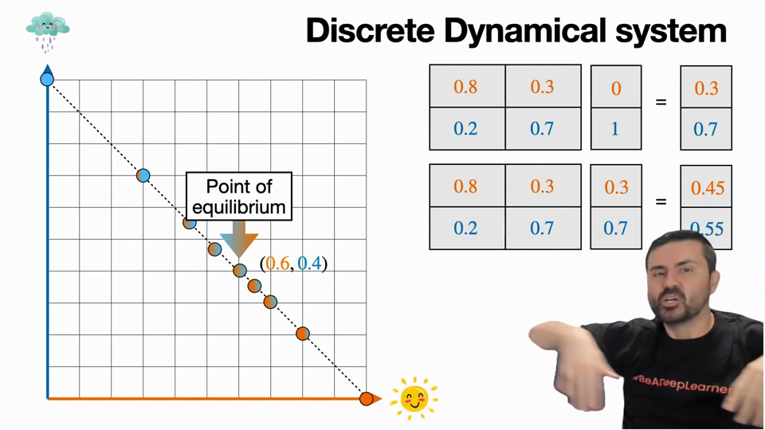

**화면 설명**

| 시각 | 화면 | 내용 |
|---|---|---|
| 07:54–08:06 | "Discrete Dynamical system", 가로축 해(맑음), 세로축 비구름(비) 모눈 | 확률벡터를 평면의 점으로 찍는다. |
| 08:18–08:36 | 주황 점 $(1,0)\to(0.8,0.2)\to(0.7,0.3)\to\cdots$, 라벨 $(0.6,0.4)$ | 점들이 한 직선 위를 따라 $(0.6,0.4)$로 다가간다. |
| 08:42–08:54 | $(1,0)$에서 $(0.6,0.4)$까지 점선 | 출발점과 평형점을 잇는 선 위를 걷는다. |
| 09:12 | 파란 점 $(0,1)\to(0.3,0.7)$, 식 `A[0;1]=[0.3;0.7]`, `A[0.3;0.7]=[0.45;0.55]` | $(0.3,0.7)$은 $(0,1)$과 $(0.6,0.4)$의 정확히 **중간**이다. 다음 점도 남은 거리의 절반만큼 간다. |
| 09:24 | 상자 "Point of equilibrium" ↓ $(0.6,0.4)$ | 평형점(point of equilibrium) |
| 09:54–10:12 | 선 밖의 회색 점과 분홍 점, 직선 $y=\frac{0.4}{0.6}x$ | 합이 1이 아닌 점은 $(0.6,0.4)$로 가지 않는다. |
| 10:18–10:30 | 상자 "Line of equilibrium", 검은 점·분홍 점이 직선으로 모임 | 원점과 $(0.6,0.4)$를 지나는 평형선(line of equilibrium) 위의 어느 점으로 수렴한다. |

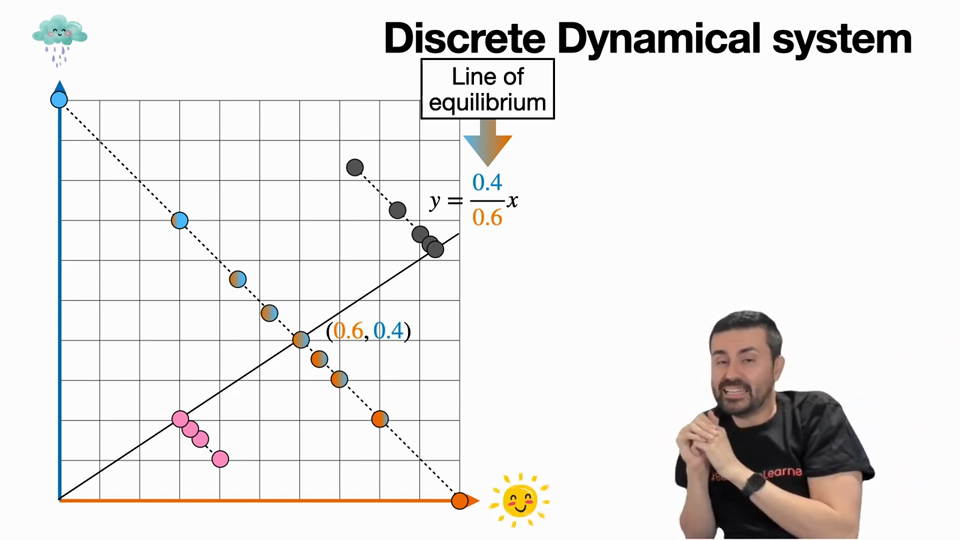

**핵심**

- 확률벡터는 $x+y=1$인 선분(점선) 위에 있고, 이 선분 위에서는 매번 평형점까지 남은 거리의 절반만큼 간다.
- 선분 밖의 점은 평형선 $y=\tfrac{0.4}{0.6}x$ 위의 한 점으로 간다. 영상은 어느 점인지 말하지 않는다. 실제로는 성분 합 $x+y$가 보존되어 $(x+y)\cdot(0.6,0.4)$로 수렴한다(7절 끝 계산 참고).
- 영상은 "왜 직선을 따라가는가, 왜 절반인가"를 질문으로 남기고 선형변환으로 넘어간다.

---

## 6. 행렬을 선형변환으로 보기 (10:36–13:18)

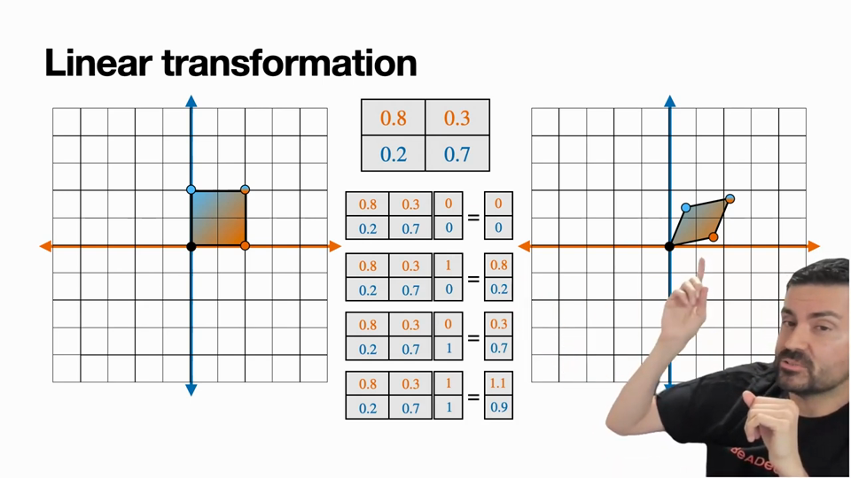

**화면 설명**

| 시각 | 화면 | 내용 |
|---|---|---|
| 10:36–10:54 | "Linear transformation", 왼쪽 모눈 → 행렬 → 오른쪽 모눈 | 행렬은 숫자 배열이 아니라 평면을 다른 평면으로 바꾸는 변환이다. 100×100이면 100차원 공간을 바꾼다. |
| 11:06–11:30 | 네 식 `A[0;0]=[0;0]`, `A[1;0]=[0.8;0.2]`, `A[0;1]=[0.3;0.7]`, `A[1;1]=[1.1;0.9]` | 원점은 언제나 원점으로 간다. 나머지 꼭짓점의 상(像) |
| 11:42 | 정사각형(파랑~주황 그러데이션) → 평행사변형 | 정사각형 하나가 어디로 가는지 알면 평면 전체가 어디로 가는지 정해진다. |
| 12:00–12:30 | 회색 3×3 타일 → 기울어진 평행사변형 타일, 초록 점 이동 | 정사각형이 평면을 덮듯 평행사변형도 평면을 덮는다. 임의의 점은 격자에서 같은 위치를 찾아 옮긴다. |
| 12:36–13:12 | "Small problem", 변환 1번, 2번, …, n번 → 빨간 "?" | 두 번, 천 번 적용하면 매번 새 평행사변형을 다시 계산해야 해서 번거롭다. |

**핵심**

- 행렬의 각 열은 표준 기저벡터의 상이다: $\mathbf{A}\mathbf{e}_1=(0.8,0.2)^T$, $\mathbf{A}\mathbf{e}_2=(0.3,0.7)^T$.
- 영상 표현의 부정확한 점
  - 11:20쯤 음성은 $(1,1)$이 "0.9, 1.1"로 간다고 말하지만 화면과 계산은 $\mathbf{A}(1,1)^T=(1.1,0.9)^T$다.
  - 정사각형 자체를 "basis"라고 부르고 "a transformation is a change of basis"라고 말한다. 엄밀히는 기저는 정사각형을 만드는 두 벡터 $\mathbf{e}_1,\mathbf{e}_2$이고, 행렬은 그 기저벡터를 $\mathbf{A}\mathbf{e}_1,\mathbf{A}\mathbf{e}_2$로 보내는 선형변환이다. 수업의 기저변환(같은 변환을 다른 기저에서 표현)과는 구별해야 한다.

---

## 7. 고윳값과 고유벡터 (13:18–17:06)

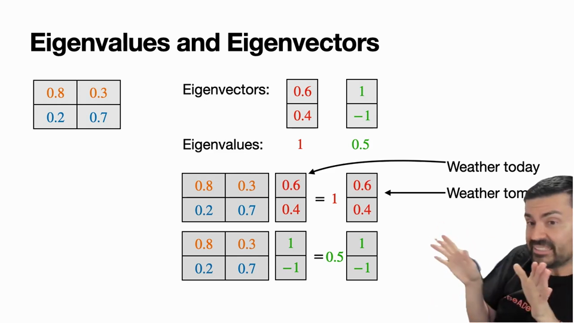

**화면 설명**

| 시각 | 화면 | 내용 |
|---|---|---|
| 13:18 | "Eigenvalues and Eigenvectors", 행렬 | 변환을 여러 번 적용해도 쉽게 설명하는 도구로 고윳값·고유벡터를 꺼낸다. 구하는 방법(행렬식으로 이차방정식 풀기, 연립방정식)은 생략한다. |
| 13:36 | WolframAlpha "eigenvalues and eigenvectors of [[0.8,0.3],[0.2,0.7]]" → $\lambda_1=1,\ v_1=(\tfrac32,1)$, $\lambda_2=\tfrac12,\ v_2=(-1,1)$ | 계산 도구 결과 |
| 13:42–13:54 | "Eigenvectors: (0.6, 0.4), (1, −1)" "Eigenvalues: 1, 0.5" | $(0.6,0.4)$는 앞의 안정 벡터와 같다. $(1,-1)$은 점들이 평형선으로 움직이던 방향이다. 0.5는 "절반씩" 가던 이유다. |
| 14:24–14:42 | `A[0.6;0.4] = 1·[0.6;0.4]`, `A[1;−1] = 0.5·[1;−1]` | 행렬 × 고유벡터 = 고윳값 × 고유벡터 |
| 14:54 | "Weather today" → $(0.6,0.4)$, "Weather tomorrow" → 결과 | 오늘이 맑음 60%·비 40%이면 내일도 똑같다. 안정 조건이 이 식에 들어 있다. |
| 15:18–15:42 | 빨간 화살표 $(0.6,0.4)$는 그대로, 초록 화살표 $(1,-1)$은 $(0.5,-0.5)$로 | 고유벡터는 방향이 그대로다. 길이는 고윳값 배가 된다. |
| 16:12–16:36 | 두 고유벡터가 만드는 빨강~초록 평행사변형 → 변환 후 평행사변형 | 고유벡터 기저의 평행사변형은 변의 방향이 같은 평행사변형으로 간다. |
| 16:42–17:00 | 빨간 직선·초록 직선, 평행사변형 타일 전체가 초록 방향으로 절반 압축 | 두 방향은 제자리에 있고, 평면 전체가 초록 방향으로 1/2만큼 눌린다. |

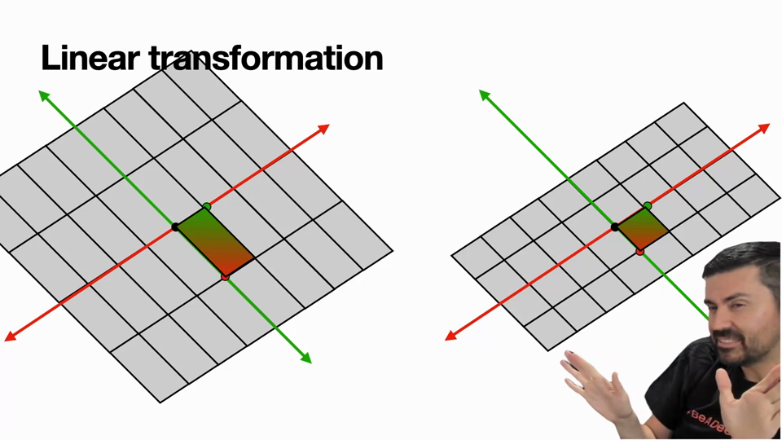

**핵심**

$$
\mathbf{A}\mathbf{p}_1=1\cdot\mathbf{p}_1,\quad \mathbf{p}_1=\begin{bmatrix}0.6\\0.4\end{bmatrix};\qquad
\mathbf{A}\mathbf{p}_2=0.5\,\mathbf{p}_2,\quad \mathbf{p}_2=\begin{bmatrix}1\\-1\end{bmatrix}
$$

검산: $\mathbf{A}\mathbf{p}_2=(0.8-0.3,\ 0.2-0.7)^T=(0.5,-0.5)^T$.

- WolframAlpha의 $v_1=(\tfrac32,1)$은 $(0.6,0.4)$의 상수배이고, $v_2=(-1,1)$은 $(1,-1)$의 $-1$배다. 고유벡터는 길이와 부호가 정해져 있지 않다는 정리노트 2.1의 내용 그대로다.
- 영상의 말 실수: 16:00쯤 "one eigenvector is always going to be 1"이라고 하지만 1인 것은 **고윳값**이다. 열 합이 1인 행렬은 항상 고윳값 1을 가진다.

---

## 8. 문제 해결: 거듭제곱은 축별 배율의 거듭제곱 (17:06–19:48)

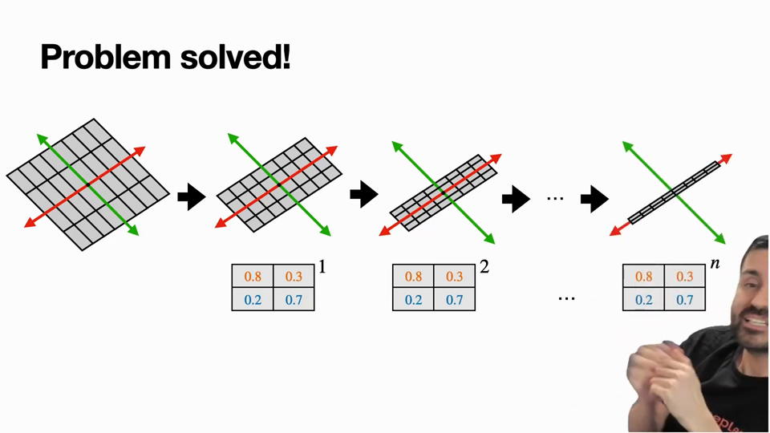

**화면 설명**

| 시각 | 화면 | 내용 |
|---|---|---|
| 17:06 | 검은 화살표 세 개가 격자를 누름 | 변환은 큰 평행사변형을 1/2로 누르는 일이다. |
| 17:12–17:42 | "Problem solved!", 격자 → $\mathbf{A}^1$ → $\mathbf{A}^2$ → … → $\mathbf{A}^n$, 마지막은 빨간 선에 붙은 가는 띠 | 한 번 적용하면 1/2, 다시 적용하면 또 1/2. $n$번이면 빨간 선을 겨우 덮는 아주 얇은 평행사변형이 된다. 이제 천 번 적용도 쉽게 설명된다. |
| 18:00–18:06 | 초록 직선 "Equilibrium", $y=\frac{0.4}{0.6}x$ | 고윳값 1의 고유벡터가 만드는 직선이 평형선이다. |
| 18:12–18:24 | 흩어진 점들이 빨간 점선을 따라 평형선으로 이동 | 점들은 평형선에 수직이 아니라 **45° 방향**으로 간다. 둘째 고유벡터 $(1,-1)$이 45° 아래를 가리키기 때문이다. |
| 18:30–18:54 | "Discrete dynamical system", 평면 전체를 덮은 빨간 점선 흐름, 검은 점이 한 번에 절반씩 이동 | 동역학계 = 평형선으로 향하는 45° 선들의 묶음. 한 번 적용하면 초록 선까지 거리의 절반만큼 간다(둘째 고윳값 0.5). |
| 19:00–19:42 | $(0,1)$ → $(0.3,0.7)$, $(1,0)$ → $(0.8,0.2)$, 둘 다 $(0.6,0.4)$로. 오른쪽에 해·구름 전이 그래프 | 처음 날씨 문제로 돌아와 같은 그림으로 설명한다. |

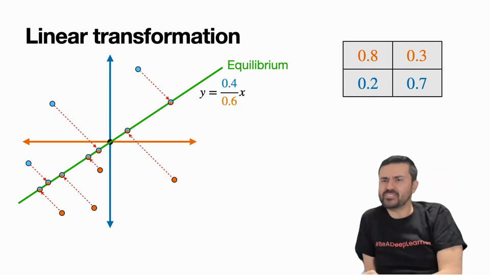

**핵심**

$$
\mathbf{x}=c_1\mathbf{p}_1+c_2\mathbf{p}_2\ \Longrightarrow\ \mathbf{A}^n\mathbf{x}=c_1\,1^n\,\mathbf{p}_1+c_2\,(0.5)^n\,\mathbf{p}_2\ \xrightarrow{n\to\infty}\ c_1\mathbf{p}_1
$$

- $c_1,c_2$는 $\mathbf{x}$를 고유벡터 기저로 읽은 좌표(고유기저 좌표)다. 이 식은 영상의 그림을 식으로 옮긴 것이고 영상에 직접 나오지는 않는다.
- 여기서 $c_1=x+y$, $c_2=0.4x-0.6y$다($\mathbf{x}=(x,y)^T$). 그래서 확률벡터($x+y=1$)는 $\mathbf{p}_1=(0.6,0.4)$로, 일반 점은 $(x+y)\,\mathbf{p}_1$로 간다. 5절의 평형점·평형선이 둘 다 이것으로 설명된다.
- 예: $(0,1)$은 $c_1=1,\ c_2=-0.6$이고 $\mathbf{A}(0,1)^T=\mathbf{p}_1+0.5(-0.6)\mathbf{p}_2=(0.3,0.7)^T$, 정확히 중간이다.
- 영상의 일반화 "one eigenvalue is going to be 1, and the other ones are going to be less than 1"은 **절댓값 기준**으로 읽어야 한다. 고윳값이 음수일 수도 있고, 열 합이 1인 행렬이라고 해서 언제나 1보다 작은 것도 아니다(예: 단위행렬). 이 영상의 예들처럼 모든 성분이 양수일 때 나머지 고윳값의 절댓값이 1보다 작다.

---

## 9. 3상태 마르코프 행렬 (19:48–22:30)

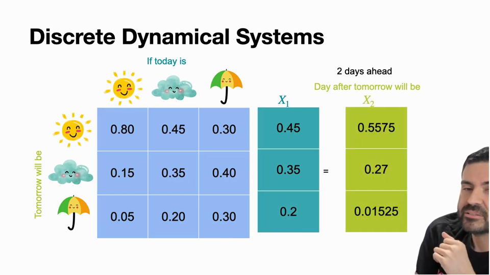

**화면 설명**

| 시각 | 화면 | 내용 |
|---|---|---|
| 20:12–20:36 | "Discrete Dynamical Systems", "If today is" 해·구름·우산, "Tomorrow will be" | 상태 3개: 맑음(sunny), 흐림(cloudy), 비(rainy) |
| 20:36 | 3×3 표, 오른쪽 "All values are positive and columns add to 1", "Markov matrix" | 모든 값이 양수이고 열 합이 1 → 마르코프 행렬. 내일이 오늘에만 달려 있다는 것이 마르코프 과정의 뜻이다. |
| 20:48 | "State vector" $X_0=(0,1,0)$ | 오늘 흐림 |
| 20:54–21:00 | "Tomorrow will be" $X_1=(0.45,0.35,0.2)$ | 둘째 열이 그대로 나온다. |
| 21:12 | "2 days ahead" $X_2=(0.5575,\ 0.27,\ 0.01525)$ | **화면 숫자 오타**: 실제로는 $(0.5775,\ 0.27,\ 0.1525)$다(아래 검산). |
| 21:18 | "3 days ahead" $X_3=(0.6293,0.2421,0.1286)$ | |
| 21:24–21:36 | $X_5=(0.6601,0.2257,0.1142)$, $X_6=(0.6639,0.2237,0.1124)$, $X_8=(0.6655,0.2228,0.1117)$ | 빠르게 넘긴다. |
| 21:36–21:42 | "10 days ahead / 11 days ahead" $X_{10}=X_{11}=(0.6665,0.2223,0.1112)$ | 값이 거의 고정된다. |
| 21:48–21:54 | "Eigenvector" → $X_{10}$, "Eigenvalue" → "= 1 ·" | $\mathbf{P}X_{10}=1\cdot X_{10}$ |
| 22:00–22:06 | "Transition matrix $P$", "Equilibrium vector $X_\infty$", "Long run probabilities" | 장기 확률: 맑음 $6/9$, 흐림 $2/9$, 비 $1/9$ |

$$
\mathbf{P}=\begin{bmatrix}0.80&0.45&0.30\\0.15&0.35&0.40\\0.05&0.20&0.30\end{bmatrix},\qquad
X_{k+1}=\mathbf{P}X_k,\qquad X_\infty=\left(\tfrac69,\tfrac29,\tfrac19\right)\approx(0.6667,\,0.2222,\,0.1111)
$$

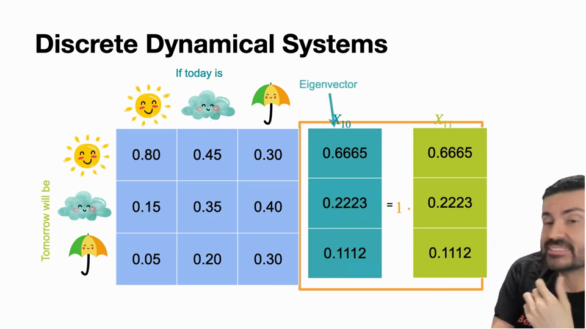

**핵심**

- $X_2$ 검산: $0.8(0.45)+0.45(0.35)+0.3(0.2)=0.36+0.1575+0.06=0.5775$, $0.05(0.45)+0.2(0.35)+0.3(0.2)=0.0225+0.07+0.06=0.1525$. 화면 숫자는 합이 1이 아니어서 오타임을 알 수 있다. 다음 $X_3=0.8(0.5775)+0.45(0.27)+0.3(0.1525)\approx0.6293$은 맞는 값에서 이어진다.
- 화면의 $X_{10}=(0.6665,0.2223,0.1112)$는 반올림한 근삿값이다. 극한은 $(6/9,2/9,1/9)$다.
- 영상은 3×3 전이행렬을 $P$라고 부른다. 정리노트에서 $\mathbf{P}$는 **고유벡터를 열로 모은 행렬**이므로 기호가 겹친다(아래 표 참고).

---

## 10. WolframAlpha와 Colab으로 확인 (22:30–24:18)

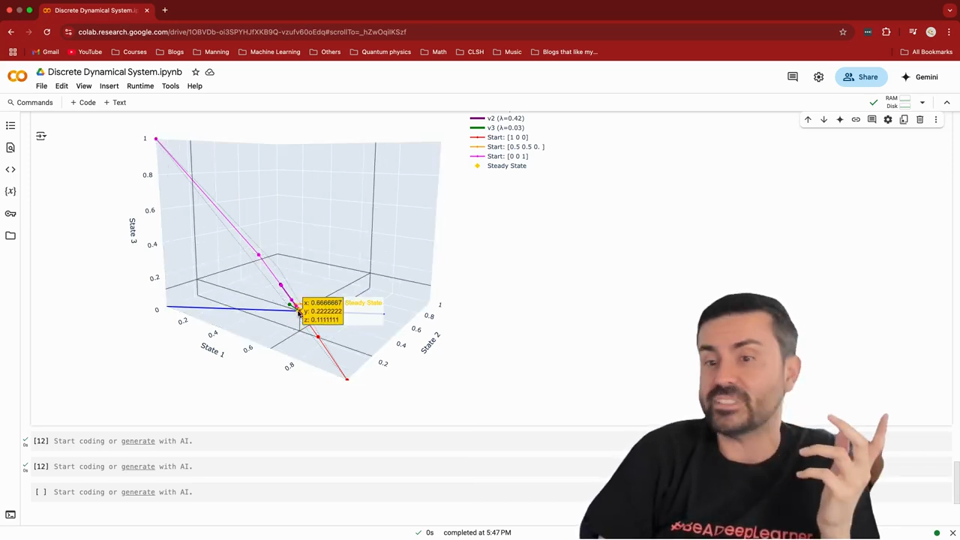

**화면 설명**

| 시각 | 화면 | 내용 |
|---|---|---|
| 22:24–22:54 | WolframAlpha: $\lambda_1=1,\ v_1=(6,2,1)$; $\lambda_2=\tfrac1{40}(9+\sqrt{61})$; $\lambda_3=\tfrac1{40}(9-\sqrt{61})$ (고유벡터 $v_2,v_3$은 $\sqrt{61}$이 든 복잡한 식) | 하나는 1이고 나머지는 1보다 작은 양수다. $(6,2,1)$은 $(0.6666,0.2222,0.1111)$의 상수배라 같은 방향이다. 고유벡터는 방향을 나타낸다. |
| 23:00–23:30 | Colab "Discrete Dynamical System.ipynb", 3D 그림, 범례 "Stability Line / v2 (λ=0.42) / v3 (λ=0.03) / Steady State" | 파란 선 = 평형선, 노란 점 = 정상 상태 $(0.6666,0.2222,0.1111)$. 보라 $v_2$는 고윳값 0.42라 매번 그 방향 성분이 0.42배가 되고, 초록 $v_3$는 0.03이라 한 번에 97%를 줄여 공간을 빠르게 누른다. |
| 23:36–24:06 | 범례 "Start: [1 0 0] / Start: [0.5 0.5 0.] / Start: [0 0 1]", 궤적들 | 출발점이 달라도 모두 노란 정상 상태로 빠르게 모인다. |

**핵심**

- $\lambda_2=(9+\sqrt{61})/40\approx0.42$, $\lambda_3=(9-\sqrt{61})/40\approx0.03$이고, 범례의 0.42, 0.03과 맞는다.
- 3×3 동역학계도 고유벡터 3개와 고윳값 3개로 완전히 설명된다는 것이 결론이다.

---

## 11. 강좌 홍보 (24:18–26:15)

DeepLearning.AI "Mathematics for Machine Learning and Data Science Specialization" 홍보와 제작진 소개, 세 강좌(선형대수·미적분·확률통계)의 주제 목록. 학습 내용 없음.

---

## 수업 내용과 연결하기

1102 정리노트 [2. 고윳값과 대각화 복습](../정리노트_1102_PCA.md)의 기호에 맞춘 대응표다.

| 영상 표현 | 수업 용어 | 수식 |
|---|---|---|
| transition matrix (2×2, 이름 없음) | 정방행렬 $\mathbf{A}$ | $\mathbf{A}=\begin{bmatrix}0.8&0.3\\0.2&0.7\end{bmatrix}$ |
| transition matrix $P$ (3×3) | 전이행렬. 정리노트의 $\mathbf{P}$(고유벡터 행렬)와 다른 뜻 | 이 노트 9절의 $\mathbf{P}$ |
| eigenvector, eigenvalue | 고유벡터 $\mathbf{p}_i$, 고윳값 $\lambda_i$ | $\mathbf{A}\mathbf{p}_i=\lambda_i\mathbf{p}_i,\ \mathbf{p}_i\neq\mathbf{0}$ |
| "matrix times eigenvector = eigenvalue times eigenvector" | 고윳값 방정식 | $\mathbf{A}\mathbf{x}=\lambda\mathbf{x}$ |
| "eigenvector describes the direction", $(6,2,1)$ vs $(0.666,0.222,0.111)$ | 고유벡터의 상수배도 고유벡터 | $c\,\mathbf{x}$ ($c\neq0$) |
| 고유벡터 두 개로 만든 평행사변형 격자 | 고유기저(eigenbasis), 고유기저 좌표 $\mathbf{c}$ | $\mathbf{x}=\mathbf{P}\mathbf{c}=c_1\mathbf{p}_1+c_2\mathbf{p}_2$ |
| "squishing by 1/2" | 대각행렬 $\mathbf{D}$가 축마다 배율을 곱함 | $\mathbf{D}=\operatorname{diag}(1,\,0.5)$ |
| matrix to the power $n$ | EVD로 거듭제곱 계산 | $\mathbf{A}^n=\mathbf{P}\mathbf{D}^n\mathbf{P}^{-1}$ |
| point / line of equilibrium, steady state, equilibrium vector $X_\infty$ | 고윳값 1의 고유벡터(정상 상태 분포) | $\mathbf{A}\boldsymbol{\pi}=\boldsymbol{\pi},\ \sum_i\pi_i=1$ |
| linear transformation | 선형변환 $\mathbf{x}\mapsto\mathbf{A}\mathbf{x}$ | 열 = 표준 기저벡터의 상 |

**영상에서 빠진 것**

1. **대각화로 극한 행렬 구하기.** 영상은 $\mathbf{A}^n\to\begin{bmatrix}0.6&0.6\\0.4&0.4\end{bmatrix}$을 반복 계산으로만 보였다. 정리노트 2.3의 EVD를 쓰면 직접 나온다.
   $$
   \mathbf{P}=\begin{bmatrix}0.6&1\\0.4&-1\end{bmatrix},\quad
   \mathbf{D}=\begin{bmatrix}1&0\\0&0.5\end{bmatrix},\quad
   \mathbf{P}^{-1}=\begin{bmatrix}1&1\\0.4&-0.6\end{bmatrix}
   $$
   ($\det\mathbf{P}=-0.6-0.4=-1$.) 그러면
   $$
   \mathbf{A}^n=\mathbf{P}\begin{bmatrix}1&0\\0&0.5^n\end{bmatrix}\mathbf{P}^{-1}\ \xrightarrow{n\to\infty}\ \mathbf{P}\begin{bmatrix}1&0\\0&0\end{bmatrix}\mathbf{P}^{-1}=\begin{bmatrix}0.6\\0.4\end{bmatrix}\begin{bmatrix}1&1\end{bmatrix}=\begin{bmatrix}0.6&0.6\\0.4&0.4\end{bmatrix}
   $$
   검산: $\mathbf{P}\mathbf{D}\mathbf{P}^{-1}=\begin{bmatrix}0.6&0.5\\0.4&-0.5\end{bmatrix}\begin{bmatrix}1&1\\0.4&-0.6\end{bmatrix}=\begin{bmatrix}0.8&0.3\\0.2&0.7\end{bmatrix}$.
2. **고윳값 구하는 과정.** 영상은 WolframAlpha에 맡겼다. 수업 방식대로 특성방정식을 풀면 $\det(\mathbf{A}-\lambda\mathbf{I})=(0.8-\lambda)(0.7-\lambda)-0.06=\lambda^2-1.5\lambda+0.5=(\lambda-1)(\lambda-0.5)=0$이다.
3. **왜 고윳값 1이 항상 있는가.** 열 합이 1이면 $\mathbf{1}^T\mathbf{A}=\mathbf{1}^T$이므로 $\mathbf{A}^T\mathbf{1}=\mathbf{1}$이다. $\mathbf{A}$와 $\mathbf{A}^T$는 특성다항식이 같아서 $\mathbf{A}$도 고윳값 1을 가진다. 나머지 고윳값의 절댓값이 1보다 작다는 것(모든 성분이 양수인 경우, 페론–프로베니우스 정리)은 영상에서 증명 없이 말로만 나왔다.
4. **대각화 가능 조건.** 영상의 두 예는 고윳값이 모두 달라 고유벡터들이 기저를 이룬다. 정리노트 2.3처럼 고유벡터가 $\mathbb{R}^n$의 기저를 이루지 못하면 이 설명이 그대로 통하지 않는다.
5. **대칭행렬·PCA와의 차이.** 전이행렬은 대칭이 아니므로 고유벡터 $(0.6,0.4)$와 $(1,-1)$은 서로 수직이 아니다(내적 $0.2$). 그래서 $\mathbf{P}^{-1}\neq\mathbf{P}^T$다. 1102 수업의 공분산 행렬처럼 대칭일 때만 스펙트럼 정리로 직교 대각화 $\mathbf{P}^{-1}=\mathbf{P}^T$가 된다. 영상의 "45° 방향, 평형선에 수직이 아님"이 바로 이 비직교성을 보여 준다.
6. **기저변환의 정확한 뜻.** 영상의 "a transformation is a change of basis"는 비유다. 수업의 Remark처럼 대각화는 **같은 선형변환을 고유기저에서 다시 표현**하는 것이다. 고유기저 좌표 $\mathbf{c}$에 $\mathbf{P}\to\mathbf{A}\to\mathbf{P}^{-1}$을 거치면 $\mathbf{D}\mathbf{c}$가 되는 과정은 [대각화와 기저변환 실험](../../인터렉티브_04_대각화와_기저변환.html)에서 직접 확인할 수 있다.
