# 고유벡터와 일반화 고유공간 / Eigenvectors and Generalized Eigenspaces — Serrano.Academy 영상 정리

- **영상**: [Eigenvectors and Generalized Eigenspaces](https://www.youtube.com/watch?v=ajXb3N6QEqc) (Luis Serrano, 19:18)
- **위치**: `복습노트/1102/.pack/` — 사용자가 지정한 날짜(1102 PCA Part 1: 고유벡터, 중근과 고유공간, 대각화·기저변환 복습)
- **정리 방식**: 프레임 193장(6초 간격, 3x3 시트 22장)을 직접 보고 전사본 `STT/Eigenvectors_and_Generalized_Eigenspaces.md`와 맞춰 정리했어요. 타임스탬프는 6초 단위 근삿값이에요.
- **전사 모델**: gemini-3.5-flash (Vertex AI API, 2개 파트 모두 성공)

> 한 줄 요약: 행렬은 평면의 격자를 다른 격자로 보내는 선형변환이고, 고유벡터로 만든 고유기저에서는 그 변환이 "두 방향으로 늘이기"뿐이에요. 고유벡터가 모자란 결함 행렬(shear)에서는 일반화 고유벡터 $\mathbf v_2$가 $\mathbf A\mathbf v_2=\lambda\mathbf v_2+\mathbf v_1$을 만족해서 "늘이기 + 밀기(shear)"로 변환을 설명하고, 이때 자기 자신으로 가는 더 큰 공간이 일반화 고유공간이에요.

---

## 1. 도입: 행렬과 벡터의 곱 (00:00–01:00)

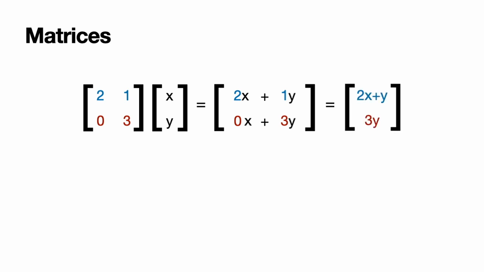

| 시각 | 화면 | 내용 |
|---|---|---|
| 00:06 | 제목 "Eigenvalues, eigenvectors and generalized eigenspaces" | 영상 주제 소개 |
| 00:12–00:24 | "Matrices", $\begin{bmatrix}2&1\\0&3\end{bmatrix}$ (첫 행 파랑, 둘째 행 빨강) | 예시 행렬 |
| 00:30–00:48 | $\begin{bmatrix}2&1\\0&3\end{bmatrix}\begin{bmatrix}x\\y\end{bmatrix}=\begin{bmatrix}2x+1y\\0x+3y\end{bmatrix}=\begin{bmatrix}2x+y\\3y\end{bmatrix}$ | 행마다 열벡터와 내적(dot product) |
| 00:54–01:00 | "1. Eigenvalues, eigenvectors, eigenspaces / 2. *Generalized* eigenvalues, *generalized* eigenvectors, *generalized* eigenspaces" | 영상의 두 부분 목차 |

**핵심**: 식만 보면 "공식 덩어리"지만, 이 곱에는 기하적 그림이 붙어 있어요. 그 그림으로 고유값·고유벡터·고유공간과 그 일반화 버전을 설명하는 것이 영상의 목표예요.

## 2. 선형변환 = 격자를 격자로 보내기, 기저변환 (01:00–03:05)

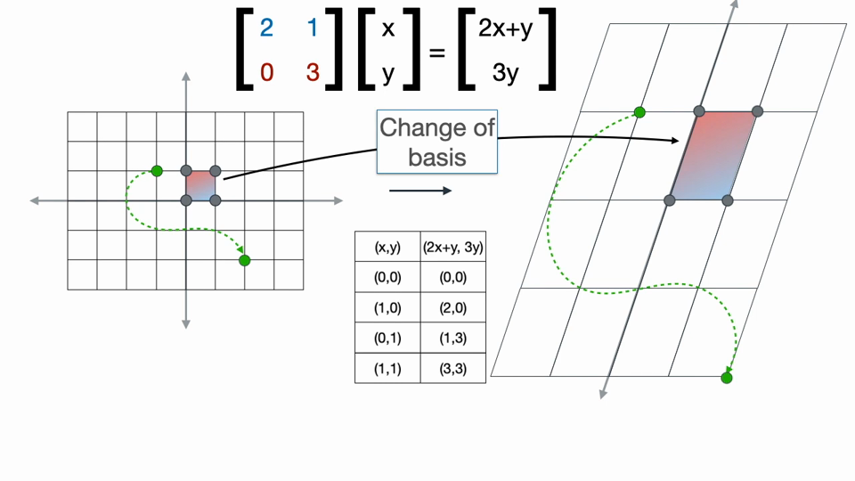

| 시각 | 화면 | 내용 |
|---|---|---|
| 01:06–01:42 | 왼쪽 표준 격자 → 오른쪽 격자, 표 머리 `(x,y) │ (2x+y, 3y)` | 평면의 모든 점을 다른 점으로 보내는 사상 |
| 01:48–02:06 | 표에 한 줄씩: (0,0)→(0,0), (1,0)→(2,0), (0,1)→(1,3), (1,1)→(3,3) | 원점은 항상 원점으로 감 |
| 02:12 | 오른쪽에 빨강-파랑 그러데이션 평행사변형 | 작은 정사각형 → 큰 평행사변형 |
| 02:18–02:36 | 오른쪽 격자가 기울어진 평행사변형 격자로 바뀜, 초록 점이 점선 곡선을 따라 움직임 | 격자 칸 위치만 지키면 어느 점이 어디로 가는지 알 수 있음 |
| 02:48–03:00 | "Change of basis" 상자, 정사각형과 평행사변형의 두 변을 굵은 화살표로 표시 | 두 기저 벡터 쌍 |

**핵심**: 정사각형의 격자가 평행사변형의 격자로 그대로 옮겨지는 것이 선형변환의 성질이에요. 그래서 기저 두 벡터가 어디로 가는지만 알면 평면 전체가 어디로 가는지 정해져요. 영상은 이것을 "change of basis"라고 불러요.

- 영상 표현 짚기: 영상은 정사각형·평행사변형 자체를 "basis"라고 부르지만, 정확히 기저는 그 변을 이루는 **두 벡터**예요(평행사변형은 두 기저 벡터가 만드는 칸). 또 여기서 행렬은 표준기저 $\mathbf e_1,\mathbf e_2$를 열벡터 $(2,0),(1,3)$으로 **보내는 변환**이에요. 수업의 "기저변환"은 같은 변환을 다른 기저의 좌표로 다시 표현하는 것($\mathbf D=\mathbf P^{-1}\mathbf A\mathbf P$)이라 뜻이 조금 달라요.

## 3. 고유기저: 두 방향으로 늘이기만 하는 평행사변형 (03:05–05:55)

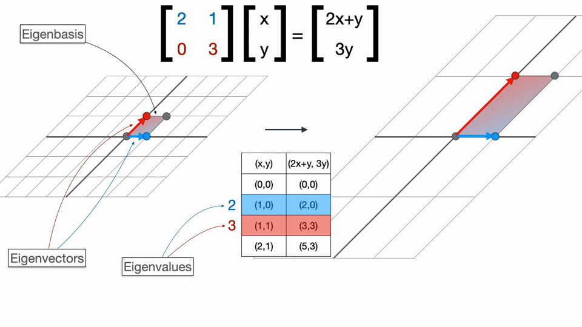

| 시각 | 화면 | 내용 |
|---|---|---|
| 03:06–03:36 | 새 평행사변형 꼭짓점 (0,0),(1,0),(1,1),(2,1); 표 (0,0)→(0,0), (1,0)→(2,0), (1,1)→(3,3), (2,1)→(5,3) | 정사각형 대신 이 평행사변형을 봄 |
| 03:42–04:06 | 양쪽 격자가 같은 방향으로 기운 평행사변형 격자, 오른쪽 평행사변형이 같은 모양으로 커짐 | 두 평행사변형의 변이 서로 평행 |
| 04:12–04:30 | 표의 (1,0)→(2,0) 줄 파랑, 왼쪽에 "2"; (1,1)→(3,3) 줄 빨강, "3". 파란 화살표·빨간 화살표 | 파란 벡터는 2배, 빨간 벡터는 3배 |
| 04:42–04:48 | 라벨 "Eigenbasis", "Eigenvectors", "Eigenvalues" | 이름 붙이기 |

**핵심**: $(1,0)\mapsto(2,0)=2(1,0)$, $(1,1)\mapsto(3,3)=3(1,1)$이라 변환 전체가 **두 방향과 두 배율**로 정해져요. eigen은 독일어로 "자신의(own)"라는 뜻이에요.

- 고유벡터(eigenvector): 기저를 이루는 두 벡터 $(1,0)$, $(1,1)$
- 고유기저(eigenbasis): 고유벡터로 만든 기저
- 고윳값(eigenvalue): 늘어나는 배율 2, 3
- 넷째 꼭짓점 검산: $(2,1)=(1,0)+(1,1)\mapsto 2(1,0)+3(1,1)=(5,3)$으로 표와 같아요.

### 고유공간 (04:54–05:55)

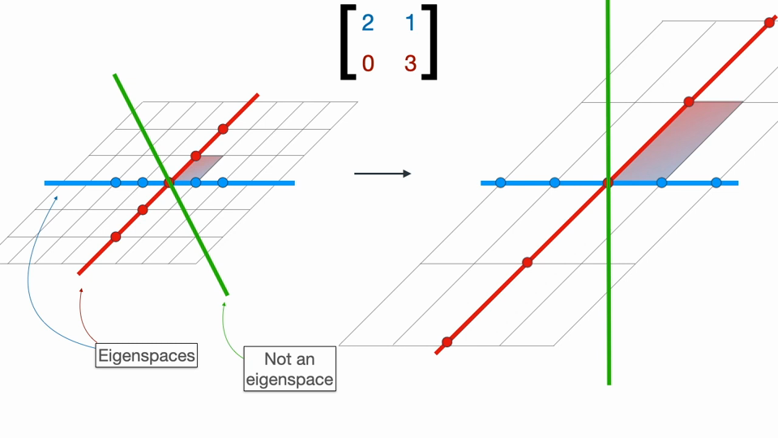

| 시각 | 화면 | 내용 |
|---|---|---|
| 04:54–05:00 | 가로 파란 직선 위 점들 → 오른쪽에서 같은 직선 위로, 간격 2배 | 파란 고유벡터의 직선은 자기 자신으로 감 |
| 05:06–05:18 | 대각선 빨간 직선 위 점들 → 같은 직선 위로, 간격 3배; 라벨 "Eigenspaces" | 빨간 직선도 자기 자신으로 |
| 05:24–05:42 | 초록 직선(왼쪽에서 오른쪽 아래로 기운 직선) → 오른쪽에서 수직선이 됨; 라벨 "Not an eigenspace" | 다른 직선은 원점을 지나는 다른 직선으로 감 |

**핵심**: 고유벡터가 만드는 원점 지나는 직선은 늘어나기만 하고 자기 자신으로 가요. 이것이 고유공간(eigenspace)이에요. 이 행렬에서 자기 자신으로 가는 원점 지나는 직선은 이 둘뿐이에요. 단위행렬이나 그 상수배 $c\mathbf I$이면 모든 직선이 자기 자신으로 가요(전사본 05:40 부근 설명).

## 4. 고윳값 방정식과 고유기저의 쓸모 (05:55–07:10)

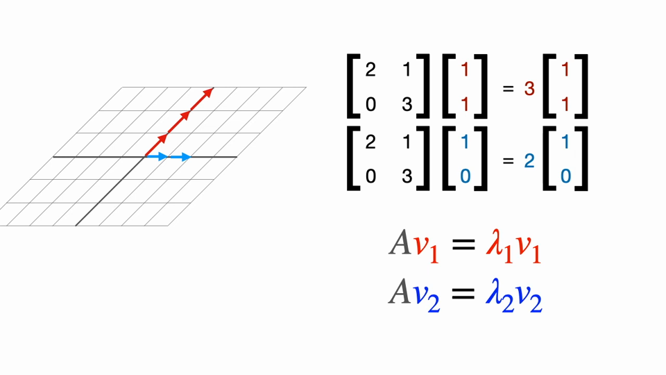

| 시각 | 화면 | 내용 |
|---|---|---|
| 06:00 | $\begin{bmatrix}2&1\\0&3\end{bmatrix}\begin{bmatrix}1\\1\end{bmatrix}=3\begin{bmatrix}1\\1\end{bmatrix}$ | 빨간 고유벡터 |
| 06:06 | $\begin{bmatrix}2&1\\0&3\end{bmatrix}\begin{bmatrix}1\\0\end{bmatrix}=2\begin{bmatrix}1\\0\end{bmatrix}$, $Av_1=\lambda_1v_1$ | 파란 고유벡터 |
| 06:12–06:18 | $Av_2=\lambda_2v_2$ 추가, "Eigenvectors" 라벨이 $v_1, v_2$를 가리킴 | 일반식 |
| 06:30–07:06 | 고유벡터 방향의 연한 평행 격자, 초록 점 → 빨강 3배·파랑 2배로 늘어난 큰 평행사변형의 꼭짓점으로 이동 | 임의의 점이 어디로 가는지 |

$$\mathbf A\mathbf v_1=\lambda_1\mathbf v_1,\qquad \mathbf A\mathbf v_2=\lambda_2\mathbf v_2$$

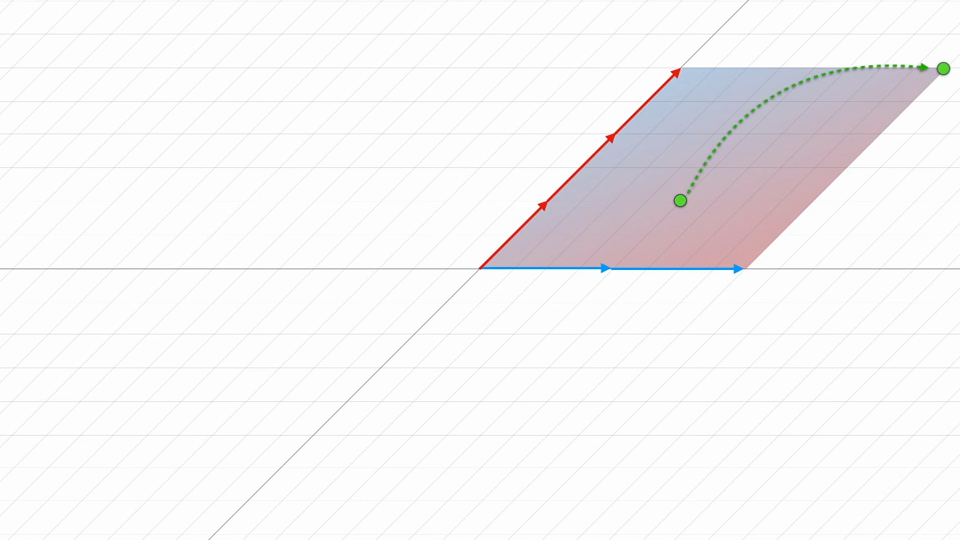

**핵심**: 초록 점을 고유벡터 방향 성분으로 나누어(평행사변형의 두 변) 각 성분을 해당 고윳값 배만큼 늘이면 옮겨진 점이 나와요. 복잡한 행렬도 고유기저에서는 "특정 두 방향으로 늘이기"뿐이에요. 이것이 수업의 대각화 $\mathbf A=\mathbf P\mathbf D\mathbf P^{-1}$의 그림이에요.

## 5. 고유벡터 찾기: WolframAlpha (07:10–08:00)

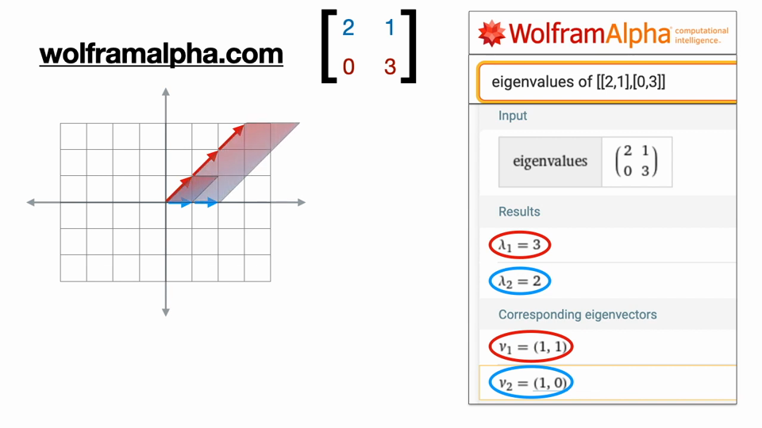

- 화면: "wolframalpha.com", 입력 `eigenvalues of [[2,1],[0,3]]`, 결과 $\lambda_1=3$, $\lambda_2=2$, Corresponding eigenvectors $v_1=(1,1)$, $v_2=(1,0)$. 07:42 이후 각 결과에 빨강·파랑 동그라미, 07:54에 "Change of basis" 상자.
- 전사본 보강: 정석 절차는 행렬식에서 나오는 **특성다항식(characteristic polynomial)**을 인수분해하고 연립일차방정식을 푸는 것이라고만 언급하고, 영상에서는 계산하지 않아요.

수업 방식으로 직접 확인하면:

$$p_{\mathbf A}(\lambda)=\det(\mathbf A-\lambda\mathbf I_2)=(2-\lambda)(3-\lambda)=0\ \Rightarrow\ \lambda=2,3$$

$\lambda=3$: $(\mathbf A-3\mathbf I)\mathbf x=\begin{bmatrix}-1&1\\0&0\end{bmatrix}\mathbf x=\mathbf 0\Rightarrow \mathbf x\propto(1,1)$, $\lambda=2$: $\begin{bmatrix}0&1\\0&1\end{bmatrix}\mathbf x=\mathbf 0\Rightarrow\mathbf x\propto(1,0)$.

## 6. 특이변환 (08:00–08:50)

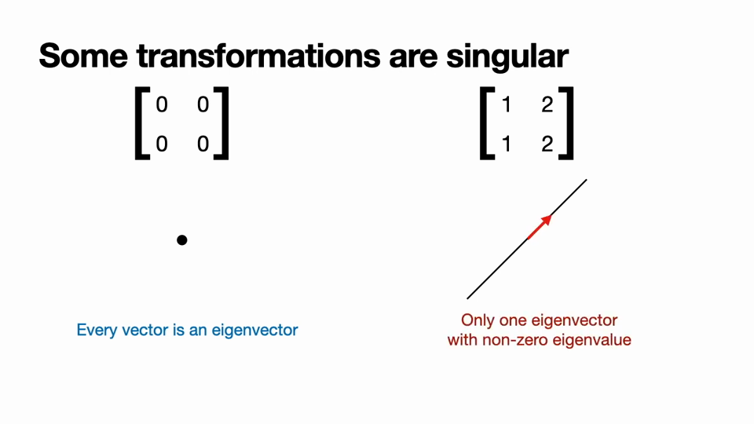

| 시각 | 화면 | 내용 |
|---|---|---|
| 08:00–08:18 | "Some transformations are singular", $\begin{bmatrix}0&0\\0&0\end{bmatrix}$, $\begin{bmatrix}1&2\\1&2\end{bmatrix}$와 격자 | 평면을 더 작은 것으로 찌그러뜨리는 변환 |
| 08:24–08:30 | 왼쪽 격자가 점 하나로, "Every vector is an eigenvector" | 영행렬: 모든 (영 아닌) 벡터가 고윳값 0의 고유벡터 |
| 08:36–08:42 | 오른쪽 격자가 직선 하나로, 빨간 화살표, "Only one eigenvector with non-zero eigenvalue" | 평면 전체를 한 직선으로 |

**핵심**: $\begin{bmatrix}1&2\\1&2\end{bmatrix}$는 $(1,1)\mapsto(3,3)$이라 고윳값 3의 고유벡터가 $(1,1)$이고, 직선으로 눌리는 방향 $(2,-1)\mapsto(0,0)$이 고윳값 0의 고유벡터예요(영상은 "some other eigenvector"라고만 말하고 성분은 보여 주지 않아요).

## 7. 평면의 세 가지 기본 변환: 늘이기·회전·밀기 (08:50–11:10)

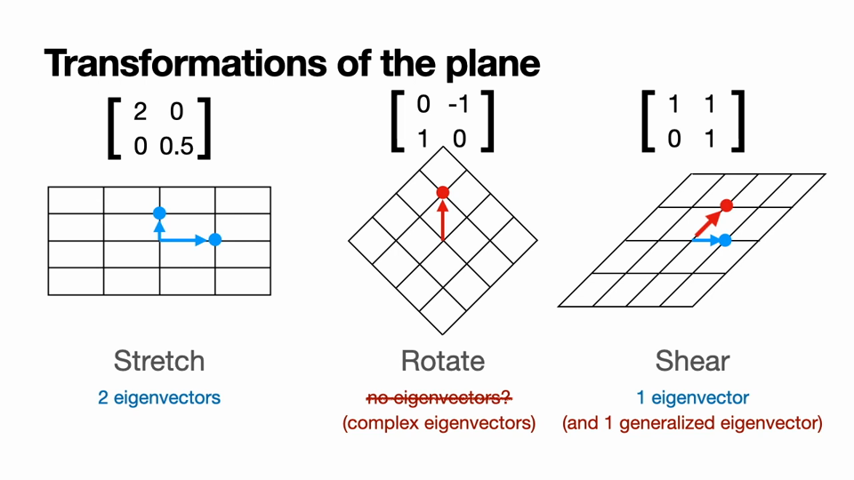

| 시각 | 화면 | 내용 |
|---|---|---|
| 08:48–09:24 | "Transformations of the plane": Stretch(가로로 넓어진 격자), Rotate(45° 기운 마름모 격자), Shear(기운 평행사변형 격자) | 비특이 변환의 세 종류 |
| 09:30 | 행렬 $\begin{bmatrix}2&0\\0&0.5\end{bmatrix}$, $\begin{bmatrix}0&-1\\1&0\end{bmatrix}$, $\begin{bmatrix}1&1\\0&1\end{bmatrix}$ | 각 예시 |
| 09:36–09:48 | Stretch 격자에 파란 화살표 두 개(가로·세로), "2 eigenvectors" | 늘이는 방향 = 고유벡터 |
| 09:54–10:24 | Rotate에 빨간 세로 화살표, "~~no eigenvectors?~~ (complex eigenvectors)" | 회전은 실수 고유벡터 없음 |
| 10:30–10:48 | Shear에 파란 가로 화살표(그대로)와 빨간 기운 화살표, "1 eigenvector" | 가로 벡터만 자기 방향 유지 |
| 10:54 | "(and 1 generalized eigenvector)" 추가 | 숨은 "고유벡터 비슷한 것" |

**핵심**:

- 늘이기 $\mathrm{diag}(2,0.5)$: 가로축 2배, 세로축 0.5배 → 고유벡터 2개. 늘이는 방향은 대각선 방향일 수도 있어요.
- 90° 회전: 평행하게 남는 실수 벡터가 없어요. 고윳값이 복소수 $\pm i$라 고유벡터도 복소수예요(영상은 다음 영상으로 미룸).
- 밀기 $\begin{bmatrix}1&1\\0&1\end{bmatrix}$: 가로 벡터 $(1,0)$만 고유벡터(고윳값 1). 나머지 벡터는 모두 기울어져요. 고유벡터가 하나뿐인 이런 행렬을 **결함 행렬(defective matrix)**이라 부르고, 빠진 자리를 **일반화 고유벡터**가 채워요.
- 영상은 "모든 비특이 선형변환은 이 셋의 조합"이라고 말해요. 직관용 설명이고, 영상에서 증명하지는 않아요.

## 8. 일반화 고유벡터: 늘이기 + 밀기 (11:10–14:25)

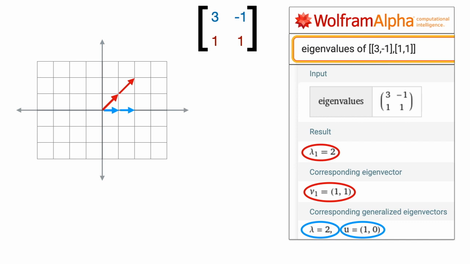

| 시각 | 화면 | 내용 |
|---|---|---|
| 11:12 | 검은 화면 "Generalized eigenvectors" | 둘째 부분 시작 |
| 11:18–11:42 | $\begin{bmatrix}3&-1\\1&1\end{bmatrix}$, WolframAlpha `eigenvalues of [[3,-1],[1,1]]`: $\lambda_1=2$, $v_1=(1,1)$, "Corresponding generalized eigenvectors" $\lambda=2,\ u=(1,0)$ | 고유벡터 1개 + 일반화 고유벡터 1개 |
| 11:48–12:12 | $\begin{bmatrix}3&-1\\1&1\end{bmatrix}\begin{bmatrix}x\\y\end{bmatrix}=\begin{bmatrix}3x-y\\x+y\end{bmatrix}$, 표 (0,0)→(0,0), (1,0)→(3,1), (1,1)→(2,2), (2,1)→(5,3) | 평행사변형의 상 |
| 12:18–12:30 | (1,1) 줄 빨강 "2", 상자 "Stretch by 2 ↗" | 고유벡터는 2배 |
| 12:30–12:48 | (1,0) 줄 파랑 "2", 오른쪽에 $(2,0)$까지의 파란 화살표와 거기서 $(3,1)$로 가는 빨간 화살표 | $(1,0)\mapsto(3,1)=(2,0)+(1,1)$ |
| 12:54–13:06 | 상자 "Stretch by 2 → / Shear ↗" | 일반화 고유벡터는 2배 늘이기 + 고유벡터 방향 밀기 |

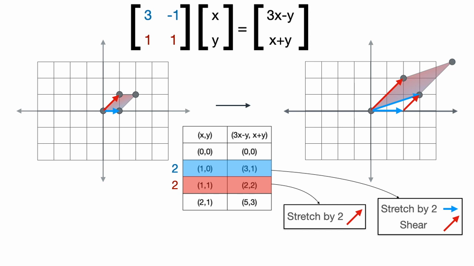

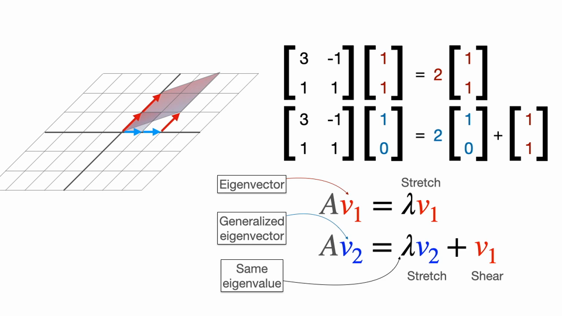

| 시각 | 화면 | 내용 |
|---|---|---|
| 13:18–13:30 | $\begin{bmatrix}3&-1\\1&1\end{bmatrix}\begin{bmatrix}1\\1\end{bmatrix}=2\begin{bmatrix}1\\1\end{bmatrix}$, $\begin{bmatrix}3&-1\\1&1\end{bmatrix}\begin{bmatrix}1\\0\end{bmatrix}=2\begin{bmatrix}1\\0\end{bmatrix}+\begin{bmatrix}1\\1\end{bmatrix}$ | 구체적 수치 |
| 13:42–13:54 | $Av_1=\lambda v_1$, $Av_2=\lambda v_2+v_1$, 라벨 "Eigenvector", "Generalized eigenvector" | 일반식 |
| 14:00 | 항 아래 "Stretch", "Stretch", "Shear" | 각 항의 역할 |
| 14:06–14:24 | "Same eigenvalue" 라벨이 둘째 식의 $\lambda$를 가리킴 | 두 식의 $\lambda$가 같음 |

$$\mathbf A\mathbf v_1=\lambda\mathbf v_1,\qquad \mathbf A\mathbf v_2=\lambda\mathbf v_2+\mathbf v_1$$

**핵심**:

- 고유벡터 $\mathbf v_1=(1,1)$은 그냥 2배로 늘어나요.
- 일반화 고유벡터 $\mathbf v_2=(1,0)$은 2배가 되고 싶지만 $(2,0)$이 아니라 $(3,1)$로 가요. 모자란 $(1,1)$이 정확히 $\mathbf v_1$이라서, "$\mathbf v_2$ 방향 2배 늘이기 + $\mathbf v_1$ 방향 밀기"예요.
- 일반화 고유벡터의 $\lambda$는 항상 짝이 되는 고유벡터의 고윳값과 같아요. 영상은 "다르면 진짜 고유벡터가 하나 더 생긴다"고만 하고 자세한 증명은 생략해요.
- 수업 기호로 정리하면 둘째 식은 $(\mathbf A-\lambda\mathbf I)\mathbf v_2=\mathbf v_1\neq\mathbf 0$, 그리고 $(\mathbf A-\lambda\mathbf I)^2\mathbf v_2=(\mathbf A-\lambda\mathbf I)\mathbf v_1=\mathbf 0$이에요. 직접 확인: $\mathbf A-2\mathbf I=\begin{bmatrix}1&-1\\1&-1\end{bmatrix}$이고 $(\mathbf A-2\mathbf I)(1,0)^T=(1,1)^T$, $(\mathbf A-2\mathbf I)^2=\mathbf 0$이에요.
- 영상 표현 짚기: 영상은 WolframAlpha 표시를 따라 "generalized eigenvalue 2"라고 부르지만, 일반화 고유벡터에 따로 붙는 새 고윳값이 있는 것은 아니에요. 같은 고윳값 $\lambda=2$예요. 선형대수에서 "generalized eigenvalue"는 보통 $\mathbf A\mathbf x=\lambda\mathbf B\mathbf x$ 문제를 가리키는 다른 용어예요.

## 9. 일반화 고유공간: 평면에서 (14:25–17:05)

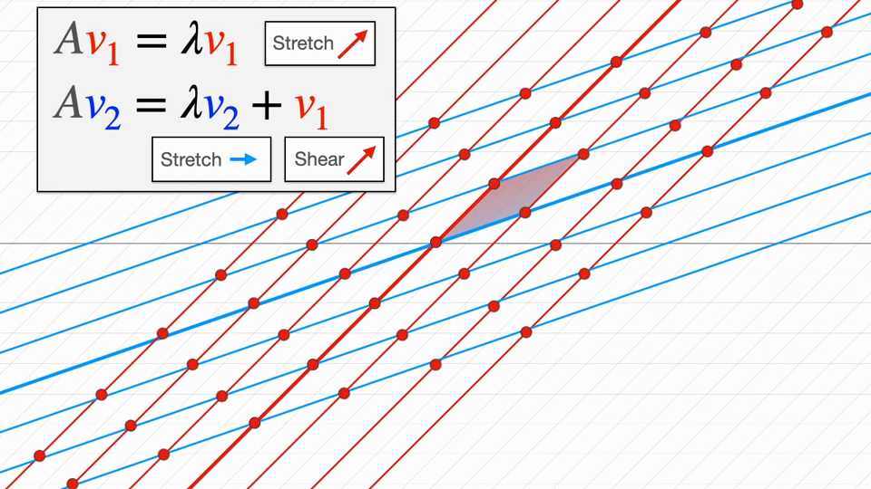

| 시각 | 화면 | 내용 |
|---|---|---|
| 14:36 | 회색 상자 $Av_1=\lambda v_1$, $Av_2=\lambda v_2+v_1$, 작은 평행사변형 | 두 식을 들고 시작 |
| 14:42–14:54 | 빨간 직선(고유벡터 방향), 파란 직선(일반화 고유벡터 방향, 가로) | 빨강은 고유공간, 파랑은 회전하므로 고유공간이 아님 |
| 15:06–15:12 | 두 직선과 평행한 빨강·파랑 평행선 여러 개 | 평행선으로 변환을 봄 |
| 15:18–15:30 | 첫 식 옆 "Stretch ↗" 상자, 평행선 간격이 벌어짐 | 첫 식: $\mathbf v_1$ 방향 늘이기 |
| 15:36–15:48 | 둘째 식 아래 "Stretch →", 평행사변형 커짐 | 둘째 식: $\mathbf v_2$ 방향 늘이기 |
| 15:54–16:06 | "Shear ↗" 추가, 파란 선들이 기울고 교점에 빨간 점들 | $\mathbf v_1$ 방향 밀기 |
| 16:24–16:54 | 빨간 직선만 남고 "Eigenspace" 라벨, 빨간 직선에 평행한 파란 선들, 밀리면서도 같은 선 모음 유지 | 고유공간 + 나머지 평면 |
| 17:00–17:06 | 화면 전체가 하늘색, "Generalized eigenspace" 라벨에서 화살표가 사방으로 | 일반화 고유공간 = 평면 전체 |

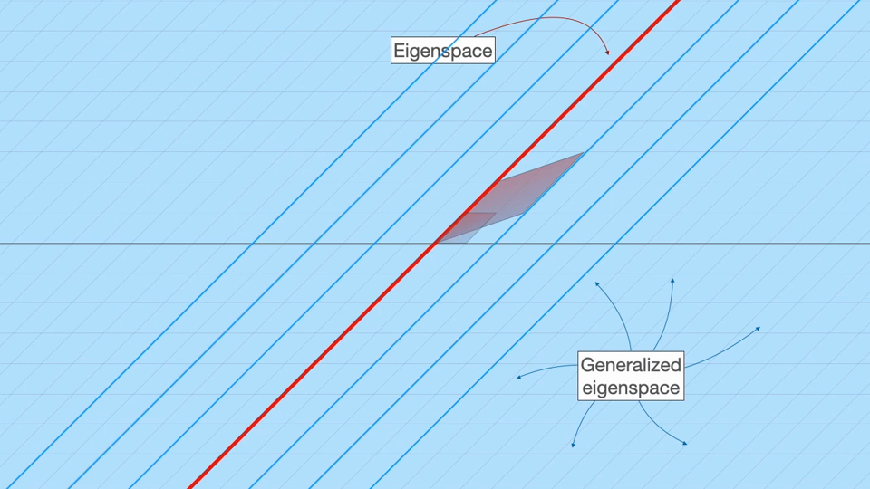

**핵심**: 빨간 직선(고유공간)은 자기 자신으로 가지만, 파란 일반화 고유벡터 방향의 직선은 밀기 때문에 기울어져 자기 자신으로 가지 않아요. 영상은 "조금 반칙 같지만" 평면 전체가 자기 자신으로 가므로 **일반화 고유공간은 평면 전체**라고 말해요.

- 영상 표현 짚기 ①: 15:18 부근 전사는 첫 식의 늘이기로 "파란 선들의 간격이" 벌어진다고 하는데, $\mathbf v_1$ 방향으로 늘이면 $\mathbf v_1$을 가로지르는 선($\mathbf v_2$에 평행한 선)들 사이 간격이 벌어진다는 뜻이에요. 화면 색과 말의 대응은 시트 해상도로 확실히 확인하지 못했어요.
- 영상 표현 짚기 ②: 16:30 이후 "밀어도 이 파란 선들은 그대로"라는 말은 $\mathbf v_1$에 평행한 직선 **모음**이 그 모음으로 간다는 뜻이에요. 각 직선 $\{\mathbf p+t\mathbf v_1\}$은 $\{\mathbf A\mathbf p+t\lambda\mathbf v_1\}$, 즉 $\mathbf v_1$에 평행한 **다른** 직선으로 가요. 원점을 지나는 직선만 자기 자신으로 가요.
- 정확한 정의(영상 밖): 이 예에서 $(\mathbf A-2\mathbf I)^2=\mathbf 0$이라 $\ker(\mathbf A-2\mathbf I)^2=\mathbb R^2$, 즉 일반화 고유공간이 평면 전체인 것이 식으로도 맞아요.

## 10. 더 높은 차원: 3차원에서의 일반화 고유공간 (17:05–18:15)

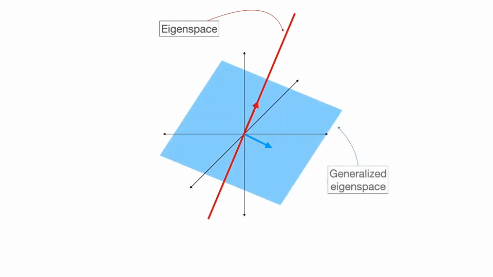

| 시각 | 화면 | 내용 |
|---|---|---|
| 17:12–17:18 | 3차원 좌표축 | $3\times3$ 행렬 |
| 17:24 | 빨간 화살표(고유벡터), 파란 짧은 화살표(일반화 고유벡터) | |
| 17:30 | 빨간 직선 + "Eigenspace" | 자기 자신으로 가는 직선 |
| 17:36–18:12 | 두 화살표를 품은 하늘색 평면 + "Generalized eigenspace" | 자기 자신으로 가는 평면 |

**핵심**: 3차원에서는 평면이 공간 전체가 아니므로 "자기 자신으로 가는 평면"이 의미 있는 정보가 돼요. 차원이 더 커지면 직선 → 평면 → 3차원 공간 … 처럼 점점 큰 일반화 고유공간이 생길 수 있어요.

- 영상 표현 짚기: 영상은 일반화 고유공간을 "변환이 자기 자신으로 보내는 가장 작은 차원의 공간"이라고 말해요. 이것은 직관이고 정의로는 부정확해요. 자기 자신으로 가는(불변) 부분공간은 여러 개이고, 예를 들어 고유공간 직선도 불변이에요. 정확한 정의는 아래 "영상에서 빠진 것" 2번을 보세요.

## 11. 마무리 (18:15–19:18)

18:18 감사 인사("With a little help from my friends…": Martha Yip, Alejandro Morales), 18:30 저자 책 광고·할인 코드, 18:54 이후 구독·SNS 안내. 내용 없음.

---

## 수업 내용과 연결하기

| 영상 표현 | 수업 용어 | 수식 |
|---|---|---|
| matrix as a linear transformation (격자 → 격자) | 선형변환, 행렬 $\mathbf A\in\mathbb R^{n\times n}$ | $\mathbf x\mapsto\mathbf A\mathbf x$ |
| eigenvector / eigenvalue | 고유벡터 / 고윳값 | $\mathbf A\mathbf x=\lambda\mathbf x,\ \mathbf x\neq\mathbf 0$ |
| finding them with the determinant polynomial | 특성방정식, 특성다항식 | $p_{\mathbf A}(\lambda)=\det(\mathbf A-\lambda\mathbf I_n)=0$ |
| eigenspace (자기 자신으로 가는 직선) | 고유공간 $E_\lambda$ | $E_\lambda=\{\mathbf x:(\mathbf A-\lambda\mathbf I)\mathbf x=\mathbf 0\}=\ker(\mathbf A-\lambda\mathbf I)$ |
| eigenbasis | 고유기저, 대각화의 $\mathbf P$ | $\mathbf P=[\mathbf p_1\ \cdots\ \mathbf p_n]$, $\mathbf A\mathbf p_i=\lambda_i\mathbf p_i$ |
| "two stretchings in two directions" | 대각화 / 고윳값 분해(EVD) | $\mathbf A=\mathbf P\mathbf D\mathbf P^{-1}$, $\mathbf D=\mathbf P^{-1}\mathbf A\mathbf P$ |
| 예: $\begin{bmatrix}2&1\\0&3\end{bmatrix}$ | 대칭이 아니어도 대각화 가능(고유벡터가 수직은 아님) | $\mathbf P=\begin{bmatrix}1&1\\1&0\end{bmatrix}$, $\mathbf D=\mathrm{diag}(3,2)$ |
| shear, defective matrix | 결함 행렬(defective): 독립 고유벡터가 $n$개보다 적어 대각화 불가 | 예: $\begin{bmatrix}1&1\\0&1\end{bmatrix}$ (인터렉티브 04의 결함 행렬 예와 같음) |
| 예: $\begin{bmatrix}3&-1\\1&1\end{bmatrix}$ | 중근 $\lambda=2$, 고유공간 1차원 | $p_{\mathbf A}(\lambda)=(\lambda-2)^2$, $E_2=\operatorname{span}\{(1,1)^T\}$ |
| generalized eigenvector | 일반화 고유벡터(수업 밖) | $(\mathbf A-\lambda\mathbf I)\mathbf v_2=\mathbf v_1$, $(\mathbf A-\lambda\mathbf I)^2\mathbf v_2=\mathbf 0$ |
| "stretch + shear" 기저 | 조르단 형식(수업 밖) | $\mathbf P^{-1}\mathbf A\mathbf P=\begin{bmatrix}2&1\\0&2\end{bmatrix}$, $\mathbf P=[\mathbf v_1\ \mathbf v_2]=\begin{bmatrix}1&1\\1&0\end{bmatrix}$ |
| generalized eigenspace | 일반화 고유공간(수업 밖) | $G_\lambda=\ker(\mathbf A-\lambda\mathbf I)^{m}$, $m$ = $\lambda$의 중복도 |

검산: 마지막 줄 위의 조르단 형식은 $\mathbf A\mathbf P=\begin{bmatrix}2&3\\2&1\end{bmatrix}=\mathbf P\begin{bmatrix}2&1\\0&2\end{bmatrix}$로 확인돼요. 대각 자리에 고윳값이 남고, 대각선 바로 위의 1이 영상의 "shear" 항 $+\mathbf v_1$이에요.

### 영상에서 빠진 것

1. **고윳값을 구하는 계산**: 영상은 WolframAlpha로 넘어가요. 수업에서는 특성방정식 $\det(\mathbf A-\lambda\mathbf I_n)=0$의 근으로 고윳값을 구하고, 각 $\lambda$를 $(\mathbf A-\lambda\mathbf I)\mathbf x=\mathbf 0$에 대입해 고유공간의 기저를 구해요(정리노트 1102 2장, 3.2 예제).
2. **일반화 고유공간의 정확한 정의**: $G_\lambda=\ker(\mathbf A-\lambda\mathbf I)^{m}$ ($m$은 특성다항식에서 $\lambda$의 중근 횟수, 즉 대수적 중복도)예요. $\dim G_\lambda=m$이고 $E_\lambda\subseteq G_\lambda$예요. 영상의 "가장 작은 불변 공간"이라는 말은 이 정의의 직관일 뿐이에요.
3. **대수적 중복도와 기하적 중복도**: 결함이라는 말은 기하적 중복도 $\dim E_\lambda$가 대수적 중복도보다 작다는 뜻이에요. 영상의 $\begin{bmatrix}3&-1\\1&1\end{bmatrix}$은 대수적 중복도 2, 기하적 중복도 1이에요. 수업에서는 "중근이어도 고유벡터가 basis를 이루면 대각화돼요"(정리노트 1102 3.2의 $\lambda=1$ 중근 예)와 "중근에서 고유벡터가 모자라면 defective"로 같은 내용을 다뤘어요.
4. **같은 고윳값이어야 하는 이유**: 영상은 증명을 생략해요. $\mathbf v_2$가 $(\mathbf A-\mu\mathbf I)^k\mathbf v_2=\mathbf 0$을 만족하는 $\mu$는 $\mathbf A$의 고윳값이어야 하고, 사슬 $(\mathbf A-\mu\mathbf I)^{k-1}\mathbf v_2$가 고윳값 $\mu$의 고유벡터가 되므로 사슬의 끝 고유벡터와 같은 고윳값을 가져요.
5. **회전의 복소 고윳값**: $\begin{bmatrix}0&-1\\1&0\end{bmatrix}$의 특성다항식은 $\lambda^2+1$이라 $\lambda=\pm i$예요. 수업(실수 대칭행렬 중심)에서는 다루지 않아요.
6. **PCA와의 연결**: PCA에서 쓰는 공분산 행렬은 실수 대칭행렬이라 스펙트럼 정리에 따라 항상 정규직교 고유기저로 직교 대각화돼요($\mathbf S=\mathbf P\mathbf D\mathbf P^T$). 그래서 이 영상의 결함 행렬·일반화 고유벡터 상황은 PCA에서는 생기지 않아요. 중근이 나와도 고유공간 차원이 중복도와 같고, 그 안에서 Gram–Schmidt로 직교 기저를 고르면 돼요(인터렉티브 03).
7. **"모든 비특이 변환 = 늘이기·회전·밀기의 조합"**: 영상은 근거 없이 말해요. 엄밀한 형태는 특잇값 분해(회전·늘이기·회전)나 QR 분해 같은 행렬 분해로 나와요.
