# 주성분 분석 / Principal Component Analysis (PCA) — Serrano.Academy (Luis Serrano) 영상 정리

- **영상**: [Principal Component Analysis (PCA)](https://www.youtube.com/watch?v=g-Hb26agBFg), 26분 33초
- **위치**: 사용자가 지정한 날짜 1102 (PCA Part 1 수업). `강의노트/Lecture05_PCA_Part1_rev.pdf` 3쪽 **Warm-Up**이 이 영상을 지정하고, 14쪽 *Idea* 슬라이드 그림의 출처도 "Youtube channel by Luis Serrano"입니다.
- **정리 방식**: 6초 간격으로 뽑은 프레임 266장(시트 30장)을 직접 보고 전사본 [`STT/Principal_Component_Analysis_PCA.md`](../../../../STT/Principal_Component_Analysis_PCA.md)와 맞춰 정리했습니다. 타임스탬프는 6초 단위의 근삿값입니다.
- **전사 모델**: gemini-3.5-flash (Vertex AI API), 3개 파트 모두 성공

> **한 줄 요약**
> PCA는 데이터를 **"가장 넓게 퍼져 보이는 각도에서 찍은 사진"**으로 줄이는 방법입니다. 중심화한 데이터로 **공분산 행렬**을 만들고, 그 **고유벡터**(퍼진 방향)와 **고윳값**(퍼진 정도) 중 큰 것 몇 개만 남겨 그 방향들 위로 사영합니다.

---

## 1. 차원 축소 = 사진 찍기 (0:00–2:00)

| 시각 | 화면 | 내용 |
|---|---|---|
| 0:00 | 제목 *Principal Component Analysis (PCA)*, Luis Serrano | 시작 |
| 0:06–0:42 | 발표자 얼굴 | 차원 축소: 큰 표의 **열(column) 수를 줄이되 정보는 최대한 남긴다**. 순서는 사영 → 분산·공분산·공분산 행렬 → 고윳값·고유벡터 → PCA |
| 0:48–1:06 | *Taking a picture*: 친구 얼굴 9개를 카메라가 여러 각도(왼쪽 아래, 아래, …)에서 찍음 | 어느 각도에서 찍어야 모두가 잘 보일까? |
| 1:12–1:30 | *Dimensionality Reduction*: 점 10개. 왼쪽 가파른 직선 위 사영(점이 뭉침), 오른쪽 아래 완만한 직선 위 사영(점이 넓게 퍼짐) | 데이터의 "사진"은 직선 위로의 사영 |
| 1:36–1:54 | 두 사영을 가로로 눕혀 나란히 놓고, 오른쪽 사영을 빨간 타원으로 강조 | 오른쪽이 더 좋다: 점들이 더 벌어져 서로 구별된다 |

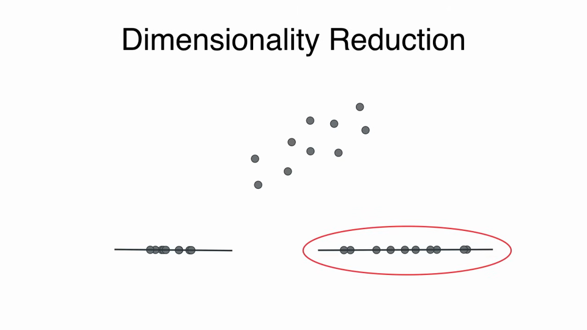

- **화면**: 위에 원래 2차원 점들, 아래에 두 가지 1차원 사영 결과. 왼쪽 사영은 점이 겹쳐 뭉쳐 있고, 빨간 타원으로 강조한 오른쪽 사영은 점 사이 간격이 넓습니다.
- **핵심**: "좋은 사영"의 기준은 **사영한 뒤 점들이 얼마나 퍼져 있는가**입니다. 이 영상의 목표는 이 이상적인 직선을 찾는 것입니다.
- 전사본에는 "keep it as **sparse** as possible"이라고 적혀 있지만, 문맥상 뜻은 **spread out**(넓게 퍼지게)입니다. 발화 실수이거나 전사 오류로 보입니다.

## 2. 집 데이터로 본 동기: 5개 특징 → 2개 특징 (2:00–5:12)

| 시각 | 화면 | 내용 |
|---|---|---|
| 2:06–2:36 | *Housing Data*: Size / Number of rooms / Number of bathrooms, 이어서 Schools around / Crime rate | 열이 5개인 집 데이터. 줄일 수 있을까? |
| 2:42–3:12 | 앞 세 개 → **Size feature**, 뒤 두 개 → **Location feature** 화살표 | 크기 관련 3개를 하나로, 동네 관련 2개를 하나로 묶음(합이나 가중합) |
| 3:18–3:42 | 산점도: 가로 *Number of Rooms*(1–5), 세로 *Size*(100–400), 집 아이콘 5채 | 2개 → 1개로 줄이는 쉬운 예. 방이 많을수록 집이 큼 |
| 3:48–4:06 | 집들을 지나는 검은 직선 | 이 직선에 사영하면 집들이 가장 넓게 퍼짐 |
| 4:12–4:24 | 집들이 직선 위로 수직 이동, 다시 가로로 눕혀 *Size feature* 축 하나로 표시 | 2차원(2열 표) → 1차원(1열 표) |
| 4:30–5:06 | *2 dimensions (size, number of rooms) → 1 dimension (size feature)*, *5 dimensions → 2 dimensions (Size feature, Location feature)* | 2→1을 그림으로 보였지만 5→2도 같은 원리 |

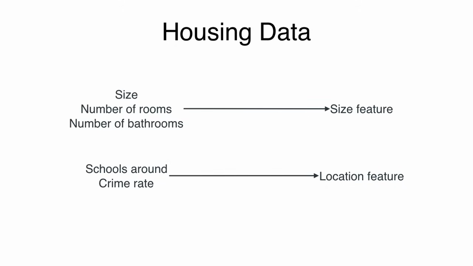

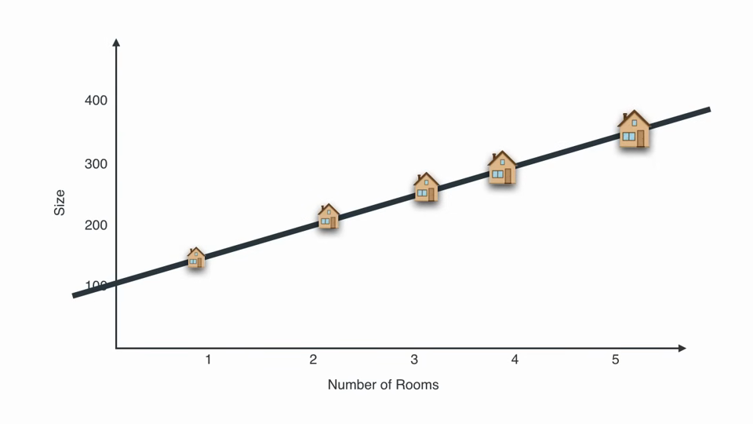

- **화면**: 가로축 방 개수, 세로축 크기인 산점도에서 집 5채가 직선 위로 **수직으로** 옮겨집니다.
- **핵심**
  - 각 집은 직선에 **수선을 내려** 그 발로 보냅니다. 이것이 (직교) 사영입니다.
  - 영상은 **선형 회귀와 다르다**고 짚습니다. 회귀는 데이터에 가장 가까운 직선을 맞추고(세로 방향 오차), PCA는 **사영 결과가 가장 잘 퍼지는** 직선을 고릅니다. 목적이 다릅니다.
  - 사영된 데이터는 원래 데이터와 완전히 같지는 않습니다. 대신 각 집이 숫자 2개가 아니라 **숫자 1개**로 표현됩니다.

## 3. 평균과 분산 (5:12–8:00)

| 시각 | 화면 | 내용 |
|---|---|---|
| 5:12–5:48 | *Mean*: 무게 없는 막대 위 점 3개, 왼쪽에 *wall*, 눈금 1–6, 점은 1·2·6 | 벽에서 각 점까지 거리를 잰다 |
| 5:54 | $\text{Mean}=\frac{1+2+6}{3}=3$, 3에 받침점(삼각형) | 평균은 막대가 **균형을 이루는 점** |
| 6:00–6:12 | *Variance*: 위에 촘촘한 점 3개, 아래에 넓게 퍼진 점 3개, 둘 다 가운데에서 균형 | 평균은 같지만 퍼짐이 다르다 |
| 6:18–6:54 | 위: 중심까지 거리 1, 0, 1 / 아래: 5, 0, 5 | 중심(평균)까지의 거리를 잰다 |
| 7:00–7:12 | $\text{Variance}=\frac{1^2+0^2+1^2}{3}=2/3$, $\frac{5^2+0^2+5^2}{3}=50/3$ | 거리를 **제곱해서 평균**. 왼쪽 거리는 좌표를 빼면 음수가 되므로 제곱 |
| 7:18–7:54 | 다시 1·2·6 예: 평균 3까지 거리 2, 1, 3 | $\text{Variance}=\frac{2^2+1^2+3^2}{3}=14/3$ |

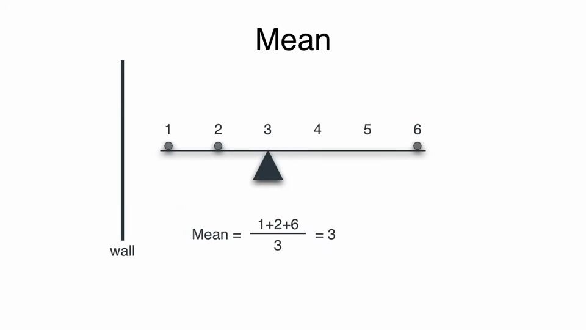

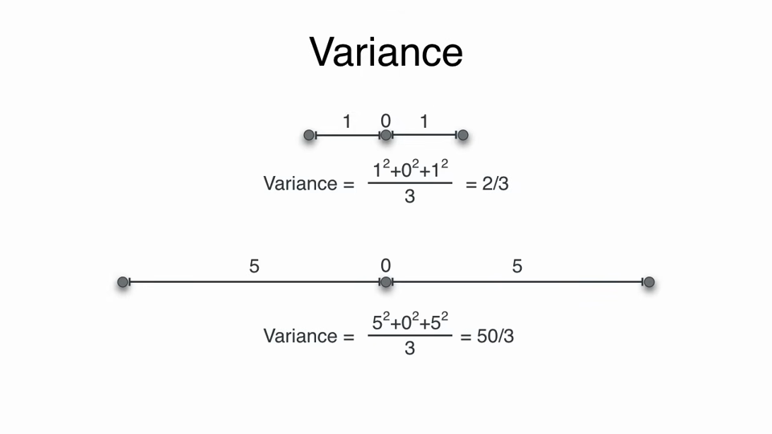

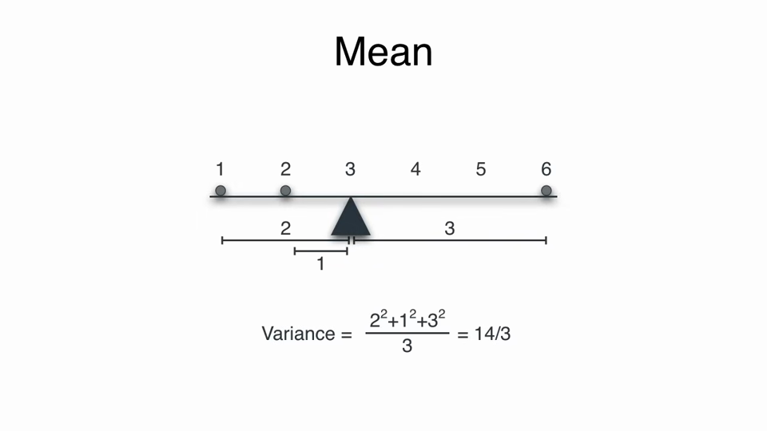

- **핵심**: 분산은 "평균으로부터 떨어진 거리의 제곱의 평균", 곧 **얼마나 퍼져 있는가**의 척도입니다.
  $$
  \bar x=\frac1N\sum_{n=1}^N x_n,\qquad \operatorname{Var}(x)=\frac1N\sum_{n=1}^N (x_n-\bar x)^2
  $$
- 영상은 $N$으로 나눕니다(표본 분산의 $N-1$이 아님). 수업의 데이터 공분산 행렬 $\mathbf S=\frac1N\mathbf X\mathbf X^T$도 $\frac1N$이라 같은 약속입니다.

## 4. 2차원 분산의 한계와 공분산 (8:00–12:18)

| 시각 | 화면 | 내용 |
|---|---|---|
| 8:00–8:30 | *Variance?*: 2차원 점 구름. 점들을 x축과 y축으로 각각 떨어뜨림 → *x-variance*, *y-variance* | 2차원에서는 가로 퍼짐과 세로 퍼짐 두 숫자로 본다 |
| 8:36–9:48 | 점 3개짜리 두 집합: 왼쪽은 왼쪽 위→오른쪽 아래, 오른쪽은 왼쪽 아래→오른쪽 위. $\text{x-variance}=\frac{2^2+0^2+2^2}{3}=8/3$, $\text{y-variance}=\frac{1^2+0^2+1^2}{3}=2/3$ | 두 집합의 x분산·y분산이 **똑같다**. 그런데 모양은 전혀 다르다 |
| 9:54–10:42 | *Covariance*: 점 $(-2,1),(2,1),(0,0),(-2,-1),(2,-1)$, *Product of coordinates*: $(2,1),(-2,-1)\to+2$(빨강), $(-2,1),(2,-1)\to-2$(청록), 원점 $\to0$ | 좌표의 **곱**이 두 집합을 구별한다 |
| 10:24–10:48 | $\text{covariance}=\frac{(-2)+0+(-2)}{3}=-4/3$, $\frac{2+0+2}{3}=4/3$ | 왼쪽 집합은 음의 공분산, 오른쪽은 양의 공분산 |
| 11:00–11:36 | 3×3 격자 9점 $(\pm2 \text{ 또는 } 0,\ \pm1 \text{ 또는 } 0)$, $\frac{-2+0+2+0+0+0+2+0-2}{9}=0$ | 곱이 서로 상쇄되어 공분산 0 |
| 11:48–12:12 | 점 구름 3개 아래 *negative covariance* / *covariance zero (or very small)* / *positive covariance* | 모양만 보고 부호를 짐작 |

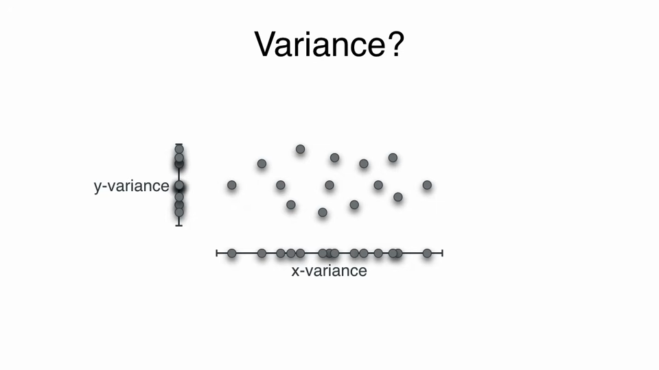

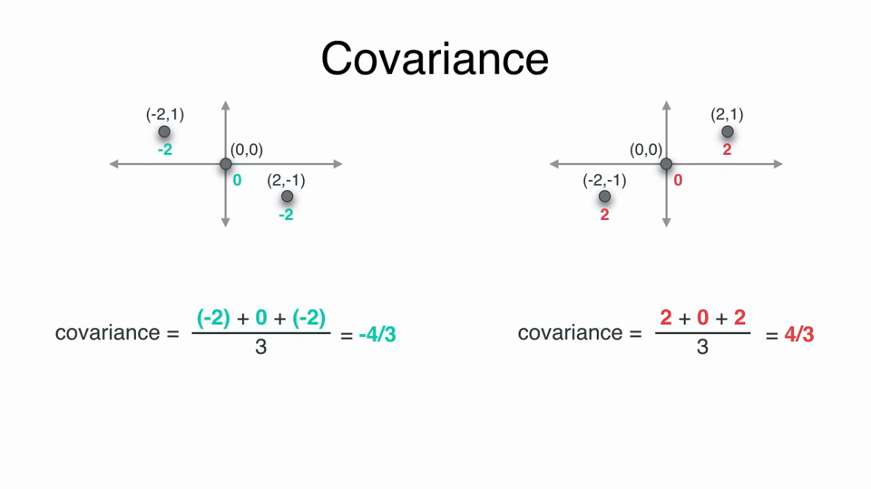

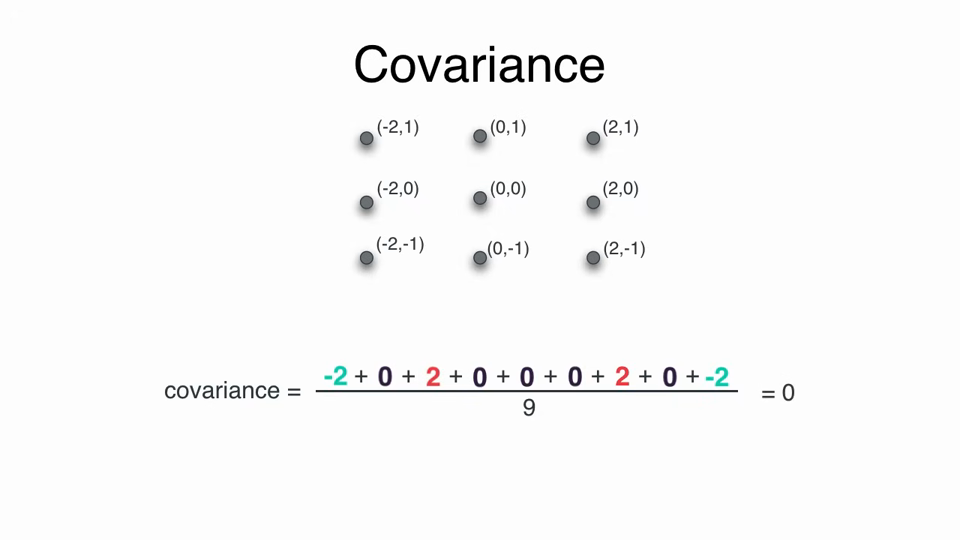

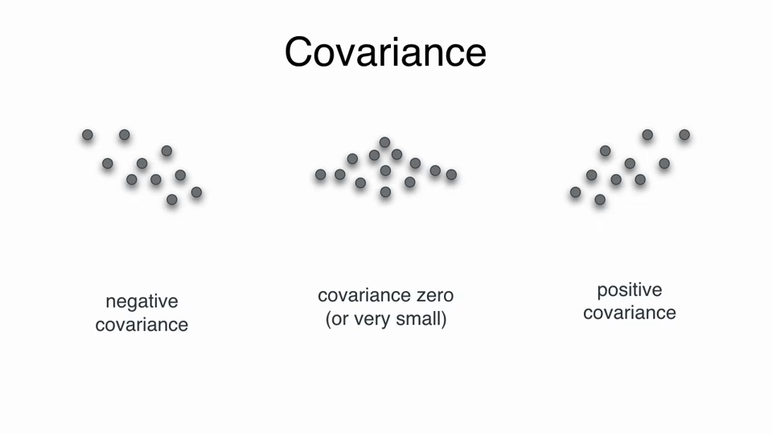

- **핵심**: 분산이 "한 좌표의 제곱의 합"이었다면, 공분산은 **"두 좌표의 곱의 합"**입니다(평균이 0인 점들이므로 좌표 자체가 평균과의 차입니다).
  $$
  \operatorname{Cov}(x,y)=\frac1N\sum_{n=1}^N (x_n-\bar x)(y_n-\bar y)
  $$
- x가 커질 때 y도 커지면(오른쪽 위로 뻗은 대각선) 양수, y가 작아지면(오른쪽 아래로 뻗은 대각선) 음수입니다. 영상은 상관(correlation)과도 밀접하다고 덧붙입니다.
- 화면의 예들은 모두 **평균이 이미 0인 점**들이라 평균을 빼는 단계가 보이지 않습니다. 일반 데이터에서는 먼저 평균을 빼야 합니다.

## 5. 중심화와 공분산 행렬 (12:18–13:54)

| 시각 | 화면 | 내용 |
|---|---|---|
| 12:18–12:24 | 오른쪽 위로 뻗은 점 10개, 이어서 좌표축 추가 | PCA를 시작할 데이터 |
| 12:30 | 점들이 원점 주변으로 이동 | **중심화**: 평균(무게중심)을 원점으로 옮김 |
| 12:48–13:00 | *Covariance matrix*: 빈 괄호 → $\operatorname{Var}(X)$ → $\operatorname{Var}(Y)$ → $\operatorname{Cov}(X,Y)$ 두 칸 | 대각선에 분산, 나머지 두 칸에 공분산(같은 값을 두 번) |
| 13:06–13:24 | $\Sigma=\begin{pmatrix}\operatorname{Var}(X)&\operatorname{Cov}(X,Y)\\\operatorname{Cov}(X,Y)&\operatorname{Var}(Y)\end{pmatrix}$ | 문헌에서는 보통 $\Sigma$라고 부른다 |
| 13:30–13:54 | 아래에 $\begin{pmatrix}9&4\\4&3\end{pmatrix}$ | 예시 숫자: x로 많이 퍼짐(9), y로 덜 퍼짐(3), 오른쪽 위 대각선이라 공분산 양수(4) |

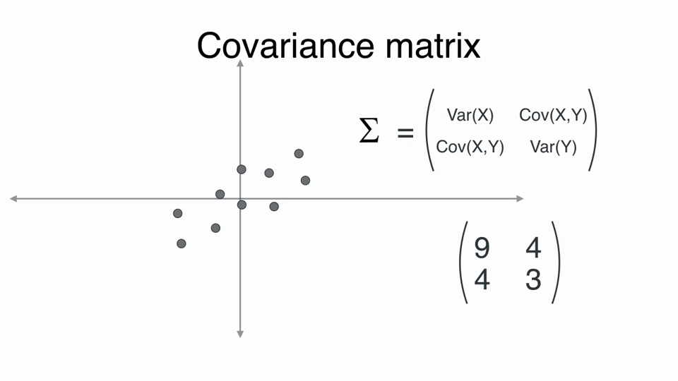

- **핵심**: 공분산 행렬 하나에 "가로 퍼짐, 세로 퍼짐, 함께 움직이는 정도"가 모두 들어 있습니다.
- **주의**: $9,4,4,3$은 영상이 **"지어낸(make up) 숫자"**라고 직접 말합니다. 화면의 점 10개에서 실제로 계산한 값이 아닙니다.

## 6. 선형변환으로 본 행렬: 원이 타원이 된다 (13:54–18:00)

| 시각 | 화면 | 내용 |
|---|---|---|
| 13:54–14:42 | *Linear Transformations*: 왼쪽 평면 → 오른쪽 평면, $(x,y)\to(9x+4y,\ 4x+3y)$. 첫 행(청록 원)이 첫 성분, 둘째 행(빨간 원)이 둘째 성분 | 행렬 = 평면에서 평면으로 가는 함수 |
| 14:48–16:06 | 표: $(0,0)\to(0,0)$, $(1,0)\to(9,4)$, $(0,1)\to(4,3)$, $(-1,0)\to(-9,-4)$, $(0,-1)\to(-4,-3)$ | 점을 하나씩 보내 본다(그림은 축척이 맞지 않음) |
| 16:12–16:24 | 왼쪽 노란 **단위원** → 오른쪽 기울어진 노란 **타원** | 평면이 대각선 방향으로 늘어남 |
| 16:30–17:00 | 빨간 화살표 $\binom{2}{1}$이 타원 장축으로, 길이 **11** | 방향 $(2,1)$으로 11배 늘어남 |
| 17:06–17:24 | 청록 화살표 $\binom{-1}{2}$, 길이 **1** | 방향 $(-1,2)$로는 1배(그대로) |
| 17:30–17:54 | *Eigenvectors (direction)* $\binom{2}{1},\binom{-1}{2}$ / *Eigenvalues (magnitude)* 11, 1 | 두 번 늘이기. 이 경우 두 방향은 서로 수직 |

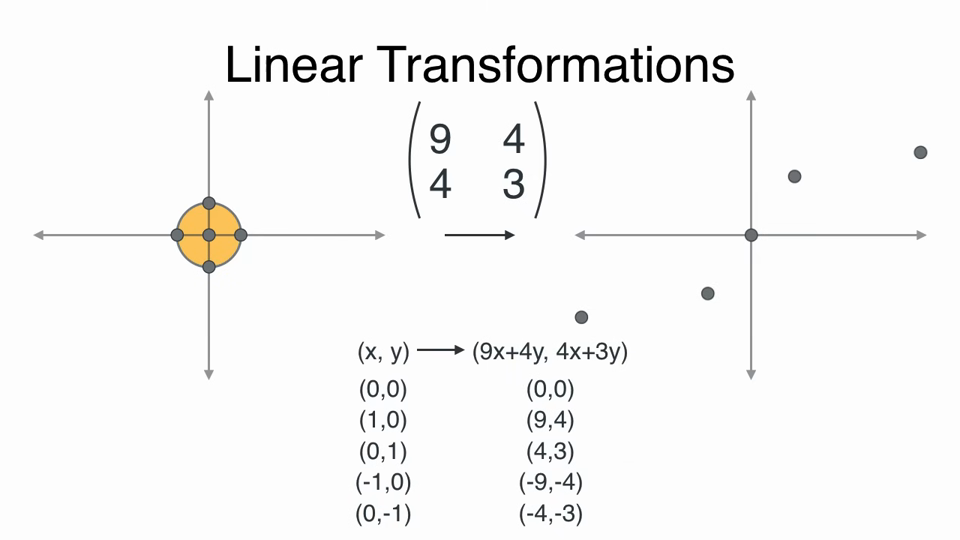

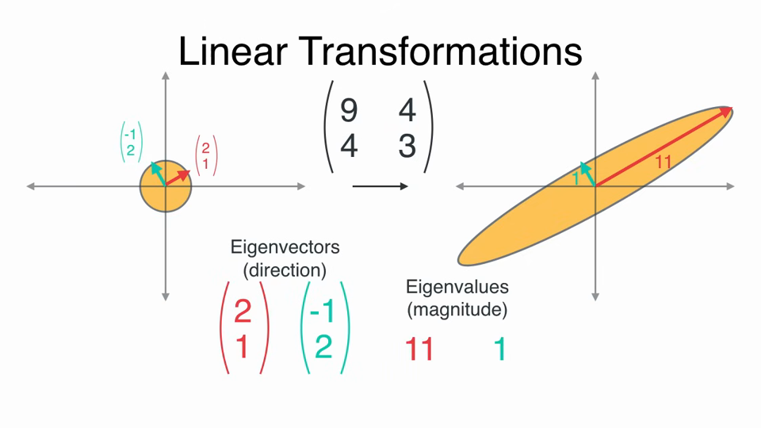

- **화면**: 단위원 안의 빨간·청록 화살표가 오른쪽 타원에서는 빨간 화살표는 길이 11, 청록 화살표는 길이 1이 됩니다.
- **핵심**: 행렬은 평면을 **고유벡터 방향으로 고윳값만큼 늘이는** 변환입니다. 단위원이 장축 11, 단축 1인 타원으로 바뀌는 것이 그 모습입니다.
- **영상 표현 짚기**: 영상은 $(2,1)$을 "벡터가 아니라 방향"이라고 말합니다. 길이 $\sqrt5$인 벡터이므로, 수업처럼 단위 고유벡터로 쓰려면 $\frac1{\sqrt5}(2,1)$로 정규화해야 합니다.

## 7. 고유벡터·고윳값 계산 (18:00–20:42)

| 시각 | 화면 | 내용 |
|---|---|---|
| 18:12–18:48 | *Eigenstuff*: 아무 벡터(주황)는 변환 후 방향이 바뀜. 빨강·청록만 방향이 그대로 | 고유벡터 = 변환해도 방향이 유지되는 벡터 |
| 18:48–19:06 | $\begin{pmatrix}9&4\\4&3\end{pmatrix}v=\lambda v$, 화살표로 *Eigenvector*, *Eigenvalue* 표시 | 행렬을 곱한 결과 = 숫자를 곱한 결과 |
| 19:06–19:18 | WolframAlpha: `eigenvectors ((9,4),(4,3))` → $v_1=(2,1)$, $v_2=(-1,2)$, $\lambda_1=11$, $\lambda_2=1$ | 가장 쉬운 방법: 계산기에 넣기 |
| 19:18–19:54 | *Characteristic Polynomial* $\begin{vmatrix}x-9&-4\\-4&x-3\end{vmatrix}=(x-9)(x-3)-(-4)(-4)=x^2-12x+11=(x-11)(x-1)$, *Eigenvalues 11 and 1* | 특성다항식의 두 근이 고윳값 |
| 20:00–20:30 | *Eigenvectors*: $\begin{pmatrix}9&4\\4&3\end{pmatrix}\binom uv=11\binom uv\Rightarrow\binom uv=\binom21$, $=1\binom uv\Rightarrow\binom uv=\binom{-1}2$ | 고윳값을 넣고 연립방정식을 풀면 고유벡터 |
| 20:30–20:42 | *3blue1brown* 썸네일 (Eigenvectors / Eigenvalues, $A\vec v=\lambda\vec v$) | 더 자세한 설명은 3Blue1Brown 선형대수 시리즈 추천 |

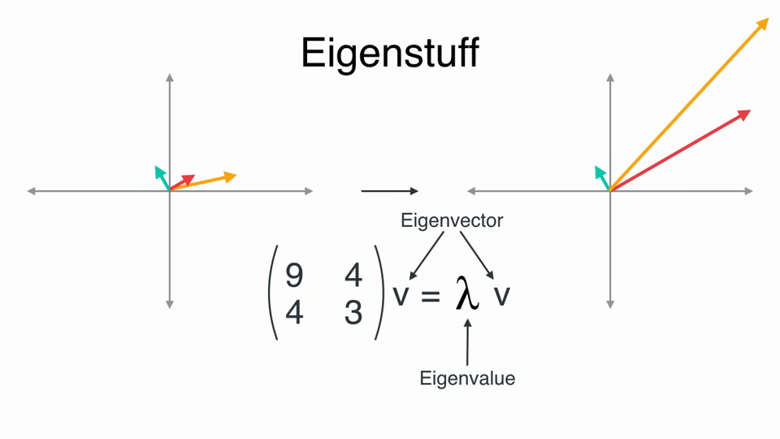

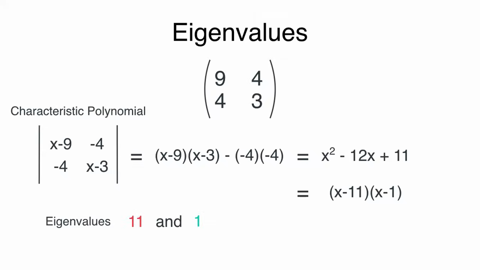

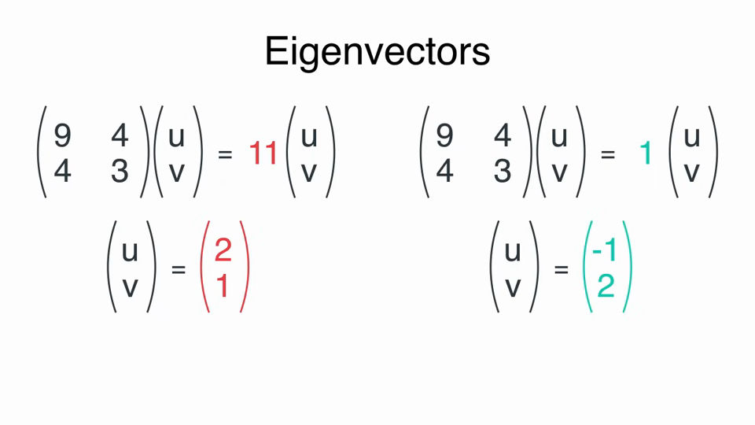

- **핵심 식**
  $$
  \Sigma\mathbf v=\lambda\mathbf v,\qquad \det(\lambda\mathbf I-\Sigma)=\lambda^2-12\lambda+11=(\lambda-11)(\lambda-1)=0
  $$
- **검산**: $\begin{pmatrix}9&4\\4&3\end{pmatrix}\binom21=\binom{22}{11}=11\binom21$, $\begin{pmatrix}9&4\\4&3\end{pmatrix}\binom{-1}{2}=\binom{-1}{2}=1\cdot\binom{-1}{2}$. 고윳값의 합 $11+1=12$는 대각합 $9+3$, 곱 $11\cdot1=11$은 행렬식 $27-16$과 같습니다.
- 영상은 변수 $x$를 고윳값 자리에 씁니다($|x\mathbf I-\Sigma|$). 수업 표기로는 $\lambda$입니다. 또 고유벡터 성분에 $v$를 다시 써서 $\binom uv$의 $v$와 벡터 $v$가 겹친다고 영상도 스스로 짚습니다.

## 8. PCA: 큰 고윳값의 고유벡터로 사영 (20:42–23:42)

| 시각 | 화면 | 내용 |
|---|---|---|
| 20:48–20:54 | 데이터 → 중심화 | 1단계 중심화 |
| 21:00–21:18 | $\Sigma=\begin{pmatrix}9&4\\4&3\end{pmatrix}$, 빨강 $\binom21$/11, 청록 $\binom{-1}2$/1, 점 구름 위에 두 화살표 | 2단계 공분산 행렬, 3단계 고유벡터·고윳값. 데이터가 **어느 방향으로 얼마나** 퍼졌는지 알려 줌 |
| 21:42–22:42 | 대각선 밖 두 4에 청록 동그라미 | 두 고유벡터가 수직인 것은 우연이 아님: $\Sigma$가 **대칭**이기 때문 |
| 23:06–23:12 | 트로피(11)와 장화(1) 그림 | 고윳값 11이 이기고 1은 쫓겨남(gets the boot) |
| 23:12–23:18 | 청록 요소가 지워지고 빨간 방향이 양쪽으로 이어진 직선이 됨 | 남은 방향 = 사영할 직선 |
| 23:24–23:42 | 점들이 빨간 직선 위로 이동 → 가로로 눕힌 1차원 데이터 | 2차원 → 1차원 |

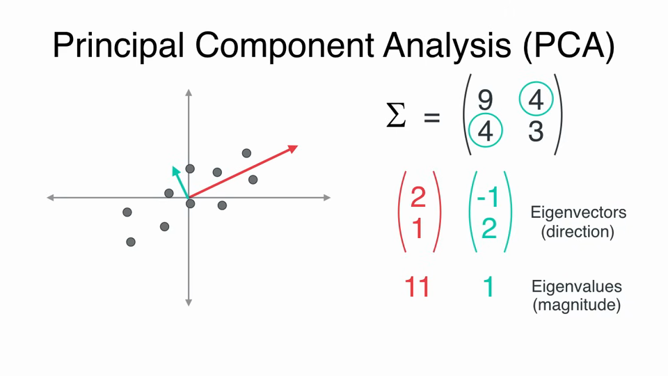

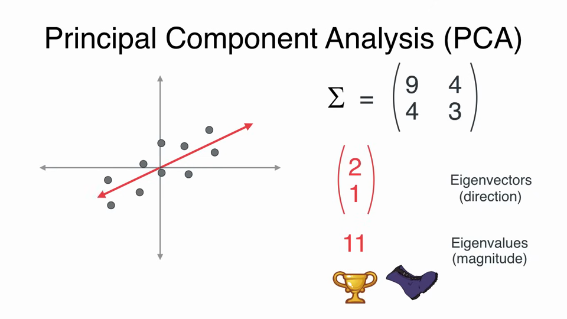

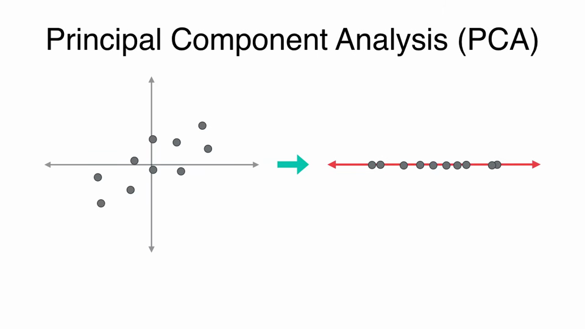

- **대칭행렬에 대해 영상이 말한 두 가지**
  1. 대칭행렬(주대각선에 대해 뒤집어도 같은 행렬)의 고유벡터는 **서로 직교**합니다. 고차원에서도 마찬가지입니다.
  2. 대칭행렬의 고윳값은 **실수**라서 변환이 회전 없이 "늘이기"로만 이루어집니다. 일반 행렬은 고윳값이 복소수일 수 있고, 그러면 회전 같은 변환이 됩니다.
  - 공분산 행렬은 같은 값(4)을 위아래에 두 번 넣어 만들기 때문에 **항상 대칭**입니다.
- **핵심**: 가장 큰 고윳값의 고유벡터 방향이 **정보(퍼짐)를 가장 많이 담은 축**이므로 그 축에 사영합니다. 영상은 "한쪽이 다른 쪽보다 11배 중요하다"고 표현합니다.
- **보충(영상에 없는 계산)**: 단위 고유벡터 $\mathbf p_1=\frac1{\sqrt5}\binom21$ 방향으로 사영한 좌표의 분산은
  $$
  \mathbf p_1^T\Sigma\,\mathbf p_1=\tfrac15\,(2,1)\binom{22}{11}=\tfrac{55}{5}=11=\lambda_1
  $$
  입니다. 즉 "magnitude"라고 부른 고윳값은 **그 방향으로 사영했을 때의 분산** 그 자체입니다.

## 9. 큰 그림: 5차원 → 2차원 (23:42–26:00)

| 시각 | 화면 | 내용 |
|---|---|---|
| 23:48–24:12 | *PCA*: *Large Table* (열 $x_1,\dots,x_5$, 행 여러 개) → *5D Plot* (축 5개를 흉내 낸 그림) | 열 5개짜리 큰 표를 5차원 공간의 점으로 |
| 24:18–24:36 | *Covariance matrix* 5×5 (별표로 채움) | 대각선: 각 차원의 분산 / 대각선 밖: 두 차원씩의 공분산. 대칭 |
| 24:42–24:54 | *Eigenstuff* $v_1\ \lambda_1,\dots,v_5\ \lambda_5$, 오른쪽에 *Big* ↑ *Small* 화살표 | 고유벡터 5개와 고윳값을 크기순으로 정렬 |
| 25:00–25:12 | $v_3,v_4,v_5$가 지워지고 $v_1,v_2$만 남음 | 위의 두 개만 고름(몇 개 남길지는 고윳값이나 원하는 차원 수로 결정) |
| 25:12–25:24 | 5D 그림 안에 빨강($v_1$)·청록($v_2$) 화살표, 둘이 펼친 **평면**(그라데이션) | 고른 고유벡터 두 개가 만드는 평면 |
| 25:30–25:48 | 평면에 사영 → *2D Plot* | "그림자" 또는 "사진"을 평면에 찍음 |
| 25:48–26:00 | → *Small Table* (열 $w_1, w_2$) | 열 2개짜리 작은 표가 데이터를 가장 잘 담는다 |

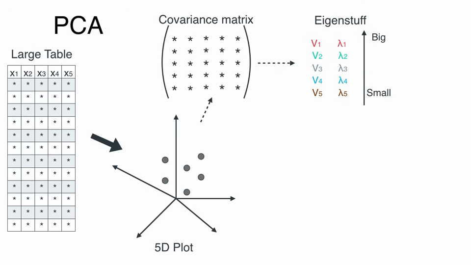

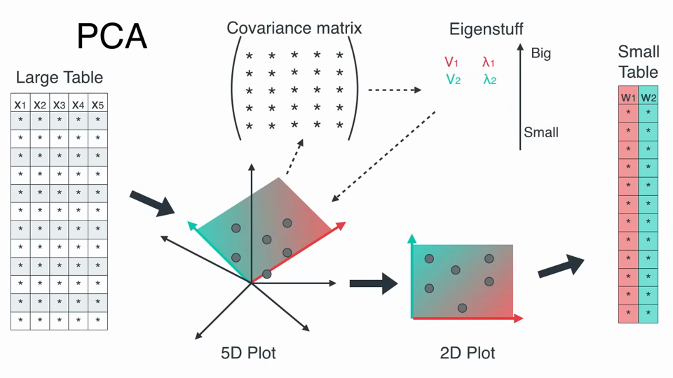

- **핵심 흐름**: 큰 표 → 공분산 행렬 → 고유벡터·고윳값 → 큰 것 $M$개 선택 → 그 고유벡터들이 펼친 부분공간에 사영 → 작은 표
- **영상 표현 짚기**
  - 음성은 "작은 것부터 큰 것 순서로(from small to big) 정렬한다"고 말하지만, 화면은 $\lambda_1$이 *Big*, $\lambda_5$가 *Small*입니다. 실제로는 **큰 고윳값이 위**인 내림차순입니다.
  - "고유벡터를 고윳값 길이로 그린다"는 말은 그림을 위한 표현입니다. 사영할 부분공간은 방향만으로 정해지므로 길이는 결과에 영향을 주지 않습니다.
- 26:00 이후: *Thank you!*, 구독·좋아요 안내와 트위터 계정 @luis_likes_math (한 줄로 생략)

---

## 수업 내용과 연결하기

| 영상 표현 | 수업 용어 | 수식 |
|---|---|---|
| taking a picture / projection over a line | 사영(projection), 사영 좌표 | $z_{1n}=\mathbf b_1^T\mathbf x_n$, $\ \mathbf z_n=\mathbf B^T\mathbf x_n$ |
| number of columns 5 → 2 | 차원 $D$ → $M$ ($M\ll D$) | $\mathbf x_n\in\mathbb R^D,\ \mathbf z_n\in\mathbb R^M$ |
| center it (무게중심을 원점으로) | 중심화(centering), L05 PCA Algorithm S1 | $\mathbf x_n\leftarrow\mathbf x_n-\boldsymbol\mu$ |
| variance, spread out | 분산(variance), 데이터의 에너지 | $\frac1N\sum_n x_n^2$ (중심화 후) |
| covariance = sum of products of coordinates | 공분산 | $\frac1N\sum_n x_n y_n$ (중심화 후) |
| covariance matrix $\Sigma$ | 데이터 공분산 행렬 $\mathbf S$ | $\mathbf S=\frac1N\mathbf X\mathbf X^T,\ \mathbf X\in\mathbb R^{D\times N}$ |
| eigenvector (direction) | 단위 고유벡터 $\mathbf p_i$ | $\mathbf S\mathbf p_i=\lambda_i\mathbf p_i,\ \|\mathbf p_i\|=1$ |
| eigenvalue (magnitude), "matters 11 times" | 고윳값 = 그 방향의 사영 분산 | $V_1=\mathbf b_1^T\mathbf S\mathbf b_1=\lambda_1$ (단, $\mathbf b_1=\mathbf p_1$) |
| characteristic polynomial | 특성방정식 | $\det(\mathbf S-\lambda\mathbf I)=0$ |
| symmetric → perpendicular eigenvectors, real eigenvalues | 스펙트럼 정리, 직교 대각화 | $\mathbf S=\mathbf P\mathbf D\mathbf P^T,\ \mathbf P^T\mathbf P=\mathbf I$ |
| pick the top two, erase the bottom three | 가장 큰 $M$개 고윳값의 고유벡터 = 주부분공간(principal subspace), L05 S3 | $\mathbf B=[\mathbf p_1,\dots,\mathbf p_M]$ |
| project onto the plane, shadow | 주부분공간으로의 사영, L05 S4 | $\tilde{\mathbf x}_n=\mathbf B\mathbf B^T\mathbf x_n$ |
| small table $w_1,w_2$ | 저차원 표현(코드) | $\mathbf z_n=\mathbf B^T\mathbf x_n\in\mathbb R^M$ |
| not linear regression | PCA는 수직 거리(복원오차)를 줄임 (1104) | $\frac1N\sum_n\|\mathbf x_n-\tilde{\mathbf x}_n\|^2$ |

여기서 $\mathbf x_n$은 중심화한 $n$번째 데이터(열벡터), $N$은 데이터 수, $\boldsymbol\mu$는 평균, $\mathbf b_1$은 첫 사영 방향(단위벡터), $\mathbf P$는 단위 고유벡터를 열로 모은 행렬, $\mathbf D$는 고윳값을 대각에 놓은 행렬입니다.

### 영상에서 빠진 것

1. **왜 가장 큰 고윳값의 고유벡터인가(증명)**: 영상은 "가장 중요하니까"라고만 말합니다. 수업은 $\|\mathbf b_1\|=1$ 조건에서 $V_1=\mathbf b_1^T\mathbf S\mathbf b_1$을 최대화하면 $\mathbf S\mathbf b_1=\lambda\mathbf b_1$이 나오고 최댓값이 $\lambda_1$임을 보입니다(1102에서 결론, 1104에서 완결).
2. **단위벡터 조건**: 영상의 $(2,1)$, $(-1,2)$는 길이가 $\sqrt5$입니다. 사영 좌표 $\mathbf b^T\mathbf x$를 쓰려면 정규화가 필요하고, 정규화하지 않으면 분산을 키우려고 벡터 길이만 늘리는 문제가 생깁니다.
3. **표준화(standardization)와 되돌리기**: L05 PCA Algorithm의 S2(차원별 표준편차로 나누기)와 S5(표준화·중심화 되돌리기)가 영상에는 없습니다. 단위가 다른 특징(방 개수 vs 면적)을 섞을 때 특히 중요합니다.
4. **복원(reconstruction)과 복원오차**: 영상은 사영해서 "작은 표"를 만드는 데서 끝납니다. 수업은 $\tilde{\mathbf x}_n=\mathbf B\mathbf z_n$으로 되돌리고, 복원오차가 **버린 고윳값의 합**과 같음을 다룹니다(1104).
5. **고차원에서의 계산**: 영상은 WolframAlpha나 특성다항식을 씁니다. 수업은 EVD, 스펙트럼 정리, 데이터 행렬의 SVD로 주성분을 구하는 방법을 다룹니다(1102·1104).
6. **몇 개를 남길지**: 영상은 "고윳값이나 원하는 차원 수에 따라"라고만 말합니다. 남긴 분산의 비율 $\sum_{i\le M}\lambda_i/\sum_i\lambda_i$ 같은 기준은 나오지 않습니다.
7. **공분산 행렬의 실제 계산**: 영상의 $9,4,4,3$은 지어낸 숫자입니다. 실제로는 $\mathbf S=\frac1N\sum_n\mathbf x_n\mathbf x_n^T$로 계산합니다.
