# 공분산 행렬 (The covariance matrix) — Luis Serrano 영상 정리

- **영상**: [The covariance matrix (Luis Serrano)](https://www.youtube.com/watch?v=WBlnwvjfMtQ), 13분 56초
- **위치**: 복습노트 1102 (PCA). 근거: 사용자가 지정한 날짜(`pick_date --date 1102`)
- **정리 방식**: 6초 간격으로 뽑은 프레임 139장을 직접 보고 같은 영상의 전사본([STT/The_covariance_matrix.md](../../../../STT/The_covariance_matrix.md))과 맞춰 정리했습니다. 타임스탬프는 6초 단위의 근삿값입니다.
- **전사 모델**: gemini-3.5-flash (Vertex AI API)

> **한 줄 요약**
> 평균(무게중심)을 원점으로 옮긴 뒤 **좌표 제곱의 평균**이 분산, **두 좌표 곱의 평균**이 공분산입니다. 분산은 대각선에, 공분산은 대각선 밖에 놓은 것이 공분산 행렬 $\Sigma$입니다. 분산만으로는 구별되지 않는 "어느 대각선 방향으로 퍼졌는가"를 공분산이 알려 줍니다.

---

## 1. 데이터를 요약하는 숫자들 (0:00–1:42)

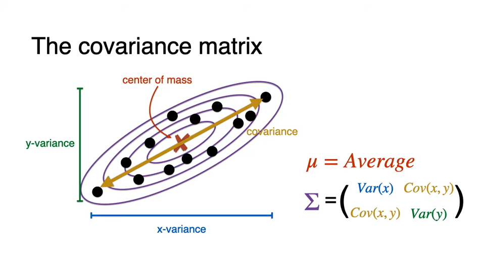

| 시각 | 화면 | 내용 |
|---|---|---|
| 0:06 | *The covariance matrix* 제목 아래 왼쪽 아래→오른쪽 위로 뻗은 검은 점 13개 | 공분산 행렬은 데이터셋에 대해 많은 정보를 준다고 소개 |
| 0:18 | 빨간 ✗와 "center of mass" 화살표 | **무게중심**: 모든 점의 무게가 같을 때 데이터가 균형을 이루는 점. mean, average라고도 부름 |
| 0:30–0:42 | 아래 파란 막대 "x-variance", 왼쪽 초록 막대 "y-variance", 오른쪽 $\mu = Average$ | 가로·세로로 얼마나 퍼졌는지. 이 데이터는 가로로 더 퍼져 있어 x 분산이 더 큼 |
| 0:54–1:06 | 대각선 금색 양방향 화살표 "covariance", 이어서 보라색 동심 타원 | 분산만으로는 원인지 타원인지 모름. **공분산**이 "길쭉하고 대각선 방향"이라는 모양을 알려 주고, 여기에 Gaussian을 맞출 수 있음 |
| 1:12–1:42 | $\Sigma$가 나타나고 $\Sigma=\begin{pmatrix}Var(x) & Cov(x,y)\\ Cov(x,y) & Var(y)\end{pmatrix}$로 채워짐 | 대각선은 분산, 대각선 밖은 공분산. 2차원 데이터면 $2\times2$, 100차원이면 $100\times100$ |

- **화면 설명**: 타원은 데이터 위에 그린 Gaussian의 등고선입니다. 금색 화살표는 타원의 긴 축 방향과 겹칩니다.
- **핵심**: 평균 $\mu$는 위치, 공분산 행렬 $\Sigma$는 퍼짐과 방향을 요약합니다.

## 2. 가중치가 있는 점 미리 보기 (1:48–2:18)

- **화면**: 같은 점들 중 왼쪽 아래 점들이 반쯤 잘린 모양(일부만 있는 점)으로 바뀌고, 무게중심 ✗가 오른쪽 위로 이동합니다. x/y 분산 막대와 공분산 화살표, 타원이 다시 그려집니다.
- **핵심**: 점이 통째로 있지 않고 1/2, 1/3, 1/10만 있는 경우에도 평균·분산·공분산을 구할 수 있습니다. 영상은 이것이 **Gaussian mixture model**처럼 점의 일부(portion)를 쓰는 알고리즘에서 필요하다고 말합니다. 계산은 7절에서 나옵니다.

## 3. 평균과 중심화 (2:24–3:18)

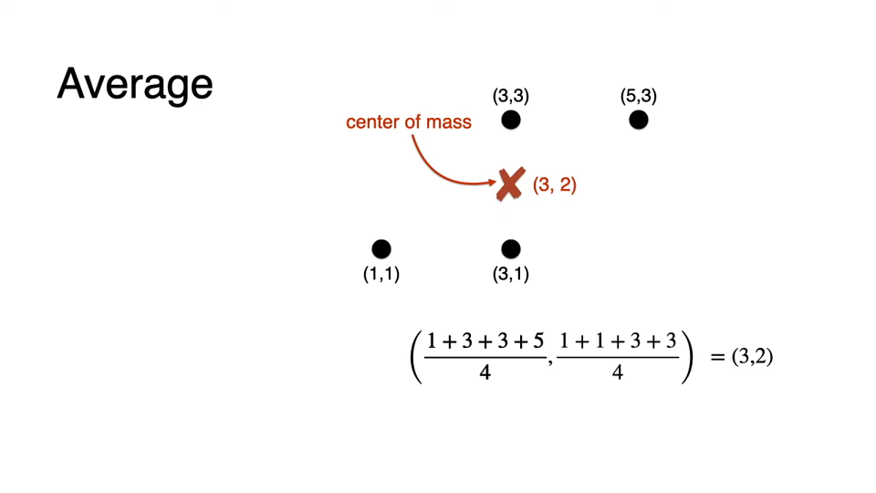

| 시각 | 화면 | 내용 |
|---|---|---|
| 2:24 | *Average*: 점 $(1,1),(3,1),(3,3),(5,3)$ | 작은 예제 데이터 4개 |
| 2:42–2:54 | $\left(\frac{1+3+3+5}{4},\frac{1+1+3+3}{4}\right)=(3,2)$ | 좌표별로 따로 평균. 무게중심은 $(3,2)$ |
| 3:06 | 원점 $(0,0)$이 빨간 점으로 표시됨 | 계산을 쉽게 하려고 무게중심을 원점으로 옮김 |
| 3:12–3:18 | 점이 $(-2,-1),(0,-1),(0,1),(2,1)$로 바뀌고 ✗ 옆에 $(0,0)$ | 모든 x에서 3, 모든 y에서 2를 뺌 |

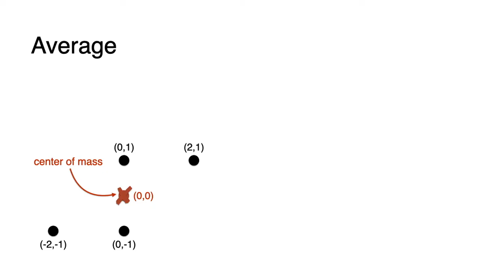

- **영상 표현 짚기**: 전사본에는 "recalculating every weight"라고 들리지만, 실제로 하는 일은 **모든 좌표에서 평균을 빼는 것(centering)** 입니다.
- **핵심**: 중심화하면 이후의 분산·공분산이 "제곱의 평균", "곱의 평균"으로 단순해집니다.

## 4. x 분산과 y 분산 (3:24–5:00)

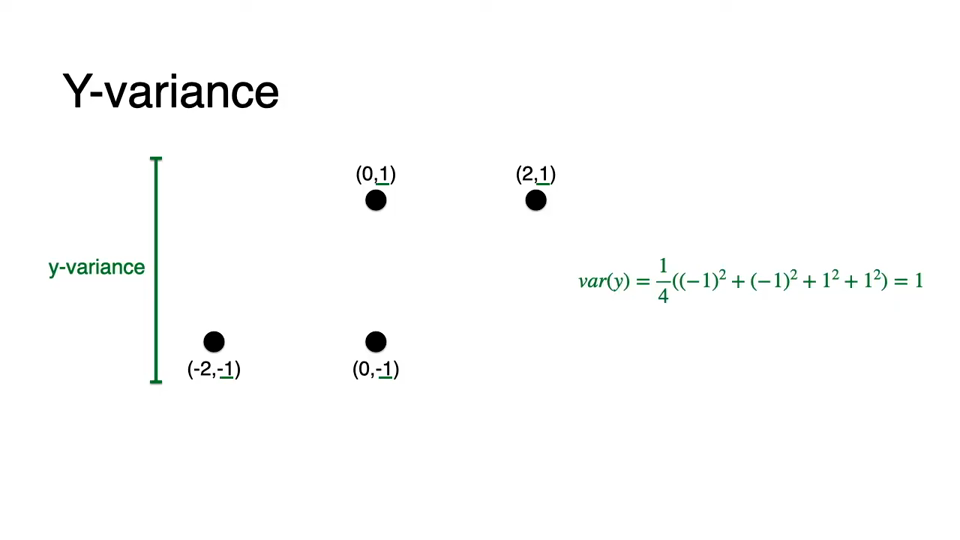

| 시각 | 화면 | 내용 |
|---|---|---|
| 3:24–3:42 | *X-variance*, x좌표에 밑줄, $var(x)=\frac14((-2)^2+0^2+0^2+2^2)=2$ | x좌표 제곱의 평균. 제곱하는 이유는 $+2$와 $-2$가 서로 지우지 않고 둘 다 "멀리 있음"으로 더해지게 하려는 것 |
| 4:00–4:24 | *Y-variance*, $var(y)=\frac14((-1)^2+(-1)^2+1^2+1^2)=1$ | y좌표도 같은 방법 |
| 4:30–5:00 | 십자축 위 데이터 4종: Small/Small, Large x/Small y, Small x/Large y, Large/Large | 모여 있으면 둘 다 작고, 가로로 퍼지면 x 분산만 큼, 세로로 퍼지면 y 분산만 큼, 사방으로 퍼지면 둘 다 큼 |

- **핵심**: 중심화된 데이터에서 분산은 해당 좌표 **제곱의 평균**입니다.

## 5. 분산이 같아도 다른 데이터 → 공분산 (5:06–7:06)

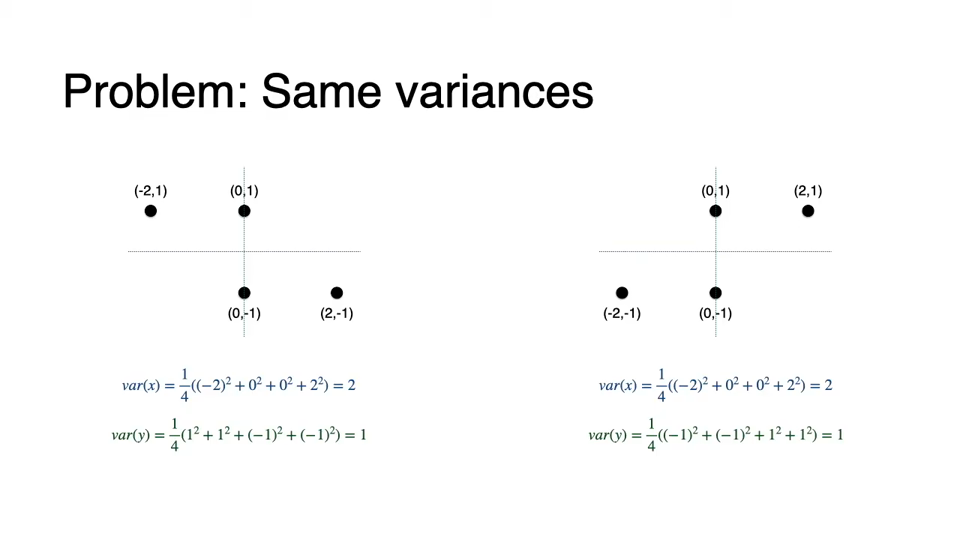

| 시각 | 화면 | 내용 |
|---|---|---|
| 5:06–5:24 | *Problem: Same variances*: 왼쪽 $(-2,1),(0,1),(0,-1),(2,-1)$, 오른쪽 $(-2,-1),(0,-1),(0,1),(2,1)$. 둘 다 $var(x)=2$, $var(y)=1$ | 왼쪽은 왼쪽 위→오른쪽 아래 대각선, 오른쪽은 반대 대각선인데 분산으로는 구별 불가 |
| 5:30–6:06 | *Solution: Covariance*, 끝점 두 개를 금색 타원으로 묶음. $(-2)\cdot1=-2$, $2\cdot(-1)=-2$ / $(-2)\cdot(-1)=2$, $2\cdot1=2$ | 답은 **두 좌표의 곱**. 역대각선 위 점은 곱이 음수, 정대각선 위 점은 곱이 양수 |
| 6:12–6:42 | 나머지 점은 $0\cdot1=0$, $0\cdot(-1)=0$. $cov(x,y)=\frac14(-2+0+0-2)=-1$, $cov(x,y)=\frac14(2+0+0+2)=1$ | 공분산은 좌표 곱의 평균 |
| 6:54–7:06 | 점 $(-2,0),(2,0),(0,1),(0,-1)$, 곱이 모두 0, $cov(x,y)=\frac14(0+0+0+0)=0$ | 어느 대각선으로도 기울지 않은 데이터는 공분산 0 |

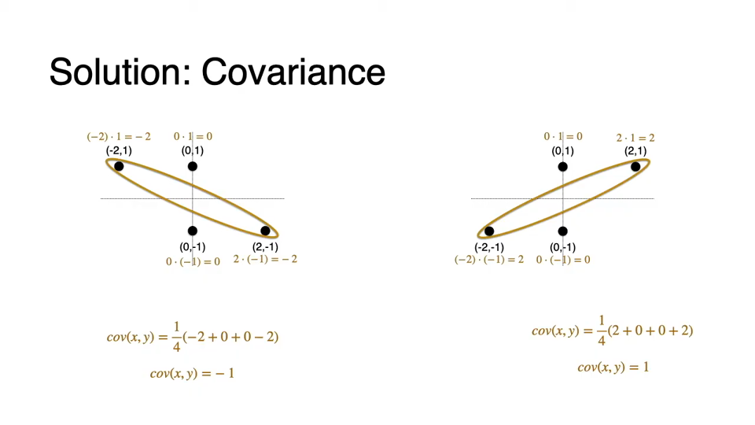

- **핵심**: 중심화된 데이터에서 공분산은 **두 좌표 곱의 평균**입니다. 부호가 대각선 방향을 알려 줍니다.

## 6. 공분산의 부호와 상관 (7:12–7:54)

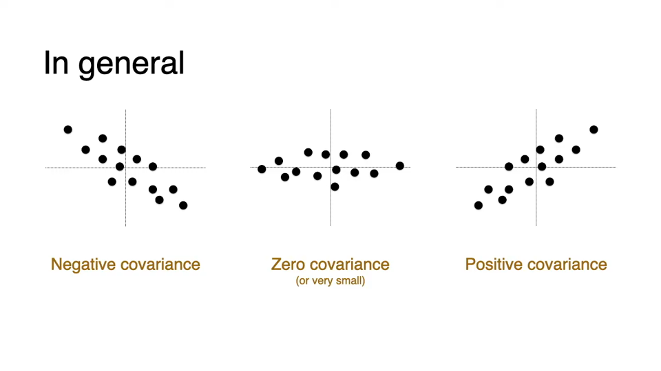

- **화면**: *In general* 아래 세 산점도. 왼쪽 위→오른쪽 아래 "Negative covariance", 가로로 납작한 "Zero covariance (or very small)", 왼쪽 아래→오른쪽 위 "Positive covariance".
- **핵심**: 공분산과 상관(correlation)은 공식은 다르지만 매우 비슷한 개념입니다. 각각 음의 상관, 상관 없음, 양의 상관(x가 커지면 y도 커짐)에 해당합니다.
- **영상 표현 짚기**: 영상은 가운데 그림을 "not correlated, or independent perhaps"라고 합니다. 공분산 0은 **선형 관계가 없다**는 뜻일 뿐이고 독립을 보장하지는 않습니다. 독립이면 공분산이 0이지만 그 역은 일반적으로 성립하지 않습니다.

## 7. 일반 공식 (8:00–9:12)

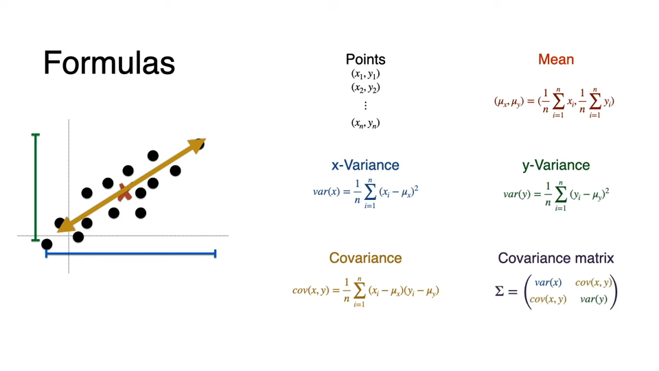

화면의 *Formulas* 슬라이드가 하나씩 쌓입니다. 점은 $(x_1,y_1),(x_2,y_2),\dots,(x_n,y_n)$입니다.

| 시각 | 화면에 추가된 식 |
|---|---|
| 8:06 | Mean: $(\mu_x,\mu_y)=\left(\frac1n\sum_{i=1}^n x_i,\ \frac1n\sum_{i=1}^n y_i\right)$ |
| 8:18 | x-Variance: $var(x)=\frac1n\sum_{i=1}^n (x_i-\mu_x)^2$ |
| 8:30 | y-Variance: $var(y)=\frac1n\sum_{i=1}^n (y_i-\mu_y)^2$ |
| 8:48 | Covariance: $cov(x,y)=\frac1n\sum_{i=1}^n (x_i-\mu_x)(y_i-\mu_y)$ |
| 9:00–9:12 | Covariance matrix: $\Sigma=\begin{pmatrix}var(x) & cov(x,y)\\ cov(x,y) & var(y)\end{pmatrix}$ |

- **핵심**: 3·4·5절에서 "중심화한 뒤 제곱/곱의 평균"이라고 한 것을 $x_i-\mu_x$, $y_i-\mu_y$로 일반화한 식입니다. 분모가 $n$이므로 표본 분산이 아닌 **평균 그대로(1/n)** 의 정의입니다.

## 8. 가중치가 있는 점 (9:12–12:36)

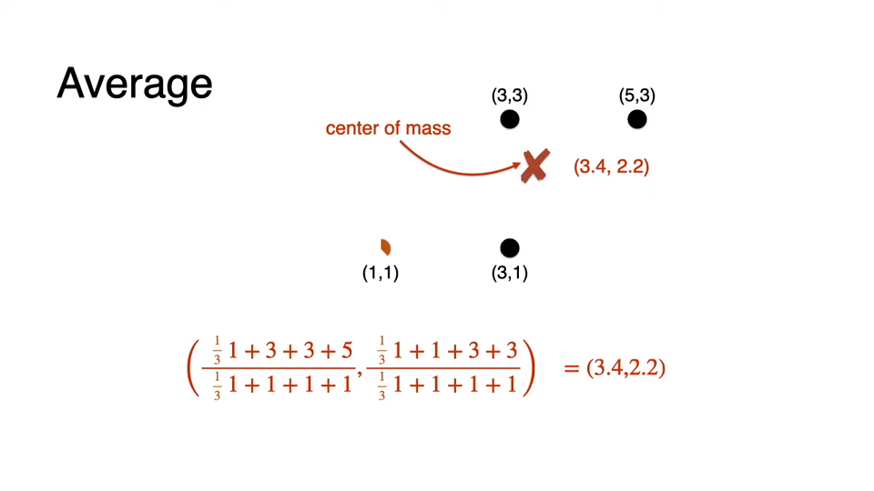

| 시각 | 화면 | 내용 |
|---|---|---|
| 9:12 | *When points are weighted differently* | 소제목 |
| 9:24–9:54 | 같은 네 점, 평균을 $\left(\frac{1+3+3+5}{1+1+1+1},\frac{1+1+3+3}{1+1+1+1}\right)$로 다시 씀 | 분모 4를 "점마다 1단위"의 합으로 보면 가중치로 넘어가기 쉬움 |
| 10:00–10:24 | $(1,1)$이 작은 주황 조각으로 바뀜. $\left(\frac{\frac13 1+3+3+5}{\frac13 1+1+1+1},\frac{\frac13 1+1+3+3}{\frac13 1+1+1+1}\right)=(3.4,2.2)$ | 왼쪽 아래 점이 1/3만 있음. 분자와 분모 모두에 $\frac13$을 붙임. 무게중심이 오른쪽 위로 이동 |
| 10:30–10:36 | *Center points*: $(-2.4,-1.2),(-0.4,-1.2),(-0.4,0.8),(1.6,0.8)$, ✗ 옆에 $(0,0)$ | 새 평균으로 중심화 |
| 10:42–11:00 | $var(x)=\frac14\left(\left(\tfrac13\right)^2(-2.4)^2+(-0.4)^2+(-0.4)^2+1.6^2\right)=0.88$ | 1/3 점의 항에 $(1/3)^2$을 곱함. 영상 설명: "분산 식이 제곱의 합이라서" |
| 11:06–11:12 | $var(y)=\frac14\left(\left(\tfrac13\right)^2(-1.2)^2+(-1.2)^2+0.8^2+0.8^2\right)=0.72$ | 두 분산 모두 가중치 없을 때(2, 1)보다 작아짐 |
| 11:18–11:41 | $cov(x,y)=\frac14\left(\left(\tfrac13\right)^2(-2.4)(-1.2)+(-0.4)(-1.2)+(-0.4)(0.8)+(2.6)(0.8)\right)=0.64$ | 공분산도 같은 방식 |

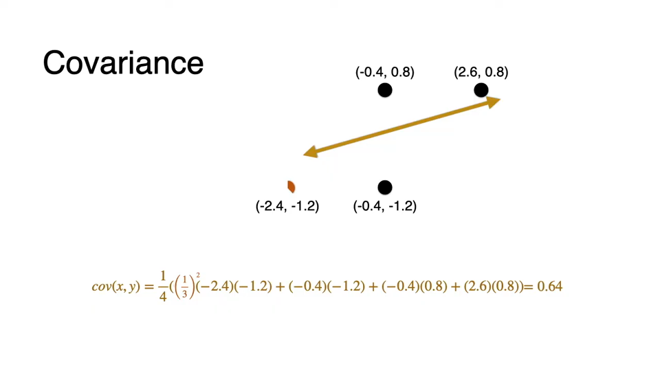

화면의 일반 공식(11:42–12:36)은 다음과 같습니다. 가중치 $\alpha_i\in[0,1]$는 점이 데이터에 얼마나 들어 있는지를 나타냅니다(30%면 $\alpha_i=0.3$).

$$
(\mu_x,\mu_y)=\left(\frac{1}{\sum\alpha_i}\sum_{i=1}^n\alpha_i x_i,\ \frac{1}{\sum\alpha_i}\sum_{i=1}^n\alpha_i y_i\right)
$$

$$
var(x)=\frac{1}{\sum\alpha_i^2}\sum_{i=1}^n\alpha_i^2(x_i-\mu_x)^2,\quad
var(y)=\frac{1}{\sum\alpha_i^2}\sum_{i=1}^n\alpha_i^2(y_i-\mu_y)^2,\quad
cov(x,y)=\frac{1}{\sum\alpha_i^2}\sum_{i=1}^n\alpha_i^2(x_i-\mu_x)(y_i-\mu_y)
$$

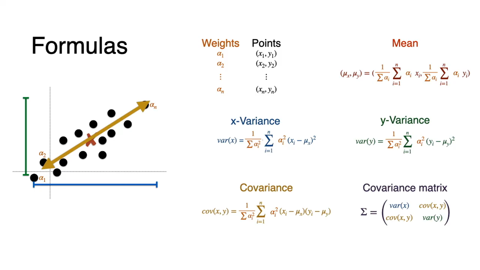

**이 구간은 그대로 외우면 안 됩니다.** 화면 계산을 직접 다시 해 보면 다음 문제가 있습니다.

1. **좌표 오타**: Y-variance와 Covariance 화면(11:06–11:41)에서 오른쪽 위 점이 $(2.6,0.8)$로 바뀌어 있습니다. 중심화한 점은 $(1.6,0.8)$입니다($5-3.4=1.6$). 공분산 0.64는 오타 2.6으로 계산한 값이고, 1.6으로 같은 방식을 쓰면 $\frac14(0.32+0.48-0.32+1.28)=0.44$입니다. 0.88과 0.72는 화면 식 그대로 맞습니다.
2. **예제와 일반 공식의 분모 불일치**: 예제는 4로 나누었지만 일반 공식대로라면 $\sum\alpha_i^2=\frac19+3\approx3.11$로 나누어야 합니다. 이 경우 $var(x)\approx1.13$, $var(y)\approx0.93$, $cov\approx0.57$입니다.
3. **$\alpha_i^2$ 가중은 표준적인 가중 분산이 아닙니다.** 평균과 같은 방식으로 가중치 $\alpha_i$ 하나만 곱하고 $\sum\alpha_i$로 나누는 것이 일반적인 정의이고, GMM의 M-step도 이 형태입니다(아래 "수업 내용과 연결하기" 4번). 이 정의로 같은 예제를 계산하면 $var(x)=1.44$, $var(y)=0.96$, $cov(x,y)=0.72$입니다. "분산은 제곱의 합이라 가중치도 제곱"이라는 영상의 설명은 좌표를 $\alpha_i$배로 줄이는 것과 점의 개수를 $\alpha_i$개로 세는 것을 혼동한 것입니다. 1/3개의 점은 거리가 1/3이 되는 것이 아니라 "개수"가 1/3이 되는 것이므로 제곱 항에 $\alpha_i$가 한 번만 붙습니다.

(위 1–3은 영상에 없는 검산이며, 숫자는 화면 좌표로 직접 다시 계산한 값입니다.)

## 9. 마무리·광고 (12:42–13:56)

저자의 책 *Grokking Machine Learning* 할인 코드 안내, 구독·좋아요 요청, 트위터 @luis_likes_math, serrano.academy 안내.

---

## 수업 내용과 연결하기

1102 정리노트(`정리노트_1102_PCA.md`)와 1028 정리노트는 데이터 $\mathbf{x}_n\in\mathbb{R}^D$를 **열벡터**로, 데이터 공분산 행렬을 $\mathbf{S}$로 씁니다. 영상의 2차원 $(x_i,y_i)$는 $D=2$, $\mathbf{x}_n=(x_n,y_n)^T$인 경우입니다.

| 영상 표현 | 수업 용어 | 수식 |
|---|---|---|
| center of mass, mean, average $(\mu_x,\mu_y)$ | 평균(mean) | $\boldsymbol{\mu}=\frac1N\sum_{n=1}^N\mathbf{x}_n$ |
| 원점으로 옮기기 (move the center to 0,0) | 중심화(centering), well-centered | $\mathbf{x}_n\leftarrow\mathbf{x}_n-\boldsymbol{\mu}$ |
| x-variance, y-variance | 분산(variance), 데이터의 "에너지" | 중심화 후 $\frac1N\sum_n x_n^2$, $\frac1N\sum_n y_n^2$ |
| covariance, 좌표 곱의 평균 | 공분산(covariance) | $\operatorname{cov}(x,y)=\frac1N\sum_n x_n y_n$ (중심화 후) |
| covariance matrix $\Sigma$ | (데이터) 공분산 행렬 $\mathbf{S}$ | $\mathbf{S}=\frac1N\sum_{n=1}^N\mathbf{x}_n\mathbf{x}_n^T=\frac1N\mathbf{X}\mathbf{X}^T$ |
| 대각선 밖 두 칸이 같은 $Cov(x,y)$ | 대칭행렬(symmetric matrix) | $\mathbf{S}^T=\mathbf{S}$ |
| $n$개의 점 $(x_i,y_i)$ | 데이터 행렬 $\mathbf{X}$ (열 = 데이터 한 개) | $\mathbf{X}=[\mathbf{x}_1\ \cdots\ \mathbf{x}_N]\in\mathbb{R}^{D\times N}$ |
| 타원의 긴 방향 (금색 화살표) | 첫 주성분 방향 | $\mathbf{S}$의 가장 큰 고윳값 $\lambda_1$의 단위 고유벡터 $\mathbf{p}_1$ |

- 영상의 $n$은 수업의 데이터 개수 $N$에 해당합니다. 수업에서 $n$은 데이터 첨자입니다.
- 영상의 "각 칸을 따로 계산" 방식과 수업의 외적 합 $\frac1N\sum_n\mathbf{x}_n\mathbf{x}_n^T$는 같은 행렬입니다. $\mathbf{x}_n\mathbf{x}_n^T=\begin{pmatrix}x_n^2 & x_ny_n\\ x_ny_n & y_n^2\end{pmatrix}$을 평균하면 영상의 $\Sigma$가 됩니다. 예: 3절의 중심화한 네 점이면 $\mathbf{S}=\begin{pmatrix}2 & 1\\ 1 & 1\end{pmatrix}$입니다(오른쪽 위로 기운 데이터라 공분산 1).

**영상에서 빠진 것 (수업에서 보충되는 내용)**

1. **벡터 형태와 기댓값 정의.** 수업은 확률벡터의 공분산 행렬을 $\boldsymbol{\Sigma}_{\mathbf{a}}=\mathbb{E}[\mathbf{a}\mathbf{a}^T]-\mathbb{E}[\mathbf{a}]\mathbb{E}[\mathbf{a}]^T$로 정의하고, 평균이 0이면 $\mathbb{E}[\mathbf{a}\mathbf{a}^T]$만 남는다는 것으로 centering의 이유를 설명합니다. 영상은 2차원 성분별 계산만 보여 줍니다.
2. **대칭성과 positive semi-definite.** $\mathbf{S}^T=\mathbf{S}$이고 고윳값이 모두 0 이상이라는 성질, 그리고 스펙트럼 정리 $\mathbf{S}=\mathbf{P}\mathbf{D}\mathbf{P}^T$로 정규직교 고유기저를 고를 수 있다는 사실은 영상에 없습니다.
3. **공분산 행렬과 PCA의 연결.** 영상은 타원과 화살표로 "퍼진 방향"을 보여 주기만 합니다. 수업은 단위벡터 $\mathbf{b}_1$ 방향으로 사영한 분산이 $V_1=\mathbf{b}_1^T\mathbf{S}\mathbf{b}_1$이고, 이를 최대화하는 방향이 $\mathbf{S}$의 가장 큰 고윳값의 고유벡터라는 것을 다룹니다. 즉 영상의 금색 화살표가 첫 주성분이고, 그 방향의 분산이 $\lambda_1$입니다.
4. **올바른 가중 공분산.** 8절의 $\alpha_i^2$ 가중 대신, GMM(1111, MML 11장)의 M-step은 책임도 $r_{nk}$를 가중치로 $\boldsymbol{\Sigma}_k=\frac{1}{N_k}\sum_{n}r_{nk}(\mathbf{x}_n-\boldsymbol{\mu}_k)(\mathbf{x}_n-\boldsymbol{\mu}_k)^T$, $N_k=\sum_n r_{nk}$를 씁니다. 가중치는 한 번만 곱하고 가중치의 합으로 나눕니다.
5. **$1/N$과 $1/(N-1)$.** 영상과 수업 모두 $1/N$을 씁니다. 통계에서 쓰는 불편 표본 분산 $1/(N-1)$과의 차이는 다루지 않습니다.
6. **상관계수.** 영상은 "공분산과 상관은 비슷하다"고만 합니다. 상관계수는 $\rho=\frac{\operatorname{cov}(x,y)}{\sqrt{\operatorname{var}(x)\operatorname{var}(y)}}\in[-1,1]$로 단위를 없앤 값이고, 공분산 0이 독립을 뜻하지 않는다는 점도 짚어야 합니다(6절).
