# 최대 분산으로 PCA 방향 고르기 — 5살도 이해하는 정리노트

정방철 교수님 머신러닝기초 · 1102 수업 (Lecture05 PCA Part1 s14–s21, MML 4·10장)

> `정리노트_1102_PCA.html`를 마크다운으로 옮겼어요. 그림은 `figures_1102/` 폴더의 SVG, 위젯은 대표 설정의 정적 그림으로 바꿨어요. 수식은 `$…$` / `$$…$$`라서 GitHub, Obsidian, Typora에서 보여요.

**목차**

- [0. 오늘의 큰 그림](#s0)
  - [가장 많이 퍼진 방향 찾기](#s0-learning-map)
- [1. 분산을 최대한 남기는 방향](#s1)
  - [1.1 분산은 데이터의 에너지](#s1-variance-energy)
  - [1.2 행렬로 다시 쓰는 사영 좌표](#s1-matrix-again)
- [2. 고윳값과 대각화 복습](#s2)
  - [2.1 고윳값과 고유벡터](#s2-eigen)
  - [2.2 대각행렬과 대각화](#s2-diagonal)
  - [2.3 고윳값 분해(EVD)](#s2-evd)
- [3. 스펙트럼 정리](#s3)
  - [3.1 대칭행렬은 직교 고유벡터로 쪼개져요](#s3-spectral)
  - [3.2 예제: 3×3 대칭행렬](#s3-spectral-example)
- [4. 첫 번째 방향 b₁ 찾기](#s4)
  - [4.1 목표와 결론 미리 보기](#s4-goal)
  - [4.2 분산 V₁을 b₁ᵀSb₁로 바꾸기](#s4-v1)
  - [4.3 왜 가장 큰 고윳값의 고유벡터일까](#s4-max-proof)
- [5. 요약 · 예고](#s5)
  - [한 장 요약](#s5-cheatsheet)
  - [다음 시간 예고](#s5-next)
  - [함께 보면 좋은 자료](#s5-links)

## 0. 오늘의 큰 그림

### 가장 많이 퍼진 방향 찾기

*1102 수업 · L05 s14–s21*

**먼저 큰 그림**

오늘의 질문은 이거예요. $D$차원 데이터 $\mathbf{x}_n \in \mathbb{R}^D$를 $M$개의 방향 $\mathbf{b}_1,\dots,\mathbf{b}_M$만으로 표현할 때($M \ll D$), 데이터의 퍼짐을 가장 많이 남기는 방향은 어떻게 고를까요? 퍼짐의 척도는 분산(variance)이고, 수업에서는 이를 데이터의 에너지라고도 불렀어요. 분산을 가장 많이 담은 방향을 기저로 고르자는 관점이 maximum variance perspective예요. 2차원 예시에서 점들이 $x$축 쪽으로 더 퍼져 있다면, 축을 하나만 쓸 때 $x$축에 사영하는 편이 에너지를 더 많이 남겨요.

1028 수업에서는 문제의 틀만 세웠어요. 정규직교 열을 가진 ${\mathbf{B} = [\mathbf{b}_1 \cdots \mathbf{b}_M] \in \mathbb{R}^{D \times M}}$로 code ${\mathbf{z}_n = \mathbf{B}^T\mathbf{x}_n}$를 만들고, centering된 데이터로 데이터 공분산 행렬 $\mathbf{S}$를 정의했어요. 오늘은 같은 틀에 "어떤 $\mathbf{B}$가 좋은가"라는 기준을 붙여요. 첫 좌표만 보면 code는 내적 하나 $z_{1n} = \mathbf{b}_1^T\mathbf{x}_n$이고, 이 좌표의 분산을 계산하면 1028의 $\mathbf{S}$가 다시 나와요. 답을 읽어 내는 도구는 선형대수의 고윳값·고유벡터와 스펙트럼 정리라서, 그 복습이 중간에 들어가요.

| 단계 | 식 | 출발점 | 오늘 한 일 |
|---|---|---|---|
| 사영 좌표 | $z_{1n} = \mathbf{b}_1^T\mathbf{x}_n$ | 1028 code $\mathbf{z}_n = \mathbf{B}^T\mathbf{x}_n$ | $(1 \times D)(D \times 1)$ 내적이라 스칼라예요. 방향 $\mathbf{b}_1$ 하나에 사영한 좌표예요. |
| 분산 | $V_1 = \frac{1}{N}\sum_{n=1}^N z_{1n}^2$ | 분산 = 제곱의 평균 − 평균의 제곱 | centering 덕분에 평균이 0이라 제곱의 평균만 남아요. |
| 목표식 | ${V_1 = \mathbf{b}_1^T\mathbf{S}\mathbf{b}_1}$ | 1028 ${\mathbf{S} = \frac{1}{N}\sum_{n=1}^N \mathbf{x}_n\mathbf{x}_n^T}$ | 전치 규칙으로 $\mathbf{b}_1$을 합 밖으로 꺼내 유도했어요. |
| 최적화 문제 | $\max_{\mathbf{b}_1} \mathbf{b}_1^T\mathbf{S}\mathbf{b}_1$, $\Vert \mathbf{b}_1\Vert ^2 = 1$ | 정규직교 기저 | 문제를 세웠고, 풀이는 다음 시간으로 미뤘어요. |
| 답을 읽는 도구 | ${\mathbf{S} = \mathbf{P}\mathbf{D}\mathbf{P}^T = \sum_i \lambda_i\mathbf{p}_i\mathbf{p}_i^T}$ | $\mathbf{A}\mathbf{x} = \lambda\mathbf{x}$, 대각화, EVD | 대칭행렬 $\mathbf{S}$는 정규직교 고유벡터로 분해된다는 스펙트럼 정리를 복습했어요. |
| 결론(예고) | $\mathbf{b}_1 = \mathbf{p}_1$ | $\mathbf{S}$의 가장 큰 고윳값 $\lambda_1$ | 결론만 들었어요. 증명은 시작만 하고 다음 시간으로 넘어갔어요. |

구하는 것은 숫자 하나가 아니라 방향이에요. 크기 1인 단위벡터 $\mathbf{b}_1 \in \mathbb{R}^D$와, 그 방향으로 사영했을 때의 분산 $V_1$이에요. 수업에서 교수님이 말로 미리 알려 준 결론은 $\mathbf{b}_1$이 $\mathbf{S}$의 가장 큰 고윳값 $\lambda_1$에 대응하는 고유벡터 $\mathbf{p}_1$이고, 그때 분산은 $V_1 = \lambda_1$이라는 것이에요. 증명은 다음 시간으로 미뤘고, 미룬 증명은 [4.3 왜 가장 큰 고윳값의 고유벡터일까](#s4-max-proof)에 보충으로 실었어요. 방향을 $M$개 쓰면 고윳값이 큰 순서로 $M$개의 고유벡터를 모아 $\mathbf{B}$를 만들어요. MNIST라면 $D = 784$를 $M = 50$으로 줄이는 데 이 $\mathbf{B}$를 써요.

첫 번째 계산인 [4.2 분산 V₁을 b₁ᵀSb₁로 바꾸기](#s4-v1)는 "방향을 고른다"는 말을 식 하나로 바꿔요. 핵심 연산은 ${z_{1n}^2 = (\mathbf{b}_1^T\mathbf{x}_n)(\mathbf{b}_1^T\mathbf{x}_n)^T}$처럼 스칼라를 전치해도 그대로라는 사실과 ${(\mathbf{A}\mathbf{B})^T = \mathbf{B}^T\mathbf{A}^T}$예요. 그러면 ${z_{1n}^2 = \mathbf{b}_1^T\mathbf{x}_n\mathbf{x}_n^T\mathbf{b}_1}$이 되고, $n$과 무관한 $\mathbf{b}_1$을 합 밖으로 꺼내면 괄호 안에 $\mathbf{S}$가 남아 ${V_1 = \mathbf{b}_1^T\mathbf{S}\mathbf{b}_1}$이 돼요. 이것이 "왜 데이터 행렬이 아니라 공분산 행렬인가"에 대한 수식의 답이에요.

두 번째로, [2.1 고윳값과 고유벡터](#s2-eigen)부터 [3.1 대칭행렬은 직교 고유벡터로 쪼개져요](#s3-spectral)까지의 복습은 목표식 $\mathbf{b}_1^T\mathbf{S}\mathbf{b}_1$의 최댓값을 읽는 도구를 준비해요. 결론이 "$\mathbf{S}$의 고유벡터"라는 말로 되어 있고, 교수님이 시작한 증명도 임의의 $\mathbf{b}_1$을 정규직교 고유벡터의 합 ${\mathbf{b}_1 = \sum_i c_i\mathbf{p}_i}$로 쓰는 데서 출발하기 때문이에요.

제약 $\|\mathbf{b}_1\|^2 = 1$은 수업에서 이유를 말하지 않았어요. 제약이 없으면 $\mathbf{b}_1$의 크기만 키워 $V_1$을 얼마든지 크게 만들 수 있기 때문이라는 설명은 학습을 위한 재구성이에요.

가장 헷갈리기 쉬운 점은 EVD의 $\mathbf{P}$가 언제나 직교행렬은 아니고, $\mathbf{P}^{-1} = \mathbf{P}^T$로 고를 수 있는 것은 $\mathbf{S}$처럼 대칭행렬일 때라는 거예요([2.3 고윳값 분해(EVD)](#s2-evd)). 대칭행렬이라도 고윳값이 중근이면 그 고유공간에서 고른 고유벡터가 자동으로 직교하지는 않아서, Gram–Schmidt처럼 직교화한 뒤 정규화해야 해요. 차원도 조심해요. 이 강의의 표기 $\mathbf{X} \in \mathbb{R}^{D \times N}$에서는 ${\mathbf{S} = \frac{1}{N}\mathbf{X}\mathbf{X}^T \in \mathbb{R}^{D \times D}}$이고, $\mathbf{X}^T\mathbf{X}$는 $N \times N$이에요. 마지막으로 "$\mathbf{b}_1$은 가장 큰 고윳값의 고유벡터"는 오늘 증명이 끝나지 않은 결론이에요.

**페이지 요약**

$M$개 방향으로 데이터를 표현할 때 분산(에너지)을 가장 많이 남기는 방향을 찾아요. 첫 방향의 분산은 $\mathbf{b}_1^T\mathbf{S}\mathbf{b}_1$로 쓰이고, 답은 $\mathbf{S}$의 가장 큰 고윳값의 고유벡터라는 결론을 미리 들었어요(증명은 다음 시간).

*핵심 식*

- 사영 좌표

  $$
  z_{1n} = \mathbf{b}_1^T\mathbf{x}_n
  $$
- 첫 좌표의 분산

  $$
  V_1 = \frac{1}{N}\sum_{n=1}^N z_{1n}^2
  $$
- 목표식

  $$
  V_1 = \mathbf{b}_1^T\mathbf{S}\mathbf{b}_1
  $$
- 데이터 공분산 행렬

  $$
  \mathbf{S} = \frac{1}{N}\sum_{n=1}^N \mathbf{x}_n\mathbf{x}_n^T
  $$
- 최적화 문제

  $$
  \max_{\mathbf{b}_1} \mathbf{b}_1^T\mathbf{S}\mathbf{b}_1, \qquad \|\mathbf{b}_1\|^2 = 1
  $$
- 스펙트럼 정리(대칭 S)

  $$
  \mathbf{S} = \mathbf{P}\mathbf{D}\mathbf{P}^T = \sum_i \lambda_i\mathbf{p}_i\mathbf{p}_i^T
  $$
- 결론(예고)

  $$
  \mathbf{b}_1 = \mathbf{p}_1, \qquad V_1 = \lambda_1
  $$

*용어*

- **maximum variance perspective** — 분산(에너지)을 가장 많이 담은 방향을 기저로 고르는 관점이에요.
- **고유벡터(eigenvector)** — $\mathbf{A}\mathbf{x} = \lambda\mathbf{x}$를 만족하는 0이 아닌 벡터예요. 답 $\mathbf{b}_1$은 $\mathbf{S}$의 고유벡터 $\mathbf{p}_1$이에요.
- **스펙트럼 정리(spectral theorem)** — 대칭행렬은 $\mathbf{P}^{-1} = \mathbf{P}^T$인 고유벡터 행렬로 분해돼요. 일반 EVD의 $\mathbf{P}$는 직교일 필요가 없어요.
- **centering** — 평균을 빼 두는 전처리예요. 그래서 분산이 제곱의 평균이 돼요.

---

## 1. 분산을 최대한 남기는 방향

### 1.1 분산은 데이터의 에너지

*1102 수업 · L05 s14*

**쉽게 말하면**

점들이 넓게 퍼진 쪽에 무게가 많이 실려 있어요.

무게가 가장 많이 실린 곳에 기둥을 세우면 적은 기둥으로도 집을 받칠 수 있어요.

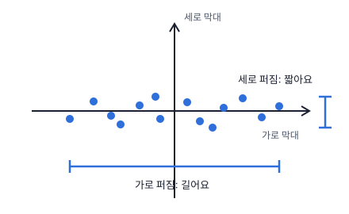

*점들이 가로로 길게 퍼져 있으니, 막대 하나만 고른다면 가로 막대가 무게를 더 많이 담아요.*

**정확히 말하면**

1028 수업에서는 데이터를 방향 몇 개에 사영해 짧은 좌표로 적는 방법까지 세웠어요. 이 토픽은 "어떤 방향이 좋은 방향인가"의 기준을 정해요. 기준은 사영한 뒤에도 남는 분산, 곧 variance예요.

#### basis는 기둥, 고르는 일은 압축

basis vector는 데이터를 적을 때 기준이 되는 방향이에요. 수업에서는 이것을 기둥에 비유했어요. 하중이 가장 많이 실리는 곳에 기둥을 세워야 적은 기둥으로 무게를 받쳐요. 마찬가지로 basis를 어디에 세울지가 곧 데이터를 적은 차원으로 압축하는 문제예요(low-dimensional approximation).

#### 칠판의 공분산 행렬

"분산을 남긴다"를 계산하려면 벡터의 분산이 무엇인지 알아야 해요. 수업에서는 확률벡터(random vector) $\mathbf{a}$의 공분산 행렬(covariance matrix)을 칠판에 바로 썼어요. $\mathbf{a}$는 성분이 $D$개인 세로(열)벡터예요.

$$
\boldsymbol{\Sigma}_{\mathbf{a}}=\mathbb{E}[\mathbf{a}\mathbf{a}^T]-\mathbb{E}[\mathbf{a}]\mathbb{E}[\mathbf{a}]^T
$$

학습을 위한 재구성으로 스칼라 분산 ${\operatorname{Var}(a)=\mathbb{E}[a^2]-(\mathbb{E}[a])^2}$, 곧 "제곱의 평균 빼기 평균의 제곱"과 나란히 놓으면 읽기 쉬워요. 제곱 $a^2$ 자리에 세로벡터와 가로벡터의 곱 $\mathbf{a}\mathbf{a}^T$가 들어간 모양이에요.

- 크기: ${(D\times 1)(1\times D)=D\times D}$라서 $\boldsymbol{\Sigma}_{\mathbf{a}}$는 정방행렬이에요. 대각선 칸은 각 성분의 분산이에요.
- 평균이 0이면 뒤 항은 영벡터끼리의 곱이라 영행렬이 되고, 제곱의 평균만 남아요. PCA가 데이터를 먼저 centering하는 이유예요. 뒤의 데이터 공분산 행렬도 이 모양으로 다시 나와요([4.2 분산 V₁을 b₁ᵀSb₁로 바꾸기](#s4-v1)).

$$
\mathbb{E}[\mathbf{a}]=\mathbf{0}\ \Rightarrow\ \boldsymbol{\Sigma}_{\mathbf{a}}=\mathbb{E}[\mathbf{a}\mathbf{a}^T]
$$

칸 하나하나의 의미, 대칭성, 교차 공분산과의 구별은 1028 정리노트에서 정의부터 세웠어요([1028 정리노트 3.1 공분산 행렬의 정의와 대칭성](../../1028/정리노트_1028_PCA.html#s3-cov-def)).

#### variance는 퍼짐의 척도이자 에너지

variance(분산)는 데이터가 평균 대비 얼마나 흩어져 있는지 나타내는 대표적인 척도(metric for degree of spread)예요. 수업에서는 이것을 데이터가 가진 에너지, 부피, 질량, 몸무게(weight)로 생각하라고 했어요. 분산이 에너지와 관련된다는 것은 통신 분야의 관점이에요.

maximum variance perspective는 이 관점을 차원 축소에 쓰는 것이에요. 차원은 최대한 줄이되, 원래 데이터의 분산을 최대한 머금은 basis vector를 골라요. 예를 들어 10차원 데이터를 어떤 3차원 공간에 사영했더니 나머지 차원에는 질량이 거의 없었다면, 그 3차원만으로 전체를 표현할 수 있어요.

골프 비유도 같은 뜻이에요. 숏아이언을 칠 때 체중을 왼발에 다 실으면 오른발을 떼도 몸이 버텨요. 하중이 몰린 축 하나만 남겨도 된다는 뜻이에요.

#### 아이디어(L05 s14): space filling

슬라이드는 데이터의 정보량(information content)을 space filling, 곧 공간을 얼마나 채우는지로 봐요. 여기서 space는 linear vector space를 줄인 말이에요. 데이터가 얼마나 퍼져 있는지(how much data is spread out) 살펴보고, 그 특징을 최대한 보존하면서 더 적은 수의 벡터로 공간을 표현해요. 슬라이드는 PCA를 "저차원 표현에서 분산을 최대화하는 차원 축소 알고리즘"으로 정리해요.

#### 2차원 예: 축 하나만 남긴다면

칠판의 예는 centering만 되어 있고 standardization은 하지 않은 2차원 데이터예요. 두 축의 평균이 모두 0이에요.

1. #### 사영해서 퍼짐 비교

   점들을 x축에 사영하면 퍼짐이 크고, y축에 사영하면 퍼짐이 작아요. 1차원 하나만 쓸 수 있다면 x축을 골라야 에너지를 더 많이 남겨요.
2. #### 점 하나에서 일어나는 일

   점 $(x_1,y_1)$을 x축에 사영하면 $y_1$을 버리는 것이에요. 이 점의 에너지 $x_1^2+y_1^2$을 $x_1^2$으로 근사하는 셈이에요.

   $$
   x_1^2+y_1^2\approx x_1^2
   $$
3. #### 분산은 에너지의 평균

   점이 $N$개이고 $n$번째 점을 $(x_n,y_n)$이라 하면, 평균이 0이므로 분산은 제곱의 평균이에요. 점 하나의 $x_1^2+y_1^2$은 그 점의 에너지이고, 분산은 그 평균이에요.

   $$
   \frac{1}{N}\sum_{n=1}^{N}(x_n^2+y_n^2)=\frac{1}{N}\sum_{n=1}^{N}x_n^2+\frac{1}{N}\sum_{n=1}^{N}y_n^2
   $$

   오른쪽 두 항은 각각 x축과 y축 방향의 분산이에요. x축만 남기면 첫째 항만 남아요.
4. #### 사영은 내적

   x축 사영은 $[1,0]$과, y축 사영은 $[0,1]$과 내적하는 것이에요.

   $$
   \begin{bmatrix}1 & 0\end{bmatrix}\begin{bmatrix}x_1\\ y_1\end{bmatrix}=x_1,\qquad \begin{bmatrix}0 & 1\end{bmatrix}\begin{bmatrix}x_1\\ y_1\end{bmatrix}=y_1
   $$

   두 벡터의 내적은 ${[1,0]\,[0,1]^T=0}$이라 서로 직교해요. 직교하는 basis에서는 각 축의 좌표를 그 basis와의 내적 하나로 얻어요. 우리가 늘 직교좌표계를 써 온 이유도 이렇게 이해가 쉽기 때문이에요.

수업에서는 Gram–Schmidt orthonormalization도 언급했어요. 주어진 벡터들을 가장 적은 수의 orthonormal basis의 가중합(weighted sum)으로 표현하도록 basis를 체계적으로 찾는 방법이에요. 이번 수업에서 절차를 다루지는 않았어요.

이제 x축, y축 대신 일반 방향 $\mathbf{b}$로 같은 사영을 하려면 좌표를 행렬로 적어야 해요. 그 표기는 [1.2 행렬로 다시 쓰는 사영 좌표](#s1-matrix-again)에서 이어져요.

**교수님 말씀**

수업은 푸리에 이야기로 시작했어요. 비주기 신호도 푸리에 변환하면 모든 주파수 성분의 가중합으로 표현되고, 오늘 복습할 고윳값 분해가 "실체를 이루는 주된 성분"을 뽑는 과정이라고 연결했어요.

> "생각보다 무지하게 중요한 이론이었다는 거를 오늘 경험하게 될 거예요" (1102 P01 01:01)

> "basis라는 표현이 사실 우리나라 말로 하면 나는 기둥이라고 생각하거든요" (1102 P01 01:58)

하중을 가장 많이 받는 곳에 기둥을 박아야 무게를 잘 지탱한다고 덧붙였어요(1102 P01 02:06).

> "그중에 가장 중요한 용어 중의 하나가 또 variance예요" (1102 P01 02:43)

공분산 행렬을 칠판에 쓰면서, $\mathbf{a}$는 세로 벡터이고 $\mathbf{a}^T$는 가로 벡터라 곱하면 square matrix가 된다고 짚었어요(1102 P01 03:25).

> "분산은 일종의 우리 쪽에서는 에너지랑도 관련이 있거든요" (1102 P01 05:02)

골프를 좋아한다며, 숏아이언을 칠 때 왼발에 하중을 다 실으면 오른발은 "별로 쓸모가 없어"라고 비유했어요(1102 P01 05:22–05:38).

> "어느 축으로 에너지가 더 퍼져 있는 거 같애?" (1102 P01 08:49)

한 학생이 x축이라고 답했고, 교수님은 1차원만 쓸 수 있다면 x축을 고르는 것이 에너지를 더 많이 머금는다고 정리했어요.

> "직교좌표계가 훨씬 이해하기가 쉽거든요" (1102 P02 02:46)

**페이지 요약**

PCA는 사영한 뒤에도 variance(분산), 곧 데이터의 에너지를 가장 많이 남기는 방향을 기둥(basis)으로 골라요.

*핵심 식*

- 공분산 행렬

  $$
  \boldsymbol{\Sigma}_{\mathbf{a}}=\mathbb{E}[\mathbf{a}\mathbf{a}^T]-\mathbb{E}[\mathbf{a}]\mathbb{E}[\mathbf{a}]^T
  $$
- 평균이 0일 때

  $$
  \mathbb{E}[\mathbf{a}]=\mathbf{0}\ \Rightarrow\ \boldsymbol{\Sigma}_{\mathbf{a}}=\mathbb{E}[\mathbf{a}\mathbf{a}^T]
  $$
- 분산은 에너지의 평균

  $$
  \frac{1}{N}\sum_{n=1}^{N}(x_n^2+y_n^2)=\frac{1}{N}\sum_{n=1}^{N}x_n^2+\frac{1}{N}\sum_{n=1}^{N}y_n^2
  $$

*용어*

- **variance(분산)** — 평균 대비 흩어진 정도(metric for degree of spread). 수업에서는 데이터의 에너지·질량으로 비유해요.
- **maximum variance perspective** — 차원을 줄이되 분산을 최대한 머금은 basis vector를 고르는 관점이에요.
- **space filling** — 정보량을 데이터가 linear vector space를 얼마나 채우는지로 보는 아이디어예요.
- **사영 = 내적** — x축 사영은 $[1,0]$과의 내적이에요. 직교하는 basis에서는 좌표가 내적 하나로 나와요.

$(D\times 1)(1\times D)=D\times D$라서 공분산 행렬은 정방행렬이고, 대각선은 각 성분의 분산이에요. 평균이 0이면 뒤 항이 사라져요. 점 하나의 $x_1^2+y_1^2$은 에너지이고, 분산은 그 평균이에요.

---

### 1.2 행렬로 다시 쓰는 사영 좌표

*1102 수업 · L05 s15*

**쉽게 말하면**

긴 숫자 줄을 막대 몇 개에 대어 보고, 막대마다 숫자 하나씩만 적어요.

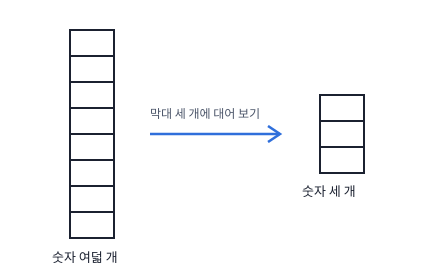

*숫자 여덟 개짜리 줄이 세 개짜리 줄로 줄어드는 것을 압축이라고 불러요.*

**정확히 말하면**

2차원 예에서는 x축 하나에 사영했어요. 이제 방향을 $M$개, 데이터를 $N$개로 늘려서 같은 사영을 행렬로 적어요. 그래야 "어떤 방향이 분산을 가장 많이 남기는가"를 식으로 계산할 수 있어요. 좌표 $\mathbf{z}_n$은 1028 수업에서 code라는 이름으로 이미 나왔어요([1028 정리노트 4.2 code: 정규직교 기저의 좌표](../../1028/정리노트_1028_PCA.html#s4-code)). 여기서는 수업의 표기와 차원을 다시 정리해요.

| 기호 | 뜻 | 크기 |
|---|---|---|
| $D$ | 원래 데이터의 차원(성분 수) | 자연수 |
| $M$ | 남길 방향의 수, 보통 $M\ll D$ | 자연수 |
| $N$ | 데이터 개수 | 자연수 |
| $\mathbf{x}_n$ | $n$번째 데이터 | $D\times 1$ |
| $\mathbf{b}_i$ | $i$번째 방향(basis vector) | $D\times 1$ |
| $\mathbf{B}$ | 방향들을 모은 행렬 | $D\times M$ |
| $\mathbf{z}_n$ | $n$번째 데이터의 새 좌표 | $M\times 1$ |

1. #### 방향을 가로로 나란히 붙여요

   각 $\mathbf{b}_i\in\mathbb{R}^{D}$는 세로(열)벡터예요. 길이는 데이터의 차원 $D$와 같아요. 이 열벡터 $M$개를 가로로 나란히 붙이면 행이 $D$개, 열이 $M$개인 행렬이 돼요.

   $$
   \mathbf{B}=\begin{bmatrix}\mathbf{b}_1 & \mathbf{b}_2 & \cdots & \mathbf{b}_M\end{bmatrix},\qquad \mathbf{B}\in\mathbb{R}^{D\times M}
   $$
2. #### 전치는 열을 행으로

   칠판의 예로 확인해요. 첫째 열이 첫째 행, 둘째 열이 둘째 행이 돼요.

   $$
   \begin{bmatrix}1 & 1\\ 0 & 1\\ 3 & 2\end{bmatrix}^T=\begin{bmatrix}1 & 0 & 3\\ 1 & 1 & 2\end{bmatrix}
   $$

   그래서 $\mathbf{B}^T$의 $i$번째 행은 $\mathbf{b}_i$를 눕힌 $\mathbf{b}_i^T\in\mathbb{R}^{1\times D}$예요.

   $$
   \mathbf{B}^T=\begin{bmatrix}\mathbf{b}_1^T\\ \vdots\\ \mathbf{b}_M^T\end{bmatrix}\in\mathbb{R}^{M\times D}
   $$
3. #### 데이터도 열로 모아요

   데이터 $\mathbf{x}_n\in\mathbb{R}^{D}$ $N$개를 열로 나란히 붙이면 데이터 행렬이 돼요. 행은 $D$개, 열은 $N$개예요.

   $$
   \mathbf{X}=\begin{bmatrix}\mathbf{x}_1 & \cdots & \mathbf{x}_N\end{bmatrix}\in\mathbb{R}^{D\times N}
   $$
4. #### 좌표 하나는 내적 하나

   $n$번째 데이터를 $i$번째 방향에 사영한 좌표예요. 2차원 예에서 $[1,0]$을 곱한 것을 일반 방향 $\mathbf{b}_i$로 바꾼 것이에요.

   $$
   z_{in}=\mathbf{b}_i^T\mathbf{x}_n
   $$

   크기는 ${(1\times D)(D\times 1)=1\times 1}$이라 스칼라예요. 이 값이 사영 좌표와 같으려면 $\mathbf{b}_i$의 길이가 1이어야 하고, PCA는 서로 직교하는 단위벡터(orthonormal)를 방향으로 써요.
5. #### 좌표 $M$개를 세로로 모아요

   $z_{1n}$부터 $z_{Mn}$까지 쌓은 벡터가 $\mathbf{z}_n$이에요. 각 칸은 $\mathbf{B}^T$의 행 하나와 $\mathbf{x}_n$의 내적이므로 행렬 곱 하나로 묶여요.

   $$
   \mathbf{z}_n=\begin{bmatrix}z_{1n}\\ \vdots\\ z_{Mn}\end{bmatrix}=\begin{bmatrix}\mathbf{b}_1^T\mathbf{x}_n\\ \vdots\\ \mathbf{b}_M^T\mathbf{x}_n\end{bmatrix}
   $$

   $$
   \mathbf{z}_n=\mathbf{B}^T\mathbf{x}_n\in\mathbb{R}^{M}
   $$

   크기는 ${(M\times D)(D\times 1)=M\times 1}$이에요.
6. #### $M\ll D$이면 압축

   숫자 $D$개짜리 $\mathbf{x}_n$이 숫자 $M$개짜리 $\mathbf{z}_n$으로 줄어요. 이것이 압축이에요.

이제 목표를 기호로 말할 수 있어요. 원래 $\mathbf{x}$의 에너지(variance)를 가장 잘 보존(preserve)하면서 차원을 줄이는 $\mathbf{b}_1,\dots,\mathbf{b}_M$을 찾아요. 첫 좌표 ${z_{1n}=\mathbf{b}_1^T\mathbf{x}_n}$의 분산을 계산하는 것이 그 첫 단계이고, [4.2 분산 V₁을 b₁ᵀSb₁로 바꾸기](#s4-v1)에서 이 식을 그대로 넣어요.

**다시 만드는 법:** 열벡터 $\mathbf{b}_i$를 가로로 붙여 $\mathbf{B}\in\mathbb{R}^{D\times M}$를 만들어요. 전치하면 행이 $\mathbf{b}_i^T$가 돼요. 행마다 $\mathbf{x}_n$과 내적하면 $z_{in}=\mathbf{b}_i^T\mathbf{x}_n$이고, 모으면 $\mathbf{z}_n=\mathbf{B}^T\mathbf{x}_n$이에요.

**교수님 말씀**

"여기까지가 이제 아이디어고, 지금부터 수학으로 넘어가 봅시다"라며 행렬 표기로 들어갔어요(1102 P02 03:51).

> "행의 길이가 D이고 열의 개수가 M인 D × M짜리 매트릭스" (1102 P02 04:39)

> "행을 열로, 열은 행으로 뒤집는 거잖아요" (1102 P02 04:51)

$\mathbf{x}_n$은 $D\times 1$, $\mathbf{b}_i^T$는 $1\times D$라 내적하면 스칼라가 되고, 그 스칼라가 $M$개 모인다고 세었어요.

> "지금부터 우리가 압축을 할 건데" (1102 P02 08:45)

> "variance를 가장 잘 보존하면서, preserve 하면서 차원을 줄일 수" (1102 P03 00:31)

**페이지 요약**

방향 $\mathbf{b}_i$들을 열로 붙인 $\mathbf{B}$의 전치를 곱하면, 데이터 하나가 내적 $M$개로 이루어진 짧은 좌표로 압축돼요.

*핵심 식*

- 방향 행렬

  $$
  \mathbf{B}=\begin{bmatrix}\mathbf{b}_1 & \mathbf{b}_2 & \cdots & \mathbf{b}_M\end{bmatrix},\qquad \mathbf{B}\in\mathbb{R}^{D\times M}
  $$
- 전치

  $$
  \mathbf{B}^T=\begin{bmatrix}\mathbf{b}_1^T\\ \vdots\\ \mathbf{b}_M^T\end{bmatrix}\in\mathbb{R}^{M\times D}
  $$
- 데이터 행렬

  $$
  \mathbf{X}=\begin{bmatrix}\mathbf{x}_1 & \cdots & \mathbf{x}_N\end{bmatrix}\in\mathbb{R}^{D\times N}
  $$
- 좌표 하나

  $$
  z_{in}=\mathbf{b}_i^T\mathbf{x}_n
  $$
- 새 좌표

  $$
  \mathbf{z}_n=\mathbf{B}^T\mathbf{x}_n\in\mathbb{R}^{M}
  $$

*용어*

- **압축** — $M\ll D$일 때 숫자 $D$개짜리 $\mathbf{x}_n$을 $M$개짜리 $\mathbf{z}_n$으로 줄이는 것이에요.
- **basis vector** — 좌표를 재는 방향 $\mathbf{b}_i$예요. PCA는 서로 직교하는 단위벡터를 써요.

$z_{in}$은 $(1\times D)(D\times 1)$이라 스칼라이고, $\mathbf{z}_n$은 $(M\times D)(D\times 1)=M\times 1$이에요. 목표는 variance를 가장 잘 보존하는 $\mathbf{b}_1,\dots,\mathbf{b}_M$을 찾는 것이에요.

---

## 2. 고윳값과 대각화 복습

### 2.1 고윳값과 고유벡터

*1102 수업 · L05 s16*

**쉽게 말하면**

늘이고 비트는 기계에 넣어도 방향은 그대로이고 길이만 바뀌는 특별한 화살표가 있어요.

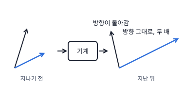

*보통 화살표는 기계를 지나면 방향이 돌아가지만, 특별한 화살표는 같은 방향으로 길이만 늘어나요.*

**정확히 말하면**

PCA에서 분산을 가장 많이 남기는 방향은 데이터 공분산 행렬의 고유벡터로 나와요([4.1 목표와 결론 미리 보기](#s4-goal)). 그래서 그 답을 읽는 도구인 고윳값과 고유벡터부터 복습해요.

**정의 (L05 s16, MML 정의 4.6)**: 정방행렬 $\mathbf{A}\in\mathbb{R}^{n\times n}$에 대해, 스칼라 $\lambda\in\mathbb{R}$와 영벡터가 아닌 벡터 $\mathbf{x}\in\mathbb{R}^{n}$가

$$
\mathbf{A}\mathbf{x}=\lambda\mathbf{x}
$$

를 만족하면 $\lambda$를 고윳값(eigenvalue), $\mathbf{x}$를 그에 대응하는 고유벡터(eigenvector)라고 해요. 이 식을 고윳값 방정식(eigenvalue equation)이라고 불러요.

- $\mathbf{A}$: $n\times n$ 정방행렬이에요. 벡터를 받아 다른 벡터로 보내는 선형변환 역할을 해요. PCA에서는 이 자리에 $D\times D$ 공분산 행렬 $\mathbf{S}$가 들어가요(이때 $n=D$).
- $\mathbf{x}$: $n\times 1$ 열벡터예요. $\mathbf{A}$를 곱해도 방향이 바뀌지 않는 특별한 방향이에요.
- $\lambda$: 스칼라예요. 그 방향으로 몇 배 늘어나는지(음수면 방향이 뒤집힘)를 알려 줘요.
- $\mathbf{x}\neq\mathbf{0}$ 조건이 필요한 이유: $\mathbf{x}=\mathbf{0}$이면 어떤 $\lambda$로도 식이 성립해서 의미가 없어요.

고유벡터는 길이가 정해져 있지 않아요. $\mathbf{x}$가 고유벡터이면 0이 아닌 상수 $c$에 대해 $c\mathbf{x}$도 같은 $\lambda$의 고유벡터예요(MML 105쪽). 그래서 뒤에서 고유벡터를 길이 1로 정규화해서 쓸 수 있어요.

**고윳값을 찾는 식 만들기 (칠판 전개)**: 목표는 $\mathbf{x}$를 모르는 상태에서 $\lambda$만으로 된 조건을 얻는 거예요.

1. 오른쪽 항을 왼쪽으로 옮겨요.

   $$
   \mathbf{A}\mathbf{x}-\lambda\mathbf{x}=\mathbf{0}
   $$
2. $\lambda\mathbf{x}$를 $\lambda\mathbf{I}_n\mathbf{x}$로 바꿔 $\mathbf{x}$로 묶어요. $\mathbf{I}_n$은 $n\times n$ 단위행렬이에요. 행렬 $\mathbf{A}$에서 스칼라 $\lambda$를 바로 뺄 수는 없어서 $\lambda\mathbf{I}_n$으로 바꿔 크기를 맞춰요.

   $$
   (\mathbf{A}-\lambda\mathbf{I}_n)\mathbf{x}=\mathbf{0}
   $$
3. 이 연립방정식이 $\mathbf{x}\neq\mathbf{0}$인 해(non-trivial solution)를 가지려면 $n\times n$ 행렬 $\mathbf{A}-\lambda\mathbf{I}_n$이 full-rank가 아니라 rank-deficient여야 해요.

   $$
   \operatorname{rk}(\mathbf{A}-\lambda\mathbf{I}_n)\lt n
   $$
4. rank-deficient인 정방행렬은 역행렬이 없어요. 역행렬이 있었다면 양변 왼쪽에 곱해 $\mathbf{x}=\mathbf{0}$만 남았을 거예요. 역행렬이 없다는 것은 행렬식이 0이라는 것과 같아요.

   $$
   \det(\mathbf{A}-\lambda\mathbf{I}_n)=0
   $$

**동치인 진술 (L05 s16)**: 다음은 모두 같은 말이에요.

- $\lambda$가 $\mathbf{A}$의 고윳값이에요.
- 다음 연립방정식이 $\mathbf{x}\neq\mathbf{0}$인 해를 가져요.

  $$
  (\mathbf{A}-\lambda\mathbf{I}_n)\mathbf{x}=\mathbf{0}
  $$
- $\mathbf{A}-\lambda\mathbf{I}_n$의 rank가 $n$보다 작아요(rank-deficient).
- $\det(\mathbf{A}-\lambda\mathbf{I}_n)=0$이에요.

$\det(\mathbf{A}-\lambda\mathbf{I}_n)=0$을 특성방정식(characteristic equation)이라고 해요. 왼쪽 $\det(\mathbf{A}-\lambda\mathbf{I}_n)$을 전개하면 $\lambda$에 대한 $n$차 다항식이 되는데, 이것이 특성다항식(characteristic polynomial) $p_{\mathbf{A}}(\lambda)$예요. 고윳값은 이 다항식의 근이에요(MML 정리 4.8).

순서는 두 단계예요. 먼저 characteristic equation을 풀어 고윳값 $\lambda$를 얻고, 각 $\lambda$를 칠판 전개 2단계의 연립방정식에 다시 넣어 고유벡터 $\mathbf{x}$를 구해요. 이 전체를 eigenvalue–eigenvector problem이라고 불러요. 실제 계산 예는 [3.2 예제: 3×3 대칭행렬](#s3-spectral-example)에 있어요.

**복원 요령**: $\mathbf{A}\mathbf{x}=\lambda\mathbf{x}$에서 이항하고 $\mathbf{I}_n$으로 묶어요. 0이 아닌 해가 있으려면 rank-deficient, 즉 행렬식이 0이어야 해요.

**페이지 요약**

고유벡터는 행렬을 곱해도 방향이 그대로인 벡터이고, 고윳값은 그때 늘어나는 배수예요. 고윳값은 행렬식이 0이 되는 조건으로 찾아요.

*핵심 식*

- 고윳값 방정식

  $$
  \mathbf{A}\mathbf{x}=\lambda\mathbf{x}
  $$
- 이항해서 묶기

  $$
  (\mathbf{A}-\lambda\mathbf{I}_n)\mathbf{x}=\mathbf{0}
  $$
- 특성방정식

  $$
  \det(\mathbf{A}-\lambda\mathbf{I}_n)=0
  $$

*용어*

- **고윳값(eigenvalue) $\lambda$** — 고유벡터 방향으로 늘어나는 배수, 스칼라
- **고유벡터(eigenvector) $\mathbf{x}$** — $\mathbf{x}\neq\mathbf{0}$인 $n\times 1$ 벡터, 상수배도 고유벡터
- **rank-deficient** — $\mathbf{A}-\lambda\mathbf{I}_n$의 rank가 $n$보다 작아 역행렬이 없고 0이 아닌 해가 생기는 상태
- **characteristic equation** — $\det(\mathbf{A}-\lambda\mathbf{I}_n)=0$, 풀면 고윳값이 나와요

---

### 2.2 대각행렬과 대각화

*1102 수업 · L05 s17*

**쉽게 말하면**

대각선 칸에만 숫자가 있는 표는 칸마다 따로 계산하면 돼서 다루기 쉬워요.

*색칠된 대각선 칸에만 숫자가 들어갈 수 있고, 테두리만 있는 나머지 칸은 모두 0이에요. 복잡한 표도 바라보는 방향을 잘 고르면 이런 표로 바꿀 수 있을 때가 있어요.*

**정확히 말하면**

고윳값 분해와 스펙트럼 정리는 결국 행렬을 대각행렬로 바꾸는 이야기예요. 그래서 대각행렬이 왜 다루기 쉬운지부터 봐요.

**대각행렬(diagonal matrix, L05 s17)**: 비대각 성분(off-diagonal element)이 모두 0인 정방행렬 $\mathbf{D}\in\mathbb{R}^{n\times n}$이에요. 조건은 비대각 성분이 0이라는 것뿐이고, 대각 성분 $d_1,\dots,d_n$은 0이어도 돼요.

$$
\mathbf{D}=\begin{bmatrix}d_1&\cdots&0\\\vdots&\ddots&\vdots\\0&\cdots&d_n\end{bmatrix}=\operatorname{diag}(d_1,\dots,d_n)
$$

대각 성분끼리만 따로 계산하면 돼서 다음 성질이 바로 나와요.

- 거듭제곱: 각 대각 성분만 $k$제곱해요.

  $$
  \mathbf{D}^k=\operatorname{diag}(d_1^k,\dots,d_n^k)
  $$
- 역행렬: 모든 $d_i\neq 0$일 때 각 성분의 역수예요.

  $$
  \mathbf{D}^{-1}=\operatorname{diag}(1/d_1,\dots,1/d_n)
  $$
- 행렬식: 대각 성분의 곱이에요.

  $$
  \det(\mathbf{D})=d_1d_2\cdots d_n
  $$

  $2\times 2$ 행렬식 공식으로 확인해요.

  $$
  \det\begin{bmatrix}a&b\\c&d\end{bmatrix}=ad-bc
  $$

  대각행렬은 $b=c=0$이라 $ad$만 남아요. 이것을 $n\times n$으로 넓히면 대각 성분의 곱이 돼요.

**대각화 가능(diagonalizable)**: $\mathbf{A}\in\mathbb{R}^{n\times n}$가 대각행렬과 닮음(similar)이면, 즉 가역행렬 $\mathbf{P}\in\mathbb{R}^{n\times n}$가 있어서

$$
\mathbf{D}=\mathbf{P}^{-1}\mathbf{A}\mathbf{P}
$$

로 쓸 수 있으면 $\mathbf{A}$는 diagonalizable이에요.

- $\mathbf{P}$: $n\times n$ 가역행렬이에요. 좌표를 바꾸는 역할을 해요. 이 $\mathbf{P}$의 열이 고유벡터라는 것은 [2.3 고윳값 분해(EVD)](#s2-evd)에서 유도해요.
- $\mathbf{D}$: $n\times n$ 대각행렬이에요. 바꾼 좌표에서 본 $\mathbf{A}$예요.
- 슬라이드의 Remark: 행렬을 대각화하는 것은 같은 선형변환을 다른 basis에서 표현하는 방법이에요(MML 116쪽).

**직교 대각화 가능(orthogonally diagonalizable)**: 위의 $\mathbf{P}$를 직교행렬(orthogonal matrix)로 고를 수 있는 경우예요. 직교행렬은 열들이 서로 수직이고 길이가 1인 정방행렬이라 $\mathbf{P}^T\mathbf{P}=\mathbf{I}_n$, 즉 $\mathbf{P}^{-1}=\mathbf{P}^T$예요. 그래서 역행렬 자리에 전치를 쓸 수 있어요.

대각화의 정의식에서 $\mathbf{P}^{-1}$ 자리에 $\mathbf{P}^T$를 넣어요.

$$
\mathbf{D}=\mathbf{P}^{-1}\mathbf{A}\mathbf{P}
$$

$$
\mathbf{D}=\mathbf{P}^T\mathbf{A}\mathbf{P}
$$

- orthogonally diagonalizable이면 당연히 diagonalizable이에요. 반대는 성립하지 않아요.
- 모든 정방행렬이 (직교)대각화되는 것은 아니에요. 대각화되는 조건은 [2.3 고윳값 분해(EVD)](#s2-evd)에서 봐요.
- PCA에서 다루는 공분산 행렬은 대칭행렬이라 항상 orthogonally diagonalizable이에요. 그 근거가 [3.1 대칭행렬은 직교 고유벡터로 쪼개져요](#s3-spectral)의 스펙트럼 정리예요.
- 오른쪽 $\mathbf{A}\mathbf{P}$부터 묶어 내적으로 읽으면 왜 대각선에 고윳값만 남는지는 [2.3 고윳값 분해(EVD)](#s2-evd)의 고유벡터 행렬을 배운 뒤 [3.1 대칭행렬은 직교 고유벡터로 쪼개져요](#s3-spectral)에서 바로 확인해요.

**교수님 말씀**

정의를 짚기 전에 "수학은 뭘로 시작한다고?"라고 물었고, 한 학생이 "정의로부터 시작한다"고 답했어요. (1102 P03 06:31)

모든 정방행렬이 대각화되지는 않고, 독특한 클래스의 행렬들만 된다고 했어요. 그래도 걱정할 필요는 없다고 덧붙였어요.

> "PCA에서 배울 매트릭스는 항상 orthogonally diagonalizable 해. 그러니까 이거 가르쳤겠지" (1102 P03 07:04)

**페이지 요약**

대각행렬은 비대각 성분이 모두 0이라 거듭제곱·역행렬·행렬식이 성분별 계산으로 끝나요. 가역 $\mathbf{P}$로 대각행렬을 만들 수 있으면 대각화 가능, $\mathbf{P}$를 직교행렬로 고를 수 있으면 직교 대각화 가능이에요.

*핵심 식*

- 대각행렬의 거듭제곱

  $$
  \mathbf{D}^k=\operatorname{diag}(d_1^k,\dots,d_n^k)
  $$
- 대각행렬의 행렬식

  $$
  \det(\mathbf{D})=d_1d_2\cdots d_n
  $$
- 대각화

  $$
  \mathbf{D}=\mathbf{P}^{-1}\mathbf{A}\mathbf{P}
  $$
- 직교 대각화

  $$
  \mathbf{D}=\mathbf{P}^T\mathbf{A}\mathbf{P}
  $$

*용어*

- **대각행렬(diagonal matrix)** — 비대각 성분이 모두 0, 대각 성분은 0이어도 됨
- **diagonalizable** — 가역 $\mathbf{P}$로 대각행렬과 닮음, 같은 선형변환을 다른 basis에서 본 것
- **orthogonally diagonalizable** — $\mathbf{P}$가 직교행렬이라 $\mathbf{P}^{-1}=\mathbf{P}^T$, PCA의 공분산 행렬은 항상 해당

---

### 2.3 고윳값 분해(EVD)

*1102 수업 · L05 s18*

**쉽게 말하면**

합체한 변신 로봇을 팔, 다리, 몸통으로 나눠 놓으면 어느 부분이 무슨 일을 하는지 잘 보여요.

*하나로 뭉친 것을 부품별로 나눠 두면 나중에 다루기 쉬워져요.*

**정확히 말하면**

PCA에서는 공분산 행렬을 고유벡터와 고윳값으로 쪼갠 뒤 그 조각에서 방향을 골라요. 그 일반형이 고윳값 분해(eigenvalue decomposition, EVD)이고, 대칭행렬에 쓰는 특수형이 [3.1 대칭행렬은 직교 고유벡터로 쪼개져요](#s3-spectral)예요.

decomposition은 인수분해, 즉 분해예요(compose는 합성, decompose는 분해). 행렬을 잘 분해해 두면 그 특성을 나중에 계산에 이용할 수 있어요.

앞 페이지의 [2.2 대각행렬과 대각화](#s2-diagonal)에서 $\mathbf{D}=\mathbf{P}^{-1}\mathbf{A}\mathbf{P}$였어요. 양변 왼쪽에 $\mathbf{P}$를 곱하면 결합법칙에 따라 $\mathbf{P}\mathbf{P}^{-1}=\mathbf{I}_n$으로 정리할 수 있어요.

$$
\begin{aligned}
\mathbf{P}\mathbf{D}
&= \mathbf{P}(\mathbf{P}^{-1}\mathbf{A}\mathbf{P}) \\
&= (\mathbf{P}\mathbf{P}^{-1})\mathbf{A}\mathbf{P} \\
&= \mathbf{I}_n\mathbf{A}\mathbf{P} \\
&= \mathbf{A}\mathbf{P}.
\end{aligned}
$$

따라서 $\mathbf{A}\mathbf{P}=\mathbf{P}\mathbf{D}$예요. $\mathbf{P}$의 $i$번째 열을 $\mathbf{p}_i$, $\mathbf{D}$의 $i$번째 대각 성분을 $\lambda_i$라고 하면, 두 행렬의 $i$번째 열을 비교해 $\mathbf{A}\mathbf{p}_i=\lambda_i\mathbf{p}_i$를 얻어요. $\mathbf{P}$가 가역이라 각 열이 영벡터가 아니므로 $\mathbf{p}_i$는 고유벡터예요. 아래에서는 반대로 고유벡터에서 출발해 같은 식을 만들어요.

**기호**: $\mathbf{A}\in\mathbb{R}^{n\times n}$의 고유벡터 $\mathbf{p}_1,\dots,\mathbf{p}_n$과 대응 고윳값 $\lambda_1,\dots,\lambda_n$이 있다고 해요. 즉 $\mathbf{p}_i$에 $\mathbf{A}$를 곱하면 $\lambda_i\mathbf{p}_i$가 돼요.

- $\mathbf{p}_i$: $n\times 1$ 열벡터, $i$번째 고유벡터예요.
- $\mathbf{P}$: $[\mathbf{p}_1,\dots,\mathbf{p}_n]$처럼 고유벡터를 열로 나란히 붙인 $n\times n$ 행렬이에요.
- $\mathbf{D}$: 같은 순서의 고윳값을 대각에 놓은 $n\times n$ 대각행렬이에요. 대각 성분은 차례로 $\lambda_1,\dots,\lambda_n$이에요.

**칠판 유도 (L05 s18)**: 목표는 열마다 쓴 $n$개의 고윳값 방정식을 행렬 식 하나로 묶는 거예요. 양변을 열 단위로 계산해 같음을 보여요.

1. $\mathbf{A}$를 $\mathbf{P}$의 각 열에 나눠 곱해요(분배). 각 $\mathbf{A}\mathbf{p}_i$는 $n\times 1$이에요.

   $$
   \mathbf{A}\mathbf{P}=\mathbf{A}[\mathbf{p}_1,\dots,\mathbf{p}_n]=[\mathbf{A}\mathbf{p}_1,\dots,\mathbf{A}\mathbf{p}_n]
   $$
2. $\mathbf{p}_i$가 고유벡터이므로 $\mathbf{A}\mathbf{p}_i$ 자리에 $\lambda_i\mathbf{p}_i$를 대입해요.

   $$
   [\mathbf{A}\mathbf{p}_1,\dots,\mathbf{A}\mathbf{p}_n]=[\lambda_1\mathbf{p}_1,\dots,\lambda_n\mathbf{p}_n]
   $$
3. 오른쪽 $\mathbf{P}\mathbf{D}$를 계산해요. $\mathbf{P}\mathbf{D}$의 $i$번째 열은 $\mathbf{P}$에 $\mathbf{D}$의 $i$번째 열 $\lambda_i\mathbf{e}_i$를 곱한 것이라 $\lambda_i\mathbf{p}_i$예요. 대각행렬을 오른쪽에 곱하면 열마다 배율이 곱해져요.

   $$
   \mathbf{P}\mathbf{D}=[\mathbf{p}_1,\dots,\mathbf{p}_n]\begin{bmatrix}\lambda_1&\cdots&0\\\vdots&\ddots&\vdots\\0&\cdots&\lambda_n\end{bmatrix}=[\lambda_1\mathbf{p}_1,\dots,\lambda_n\mathbf{p}_n]
   $$
4. 2와 3의 결과가 같으므로

   $$
   \mathbf{A}\mathbf{P}=\mathbf{P}\mathbf{D}
   $$
5. $\mathbf{P}$가 가역이면 양변 오른쪽에 $\mathbf{P}^{-1}$을 곱해요.

   $$
   \mathbf{A}=\mathbf{P}\mathbf{D}\mathbf{P}^{-1}
   $$
6. $\mathbf{P}$가 가역일 때 4단계 식의 양변 왼쪽에 $\mathbf{P}^{-1}$을 곱하면 [2.2 대각행렬과 대각화](#s2-diagonal)의 정의식으로 돌아가요.

   $$
   \mathbf{D}=\mathbf{P}^{-1}\mathbf{A}\mathbf{P}
   $$

3단계에서 $\mathbf{D}$는 오른쪽에 곱해야 열마다 배율이 곱해져요. (수업 중 대각행렬은 앞뒤 어디에 곱해도 같다고 말했지만 일반 행렬과는 교환되지 않아요. 정정은 [3.1 대칭행렬은 직교 고유벡터로 쪼개져요](#s3-spectral)에서 다뤄요.)

**정리 (EVD, L05 s18, MML 정리 4.20)**: $\mathbf{A}\in\mathbb{R}^{n\times n}$가 다음처럼 분해되는 것과, $\mathbf{A}$의 고유벡터들이 $\mathbb{R}^n$의 basis를 이루는 것은 동치(if and only if)예요.

$$
\mathbf{A}=\mathbf{P}\mathbf{D}\mathbf{P}^{-1}
$$

- 이유: 5단계에서 $\mathbf{P}^{-1}$이 있어야 해요. $\mathbf{P}$가 가역이려면 열 $\mathbf{p}_1,\dots,\mathbf{p}_n$이 일차독립이어야 하고, $n$개의 일차독립 벡터는 $\mathbb{R}^n$의 basis예요(MML 116쪽).
- EVD의 $\mathbf{P}$는 가역이기만 하면 돼요. 직교행렬일 필요는 없어요. $\mathbf{P}^{-1}=\mathbf{P}^T$로 고를 수 있는 것은 대칭행렬일 때예요([3.1 대칭행렬은 직교 고유벡터로 쪼개져요](#s3-spectral)).
- $\mathbf{D}$의 고윳값 순서는 EVD가 요구하지 않아요. $\mathbf{P}$의 열 순서만 같이 맞추면 돼요. 고윳값을 큰 것부터 작은 것 순으로 놓는 것은 PCA에서 쓰는 관례예요(MML 105쪽도 소프트웨어 관례로 소개).

**모든 정방행렬이 대각화되지는 않아요**: 고윳값이 중근일 때 일차독립인 고유벡터가 $n$개보다 적을 수 있어요. 그러면 고유벡터가 $\mathbb{R}^n$의 basis를 이루지 못해 가역 $\mathbf{P}$를 만들 수 없고, 대각화되지 않아요. 이런 행렬을 defective라고 해요(MML 정의 4.13, 111쪽; 교과서 예 4.6, 108쪽에 $2\times 2$ 예가 있어요).

반대로 고윳값이 중근이어도 고유벡터가 basis를 이루면 대각화돼요. [3.2 예제: 3×3 대칭행렬](#s3-spectral-example)은 $\lambda=1$이 중근인데도 고유벡터 3개로 $\mathbf{P}$를 만들어요.

**EVD의 장점 (L05 s18)**: 어려운 계산을 대각행렬 계산으로 바꿔요.

1. 제곱: 가운데 $\mathbf{P}^{-1}\mathbf{P}=\mathbf{I}_n$이 사라져요.

   $$
   \mathbf{A}^2=\mathbf{P}\mathbf{D}\mathbf{P}^{-1}\mathbf{P}\mathbf{D}\mathbf{P}^{-1}=\mathbf{P}\mathbf{D}\mathbf{I}_n\mathbf{D}\mathbf{P}^{-1}=\mathbf{P}\mathbf{D}^2\mathbf{P}^{-1}
   $$

   $$
   \mathbf{D}^2=\operatorname{diag}(\lambda_1^2,\dots,\lambda_n^2)
   $$
2. 같은 상쇄를 $k$번 반복하면

   $$
   \mathbf{A}^k=\mathbf{P}\mathbf{D}^k\mathbf{P}^{-1}
   $$
3. 행렬식: 곱의 행렬식은 행렬식의 곱이에요.

   $$
   \det(\mathbf{A})=\det(\mathbf{P})\det(\mathbf{D})\det(\mathbf{P}^{-1})
   $$
4. $\det(\mathbf{P})\det(\mathbf{P}^{-1})$는 $\det(\mathbf{P}\mathbf{P}^{-1})$과 같고 $\det(\mathbf{I}_n)=1$이라 남는 것은 $\det(\mathbf{D})$예요.

   $$
   \det(\mathbf{A})=\det(\mathbf{D})=\prod_i d_{ii}=\prod_i\lambda_i
   $$

   (수업 중 $\mathbf{P}$가 orthonormal이라 $\det(\mathbf{P})=1$이라고 말했지만, $\det(\mathbf{A})=\det(\mathbf{D})$인 이유는 $\det(\mathbf{P})\det(\mathbf{P}^{-1})=1$이에요. 직교행렬이어도 $\det(\mathbf{P})=\pm 1$이에요.)
5. 역행렬: 수업에서는 역행렬 계산도 쉬워진다고만 했어요. 강의 내용을 식으로 옮긴 재표현은, 모든 $\lambda_i\neq 0$일 때 다음과 같아요. $\mathbf{A}$에 곱하면 가운데가 차례로 상쇄되어 $\mathbf{I}_n$이 돼요.

   $$
   \mathbf{A}^{-1}=\mathbf{P}\mathbf{D}^{-1}\mathbf{P}^{-1}
   $$

MML은 이 분해를 세 단계 변환으로 읽어요(MML 117쪽 그림 4.7). $\mathbf{P}^{-1}$이 좌표를 고유벡터 basis로 바꾸고, $\mathbf{D}$가 각 축을 $\lambda_i$배 늘이고, $\mathbf{P}$가 원래 좌표로 되돌려요.

**복원 요령**: 고유벡터를 열로 모은 $\mathbf{P}$와 고윳값을 대각에 둔 $\mathbf{D}$를 만들어요. 열마다 $\mathbf{A}\mathbf{p}_i$가 $\lambda_i\mathbf{p}_i$이므로 $\mathbf{A}\mathbf{P}$와 $\mathbf{P}\mathbf{D}$가 같고, $\mathbf{P}^{-1}$을 오른쪽에 곱하면 분해, 왼쪽에 곱하면 대각화예요.

**교수님 말씀**

**변신 로봇 비유**: 합체한 변신 로봇 장난감을 분해하면 팔, 다리, 어깨, 뿔이 다 구별돼요. 행렬도 잘 분해해 두면 각 부분의 특성을 나중에 이용할 수 있다고 했어요.

행렬을 어떻게 분해할지는 선형대수에서 오래된 핵심 문제라고 강조했어요.

> "이 매트릭스를 어떻게 분해할 것인가가 … 수학자들한테는 몇백 년간 매우 중요한 이슈였어요." (1102 P03 08:57)

**페이지 요약**

고유벡터를 열로 모은 $\mathbf{P}$와 고윳값을 대각에 둔 $\mathbf{D}$로 열마다의 고윳값 방정식을 묶으면 $\mathbf{A}\mathbf{P}$와 $\mathbf{P}\mathbf{D}$가 같고, 고유벡터가 basis를 이룰 때만 $\mathbf{P}^{-1}$을 곱해 분해할 수 있어요.

*핵심 식*

- 열별 묶음

  $$
  \mathbf{A}\mathbf{P}=\mathbf{P}\mathbf{D}
  $$
- 고윳값 분해

  $$
  \mathbf{A}=\mathbf{P}\mathbf{D}\mathbf{P}^{-1}
  $$
- 거듭제곱

  $$
  \mathbf{A}^k=\mathbf{P}\mathbf{D}^k\mathbf{P}^{-1}
  $$
- 행렬식

  $$
  \det(\mathbf{A})=\det(\mathbf{D})=\prod_i d_{ii}=\prod_i\lambda_i
  $$

*용어*

- **고윳값 분해(EVD)** — 고유벡터 행렬 $\mathbf{P}$와 고윳값 대각행렬 $\mathbf{D}$로 쪼개기, 고유벡터가 $\mathbb{R}^n$의 basis일 때만 가능
- **$\mathbf{P}$** — 가역이면 충분, 직교일 필요 없음(직교는 대칭행렬일 때)
- **고윳값 순서** — EVD의 요구가 아니라 PCA의 관례(큰 것부터)
- **defective** — 일차독립 고유벡터가 $n$개보다 적어 대각화되지 않는 행렬
- **변신 로봇** — 합체 로봇을 부품별로 나누듯 행렬을 분해해 특성을 이용한다는 교수님 비유

---

## 3. 스펙트럼 정리

### 3.1 대칭행렬은 직교 고유벡터로 쪼개져요

*1102 수업 · L05 s19*

**쉽게 말하면**

대각선을 따라 접으면 딱 겹치는 표는 서로 직각인 방향 조각 몇 개로 깔끔하게 나눌 수 있어요.

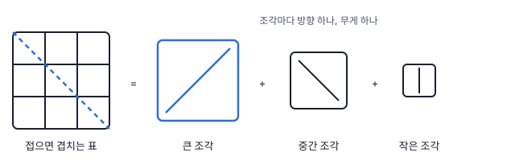

*대각선으로 접으면 겹치는 표 하나가 무게가 다른 조각 세 개를 더한 것과 같아요.*

**정확히 말하면**

PCA에서 쓰는 데이터 공분산 행렬 $\mathbf{S}$는 대칭이라 이 정리가 그대로 적용되고, 뒤의 [4.3 왜 가장 큰 고윳값의 고유벡터일까](#s4-max-proof)에서 $\mathbf{b}_1$을 $\mathbf{S}$의 고유벡터 $\mathbf{p}_i$들로 펼칠 때 이 결과를 그대로 써요.

**기호.** 이 토픽의 기호는 다음과 같아요. 슬라이드는 차원을 $n$으로 쓰고, PCA에서는 이 $n$이 데이터 차원 $D$예요.

- $\mathbf{S}\in\mathbb{R}^{n\times n}$: 대칭행렬(symmetric matrix)이에요. $\mathbf{S}^T=\mathbf{S}$, 즉 대각선을 기준으로 위아래 성분이 같아요. 전치해도 크기가 그대로여야 하므로 반드시 정방행렬이에요.
- $\lambda_1,\dots,\lambda_n$: $\mathbf{S}$의 고윳값(eigenvalue)이에요. 각각 스칼라예요.
- $\mathbf{p}_i\in\mathbb{R}^{n}$: $\lambda_i$에 대응하는 고유벡터(eigenvector)예요. 길이 1인 열벡터로 골라요.
- ${\mathbf{P}=[\mathbf{p}_1,\dots,\mathbf{p}_n]\in\mathbb{R}^{n\times n}}$: 고유벡터를 열로 나란히 붙인 행렬이에요.
- ${\mathbf{D}=\operatorname{diag}(\lambda_1,\dots,\lambda_n)\in\mathbb{R}^{n\times n}}$: 고윳값을 대각에 놓은 대각행렬이에요.

**정리(spectral theorem, 스펙트럼 정리).** 대칭행렬 $\mathbf{S}\in\mathbb{R}^{n\times n}$는 다음처럼 분해돼요(L05 s19, MML Theorem 4.15·4.21).

$$
\mathbf{S}=\mathbf{P}\mathbf{D}\mathbf{P}^{-1}
$$

$$
\mathbf{P}^{-1}=\mathbf{P}^T
$$

두 식을 합쳐 다음처럼 써요.

$$
\mathbf{S}=\mathbf{P}\mathbf{D}\mathbf{P}^T
$$

이때 성립하는 성질은 세 가지예요.

1. $\mathbf{D}$의 대각 성분, 곧 고윳값은 모두 **실수**예요. 일반 실행렬은 고윳값이 복소수일 수 있지만 대칭행렬은 그렇지 않아요.
2. $\mathbf{P}$의 열은 정규직교(orthonormal)예요. 서로 다른 고윳값의 고유벡터는 항상 직교해요. 같은 고윳값(중근)의 고유벡터는 자동으로 직교하지 않아서 직접 직교화해요. 그 과정은 [3.2 예제: 3×3 대칭행렬](#s3-spectral-example)에서 다뤄요.
3. 열이 정규직교이면 $\mathbf{p}_i^T\mathbf{p}_j$가 $i=j$일 때 1, 아니면 0이에요. 이를 한꺼번에 쓰면 $\mathbf{P}^T\mathbf{P}=\mathbf{I}$이고, 이런 $\mathbf{P}$를 직교행렬(orthogonal matrix)이라고 해요. 그래서 역행렬을 구하지 않고 전치만 하면 돼요.

[2.3 고윳값 분해(EVD)](#s2-evd)의 일반 분해와 달리, 대칭이면 $\mathbf{P}$를 직교로 고를 수 있어요.

(수업 중 대칭행렬이면 역행렬이 자기 전치, 즉 $\mathbf{S}^{-1}=\mathbf{S}^T$인 것처럼 말했다가 정정: 전치가 역행렬이 되는 것은 고유벡터 행렬 $\mathbf{P}$이고, 대칭이면 항상 그렇게 고를 수 있어요.)

**직교 대각화 $\mathbf{D}=\mathbf{P}^T\mathbf{S}\mathbf{P}$를 오른쪽부터 내적으로 읽기.** 아래는 [2.2 대각행렬과 대각화](#s2-diagonal)의 직교 대각화 식($\mathbf{D}=\mathbf{P}^T\mathbf{A}\mathbf{P}$에서 $\mathbf{A}=\mathbf{S}$)과 강의 공식을 연결하기 위한 재표현이에요. 오른쪽 두 행렬 $\mathbf{S}\mathbf{P}$부터 묶어 읽으면 왜 비대각 성분이 사라지고 대각선에 고윳값만 남는지 바로 보여요.

1. **오른쪽 $\mathbf{S}\mathbf{P}$ 먼저**: $\mathbf{P}=[\mathbf{p}_1,\dots,\mathbf{p}_n]$의 각 세로줄은 고유벡터이므로, $\mathbf{S}$를 곱하면 세로줄마다 자기 고윳값 $\lambda_j$배가 돼요([2.3 고윳값 분해(EVD)](#s2-evd) 칠판 유도 1–2단계).

   $$
   \mathbf{S}\mathbf{P}=[\mathbf{S}\mathbf{p}_1\ \cdots\ \mathbf{S}\mathbf{p}_n]=[\lambda_1\mathbf{p}_1\ \cdots\ \lambda_n\mathbf{p}_n]
   $$
2. **왼쪽에 $\mathbf{P}^T$ 곱하기(가로줄×세로줄 내적)**: $\mathbf{P}^T$는 고유벡터들이 가로줄(행)로 누운 행렬이에요. 여기에 $\mathbf{S}\mathbf{P}$를 곱하면 $(i,j)$ 칸 성분 $D_{ij}$는 $\mathbf{P}^T$의 $i$번째 가로줄 $\mathbf{p}_i^T$와 $\mathbf{S}\mathbf{P}$의 $j$번째 세로줄 $\lambda_j\mathbf{p}_j$의 내적이에요.

   $$
   \mathbf{P}^T(\mathbf{S}\mathbf{P})=\begin{bmatrix}\mathbf{p}_1^T\\\vdots\\\mathbf{p}_n^T\end{bmatrix}[\lambda_1\mathbf{p}_1\ \cdots\ \lambda_n\mathbf{p}_n],\qquad D_{ij}=\mathbf{p}_i^T(\mathbf{S}\mathbf{p}_j)=\lambda_j(\mathbf{p}_i^T\mathbf{p}_j)
   $$
3. **정규직교성 적용**: 대각선 칸($i=j$)은 같은 단위 고유벡터끼리의 내적이라 $\mathbf{p}_i^T\mathbf{p}_i=1$이 되어 $\lambda_i$만 남고, 비대각선 칸($i\neq j$)은 서로 수직인 고유벡터끼리의 내적이라 $\mathbf{p}_i^T\mathbf{p}_j=0$이 되어 모두 $0$으로 지워져요.

   $$
   \mathbf{P}^T\mathbf{S}\mathbf{P}=\begin{bmatrix}\lambda_1(\mathbf{p}_1^T\mathbf{p}_1) & \cdots & \lambda_n(\mathbf{p}_1^T\mathbf{p}_n)\\ \vdots & \ddots & \vdots\\ \lambda_1(\mathbf{p}_n^T\mathbf{p}_1) & \cdots & \lambda_n(\mathbf{p}_n^T\mathbf{p}_n)\end{bmatrix}=\begin{bmatrix}\lambda_1 & \cdots & 0\\ \vdots & \ddots & \vdots\\ 0 & \cdots & \lambda_n\end{bmatrix}=\mathbf{D}
   $$

**유도: 행렬을 방향별 조각의 합으로.** 목적은 $\mathbf{S}$ 하나를 "방향 $\mathbf{p}_i$ 하나와 무게 $\lambda_i$ 하나"짜리 조각 $n$개의 합으로 다시 쓰는 거예요. 수업 칠판처럼 $n=3$으로 전개해요.

1. 분해식을 성분 모양으로 써요.

   $$
   \mathbf{S}=[\mathbf{p}_1\ \mathbf{p}_2\ \mathbf{p}_3]\begin{bmatrix}\lambda_1 & 0 & 0\\ 0 & \lambda_2 & 0\\ 0 & 0 & \lambda_3\end{bmatrix}\begin{bmatrix}\mathbf{p}_1^T\\ \mathbf{p}_2^T\\ \mathbf{p}_3^T\end{bmatrix}
   $$
2. 앞의 두 행렬을 먼저 곱해요. 대각행렬을 **오른쪽**에 곱하면 각 열이 해당 고윳값배가 돼요(열 스케일링).

   $$
   \mathbf{P}\mathbf{D}=[\lambda_1\mathbf{p}_1\ \lambda_2\mathbf{p}_2\ \lambda_3\mathbf{p}_3]
   $$

   이 전개에 필요한 것은 이 열 스케일링뿐이에요.
3. 남은 곱은 "열들을 가로로 붙인 행렬" 곱하기 "행들을 세로로 쌓은 행렬"이에요. 행렬 곱의 열×행 전개(외적 합)에 따라 $k$번째 열과 $k$번째 행끼리만 곱해서 더해요.

   $$
   [\lambda_1\mathbf{p}_1\ \lambda_2\mathbf{p}_2\ \lambda_3\mathbf{p}_3]\begin{bmatrix}\mathbf{p}_1^T\\ \mathbf{p}_2^T\\ \mathbf{p}_3^T\end{bmatrix}=\lambda_1\mathbf{p}_1\mathbf{p}_1^T+\lambda_2\mathbf{p}_2\mathbf{p}_2^T+\lambda_3\mathbf{p}_3\mathbf{p}_3^T
   $$

   $i\neq j$인 교차항 $\mathbf{p}_i\mathbf{p}_j^T$는 곱의 정의상 처음부터 생기지 않아요. 직교성과는 상관없어요.
4. 일반 $n$으로 쓰면 다음과 같아요.

   $$
   \mathbf{S}=\sum_{i=1}^{n}\lambda_i\mathbf{p}_i\mathbf{p}_i^T
   $$

합 $\sum_{i=1}^{n}\lambda_i\mathbf{p}_i\mathbf{p}_i^T$의 각 조각 $\mathbf{p}_i\mathbf{p}_i^T$는 $(n\times1)(1\times n)$이라 $n\times n$ 행렬이에요. 고유벡터 하나를 세로와 가로로 곱해 만든 행렬에 $\lambda_i$를 곱하고, 이것을 $n$개 모두 더하면 원래 $\mathbf{S}$예요.

직교성이 실제로 쓰이는 곳은 이 합을 다시 고유벡터에 곱할 때예요. 아래는 강의 공식을 확인하기 위한 재구성이에요. $\mathbf{p}_i^T\mathbf{p}_j$가 $i=j$일 때만 1이므로 조각 하나만 남아요.

$$
\mathbf{S}\mathbf{p}_j=\sum_{i=1}^{n}\lambda_i\mathbf{p}_i(\mathbf{p}_i^T\mathbf{p}_j)=\lambda_j\mathbf{p}_j
$$

**왜 PCA에서 대칭행렬만 보면 되나.** 데이터 공분산 행렬 ${\mathbf{S}=\frac{1}{N}\sum_{n=1}^{N}\mathbf{x}_n\mathbf{x}_n^T}$는 벡터를 자기 자신의 전치와 곱한 것의 평균이에요. 각 항을 전치해도 그대로예요.

$$
(\mathbf{x}_n\mathbf{x}_n^T)^T=(\mathbf{x}_n^T)^T\mathbf{x}_n^T=\mathbf{x}_n\mathbf{x}_n^T
$$

따라서 $\mathbf{S}^T=\mathbf{S}$이고, 앞으로 다룰 공분산 행렬에는 언제나 스펙트럼 정리를 쓸 수 있어요. 고윳값이 실수이니 "가장 큰 고윳값"이라는 비교도 의미가 있어요.

**교수님 말씀**

교수님은 스펙트럼을 **푸리에** 변환으로 설명했어요. 신호 $s(t)$의 푸리에 변환이 $\delta(f-f_c)$이면 역변환은 $e^{j2\pi f_c t}$예요. 시간 영역에서는 복소평면을 도는 코사인과 사인의 합처럼 복잡해 보여요. 주파수 영역에서는 값 하나로 끝나요. 몇 개 성분만 알면 간단히 표현된다는 것이 압축의 개념이고, spectral theorem은 이 발상을 선형대수로 옮겨 행렬을 벡터들의 합으로 요약한다고 했어요(1102 P04 05:45 무렵).

> “내가 수학은 언어고 수학을 잘해야 된다, 그런 얘기를 참 많이 하는데” (1102 P04 09:03)

공학 문제 대부분이 이런 기초 수학으로 표현된다는 맥락이에요. 앞으로 다룰 행렬은 항상 대칭이고, 선형대수를 배우지 않은 학생도 있을 수 있어 복습한다고 밝혔어요.

> “diagonal matrix는 뒤에다 곱하나 앞에다 곱하나 교환법칙이 성립하거든요” (1102 P05 03:13)

(수업 중 대각행렬은 앞뒤 어느 쪽에 곱해도 교환법칙이 성립한다고 말했다가 정정: 일반적으로 $\mathbf{P}\mathbf{D}\neq\mathbf{D}\mathbf{P}$이고, 모든 행렬과 교환되는 대각행렬은 $c\mathbf{I}$뿐이에요. 전개에는 열 스케일링만 필요해요.)

교수님은 교차항(cross-correlation term)을 $\mathbf{p}_i$들이 직교해서 계산하지 않아도 된다고 설명했어요(1102 P05 04:31). 실제로는 열×행 곱의 구조 때문에 교차항이 처음부터 생기지 않아요. 시각은 녹음 파트 안의 추정값이라 30초 안팎 어긋날 수 있어요.

**페이지 요약**

대칭행렬은 실수 고윳값과 서로 직교하는 단위 고유벡터로 분해되고, 그래서 방향별 조각의 합으로 쓸 수 있어요.

*핵심 식*

- 스펙트럼 정리

  $$
  \mathbf{S}=\mathbf{P}\mathbf{D}\mathbf{P}^{-1}
  $$

  $$
  \mathbf{P}^{-1}=\mathbf{P}^T
  $$
- 직교 대각화 내적 읽기(재표현)

  $$
  D_{ij}=\mathbf{p}_i^T\mathbf{S}\mathbf{p}_j=\lambda_j(\mathbf{p}_i^T\mathbf{p}_j)
  $$
- 열 스케일링

  $$
  \mathbf{P}\mathbf{D}=[\lambda_1\mathbf{p}_1\ \lambda_2\mathbf{p}_2\ \lambda_3\mathbf{p}_3]
  $$
- 외적 합

  $$
  \mathbf{S}=\sum_{i=1}^{n}\lambda_i\mathbf{p}_i\mathbf{p}_i^T
  $$
- 직교성이 쓰이는 곳(재구성)

  $$
  \mathbf{S}\mathbf{p}_j=\sum_{i=1}^{n}\lambda_i\mathbf{p}_i(\mathbf{p}_i^T\mathbf{p}_j)=\lambda_j\mathbf{p}_j
  $$
- 공분산이 대칭인 이유

  $$
  (\mathbf{x}_n\mathbf{x}_n^T)^T=(\mathbf{x}_n^T)^T\mathbf{x}_n^T=\mathbf{x}_n\mathbf{x}_n^T
  $$

*용어*

- **스펙트럼 정리(spectral theorem)** — 대칭행렬은 ${\mathbf{S}=\mathbf{P}\mathbf{D}\mathbf{P}^T}$로 분해되고 고윳값은 모두 실수예요.
- **대칭행렬(symmetric matrix)** — $\mathbf{S}^T=\mathbf{S}$인 정방행렬이에요. 데이터 공분산 행렬이 여기에 속해요.
- **직교행렬(orthogonal matrix)** — $\mathbf{P}^T\mathbf{P}=\mathbf{I}$, 그래서 $\mathbf{P}^{-1}=\mathbf{P}^T$예요.
- **교차항** — 열×행 곱의 정의상 처음부터 생기지 않아요. 직교성 때문이 아니에요.

---

### 3.2 예제: 3×3 대칭행렬

*1102 수업 · L05 s19*

**쉽게 말하면**

힘이 똑같은 두 방향은 비스듬히 놓여 있을 수 있어서, 직각이 되게 하나를 우리가 돌려 맞춰요.

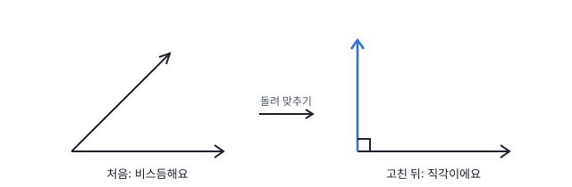

*첫 선은 그대로 두고, 둘째 선만 직각이 되게 돌렸어요.*

**정확히 말하면**

목적은 [3.1 대칭행렬은 직교 고유벡터로 쪼개져요](#s3-spectral)의 ${\mathbf{S}=\mathbf{P}\mathbf{D}\mathbf{P}^T}$를 숫자로 확인하는 거예요. 특히 고윳값이 중근이라 고유벡터가 저절로 직교하지 않는 경우를 다뤄요(L05 s19, MML Example 4.8). 대칭행렬 하나를 잡아요.

${\mathbf{A}=\begin{bmatrix}3 & 2 & 2\\ 2 & 3 & 2\\ 2 & 2 & 3\end{bmatrix}}$는 대각 성분이 3, 나머지가 2라서 $\mathbf{A}^T=\mathbf{A}$예요.

**1단계: 고윳값.** 특성다항식 ${p_A(\lambda)=\det(\mathbf{A}-\lambda\mathbf{I})}$의 근이 고윳값이에요. 결과는 다음과 같아요.

$$
p_A(\lambda)=-(\lambda-1)^2(\lambda-7)
$$

수업과 슬라이드는 결과만 적었어요. 아래는 검산용 재구성이에요. $a=3-\lambda$로 두면 $\mathbf{A}-\lambda\mathbf{I}$는 대각이 $a$, 나머지가 2예요.

1. 세 행을 모두 첫 행에 더하면 첫 행이 $(a+4)(1,1,1)$이 되고, 행렬식은 그대로예요. $a+4$를 밖으로 빼요.
2. 둘째·셋째 행에서 새 첫 행 $(1,1,1)$의 2배를 빼면 ${\begin{bmatrix}1 & 1 & 1\\ 0 & a-2 & 0\\ 0 & 0 & a-2\end{bmatrix}}$이 돼요.
3. 삼각행렬의 행렬식은 대각 성분의 곱이에요.

   $$
   \det(\mathbf{A}-\lambda\mathbf{I})=(a+4)(a-2)^2=(7-\lambda)(1-\lambda)^2
   $$
4. $(1-\lambda)^2=(\lambda-1)^2$이고 $7-\lambda=-(\lambda-7)$이라서 $p_A(\lambda)=-(\lambda-1)^2(\lambda-7)$이에요.

고윳값은 $\lambda=1$(중근, 두 번)과 $\lambda=7$이에요. 슬라이드는 서로 다른 고윳값을 $\lambda_1=1$, $\lambda_2=7$로 번호 붙였어요.

**2단계: 고유공간.** 각 고윳값에 대해 ${(\mathbf{A}-\lambda\mathbf{I})\mathbf{x}=\mathbf{0}}$을 풀어요.

- $\lambda=1$: $\mathbf{A}-\mathbf{I}$는 모든 성분이 2라서 조건은 $x_1+x_2+x_3=0$ 하나예요. 자유변수가 둘이라 고유공간이 2차원이에요.

  $$
  {E_1=\operatorname{span}\left[\begin{bmatrix}-1\\ 1\\ 0\end{bmatrix},\begin{bmatrix}-1\\ 0\\ 1\end{bmatrix}\right]}
  $$
- $\lambda=7$: $\mathbf{A}-7\mathbf{I}$는 대각이 $-4$, 나머지가 2예요. 각 행이 $2(x_1+x_2+x_3)-6x_i=0$이 되어 세 성분이 같아요.

  $$
  {E_7=\operatorname{span}\left[\begin{bmatrix}1\\ 1\\ 1\end{bmatrix}\right]}
  $$

그래서 중근 $\lambda=1$에서 고유벡터가 2개 나오고, 모두 3개로 $\mathbf{P}$를 만들 수 있어요. 세 벡터를 차례로 $\mathbf{x}_1=(-1,1,0)^T$, $\mathbf{x}_2=(-1,0,1)^T$, $\mathbf{x}_3=(1,1,1)^T$라고 부를게요(이 예제 안에서만 쓰는 이름이에요).

**3단계: 직교성 점검.** 서로 다른 고윳값의 고유벡터는 직교해요. 실제로 $\mathbf{x}_3^T\mathbf{x}_1=0$, $\mathbf{x}_3^T\mathbf{x}_2=0$이에요. 같은 고윳값의 두 벡터는 $\mathbf{x}_1^T\mathbf{x}_2=1\neq0$이라 직교하지 않아요.

**4단계: Gram-Schmidt 직교화.** 수업에서는 직접 해 보라고 맡긴 단계예요. 슬라이드에는 결과만 있어요. 직교화가 허용되는 이유는 같은 고윳값의 고유벡터를 섞어도 여전히 그 고윳값의 고유벡터이기 때문이에요. 임의의 스칼라 $\alpha,\beta$에 대해 다음이 성립해요.

$$
\mathbf{A}(\alpha\mathbf{x}_1+\beta\mathbf{x}_2)=\alpha\mathbf{A}\mathbf{x}_1+\beta\mathbf{A}\mathbf{x}_2=1\cdot(\alpha\mathbf{x}_1+\beta\mathbf{x}_2)
$$

1. 첫 벡터는 그대로 둬요: $\mathbf{x}_1'=\mathbf{x}_1=(-1,1,0)^T$.
2. 둘째 벡터에서 $\mathbf{x}_1'$ 방향 성분을 빼요. 계수는 ${\mathbf{x}_1^T\mathbf{x}_2/\mathbf{x}_1^T\mathbf{x}_1=1/2}$예요.

   $$
   \mathbf{x}_2'=\mathbf{x}_2-\frac{\mathbf{x}_1^T\mathbf{x}_2}{\mathbf{x}_1^T\mathbf{x}_1}\mathbf{x}_1=\begin{bmatrix}-1\\ 0\\ 1\end{bmatrix}-\frac{1}{2}\begin{bmatrix}-1\\ 1\\ 0\end{bmatrix}=\begin{bmatrix}-1/2\\ -1/2\\ 1\end{bmatrix}
   $$
3. 확인해요. ${\mathbf{x}_1^T\mathbf{x}_2'=\frac12-\frac12+0=0}$이고 ${\mathbf{x}_3^T\mathbf{x}_2'=-\frac12-\frac12+1=0}$이에요. 또 $\mathbf{A}\mathbf{x}_2'=\mathbf{x}_2'$라서 여전히 $\lambda=1$의 고유벡터예요.

이렇게 $(-1,1,0)^T$, $(-1/2,-1/2,1)^T$(고윳값 1)와 $(1,1,1)^T$(고윳값 7)가 $\mathbb{R}^3$의 직교 기저가 돼요. $E_1$ 안의 직교 기저는 이 한 쌍만 있는 것이 아니라서 $\mathbf{P}$도 하나로 정해지지 않아요.

**5단계: 정규화.** 각 벡터를 자기 길이로 나눠요. 길이는 차례로 $\sqrt2$, $\sqrt{3/2}$, $\sqrt3$이에요.

$$
{\mathbf{p}_1=\frac{1}{\sqrt2}\begin{bmatrix}-1\\ 1\\ 0\end{bmatrix}},\quad{\mathbf{p}_2=\frac{1}{\sqrt6}\begin{bmatrix}-1\\ -1\\ 2\end{bmatrix}},\quad{\mathbf{p}_3=\frac{1}{\sqrt3}\begin{bmatrix}1\\ 1\\ 1\end{bmatrix}}
$$

$\mathbf{p}_2$는 $(-1/2,-1/2,1)^T$를 $\sqrt{3/2}$로 나눈 것과 같아요. 고윳값 순서는 열 순서를 따라 $\lambda_1=\lambda_2=1$, $\lambda_3=7$이에요. 여기서 아래첨자는 $\mathbf{P}$의 열 번호라서 슬라이드의 $\lambda_2=7$과 번호가 달라요.

$$
{\mathbf{P}=\begin{bmatrix}-1/\sqrt2 & -1/\sqrt6 & 1/\sqrt3\\ 1/\sqrt2 & -1/\sqrt6 & 1/\sqrt3\\ 0 & 2/\sqrt6 & 1/\sqrt3\end{bmatrix}},\quad{\mathbf{D}=\begin{bmatrix}1 & 0 & 0\\ 0 & 1 & 0\\ 0 & 0 & 7\end{bmatrix}}
$$

**6단계: $\mathbf{P}^T\mathbf{P}=\mathbf{I}$ 확인.** $\mathbf{P}^T\mathbf{P}$의 $(i,j)$ 성분은 $\mathbf{p}_i^T\mathbf{p}_j$예요. 대각은 길이의 제곱이라 정규화 뒤 모두 1이고, 비대각은 3·4단계에서 확인한 대로 0이에요. 그래서 $\mathbf{P}^T\mathbf{P}=\mathbf{I}$예요.

(수업 중 "$\mathbf{P}\mathbf{P}^T$하면 identity"라고 말했다가 정정: 정의는 $\mathbf{P}^T\mathbf{P}=\mathbf{I}$예요. 정방 직교행렬이면 $\mathbf{P}\mathbf{P}^T=\mathbf{I}$도 성립해 결과는 같아요.)

**7단계: 조각의 합으로 $\mathbf{A}$ 복원.** 각 조각 $\mathbf{p}_i\mathbf{p}_i^T$를 계산해요.

$$
{\mathbf{p}_1\mathbf{p}_1^T=\frac{1}{2}\begin{bmatrix}1 & -1 & 0\\ -1 & 1 & 0\\ 0 & 0 & 0\end{bmatrix}},\quad{\mathbf{p}_2\mathbf{p}_2^T=\frac{1}{6}\begin{bmatrix}1 & 1 & -2\\ 1 & 1 & -2\\ -2 & -2 & 4\end{bmatrix}},\quad{\mathbf{p}_3\mathbf{p}_3^T=\frac{1}{3}\begin{bmatrix}1 & 1 & 1\\ 1 & 1 & 1\\ 1 & 1 & 1\end{bmatrix}}
$$

고윳값 1인 두 조각을 더하고, 고윳값 7인 조각에 7을 곱해요.

$$
{1\cdot(\mathbf{p}_1\mathbf{p}_1^T+\mathbf{p}_2\mathbf{p}_2^T)=\frac{1}{3}\begin{bmatrix}2 & -1 & -1\\ -1 & 2 & -1\\ -1 & -1 & 2\end{bmatrix}},\quad{7\,\mathbf{p}_3\mathbf{p}_3^T=\frac{7}{3}\begin{bmatrix}1 & 1 & 1\\ 1 & 1 & 1\\ 1 & 1 & 1\end{bmatrix}}
$$

두 행렬을 더하면 대각은 $\frac{2}{3}+\frac{7}{3}=3$, 비대각은 $-\frac{1}{3}+\frac{7}{3}=2$예요.

$$
\sum_{i=1}^{3}\lambda_i\mathbf{p}_i\mathbf{p}_i^T=\begin{bmatrix}3 & 2 & 2\\ 2 & 3 & 2\\ 2 & 2 & 3\end{bmatrix}=\mathbf{A}
$$

같은 확인을 ${\mathbf{P}\mathbf{D}\mathbf{P}^T=\mathbf{A}}$로 해도 돼요. 위 계산은 Python(fractions, sympy)으로 검산했어요.

**복원 순서.** 특성다항식으로 고윳값을 구하고, 고유공간을 풀고, 중근 고유공간만 Gram-Schmidt로 직교화한 뒤 정규화해요. 마지막으로 $\mathbf{P}^T\mathbf{P}=\mathbf{I}$와 조각의 합으로 검산해요.

**교수님 말씀**

교수님은 $\lambda=1$이 중근이라 고유벡터가 2개 나올 수 있고, 그 2개가 고유공간을 span한다고 짚었어요. 그래서 고유벡터 3개로 $\mathbf{P}$를 만들 수 있다고 했어요. $(-1,1,0)^T$를 자기 노름 $\sqrt2$로 나누듯 정규화하면 $\mathbf{P}^T\mathbf{P}=\mathbf{I}$와 ${\sum\lambda_i\mathbf{p}_i\mathbf{p}_i^T=\mathbf{A}}$를 직접 확인할 수 있다고 했어요(1102 P05 08:27 무렵).

> “이거는 여러분이 그냥 복습 간단하게 한번 해보세요” (1102 P05 09:30)

$\lambda=1$ 고유공간 안의 직교화 단계는 말로 설명하지 않고 복습으로 맡겼어요. 시각은 녹음 파트 안의 추정값이에요.

**페이지 요약**

중근 고윳값의 고유벡터는 저절로 직교하지 않아서 Gram-Schmidt로 직교화하고 정규화하면 $\mathbf{P}^T\mathbf{P}=\mathbf{I}$인 $\mathbf{P}$를 얻어요.

*핵심 식*

- 특성다항식

  $$
  p_A(\lambda)=-(\lambda-1)^2(\lambda-7)
  $$
- 고유공간

  $$
  {E_1=\operatorname{span}\left[\begin{bmatrix}-1\\ 1\\ 0\end{bmatrix},\begin{bmatrix}-1\\ 0\\ 1\end{bmatrix}\right]}
  $$

  $$
  {E_7=\operatorname{span}\left[\begin{bmatrix}1\\ 1\\ 1\end{bmatrix}\right]}
  $$
- Gram-Schmidt 한 단계

  $$
  \mathbf{x}_2'=\mathbf{x}_2-\frac{\mathbf{x}_1^T\mathbf{x}_2}{\mathbf{x}_1^T\mathbf{x}_1}\mathbf{x}_1=\begin{bmatrix}-1\\ 0\\ 1\end{bmatrix}-\frac{1}{2}\begin{bmatrix}-1\\ 1\\ 0\end{bmatrix}=\begin{bmatrix}-1/2\\ -1/2\\ 1\end{bmatrix}
  $$
- 정규화한 고유벡터

  $$
  {\mathbf{p}_1=\frac{1}{\sqrt2}\begin{bmatrix}-1\\ 1\\ 0\end{bmatrix}},\quad{\mathbf{p}_2=\frac{1}{\sqrt6}\begin{bmatrix}-1\\ -1\\ 2\end{bmatrix}},\quad{\mathbf{p}_3=\frac{1}{\sqrt3}\begin{bmatrix}1\\ 1\\ 1\end{bmatrix}}
  $$
- 복원 확인

  $$
  \sum_{i=1}^{3}\lambda_i\mathbf{p}_i\mathbf{p}_i^T=\begin{bmatrix}3 & 2 & 2\\ 2 & 3 & 2\\ 2 & 2 & 3\end{bmatrix}=\mathbf{A}
  $$

*용어*

- **중근(repeated eigenvalue)** — $\lambda=1$이 두 번 나와 고유공간이 2차원이에요. 그 안의 고유벡터는 자동으로 직교하지 않아요.
- **Gram-Schmidt** — 같은 고유공간 안에서 앞 벡터 방향 성분을 빼 직교 기저를 만들어요. 수업에서는 복습으로 맡긴 단계예요.
- **정규화(normalization)** — 각 벡터를 자기 길이로 나눠 길이 1로 만들어요.
- **$\mathbf{P}^T\mathbf{P}=\mathbf{I}$** — 성분 $\mathbf{p}_i^T\mathbf{p}_j$가 대각 1, 비대각 0이라는 뜻이에요.

---

## 4. 첫 번째 방향 b₁ 찾기

### 4.1 목표와 결론 미리 보기

*1102 수업 · L05 s20*

**쉽게 말하면**

사진을 몇 개의 방향만으로 설명해야 한다면, 사진들이 가장 넓게 퍼진 방향부터 차례로 고르면 돼요.

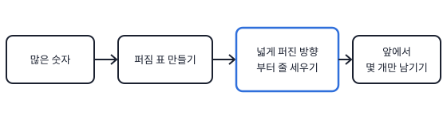

*숫자들이 얼마나 함께 퍼지는지 표로 만들고, 넓게 퍼진 방향부터 줄 세워 앞의 몇 개만 남겨요.*

**정확히 말하면**

이 섹션은 오늘의 질문("퍼짐을 가장 많이 남기는 방향은?")을 실제로 풀 수 있는 문제로 바꿔요. 슬라이드 s20은 그 계획을 네 줄로 정리해요. 이 관점을 maximum variance perspective라고 불러요.

- **Goal**: 분산을 최대로 남기는 정규직교 기저 ${\mathbf{B} = [\mathbf{b}_1 \cdots \mathbf{b}_M] \in \mathbb{R}^{D \times M}}$를 찾아요. 각 $\mathbf{b}_i \in \mathbb{R}^D$는 크기 1이고 서로 수직이에요.
- **Result**: data covariance matrix $\mathbf{S}$의 고윳값 중 가장 큰 $M$개 $\lambda_1 \ge \dots \ge \lambda_M$에 대응하는 고유벡터 $\mathbf{p}_1, \dots, \mathbf{p}_M$이 곧 $\mathbf{b}_1, \dots, \mathbf{b}_M$이에요. 수업에서는 이 결론을 먼저 알려 주고 증명은 뒤로 미뤘어요.
- **Question**: 왜 data matrix $\mathbf{X}$가 아니라 data covariance matrix $\mathbf{S}$일까요? 왜 고유벡터를 고윳값 크기 순서로 고를까요?
- **Strategy**: 귀납법(induction)이에요. Step 1에서 데이터를 1차원 직선에 사영한다고 보고 분산을 최대로 하는 $\mathbf{b}_1$ 하나를 찾아요. Step k에서는 $\mathbf{b}_1, \dots, \mathbf{b}_{k-1}$을 찾았다고 가정하고, 그것들과 직교하면서 분산을 최대로 하는 $\mathbf{b}_k$를 찾아요.

**Question에 대한 교수님의 답 두 가지.**

1. data matrix는 대칭행렬이 아니라서 EVD를 하면 "찝찝한 특성"이 남아요. 대칭인 $\mathbf{S}$는 스펙트럼 정리 덕분에 정규직교 고유벡터로 깔끔하게 분해돼요([3.1 대칭행렬은 직교 고유벡터로 쪼개져요](#s3-spectral)). 덧붙이면 $\mathbf{X} \in \mathbb{R}^{D \times N}$은 보통 정사각행렬도 아니라서 EVD 자체가 정의되지 않아요(수업 밖 덧붙임).
2. 분산이라는 개념 자체가 공분산을 써야 만들어져요. 첫 좌표의 분산을 계산하면 식 안에 $\mathbf{S}$가 저절로 나타나요. 그 계산이 [4.2 분산 V₁을 b₁ᵀSb₁로 바꾸기](#s4-v1)예요.

두 번째 물음(왜 고윳값 순서인가)은 Step 1의 결론과 이어져요. 가장 큰 고윳값의 고유벡터가 분산을 가장 많이 담는다는 결론이고, 그 이유는 [4.3 왜 가장 큰 고윳값의 고유벡터일까](#s4-max-proof)에서 다뤄요. 교수님은 슬라이드의 풀이는 건너뛰고, 고유기저 전개로 증명하겠다고 했어요(1102 P06 03:49). 그 증명은 수업 중에 끝나지 않아 다음 시간에 마무리하기로 했어요(1102 P07 08:12).

**Step k는 말로만 짚었어요.** 대칭행렬의 고유벡터는 서로 정규직교해요. $\mathbf{b}_1 = \mathbf{p}_1$로 정하고 나면 $\mathbf{p}_2$는 처음부터 $\mathbf{p}_1$과 직교하므로, 남은 에너지 중 가장 큰 것을 담는 방향은 $\mathbf{p}_2$예요. 이렇게 수학적 귀납법으로 이어 가면 된다는 설명까지가 수업 범위예요.

**MNIST로 다시 보기(s12 재언급).** MNIST 손글씨 이미지는 $28 \times 28 = 784$픽셀이라 $D = 784$예요.1 $M = 50$으로 두면 $784 \times 1$ 벡터를 $50 \times 1$ 벡터로 압축해요. 그 벡터로 분류하고 원래 차원으로 복원해도 분류 정확도가 거의 변하지 않는다고 했어요. 전체 절차는 다음과 같아요.

data matrix $\mathbf{X}$ → data covariance matrix $\mathbf{S}$ → EVD → 고윳값이 큰 순서로 고유벡터 50개 → 그 50개 방향으로 사영

1 수업 중 "24 곱하기 24"라고 말했다가 784를 떠올렸어요. $24 \times 24 = 576$이고, MNIST는 $28 \times 28 = 784$예요.

**교수님 말씀**

복습을 마치고 s20으로 넘어가며 "이제 진짜 본게임"이라고 했어요.

> "이제 진짜로 우리가 해보려고 하는 이제 본게임으로 돌아왔는데" (1102 P05 09:36)

data matrix를 쓰지 않는 이유를 대칭성으로 설명했어요.

> "뭔가 찝찝한 특성들이 남아 있어" (1102 P06 03:04)

슬라이드 풀이 대신 직접 증명하겠다고 했어요.

> "다른 방법으로 증명해 줄게." (1102 P06 03:49)

> "학생들 입장에서 조금 어려울 수도 있는데 내가 차근차근 증명해 줄게요." (1102 P06 04:10)

귀납 전략을 말로 정리하며 이 흐름이 PCA 전체라고 강조했어요.

> "이게 PCA의 처음부터 끝까지를 증명하는 거죠." (1102 P08 00:45)

**페이지 요약**

분산을 최대로 남기는 정규직교 기저 $\mathbf{B}$를 찾는 것이 목표이고, 답은 $\mathbf{S}$의 고윳값이 큰 $M$개 고유벡터라는 결론을 먼저 들었어요. 증명은 귀납법으로, Step 1에서 $\mathbf{b}_1$부터 찾아요.

*핵심 식*

- Goal

  $$
  {\mathbf{B} = [\mathbf{b}_1 \cdots \mathbf{b}_M] \in \mathbb{R}^{D \times M}}
  $$
- Result

  $$
  \mathbf{b}_1, \dots, \mathbf{b}_M = \mathbf{p}_1, \dots, \mathbf{p}_M \quad (\lambda_1 \ge \dots \ge \lambda_M)
  $$
- MNIST

  $$
  D = 784 = 28 \times 28, \qquad M = 50
  $$

*용어*

- **maximum variance perspective** — 사영한 좌표의 분산을 최대로 하는 방향을 기저로 고르는 관점이에요.
- **data covariance matrix** — $\mathbf{S}$. 대칭이라 정규직교 고유벡터로 분해되고, 분산 식에 저절로 나타나요. data matrix $\mathbf{X}$ 대신 쓰는 두 이유예요.
- **귀납법(induction)** — Step 1에서 $\mathbf{b}_1$을, Step k에서 앞 방향들과 직교하는 $\mathbf{b}_k$를 찾아요. Step k는 수업에서 말로만 짚었어요.
- **MNIST** — $28 \times 28$ 손글씨 이미지. 784차원을 50차원으로 줄여도 분류 정확도가 거의 같아요.

---

### 4.2 분산 V₁을 b₁ᵀSb₁로 바꾸기

*1102 수업 · L05 s21*

**쉽게 말하면**

점마다 정한 방향으로 얼마나 뻗었는지 재서 제곱하고 평균 내면, 그 방향의 퍼짐이 돼요.

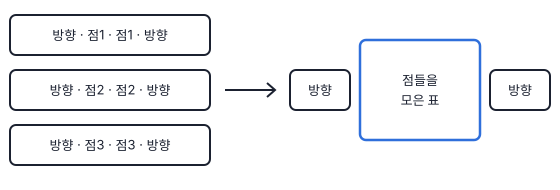

*모든 줄에 똑같은 방향이 붙어 있으니, 방향은 양 끝으로 꺼내고 가운데에 점들만 모아요.*

**정확히 말하면**

이 유도의 목적은 "방향 $\mathbf{b}_1$을 잘 고른다"는 말을 $\mathbf{b}_1$에 대한 식 하나로 바꾸는 거예요. 그 식 안에 1028에서 정의한 $\mathbf{S}$가 나타나요. $\mathbf{b}_1$은 차원을 딱 하나만 쓸 수 있을 때 고를 방향이고, 교수님은 이것이 앞의 x축 예시(1차원만 쓴다면 x축)와 같은 문제라고 그 학생 대화를 다시 꺼냈어요(1102 P06 04:30, [1.1 분산은 데이터의 에너지](#s1-variance-energy)).

**사영 좌표는 가중합이에요.** $\mathbf{b}_1 \in \mathbb{R}^D$는 크기 1인 방향(열벡터, $D \times 1$), $\mathbf{x}_n \in \mathbb{R}^D$는 centering된 $n$번째 데이터예요. $x_{dn}$을 $\mathbf{x}_n$의 $d$번째 성분, $b_{1d}$를 $\mathbf{b}_1$의 $d$번째 성분이라고 하면 다음과 같아요.

$$
z_{1n} = \mathbf{b}_1^T\mathbf{x}_n = \sum_{d=1}^{D} b_{1d}x_{dn}
$$

$(1 \times D)(D \times 1) = 1 \times 1$이라 $z_{1n}$은 스칼라예요. 성분 $x_{dn}$에 무게 $b_{1d}$를 곱해 더한 가중합이에요. 각 성분의 평균이 0이면(centering) 그 가중합의 평균도 0이에요. 그래서 분산 = 제곱의 평균 − 평균의 제곱에서 뒤 항이 사라지고, 표본평균으로 쓰면 다음과 같아요.

$V_1=\frac{1}{N}\sum_{n=1}^{N}z_{1n}^2$

**D = 2로 먼저 확인해요.** $z_{1n} = b_{11}x_{1n} + b_{12}x_{2n}$이에요. ${S_{ij} = \frac{1}{N}\sum_{n} x_{in}x_{jn}}$을 $\mathbf{S}$의 $(i,j)$ 성분이라고 하면 $S_{12} = S_{21}$이에요. 스칼라 분산 공식(제곱 전개, 교차항 2번)으로 계산하면 행렬 식과 같아요.

$$
\frac{1}{N}\sum_{n=1}^{N}(b_{11}x_{1n}+b_{12}x_{2n})^2 = b_{11}^2S_{11}+2b_{11}b_{12}S_{12}+b_{12}^2S_{22}
$$

$$
= \begin{bmatrix}b_{11} & b_{12}\end{bmatrix}\begin{bmatrix}S_{11} & S_{12}\\ S_{21} & S_{22}\end{bmatrix}\begin{bmatrix}b_{11}\\ b_{12}\end{bmatrix} = \mathbf{b}_1^T\mathbf{S}\mathbf{b}_1
$$

교차항 $2b_{11}b_{12}S_{12}$는 두 성분이 함께 움직이는 정도라 빠뜨리면 안 돼요. 아래 수업 유도는 이 결과를 $D$차원 전체에서 한 번에 얻는 방법이에요.

**한 항씩 전치로 정리해요.** 곱의 전치 규칙을 써요.

$$
(\mathbf{A}\mathbf{B})^T=\mathbf{B}^T\mathbf{A}^T
$$

1. 제곱을 곱으로 써요. ${z_{1n}^2 = (\mathbf{b}_1^T\mathbf{x}_n)(\mathbf{b}_1^T\mathbf{x}_n)}$
2. 뒤쪽 인수는 스칼라라서 전치해도 그대로예요($3^T = 3$). ${z_{1n}^2 = (\mathbf{b}_1^T\mathbf{x}_n)(\mathbf{b}_1^T\mathbf{x}_n)^T}$
3. 곱의 전치에 $\mathbf{A} = \mathbf{b}_1^T$, $\mathbf{B} = \mathbf{x}_n$을 넣어요. ${(\mathbf{b}_1^T\mathbf{x}_n)^T = \mathbf{x}_n^T(\mathbf{b}_1^T)^T = \mathbf{x}_n^T\mathbf{b}_1}$
4. 합치면 ${z_{1n}^2 = \mathbf{b}_1^T\mathbf{x}_n\mathbf{x}_n^T\mathbf{b}_1}$이에요. 차원은 $(1 \times D)(D \times 1)(1 \times D)(D \times 1)$이고, 가운데 $\mathbf{x}_n\mathbf{x}_n^T$는 $D \times D$ 행렬이에요.
5. 두 항만 더해 봐요. 왼쪽의 $\mathbf{b}_1^T$는 왼쪽으로, 오른쪽의 $\mathbf{b}_1$은 오른쪽으로 묶어요(행렬 곱의 분배법칙).

   $$
   {\mathbf{b}_1^T\mathbf{x}_1\mathbf{x}_1^T\mathbf{b}_1 + \mathbf{b}_1^T\mathbf{x}_2\mathbf{x}_2^T\mathbf{b}_1 = \mathbf{b}_1^T(\mathbf{x}_1\mathbf{x}_1^T + \mathbf{x}_2\mathbf{x}_2^T)\mathbf{b}_1}
   $$
6. $N$개로 늘리고 $\frac{1}{N}$을 괄호 안에 넣어요. $\mathbf{b}_1$은 $n$과 무관해서 합 밖으로 나와요.

   $$
   V_1 = \frac{1}{N}\sum_{n=1}^{N}\mathbf{b}_1^T\mathbf{x}_n\mathbf{x}_n^T\mathbf{b}_1
   $$

   $$
   = \mathbf{b}_1^T\left(\frac{1}{N}\sum_{n=1}^{N}\mathbf{x}_n\mathbf{x}_n^T\right)\mathbf{b}_1
   $$
7. 괄호 안이 1028에서 정의한 데이터 공분산 행렬이에요.

   $$
   \mathbf{S}=\frac{1}{N}\sum_{n=1}^{N}\mathbf{x}_n\mathbf{x}_n^T
   $$

   따라서 $V_1$은 $\mathbf{b}_1^T\mathbf{S}\mathbf{b}_1$이에요.

**계수 위치와 차원.** $\mathbf{S} \in \mathbb{R}^{D \times D}$이고, 이 강의의 표기 ${\mathbf{X} = [\mathbf{x}_1 \cdots \mathbf{x}_N] \in \mathbb{R}^{D \times N}}$으로는 ${\mathbf{S} = \frac{1}{N}\mathbf{X}\mathbf{X}^T}$예요. 왼쪽에는 행벡터 $\mathbf{b}_1^T$($1 \times D$), 오른쪽에는 열벡터 $\mathbf{b}_1$($D \times 1$)이 붙어 ${(1 \times D)(D \times D)(D \times 1) = 1 \times 1}$ 스칼라가 돼요. 분산은 숫자 하나여야 하니 맞는 크기예요. 이 순서를 바꾸면 곱 자체가 정의되지 않아요.

**아는 공식과 연결하기.** 아래는 강의 공식을 연결하기 위한 재표현이에요. 스칼라에서 ${\operatorname{Var}(ax) = a\operatorname{Var}(x)a}$였듯, 확률벡터의 일반 규칙은 공분산 행렬 양쪽에 계수를 붙여요. 아래 식의 $\boldsymbol{\Sigma}$는 확률벡터 $\mathbf{x}$의 공분산 행렬이 들어가는 자리이고, 여기서는 데이터로 계산한 표본 공분산 $\mathbf{S}$가 그 자리에 들어가요.

$$
\operatorname{Cov}(\mathbf{A}\mathbf{x}) = \mathbf{A}\boldsymbol{\Sigma}\mathbf{A}^T
$$

여기서는 공분산 자리에 데이터에서 계산한 $\mathbf{S}$가, 계수 자리에 $\mathbf{A} = \mathbf{b}_1^T$($1 \times D$)가 들어가요. 출발 규칙은 "첫 입력의 계수는 왼쪽, 둘째 입력의 계수는 전치해서 오른쪽"이에요. 분산은 두 입력이 모두 $z_1$이라 왼쪽에 $\mathbf{b}_1^T$, 오른쪽에 $(\mathbf{b}_1^T)^T = \mathbf{b}_1$이 붙고, 결과는 ${(1 \times D)(D \times D)(D \times 1) = 1 \times 1}$이에요.

$$
\operatorname{Var}(z_1) = \mathbf{b}_1^T\mathbf{S}(\mathbf{b}_1^T)^T = \mathbf{b}_1^T\mathbf{S}\mathbf{b}_1
$$

수업의 합 전개와 같은 결과예요. 두 입력이 모두 같은 $z_1$이라 자기 공분산(곧 분산)이고, 그래서 양쪽에 같은 $\mathbf{b}_1$이 붙어요. 일반 규칙의 전치도 수업 유도 3단계의 곱의 전치에서 나온 거예요.

**최적화 문제.** 이제 $V_1$을 최대로 하는 $\mathbf{b}_1$을 찾아요(MML (10.10)).

$$
\max_{\mathbf{b}_1} \mathbf{b}_1^T\mathbf{S}\mathbf{b}_1 \quad \text{subject to} \quad \|\mathbf{b}_1\|^2 = 1
$$

제약 $\|\mathbf{b}_1\|^2=1$은 수업에서 "정규화된 벡터"라고만 했고 이유는 말하지 않았어요. 다음은 학습을 위한 재구성이에요(MML 10.2.1, 321쪽에 같은 설명이 있어요). $\mathbf{b}_1$ 대신 $c\mathbf{b}_1$을 넣으면 값이 $c^2$배가 되므로, 제약이 없으면 크기만 키워 $V_1$을 무한대로 보낼 수 있어요. 우리가 원하는 것은 크기가 아니라 방향이라 크기를 1로 묶어요.

**복원용 요약.** 스칼라 $z_{1n}$을 자기 전치와 곱한다 → 곱의 전치로 $\mathbf{x}_n^T\mathbf{b}_1$을 만든다 → $\mathbf{b}_1^T$는 왼쪽, $\mathbf{b}_1$은 오른쪽으로 꺼낸다 → 가운데 평균이 $\mathbf{S}$.

수업 중 "b₂를 오른쪽으로 빼도 돼요"라고 말했지만 $\mathbf{b}_1$이 맞아요(1102 P07 03:05).

**교수님 말씀**

표본평균을 설명하며 지난 수업에서 학생에게 학점을 물었던 일을 다시 꺼냈어요. 지금까지 받은 학점을 모두 더해 개수로 나눈 것이 표본평균이에요(1102 P06 07:46).

"수학을 잘하려면 뭘 잘해야 돼?"라는 물음에 한 학생이 교수님의 단골 표현으로 답했어요. 스칼라 뒤쪽 인수에 전치를 취하는 단계가 바로 그 하나 마나 한 짓이에요.

> "하나 마나 한 짓을 잘해야 된다" (1102 P06 08:52)

"트랜스포즈 취해도 돼 안 돼?"에 학생이 "돼"라고 답했고, 이유는 "3의 트랜스포즈는 3"이었어요(1102 P07 00:49).

> "만약에 여러분 리니어 알지브라에서 안 배웠다면 지금 배운 거야." (1102 P07 01:20)

$\mathbf{b}_1$이 합과 무관한 상수로 빠져나오는 순간을 "아트"라고 불렀어요.

> "이게 왜 아트냐면 여기서 우리에게 소름 끼치는 일이 하나 발생했는데" (1102 P07 02:14)

> "왼쪽에 있는 걸 오른쪽으로 갈 수 있어야 크리에이티브한 거예요" (1102 P07 03:29)

합 $\sum \mathbf{b}_1^T\mathbf{x}_n\mathbf{x}_n^T\mathbf{b}_1$을 $\mathbf{b}_1^T(\sum \mathbf{x}_n\mathbf{x}_n^T)\mathbf{b}_1$로 묶는 방향을 가리킨 말이에요. 괄호 안 $\mathbf{S}$를 칠판에 노란색으로 표시하고, 이것이 "왜 covariance matrix인가"의 수식적 답이라고 했어요.

**페이지 요약**

사영 좌표의 분산 $V_1$을 스칼라 전치와 곱의 전치로 정리하면, $\mathbf{b}_1$이 양 끝으로 빠지고 가운데에 $\mathbf{S}$가 남아 $\mathbf{b}_1^T\mathbf{S}\mathbf{b}_1$이 돼요. $D = 2$로 풀면 교차항까지 같은 값이고, 일반 규칙 $\mathbf{A}\boldsymbol{\Sigma}\mathbf{A}^T$에 $\mathbf{A} = \mathbf{b}_1^T$, $\boldsymbol{\Sigma}$ 자리에 $\mathbf{S}$를 넣은 것과도 같아요. 크기 제약 $\|\mathbf{b}_1\|^2=1$ 아래에서 이것을 최대화해요.

*핵심 식*

- 사영 좌표(가중합)

  $$
  z_{1n} = \mathbf{b}_1^T\mathbf{x}_n = \sum_{d=1}^{D} b_{1d}x_{dn}
  $$
- 첫 좌표의 분산

  $$
  V_1=\frac{1}{N}\sum_{n=1}^{N}z_{1n}^2
  $$
- 곱의 전치

  $$
  (\mathbf{A}\mathbf{B})^T=\mathbf{B}^T\mathbf{A}^T
  $$
- D = 2 확인

  $$
  b_{11}^2S_{11}+2b_{11}b_{12}S_{12}+b_{12}^2S_{22} = \mathbf{b}_1^T\mathbf{S}\mathbf{b}_1
  $$
- 한 항

  $$
  {z_{1n}^2 = \mathbf{b}_1^T\mathbf{x}_n\mathbf{x}_n^T\mathbf{b}_1}
  $$
- 데이터 공분산 행렬

  $$
  \mathbf{S}=\frac{1}{N}\sum_{n=1}^{N}\mathbf{x}_n\mathbf{x}_n^T
  $$
- 목표식

  $$
  V_1 = \mathbf{b}_1^T\mathbf{S}\mathbf{b}_1
  $$
- 차원

  $$
  {(1 \times D)(D \times D)(D \times 1) = 1 \times 1}
  $$
- 일반 규칙과의 연결(재표현)

  $$
  \operatorname{Cov}(\mathbf{A}\mathbf{x}) = \mathbf{A}\boldsymbol{\Sigma}\mathbf{A}^T, \quad \mathbf{A} = \mathbf{b}_1^T
  $$
- 최적화 문제

  $$
  \max_{\mathbf{b}_1} \mathbf{b}_1^T\mathbf{S}\mathbf{b}_1 \quad \text{subject to} \quad \|\mathbf{b}_1\|^2 = 1
  $$

*용어*

- **하나 마나 한 짓** — 스칼라에 전치를 취하는 것처럼 값을 바꾸지 않는 조작. 이 유도의 출발점이에요.
- **centering** — 평균을 빼 두어 분산이 제곱의 평균이 되게 해요.
- **계수 위치** — 첫 입력의 계수는 왼쪽, 둘째 입력의 계수는 전치해서 오른쪽. 결과는 $1 \times 1$ 스칼라예요(재표현의 출발 규칙).
- **제약 $\|\mathbf{b}_1\|^2=1$** — 크기를 키워 분산을 부풀리지 못하게 방향만 고르게 해요(이유는 수업 밖 재구성).

---

### 4.3 왜 가장 큰 고윳값의 고유벡터일까

*1102 수업 · L05 s21*

**쉽게 말하면**

점들은 기울어진 길쭉한 타원처럼 퍼져 있어서, 화살표를 빙 돌리다가 타원의 긴 쪽에 오면 퍼짐이 가장 커요.

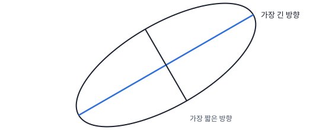

*가장 긴 방향이 첫 번째 답이고, 그와 수직인 방향에서 퍼짐이 가장 작아요.*

**정확히 말하면**

이 증명의 목적은 크기 1인 $\mathbf{b}_1$ 중에서 목표식을 가장 크게 만드는 방향이 무엇인지, 그때 값이 얼마인지 구하는 거예요. 출발식은 [4.2 분산 V₁을 b₁ᵀSb₁로 바꾸기](#s4-v1)에서 얻은 결과예요.

$$
V_1 = \mathbf{b}_1^T\mathbf{S}\mathbf{b}_1, \qquad \|\mathbf{b}_1\|^2 = 1
$$

답을 읽는 도구는 [3.1 대칭행렬은 직교 고유벡터로 쪼개져요](#s3-spectral)의 스펙트럼 정리예요. $\mathbf{S} \in \mathbb{R}^{D \times D}$는 대칭이라 정규직교 고유벡터 $\mathbf{p}_1, \dots, \mathbf{p}_D \in \mathbb{R}^D$로 분해돼요.1

$$
\mathbf{S}\mathbf{p}_i = \lambda_i\mathbf{p}_i, \qquad \mathbf{p}_i^T\mathbf{p}_j = \begin{cases}1 & (i = j)\\ 0 & (i \ne j)\end{cases}
$$

$$
\mathbf{S} = \sum_{i=1}^{D}\lambda_i\mathbf{p}_i\mathbf{p}_i^T
$$

고윳값은 PCA 관례대로 큰 순서 ${\lambda_1 \ge \lambda_2 \ge \dots \ge \lambda_D}$로 번호를 붙여요. 가장 큰 고윳값이 $\lambda_1$이에요.

**수업에서 한 부분.**

1. **전개 아이디어**: $\mathbf{p}_1, \dots, \mathbf{p}_D$는 정규직교이고 $\mathbb{R}^D$ 전체를 덮는 기저예요. 3차원이면 $3 \times 1$ 벡터 3개의 가중합으로 모든 점을 나타낼 수 있는 것과 같아요. 그래서 어떤 $\mathbf{b}_1$이든 고유벡터의 가중합으로 써요. 여기서 $c_i$는 스칼라 가중치예요.

   $$
   \mathbf{b}_1=\sum_{i=1}^{D}c_i\mathbf{p}_i
   $$
2. **대입 시작**: 출발식에 그대로 넣어요. 수업은 이 줄에서 멈췄어요.

   $$
   \mathbf{b}_1^T\mathbf{S}\mathbf{b}_1 = \left(\sum_{i=1}^{D}c_i\mathbf{p}_i\right)^T\mathbf{S}\left(\sum_{i=1}^{D}c_i\mathbf{p}_i\right)
   $$
3. **결론(말로만)**: "산수로 부등호 몇 개"면 끝나고, $\mathbf{b}_1 = \mathbf{p}_1$일 때 최대예요. 즉 첫 방향은 가장 큰 고윳값 $\lambda_1$의 고유벡터예요. 그때의 분산 $V_1 = \lambda_1$은 아래 보충 증명에서 얻는 결과예요.

나머지 부등식은 다음 시간으로 미뤘어요. 끝까지의 계산은 아래 보충에 있어요.

#### 직접 해 보기: 방향을 돌리며 bᵀSb 재기 *(정적 스냅샷 — 직접 조작은 HTML 버전)*

각도를 돌리면 단위원 위의 b와 Sb 화살표, 그리고 오른쪽 곡선 위의 bᵀSb 값이 함께 바뀌어요.

예시 행렬은 ${\mathbf{S} = \begin{bmatrix}2.5 & 0.866\\ 0.866 & 1.5\end{bmatrix}}$이에요. 고윳값은 3과 1이고, 고유벡터 $\mathbf{p}_1$은 30°, $\mathbf{p}_2$는 120° 방향이에요.

b = **(1.00, 0.00)**, Sb = **(2.50, 0.87)**, b와 Sb 사이 각 **19.1°**, bᵀSb = **2.50**

범례: b(단위벡터), 오른쪽은 bᵀSb 곡선 · Sb · 고유벡터 방향 p₁, p₂ · 회색 점선 가로줄: λ₁ = 3, λ₂ = 1

θ = 30°에서 Sb가 b와 평행해지고(길이 3배), bᵀSb가 최댓값 3 = λ₁이 돼요. 수직인 θ = 120°에서도 평행해지지만(길이 그대로), 이때가 최솟값 1이에요.

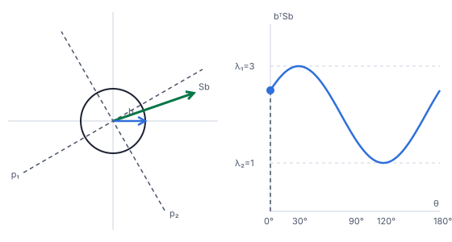

*θ = 0°: b와 Sb가 평행하지 않아요.*

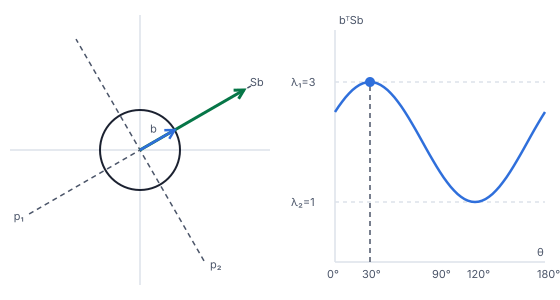

*θ = 30°: b = p₁, Sb = 3b, 최댓값이에요.*

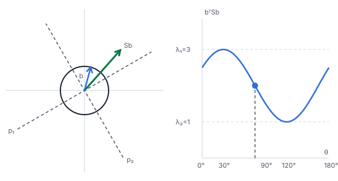

*θ = 75°: 두 고유벡터 사이 한가운데예요.*

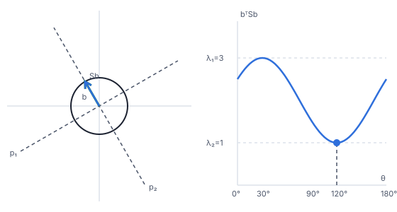

*θ = 120°: b = p₂, Sb = b, 최솟값이에요.*

| 설정 θ | b | Sb | b와 Sb 사이 각 | bᵀSb |
|---|---|---|---|---|
| 0° | (1.00, 0.00) | (2.50, 0.87) | 19.1° | 2.50 |
| 30° (p₁) | (0.87, 0.50) | (2.60, 1.50) | 0.0° (평행) | 3.00 = λ₁ (최대) |
| 75° | (0.26, 0.97) | (1.48, 1.67) | 26.6° | 2.00 |
| 120° (p₂) | (−0.50, 0.87) | (−0.50, 0.87) | 0.0° (평행) | 1.00 = λ₂ (최소) |

1 칠판에서는 $n$차원으로 쓰다가 $D$차원으로 바꿨어요. $\mathbf{b}_1, \mathbf{p}_i \in \mathbb{R}^D$, $\mathbf{S} \in \mathbb{R}^{D \times D}$로 통일해요. 또 "$\mathbf{S}$는 $\mathbf{X}^T\mathbf{X}$로 이루어져 $D \times D$"라고 말했지만, 이 강의의 표기 $\mathbf{X} \in \mathbb{R}^{D \times N}$에서는 ${\mathbf{S} = \frac{1}{N}\mathbf{X}\mathbf{X}^T}$이고 $\mathbf{X}^T\mathbf{X}$는 $N \times N$이에요(1102 P07 06:13).

**교수님 말씀**

최적화 문제를 세운 뒤 바로 증명을 시작했어요.

> "이 문제를 지금부터 제가 5분 안에 풀어볼게요." (1102 P07 04:46)

> "임의의 b라는 벡터는 항상 이렇게 S라는 매트릭스의 아이겐벡터들의 웨이티드 썸으로 표현할 수 있다." (1102 P07 05:50)

대입까지 쓰고 시간이 모자라 멈췄어요. 직접 해 보라고 하고, 다음 시간에 다시 하겠다고 했어요.

> "오늘 시간이 없어서 이거 증명까지 다 못해줄 것 같은데" (1102 P07 07:16)

> "여러분 손으로 한번 해보세요, 나중에" (1102 P07 07:38)

결론 $\mathbf{b}_1 = \mathbf{p}_1$만 먼저 알려 주며 이렇게 덧붙였어요.

> "저를 믿으세요." (1102 P07 08:15)

**보충 · 수업에서 유도하진 않았어요**

수업이 멈춘 대입 단계부터 끝까지 이어 가요. 미분 없이 고유기저 전개와 부등식만 써요. 출발식과 대입할 식을 다시 써요.

$$
\mathbf{b}_1^T\mathbf{S}\mathbf{b}_1, \qquad \mathbf{S} = \sum_{i=1}^{D}\lambda_i\mathbf{p}_i\mathbf{p}_i^T, \qquad \mathbf{b}_1=\sum_{i=1}^{D}c_i\mathbf{p}_i
$$

1. 가중치 $c_i$를 읽어요. 전개식 양변 왼쪽에 $\mathbf{p}_i^T$를 곱하면 $j \ne i$인 항은 $\mathbf{p}_i^T\mathbf{p}_j = 0$으로 사라져요.

   $$
   \mathbf{p}_i^T\mathbf{b}_1 = \sum_{j=1}^{D}c_j\mathbf{p}_i^T\mathbf{p}_j = c_i
   $$
2. 출발식에 스펙트럼 정리를 대입해요. $\lambda_i$는 스칼라라서 앞으로 나와요.

   $$
   \mathbf{b}_1^T\mathbf{S}\mathbf{b}_1 = \mathbf{b}_1^T\left(\sum_{i=1}^{D}\lambda_i\mathbf{p}_i\mathbf{p}_i^T\right)\mathbf{b}_1
   $$

   $$
   = \sum_{i=1}^{D}\lambda_i(\mathbf{b}_1^T\mathbf{p}_i)(\mathbf{p}_i^T\mathbf{b}_1)
   $$
3. $\mathbf{b}_1^T\mathbf{p}_i$는 스칼라라서 $\mathbf{p}_i^T\mathbf{b}_1$과 같고(하나 마나 한 전치), 둘 다 $c_i$예요.

   $$
   \mathbf{b}_1^T\mathbf{S}\mathbf{b}_1 = \sum_{i=1}^{D}\lambda_i c_i^2
   $$
4. 제약도 같은 방법으로 $c_i$로 바꿔요.

   $$
   \|\mathbf{b}_1\|^2 = \mathbf{b}_1^T\mathbf{b}_1 = \sum_{i=1}^{D}\sum_{j=1}^{D}c_ic_j\mathbf{p}_i^T\mathbf{p}_j = \sum_{i=1}^{D}c_i^2 = 1
   $$
5. $c_i^2 \ge 0$이고 모든 $i$에서 $\lambda_i \le \lambda_1$이므로 각 항을 $\lambda_1 c_i^2$로 키워요.

   $$
   \mathbf{b}_1^T\mathbf{S}\mathbf{b}_1=\sum_i\lambda_i c_i^2
   $$

   $$
   \le\lambda_1\sum_i c_i^2
   $$

   $$
   =\lambda_1
   $$
6. 상한에 실제로 닿는지 확인해요. $\mathbf{b}_1 = \mathbf{p}_1$이면 $c_1 = 1$, 나머지 $c_i = 0$이라 값이 정확히 $\lambda_1$이에요. 그래서 최댓값은 $\lambda_1$이고 $V_1 = \lambda_1$이에요.
7. **등호 조건**: 5단계 부등식의 양변 차이는 $\sum_i(\lambda_1 - \lambda_i)c_i^2$이에요. 이것이 0이려면 $\lambda_i \lt \lambda_1$인 모든 $i$에서 $c_i = 0$이어야 해요. $\lambda_1$이 다른 고윳값보다 엄격히 크면 최대점은 $\mathbf{b}_1 = \pm\mathbf{p}_1$뿐이에요(부호는 같은 방향의 선). $\lambda_1$이 중근이면 그 고유공간 안의 어떤 단위벡터든 최대예요.

**직관.** $c_i^2 \ge 0$이고 합이 1이므로 $\sum_i\lambda_i c_i^2$는 고윳값들의 가중평균이에요. 가중평균은 가장 큰 값을 넘을 수 없고, 무게를 전부 $\lambda_1$에 실을 때 최대예요. 같은 이유로 최솟값은 $\lambda_D$이고 $\mathbf{b}_1 = \mathbf{p}_D$일 때예요.

**위젯으로 확인.** 위젯의 $\mathbf{b}$는 $\mathbf{p}_1$에서 $\varphi = \theta - 30°$만큼 돌아간 단위벡터라 $c_1 = \cos\varphi$, $c_2 = \sin\varphi$예요. 그래서 다음 식이 되고, θ = 30°에서 최대 3, θ = 120°에서 최소 1이에요.

$$
\mathbf{b}^T\mathbf{S}\mathbf{b} = 3\cos^2\varphi + 1\cdot\sin^2\varphi = 2 + \cos 2\varphi
$$

**복원용 요약.** 출발식 $\mathbf{b}_1^T\mathbf{S}\mathbf{b}_1$ → $\mathbf{S}$를 고유벡터 합으로, $\mathbf{b}_1$도 고유벡터 합으로 → 직교성으로 교차항이 사라져 $\sum_i\lambda_i c_i^2$ → 가중치 합이 1인 가중평균이라 최대는 $\lambda_1$.

**페이지 요약**

임의의 $\mathbf{b}_1$을 $\mathbf{S}$의 정규직교 고유벡터 합으로 쓰는 것이 증명의 출발이고, 수업의 결론은 $\mathbf{b}_1 = \mathbf{p}_1$(가장 큰 고윳값 $\lambda_1$의 고유벡터)이에요. 끝까지의 부등식과 최댓값 $V_1 = \lambda_1$은 수업에서 미뤘고 보충으로 실었어요.

*핵심 식*

- 출발식

  $$
  V_1 = \mathbf{b}_1^T\mathbf{S}\mathbf{b}_1, \qquad \|\mathbf{b}_1\|^2 = 1
  $$
- 스펙트럼 정리

  $$
  \mathbf{S} = \sum_{i=1}^{D}\lambda_i\mathbf{p}_i\mathbf{p}_i^T
  $$
- 고유기저 전개

  $$
  \mathbf{b}_1=\sum_{i=1}^{D}c_i\mathbf{p}_i
  $$
- 부등식(보충)

  $$
  \mathbf{b}_1^T\mathbf{S}\mathbf{b}_1=\sum_i\lambda_i c_i^2
  $$

  $$
  \le\lambda_1\sum_i c_i^2
  $$

  $$
  =\lambda_1
  $$
- 결론

  $$
  \mathbf{b}_1 = \mathbf{p}_1
  $$
- 최댓값(보충)

  $$
  V_1 = \lambda_1
  $$

*용어*

- **고유기저 전개** — 정규직교 고유벡터는 공간 전체의 기저라 어떤 벡터든 그 가중합으로 써져요. 가중치는 $c_i = \mathbf{p}_i^T\mathbf{b}_1$(보충)이에요.
- **등호 조건(보충)** — $\lambda_i \lt \lambda_1$인 성분이 모두 0일 때. $\lambda_1$이 단근이면 $\mathbf{b}_1 = \pm\mathbf{p}_1$이에요.
- **저를 믿으세요** — 증명을 끝내지 못한 채 결론 $\mathbf{b}_1 = \mathbf{p}_1$을 먼저 알려 주며 한 말이에요.

---

## 5. 요약 · 예고

### 한 장 요약

*1102 수업 · L05 s14–s21*

| 항목 | 식 | 기억할 점 |
|---|---|---|
| [분산 = 에너지](#s1-variance-energy) | ${\boldsymbol{\Sigma}_{\mathbf{a}} = \mathbb{E}[\mathbf{a}\mathbf{a}^T] - \mathbb{E}[\mathbf{a}]\,\mathbb{E}[\mathbf{a}]^T}$ | variance는 데이터가 평균에서 얼마나 퍼졌는지 재는 척도이고, 교수님은 이를 에너지·하중(무게)으로 비유했어요. 평균이 $\mathbf{0}$이면(centering) 뒤 항이 사라져 $\mathbb{E}[\mathbf{a}\mathbf{a}^T]$만 남아요. 목표는 적은 수의 basis로 이 에너지를 가장 많이 보존하는 것(maximum variance perspective)이에요. |
| [사영 좌표](#s1-matrix-again) | ${\mathbf{B} = [\mathbf{b}_1\ \cdots\ \mathbf{b}_M] \in \mathbb{R}^{D \times M}}$ ${\mathbf{z}_n = \mathbf{B}^T\mathbf{x}_n}$, ${z_{in} = \mathbf{b}_i^T\mathbf{x}_n}$ | $\mathbf{b}_i \in \mathbb{R}^D$는 열벡터이고 가로로 나란히 붙여 $\mathbf{B}$를 만들어요. $\mathbf{z}_n \in \mathbb{R}^M$의 각 성분은 내적 하나(스칼라)예요. $M \ll D$이면 압축이에요. |
| [고윳값·고유벡터](#s2-eigen) | ${\mathbf{A}\mathbf{x} = \lambda\mathbf{x}}$ ($\mathbf{x} \neq \mathbf{0}$) ${\det(\mathbf{A} - \lambda\mathbf{I}_n) = 0}$ | ${(\mathbf{A} - \lambda\mathbf{I}_n)\mathbf{x} = \mathbf{0}}$에 0이 아닌 해가 있으려면 이 행렬이 rank-deficient, 즉 역행렬이 없어야 해요. 이 식(characteristic equation)을 풀면 고윳값이 나와요. |
| [대각화](#s2-diagonal) | ${\mathbf{D} = \mathbf{P}^{-1}\mathbf{A}\mathbf{P}}$ | 가역 $\mathbf{P}$로 이렇게 만들 수 있으면 diagonalizable이에요. 대각행렬은 거듭제곱·역행렬·행렬식을 대각 성분만으로 계산해요. 모든 정방행렬이 대각화되지는 않아요. |
| [직교대각화](#s2-diagonal) | ${\mathbf{D} = \mathbf{P}^T\mathbf{A}\mathbf{P}}$ | $\mathbf{P}^{-1}$ 자리에 $\mathbf{P}^T$를 쓸 수 있으면 orthogonally diagonalizable이에요. PCA에서 다루는 행렬은 항상 여기에 해당해요. |
| [EVD](#s2-evd) | ${\mathbf{A}\mathbf{P} = \mathbf{P}\mathbf{D}}$ ${\mathbf{A} = \mathbf{P}\mathbf{D}\mathbf{P}^{-1}}$ ${\mathbf{A}^k = \mathbf{P}\mathbf{D}^k\mathbf{P}^{-1}}$ ${\det\mathbf{A} = \prod_i \lambda_i}$ | $\mathbf{P}$의 열은 고유벡터, $\mathbf{D}$의 대각은 대응 고윳값이에요. ${\mathbf{A}\mathbf{p}_i = \lambda_i\mathbf{p}_i}$를 열마다 모으면 ${\mathbf{A}\mathbf{P} = \mathbf{P}\mathbf{D}}$가 돼요. 일반 EVD의 $\mathbf{P}$는 직교일 필요가 없고, $\det\mathbf{A} = \det\mathbf{D}$인 이유는 $\det\mathbf{P}\,\det\mathbf{P}^{-1} = 1$이기 때문이에요. |
| [스펙트럼 정리](#s3-spectral) | ${\mathbf{S} = \mathbf{P}\mathbf{D}\mathbf{P}^T}$ ${\mathbf{S} = \sum_{i=1}^{n}\lambda_i\mathbf{p}_i\mathbf{p}_i^T}$ | 대칭행렬 $\mathbf{S}^T = \mathbf{S}$는 $\mathbf{P}^T\mathbf{P} = \mathbf{I}$인 고유벡터 행렬로 분해되고 고윳값은 모두 실수예요. 합 꼴은 열×행 곱의 정의에서 바로 나와요. 대각행렬이 일반 행렬과 교환되는 것은 아니에요. |
| [분산 $V_1$](#s4-v1) | ${V_1 = \frac{1}{N}\sum_{n=1}^{N}z_{1n}^2}$ ${V_1 = \mathbf{b}_1^T\mathbf{S}\mathbf{b}_1}$ | centering 덕분에 평균 제곱이 곧 분산이에요. ${z_{1n}^2 = \mathbf{b}_1^T\mathbf{x}_n\mathbf{x}_n^T\mathbf{b}_1}$(스칼라 전치, ${(\mathbf{A}\mathbf{B})^T = \mathbf{B}^T\mathbf{A}^T}$)로 바꾸면 $\mathbf{b}_1$이 합 밖으로 나오고 괄호 안이 ${\mathbf{S} = \frac{1}{N}\sum_{n=1}^{N}\mathbf{x}_n\mathbf{x}_n^T}$예요. covariance matrix를 쓰는 이유가 여기서 나와요. |
| [최적화 문제](#s4-v1) | ${\max_{\mathbf{b}_1}\ \mathbf{b}_1^T\mathbf{S}\mathbf{b}_1}$ ${\Vert \mathbf{b}_1\Vert ^2 = 1}$ | $\mathbf{b}_1$은 normalized 벡터여야 해요. 제약이 없으면 $\mathbf{b}_1$을 키워 값을 얼마든지 크게 만들 수 있어요(수업에서 말하지 않은 이유를 덧붙인 것이에요). |
| [결론](#s4-max-proof) | ${\mathbf{b}_1 = \mathbf{p}_1}$, $V_1 = \lambda_1$ | $\mathbf{b}_1$은 $\mathbf{S}$의 가장 큰 고윳값 $\lambda_1$의 고유벡터예요. 교수님은 ${\mathbf{b}_1 = \sum_{i=1}^{D}c_i\mathbf{p}_i}$로 전개해 대입하는 데까지 했고, 증명은 다음 시간에 마무리해요. $M$개가 필요하면 고윳값 큰 순서로 고유벡터 $M$개를 고른다는 결론만 들었어요. |

---

### 다음 시간 예고

*1102 수업 · L05 s13, s22–s25*

이번 수업에서 다루지 않았거나 예고만 한 슬라이드의 제목이에요. 교수님은 s22의 라그랑주 승수법 풀이를 이번에 건너뛰었고, 대신 고유기저 전개로 시작한 $\mathbf{b}_1$ 증명을 다음 시간에 마무리하겠다고 했어요.

- Step 1: Finding $\mathbf{b}_1$ (2) (s22): 라그랑주 승수법으로 푸는 풀이
- Step k: Finding $\mathbf{b}_k$ (1)–(3) (s23–s25)
- (3) Projection Perspective
- (4) Eigenvector Computation and Low-Rank Approximations
- (5) PCA in High Dimensions
- (6) Key Steps of PCA in Practice

공지: 11/04(수)에는 조교가 중간고사 문제 풀이를 해요. 다음 강의는 11/09(월)이에요.

---

### 함께 보면 좋은 자료

*1102 수업 · L05 s21*

- [1102 PCA 복습문제](복습문제_1102_PCA.md): 오늘 배운 식을 직접 풀어 봐요.
- [1028 정리노트: 데이터(표본) 공분산 행렬](../../1028/정리노트_1028_PCA.html#s3-data-cov): $\mathbf{b}_1^T\mathbf{S}\mathbf{b}_1$에 다시 나온 $\mathbf{S}$를 처음 정의한 곳이에요.

복습문제 9문항

- [문제지 PDF](복습문제_1102_PCA-문제.pdf)
- [해설지 PDF](복습문제_1102_PCA-답안.pdf)

---

출처: 정방철 교수님 강의자료(Lecture05) · 수업 녹음 전사(1102) · Deisenroth, Faisal, Ong, *Mathematics for Machine Learning* (2020) 4·10장.
