# 특잇값 분해(SVD)와 이미지 압축 / Singular Value Decomposition (SVD) and Image Compression — Serrano.Academy 영상 정리

- **영상**: https://www.youtube.com/watch?v=DG7YTlGnCEo (28:55, Luis Serrano)
- **위치**: `복습노트/1104/.pack/` — 사용자가 지정한 날짜(1104, L06 PCA Part 2: SVD와 저랭크 근사)
- **정리 방식**: 6초 간격 프레임 289장(3x3 시트 33장)을 직접 보고 전사본 `STT/Singular_Value_Decomposition_SVD_and_Image_Compression.md`와 맞춰 정리, 타임스탬프는 6초 단위 근삿값
- **전사 모델**: gemini-3.5-flash (Vertex AI, 3개 파트 모두 성공)

> 한 줄 요약: 모든 행렬은 **회전 → 가로·세로 늘이기 → 회전**($A=U\Sigma V^\dagger$)으로 쪼갤 수 있고, 이 곱을 펼치면 $A=\sum_i\sigma_i\,u_iv_i$처럼 랭크 1 행렬의 합이 된다. 특잇값이 큰 항만 남기면 원래 행렬과 가까우면서 랭크가 낮아 적은 수로 저장할 수 있는 행렬을 얻는다(이미지 압축).

---

## 0. 인트로·안내 (00:00–00:54)

- 타이틀 "Singular Value Decomposition", 회전·늘이기 아이콘과 흐린 픽셀 이미지가 보인다.
- 끝부분 이미지 압축 결과를 미리 보여 준다. 화면에는 특잇값 `4.6, 3.5, 2.54, 1.47, 0.0, 0.0`인 하트 예제가 나온다. 본편(25분대)의 하트와 수치가 다르다(본편은 `4.74, 1.41, 1.41, 0.73, 0, 0`).
- 코드 저장소(`github.com/luisguiserrano/singular_value_decomposition`)와 저자 책 광고는 생략한다.

## 1. 변환: 늘이기·줄이기·회전 (00:54–02:00)

| 시각 | 화면 | 내용 |
|---|---|---|
| 00:54 | `Transformations / Stretch (or compress) horizontally` + 닥스훈트, 가로 화살표 | 평면의 변환은 점을 다른 점으로 보내는 함수로 볼 수 있다. 개를 가로로 늘인다. |
| 01:12 | 대각선 화살표 + 지운 부제목 | 늘이기·줄이기는 **가로나 세로 방향으로만** 허용한다는 점을 강조한다. 대각선 방향은 쓸 수 없다. |
| 01:18 | `Stretch (or compress) vertically` | 세로로 줄인 납작한 개 |
| 01:24 | `Rotate` + 반시계 화살표 | 회전 |

**핵심**: 이후 "늘이기와 줄이기"를 묶어 **scaling**이라 부른다. 쓸 수 있는 도구는 *가로·세로 scaling*과 *회전* 두 가지뿐이다.

## 2. 퍼즐: 원을 타원으로 (01:30–03:42)

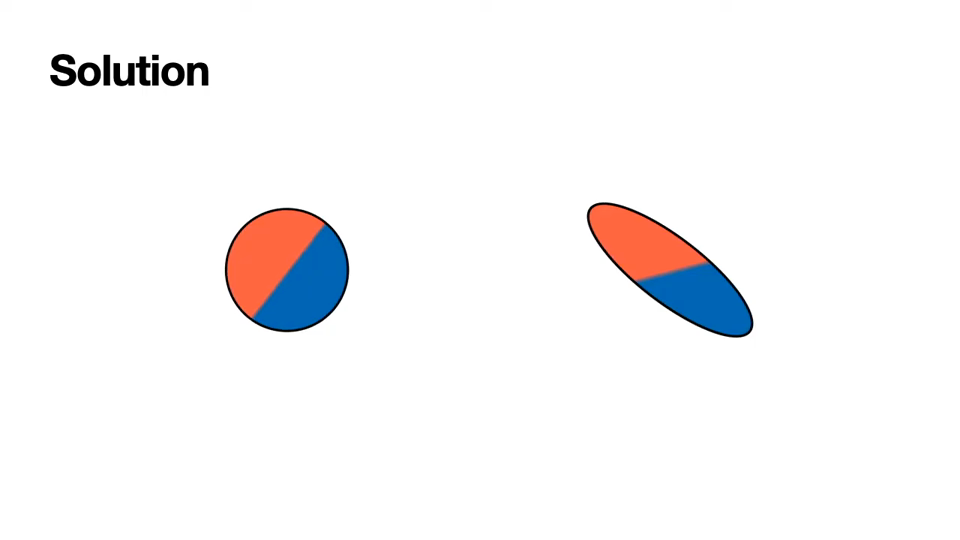

| 시각 | 화면 | 내용 |
|---|---|---|
| 01:30 | `Puzzle (easy)`: 회색 원 → 기울어진 타원 | 회전과 가로·세로 scaling만으로 원을 타원으로 바꿔 보라. |
| 02:06–02:18 | 가로로 늘인 타원 → 세로로 줄인 타원 → 반시계 회전 | 쉬운 퍼즐의 풀이: 늘이기 → 줄이기 → 회전 |
| 02:24 | `Puzzle (hard)`: 위 파랑·아래 주황 원 → 색 배치가 정해진 타원 | 이번에는 **원 위의 모든 점이 정해진 위치로** 가야 한다(색 구슬 목걸이 비유). |
| 02:42–03:00 | 같은 방법을 쓰면 모양은 맞지만 색 경계가 틀리고, 빨강·파랑 점이 엉뚱한 곳에 있다 | 쉬운 퍼즐의 방법으로는 실패한다. |
| 03:06–03:30 | `Solution`: 원을 **먼저 회전** → 가로로 늘이기 → 세로로 줄이기 → 다시 회전 | 색까지 맞는다. |

**핵심**: **회전 → scaling → 회전** 세 단계면 원을 원하는 타원으로 점 단위까지 정확히 보낼 수 있다. 영상은 이것이 모든 선형변환을 흉내 내는 방법이라고 말한다.

## 3. 행렬 = 선형변환, 단위원 → 타원 (03:42–06:30)

![A=[[3,0],[4,5]]가 단위원 위 네 점을 (3,4),(0,5),(-3,-4),(0,-5)로 보내 타원을 만드는 그림](figures/03_matrix_ellipse.png)

| 시각 | 화면 | 내용 |
|---|---|---|
| 03:54 | `What does this have to do with matrices?` $A=\begin{bmatrix}3&0\\4&5\end{bmatrix}$ | 행렬 하나가 선형변환 하나를 정의한다. |
| 04:18 | 좌·우 두 격자, `(p,q)` → `(3p+0q, 4p+5q)` | 왼쪽 평면의 점 $(p,q)$를 오른쪽 평면의 $(3p+0q,\,4p+5q)$로 보낸다. 둘째 행 `4 5`와 `4p+5q`를 빨간 상자로 짝지어 보여 준다. |
| 04:42–05:06 | 파랑 `(1,0)→(3,4)`, 빨강 `(0,1)→(0,5)`, 초록 `(-1,0)→(-3,-4)`, 주황 `(0,-1)→(0,-5)` | 점을 하나씩 옮긴다. 대각선 위의 네 점도 추가로 옮긴다. |
| 05:24–05:42 | 오른쪽에 점들을 잇는 기울어진 타원 | **단위원은 원점이 중심인 타원으로 간다.** 2x2 행렬은 모두 이렇게 단위원을 타원으로 보내고, 그 타원이 변환을 결정한다. |
| 05:48–06:00 | `Rotation matrices` $\begin{bmatrix}\cos\theta&-\sin\theta\\ \sin\theta&\cos\theta\end{bmatrix}$ | 각 $\theta$만큼 회전. 타원과 개가 함께 돈다. |
| 06:06–06:30 | `Stretching matrices` $\begin{bmatrix}\sigma_1&0\\0&\sigma_2\end{bmatrix}$, 파란 화살표 $\sigma_1$(가로), $\sigma_2$(세로) | 대각행렬은 가로를 $\sigma_1$배, 세로를 $\sigma_2$배 늘인다. 1보다 크면 늘이기, 작으면 줄이기, 1이면 그대로, 음수면 늘인 뒤 축에 대해 뒤집기. |

**짚을 점**: 전사본에서는 회전행렬을 "cos θ, sin θ, −sin θ, cos θ" 순서로 읽지만, 화면은 첫 행이 $\cos\theta,\,-\sin\theta$인 표준형(반시계 회전)이다. 7분대 일반형 화면은 반대로 $\begin{bmatrix}\cos\theta&\sin\theta\\-\sin\theta&\cos\theta\end{bmatrix}$(시계 방향 꼴)이다. 어느 쪽이든 각의 부호만 바뀐 회전이다.

## 4. SVD: $A=U\Sigma V^\dagger$ (06:30–10:42)

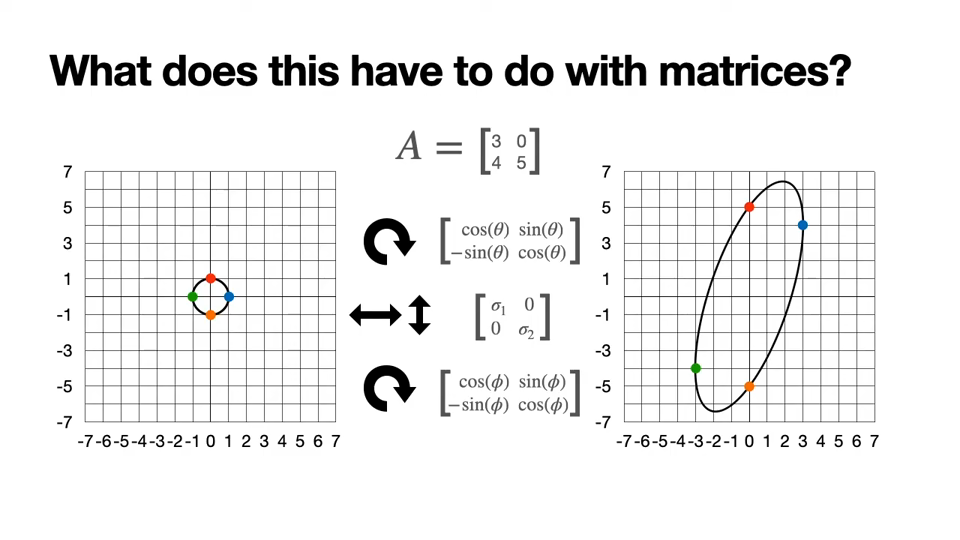

| 시각 | 화면 | 내용 |
|---|---|---|
| 07:12 | 단위원·타원 사이에 회전 $\begin{bmatrix}\cos\theta&\sin\theta\\-\sin\theta&\cos\theta\end{bmatrix}$, scaling $\begin{bmatrix}\sigma_1&0\\0&\sigma_2\end{bmatrix}$, 회전 $\begin{bmatrix}\cos\phi&\sin\phi\\-\sin\phi&\cos\phi\end{bmatrix}$ | **이 영상의 핵심**: 모든 선형변환은 회전 → 가로·세로 scaling → 회전으로 쓸 수 있다. |
| 07:24 | `Singular value decomposition` $\begin{bmatrix}3&0\\4&5\end{bmatrix}=[\text{회전}(\theta)][\text{대각}][\text{회전}(\phi)]$ | 행렬로 쓰면 세 행렬의 곱 |
| 07:36 | $A=U\Sigma V^\dagger$ | 회전 두 개를 $U$, $V$, scaling을 $\Sigma$라 부른다. $V^\dagger$는 adjoint(켤레전치)이다. 영상의 행렬은 실수라서 전치와 같다. |
| 08:12–08:24 | WolframAlpha `singular value decomposition {{3,0},{4,5}}` 결과, numpy `from numpy.linalg import svd` 결과 | 손 계산은 고윳값·고유벡터 구하기와 비슷하다며 다른 영상으로 미루고, 도구로 구한다. |
| 08:36 | 소수 버전과 근호 버전을 함께 표시 | 아래 식 |

$$
\begin{bmatrix}3&0\\4&5\end{bmatrix}
=\begin{bmatrix}0.316&-0.949\\0.949&0.316\end{bmatrix}
\begin{bmatrix}6.708&0\\0&2.236\end{bmatrix}
\begin{bmatrix}0.7071&0.7071\\-0.7071&0.7071\end{bmatrix}
=\begin{bmatrix}\tfrac1{\sqrt{10}}&-\tfrac3{\sqrt{10}}\\ \tfrac3{\sqrt{10}}&\tfrac1{\sqrt{10}}\end{bmatrix}
\begin{bmatrix}3\sqrt5&0\\0&\sqrt5\end{bmatrix}
\begin{bmatrix}\tfrac1{\sqrt2}&\tfrac1{\sqrt2}\\-\tfrac1{\sqrt2}&\tfrac1{\sqrt2}\end{bmatrix}
$$

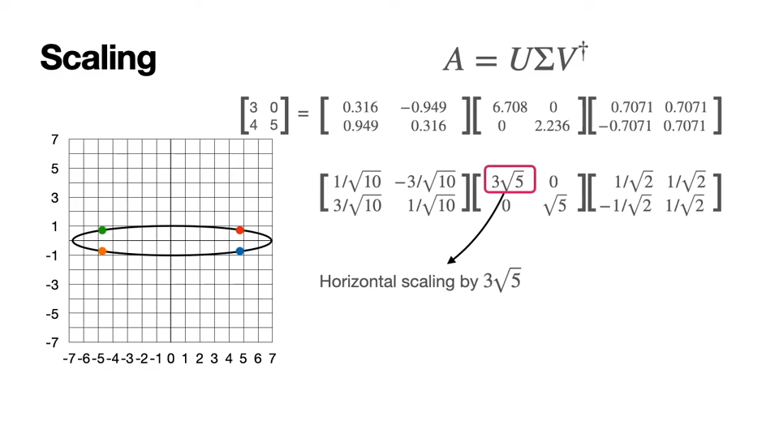

벡터에는 오른쪽 행렬부터 곱하므로 **오른쪽부터 읽는다**.

| 시각 | 단계 | 화면 글자 | 단위원의 변화 |
|---|---|---|---|
| 09:00 | $V^\dagger$ (빨간 상자) | `Rotation of θ = −π/4 = −45°` | 네 색 점이 시계 방향으로 45° 돈다. |
| 09:30 | $\Sigma$의 $3\sqrt5$ | `Horizontal scaling by 3√5` | 가로로 약 6.7배 |
| 09:42 | $\Sigma$의 $\sqrt5$ | `Vertical scaling by √5` | 세로로 약 2.2배. 가로로 긴 타원 |
| 09:54–10:12 | $U$ (빨간 상자) | `Rotation of θ = arctan(3) = 71.72°` | 반시계 회전 후 처음의 기울어진 타원과 일치 |

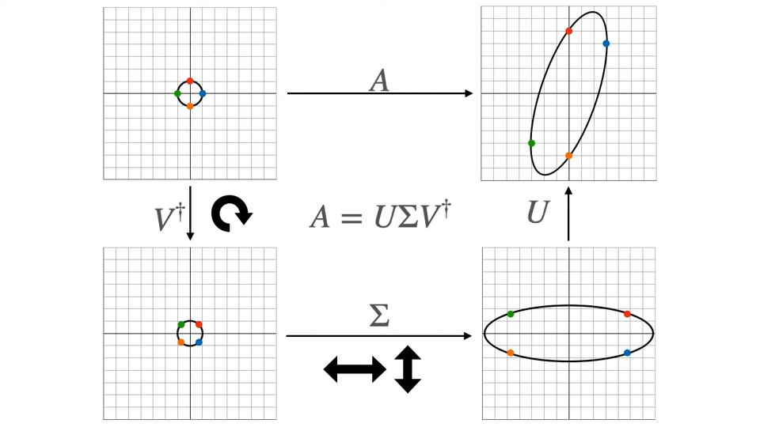

**핵심**: 10:30의 요약 도식처럼 $A$로 바로 가는 길(위)과 $V^\dagger\to\Sigma\to U$로 돌아가는 길(왼쪽 아래 오른쪽 위)이 같다. $\Sigma$의 대각 성분이 **특잇값**(singular value)이다.

**짚을 점**
- $\arctan 3 = 1.249\text{ rad}$는 **71.57°**이다. 화면의 "71.72°"는 틀린 값이다(라디안 1.249는 맞다).
- 화면의 numpy 출력은 $U$와 $V^\top$의 부호가 위 식과 다르다(예: $U$의 첫 열이 $-0.316, -0.949$). 특이벡터는 $u_i$와 $v_i$의 부호를 함께 바꿔도 같은 곱을 주므로 둘 다 맞는 분해이다.

## 5. 차원 축소: 작은 특잇값을 0으로 (10:42–14:12)

![A=[[1.8,1.2],[4.4,4.6]]의 SVD 도식에서 Σ=diag(6.71, 0.44)가 단위원을 아주 납작한 타원으로 보내는 화면](figures/07_near_degenerate.png)

| 시각 | 화면 | 내용 |
|---|---|---|
| 10:48 | 검은 화면 `dimensionality reduction` | 새 장 |
| 10:54 | $A=\begin{bmatrix}1.8&1.2\\4.4&4.6\end{bmatrix}$, 오른쪽은 아주 가는 타원 | 점들이 거의 한 직선에 놓인다. **거의 퇴화한(degenerate) 변환**, 즉 행렬식이 0에 가깝고 거의 특이(singular)한 행렬이다. |
| 11:48–12:06 | $V^\dagger=\begin{bmatrix}0.7071&0.7071\\-0.7071&0.7071\end{bmatrix}$, $\Sigma=\begin{bmatrix}6.71&0\\0&0.44\end{bmatrix}$, $U=\begin{bmatrix}0.316&-0.949\\0.949&0.316\end{bmatrix}$ | $V^\dagger$와 $U$는 4절과 같은 회전이고 $\Sigma$만 다르다. 6.71(빨간 원)이 타원을 길게, **0.44가 타원을 얇게** 만든다. 가는 모양의 원인은 0.44에 있다. |
| 12:36 | 0.44 자리에 빨간 원 친 **0** | "0.44는 작으니 0으로 하자" |
| 12:42–12:48 | 오른쪽 아래 타원이 선분으로 변하고, 오른쪽 위도 직선 | 평면 전체가 한 직선으로 눌린다(퇴화 변환). |
| 13:00 | $A$가 $\begin{bmatrix}1.5&1.5\\4.5&4.5\end{bmatrix}$로 바뀜 | 세 행렬을 다시 곱한 새 행렬 |

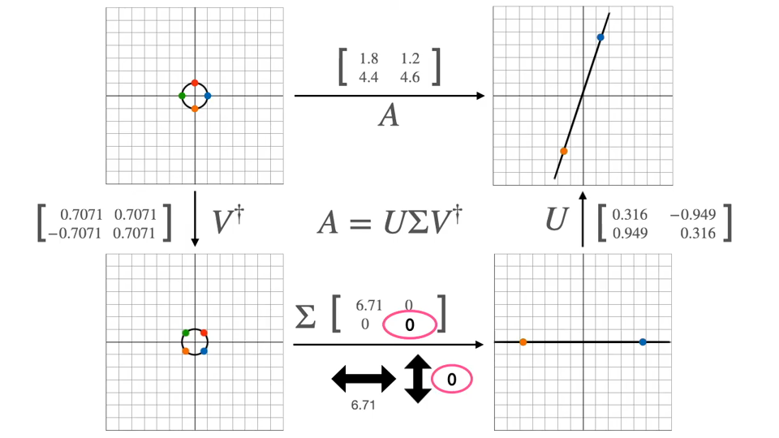

| 시각 | 화면 | 내용 |
|---|---|---|
| 13:30 | `[[1.5,1.5],[4.5,4.5]]` / `Rank 1` | 평면을 직선으로 보내는 행렬은 랭크 1 |
| 13:48–14:12 | 왼쪽 가는 타원 + `[[1.8,1.2],[4.4,4.6]]` `Rank 2` → 오른쪽 직선 + `[[1.5,1.5],[4.5,4.5]]` `Rank 1` | 랭크 2지만 거의 퇴화한 행렬을 아주 가까운 랭크 1 행렬로 바꿨다. |

**핵심**: 특잇값 하나를 0으로 만들면 랭크가 하나 줄어든다. 줄인 특잇값이 작을수록 행렬은 거의 바뀌지 않는다. 계산으로 확인하면 $6.71\times\begin{bmatrix}0.316\\0.949\end{bmatrix}\begin{bmatrix}0.7071&0.7071\end{bmatrix}\approx\begin{bmatrix}1.5&1.5\\4.5&4.5\end{bmatrix}$이다.

**짚을 점**: 전사본은 새 행렬을 "rows are the same"이라고 말하지만, 화면 행렬 $\begin{bmatrix}1.5&1.5\\4.5&4.5\end{bmatrix}$에서 같은 것은 **두 열**이다. 두 행은 서로 3배 관계이다. 바로 뒤에서는 "두 열이 정확히 같다"고 바로잡는다.

## 6. 랭크 1 행렬과 외적 (14:18–16:30)

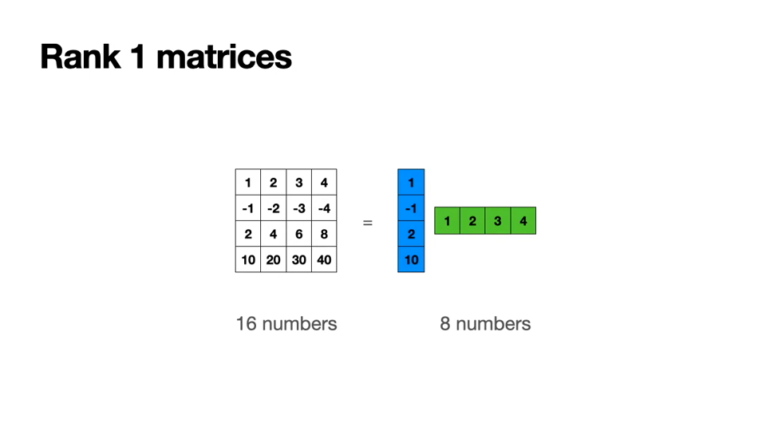

| 시각 | 화면 | 내용 |
|---|---|---|
| 14:18 | `Rank 1 matrices`, 4x4 표 `1 2 3 4 / -1 -2 -3 -4 / 2 4 6 8 / 10 20 30 40` | 무작위 수가 아니다. |
| 14:36–15:06 | 위에 초록 `1 2 3 4`, 왼쪽에 파랑 `1, -1, 2, 10`이 하나씩 붙는다 | 모든 행이 `1 2 3 4`의 배수(1배, −1배, 2배, 10배)이다. |
| 15:06–15:18 | 행렬 `=` 파란 열 × 초록 행 | **외적**(outer product): $\begin{bmatrix}1\\-1\\2\\10\end{bmatrix}\begin{bmatrix}1&2&3&4\end{bmatrix}$ |
| 15:24–15:30 | `16 numbers` / `8 numbers` | 저장할 수가 16개에서 8개로 준다. |
| 16:06 | `Higher rank matrices`: `3 1 4 1 / 5 9 2 6 / 5 3 5 8 / 9 7 9 3` = 물음표 열 × 물음표 행 | 이 행렬은 두 벡터의 곱으로 쓸 수 없다. 랭크 4이고 행렬식이 0이 아니어서 16개 수가 모두 필요하다. |

**핵심**: 1000x1000 랭크 1 행렬이면 100만 개 대신 2000개만 저장한다. 큰 행렬을 더 작은 것들의 곱으로 쓰는 것이 영상이 말하는 "압축", "차원 축소"이다.

## 7. SVD를 랭크 1 행렬의 합으로 펼치기 (16:30–20:48)

| 시각 | 화면 | 내용 |
|---|---|---|
| 16:36–17:00 | `Approximation by rank one matrices`: 행렬 = (파랑×초록) + (파랑×초록) + … | 랭크가 높은 행렬은 랭크 1 행렬 여러 개의 **합으로 근사**한다. 이 예에서는 정확히 4개가 필요하다. |
| 17:24–17:48 | $A=U\Sigma V^\dagger$ 블록: $U$의 열 `U1…U4`, $\Sigma$의 대각 `σ1…σ4`, $V^\dagger$의 행 `V1…V4` | 기호를 정한다. |
| 17:54–18:12 | $\sigma_1U_1V_1+\sigma_2U_2V_2+\sigma_3U_3V_3+\sigma_4U_4V_4$, 각 항 아래 `Rank 1` | 행렬 곱을 펼친 결과. 각 항은 열 × 행 외적이므로 랭크 1이다. |
| 18:18–18:36 | 빨간 라벨 `Large`, `Medium`, `Small`, `Tiny` | 특잇값을 큰 것부터 늘어놓는다. |
| 18:48 | 앞의 두 항만 남김 | 작은 두 항을 버리면 $A$와 아주 비슷한 랭크 2 행렬이 된다. |

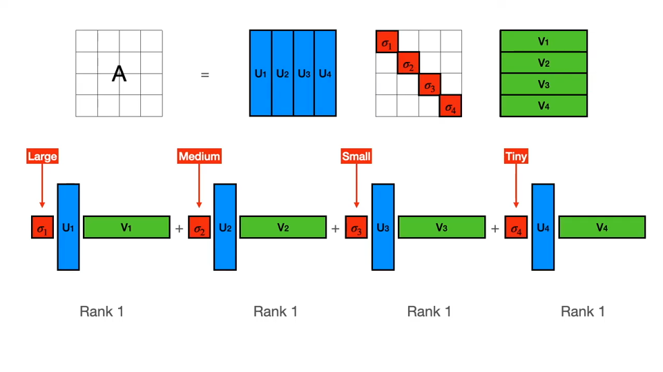

$$
A=U\Sigma V^\dagger=\sigma_1U_1V_1+\sigma_2U_2V_2+\sigma_3U_3V_3+\sigma_4U_4V_4
$$

여기서 $U_i$는 $U$의 $i$번째 **열**(4x1), $V_i$는 $V^\dagger$의 $i$번째 **행**(1x4)이다. 저장량은 항마다 $4+4$개 정도이다. 4x4에서는 절약이 없지만 1000x1000에서 4항만 남기면 약 4000개로 충분하다(특잇값 4개까지 세면 조금 더 많다).

**수치 예 (19:42–20:48)**: 앞의 랭크 4 행렬을 실제로 분해한다.

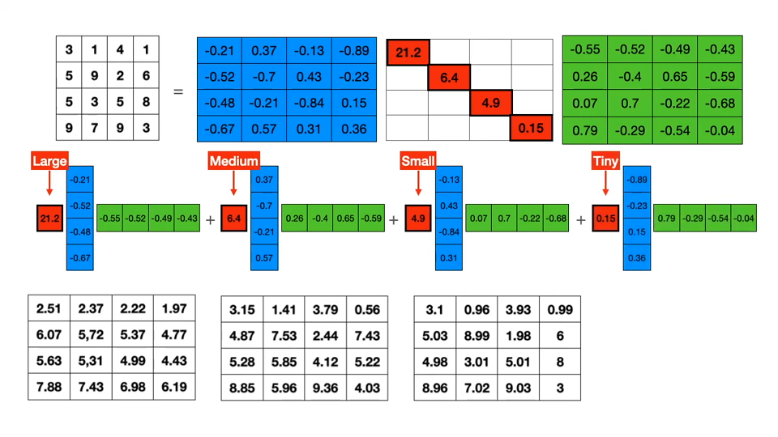

| 남긴 항 | 특잇값 | 누적 합(화면 표) | 영상 설명 |
|---|---|---|---|
| 1개 | 21.2 (Large) | `2.51 2.37 2.22 1.97 / 6.07 5.72 5.37 4.77 / 5.63 5.31 4.99 4.43 / 7.88 7.43 6.98 6.19` | 원래 행렬에 가장 가까운 랭크 1 행렬 |
| 2개 | 6.4 (Medium) | `3.15 1.41 3.79 0.56 / 4.87 7.53 2.44 7.43 / 5.28 5.85 4.12 5.22 / 8.85 5.96 9.36 4.03` | 가장 가까운 랭크 2 행렬 |
| 3개 | 4.9 (Small) | `3.1 0.96 3.93 0.99 / 5.03 8.99 1.98 6 / 4.98 3.01 5.01 8 / 8.96 7.02 9.03 3` | 원래 행렬 `3 1 4 1 / 5 9 2 6 / 5 3 5 8 / 9 7 9 3`과 거의 같다 |
| 4개 | 0.15 (Tiny) | `3 1 4 1 / 5 9 2 6 / 5 3 5 8 / 9 7 9 3` | 랭크 4이므로 네 항이면 정확히 원래 행렬 |

**짚을 점**: 전사본은 셋째·넷째 성분을 말하며 "eigenvalue"라고 하지만 화면과 문맥상 **특잇값**(singular value)이다. 이 행렬의 고윳값은 다른 값이다. 직접 계산해 보면 특잇값은 21.23, 6.43, 4.88, 0.147이고, 첫 랭크 1 근사도 화면 표와 일치한다.

## 8. 랭크란 무엇인가 (20:54–23:00)

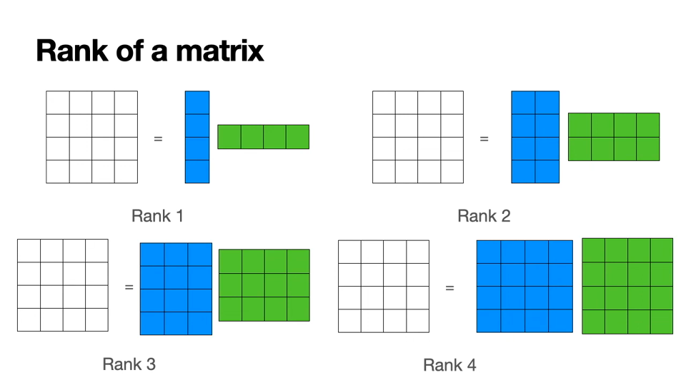

| 시각 | 화면 | 내용 |
|---|---|---|
| 20:54 | `Rank of a matrix`: 4x4 = (4x1)(1x4), `Rank 1` | 원소 사이 관계가 가장 많아 가장 예측하기 쉽다. |
| 21:30 | (4x2)(2x4), `Rank 2` | 랭크 1로는 못 쓰지만 폭 2와 높이 2인 두 행렬의 곱으로는 쓸 수 있다. |
| 21:54 | (4x3)(3x4), `Rank 3` | |
| 22:00 | (4x4)(4x4), `Rank 4` | **full rank**. 랭크는 행 수와 열 수 중 작은 값을 넘지 못한다. |

**핵심**: 랭크가 낮을수록 원소 사이의 선형 관계가 많아 작은 두 행렬의 곱으로 저장할 수 있다. 차원 축소의 목표는 랭크가 높은 큰 행렬과 아주 가까운 **저랭크 행렬**을 찾는 것이다.

## 9. 정방행렬이 아니어도 된다 (23:00–24:00)

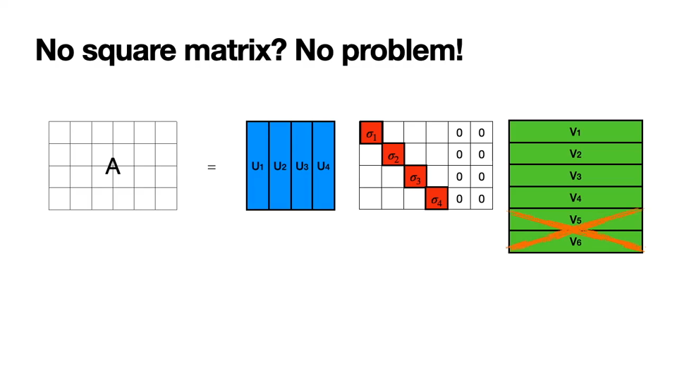

| 시각 | 화면 | 내용 |
|---|---|---|
| 23:00 | `No square matrix? No problem!`, 4x6 행렬 `A =` | 직사각행렬에도 SVD가 된다. |
| 23:24 | $U$: `U1…U4`(4x4), $\Sigma$: $\sigma_1\ldots\sigma_4$ 대각 + 오른쪽 `0 0` 두 열 | $\Sigma$는 4x6 |
| 23:30 | $V^\dagger$: `V1…V6`(6x6) | |
| 23:42 | `V5`, `V6` 행에 주황 X, $\Sigma$의 0 열을 가리키는 화살표 | $V_5,V_6$은 0과 곱해져 결과에 쓰이지 않는다. 그래도 전체 행렬을 갖고 있는 편이 유용하다. |

**짚을 점**: 전사본은 "$\Sigma$에 0 **행** 두 개를 붙여 6x4로 만든다"고 말하지만, 화면과 차원 계산으로는 **0 열** 두 개를 붙인 **4x6**이다. $(4\times4)(4\times6)(6\times6)=4\times6$이어야 $A$의 모양이 맞는다.

## 10. 응용: 하트 이미지 압축 (24:00–27:48)

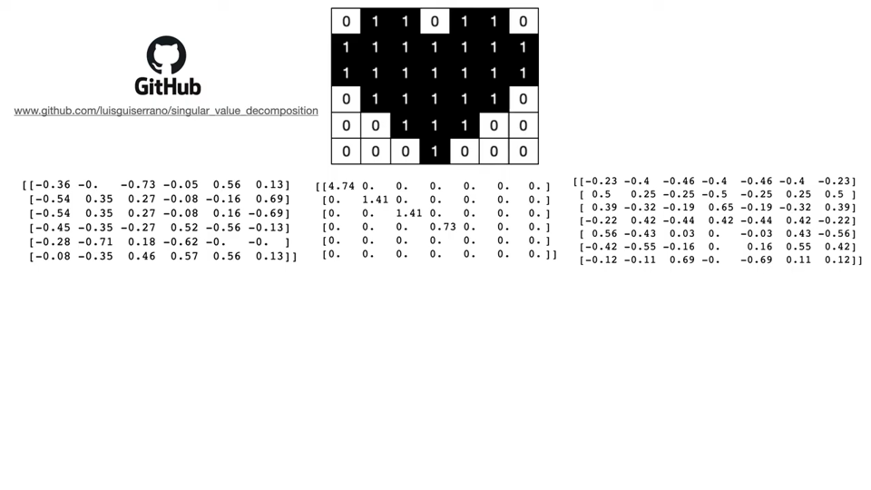

| 시각 | 화면 | 내용 |
|---|---|---|
| 24:00–24:24 | 흑백 하트 픽셀 그림, GitHub 링크 | 저장소 코드로 따라 할 수 있다. |
| 24:24 | 하트 칸에 수가 적힌다: `0 1 1 0 1 1 0 / 1 1 1 1 1 1 1 / 1 1 1 1 1 1 1 / 0 1 1 1 1 1 0 / 0 0 1 1 1 0 0 / 0 0 0 1 0 0 0` | 검정 = 1, 흰색 = 0(그래픽에서는 보통 반대). 6x7 행렬 |
| 24:48–24:56 | numpy 출력 $U$(6x6), $\Sigma$(대각 `4.74, 1.41, 1.41, 0.73, 0, 0`, 6x7), $V^\dagger$(7x7) | 도구에 따라 부호나 0 채움 크기가 다를 수 있지만 같은 분해이다. |
| 25:30 | $U$ 첫 열(초록 상자), $\sigma_1=4.74$(빨강), $V^\dagger$ 첫 행(파랑) → 흐릿한 하트 그림 | 첫 성분 $\sigma_1U_1V_1$은 하트를 흐릿하게 잡아낸 랭크 1 행렬이다. |
| 26:06 | 둘째 성분 1.41 | 특잇값이 작아 더 옅은 그림 |
| 26:30–26:48 | `4.74, 1.41, 1.41, 0.73, 0.0, 0.0` 여섯 성분 | 갈수록 옅어지고 마지막 두 개는 특잇값 0이라 빈 그림이다. 쓰이지 않는 $V^\dagger$ 행도 있다. |
| 26:54–27:12 | 아랫줄에 앞에서부터 더한 누적 그림, 빨간 세로선이 옮겨 간다 | 1개: 흐릿함 → 2개: 조금 선명 → 3개: 더 선명 → 4개: **완전한 하트** |
| 27:18 | 행렬 옆 `Rank 4` | 특잇값이 0이 아닌 항이 4개이므로 하트 행렬의 랭크는 4이다. |

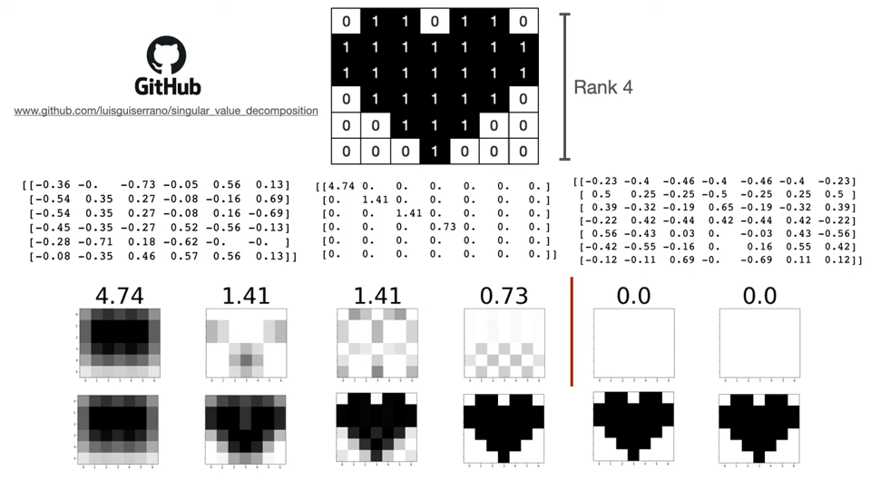

**핵심**: 몇 개의 성분을 남길지 정하면 저장 공간과 선명도를 맞바꿀 수 있다. 공간이 적으면 앞의 한두 성분만, 여유가 있으면 더 많은 성분을 저장한다. 직접 계산한 특잇값도 $4.74, 1.414, 1.414, 0.731, 0, 0$이고 랭크는 4이다.

## 11. 마무리·광고 (27:48–28:55)

관련 영상(Matrix Factorization, Principal Component Analysis) 소개, 책 할인 코드, 구독·트위터 안내.

---

## 수업 내용과 연결하기

1104 정리노트(`정리노트_1104_PCA_Part2`)의 "SVD와 실제 계산" 절, L06 슬라이드 "PCA as Low-Rank Matrix Approximations"와 맞춘다.

| 영상 표현 | 수업 용어 | 수식 |
|---|---|---|
| 회전 → scaling → 회전 | 특잇값 분해(SVD) | $\mathbf X=\mathbf U\mathbf\Sigma\mathbf V^\top$ |
| 회전행렬 $U$, $V$ (rotation) | 직교행렬, 열이 직교 정규 | $\mathbf U^\top\mathbf U=\mathbf I_D,\ \mathbf V^\top\mathbf V=\mathbf I_N$ |
| $V^\dagger$ (dagger, 켤레전치) | $\mathbf V^\top$ (실수 행렬이라 전치와 같음) | $\mathbf V^\dagger=\mathbf V^\top$ |
| scaling 행렬 $\Sigma$, 대각 성분 | 특잇값 $\sigma_i\ge0$, 큰 순서 | $\mathbf\Sigma\in\mathbb R^{D\times N}$ |
| $U$의 열 $U_i$ | 왼쪽 특이벡터 $\mathbf u_i$ (PCA에서는 주성분 축) | $\mathbf u_i\in\mathbb R^D$ |
| $V^\dagger$의 행 $V_i$ | 오른쪽 특이벡터의 전치 $\mathbf v_i^\top$ | $\mathbf v_i\in\mathbb R^N$ |
| $\sigma_iU_iV_i$ (outer product, rank one) | 랭크 1 행렬 한 겹 | $\sigma_i\mathbf u_i\mathbf v_i^\top$ |
| 작은 특잇값 버리기 / 처음 몇 항 더하기 | 상위 $M$개 특잇값에서 자른 SVD, 저랭크 근사 | $\tilde{\mathbf X}_M=\mathbf U_M\mathbf\Sigma_M\mathbf V_M^\top=\sum_{i=1}^M\sigma_i\mathbf u_i\mathbf v_i^\top$ |
| "가장 가까운 랭크 1(2, 3) 행렬" | 에카르트–영 정리 | $\tilde{\mathbf X}_M=\arg\min_{\operatorname{rk}(\mathbf A)\le M}\lVert\mathbf X-\mathbf A\rVert$ |
| 16개 → 8개 수, 작은 두 행렬의 곱으로 저장 | 축 행렬 $\mathbf U_M$과 좌표 행렬 $\mathbf\Sigma_M\mathbf V_M^\top$ 보관 | $(D\times M)(M\times N)$ |
| 4x6 행렬의 $\Sigma$에 0 열 패딩 | 직사각 $\mathbf\Sigma$ (대각만 0이 아님) | $\mathbf\Sigma\in\mathbb R^{D\times N}$ |

**영상에서 빠진 것**

1. **SVD 계산법과 고유분해의 관계.** 영상은 계산을 도구에 맡긴다. 수업에서는 $\mathbf S=\frac1N\mathbf X\mathbf X^\top=\mathbf U\frac{\mathbf\Sigma\mathbf\Sigma^\top}{N}\mathbf U^\top$로 정리해 $\mathbf U$의 열이 공분산의 고유벡터이고 $\lambda_i=\sigma_i^2/N$임을 보인다. 특잇값과 고윳값은 일반적으로 다른 값이다(7절의 "eigenvalue"는 말실수).
2. **"가장 가깝다"의 기준과 근거.** 영상은 랭크 $k$ 근사가 가장 가깝다고 말만 한다. 수업은 Frobenius 노름 기준의 에카르트–영 정리로 정리하고, 오차가 $\lVert\mathbf X-\tilde{\mathbf X}_M\rVert_F^2=\sum_{i>M}\sigma_i^2$임을 보인다. 예를 들어 4x4 예제에서 3항 근사의 오차 제곱합은 $0.15^2\approx0.02$뿐이다.
3. **회전만이 아니라 반사도 있다.** 영상은 $U,V$를 "회전"이라 부르지만, 일반적인 직교행렬은 반사를 포함할 수 있다(행렬식 $-1$). 3차원 이상에서는 평면 회전 하나로 표현되지 않는다.
4. **특잇값의 비음수·정렬 규약과 부호 모호성.** $\sigma_i\ge0$을 큰 순서로 놓는 것은 규약이다. $\mathbf u_i,\mathbf v_i$는 부호를 함께 바꿔도 되고, 같은 특잇값이 겹치면(하트 예의 1.41, 1.41) 그 공간 안에서 축을 다르게 고를 수 있다. 정리노트도 "부호는 달라질 수 있고, 고윳값이 같은 축들은 다르게 골라질 수 있다"고 짚는다.
5. **PCA와의 연결.** 영상은 일반 행렬(이미지) 압축만 다룬다. 수업에서는 **평균을 뺀** 데이터 행렬 $\mathbf X$의 SVD에서 왼쪽 특이벡터가 주성분 축이 되고, 저랭크 근사가 곧 PCA 복원 $\tilde{\mathbf X}_M=\mathbf B\mathbf B^\top\mathbf X$($\mathbf B=\mathbf U_M$)임을 보인다.
6. **랭크의 정의.** 영상은 "작은 두 행렬의 곱으로 쓸 수 있는 최소 폭"으로 직관적으로만 설명한다. 정식 정의는 선형독립인 열(행)의 최대 개수이고, 0이 아닌 특잇값의 개수와 같다.
