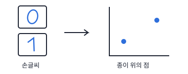

# PCA 2부 — 5살도 이해하는 정리노트

정방철 교수님 머신러닝기초 · 1104 수업 (Lecture05–06, MML 10장)

> `정리노트_1104_PCA_Part2.html`를 마크다운으로 옮겼어요. 그림은 `figures_1104/` 폴더의 SVG, 위젯은 대표 설정의 정적 그림으로 바꿨어요. 수식은 `$…$` / `$$…$$`라서 GitHub, Obsidian, Typora에서 보여요.

**목차**

- [PCA의 두 목표](#s0)
  - [어떤 축을 남겨야 복원오차가 작아질까?](#s0-learning-map)
  - [고유기저에서 방향 분산 계산하기](#s0-spectral-weights)
  - [첫 번째부터 M번째까지 방향 고르기](#s0-top-directions)
- [사영과 복원](#s1)
  - [기저를 고정하고 좌표 구하기](#s1-projection)
  - [버린 방향에서 복원오차 계산하기](#s1-discarded)
  - [MNIST에서 사영과 복원 읽기](#s1-mnist)
- [SVD와 실제 계산](#s2)
  - [데이터의 SVD에서 주성분 찾기](#s2-svd)
  - [작은 행렬 두 개로 데이터 복원하기](#s2-low-rank)
  - [PCA를 적용하고 원래 단위로 돌아가기](#s2-workflow)
- [요약 · 예고](#s3)
  - [한 장 요약](#s3-cheatsheet)
  - [다음 시간 예고](#s3-next)
  - [함께 보면 좋은 자료](#s3-links)

## PCA의 두 목표

### 어떤 축을 남겨야 복원오차가 작아질까?

*1104 수업 · L05 s26–28 · L06 s5–17*

**먼저 큰 그림**

표본마다 원래 특성보다 적은 숫자를 저장하려면 어떤 축을 남겨야 원래 데이터를 가장 잘 복원할 수 있을까요?

1102에는 새 축에 사영한 좌표와 그 좌표의 분산을 배웠어요. 1104에는 어느 축에서 분산이 최대인지 증명하고, 같은 축을 썼을 때의 복원오차를 계산해요.

| 보는 방향 | 계산하는 것 | 다음에 쓰는 곳 |
|---|---|---|
| 남기는 쪽 | 선택한 축에 담긴 분산 | 분산이 큰 순서로 축을 골라 압축해요. |
| 버리는 쪽 | 빠진 축에 담긴 분산 | 복원 벡터의 평균 제곱오차를 구해요. |

결과는 선택한 축을 모은 행렬, 표본별 압축 좌표, 원래 차원으로 돌린 복원 벡터와 평균 제곱 복원오차예요. 중심화한 데이터를 고정하면 남긴 분산과 버린 분산의 합이 일정해 두 목표에서 같은 축을 고를 수 있어요.

먼저 후보 축을 공분산의 고유기저로 써서 방향 분산을 고윳값의 가중평균으로 바꿔요. 그 식으로 가장 큰 축부터 고르고, 같은 기저로 잔차를 세요. 마지막에는 데이터 행렬의 특잇값 분해로 같은 축을 계산해요. 해당 축의 분산은 특잇값의 제곱을 표본 수로 나눈 값이에요.

사영 좌표의 차원은 남긴 축의 수예요. 복원 벡터의 차원은 원래 특성 수예요. 선택 경계의 고윳값이 같다면 최적 축을 여러 방식으로 고를 수 있어요.

**페이지 요약**

중심화한 데이터에서 남긴 분산을 최대로 하면 버린 축의 분산 합인 평균 제곱 복원오차가 최소가 돼요.

압축 좌표는 남긴 축 수인 $M$차원이고, 복원값은 원래 특성 수인 $D$차원이에요. 선택 경계의 고윳값이 같으면 최적 축을 여러 방식으로 고를 수 있어요.

---

### 고유기저에서 방향 분산 계산하기

*1104 수업 · L05 s10 · s19 · s26–27*

**쉽게 말하면**

종이에 찍힌 점들을 자 하나로 읽을 때 자를 기울이면 눈금에 표시되는 점 사이 간격이 달라져요.

*점들이 늘어선 방향에 자를 대면 넓은 범위의 눈금을 써요.*

**정확히 말하면**

길이가 1인 축 $\mathbf b\in\mathbb R^D$에서, 사영한 좌표들이 얼마나 퍼지는지 구해요. 표본 수는 $N$, 원래 특성 수는 $D$이고, 열벡터 $\mathbf x_n\in\mathbb R^D$는 이미 특성별 평균을 뺀 $n$번째 표본이에요. $\mathbf X=[\mathbf x_1,\ldots,\mathbf x_N]\in\mathbb R^{D\times N}$은 이 표본들을 모은 행렬이에요.

#### 1 / 3 가중합의 분산 구하기

사영 좌표의 제곱을 평균내고, 공분산 행렬로 묶어요.

##### 가중합 하나의 분산

축 $\mathbf b$의 $d$번째 성분 $b_d$를 각 특성 $x_{dn}$에 곱해 더하면 한 숫자 $\mathbf b^\top\mathbf x_n=\sum_{d=1}^D b_dx_{dn}$가 나와요. 두 특성만 있으면 $b_1x_{1n}+b_2x_{2n}$이에요. 이 숫자의 표본 평균은 0이므로 분산은 이 가중합을 제곱해 평균낸 값이에요. 제곱 안에는 서로 다른 특성을 곱한 항도 들어가요.

1. 실수인 좌표는 전치해도 값이 같아요. 곱의 전치는 순서를 바꾸므로 $(\mathbf b^\top\mathbf x_n)^\top=\mathbf x_n^\top\mathbf b$예요.

   $$
   (\mathbf b^\top\mathbf x_n)^2=(\mathbf b^\top\mathbf x_n)(\mathbf x_n^\top\mathbf b)=\mathbf b^\top(\mathbf x_n\mathbf x_n^\top)\mathbf b.
   $$
2. 모든 표본에서 같은 축을 사용하므로 양쪽의 $\mathbf b$를 평균 바깥으로 꺼낼 수 있어요. 방향 분산을 $V(\mathbf b)$로 쓰면 다음과 같아요.

   $$
   V(\mathbf b)=\frac1N\sum_{n=1}^N(\mathbf b^\top\mathbf x_n)^2=\mathbf b^\top\mathbf S\mathbf b.
   $$

   $$
   \mathbf S=\frac1N\mathbf X\mathbf X^\top
   $$

$\mathbf S$는 중심화한 데이터의 자기 공분산 행렬이에요. $\mathbf x_n\mathbf x_n^\top$의 $(i,j)$ 원소는 $x_{in}x_{jn}$이므로 평균을 내면 대각 원소는 특성별 분산이고, 비대각 원소는 두 특성의 공분산이에요. 성분을 서로 바꿔 곱해도 값이 같아 대칭이에요. 분산식의 크기는 $(1\times D)(D\times D)(D\times1)=1\times1$이에요. 임의의 $\mathbf b$에서도 제곱의 평균은 음수가 될 수 없으므로 $\mathbf S$는 양의 준정부호(PSD)예요.

방향만 비교하려면 축 벡터의 길이를 같게 맞춰야 해요. 실수 $\alpha$를 곱해 축 벡터의 길이를 바꾸면 가중합 좌표도 $\alpha$배가 되므로 다음 관계가 성립해요.

$$
V(\alpha\mathbf b)=\alpha^2V(\mathbf b).
$$

축 자체를 크게 만들어 분산 값을 키우는 선택을 막으려고 $\|\mathbf b\|=1$로 제한해요. 이 조건 아래에서 어느 방향의 분산이 가장 큰지 비교해요.

#### 2 / 3 축을 고유기저 좌표로 쓰기

공분산의 고유기저를 정하고, 같은 축의 좌표와 길이 조건을 확인해요.

##### 같은 축을 고유기저 좌표로 쓰기

실대칭 행렬의 스펙트럼 정리에 따라 단위 고유벡터 $\mathbf p_1,\ldots,\mathbf p_D\in\mathbb R^D$를 직교하도록 골라 기저로 삼을 수 있어요. $\mathbf S\mathbf p_i=\lambda_i\mathbf p_i$의 $\lambda_i$는 그 축의 분산이며 $\lambda_1\ge\cdots\ge\lambda_D\ge0$ 순서로 배열해요. $\delta_{ij}$는 같은 인덱스면 1, 다르면 0이에요. 그러므로 $\mathbf p_i^\top\mathbf p_j=\delta_{ij}$예요.

1. $\mathbf P=[\mathbf p_1,\ldots,\mathbf p_D]\in\mathbb R^{D\times D}$와 $\boldsymbol\Lambda=\operatorname{diag}(\lambda_1,\ldots,\lambda_D)\in\mathbb R^{D\times D}$를 두면 열마다 고유벡터 정의에 따라 $\mathbf S\mathbf P=\mathbf P\boldsymbol\Lambda$예요.

   강의 공식을 내적으로 풀어 읽어 볼게요. $p_{di}$는 $i$번째 열벡터 $\mathbf p_i$의 $d$번째 성분이에요. $\mathbf P^\top$의 $i$번째 행과 $\mathbf P$의 $j$번째 열을 곱하면 다음 한 칸을 얻어요.

   $$
   (\mathbf P^\top\mathbf P)_{ij}=\sum_{d=1}^D p_{di}p_{dj}=\mathbf p_i^\top\mathbf p_j.
   $$

   예를 들어 $(1,2)$번째 칸은 $p_{11}p_{12}+\cdots+p_{D1}p_{D2}=\mathbf p_1^\top\mathbf p_2$예요. 대각선 칸은 자기 자신과의 내적이라 길이의 제곱 $1$이고, 나머지 칸은 서로 수직인 두 열의 내적이라 $0$이에요. 그래서 $\mathbf P^\top\mathbf P=\mathbf I_D$예요.

   여기서 $\mathbf P$는 실수 정방행렬이므로 $\mathbf P^{-1}=\mathbf P^\top$이고, 반대 순서로 곱해도 $\mathbf P\mathbf P^\top=\mathbf I_D$예요. $\mathbf P$는 고유기저 좌표를 원래 벡터로 조립하고, $\mathbf P^\top$는 각 열과의 내적으로 그 좌표를 다시 읽어요. 전체 기저를 모두 썼기 때문에 두 변환을 이어 하면 원래 벡터로 돌아와요.

   이제 $\mathbf S\mathbf P=\mathbf P\boldsymbol\Lambda$의 오른쪽에 $\mathbf P^\top$를 곱해요.

   $$
   \mathbf S=\mathbf P\boldsymbol\Lambda\mathbf P^\top=\sum_{i=1}^D\lambda_i\mathbf p_i\mathbf p_i^\top.
   $$

   대각행렬의 비대각 원소가 0이라 같은 인덱스의 외적만 남아요.
2. 좌표를 바꾸는 수업 예에서 $(6,6)$은 단위축 $(1,1)/\sqrt2$와 $(1,-1)/\sqrt2$에 각각 $6\sqrt2$와 $0$을 곱해 더한 벡터예요. 같은 방식으로 $c_i=\mathbf p_i^\top\mathbf b$를 $i$번째 기저 좌표로 두면 $\mathbf b=\sum_i c_i\mathbf p_i$예요. 이 식을 자기 자신과 내적하면 서로 다른 축끼리의 항은 0이고 같은 축의 내적은 1이라 $\|\mathbf b\|^2=\sum_i c_i^2=1$이에요.

#### 3 / 3 직교성으로 가중평균 얻기

고유기저 전개를 분산식에 대입하고, 서로 다른 축의 내적을 정리해요.

1. $V(\mathbf b)$의 왼쪽과 오른쪽에 그 전개를 넣어요. 3차원이라면 왼쪽의 세 항과 오른쪽의 세 항이 만나 9개 항이 생겨요. 일반식은 다음과 같아요.

   $$
   V(\mathbf b)=\sum_{i=1}^D\sum_{j=1}^D c_i c_j\mathbf p_i^\top\mathbf S\mathbf p_j.
   $$
2. 오른쪽에 붙은 $\mathbf S\mathbf p_j$를 $\lambda_j\mathbf p_j$로 바꿔요. $\lambda_j$는 실수라 내적 앞에 꺼낼 수 있어요.

   $$
   V(\mathbf b)=\sum_{i=1}^D\sum_{j=1}^D c_i c_j\lambda_j\mathbf p_i^\top\mathbf p_j.
   $$
3. 직교성 때문에 $i=j$인 항만 남아요. 3차원이라면 9개 중 3개예요.

   $$
   V(\mathbf b)=\sum_{i=1}^D\lambda_i c_i^2.
   $$

   각 $c_i^2$는 음수가 아니고 합이 1이므로 방향 분산은 고윳값의 가중평균이에요. 이 성질로 [첫 축의 분산 상한](#s0-top-directions)을 정해요.

**교수님 말씀**

> “이게 또 대표적인 하나마나 한 짓이지.”

같은 벡터를 고유기저로 다시 쓰면, 고유벡터에 행렬을 곱하는 계산이 스칼라를 곱하는 계산으로 바뀌어요. 공분산의 두 비대각 원소가 같은 모습은 대각선을 접어 마주 찍은 데칼코마니에 비유했어요.

실대칭 $3\times3$ 행렬에 고윳값이 중복되어도 정규직교 고유벡터 세 개를 고를 수 있어요. 같은 고윳값의 고유공간 안에서 직교 정규 기저를 택해요.

> “헷갈리면 손으로 디립다 써봐라.”

내적의 항을 직접 써 보면 어떤 교차항이 0인지 확인할 수 있어요.

**페이지 요약**

가중합을 제곱해 평균낸 방향 분산은, 축을 고유기저로 다시 쓰면 고윳값의 가중평균이에요.

*핵심 식*

- 중심화 데이터의 공분산

  $$
  \mathbf S=\frac1N\mathbf X\mathbf X^\top
  $$
- 고유기저로 분해

  $$
  \mathbf S=\mathbf P\boldsymbol\Lambda\mathbf P^\top
  $$
- 방향 분산

  $$
  V(\mathbf b)=\mathbf b^\top\mathbf S\mathbf b=\sum_{i=1}^D\lambda_i c_i^2
  $$

  제곱 가중치의 합은 $\sum_i c_i^2=1$이에요.

공분산은 실대칭이므로 정규직교 고유기저를 고를 수 있고, 양의 준정부호라 고윳값은 모두 $0$ 이상이에요. 열끼리의 내적이 대각선 $1$·나머지 $0$을 만들므로, 정방 고유기저 행렬에서는 $\mathbf P^{-1}=\mathbf P^\top$예요.

축 자체의 크기로 분산 값을 키우지 않도록 단위 길이로 방향을 비교해요.

*용어*

- **고유기저** — 데이터 공분산의 직교 정규 고유벡터를 모은 기저예요.

---

### 첫 번째부터 M번째까지 방향 고르기

*1104 수업 · L05 s27–28*

**쉽게 말하면**

첫 번째 자는 점들이 가장 길게 늘어선 방향에 놓아요. 두 번째 자는 첫 번째 자와 모서리가 맞는 방향에 놓아요.

*두 자는 직각으로 만나요.*

**정확히 말하면**

[고유기저에서 방향 분산 계산하기](#s0-spectral-weights)에서, 단위축 $\mathbf b$의 분산을 $\sum_i\lambda_i c_i^2$로 썼어요. $c_i$는 $\mathbf b$를 고유벡터 $\mathbf p_i$로 전개할 때의 좌표이고 $\sum_i c_i^2=1$이에요. 이제 가능한 최댓값과 그 값에 도달하는 축을 찾아요.

#### 1 / 3 첫 방향의 최댓값 찾기

분산이 넘을 수 없는 값을 구하고, 그 값에 도달하는 축을 찾아요.

1. **상한을 정해요.** $\lambda_i\le\lambda_1$이고 $c_i^2\ge0$이라 각 항의 고윳값을 $\lambda_1$로 바꾸면 합이 줄지 않아요.

   $$
   V(\mathbf b)=\sum_{i=1}^D\lambda_i c_i^2\le\lambda_1\sum_{i=1}^D c_i^2=\lambda_1.
   $$
2. **상한에 도달해요.** 첫 주성분의 방향을 $\mathbf b_1=\mathbf p_1$로 택하면 $c_1=1$이고 나머지가 0이라 $V(\mathbf b_1)=\lambda_1$이에요. 등호가 되려면 $\lambda_i\lt\lambda_1$인 축의 $c_i$가 0이어야 해요. 가장 큰 고윳값이 하나라면 부호만 다른 두 단위벡터가 같은 축을 나타내고, 고윳값이 중복되면 해당 고유공간의 단위벡터 중에서 고를 수 있어요.

#### 2 / 3 직교하는 다음 방향 고르기

이미 고른 축과 직교하는 조건을 넣어, 남은 방향의 분산 상한을 구해요.

다음 축에서도 분산만 최대화하면 이미 고른 첫 방향을 다시 고를 수 있어요. 서로 다른 좌표축으로 정보를 나누어 담으려고, PCA는 이미 고른 축과 직교하는 단위축 안에서 다음 축을 찾아요.

**이미 고른 방향을 빼요.** 둘째 방향은 $\mathbf b_1$과 직교해야 하므로 $\mathbf p_1^\top\mathbf b=0$, 곧 $c_1=0$이에요. 이미 첫 $k-1$개를 $\mathbf p_1,\ldots,\mathbf p_{k-1}$로 골랐다면 $c_1=\cdots=c_{k-1}=0$이에요. 남은 좌표로 같은 상한 계산을 해요.

$$
V(\mathbf b)=\sum_{i=k}^D\lambda_i c_i^2\le\lambda_k\sum_{i=k}^D c_i^2=\lambda_k.
$$

$\mathbf b_k=\mathbf p_k$가 이 값에 도달해요.

첫 $M$개 축을 $\mathbf B=[\mathbf p_1,\ldots,\mathbf p_M]\in\mathbb R^{D\times M}$에 담으면, 각 좌표 분산을 더한 보존 분산은 $\sum_{i=1}^M\lambda_i$예요. 선택 경계에서 $M\lt D$이고 $\lambda_M=\lambda_{M+1}$이면 같은 고윳값의 공간에서 서로 다른 축 조합을 택해도 보존 분산은 같아요. 다음 [사영과 복원](#s1-projection)에서는 선택한 축을 좌표 계산과 복원에 사용해요.

#### 3 / 3 여러 축의 최적성 확인하기

여러 축을 한꺼번에 비교해도 상위 고유방향을 남기는 선택이 최적인지 확인해요.

##### 여러 축을 한꺼번에 골라도 같은 이유

강의에서 보인 순차 선택을 바탕으로, 여기서는 여러 축을 한꺼번에 비교할 때도 같은 선택이 최적인 이유를 덧붙여요. 임의의 정규직교 축을 모은 행렬을 $\mathbf C\in\mathbb R^{D\times M}$이라 하고, $w_i=\|\mathbf C^\top\mathbf p_i\|^2$를 $i$번째 고유방향을 얼마나 담는지 나타내는 가중치라 해요.

1. 단위 고유벡터 $\mathbf p_i$를 사영한 제곱 길이이므로 $0\le w_i\le1$이에요. 각 축은 단위벡터라 고유기저 좌표의 제곱합이 1이고, $M$개 축에 대해 더하면 $\sum_i w_i=M$이에요.
2. 축마다 $V(\mathbf b)=\sum_i\lambda_i c_i^2$를 적용해 더하면 전체 보존 분산은 $\sum_i\lambda_i w_i$예요.
3. 앞쪽에서 비운 가중치 $\sum_{i\le M}(1-w_i)$와 뒤쪽에 둔 가중치 $\sum_{i\gt M}w_i$는 같아요. 앞쪽 고윳값은 모두 $\lambda_M$ 이상이고 뒤쪽은 모두 $\lambda_M$ 이하이므로, 앞쪽에서 잃는 분산이 뒤쪽에서 얻는 분산 이상이에요.

따라서 앞 $M$개의 고유방향에 가중치를 1씩 두는 선택이 전체 보존 분산도 최대로 만들어요.

**교수님 말씀**

> “그러면 b를 어떻게 선택하면 λ1이 만들어질까? 그게 optimal이잖아.”

모든 후보가 넘을 수 없는 값부터 찾고, 실제로 그 값을 만드는 후보를 대입해요.

**페이지 요약**

고른 축과 직교하는 후보만 남기면, 아직 고르지 않은 고윳값 중 가장 큰 값이 다음 방향의 분산 상한이에요.

*핵심 식*

- 남은 후보의 상한

  $$
  V(\mathbf b)=\sum_{i=k}^D\lambda_i c_i^2\le\lambda_k
  $$
- 상한에 도달하는 방향

  $$
  \mathbf b_k=\mathbf p_k
  $$
- 최대 전체 보존 분산

  $$
  \sum_{i=1}^M\lambda_i
  $$

다음 축은 이미 고른 축과 직교하는 단위축 중에서 골라, 같은 방향을 중복 선택하지 않아요.

*용어*

- **직교 제약** — 이미 고른 축의 좌표를 0으로 두는 조건이에요.
- **고윳값 중복** — 선택 경계의 고윳값이 같으면 같은 최댓값을 내는 축 조합이 여러 개예요.

---

## 사영과 복원

### 기저를 고정하고 좌표 구하기

*1104 수업 · L06 s5–7*

**쉽게 말하면**

길 위에서 길 밖의 점과 가장 가까운 곳을 찾고 싶어요.

*길에 직각으로 내려가면 가장 가까운 곳에 닿아요.*

**정확히 말하면**

#### 1 / 4 복원오차와 변수 정하기

고정한 기저, 구할 좌표와 복원값을 구별하고 최소화할 오차를 정해요.

압축한 숫자로 원래 점을 최대한 가깝게 복원하고 싶어요. 먼저 모든 표본에 공통으로 쓸 축을 고정하고 표본마다 좌표를 구해요. 그 좌표로 복원한 뒤 어떤 축을 남길지 판단해요.

중심화한 표본 $\mathbf x_n\in\mathbb R^D$는 $N$개예요. 직교 정규 기저 벡터 $\mathbf b_1,\ldots,\mathbf b_M\in\mathbb R^D$를 열로 모은 $\mathbf B\in\mathbb R^{D\times M}$이 부분공간 $U$를 만들어요. $\mathbf z_n\in\mathbb R^M$은 축들의 좌표 열벡터이고, $\tilde{\mathbf x}_n=\mathbf B\mathbf z_n$은 그 좌표를 가중치로 축 벡터를 더한 $D$차원 복원값이에요.

$$
J_M=\frac1N\sum_{n=1}^N\|\mathbf x_n-\tilde{\mathbf x}_n\|^2.
$$

이 평균 제곱 복원오차를 줄이려면 고정된 $\mathbf B$에서 각 표본의 오차를 따로 최소화하면 돼요. 강의 슬라이드의 성분별 연쇄법칙을 행벡터로 묶어서 써 볼게요.

#### 2 / 4 좌표로 미분하기

복원값을 거치는 연쇄법칙으로 좌표에 대한 행벡터 미분을 구해요.

제곱오차를 복원값으로 미분하면 $-\frac2N(\mathbf x_n-\tilde{\mathbf x}_n)^\top$인 $1\times D$ 행벡터예요. 복원식을 좌표로 미분한 $D\times M$ 야코비안(Jacobian)은 $\mathbf B$예요. 두 미분을 곱하면 좌표에 대한 $1\times M$ 행벡터를 얻어요.

$$
\frac{\partial J_M}{\partial\mathbf z_n}=-\frac2N(\mathbf x_n-\tilde{\mathbf x}_n)^\top\mathbf B.
$$

이 식에서 마지막 행렬 대신 그 $i$번째 열 $\mathbf b_i$만 곱하면 슬라이드의 $i$번째 성분을 얻어요.

#### 3 / 4 정규방정식에서 좌표 구하기

미분을 영행벡터로 놓고 양변을 전치한 뒤, 기저 조건에 맞는 좌표를 구해요.

1. 미분을 $1\times M$ 영행벡터로 놓아요. 양변을 $-2/N$으로 나누고 복원값 $\tilde{\mathbf x}_n=\mathbf B\mathbf z_n$을 대입해요.

   $$
   (\mathbf x_n-\mathbf B\mathbf z_n)^\top\mathbf B=\mathbf 0_{1\times M}.
   $$

   전치를 분배해요. 곱의 전치에서는 $\mathbf B$와 $\mathbf z_n$의 순서를 바꿔요.

   $$
   \mathbf x_n^\top\mathbf B-\mathbf z_n^\top\mathbf B^\top\mathbf B=\mathbf 0_{1\times M}.
   $$

   두 번째 항을 옮겨 정리해요.

   $$
   \mathbf z_n^\top\mathbf B^\top\mathbf B=\mathbf x_n^\top\mathbf B.
   $$

   양변을 전치하면 좌표 열벡터에 대한 정규방정식(normal equations)이 돼요.

   $$
   \mathbf B^\top\mathbf B\mathbf z_n=\mathbf B^\top\mathbf x_n.
   $$
2. $\mathbf B$의 열이 선형독립이면 좌표에 대한 헤시안 $2\mathbf B^\top\mathbf B/N$이 양의 정부호이므로, 이 정지점이 제곱오차의 유일한 최소점이에요. 양변 왼쪽에 역행렬을 곱하면 유사역행렬(pseudoinverse) 해가 나와요.

   $$
   \mathbf z_n=(\mathbf B^\top\mathbf B)^{-1}\mathbf B^\top\mathbf x_n.
   $$

   직교 정규 기저에서는 앞의 고유기저와 마찬가지로 $(\mathbf B^\top\mathbf B)_{ij}=\mathbf b_i^\top\mathbf b_j$예요. 대각선은 길이의 제곱 $1$, 나머지는 수직인 축의 내적 $0$이므로 $\mathbf B^\top\mathbf B=\mathbf I_M$이에요. 일반식의 역행렬 항이 단위행렬이 되어 각 좌표가 점과 축의 내적으로 단순해져요.

   $$
   \mathbf z_n=\mathbf B^\top\mathbf x_n,\qquad z_{in}=\mathbf b_i^\top\mathbf x_n.
   $$

#### 4 / 4 복원과 잔차 확인하기

구한 좌표를 복원식에 넣고, 잔차가 남긴 모든 축에 수직인지 확인해요.

구한 좌표를 복원식에 대입하면 $\tilde{\mathbf x}_n=\mathbf B\mathbf B^\top\mathbf x_n$이에요. 정규방정식을 옮겨 쓰면 잔차와 모든 축의 내적이 영벡터라는 뜻이에요.

$$
\mathbf B^\top(\mathbf x_n-\tilde{\mathbf x}_n)=\mathbf 0.
$$

잔차가 부분공간과 수직이므로 이 복원은 직교사영(orthogonal projection)이에요. $\mathbf B^\top$는 $M$개 좌표를 뽑고, $\mathbf B$는 그 좌표를 $D$차원 공간의 점으로 바꿔요.

$M\lt D$이면 $\mathbf B$는 일부 축만 담은 직사각행렬이므로 정방행렬 $\mathbf P$처럼 역행렬을 갖지는 않아요. $\mathbf B^\top\mathbf B=\mathbf I_M$은 남긴 좌표로 조립했다가 다시 읽으면 그 좌표를 되찾는다는 뜻이에요. 반대 순서인 $\mathbf B\mathbf B^\top$는 남긴 부분공간으로 보내는 사영행렬이며, $\mathbf I_D$와 달라요. 따라서 $\mathbf x_n$이 그 부분공간 안에 있을 때만 복원값이 원래 벡터와 같아요.

단위벡터 내적에서 기저 행렬 B의 층별 내적 z = Bᵀx와 평면 사영 복원 x̃ = Bz로 확장되는 과정을 [내적에서 행렬 사영으로 실험](../%EC%9D%B8%ED%84%B0%EB%A0%89%ED%8B%B0%EB%B8%8C_01_%EB%82%B4%EC%A0%81%EC%97%90%EC%84%9C_%ED%96%89%EB%A0%AC_%EC%82%AC%EC%98%81%EC%9C%BC%EB%A1%9C.html)에서 직접 비교해 보세요.

**교수님 말씀**

이전 최소제곱 풀이를 떠올리고, 평면의 점 $(6,8)$을 예로 들어 좌표의 뜻을 짚었어요. 가로 단위벡터와 내적하면 $6$, 세로 단위벡터와 내적하면 $8$이 나와요. 새 축에서도 같은 방식으로 좌표를 읽어요.

**페이지 요약**

직교 정규 축을 고정하면 각 축과의 내적으로 좌표를 구하고, 그 좌표로 축을 가중합해 가장 가까운 점을 복원해요.

*핵심 식*

- 선형독립인 일반 기저에서 좌표

  $$
  \mathbf z_n=(\mathbf B^\top\mathbf B)^{-1}\mathbf B^\top\mathbf x_n.
  $$
- 직교 정규 기저에서 좌표

  $$
  \mathbf z_n=\mathbf B^\top\mathbf x_n,\qquad z_{in}=\mathbf b_i^\top\mathbf x_n.
  $$
- 직교 정규 기저에서 복원

  $$
  \tilde{\mathbf x}_n=\mathbf B\mathbf B^\top\mathbf x_n
  $$

직교 정규 열들의 내적은 $\mathbf B^\top\mathbf B=\mathbf I_M$을 만들어요. $M\lt D$일 때 반대 순서인 $\mathbf B\mathbf B^\top$는 사영행렬이며, 일반적인 역변환이 아니에요.

*용어*

- **직교사영(orthogonal projection)** — 잔차가 부분공간의 모든 축과 수직이 되는 가장 가까운 점을 찾는 연산.

---

### 버린 방향에서 복원오차 계산하기

*1104 수업 · L06 s8–10*

**쉽게 말하면**

가로로 얼마나 갔는지만 적어 두면, 원래 자리의 높이는 잃어버려요.

*가로로 간 거리는 그대로라서, 원래 자리와의 차이는 높이만큼이에요.*

**정확히 말하면**

어떤 축을 골라야 복원오차가 작아지는지 알려면 먼저 고정된 축에서 생긴 잔차를 계산해요. [기저를 고정하고 좌표 구하기](#s1-projection)에서 구한 복원식에 전체 기저 전개를 대조해요.

#### 1 / 4 버린 축으로 잔차 쓰기

전체 기저 전개에서 복원한 성분을 빼고 남는 항을 확인해요.

남기는 직교 정규 축 $\mathbf b_1,\ldots,\mathbf b_M$이 만드는 공간이 $U$예요. $D-M$개 축 $\mathbf b_{M+1},\ldots,\mathbf b_D$를 보태 전체 직교 정규 기저를 만들어요. 추가한 축들이 생성하는 공간이 직교여공간(orthogonal complement) $U^\perp$예요.

$$
\mathbf x_n=\sum_{m=1}^M(\mathbf b_m^\top\mathbf x_n)\mathbf b_m+\sum_{j=M+1}^D(\mathbf b_j^\top\mathbf x_n)\mathbf b_j.
$$

첫 합이 복원값 $\tilde{\mathbf x}_n$과 같아서, 원래 점에서 복원값을 빼면 두 번째 합만 남아요.

$$
\mathbf x_n-\tilde{\mathbf x}_n=\sum_{j=M+1}^D(\mathbf b_j^\top\mathbf x_n)\mathbf b_j.
$$

#### 2 / 4 제곱오차 전개하기

잔차의 제곱 길이에서 직교성으로 사라지는 교차항을 정리해요.

잔차의 제곱 길이를 전개하면 서로 다른 축의 내적은 $0$, 자기 자신과의 내적은 $1$이에요. 따라서 버린 좌표 각각의 제곱만 남아요.

$$
J_M=\frac1N\sum_{n=1}^N\sum_{j=M+1}^D(\mathbf b_j^\top\mathbf x_n)^2.
$$

#### 3 / 4 방향별 분산으로 바꾸기

버린 좌표의 평균 제곱을 분산으로 읽고, 전체 분산과 연결해요.

한 방향의 좌표 $\mathbf b_j^\top\mathbf x_n$은 $D$개 특성의 가중합이에요. 입력을 중심화했으므로 이 좌표의 평균도 $0$이에요. 따라서 평균 제곱은 그 좌표의 분산, 즉 스칼라 좌표의 자기 공분산이에요.

$$
(\mathbf b_j^\top\mathbf x_n)^2=(\mathbf b_j^\top\mathbf x_n)(\mathbf b_j^\top\mathbf x_n)^\top=\mathbf b_j^\top\mathbf x_n\mathbf x_n^\top\mathbf b_j.
$$

축 $\mathbf b_j$는 표본에 따라 바뀌지 않으므로 양쪽에 고정하고 가운데 외적만 평균해요. 그 평균이 $D\times D$ 공분산 행렬 $\mathbf S=\frac1N\sum_{n=1}^N\mathbf x_n\mathbf x_n^\top$예요. 첫 좌표의 계수 $\mathbf b_j^\top$가 왼쪽, 두 번째 좌표의 계수를 전치한 $\mathbf b_j$가 오른쪽에 있어요. 결과 크기는 $1\times1$이에요.

$$
J_M=\sum_{j=M+1}^D\mathbf b_j^\top\mathbf S\mathbf b_j.
$$

남긴 축의 분산까지 합하면 전체 분산 $\operatorname{tr}\mathbf S$가 돼요. 이는 표본의 평균 제곱 길이 $\frac1N\sum_n\|\mathbf x_n\|^2$이고, 어느 직교 정규 기저를 써도 같아요. 보존 분산을 최대화하는 것과 복원오차를 최소화하는 것이 같은 이유예요.

$$
J_M=\operatorname{tr}\mathbf S-\sum_{m=1}^M\mathbf b_m^\top\mathbf S\mathbf b_m.
$$

#### 4 / 4 최소오차를 고윳값으로 읽기

상위 고유방향을 남겼을 때 버린 방향의 분산을 고윳값으로 계산해요.

[첫 번째부터 M번째까지 방향 고르기](#s0-top-directions)에서 구한 대로, 공분산의 고윳값을 $\lambda_1\ge\cdots\ge\lambda_D\ge0$으로 정렬하고 상위 $M$개에 해당하는 직교 정규 고유벡터를 남겨요. 직교여공간의 각 고유벡터에 대해 $\mathbf S\mathbf b_j=\lambda_j\mathbf b_j$를 대입해요.

$$
\mathbf b_j^\top\mathbf S\mathbf b_j=\lambda_j\mathbf b_j^\top\mathbf b_j=\lambda_j.
$$

이렇게 얻은 고윳값을 더하면 최소 복원오차예요.

$$
J_M^\star=\sum_{j=M+1}^D\lambda_j.
$$

남긴 축들의 사영 성분 x̃ = Bz와 버린 수직 축의 잔차 x − x̃가 피타고라스 등식을 이루는 모습을 [내적에서 행렬 사영으로 실험](../%EC%9D%B8%ED%84%B0%EB%A0%89%ED%8B%B0%EB%B8%8C_01_%EB%82%B4%EC%A0%81%EC%97%90%EC%84%9C_%ED%96%89%EB%A0%AC_%EC%82%AC%EC%98%81%EC%9C%BC%EB%A1%9C.html)의 평면 모드에서 확인해 보세요.

**교수님 말씀**

내적의 제곱을 스칼라와 그 전치의 곱으로 써도 값은 같지만, 가운데 두 벡터를 묶으면 공분산을 알아볼 수 있다고 설명했어요. 전체 에너지가 일정하니 남기는 쪽이 커지면 잃는 쪽이 작아진다고 연결했어요.

**페이지 요약**

원래 벡터와 복원값에서 남긴 축의 항이 상쇄되므로 복원오차는 버린 방향의 분산 합이에요.

*핵심 식*

- 전체 분산과 보존 분산의 차이

  $$
  J_M=\operatorname{tr}\mathbf S-\sum_{m=1}^M\mathbf b_m^\top\mathbf S\mathbf b_m.
  $$
- 상위 축을 남겼을 때 최소 복원오차

  $$
  J_M^\star=\sum_{j=M+1}^D\lambda_j.
  $$

*용어*

- **직교여공간(orthogonal complement)** — 남긴 부분공간의 모든 벡터에 수직인 벡터들의 공간.

---

### MNIST에서 사영과 복원 읽기

*1104 수업 · L06 s11 · MML 예제 10.3–10.4*

**쉽게 말하면**

손글씨 한 장을 숫자 두 개로 요약하면 종이 위의 점 하나로 찍을 수 있어요.

*점이 모인 자리를 비교해 손글씨의 무리를 살펴봐요.*

**정확히 말하면**

MNIST 손글씨 한 장은 $28\times28$ 픽셀이라 밝기를 펼치면 $784$차원 벡터예요. 강의의 산점도에서는 숫자 0과 1의 중심화된 벡터를 상위 두 주성분 방향 $\mathbf b_1,\mathbf b_2$에 사영해요. $\mathbf x_n$을 한 이미지의 중심화 벡터라고 하면, 두 내적이 산점도의 가로·세로 좌표예요.

$$
\mathbf z_n=(\mathbf b_1^\top\mathbf x_n,\ \mathbf b_2^\top\mathbf x_n)^\top\in\mathbb R^2.
$$

산점도에서 0과 1은 비교적 분리되며 일부 점은 겹쳐요. 0의 무리는 1의 무리보다 더 넓게 퍼져 보여요. PCA는 전체 표본의 보존 분산을 기준으로 두 축을 고르고, 숫자 라벨은 산점도에서 두 무리를 구분해 표시할 때 써요. (L06 s11, MML Fig. 10.10)

이미지로 복원하려면 남긴 $M$개 좌표로 $\mathbf B\mathbf z_n\in\mathbb R^{784}$를 만든 다음, 중심화할 때 뺀 평균 이미지를 더하고 $28\times28$ 모양으로 배치해요. $M$이 작아도 복원한 이미지는 $784$픽셀이고, 중심화된 변동 중 보존한 방향의 정보가 담겨요.

**교과서의 복원 예시** MML 예제 10.4에서는 숫자 8로 PCA를 학습하고, 같은 테스트 이미지를 $M=1,10,100,500$으로 복원해 비교해요. 주성분 하나에서는 윤곽이 흐릿하고, 더 많은 축을 포함하면 필체의 세부가 드러나요. $784$개 축을 모두 쓰면 완전한 직교 정규 기저가 되어 원래 픽셀 값을 복원해요. (MML Fig. 10.12)

**교수님 말씀**

두 축으로 줄인 뒤에도 0과 1의 무리가 어느 정도 보이는 점을 짚었어요. 이어 축을 하나 더 확보하거나 50개 좌표를 남기는 상황을 들어, 압축할 때 남기는 좌표 수를 바꿀 수 있다고 설명했어요.

**페이지 요약**

784픽셀짜리 이미지를 상위 두 축의 좌표로 찍어 분포를 비교하고, 이미지 복원에는 남긴 축의 가중합과 평균을 사용해요.

PCA의 축 선택에는 숫자 라벨을 쓰지 않아요. 라벨은 산점도에서 두 무리를 구분해 표시할 때 사용해요.

*용어*

- **두 주성분의 사영 좌표** — 산점도의 가로·세로를 정하는 두 내적.
- **복원 이미지** — 남긴 축의 가중합에 평균을 되돌려 얻은 784픽셀 이미지. 784개 축을 모두 쓰면 원래 픽셀 값을 얻어요.

---

## SVD와 실제 계산

### 데이터의 SVD에서 주성분 찾기

*1104 수업 · L06 s13*

**쉽게 말하면**

한 점씩 모아 만든 지도에서도 점들이 길게 늘어선 방향을 찾을 수 있어요.

*긴 방향을 먼저 고르면 점들의 퍼짐을 많이 담을 수 있어요.*

**정확히 말하면**

앞에서 주성분을 공분산 행렬 $\mathbf S$의 상위 고유벡터로 골랐어요. 이번에는 $\mathbf S$를 먼저 만들지 않고 데이터 행렬에서 그 방향을 읽어요.

#### 1 / 3 데이터 행렬 분해하기

중심화한 데이터 행렬과 SVD의 각 행렬이 어떤 크기인지 확인해요.

1. **출발식.** 중심화한 $D$차원 샘플 $N$개를 열로 쌓은 $\mathbf X\in\mathbb R^{D\times N}$에 대해 $\mathbf S=\mathbf X\mathbf X^\top/N$이에요.
2. **데이터를 분해해요.** 특잇값 분해(SVD)는 $\mathbf X=\mathbf U\mathbf\Sigma\mathbf V^\top$예요. 전체 분해에서 $\mathbf U$와 $\mathbf V$는 각각 $D\times D$, $N\times N$ 직교행렬이에요. 직사각형 대각행렬 $\mathbf\Sigma$의 크기는 $D\times N$이고, 대각선의 특잇값 $\sigma_i$는 내림차순이에요.

#### 2 / 3 공분산 식에 대입하기

데이터의 SVD를 공분산 식에 넣고, 전치와 직교성으로 정리해요.

1. **출발식에 대입해요.** 두 번째 인수 $\mathbf X^\top$는 전치할 때 곱의 순서가 뒤집혀요.

   $$
   \mathbf S=\frac1N\mathbf U\mathbf\Sigma\mathbf V^\top\mathbf V\mathbf\Sigma^\top\mathbf U^\top
   $$
2. **직교성을 써요.** $\mathbf V^\top\mathbf V=\mathbf I_N$이므로 $\mathbf V$가 사라져요.

   $$
   \mathbf S=\mathbf U\left(\frac{\mathbf\Sigma\mathbf\Sigma^\top}{N}\right)\mathbf U^\top
   $$

#### 3 / 3 주성분과 분산 읽기

공분산의 분해식에서 주성분 방향과 그 축의 분산을 읽어요.

**축과 분산을 읽어요.** 가운데 $D\times D$ 행렬은 대각행렬이에요. $\mathbf U$의 열인 왼쪽 특이벡터 $\mathbf u_i$가 주성분 후보이고, 해당 고윳값은 $\lambda_i=\sigma_i^2/N$이에요. 대각의 남는 자리는 0이에요.

같은 중심화 데이터로 계산하면 두 방법에서 같은 고윳값과 고유공간을 얻어요. 부호는 달라질 수 있고, 같은 고윳값이 축을 고르는 경계에 걸리면 여러 최적 부분공간을 고를 수 있어요. 공분산의 고윳값이 필요하면 특잇값을 제곱한 뒤 샘플 수로 나눠요.

**교수님 말씀**

> “$\mathbf{X}$를 그냥 놓고 singular value decomposition을 해도 똑같은 결과가 나온다.”

**페이지 요약**

공분산을 직접 분해하거나 중심화 데이터의 SVD에서 주성분 방향을 얻을 수 있어요.

*핵심 식*

- 공분산의 직교 분해

  $$
  \mathbf S=\mathbf U\left(\frac{\mathbf\Sigma\mathbf\Sigma^\top}{N}\right)\mathbf U^\top
  $$
- 축에 남는 분산$\lambda_i=\sigma_i^2/N$

왼쪽 특이벡터가 원래 특성 공간의 축이에요. 고윳값이 경계에서 같으면 최적 부분공간 선택에 여지가 있어요.

---

### 작은 행렬 두 개로 데이터 복원하기

*1104 수업 · L06 s14*

**쉽게 말하면**

여러 겹의 그림을 포개서 한 장을 만들어요. 가장 진한 겹부터 몇 장 남기면 적은 양으로도 원래 모양을 많이 살릴 수 있어요.

**정확히 말하면**

한 샘플의 복원 $\tilde{\mathbf x}_n=\mathbf B\mathbf B^\top\mathbf x_n$을 모든 열에 적용하면 $\tilde{\mathbf X}_M=\mathbf B\mathbf B^\top\mathbf X$예요. 이제 $\mathbf B$에 상위 $M$개의 왼쪽 특이벡터를 모은 $\mathbf U_M$을 넣어요. 먼저 $1\le M\le\min(D,N)$일 때의 행렬 모양을 살펴봐요.

#### 1 / 3 남길 좌표 구하기

상위 왼쪽 특이벡터와의 내적으로 압축 좌표를 구해요.

**남길 좌표.** $\mathbf U_M^\top\mathbf X$에 SVD를 대입하면 $\mathbf U_M^\top\mathbf U$가 처음 $M$개의 행만 골라요. 결과는 $\mathbf\Sigma_M\mathbf V_M^\top\in\mathbb R^{M\times N}$이고, $\mathbf V_M$은 $\mathbf V$의 첫 $M$열, $\mathbf\Sigma_M$은 첫 $M$개 특잇값을 담은 대각행렬이에요.

#### 2 / 3 원래 크기로 복원하기

기저와 압축 좌표를 곱해 모든 표본을 원래 차원으로 복원해요.

**원래 크기로 복원.** $D\times M$ 기저를 그 좌표에 곱하면 $D\times N$ 행렬이 돌아와요. 압축된 데이터를 기저 $\mathbf U_M$과 좌표 $\mathbf\Sigma_M\mathbf V_M^\top$의 두 행렬로 보관할 수 있어요.

$\mathbf v_i\in\mathbb R^N$는 $\mathbf V$의 $i$번째 열이고, $v_{ni}$는 그 열의 $n$번째 성분이에요. 앞에서 구한 좌표 행렬 $\mathbf\Sigma_M\mathbf V_M^\top$의 $(i,n)$번째 값은 $\sigma_i v_{ni}$예요. 따라서 $\sigma_i\mathbf u_i\mathbf v_i^\top$는 각 표본의 좌표 $\sigma_i v_{ni}$를 같은 방향 $\mathbf u_i$에 곱해 나란히 놓은 한 층이에요. 이 층들을 더하면 전체 복원 행렬이 돼요.

$$
\tilde{\mathbf X}_M=\mathbf U_M\mathbf\Sigma_M\mathbf V_M^\top=\sum_{i=1}^M\sigma_i\mathbf u_i\mathbf v_i^\top
$$

#### 3 / 3 버린 정보의 양 계산하기

복원오차를 버린 특잇값의 제곱합으로 읽고, 정확히 복원되는 조건을 확인해요.

**버린 양.** Frobenius 노름의 제곱은 행렬 원소 제곱의 합이에요. 따라서 $\|\mathbf X-\tilde{\mathbf X}_M\|_F^2$는 모든 샘플의 제곱 복원오차를 더한 값이에요.

$$
\|\mathbf X-\tilde{\mathbf X}_M\|_F^2=NJ_M^\star=\sum_{i\gt M}\sigma_i^2
$$

마지막 등식은 앞의 $J_M^\star=\sum_{i\gt M}\lambda_i$에 $\lambda_i=\sigma_i^2/N$을 대입한 결과예요. 부족한 특잇값 자리는 0으로 봐요.

에카르트–영 정리(Eckart–Young theorem)에 따르면 위 절단 SVD는 랭크가 $M$ 이하인 행렬 중 Frobenius 오차를 최소화하는 저랭크 근사예요. 원래 랭크가 $M$ 이하이면 그대로 복원돼요. $N\lt M\le D$이면 $\mathbf U$에는 축이 더 있지만 대응하는 특잇값을 0으로 채워 해석해요. 이때 $\min(D,N)$개까지만 사용해도 복원 결과가 같아요. 예를 들어 특잇값이 $5,3,1$일 때 두 겹을 남기면 버린 제곱합은 $1$이에요.

**교수님 말씀**

대규모 다중 안테나 예에서는 송신·수신 안테나가 각각 천 개라면 채널 계수가 백만 개예요. 공간적으로 닮은 채널의 변화가 소수 방향에 집중되면 적은 랭크로 근사할 수 있어요. 압축센싱은 희소성처럼 신호 구조를 활용하는 별도의 예로 언급했어요. 신경망을 비교 평가할 때는 이미 알려진 최적 해법을 먼저 확인하라고 강조했어요.

**꼭 기억해요**

> “low-rank matrix approximation이라는 것도 있는데 여러분 이게 요, 진짜 중요해요.”

**페이지 요약**

큰 특잇값에 대응하는 층부터 남기면 같은 랭크 한도에서 행렬의 제곱 복원오차가 가장 작아요.

*핵심 식*

- 랭크 제한 복원 ($M\le\min(D,N)$)

  $$
  \tilde{\mathbf X}_M=\mathbf U_M\mathbf\Sigma_M\mathbf V_M^\top=\sum_{i=1}^M\sigma_i\mathbf u_i\mathbf v_i^\top
  $$
- 전체 샘플의 제곱오차

  $$
  \|\mathbf X-\tilde{\mathbf X}_M\|_F^2=NJ_M^\star=\sum_{i\gt M}\sigma_i^2
  $$

실제 랭크가 한도 이하이면 정확히 복원돼요. 채널 계수의 변화가 소수 방향에 집중될 때도 같은 아이디어를 적용할 수 있어요.

---

### PCA를 적용하고 원래 단위로 돌아가기

*1104 수업 · L06 s16–17*

**쉽게 말하면**

서로 다른 자로 잰 숫자를 비슷한 눈금에 놓아요. 짧게 적고 다시 펼친 다음 처음 쓰던 눈금으로 돌려요.

**정확히 말하면**

#### 1 / 3 평균과 눈금 맞추기

훈련 데이터의 평균을 빼고, 필요하면 표준편차로 눈금을 맞춰요.

1. **중심화.** 원래 샘플 $\mathbf x^{\rm raw}\in\mathbb R^D$에서 훈련 데이터의 성분별 평균 $\boldsymbol\mu$를 빼요.
2. **필요하면 표준화.** 성분의 단위나 크기가 크게 다를 때 표준편차 $s_d$로 나눌 수 있어요. $\mathbf T=\operatorname{diag}(s_1,\ldots,s_D)$라 두면 $\mathbf y=\mathbf T^{-1}(\mathbf x^{\rm raw}-\boldsymbol\mu)$예요. 이 식에는 $s_d\gt0$이 필요해요. 상수 특성은 표준화하기 전에 제외할 수 있어요.

#### 2 / 3 축을 고르고 압축·복원하기

처리한 공간에서 주성분을 선택하고, 좌표 계산과 복원을 이어서 해요.

1. **축 선택.** 처리한 데이터로 공분산을 만들고 가장 큰 고윳값에 대응하는 $M$개의 정규직교 고유벡터를 $\mathbf B$에 담아요.
2. **사영하고 복원.** $\mathbf z=\mathbf B^\top\mathbf y$로 줄인 뒤 $\tilde{\mathbf y}=\mathbf B\mathbf z$로 원래 개수의 성분을 얻어요.

#### 3 / 3 원래 단위로 되돌리기

전처리를 역순으로 되돌리고, 같은 평균과 표준편차를 재사용해요.

**전처리 역순.** 먼저 표준편차를 다시 곱하고 평균을 더해요.

$$
\tilde{\mathbf x}^{\rm raw}=\mathbf T\tilde{\mathbf y}+\boldsymbol\mu
$$

중심화만 했다면 위 두 변환에서 $\mathbf T=\mathbf I_D$를 사용해요.

표준화 여부는 어느 단위에서 분산과 복원오차를 계산할지 결정해요. 같은 평균과 표준편차를 사영과 복원에 재사용해요.

이 과정을 선형 오토인코더로 읽으면 $\mathbf B^\top$는 줄이는 인코더, $\mathbf B$는 펼치는 디코더예요. 수업에서는 비선형 오토인코더로의 확장도 소개했어요. 교수님은 Bayesian PCA도 확장 방향으로 언급했어요.

**교수님 말씀**

> “채널을 가장 적게 쓰면서 누가 누가 잘 $\mathbf X$라는 벡터를 복원할 수 있는가?”

**페이지 요약**

처리한 공간에서 사영과 복원을 하고, 표준편차를 곱한 다음 평균을 더해 원래 단위로 돌아와요.

*핵심 식*

- 인코더와 디코더$\mathbf z=\mathbf B^\top\mathbf y$, $\tilde{\mathbf y}=\mathbf B\mathbf z$
- 역변환

  $$
  \tilde{\mathbf x}^{\rm raw}=\mathbf T\tilde{\mathbf y}+\boldsymbol\mu
  $$

표준화를 쓸 때는 양의 표준편차가 필요해요. 표준화 여부에 따라 분산을 재는 단위가 달라져요. $\mathbf B^\top$와 $\mathbf B$는 각각 선형 인코더와 디코더 역할을 해요.

---

## 요약 · 예고

### 한 장 요약

| 하고 싶은 일 | 출발점과 결과 |
|---|---|
| 퍼짐을 보존하기 | 중심화한 데이터의 공분산 $\mathbf S=\mathbf X\mathbf X^\top/N$에서 상위 $M$개 정규직교 고유벡터로 $\mathbf B$를 구성해요. |
| 한 샘플을 압축하고 복원하기 | $\mathbf z_n=\mathbf B^\top\mathbf x_n$은 $M$차원 좌표예요. $\tilde{\mathbf x}_n=\mathbf B\mathbf z_n$은 $D$차원 복원이에요. |
| 훈련 평균 제곱오차 재기 | 상위 $M$개 방향을 남겼다면 버린 방향의 고윳값을 합해요. $J_M^\star=\sum_{i=M+1}^D\lambda_i$. |
| 공분산을 직접 분해하지 않고 계산하기 | $\mathbf X=\mathbf U\mathbf\Sigma\mathbf V^\top$에서 상위 왼쪽 특이벡터를 가져와요. $\lambda_i=\sigma_i^2/N$. |
| 원래 단위 복원하기 | 표준화한 데이터로 학습했다면 복원 벡터에 표준편차를 곱하고 평균을 더해요. |

---

### 다음 시간 예고

- 다음 주 월요일 중간고사 문제 풀이
- 다음 주 수요일 밀도 추정
- 11월 중 PCA 실습 예정

---

### 함께 보면 좋은 자료

- [1104 복습문제](복습문제_1104_PCA_Part2.md)
- [1102 정리노트에서 사영 분산 다시 보기](../../1102/정리노트_1102_PCA.html#s4-v1)
- [Lecture06 PCA Part 2 강의자료](../../../강의노트/Lecture06_PCA_Part2.pdf)

복습문제 8문항

- [문제지 PDF](복습문제_1104_PCA_Part2-문제.pdf)
- [해설지 PDF](복습문제_1104_PCA_Part2-답안.pdf)

---

출처는 정방철 교수님 강의자료 Lecture05–06, 1104 수업 전사, Deisenroth, Faisal, Ong의 *Mathematics for Machine Learning* 10장이에요.
