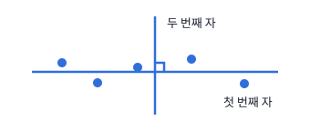
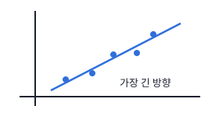
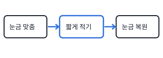

# PCA 2부 — 5살도 이해하는 정리노트

정방철 교수님 머신러닝기초 · 1104 수업 (Lecture05–06, MML 10장)

> `정리노트_1104_PCA_Part2.html`를 마크다운으로 옮겼어요. 그림은 `figures_1104/` 폴더의 SVG, 위젯은 대표 설정의 정적 그림으로 바꿨어요. 수식은 `$…$` / `$$…$$`라서 GitHub, Obsidian, Typora에서 보여요.

**목차**

- [PCA의 두 목표](#s0)
  - [어떤 축을 남겨야 복원오차가 작아질까?](#s0-learning-map)
  - [고유기저에서 방향 분산 계산하기](#s0-spectral-weights)
  - [첫 번째부터 M번째까지 방향 고르기](#s0-top-directions)
- [사영과 복원](#s1)
  - [기저를 고정하고 좌표 구하기](#s1-projection)
  - [버린 방향에서 복원오차 계산하기](#s1-discarded)
  - [MNIST에서 사영과 복원 읽기](#s1-mnist)
- [SVD와 실제 계산](#s2)
  - [데이터의 SVD에서 주성분 찾기](#s2-svd)
  - [작은 행렬 두 개로 데이터 복원하기](#s2-low-rank)
  - [PCA를 적용하고 원래 단위로 돌아가기](#s2-workflow)
- [요약 · 예고](#s3)
  - [한 장 요약](#s3-cheatsheet)
  - [다음 시간 예고](#s3-next)
  - [함께 보면 좋은 자료](#s3-links)

## PCA의 두 목표

### 어떤 축을 남겨야 복원오차가 작아질까?

*1104 수업 · L05 s26–28 · L06 s5–17*

**먼저 큰 그림**

표본 하나가 숫자 $D$개로 되어 있을 때, 그보다 적은 $M$개만 저장했다가 다시 $D$개로 펼치고 싶어요. 어떤 축에서 읽은 숫자를 남겨야 다시 펼친 결과가 원래와 가장 가까울까요?

1102에서는 축 하나가 정해졌을 때 그 축에서 읽은 좌표와 좌표의 분산을 구했어요. 1104에서는 축을 고르는 문제를 풀어요. 분산이 가장 큰 축이 무엇인지 증명하고, 그 축을 남기면 복원오차도 가장 작다는 것을 계산으로 확인해요.

| 보는 방향 | 계산하는 것 | 다음에 쓰는 곳 |
|---|---|---|
| 남기는 쪽 | 선택한 축에 담긴 분산 | 분산이 큰 순서로 축을 골라 압축해요. |
| 버리는 쪽 | 빠진 축에 담긴 분산 | 복원 벡터의 평균 제곱오차를 구해요. |

오늘 구하는 것은 네 가지예요. 남길 축을 모은 행렬, 표본마다 줄여 적은 좌표, 그 좌표를 원래 차원으로 펼친 복원 벡터, 그리고 원래 벡터와 복원 벡터의 차이를 제곱해 평균낸 복원오차예요. 평균을 뺀 데이터가 정해지면 남긴 분산과 버린 분산의 합은 변하지 않아요. 그래서 분산을 가장 많이 남기는 축과 오차를 가장 적게 만드는 축이 같아요.

계산은 네 걸음이에요. 먼저 [어느 방향의 분산이든 공분산 행렬의 고윳값들을 섞은 평균](#s0-spectral-weights)임을 보여요. 그러면 [가장 큰 고윳값의 방향부터 고르면](#s0-top-directions) 돼요. 다음으로 [복원오차가 버린 축의 고윳값 합](#s1-discarded)임을 계산해요. 마지막으로 공분산을 만들지 않고 [데이터 행렬을 바로 분해하는 특잇값 분해(SVD)](#s2-svd)로 같은 축을 구해요. 그 축의 분산은 특잇값의 제곱을 표본 수로 나눈 값이에요.

줄여 적은 좌표는 남긴 축의 수인 $M$차원이고, 복원 벡터는 원래 특성 수인 $D$차원이에요. 남기는 마지막 축과 버리는 첫 축의 고윳값이 같다면 최적 축을 여러 방식으로 고를 수 있어요.

**페이지 요약**

평균을 뺀 데이터에서 남긴 분산을 최대로 하면 버린 축의 분산 합인 평균 제곱 복원오차가 최소가 돼요.

줄여 적은 좌표는 남긴 축 수인 $M$차원이고, 복원 벡터는 원래 특성 수인 $D$차원이에요. 남기는 마지막 축과 버리는 첫 축의 고윳값이 같으면 최적 축을 여러 방식으로 고를 수 있어요.

---

### 고유기저에서 방향 분산 계산하기

*1104 수업 · L05 s10 · s19 · s26–27*

**쉽게 말하면**

종이에 찍힌 점들을 자 하나로 읽을 때 자를 기울이면 눈금에 표시되는 점 사이 간격이 달라져요.

*점들이 늘어선 방향에 자를 대면 넓은 범위의 눈금을 써요.*

**정확히 말하면**

이 페이지가 답하는 질문은 하나예요. **자를 어느 방향에 놓아야 눈금이 가장 넓게 퍼질까요?** 답을 먼저 말하면, 어느 방향의 퍼짐이든 공분산 행렬의 고윳값들을 섞은 평균이에요. 그래서 가장 큰 고윳값보다 더 넓게 퍼질 수는 없어요.

그림의 자 방향이 길이 1인 벡터 $\mathbf b\in\mathbb R^D$이고, 자에서 읽은 눈금이 내적 $\mathbf b^\top\mathbf x_n$이에요. $\mathbf x_n\in\mathbb R^D$는 특성별 평균을 이미 뺀 $n$번째 표본이고, 표본은 $N$개, 특성은 $D$개예요.

#### 1 / 3 퍼짐을 숫자 하나로 쓰기

방향을 바꿀 때마다 표본 $N$개를 다시 읽지 않아도 되는 식을 만들어요.

파란색은 바로 윗줄에서 바뀐 부분이에요.

$$
z_n=\mathbf b^\top\mathbf x_n
$$

↳ $n$번째 점을 자 $\mathbf b$로 읽은 눈금

$$
V(\mathbf b)=\frac1N\sum_{n=1}^N(\mathbf b^\top\mathbf x_n)^2
$$

↳ 평균이 0이라 분산은 제곱의 평균

자세히

표본의 평균이 $\mathbf 0$이라 눈금의 평균도 0이에요. 이 식 그대로는 자를 돌릴 때마다 점 $N$개를 다시 읽어야 해서, 데이터 계산과 방향 계산을 떼어 놓아요.

$$
(\mathbf b^\top\mathbf x_n)^2=(\mathbf b^\top\mathbf x_n)\textcolor{#3182f6}{(\mathbf x_n^\top\mathbf b)}=\mathbf b^\top\textcolor{#3182f6}{(\mathbf x_n\mathbf x_n^\top)}\mathbf b
$$

↳ 실수 하나는 전치해도 같아요

자세히

제곱의 한쪽 $\mathbf b^\top\mathbf x_n$을 전치해 $\mathbf x_n^\top\mathbf b$로 쓰고, 가운데 두 벡터를 묶어요.

$$
V(\mathbf b)=\mathbf b^\top\textcolor{#3182f6}{\left[\frac1N\sum_{n=1}^N\mathbf x_n\mathbf x_n^\top\right]}\mathbf b=\mathbf b^\top\mathbf S\,\mathbf b
$$

↳ $\mathbf b$는 모든 표본에서 같아서 합 밖으로

자세히

가운데 묶음이 공분산 행렬 $\mathbf S$예요. $(i,j)$ 칸은 $x_{in}x_{jn}$의 평균이라 $i$와 $j$를 바꿔도 같아요. 그래서 $\mathbf S$는 대칭이고, 2단계에서 이 사실을 써요.

**데이터는 $\mathbf S$에 한 번만 모으고, 방향을 바꿀 때는 $\mathbf b$만 갈아 끼워요.**

##### 작은 예로 넣어 보기

$$
\mathbf S=\begin{bmatrix}2&1\\1&2\end{bmatrix}
$$

↳ 특성이 두 개인 공분산

$$
V\big((1,0)^\top\big)=2
$$

↳ 가로 방향

$$
V\big((1,1)^\top/\sqrt2\big)=\tfrac12(2+1+1+2)=3
$$

↳ 대각선 방향이 더 넓게 퍼져요

$$
V(\alpha\mathbf b)=\alpha^2V(\mathbf b)
$$

↳ 자를 늘이면 눈금도 커져요

자세히

그래서 방향끼리 공정하게 비교하려고 $\|\mathbf b\|=1$인 벡터만 넣어요.

3이 최댓값일까요? 하나씩 넣어 보는 방법으로는 알 수 없어서, 모든 방향을 한꺼번에 비교할 식이 필요해요.

#### 2 / 3 방향을 고유벡터로 다시 쓰기

행렬 곱이 숫자 곱으로 바뀌는 축을 골라, 그 축으로 $\mathbf b$를 표현해요.

$\mathbf b^\top\mathbf S\mathbf b$에서 비교를 어렵게 하는 것은 가운데의 행렬 곱이에요. 이 곱이 숫자 곱으로 바뀌는 축을 골라요.

$$
\mathbf S\mathbf p_i=\lambda_i\mathbf p_i
$$

↳ 고유벡터 방향에서는 $\mathbf S$ 곱이 숫자 $\lambda_i$ 곱

$$
\mathbf S\begin{bmatrix}1\\1\end{bmatrix}=3\begin{bmatrix}1\\1\end{bmatrix},\qquad \mathbf S\begin{bmatrix}1\\-1\end{bmatrix}=1\begin{bmatrix}1\\-1\end{bmatrix}
$$

↳ 예에서 $\lambda_1=3$, $\lambda_2=1$

자세히

길이를 1로 맞추면 $\mathbf p_1=(1,1)^\top/\sqrt2$, $\mathbf p_2=(1,-1)^\top/\sqrt2$예요. 가로축은 $\mathbf S(1,0)^\top=(2,1)^\top$이라 숫자배가 아니고 행렬 곱이 그대로 남아요. 아무 축이나 쓸 수 있는 것과 이번 목적에 쓸모 있는 축은 달라요.

$$
\mathbf p_i^\top\mathbf p_i=1,\qquad \mathbf p_i^\top\mathbf p_j=0\quad(i\ne j)
$$

↳ $\mathbf S$가 실수 대칭이라 이렇게 고를 수 있어요

자세히

일반 행렬의 고유벡터는 수직이라는 보장이 없어요. 예의 두 벡터도 내적이 $\frac12(1-1)=0$이에요.

$$
\lambda_1\ge\cdots\ge\lambda_D\ge0
$$

↳ 큰 순서로 번호, 모두 0 이상

자세히

$\lambda_i=\mathbf p_i^\top\mathbf S\mathbf p_i$는 $\mathbf p_i$ 방향의 분산이고, 분산은 음수가 될 수 없어요.

$$
\mathbf b=\sum_{i=1}^D c_i\mathbf p_i
$$

↳ $\mathbf b$를 고유벡터의 가중합으로

자세히

$c_i$는 $\mathbf b$가 $\mathbf p_i$ 쪽으로 얼마나 향하는지 나타내요.

$$
c_i=\mathbf p_i^\top\mathbf b
$$

↳ 양변에 $\mathbf p_i^\top$를 곱하면 수직인 항은 0

$$
\|\mathbf b\|^2=\sum_{i=1}^D c_i^2=1
$$

↳ 다른 축끼리의 항이 사라지고 $\|\mathbf b\|=1$

자세히

예: 가로 방향 $(1,0)^\top$은 $c_1=c_2=1/\sqrt2$이고, $\frac12+\frac12=1$이에요.

##### 행렬로 모아 쓰면

$$
\mathbf S\mathbf P=\mathbf P\boldsymbol\Lambda
$$

↳ $\mathbf S\mathbf p_i=\lambda_i\mathbf p_i$를 열마다 모아요

자세히

$\mathbf P=[\mathbf p_1,\ldots,\mathbf p_D]$이고, $\boldsymbol\Lambda$는 같은 순서로 고윳값을 대각에 놓은 행렬이에요.

$$
\mathbf P^\top\mathbf P=\mathbf I_D,\qquad \mathbf P^{-1}=\mathbf P^\top
$$

↳ $(i,j)$ 칸이 $\mathbf p_i^\top\mathbf p_j$이고, $\mathbf P$는 정방행렬

$$
\mathbf S=\mathbf P\boldsymbol\Lambda\mathbf P^\top
$$

↳ 오른쪽에 $\mathbf P^\top$를 곱해요

#### 3 / 3 분산이 가중평균이 되는 이유

$\mathbf b$의 전개를 분산식에 넣고, 사라지는 항과 남는 항을 확인해요.

축이 두 개인 경우부터 써 봐요.

$$
V(\mathbf b)=\mathbf b^\top\mathbf S\,\mathbf b
$$

↳ 1단계에서 만든 식

$$
\hphantom{V(\mathbf b)}=\textcolor{#3182f6}{(c_1\mathbf p_1^\top+c_2\mathbf p_2^\top)}\,\mathbf S\,\textcolor{#3182f6}{(c_1\mathbf p_1+c_2\mathbf p_2)}
$$

↳ $\mathbf b=c_1\mathbf p_1+c_2\mathbf p_2$ 대입

$$
\hphantom{V(\mathbf b)}=(c_1\mathbf p_1^\top+c_2\mathbf p_2^\top)\,\textcolor{#3182f6}{(\lambda_1c_1\mathbf p_1+\lambda_2c_2\mathbf p_2)}
$$

↳ $\mathbf S\mathbf p_i=\lambda_i\mathbf p_i$

자세히

오른쪽 괄호에 $\mathbf S$를 먼저 곱해요. 고유벡터라서 행렬 곱이 숫자 곱으로 바뀌어요. 2단계에서 축을 고른 이유가 여기서 쓰여요.

$$
\hphantom{V(\mathbf b)}=\lambda_1c_1^2\underbrace{\mathbf p_1^\top\mathbf p_1}_{1}+\lambda_2c_1c_2\underbrace{\mathbf p_1^\top\mathbf p_2}_{0}+\lambda_1c_2c_1\underbrace{\mathbf p_2^\top\mathbf p_1}_{0}+\lambda_2c_2^2\underbrace{\mathbf p_2^\top\mathbf p_2}_{1}
$$

↳ 괄호를 전개하면 네 항

자세히

고유벡터들은 서로 수직이고 길이가 1이에요. 그래서 다른 축끼리의 내적은 0, 같은 축끼리의 내적은 1이에요.

$$
\hphantom{V(\mathbf b)}=\lambda_1c_1^2+\lambda_2c_2^2
$$

↳ 0인 두 항이 사라져요

$$
V(\mathbf b)=\sum_{i=1}^D\lambda_i c_i^2,\qquad \sum_{i=1}^D c_i^2=1
$$

↳ 축이 $D$개일 때

자세히

같은 일이 일어나요. $D\times D$개 항 중 번호가 같은 $D$개만 남아요. 제곱 가중치의 합이 1인 것은 2단계에서 $\|\mathbf b\|=1$로 얻었어요.

**방향 분산은 고윳값들을 $c_i^2$의 비율로 섞은 가중평균이에요.** 평균은 섞은 값 중 가장 큰 것을 넘지 못하므로, 예에서 3보다 넓게 퍼지는 방향은 없어요.

확인: 가로 방향은 $3\cdot\frac12+1\cdot\frac12=2$로, 1단계에서 직접 구한 값과 같아요. 일반적인 경우는 [첫 번째부터 M번째까지 방향 고르기](#s0-top-directions)에서 다뤄요.

##### 다시 만들 때 필요한 것

기억할 출발점은 세 가지예요. 방향 분산은 $\mathbf b^\top\mathbf S\mathbf b$이고, 고유벡터에서는 $\mathbf S\mathbf p_i=\lambda_i\mathbf p_i$이고, 대칭행렬의 고유벡터는 서로 수직이고 길이 1로 고를 수 있어요. $\mathbf b$를 고유벡터의 가중합으로 써서 넣으면 나머지 식은 위 순서대로 다시 나와요.

**교수님 말씀**

> “이게 또 대표적인 하나마나 한 짓이지.”

같은 벡터를 고유기저로 다시 쓰면, 고유벡터에 행렬을 곱하는 계산이 스칼라를 곱하는 계산으로 바뀌어요. 공분산의 두 비대각 원소가 같은 모습은 대각선을 접어 마주 찍은 데칼코마니에 비유했어요.

> “헷갈리면 손으로 디립다 써봐라.”

내적의 항을 직접 써 보면 어떤 교차항이 0인지 확인할 수 있어요.

**페이지 요약**

방향 분산은, 축을 고유벡터로 다시 쓰면 고윳값의 가중평균이에요.

*핵심 식*

- 방향 분산

  $$
  V(\mathbf b)=\mathbf b^\top\mathbf S\mathbf b,\quad \mathbf S=\frac1N\sum_n\mathbf x_n\mathbf x_n^\top
  $$
- 고유기저로 분해

  $$
  \mathbf S=\mathbf P\boldsymbol\Lambda\mathbf P^\top
  $$
- 고윳값의 가중평균

  $$
  V(\mathbf b)=\sum_{i=1}^D\lambda_i c_i^2,\quad c_i=\mathbf p_i^\top\mathbf b
  $$

  제곱 가중치의 합은 $\sum_i c_i^2=1$이에요.

$\mathbf S$가 실수 대칭행렬이라 고유벡터를 서로 수직, 길이 1로 고를 수 있어요. 방향끼리 비교하려고 $\|\mathbf b\|=1$로 맞춰요.

*예*

$\mathbf S=\begin{bmatrix}2&1\\1&2\end{bmatrix}$에서 $\lambda_1=3$, $\lambda_2=1$이에요. 가로 방향의 분산은 $3\cdot\frac12+1\cdot\frac12=2$예요.

---

### 첫 번째부터 M번째까지 방향 고르기

*1104 수업 · L05 s27–28*

**쉽게 말하면**

첫 번째 자는 점들이 가장 길게 늘어선 방향에 놓아요. 두 번째 자는 첫 번째 자와 모서리가 맞는 방향에 놓아요.

*두 자는 직각으로 만나요.*

**정확히 말하면**

이 페이지의 질문은 **어느 축들을 남겨야 분산을 가장 많이 담을까요?**예요. 답을 먼저 말하면, 공분산 $\mathbf S$의 고윳값이 큰 순서대로 고유벡터 $M$개를 남기면 돼요.

출발점은 [고유기저에서 방향 분산 계산하기](#s0-spectral-weights)의 결과예요. 길이 1인 방향 $\mathbf b$를 고유벡터 $\mathbf p_i$의 가중합 $\mathbf b=\sum_i c_i\mathbf p_i$로 쓰면 분산은 고윳값의 가중평균이었어요. 고윳값은 큰 순서로 $\lambda_1\ge\cdots\ge\lambda_D\ge0$이에요.

$$
V(\mathbf b)=\sum_{i=1}^D\lambda_i c_i^2,\qquad \sum_{i=1}^D c_i^2=1.
$$

#### 1 / 2 첫 방향의 최댓값 찾기

분산이 넘을 수 없는 값을 구하고, 그 값을 실제로 만드는 방향을 찾아요.

파란색은 바로 윗줄에서 바뀐 부분이에요.

방향을 고르는 일은 합이 1인 무게 $c_i^2$를 어느 고윳값에 얼마나 실을지 정하는 일이에요.

$$
V(\mathbf b)=\sum_{i=1}^D\lambda_i c_i^2
$$

↳ 출발식, $\sum_i c_i^2=1$

$$
\hphantom{V(\mathbf b)}\le\textcolor{#3182f6}{\lambda_1}\sum_{i=1}^D c_i^2
$$

↳ 모든 $\lambda_i\le\lambda_1$이고 $c_i^2\ge0$

$$
\hphantom{V(\mathbf b)}=\lambda_1
$$

↳ 무게의 합은 1

$$
V(\mathbf p_1)=\lambda_1
$$

↳ $c_1=1$, 나머지 0이면 상한을 실제로 만들어요

**상한을 실제로 만드는 방향이 있으니 $\lambda_1$이 최댓값이고, 첫 축은 $\mathbf b_1=\mathbf p_1$이에요.**

예: $3c_1^2+1\cdot c_2^2$은 $c_1^2=1$일 때 가장 큰 값 3이에요. $-\mathbf p_1$도 같은 축이라 어느 쪽을 써도 돼요. 가장 큰 고윳값이 여러 개로 같으면 그 고유벡터들이 만드는 공간의 어떤 단위벡터도 같은 최댓값이에요.

#### 2 / 2 직교하는 다음 방향 고르기

이미 고른 축과 수직이라는 조건을 넣고, 남은 방향의 최댓값을 구해요.

둘째 축도 분산이 가장 큰 방향으로만 고르면 다시 $\mathbf p_1$이 나와요. 아직 담지 않은 정보를 담으려고, 이미 고른 축과 수직인 단위벡터 중에서 찾아요.

$$
\mathbf b\perp\mathbf p_1\iff c_1=\mathbf p_1^\top\mathbf b=0
$$

↳ 수직 조건을 가중치로 옮겨요

$$
V(\mathbf b)=\sum_{i=\textcolor{#3182f6}{2}}^D\lambda_i c_i^2\le\lambda_2
$$

↳ $\lambda_1$에는 무게를 못 실어요 → $\mathbf b_2=\mathbf p_2$

$$
V(\mathbf b)=\sum_{i=\textcolor{#3182f6}{k}}^D\lambda_i c_i^2\le\lambda_k
$$

↳ $k$번째 축: $c_1=\cdots=c_{k-1}=0$

자세히

$\mathbf b_k=\mathbf p_k$가 이 값을 만들어요.

$$
\mathbf B=[\mathbf p_1,\ldots,\mathbf p_M]\in\mathbb R^{D\times M}
$$

↳ 고른 첫 $M$개 축을 열로

$$
\sum_{i=1}^M\lambda_i
$$

↳ 보존 분산: 축마다 담긴 분산의 합

**$k$번째 축은 $\mathbf p_k$예요. 고윳값이 큰 순서로 고유벡터를 고르면 돼요.**

예: 고윳값이 3과 1이면 축 하나를 남길 때 전체 분산 4 중 3을 담아요. $M\lt D$이고 $\lambda_M=\lambda_{M+1}$이면 같은 고윳값의 공간에서 다른 축을 골라도 보존 분산은 같아요. 다음 [기저를 고정하고 좌표 구하기](#s1-projection)에서 이 $\mathbf B$로 좌표를 구하고 복원해요.

#### 여러 축을 함께 고를 때의 결론

위에서는 축을 하나씩 차례로 골랐어요. $M$개를 한꺼번에 고르는 경우에도 상위 $M$개 고유방향을 남길 때 보존 분산 $\sum_{i=1}^M\lambda_i$가 최대예요. 문제를 풀 때는 이 결론만 쓰면 되고, 증명은 선택 보충이에요.

선택 보충: 여러 축을 함께 비교하는 증명

강의에서 보인 순차 선택을 바탕으로, 여기서는 여러 축을 한꺼번에 비교할 때도 같은 선택이 최적인 이유를 덧붙여요. 임의의 정규직교 단위축 $\mathbf q_1,\ldots,\mathbf q_M\in\mathbb R^D$를 열로 모은 행렬을 $\mathbf C=[\mathbf q_1,\ldots,\mathbf q_M]\in\mathbb R^{D\times M}$이라 해요. 앞의 숫자 계수 $c_i$와 구별하려고 축 벡터에는 $\mathbf q_m$을 써요.

$\mathbf C^\top\mathbf p_i$의 $m$번째 값은 $\mathbf q_m^\top\mathbf p_i$예요. 따라서 $i$번째 고유방향을 선택한 부분공간에 얼마나 담는지 나타내는 가중치는 다음과 같아요.

$$
w_i=\|\mathbf C^\top\mathbf p_i\|^2=\sum_{m=1}^M(\mathbf q_m^\top\mathbf p_i)^2.
$$

1. **가중치의 범위와 합을 구해요.** 선택한 축을 전체 정규직교 기저로 보태면, 단위벡터 $\mathbf p_i$의 전체 좌표 제곱합은 1이에요. $w_i$는 그중 $M$개만 더하므로 $0\le w_i\le1$이에요. 반대로 $m$을 고정하면, $\mathbf p_i^\top\mathbf q_m$은 단위축 $\mathbf q_m$의 전체 고유기저 좌표예요.

   $$
   \sum_{i=1}^D(\mathbf p_i^\top\mathbf q_m)^2=\|\mathbf q_m\|^2=1.
   $$

   내적은 실수라 $\mathbf q_m^\top\mathbf p_i=\mathbf p_i^\top\mathbf q_m$예요. 유한한 두 합의 순서를 바꾸면 다음과 같아요.

   $$
   \sum_{i=1}^D w_i=\sum_{m=1}^M\sum_{i=1}^D(\mathbf p_i^\top\mathbf q_m)^2=\sum_{m=1}^M1=M.
   $$
2. **축별 분산을 더해요.** 앞의 방향 분산식에서 $\mathbf b=\mathbf q_m$, $c_i=\mathbf p_i^\top\mathbf q_m$을 대입해요.

   $$
   V(\mathbf q_m)=\sum_{i=1}^D\lambda_i(\mathbf p_i^\top\mathbf q_m)^2.
   $$

   모든 선택 축에 대해 더하고 합의 순서를 바꾸면 괄호 안이 $w_i$예요.

   $$
   \sum_{m=1}^M V(\mathbf q_m)=\sum_{i=1}^D\lambda_i\left[\sum_{m=1}^M(\mathbf p_i^\top\mathbf q_m)^2\right]=\sum_{i=1}^D\lambda_i w_i.
   $$
3. **상위 고유축 선택과 비교해요.** $\sum_iw_i=M$을 앞뒤로 나누어 옮기면, 앞쪽에서 비운 가중치와 뒤쪽에 둔 가중치가 같아요.

   $$
   \sum_{i=1}^M(1-w_i)=M-\sum_{i=1}^M w_i=\sum_{i=M+1}^D w_i.
   $$

   상위 $M$축을 모두 담을 때의 분산에서 임의 선택의 분산을 빼요. 앞쪽에서는 $\lambda_i\ge\lambda_M$, 뒤쪽에서는 $\lambda_i\le\lambda_M$이고 각 가중치는 음수가 아니에요.

   $$
   \begin{aligned}\sum_{i=1}^M\lambda_i-\sum_{i=1}^D\lambda_iw_i&=\sum_{i=1}^M\lambda_i(1-w_i)-\sum_{i=M+1}^D\lambda_iw_i\\&\ge\lambda_M\left[\sum_{i=1}^M(1-w_i)-\sum_{i=M+1}^D w_i\right]\\&=0.\end{aligned}
   $$

따라서 앞 $M$개의 고유방향에 가중치를 1씩 두는 선택이 전체 보존 분산도 최대로 만들어요. $M=D$라면 뒤쪽 합은 빈 합인 0이고 모든 방향을 보존해요.

**교수님 말씀**

> “그러면 b를 어떻게 선택하면 λ1이 만들어질까? 그게 optimal이잖아.”

모든 후보가 넘을 수 없는 값부터 찾고, 실제로 그 값을 만드는 후보를 대입해요.

**페이지 요약**

고른 축과 직교하는 후보만 남기면, 아직 고르지 않은 고윳값 중 가장 큰 값이 다음 방향의 분산 상한이에요.

*핵심 식*

- 남은 후보의 상한

  $$
  V(\mathbf b)=\sum_{i=k}^D\lambda_i c_i^2\le\lambda_k
  $$
- 상한에 도달하는 방향

  $$
  \mathbf b_k=\mathbf p_k
  $$
- 최대 전체 보존 분산

  $$
  \sum_{i=1}^M\lambda_i
  $$

다음 축은 이미 고른 축과 직교하는 단위축 중에서 골라, 같은 방향을 중복 선택하지 않아요.

*용어*

- **직교 제약** — 이미 고른 축의 좌표를 0으로 두는 조건이에요.
- **고윳값 중복** — 선택 경계의 고윳값이 같으면 같은 최댓값을 내는 축 조합이 여러 개예요.

---

## 사영과 복원

### 기저를 고정하고 좌표 구하기

*1104 수업 · L06 s5–7*

**쉽게 말하면**

길 위에서 길 밖의 점과 가장 가까운 곳을 찾고 싶어요.

*길에 직각으로 내려가면 가장 가까운 곳에 닿아요.*

**정확히 말하면**

이 페이지의 질문은 **남길 축이 정해졌을 때, 표본마다 어떤 숫자 $M$개를 적어야 가장 가깝게 복원될까요?**예요. 답을 먼저 말하면, 축들이 서로 수직이고 길이가 1일 때는 표본과 각 축의 내적을 적으면 돼요.

$$
\mathbf z_n=\mathbf B^\top\mathbf x_n,\qquad \tilde{\mathbf x}_n=\mathbf B\mathbf z_n=\mathbf B\mathbf B^\top\mathbf x_n.
$$

그림의 길이 남긴 축들이 만드는 공간이고, 길 밖의 점이 표본 $\mathbf x_n$, 가장 가까운 곳이 복원값 $\tilde{\mathbf x}_n$이에요. 내적이 왜 가장 가까운 점을 주는지는 오차를 최소화해서 확인해요.

#### 1 / 4 복원오차와 변수 정하기

정해진 것과 구할 것을 구별하고, 줄이려는 오차를 식으로 써요.

$$
\mathbf x_n\in\mathbb R^D
$$

↳ **주어진 것**: 평균을 뺀 표본

$$
\mathbf B=[\mathbf b_1,\ldots,\mathbf b_M]\in\mathbb R^{D\times M}
$$

↳ **고정**: 모든 표본이 함께 쓰는 축

$$
\mathbf z_n\in\mathbb R^M
$$

↳ **구할 것**: 표본마다의 좌표

$$
\tilde{\mathbf x}_n=\mathbf B\mathbf z_n=z_{1n}\mathbf b_1+\cdots+z_{Mn}\mathbf b_M
$$

↳ 복원값: 좌표를 가중치로 축을 더해요

$$
J_M=\frac1N\sum_{n=1}^N\|\mathbf x_n-\tilde{\mathbf x}_n\|^2
$$

↳ 복원오차: 거리 제곱의 평균

$\mathbf z_n$은 합의 $n$번째 항에만 들어 있어요. 그래서 $\mathbf B$를 고정하면 표본 하나의 오차를 줄이는 문제를 $N$번 따로 푸는 것과 같아요.

#### 2 / 4 좌표로 미분하기

오차가 가장 작은 좌표에서는 미분이 0이라는 조건을 쓰려고, 좌표에 대한 미분을 구해요.

파란색은 바로 윗줄에서 바뀐 부분이에요.

$$
\frac{\partial J_M}{\partial\tilde{\mathbf x}_n}=-\frac2N(\mathbf x_n-\tilde{\mathbf x}_n)^\top
$$

↳ $(x-a)^2$을 $a$로 미분하면 $-2(x-a)$인 것과 같은 모양

자세히

벡터에서는 $1\times D$ 행벡터예요.

$$
\frac{\partial\tilde{\mathbf x}_n}{\partial\mathbf z_n}=\mathbf B
$$

↳ $\tilde{\mathbf x}_n=\mathbf B\mathbf z_n$, $D\times M$ 행렬

$$
\frac{\partial J_M}{\partial\mathbf z_n}=-\frac2N(\mathbf x_n-\tilde{\mathbf x}_n)^\top\textcolor{#3182f6}{\mathbf B}
$$

↳ 연쇄법칙: 두 미분을 곱해요

자세히

결과는 $1\times M$ 행벡터예요. 강의 슬라이드는 성분별로 썼어요. 마지막 $\mathbf B$ 대신 $i$번째 열 $\mathbf b_i$만 곱하면 슬라이드의 $i$번째 성분이에요.

#### 3 / 4 정규방정식에서 좌표 구하기

미분을 0으로 놓은 식을 좌표에 대해 풀어요.

$$
(\mathbf x_n-\textcolor{#3182f6}{\mathbf B\mathbf z_n})^\top\mathbf B=\mathbf 0_{1\times M}
$$

↳ 미분을 0으로 놓고, $-2/N$으로 나누고, $\tilde{\mathbf x}_n$ 대입

$$
\mathbf x_n^\top\mathbf B-\textcolor{#3182f6}{\mathbf z_n^\top\mathbf B^\top}\mathbf B=\mathbf 0_{1\times M}
$$

↳ 전치를 분배: 곱은 순서가 뒤집혀요

$$
\mathbf z_n^\top\mathbf B^\top\mathbf B=\mathbf x_n^\top\mathbf B
$$

↳ 둘째 항을 옮겨요

$$
\textcolor{#3182f6}{\mathbf B^\top\mathbf B\,\mathbf z_n=\mathbf B^\top\mathbf x_n}
$$

↳ 양변을 전치: 정규방정식

자세히

구하려는 $\mathbf z_n$이 행벡터로 누워 있어서 열벡터로 세워요. 이 식을 정규방정식(normal equations)이라 해요.

$$
\mathbf z_n=\textcolor{#3182f6}{(\mathbf B^\top\mathbf B)^{-1}}\mathbf B^\top\mathbf x_n
$$

↳ 열이 선형독립이면 $\mathbf B^\top\mathbf B$가 가역

자세히

$\mathbf B^\dagger=(\mathbf B^\top\mathbf B)^{-1}\mathbf B^\top$를 $\mathbf B$의 유사역행렬(pseudoinverse)이라 해요.

$$
\mathbf z_n=\mathbf B^\top\mathbf x_n,\qquad z_{in}=\mathbf b_i^\top\mathbf x_n
$$

↳ PCA 축은 직교 정규라 $\mathbf B^\top\mathbf B=\mathbf I_M$

자세히

$(\mathbf B^\top\mathbf B)_{ij}=\mathbf b_i^\top\mathbf b_j$라서 대각선은 길이의 제곱 1, 나머지는 수직인 축의 내적 0이에요.

**축이 직교 정규이면 좌표는 각 축과의 내적이에요.** 축이 서로 수직이 아니면 한 축과의 내적에 다른 축의 성분이 섞여 들어가서 $(\mathbf B^\top\mathbf B)^{-1}$로 바로잡아야 해요.

#### 4 / 4 복원과 잔차 확인하기

구한 좌표로 복원하고, 남은 차이가 모든 축에 수직인지 확인해요.

$$
\tilde{\mathbf x}_n=\mathbf B\mathbf B^\top\mathbf x_n
$$

↳ 구한 좌표를 복원식에 대입

$$
\mathbf B^\top(\mathbf x_n-\tilde{\mathbf x}_n)=\mathbf 0
$$

↳ 정규방정식을 한쪽으로: 잔차는 모든 축과 수직

자세히

원래 표본에서 복원값을 뺀 벡터가 잔차예요. 그림에서 길에 직각으로 내려간 선이 잔차이고, 그래서 이 복원을 직교사영(orthogonal projection)이라 해요.

예: 점 $(6,8)$에서 가로축 $\mathbf B=(1,0)^\top$만 남기면 좌표는 6, 복원값은 $(6,0)$, 잔차는 $(0,8)$이고, 잔차와 가로축의 내적은 0이에요.

##### 헷갈리기 쉬운 두 곱

$$
\mathbf B^\top\mathbf B=\mathbf I_M
$$

↳ $M\times M$: 조립했다가 다시 읽으면 같은 좌표

$$
\mathbf B\mathbf B^\top\ne\mathbf I_D\quad(M\lt D)
$$

↳ $D\times D$: 남긴 공간으로 보내는 사영행렬

자세히

위 예에서도 $(6,8)$이 $(6,0)$으로 바뀌었어요. 표본이 처음부터 남긴 공간 안에 있을 때만 복원값이 원래 벡터와 같아요.

단위벡터 내적에서 기저 행렬 B의 층별 내적 z = Bᵀx와 평면 사영 복원 x̃ = Bz로 확장되는 과정을 [내적에서 행렬 사영으로 실험](../%EC%9D%B8%ED%84%B0%EB%A0%89%ED%8B%B0%EB%B8%8C_01_%EB%82%B4%EC%A0%81%EC%97%90%EC%84%9C_%ED%96%89%EB%A0%AC_%EC%82%AC%EC%98%81%EC%9C%BC%EB%A1%9C.html)에서 직접 비교해 보세요.

**교수님 말씀**

이전 최소제곱 풀이를 떠올리고, 평면의 점 $(6,8)$을 예로 들어 좌표의 뜻을 짚었어요. 가로 단위벡터와 내적하면 $6$, 세로 단위벡터와 내적하면 $8$이 나와요. 새 축에서도 같은 방식으로 좌표를 읽어요.

**페이지 요약**

직교 정규 축을 고정하면 각 축과의 내적으로 좌표를 구하고, 그 좌표로 축을 가중합해 가장 가까운 점을 복원해요.

*핵심 식*

- 선형독립인 일반 기저에서 좌표

  $$
  \mathbf z_n=(\mathbf B^\top\mathbf B)^{-1}\mathbf B^\top\mathbf x_n.
  $$
- 직교 정규 기저에서 좌표

  $$
  \mathbf z_n=\mathbf B^\top\mathbf x_n,\qquad z_{in}=\mathbf b_i^\top\mathbf x_n.
  $$
- 직교 정규 기저에서 복원

  $$
  \tilde{\mathbf x}_n=\mathbf B\mathbf B^\top\mathbf x_n
  $$

직교 정규 열들의 내적은 $\mathbf B^\top\mathbf B=\mathbf I_M$을 만들어요. $M\lt D$일 때 반대 순서인 $\mathbf B\mathbf B^\top$는 사영행렬이며, 일반적인 역변환이 아니에요.

*용어*

- **직교사영(orthogonal projection)** — 잔차가 부분공간의 모든 축과 수직이 되는 가장 가까운 점을 찾는 연산.

---

### 버린 방향에서 복원오차 계산하기

*1104 수업 · L06 s8–10*

**쉽게 말하면**

가로로 얼마나 갔는지만 적어 두면, 원래 자리의 높이는 잃어버려요.

*가로로 간 거리는 그대로라서, 원래 자리와의 차이는 높이만큼이에요.*

**정확히 말하면**

이 페이지의 질문은 두 가지예요. **복원하면 얼마나 틀릴까요? 그리고 어떤 축을 남겨야 가장 덜 틀릴까요?** 답을 먼저 말하면, 복원오차는 버린 축들에 담긴 분산의 합이에요. 그래서 분산이 큰 축을 남기고 작은 축을 버리면 오차가 가장 작아요.

출발점은 [기저를 고정하고 좌표 구하기](#s1-projection)의 복원식 $\tilde{\mathbf x}_n=\mathbf B\mathbf B^\top\mathbf x_n$이에요. 1단계부터 3단계까지는 서로 수직이고 길이 1인 축이면 무엇이든 성립하고, 4단계에서 고유벡터를 골라 넣어요.

#### 1 / 4 버린 축으로 잔차 쓰기

원래 표본에서 복원값을 빼면 무엇이 남는지 확인해요.

남긴 축에 수직인 축 $\mathbf b_{M+1},\ldots,\mathbf b_D$를 보태 전체 직교 정규 기저를 만들어요. 보탠 축이 버리는 축이고, 이 축들이 만드는 공간을 직교여공간(orthogonal complement)이라 해요.

$$
\mathbf x_n=\underbrace{\sum_{m=1}^M(\mathbf b_m^\top\mathbf x_n)\mathbf b_m}_{\tilde{\mathbf x}_n}+\sum_{j=M+1}^D(\mathbf b_j^\top\mathbf x_n)\mathbf b_j
$$

↳ 전체 기저로 남김없이 쓰고, 남긴 축과 버린 축으로 나눠요

자세히

첫 합은 복원값 $\tilde{\mathbf x}_n=\mathbf B\mathbf B^\top\mathbf x_n$을 축별로 풀어 쓴 것이에요.

$$
\mathbf x_n-\tilde{\mathbf x}_n=\sum_{j=M+1}^D(\mathbf b_j^\top\mathbf x_n)\mathbf b_j
$$

↳ 복원값을 빼면 버린 쪽만 남아요

**틀린 부분은 버린 축 방향의 성분이에요.**

예: 점 $(6,8)$에서 가로축만 남기면 남긴 성분이 6, 버린 성분이 8이에요.

#### 2 / 4 제곱오차 전개하기

잔차의 길이 제곱을 버린 좌표의 제곱합으로 바꿔요.

파란색은 바로 윗줄에서 바뀐 부분이에요.

$$
\mathbf r_n=\sum_{j=M+1}^D a_{jn}\mathbf b_j,\qquad a_{jn}=\mathbf b_j^\top\mathbf x_n
$$

↳ 잔차와 버린 좌표에 잠시 이름을 붙여요

$$
\|\mathbf r_n\|^2=\mathbf r_n^\top\mathbf r_n=\left(\sum_{i=M+1}^D a_{in}\mathbf b_i^\top\right)\left(\sum_{j=M+1}^D a_{jn}\mathbf b_j\right)
$$

↳ 길이 제곱은 자기 자신과의 내적

$$
\hphantom{\|\mathbf r_n\|^2}=\sum_{i=M+1}^D\sum_{j=M+1}^D a_{in}a_{jn}\textcolor{#3182f6}{(\mathbf b_i^\top\mathbf b_j)}
$$

↳ 곱해 펼치면 축 번호의 모든 조합

$$
\hphantom{\|\mathbf r_n\|^2}=\sum_{j=M+1}^D\textcolor{#3182f6}{a_{jn}^2}=\sum_{j=M+1}^D(\mathbf b_j^\top\mathbf x_n)^2
$$

↳ 다른 축의 내적은 0, 같은 축은 1

자세히

[고유기저에서 방향 분산 계산하기](#s0-spectral-weights)의 3단계와 같은 정리예요.

$$
J_M=\frac1N\sum_{n=1}^N\sum_{j=M+1}^D(\mathbf b_j^\top\mathbf x_n)^2
$$

↳ 표본 $N$개에서 평균

예: $(6,8)$에서 버린 좌표가 8 하나라 오차의 제곱이 64예요.

#### 3 / 4 방향별 분산으로 바꾸기

복원오차를 버린 축의 분산으로 읽고, 남긴 분산과의 관계를 구해요.

$$
\frac1N\sum_{n=1}^N(\mathbf b_j^\top\mathbf x_n)^2=\mathbf b_j^\top\mathbf S\mathbf b_j
$$

↳ 합 순서를 바꾸면 안쪽은 [방향 분산](#s0-spectral-weights)

$$
J_M=\sum_{j=M+1}^D\mathbf b_j^\top\mathbf S\mathbf b_j
$$

↳ 복원오차는 버린 축의 분산 합

##### 남긴 분산과의 관계

버린 분산을 줄이는 일과 남긴 분산을 키우는 일이 같으려면, 둘의 합이 축을 어떻게 고르든 변하지 않아야 해요.

$$
\sum_{j=1}^D(\mathbf b_j^\top\mathbf x_n)^2=\|\mathbf x_n\|^2
$$

↳ 2단계 계산을 전체 축에 적용

$$
\sum_{j=1}^D\mathbf b_j^\top\mathbf S\mathbf b_j=\frac1N\sum_{n=1}^N\|\mathbf x_n\|^2
$$

↳ 표본에서 평균: 오른쪽에는 축이 없어요

$$
\hphantom{\sum_{j=1}^D\mathbf b_j^\top\mathbf S\mathbf b_j}=\sum_{d=1}^D S_{dd}=\operatorname{tr}\mathbf S
$$

↳ 성분으로 풀면 특성별 분산의 합

자세히

행렬의 대각 원소 합을 트레이스(trace)라 해요. 전체 분산 $\operatorname{tr}\mathbf S$는 어떤 직교 정규 기저를 써도 같아요.

$$
J_M=\operatorname{tr}\mathbf S-\sum_{m=1}^M\mathbf b_m^\top\mathbf S\mathbf b_m
$$

↳ 전체를 남긴 축과 버린 축으로 나누고 옮겨요

**$\operatorname{tr}\mathbf S$가 고정이라, 남긴 분산을 키우는 만큼 복원오차가 줄어요.**

#### 4 / 4 최소오차를 고윳값으로 읽기

가장 좋은 축을 골라 넣고, 그때의 오차를 고윳값으로 계산해요.

남긴 분산이 최대인 선택은 고윳값이 큰 순서의 고유벡터 $M$개였어요([첫 번째부터 M번째까지 방향 고르기](#s0-top-directions)). 이제 $\mathbf b_j$에 $\mathbf S$의 고유벡터를 넣어요.

$$
\mathbf b_j^\top\mathbf S\mathbf b_j=\lambda_j\mathbf b_j^\top\mathbf b_j=\lambda_j
$$

↳ 버린 축마다 $\mathbf S\mathbf b_j=\lambda_j\mathbf b_j$

$$
J_M^\star=\sum_{j=M+1}^D\lambda_j
$$

↳ 최소 복원오차는 버린 고윳값의 합

예: $\mathbf S=\begin{bmatrix}2&1\\1&2\end{bmatrix}$의 고윳값은 3과 1이에요. 축 하나를 남기면 남긴 분산 3, 복원오차 1이고, 합 4가 $\operatorname{tr}\mathbf S=2+2$와 같아요.

남긴 축들의 사영 성분 x̃ = Bz와 버린 수직 축의 잔차 x − x̃가 피타고라스 등식을 이루는 모습을 [내적에서 행렬 사영으로 실험](../%EC%9D%B8%ED%84%B0%EB%A0%89%ED%8B%B0%EB%B8%8C_01_%EB%82%B4%EC%A0%81%EC%97%90%EC%84%9C_%ED%96%89%EB%A0%AC_%EC%82%AC%EC%98%81%EC%9C%BC%EB%A1%9C.html)의 평면 모드에서 확인해 보세요.

**교수님 말씀**

내적의 제곱을 스칼라와 그 전치의 곱으로 써도 값은 같지만, 가운데 두 벡터를 묶으면 공분산을 알아볼 수 있다고 설명했어요. 전체 에너지가 일정하니 남기는 쪽이 커지면 잃는 쪽이 작아진다고 연결했어요.

**페이지 요약**

원래 벡터와 복원값에서 남긴 축의 항이 상쇄되므로 복원오차는 버린 방향의 분산 합이에요.

*핵심 식*

- 전체 분산과 보존 분산의 차이

  $$
  J_M=\operatorname{tr}\mathbf S-\sum_{m=1}^M\mathbf b_m^\top\mathbf S\mathbf b_m.
  $$
- 상위 축을 남겼을 때 최소 복원오차

  $$
  J_M^\star=\sum_{j=M+1}^D\lambda_j.
  $$

*용어*

- **직교여공간(orthogonal complement)** — 남긴 부분공간의 모든 벡터에 수직인 벡터들의 공간.

---

### MNIST에서 사영과 복원 읽기

*1104 수업 · L06 s11 · MML 예제 10.3–10.4*

**쉽게 말하면**

손글씨 한 장을 숫자 두 개로 요약하면 종이 위의 점 하나로 찍을 수 있어요.

*점이 모인 자리를 비교해 손글씨의 무리를 살펴봐요.*

**정확히 말하면**

MNIST 손글씨 한 장은 $28\times28$ 픽셀이라 밝기를 펼치면 $784$차원 벡터예요. 강의의 산점도에서는 숫자 0과 1의 중심화된 벡터를 상위 두 주성분 방향 $\mathbf b_1,\mathbf b_2$에 사영해요. $\mathbf x_n$을 한 이미지의 중심화 벡터라고 하면, 두 내적이 산점도의 가로·세로 좌표예요.

$$
\mathbf z_n=(\mathbf b_1^\top\mathbf x_n,\ \mathbf b_2^\top\mathbf x_n)^\top\in\mathbb R^2.
$$

산점도에서 0과 1은 비교적 분리되며 일부 점은 겹쳐요. 0의 무리는 1의 무리보다 더 넓게 퍼져 보여요. PCA는 전체 표본의 보존 분산을 기준으로 두 축을 고르고, 숫자 라벨은 산점도에서 두 무리를 구분해 표시할 때 써요. (L06 s11, MML Fig. 10.10)

이미지로 복원하려면 남긴 $M$개 좌표로 $\mathbf B\mathbf z_n\in\mathbb R^{784}$를 만든 다음, 중심화할 때 뺀 평균 이미지를 더하고 $28\times28$ 모양으로 배치해요. $M$이 작아도 복원한 이미지는 $784$픽셀이고, 중심화된 변동 중 보존한 방향의 정보가 담겨요.

**교과서의 복원 예시** MML 예제 10.4에서는 숫자 8로 PCA를 학습하고, 같은 테스트 이미지를 $M=1,10,100,500$으로 복원해 비교해요. 주성분 하나에서는 윤곽이 흐릿하고, 더 많은 축을 포함하면 필체의 세부가 드러나요. $784$개 축을 모두 쓰면 완전한 직교 정규 기저가 되어 원래 픽셀 값을 복원해요. (MML Fig. 10.12)

**교수님 말씀**

두 축으로 줄인 뒤에도 0과 1의 무리가 어느 정도 보이는 점을 짚었어요. 이어 축을 하나 더 확보하거나 50개 좌표를 남기는 상황을 들어, 압축할 때 남기는 좌표 수를 바꿀 수 있다고 설명했어요.

**페이지 요약**

784픽셀짜리 이미지를 상위 두 축의 좌표로 찍어 분포를 비교하고, 이미지 복원에는 남긴 축의 가중합과 평균을 사용해요.

PCA의 축 선택에는 숫자 라벨을 쓰지 않아요. 라벨은 산점도에서 두 무리를 구분해 표시할 때 사용해요.

*용어*

- **두 주성분의 사영 좌표** — 산점도의 가로·세로를 정하는 두 내적.
- **복원 이미지** — 남긴 축의 가중합에 평균을 되돌려 얻은 784픽셀 이미지. 784개 축을 모두 쓰면 원래 픽셀 값을 얻어요.

---

## SVD와 실제 계산

### 데이터의 SVD에서 주성분 찾기

*1104 수업 · L06 s13*

**쉽게 말하면**

한 점씩 모아 만든 지도에서도 점들이 길게 늘어선 방향을 찾을 수 있어요.

SVD를 수식으로 보기 전에, [같은 하트에서 몇 성분을 남길지 바꿔 보세요.](#widget-svd-image)

*긴 방향을 먼저 고르면 점들의 퍼짐을 많이 담을 수 있어요.*

**정확히 말하면**

지금까지는 공분산 $\mathbf S$를 만든 다음 그 고유벡터를 구했어요. 이 페이지의 질문은 **$\mathbf S$를 만들지 않고 데이터 행렬에서 바로 같은 축을 구할 수 있을까요?**예요. 답을 먼저 말하면, 데이터 행렬을 특잇값 분해했을 때 나오는 왼쪽 특이벡터가 그 축이고, 축의 분산은 특잇값의 제곱을 표본 수로 나눈 값이에요.

#### 1 / 3 데이터 행렬 분해하기

특잇값 분해가 데이터 행렬을 어떤 세 행렬로 나누는지 확인해요.

출발은 평균을 뺀 표본 $N$개를 열로 쌓은 $\mathbf X\in\mathbb R^{D\times N}$과 $\mathbf S=\mathbf X\mathbf X^\top/N$이에요. 고유분해는 정방행렬에만 쓸 수 있어서, 직사각행렬 $\mathbf X$에는 특잇값 분해(SVD)를 써요.

$$
\mathbf X=\mathbf U\mathbf\Sigma\mathbf V^\top
$$

↳ 특잇값 분해

| 행렬 | 크기 | 담긴 것 |
|---|---|---|
| $\mathbf U$ | $D\times D$ | 특성 공간의 방향들이에요. 열 $\mathbf u_i$를 왼쪽 특이벡터라 하고, 서로 수직이고 길이가 1이에요. |
| $\mathbf\Sigma$ | $D\times N$ | 대각선에만 값이 있어요. 이 값 $\sigma_i\ge0$이 특잇값이고 큰 순서로 놓아요. |
| $\mathbf V$ | $N\times N$ | 표본 쪽의 방향들이에요. 열 $\mathbf v_i$도 서로 수직이고 길이가 1이에요. |

$$
\mathbf U^\top\mathbf U=\mathbf I_D,\qquad \mathbf V^\top\mathbf V=\mathbf I_N
$$

↳ 열이 직교 정규인 정방행렬 (고유기저 $\mathbf P$와 같은 성질)

#### 2 / 3 공분산 식에 대입하기

분해한 $\mathbf X$를 공분산 식에 넣어, $\mathbf S$가 어떤 모양이 되는지 봐요.

파란색은 바로 윗줄에서 바뀐 부분이에요.

$$
\mathbf X^\top=(\mathbf U\mathbf\Sigma\mathbf V^\top)^\top=\mathbf V\mathbf\Sigma^\top\mathbf U^\top
$$

↳ 곱을 전치하면 순서가 뒤집혀요

$$
\mathbf S=\frac1N\mathbf X\mathbf X^\top=\frac1N\mathbf U\mathbf\Sigma\textcolor{#3182f6}{\mathbf V^\top\mathbf V}\mathbf\Sigma^\top\mathbf U^\top
$$

↳ 출발식에 대입

$$
\mathbf S=\mathbf U\left(\frac{\mathbf\Sigma\mathbf\Sigma^\top}{N}\right)\mathbf U^\top
$$

↳ $\mathbf V^\top\mathbf V=\mathbf I_N$이라 $\mathbf V$가 사라져요

#### 3 / 3 주성분과 분산 읽기

정리한 식을 고유분해와 나란히 놓고, 축과 분산을 읽어요.

$$
\mathbf\Sigma=\begin{bmatrix}\sigma_1&0&0\\0&\sigma_2&0\end{bmatrix},\qquad \mathbf\Sigma\mathbf\Sigma^\top=\begin{bmatrix}\sigma_1^2&0\\0&\sigma_2^2\end{bmatrix}
$$

↳ $D=2$, $N=3$ 예: 특잇값 제곱이 놓인 $D\times D$ 대각행렬

$$
\mathbf S=\mathbf P\boldsymbol\Lambda\mathbf P^\top\quad\longleftrightarrow\quad \mathbf S=\mathbf U\left(\frac{\mathbf\Sigma\mathbf\Sigma^\top}{N}\right)\mathbf U^\top
$$

↳ 둘 다 직교 정규 · 대각 · 전치의 곱

자세히

그래서 $\mathbf U$의 열 $\mathbf u_i$가 $\mathbf S$의 고유벡터, 곧 주성분 방향이에요.

$$
\lambda_i=\frac{\sigma_i^2}{N}
$$

↳ 가운데 대각 원소끼리 맞대요

**왼쪽 특이벡터가 주성분 축이고, 축의 분산은 특잇값의 제곱을 표본 수로 나눈 값이에요.**

예: 표본 12개, 가장 큰 특잇값 6이면 첫 주성분의 분산은 $36/12=3$이에요. 특잇값 자체는 분산이 아니에요. $N\lt D$이면 특잇값은 $N$개뿐이고 남는 방향의 분산은 0이에요. 두 방법의 축은 부호가 반대일 수 있고, 고윳값이 같은 축들은 그 공간 안에서 다르게 골라질 수 있어요.

**교수님 말씀**

> “$\mathbf{X}$를 그냥 놓고 singular value decomposition을 해도 똑같은 결과가 나온다.”

**페이지 요약**

공분산을 직접 분해하거나 중심화 데이터의 SVD에서 주성분 방향을 얻을 수 있어요.

*핵심 식*

- 데이터의 특잇값 분해

  $$
  \mathbf X=\mathbf U\mathbf\Sigma\mathbf V^\top.
  $$
- 공분산의 직교 분해

  $$
  \mathbf S=\mathbf U\left(\frac{\mathbf\Sigma\mathbf\Sigma^\top}{N}\right)\mathbf U^\top.
  $$
- 축에 남는 분산

  $$
  \lambda_i=\frac{\sigma_i^2}{N}.
  $$

왼쪽 특이벡터가 원래 특성 공간의 축이에요. 특잇값은 제곱한 뒤 표본 수로 나눠야 분산이에요. 부호는 달라질 수 있고, 고윳값이 같은 축들은 다르게 골라질 수 있어요.

---

### 작은 행렬 두 개로 데이터 복원하기

*1104 수업 · L06 s14*

**쉽게 말하면**

같은 하트에서 SVD 성분을 몇 개 남겨야 모양이 돌아올까요? 성분 수만 바꿔 오른쪽 그림과 오차를 비교해 보세요.

#### 직접 해 보기: 남길 성분 수 바꾸기 *(정적 스냅샷 — 직접 조작은 HTML 버전)*

Serrano의 SVD 영상에 나온 6×7 하트예요. 특잇값이 큰 성분부터 선택한 개수만큼 더해 복원해요.

원본 픽셀에서 0은 흰색, 1은 검정이에요. 그림을 표시할 때만 값을 0과 1 사이로 잘라요. 오차는 자르기 전의 복원값과 원본을 픽셀마다 빼고, 제곱해 더한 값이에요.

*같은 하트를 1개, 3개, 4개 성분으로 복원한 결과예요.*

| 남긴 성분 수 | 픽셀 차이의 제곱합 |
|---|---|
| 0개 | 27.000 |
| 1개 | 4.534 |
| 2개 | 2.534 |
| 3개 | 0.534 |
| 4개 | 0.000 |

1개만 남기면 윤곽이 흐리고, 3개를 남기면 원본과 거의 비슷해 보여도 오차는 0.534 남아요. 4개를 남기면 원본의 42개 픽셀을 모두 되찾아요. 왜 추가한 성분마다 오차가 줄고, 네 번째에서 0이 될까요?

**정확히 말하면**

실험에서는 하트의 픽셀 행렬 $\mathbf A$를 SVD로 나눴어요. 왼쪽·오른쪽 단위 특이벡터 $\mathbf u_i,\mathbf v_i$의 바깥곱에 특잇값 $\sigma_i$를 곱하면, 원본과 같은 크기의 그림 한 겹 $\sigma_i\mathbf u_i\mathbf v_i^\top$이 돼요. 특잇값을 큰 순서로 놓고 앞의 $M$겹만 더하면 복원 이미지 $\tilde{\mathbf A}_M$을 얻어요.

각 겹의 열은 모두 같은 방향 $\mathbf u_i$의 배수예요. $M$겹을 더한 복원 행렬의 열은 남긴 $M$개 방향으로만 만들 수 있으므로 랭크가 $M$ 이하예요. 픽셀 수는 그대로 두면서 랭크를 줄이는 것이 **저랭크 근사**예요.

수업에서는 같은 계산을 중심화한 표본들을 열로 모은 데이터 행렬 $\mathbf X$에 적용해요. 하트 실험에서는 이미지 한 장이 행렬이고, 아래에서 $\mathbf X$의 한 열은 한 표본이에요.

출발점은 표본 하나의 복원식 $\tilde{\mathbf x}_n=\mathbf B\mathbf B^\top\mathbf x_n$이에요. $\mathbf X$의 열마다 같은 계산을 하므로 전체로는 $\tilde{\mathbf X}_M=\mathbf B\mathbf B^\top\mathbf X$예요. 축 $\mathbf B$에는 [데이터의 SVD에서 주성분 찾기](#s2-svd)에서 구한 상위 $M$개의 왼쪽 특이벡터를 넣어요. 이 행렬을 $\mathbf U_M\in\mathbb R^{D\times M}$이라 쓰고, $M\le\min(D,N)$으로 둬요.

#### 1 / 3 남길 좌표 구하기

모든 표본의 좌표를 SVD의 조각으로 써요.

파란색은 바로 윗줄에서 바뀐 부분이에요.

$$
\mathbf U_M^\top\mathbf X=\mathbf U_M^\top\textcolor{#3182f6}{\mathbf U\mathbf\Sigma\mathbf V^\top}
$$

↳ 전체 좌표 $\mathbf B^\top\mathbf X$에 SVD를 대입

$$
\hphantom{\mathbf U_M^\top\mathbf X}=\textcolor{#3182f6}{(\mathbf U_M^\top\mathbf U)}\mathbf\Sigma\mathbf V^\top
$$

↳ 괄호는 첫 $M$개 행만 고르는 행렬

자세히

$(i,j)$ 칸이 $\mathbf u_i^\top\mathbf u_j$라서 번호가 같을 때만 1이에요. $M=2$, $D=3$이면 $\begin{bmatrix}1&0&0\\0&1&0\end{bmatrix}$이에요.

$$
\hphantom{\mathbf U_M^\top\mathbf X}=\textcolor{#3182f6}{\mathbf\Sigma_M\mathbf V_M^\top}\in\mathbb R^{M\times N}
$$

↳ $\mathbf\Sigma\mathbf V^\top$의 $i$번째 행은 $\sigma_i\mathbf v_i^\top$

자세히

남는 것은 상위 $M$개 특잇값을 모은 대각행렬 $\mathbf\Sigma_M\in\mathbb R^{M\times M}$과 $\mathbf V$의 첫 $M$열 $\mathbf V_M\in\mathbb R^{N\times M}$이에요.

이 행렬의 $n$번째 열이 $n$번째 표본의 좌표 $M$개예요.

#### 2 / 3 원래 크기로 복원하기

축 행렬과 좌표 행렬을 곱해 모든 표본을 원래 차원으로 되돌려요.

$$
\tilde{\mathbf X}_M=\mathbf U_M\,\mathbf\Sigma_M\mathbf V_M^\top
$$

↳ 축($D\times M$) × 좌표($M\times N$) = $D\times N$

$$
\hphantom{\tilde{\mathbf X}_M}=\sum_{i=1}^M\sigma_i\mathbf u_i\mathbf v_i^\top
$$

↳ 겹으로 읽으면 $M$장의 합

자세히

$v_{ni}$를 $\mathbf v_i$의 $n$번째 성분이라 하면, $n$번째 표본의 $i$번째 좌표는 $\sigma_iv_{ni}$예요. $\sigma_i\mathbf u_i\mathbf v_i^\top$는 모든 표본의 이 좌표를 같은 방향 $\mathbf u_i$에 곱해 나란히 놓은 한 겹이에요.

**압축한 데이터는 축 행렬 $\mathbf U_M$과 좌표 행렬 $\mathbf\Sigma_M\mathbf V_M^\top$ 두 개로 보관해요.** 특잇값이 큰 겹일수록 기여가 커서 큰 것부터 남겨요.

#### 3 / 3 버린 정보의 양 계산하기

하트의 픽셀 차이 제곱합이 왜 버린 특잇값의 제곱합과 같은지 확인해요.

원본에서 남긴 겹을 빼면 버린 겹만 남아요.

$$
\mathbf A-\tilde{\mathbf A}_M=\sum_{i>M}\sigma_i\mathbf u_i\mathbf v_i^\top.
$$

한 겹의 픽셀 값은 행 계수와 열 계수의 곱이에요. 두 겹의 같은 위치 픽셀끼리 곱해 모두 더하면 행 계수끼리의 내적과 열 계수끼리의 내적을 곱한 값이 돼요. $\langle\cdot,\cdot\rangle_F$는 픽셀 곱의 합을 뜻해요.

$$
\langle\mathbf u_i\mathbf v_i^\top,\mathbf u_j\mathbf v_j^\top\rangle_F=(\mathbf u_i^\top\mathbf u_j)(\mathbf v_i^\top\mathbf v_j).
$$

다른 겹끼리는 특이벡터들이 직교해서 이 곱이 0이고, 같은 겹끼리는 단위벡터라 1이에요. 그래서 잔차를 제곱해 더하면 교차항은 모두 사라지고, 각 겹에 곱했던 $\sigma_i$의 제곱만 남아요.

$$
\|\mathbf A-\tilde{\mathbf A}_M\|_F^2=\sum_{i\gt M}\sigma_i^2.
$$

3겹을 남기면 버린 겹 중 0이 아닌 특잇값은 네 번째 값 $\sigma_4\approx0.731$뿐이라 오차가 약 0.534예요. 4겹을 남기면 0이 아닌 특잇값을 모두 썼으니 오차는 0이에요.

수업의 데이터 행렬에서도 픽셀 대신 행렬 원소의 차이를 제곱해 더해요. 앞에서 구한 표본당 평균 복원오차 $J_M^\star$를 쓰면 같은 식을 얻어요.

$$
\|\mathbf X-\tilde{\mathbf X}_M\|_F^2=NJ_M^\star
$$

↳ 원소 차이 제곱의 합 = 표본별 오차의 합

자세히

이 값을 Frobenius 노름의 제곱이라 해요. 평균이 아니라 합이라서 $J_M^\star$의 $N$배예요.

$$
\hphantom{\|\mathbf X-\tilde{\mathbf X}_M\|_F^2}=N\sum_{i\gt M}\textcolor{#3182f6}{\frac{\sigma_i^2}{N}}
$$

↳ [버린 방향](#s1-discarded)의 $J_M^\star=\sum_{i\gt M}\lambda_i$에 $\lambda_i=\sigma_i^2/N$

$$
\hphantom{\|\mathbf X-\tilde{\mathbf X}_M\|_F^2}=\sum_{i\gt M}\sigma_i^2
$$

↳ $N$이 약분돼요

**틀리는 양은 버린 특잇값의 제곱합이에요.**

하트에서 2겹을 남기면 세 번째 특잇값 $\sqrt{2}$도 버리므로 오차는 $2+\sigma_4^2\approx2.534$예요. 큰 특잇값부터 $M$겹 남긴 행렬은 랭크 $M$ 이하인 모든 행렬 중 이 오차가 가장 작아요(에카르트–영 정리, 저랭크 근사). $\mathbf X$의 랭크가 처음부터 $M$ 이하이면 그대로 복원돼요.

**꼭 기억해요**

> “low-rank matrix approximation이라는 것도 있는데 여러분 이게 요, 진짜 중요해요.”

**페이지 요약**

원본과 복원 이미지를 비교해요. 성분을 하나 더 남길 때마다 픽셀 차이의 제곱합이 얼마나 줄어드는지 보세요.

핵심 식 보기

- 전체 표본의 좌표

  $$
  \mathbf U_M^\top\mathbf X=\mathbf\Sigma_M\mathbf V_M^\top\in\mathbb R^{M\times N}.
  $$
- 랭크 제한 복원 ($M\le\min(D,N)$)

  $$
  \tilde{\mathbf X}_M=\mathbf U_M\mathbf\Sigma_M\mathbf V_M^\top.
  $$

  $$
  \tilde{\mathbf X}_M=\sum_{i=1}^M\sigma_i\mathbf u_i\mathbf v_i^\top.
  $$
- 전체 샘플의 제곱오차

  $$
  \|\mathbf X-\tilde{\mathbf X}_M\|_F^2=NJ_M^\star.
  $$

  $$
  \|\mathbf X-\tilde{\mathbf X}_M\|_F^2=\sum_{i\gt M}\sigma_i^2.
  $$

실제 랭크가 한도 이하이면 정확히 복원돼요.

---

### PCA를 적용하고 원래 단위로 돌아가기

*1104 수업 · L06 s16–17*

**쉽게 말하면**

서로 다른 자로 잰 숫자를 비슷한 눈금에 놓아요. 짧게 적고 다시 펼친 다음 처음 쓰던 눈금으로 돌려요.

**정확히 말하면**

지금까지의 식은 모두 평균을 이미 뺀 데이터에서 출발했어요. 이 페이지의 질문은 **평균을 빼지 않은 실제 데이터에는 앞뒤로 무엇을 더 해야 할까요?**예요. 답을 먼저 말하면, 앞에서 평균을 빼고 필요하면 눈금을 맞춘 뒤 PCA를 하고, 복원한 다음에는 그 처리를 거꾸로 되돌려요.

#### 1 / 3 평균과 눈금 맞추기

훈련 데이터의 평균을 빼고, 필요하면 표준편차로 눈금을 맞춰요.

$$
\mathbf x^{\rm raw}-\boldsymbol\mu
$$

↳ **중심화**: 훈련 데이터의 성분별 평균을 빼요

자세히

앞의 모든 식이 평균 0을 전제로 분산을 제곱의 평균으로 썼기 때문이에요.

$$
\mathbf y=\mathbf T^{-1}(\mathbf x^{\rm raw}-\boldsymbol\mu)
$$

↳ **필요하면 표준화**: 특성별 표준편차로 나눠요. $\mathbf T$는 표준편차 $s_d$를 대각에 놓은 행렬

자세히

특성마다 단위나 크기가 크게 다르면 숫자가 큰 특성이 분산의 대부분을 차지해 축 선택을 좌우해요. 나누려면 $s_d\gt0$이어야 하고, 값이 변하지 않는 상수 특성은 미리 제외할 수 있어요.

#### 2 / 3 축을 고르고 압축·복원하기

처리한 데이터에 앞에서 배운 식을 그대로 적용해요.

$$
\mathbf B=[\mathbf p_1,\ldots,\mathbf p_M]
$$

↳ 처리한 $\mathbf y$의 공분산에서 고윳값이 큰 고유벡터 $M$개

$$
\mathbf z=\mathbf B^\top\mathbf y
$$

↳ $M$개 숫자로 줄여요

$$
\tilde{\mathbf y}=\mathbf B\mathbf z
$$

↳ 다시 $D$개 숫자로 펼쳐요

앞의 식에서 $\mathbf x_n$ 자리에 $\mathbf y$가 들어간 것뿐이에요.

#### 3 / 3 원래 단위로 되돌리기

앞에서 한 처리를 마지막에 한 것부터 거꾸로 되돌려요.

$$
\tilde{\mathbf x}^{\rm raw}=\mathbf T\tilde{\mathbf y}+\boldsymbol\mu
$$

↳ 처리를 거꾸로: 표준편차를 먼저 곱하고 평균을 나중에 더해요

자세히

$\tilde{\mathbf y}$는 아직 평균을 빼고 눈금을 맞춘 단위예요. 앞에서 평균을 먼저 빼고 표준편차로 나눴으니 되돌릴 때는 반대 순서예요. 표준화 없이 중심화만 했다면 $\mathbf T=\mathbf I_D$예요.

새 샘플을 압축하고 복원할 때도 훈련 데이터에서 구한 같은 평균과 표준편차를 써요. 표준화 여부에 따라 분산과 복원오차를 재는 단위가 달라져 고르는 축도 달라질 수 있어요. 선형 오토인코더로 읽으면 $\mathbf B^\top$는 줄이는 인코더, $\mathbf B$는 펼치는 디코더예요.

**교수님 말씀**

> “채널을 가장 적게 쓰면서 누가 누가 잘 $\mathbf X$라는 벡터를 복원할 수 있는가?”

**페이지 요약**

처리한 공간에서 사영과 복원을 하고, 표준편차를 곱한 다음 평균을 더해 원래 단위로 돌아와요.

*핵심 식*

- 전처리

  $$
  \mathbf y=\mathbf T^{-1}(\mathbf x^{\rm raw}-\boldsymbol\mu).
  $$
- 인코더와 디코더$\mathbf z=\mathbf B^\top\mathbf y$, $\tilde{\mathbf y}=\mathbf B\mathbf z$
- 역변환

  $$
  \tilde{\mathbf x}^{\rm raw}=\mathbf T\tilde{\mathbf y}+\boldsymbol\mu.
  $$

표준화를 쓸 때는 양의 표준편차가 필요해요. 표준화 여부에 따라 분산을 재는 단위가 달라져요. $\mathbf B^\top$와 $\mathbf B$는 각각 선형 인코더와 디코더 역할을 해요.

---

## 요약 · 예고

### 한 장 요약

| 하고 싶은 일 | 출발점과 결과 |
|---|---|
| 퍼짐을 보존하기 | 중심화한 데이터의 공분산 $\mathbf S=\mathbf X\mathbf X^\top/N$에서 상위 $M$개 정규직교 고유벡터로 $\mathbf B$를 구성해요. |
| 한 샘플을 압축하고 복원하기 | $\mathbf z_n=\mathbf B^\top\mathbf x_n$은 $M$차원 좌표예요. $\tilde{\mathbf x}_n=\mathbf B\mathbf z_n$은 $D$차원 복원이에요. |
| 훈련 평균 제곱오차 재기 | 상위 $M$개 방향을 남겼다면 버린 방향의 고윳값을 합해요. $J_M^\star=\sum_{i=M+1}^D\lambda_i$. |
| 공분산을 직접 분해하지 않고 계산하기 | $\mathbf X=\mathbf U\mathbf\Sigma\mathbf V^\top$에서 상위 왼쪽 특이벡터를 가져와요. $\lambda_i=\sigma_i^2/N$. |
| 원래 단위 복원하기 | 표준화한 데이터로 학습했다면 복원 벡터에 표준편차를 곱하고 평균을 더해요. |

---

### 다음 시간 예고

- 다음 주 월요일 중간고사 문제 풀이
- 다음 주 수요일 밀도 추정
- 11월 중 PCA 실습 예정

---

### 함께 보면 좋은 자료

- [1104 복습문제](복습문제_1104_PCA_Part2.md)
- [1102 정리노트에서 사영 분산 다시 보기](../../1102/정리노트_1102_PCA.html#s4-v1)
- [Lecture06 PCA Part 2 강의자료](../../../강의노트/Lecture06_PCA_Part2.pdf)

복습문제 10문항

- [문제지 PDF](../복습문제_1104_PCA_Part2-문제.pdf)
- [해설지 PDF](../복습문제_1104_PCA_Part2-답안.pdf)

---

출처는 정방철 교수님 강의자료 Lecture05–06, 1104 수업 전사, Deisenroth, Faisal, Ong의 *Mathematics for Machine Learning* 10장이에요.
