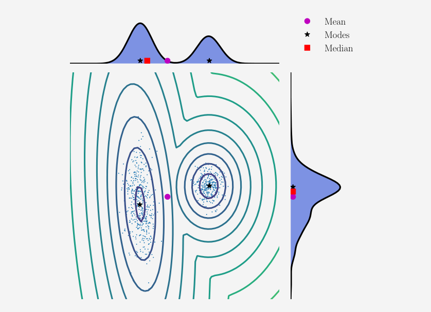

# 복습문제 8선 · 11월 11일 수업 범위

교과서 예제 7개에서 8문항을 골랐어요. 먼저 풀어 보고, 막히면 힌트를 열어 보세요.

> [HTML 원본](../복습문제_1111_Gaussian_Mixture_Models.html)과 같은 내용을 담았어요. 원문, 힌트, 풀이는 접혀 있어요. 먼저 풀어 보고 펼쳐 보세요.

**목차**

- [A. 교과서 예제 변형](#partA)
  - [P1. 두 번 뽑은 동전의 확률질량](#p1)
  - [P2. 빈도표에서 조건부확률 읽기](#p2)
  - [P3. 혼합 밀도의 봉우리 읽기](#p3)
  - [P4. 두 상태의 확률로 평균 구하기](#p4)
  - [P5. 밀도에서 누적확률 구하기](#p5)
  - [P6. 세 가우시안을 섞은 밀도](#p6)
  - [P7. 두 관측값의 책임도 계산](#p7)
  - [P8. 책임도 표에서 성분별 합 읽기](#p8)

## A. 교과서 예제 변형

### P1. 두 번 뽑은 동전의 확률질량

미국 동전과 영국 동전이 든 주머니에서 동전 하나를 무작위로 뽑아요. 뽑은 동전을 다시 넣고 같은 방법으로 한 번 더 뽑아요. 매번 미국 동전이 나올 확률은 $0.3$이에요. 두 번 중 미국 동전이 나온 횟수를 $X$라고 해요.

- (a) $X=0,1,2$ 각각의 확률을 구해 보세요.
- (b) (a)의 세 확률이 합해서 $1$이 되는지 확인해 보세요.

교과서 원문 보기

“Consider a statistical experiment where we model a funfair game consisting of drawing two coins from a bag (with replacement).” — Example 6.1

힌트 보기

두 번의 추출이 독립이므로 한 순서의 확률은 곱으로 구해요. 미국 동전이 한 번 나오는 순서는 두 가지예요.

풀이 보기

- (a) 영국 동전의 확률은 $1-0.3=0.7$이에요. 동전을 다시 넣으므로 두 번째 뽑기의 확률은 첫 번째 결과와 무관해요.

  $$
  P(X=0)=0.7^2=0.49
  $$

  $$
  P(X=2)=0.3^2=0.09
  $$
- (a) 한 번만 미국 동전이 나오려면 첫 번째만 미국 동전이거나 두 번째만 미국 동전이어야 해요. 두 순서는 서로 배타적이므로 확률을 더해요.

  $$
  P(X=1)=0.3\cdot0.7+0.7\cdot0.3=0.42
  $$
- (b) 가능한 세 횟수의 확률을 모두 더하면 $0.49+0.42+0.09=1$이에요.

정답 (a) $(0.49,0.42,0.09)$ (b) 세 확률의 합은 $1$이에요.

---

### P2. 빈도표에서 조건부확률 읽기

확률변수 $X$와 $Y$의 관측 결과를 빈도표로 정리했어요. 관측 한 건을 같은 확률로 뽑아요.

| $Y$ / $X$ | $x_1$ | $x_2$ | $x_3$ | $x_4$ | $x_5$ |
|---|---|---|---|---|---|
| $y_1$ | 1 | 2 | 3 | 4 | 5 |
| $y_2$ | 2 | 4 | 6 | 8 | 10 |
| $y_3$ | 3 | 6 | 9 | 12 | 15 |

- (a) 주변확률 $P(X=x_3)$과 $P(Y=y_2)$를 구해 보세요.
- (b) (a)의 결과를 이용해 $P(Y=y_2\mid X=x_3)$과 $P(X=x_3\mid Y=y_2)$를 각각 기약분수로 써 보세요.

교과서 원문 보기

“The conditional probability is the fraction of a row or column in a particular cell.” — Example 6.2

힌트 보기

교차 칸의 빈도는 같아요. 세로줄 오른쪽의 조건에 따라 분모에 쓸 행 또는 열의 합이 달라져요.

풀이 보기

- (a) 전체 빈도는 $15+30+45=90$이에요. $x_3$ 열의 합은 $3+6+9=18$, $y_2$ 행의 합은 $2+4+6+8+10=30$이에요. 각각 전체 빈도로 나눠요.

  $$
  P(X=x_3)=\frac{18}{90}=\frac{1}{5}
  $$

  $$
  P(Y=y_2)=\frac{30}{90}=\frac{1}{3}
  $$
- (b) 두 확률의 분자는 모두 교차 칸의 결합확률 $6/90$이에요. $X=x_3$이 주어지면 $x_3$의 주변확률로, $Y=y_2$가 주어지면 $y_2$의 주변확률로 나눠요.

  $$
  P(Y=y_2\mid X=x_3)=\frac{6/90}{18/90}=\frac{1}{3}
  $$

  $$
  P(X=x_3\mid Y=y_2)=\frac{6/90}{30/90}=\frac{1}{5}
  $$

정답 (a) $\frac{1}{5}$, $\frac{1}{3}$ (b) $\frac{1}{3}$, $\frac{1}{5}$

---

### P3. 혼합 밀도의 봉우리 읽기

두 가우시안 성분을 각각 $0.4$와 $0.6$의 비율로 섞었어요. 가운데는 결합 밀도의 등고선이고, 위쪽은 $X_1$, 오른쪽은 $X_2$의 주변 밀도예요.

*결합 밀도와 두 좌표의 주변 밀도*

- (a) 결합 밀도에 봉우리가 몇 개 있는지 등고선에서 읽어 보세요.
- (b) $X_1$과 $X_2$의 주변 밀도에서 각각 봉우리 개수를 세고, 결합 밀도의 봉우리 개수와 같은지 판단해 보세요.

교과서 원문 보기

“Consider the two-dimensional distribution illustrated in Figure 6.4” — Example 6.4

힌트 보기

가운데 등고선이 서로 다른 중심을 몇 곳 감싸는지 보세요. 주변 밀도는 위쪽과 오른쪽 곡선에서 따로 읽어요.

풀이 보기

- (a) 결합 밀도에서는 등고선이 왼쪽과 오른쪽의 서로 다른 높은 지점을 감싸요. 봉우리는 두 개예요.
- (b) 위쪽 곡선은 두 곳에서 솟으므로 $X_1$의 봉우리 개수는 결합 밀도와 같아요. 오른쪽 곡선은 한 번 오른쪽으로 불룩해졌다가 다시 좁아지므로 $X_2$의 봉우리는 한 개예요.

정답 (a) 결합 밀도 두 개 (b) $X_1$ 두 개, $X_2$ 한 개

---

### P4. 두 상태의 확률로 평균 구하기

$X$는 $0$ 또는 $1$만 취해요. $P(X=1)=\mu$인 베르누이 분포의 확률질량함수는 아래와 같아요. 여기서 $\mu=0.7$이에요.

$$
p(x\mid\mu)=\mu^x(1-\mu)^{1-x},\qquad x\in\{0,1\}
$$

- (a) $p(0\mid\mu)$와 $p(1\mid\mu)$를 구해 보세요.
- (b) (a)의 확률을 가중치로 써서 $E[X]$를 구해 보세요.

교과서 원문 보기

“The Bernoulli distribution is a distribution for a single binary random variable X with state x ∈ {0, 1}.” — Example 6.8

힌트 보기

가능한 값은 $0$과 $1$이에요. 각 값에 그 값이 나올 확률을 곱하고 더해요.

풀이 보기

- (a) 확률질량함수에서 $x=0$이면 $1-\mu$, $x=1$이면 $\mu$만 남아요.

  $$
  p(0\mid\mu)=1-\mu=0.3,\qquad p(1\mid\mu)=\mu=0.7
  $$
- (b) 값과 확률을 짝지어 곱하고 더해요. 값이 $0$인 항의 기여는 $0$이에요.

  $$
  E[X]=0\cdot0.3+1\cdot0.7=0.7
  $$

정답 (a) $0.3$, $0.7$ (b) $E[X]=0.7$

---

### P5. 밀도에서 누적확률 구하기

연속확률변수 $X$의 밀도는 $0\le x\le1$에서 $f_X(x)=3x^2$이고, 그 밖에서는 $0$이에요. $F_X(t)=P(X\le t)$를 누적분포함수라고 해요.

- (a) $0\le t\le1$에서 $F_X(t)$를 적분으로 구해 보세요.
- (b) (a)의 결과에 $t=\frac{1}{2}$를 대입해 $P(X\le\frac{1}{2})$를 구해 보세요.

교과서 원문 보기

“Let X be a continuous random variable with probability density function on 0 ⩽ x ⩽ 1” — Example 6.16, 식 (6.128)–(6.129f)

힌트 보기

$x\lt 0$에서는 밀도가 $0$이므로, 누적확률에 기여하는 구간은 $0$에서 $t$까지예요.

풀이 보기

- (a) $t$ 이하의 확률은 $t$까지 밀도를 적분한 면적이에요. $0$보다 왼쪽은 밀도가 $0$이므로 하한은 $0$으로 잡아요.

  $0\le t\le1$에서 아래와 같아요.

  $$
  F_X(t)=\int_0^t 3u^2\,du=[u^3]_0^t=t^3
  $$
- (b) 누적확률을 구할 경계 $t=\frac{1}{2}$를 (a)의 식에 넣어요.

  $$
  P(X\le\tfrac{1}{2})=F_X(\tfrac{1}{2})=(\tfrac{1}{2})^3=\frac{1}{8}
  $$

정답 (a) $F_X(t)=t^3$ ($0\le t\le1$) (b) $\frac{1}{8}$

---

### P6. 세 가우시안을 섞은 밀도

관측값은 $-3,-2.5,-1,0,2,4,5$예요. 아래 표의 세 정규분포를 각각 $\frac{1}{3}$의 가중치로 섞어요.

| 성분 $k$ | 평균 $\mu_k$ | 분산 $\sigma_k^2$ |
|---|---|---|
| 1 | $-4$ | $1$ |
| 2 | $0$ | $0.2$ |
| 3 | $8$ | $3$ |

- (a) 혼합 밀도 $p(x)$의 식을 쓰고, $p(0)$을 소수점 아래 넷째 자리까지 구해 보세요.
- (b) (a)의 가중 성분 밀도 중 $x=0$에서 가장 큰 값을 갖는 성분을 골라 보세요.

교과서 원문 보기

“The corresponding model (and the data points) are shown in Figure 11.3.” — Example 11.1

힌트 보기

세 정규분포에 모두 $x=0$을 넣고 각각의 밀도에 혼합 가중치를 곱해요.

풀이 보기

- (a) 정규분포를 $p_k(x)=\mathcal N(x\mid\mu_k,\sigma_k^2)$로 두면, 혼합 밀도는 가중합이에요.

  $$
  p(x)=\tfrac{1}{3}\bigl(p_1(x)+p_2(x)+p_3(x)\bigr)
  $$

  세 항의 평균과 분산은 순서대로 $(-4,1)$, $(0,0.2)$, $(8,3)$이에요.
- (a) 각 항은 아래 정규밀도식에 $x=0$과 성분의 평균·분산을 넣어 계산해요.

  $$
  p_k(x)=\frac{\exp\bigl(-\frac{(x-\mu_k)^2}{2\sigma_k^2}\bigr)}{\sqrt{2\pi\sigma_k^2}}
  $$

  가중한 세 항은 차례로 약 $0.000044610$, $0.297354019$, $0.000001790$이에요. 먼저 더하고 마지막에 반올림하면 $p(0)\approx0.2974$예요.
- (b) 두 번째 항이 세 가중 성분 밀도 중 가장 크므로, 성분 $2$가 $x=0$의 밀도에 가장 크게 기여해요.

정답 (a) $p(x)=\frac{1}{3}\sum_{k=1}^3\mathcal N(x\mid\mu_k,\sigma_k^2)$, $p(0)\approx0.2974$ (b) 성분 $2$

---

### P7. 두 관측값의 책임도 계산

성분 $k$에서 $x$가 나오는 밀도는 $\mathcal N(x\mid\mu_k,\sigma_k^2)$예요. 각 성분을 고르는 사전확률은 $\frac{1}{3}$이에요.

| 성분 $k$ | 평균 $\mu_k$ | 분산 $\sigma_k^2$ |
|---|---|---|
| 1 | $-4$ | $1$ |
| 2 | $0$ | $0.2$ |
| 3 | $8$ | $3$ |

관측값은 $-1$과 $2$예요. 각 관측값 $x$에 대해 $r_k(x)$는 $x$를 관측한 뒤 성분 $k$에서 나왔을 확률이에요.

- (a) 두 관측값의 책임도 $(r_1(x),r_2(x),r_3(x))$를 각각 소수점 아래 셋째 자리까지 구해 보세요.
- (b) (a)의 결과에서 관측값마다 책임도가 가장 큰 성분을 골라 보세요.

교과서 원문 보기

“Here the nth row tells us the responsibilities of all mixture components for xn.” — Example 11.2

힌트 보기

한 관측값을 고정하고 성분별로 사전확률과 밀도를 곱해요. 그 값들의 합으로 각 값을 나눠요.

풀이 보기

- (a) $q_k(x)=\frac{1}{3}\mathcal N(x\mid\mu_k,\sigma_k^2)$라고 놓아요. 베이즈 정리의 분모는 같은 $x$에서 세 가중 밀도를 더한 값이에요.

  $$
  r_k(x)=\frac{q_k(x)}{q_1(x)+q_2(x)+q_3(x)}
  $$
- (a) 예를 들어 성분 $2$에 $x=-1$, $\mu_2=0$, $\sigma_2^2=0.2$를 넣으면 다음과 같아요.

  $$
  q_2(-1)=\frac{1}{3}\frac{\exp(-1/0.4)}{\sqrt{0.4\pi}}\approx0.0244083
  $$

  나머지 성분도 같은 방법으로 계산해요. 표에는 가중 밀도와 그 합의 근삿값을 정리했어요.

  | $x$ | $q_1$ | $q_2$ | $q_3$ | 합 |
  |---|---|---|---|---|
  | $-1$ | $1.477\cdot10^{-3}$ | $2.441\cdot10^{-2}$ | $1.053\cdot10^{-7}$ | $2.589\cdot10^{-2}$ |
  | $2$ | $2.025\cdot10^{-9}$ | $1.350\cdot10^{-5}$ | $1.903\cdot10^{-4}$ | $2.038\cdot10^{-4}$ |
- (a) 같은 행 안에서 각 항을 합으로 나눈 뒤 반올림해요. 예를 들어 $x=-1$에서 성분 $2$는 $0.0244083/0.0258857\approx0.943$이에요.

  $$
  x=-1: (0.057,0.943,0.000)
  $$

  $$
  x=2: (0.000,0.066,0.934)
  $$

  표시된 $0.000$은 양수인 값을 반올림한 결과예요.
- (b) $-1$에서는 성분 $2$, $2$에서는 성분 $3$의 책임도가 가장 커요.

정답 (a) $-1$에서 $(0.057,0.943,0.000)$, $2$에서 $(0.000,0.066,0.934)$ (b) 차례로 성분 $2$와 성분 $3$

---

### P8. 책임도 표에서 성분별 합 읽기

관측 $7$개의 책임도가 아래 행렬 $R$에 반올림되어 제시되어 있어요. 행은 관측값, 열은 성분 $1,2,3$을 뜻해요. 표에 적힌 수로 계산해요.

$$
R=\begin{bmatrix}1.0&0.0&0.0\\1.0&0.0&0.0\\0.057&0.943&0.0\\0.001&0.999&0.0\\0.0&0.066&0.934\\0.0&0.0&1.0\\0.0&0.0&1.0\end{bmatrix}
$$

- (a) 성분 $k$의 총 책임도 $N_k=\sum_{n=1}^7 r_{nk}$를 세 성분에 대해 구해 보세요.
- (b) (a)에서 전체 관측에 대한 총 책임도가 가장 큰 성분을 찾아보세요.

교과서 원문 보기

“The sum of all entries of a column gives us the values Nk, i.e., the total responsibility of the kth mixture component.” — Example 11.2

힌트 보기

$N_k$는 성분 하나를 고정해요. 열 $k$에서 위에서 아래로 일곱 값을 더해요.

풀이 보기

- (a) 열마다 $0$이 아닌 항만 더해도 같은 합을 얻어요.

  $$
  N_1=1+1+0.057+0.001=2.058
  $$

  $$
  N_2=0.943+0.999+0.066=2.008
  $$

  $$
  N_3=0.934+1+1=2.934
  $$
- (b) 세 값 중 $2.934$가 가장 커요. 전체 관측에 대한 총 책임도가 가장 큰 성분은 $3$이에요.

정답 (a) $(2.058,2.008,2.934)$ (b) 성분 $3$

---

자료 · Deisenroth, Faisal, Ong, *Mathematics for Machine Learning*. 수치 답은 Python으로 검산했어요.
