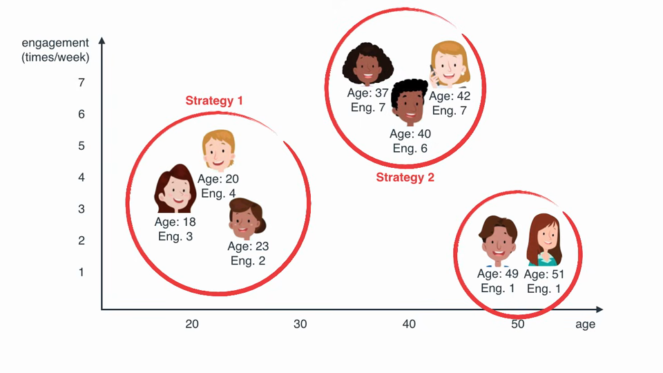
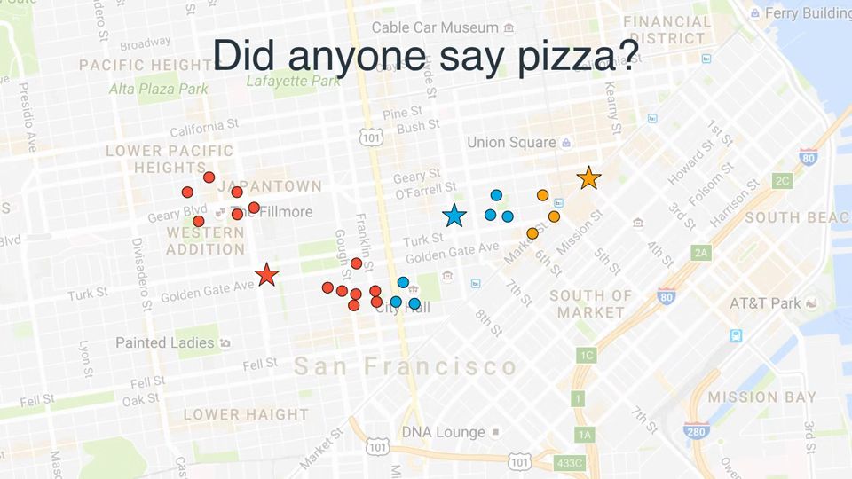
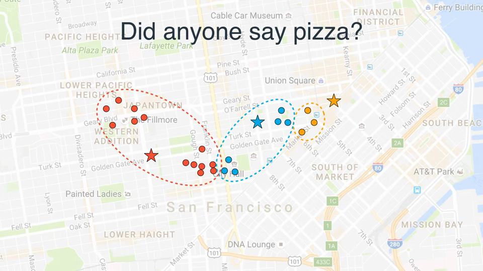
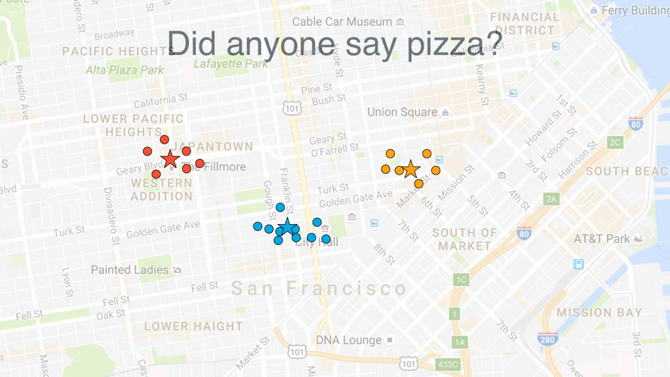
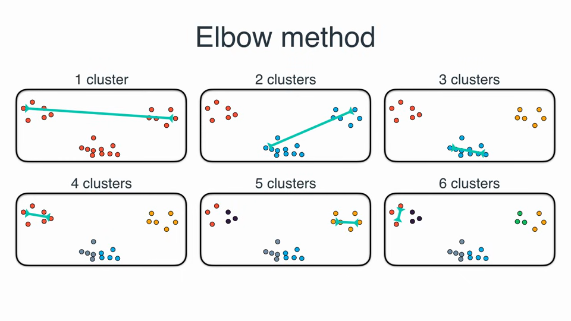
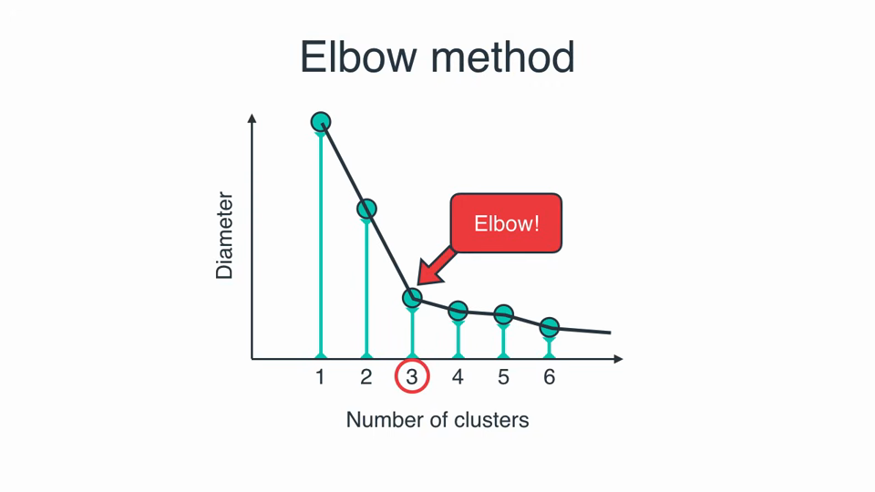
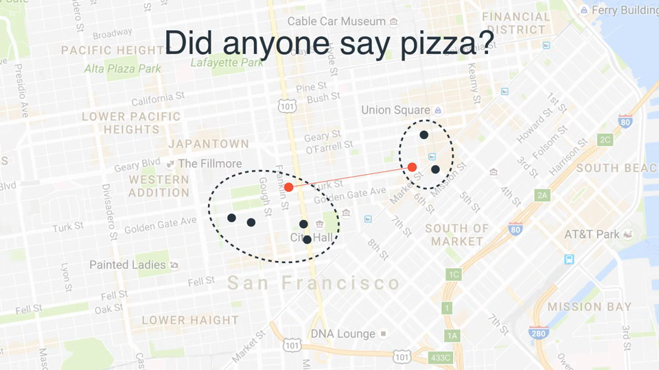
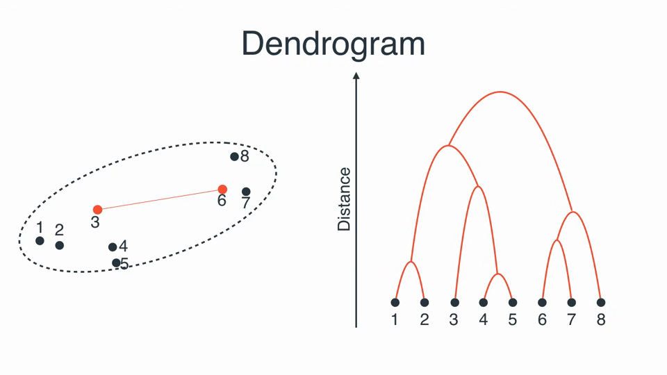
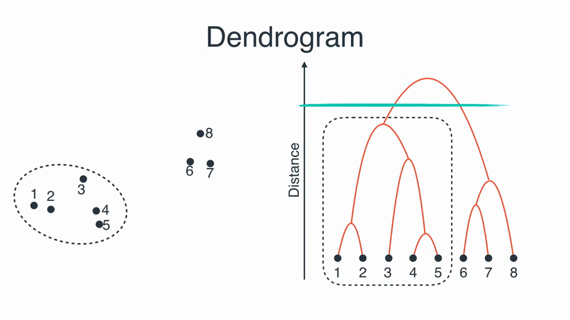
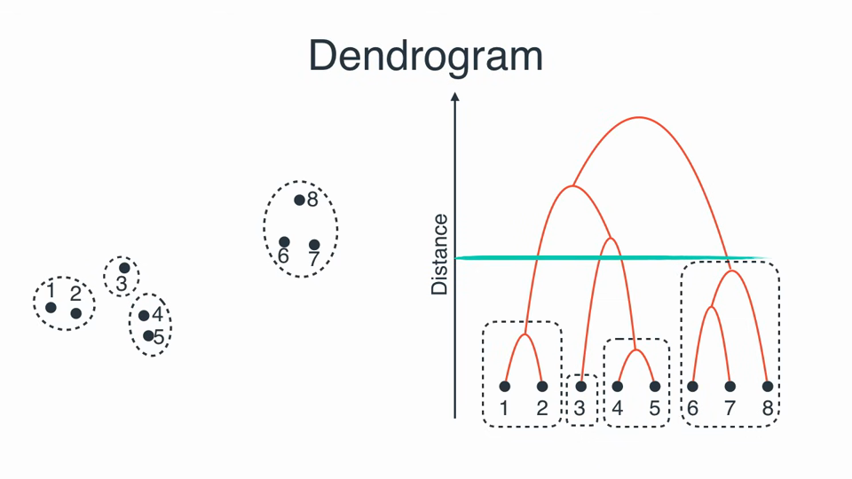

# 클러스터링: K-means와 계층적 군집 (Clustering: K-means and Hierarchical) — Luis Serrano 영상 정리

- **영상**: [Clustering: K-means and Hierarchical (Luis Serrano)](https://www.youtube.com/watch?v=QXOkPvFM6NU), 17분 22초
- **위치**: 복습노트 1111 (사용자가 지정한 날짜). Lecture07 Density Estimation Part 1(GMM) 수업의 짝 자료로 넣었습니다. K-means는 GMM의 hard assignment 버전입니다.
- **정리 방식**: 6초 간격으로 뽑은 프레임 174장(3x3 시트 20장)을 직접 보고, 같은 영상의 전사본([STT/Clustering_K_means_and_Hierarchical.md](../../../../STT/Clustering_K_means_and_Hierarchical.md))과 맞춰 정리했습니다. 타임스탬프는 6초 단위의 근삿값입니다.
- **전사 모델**: gemini-3.5-flash (Vertex AI API)

> **한 줄 요약**
> K-means는 **"각 점을 가장 가까운 중심에 배정한다"**와 **"중심을 배정된 점들의 평균으로 옮긴다"**를 변화가 없을 때까지 반복합니다. 계층적 군집은 **가장 가까운 두 점(무리)부터 차례로 합치고**, 그 과정을 덴드로그램으로 그린 뒤 원하는 높이에서 자릅니다. 클러스터 수는 사람이 2차원 그래프(엘보 그래프, 덴드로그램)를 보고 정합니다.

---

## 1. 도입: 고객 세분화 예시 (00:00–02:36)

| 시각 | 화면 | 내용 |
|---|---|---|
| 00:00 | 제목 *Clustering: K-means and hierarchical*, Luis Serrano | 클러스터링은 **비지도 학습**(unsupervised learning)이고, 데이터를 무리로 묶는 일 |
| 00:24–00:42 | *Customer Segmentation* / *Goal: To make 3 marketing strategies* | 앱 마케팅 예산으로 전략 3개를 만들 수 있음 → 고객을 3그룹으로 나누기 |
| 00:54–01:00 | *Age (in years)*, *Engagement with the page (in days/week)* | 열 2개: 인구통계(나이)와 행동(주당 방문 일수, 0~7) |
| 01:24 | 얼굴 그림 8명과 값 | 아래 표 |
| 01:36–01:42 | 빨간 화살표가 (49, 1)·(51, 1), 이어서 (18, 3)·(23, 2) 아래에 | "눈으로 보면 이 둘은 비슷하다" |
| 02:00 | 가로축 age(20~50), 세로축 engagement (times/week, 1~7) 산점도 | 그려 보니 무리 3개가 바로 보임 |
| 02:12–02:36 | 빨간 원 3개, 라벨 *Strategy 1/2/3* | 전략 1: 20세 전후·참여 2~4일, 전략 2: 30대 후반~40대 초·참여 높음, 전략 3: 50세 전후·참여 매우 낮음 |

| 나이 | 42 | 18 | 23 | 49 | 37 | 51 | 40 | 20 |
|---|---|---|---|---|---|---|---|---|
| 참여(Eng.) | 7 | 3 | 2 | 1 | 7 | 1 | 6 | 4 |

- **화면 설명**: 표로는 그룹이 잘 안 보이지만, 산점도로 그리면 $\{(18,3),(20,4),(23,2)\}$, $\{(37,7),(40,6),(42,7)\}$, $\{(49,1),(51,1)\}$ 세 무리가 분명합니다.
- **핵심**: 점이 적고 2차원이면 사람이 쉽게 묶지만, 점이 많고 열(차원)이 많으면 어렵습니다. 그래서 컴퓨터가 기계적으로 할 수 있는 방법이 필요합니다.
- 02:42–03:12 *Clustering goal: group data* 화면에서 회색 점 무리가 빨간 원 4개로 묶입니다. 03:18에 오늘 다룰 두 방법 *K-means clustering*, *Hierarchical clustering*이 나옵니다.

## 2. K-means: 피자 가게 위치 정하기 (03:36–07:24)

화면 제목은 *Did anyone say pizza?*, 배경은 샌프란시스코 지도입니다. 검은 점은 고객 집, 별(★)은 피자 가게(= 클러스터 중심)입니다.

| 시각 | 화면 | 내용 |
|---|---|---|
| 03:42 | 지도 + *Pizza Place* 로고 | 피자 가게 3개를 고객에게 가장 좋은 곳에 열고 싶음 |
| 03:54 | 검은 점 무리 3개 (Japantown 쪽, City Hall 쪽, Market St 쪽) | 고객이 사는 곳 |
| 04:12 | 빨강·파랑·노랑 점선 원으로 칠한 "정답" | 사람 눈에는 쉬움. 컴퓨터는 어려움 |
| 04:30 | 빨강·파랑·주황 별 3개가 **무작위 위치**에 | 머신러닝 대부분처럼 무작위로 시작해 점점 개선 |
| 05:00 | 모든 점이 가장 가까운 별의 색으로 칠해짐 | **논리 1**: 모두 가장 가까운 가게로 간다 |
| 05:24–05:36 | 색별 점선 타원, 별이 각 무리의 가운데로 이동 | **논리 2**: 가게를 손님 집들의 중심으로 옮긴다 |
| 05:42–05:54 | 주황 점선 원이 파랑 점 3개를 감쌈 → 주황으로 바뀜 | 다시 논리 1: 파랑 점 3개가 이제 주황 가게에 더 가까움 |
| 06:00–06:06 | City Hall 근처 빨강 점 2개 → 파랑 | 빨강 점 2개가 파랑 가게에 더 가까움 |
| 06:18 | 별이 다시 이동 | 논리 2 반복 |
| 06:30–06:36 | 파랑 점선 원이 City Hall 왼쪽 빨강 점들을 감쌈 → 파랑 | 논리 1 반복 |
| 06:48 | 별 3개가 각 무리 한가운데에. 빨강(Japantown)·파랑(City Hall)·주황(Market St) | 논리 2를 적용하면 더 바뀌는 것이 없음 → 끝 |
| 07:18 | 제목이 *K-Means Clustering*으로 바뀜 | 이것이 K-means 알고리즘 |

- **화면 설명**: 무작위 별에서 시작해 **배정(색칠) → 이동(별 옮기기)**을 세 번쯤 반복하면, 04:12에 사람이 그렸던 정답과 같은 세 무리가 나옵니다.
- **핵심**
  - 컴퓨터가 하는 일은 두 가지뿐입니다. ① **좌표 평균**으로 점들의 중심 구하기, ② **피타고라스 정리(거리 공식)**로 거리를 재고 숫자 비교하기.
  - 영상의 표현 "think like a computer, not like a human"은 이 두 가지 기계적 연산만으로 그룹을 찾는다는 뜻입니다.
  - 2차원 점 $\mathbf{x}=(x_1,x_2)$와 중심 $\boldsymbol{\mu}=(\mu_1,\mu_2)$의 거리는 $\|\mathbf{x}-\boldsymbol{\mu}\|=\sqrt{(x_1-\mu_1)^2+(x_2-\mu_2)^2}$입니다. 영상은 식을 화면에 쓰지 않고 말로만 설명합니다.

## 3. 클러스터 수 정하기: 엘보 방법 (07:24–11:30)

| 시각 | 화면 | 내용 |
|---|---|---|
| 07:42 | *How do we know how many clusters?* | "3개"는 사람이 정했다. 컴퓨터는 어떻게 아나? |
| 07:48–08:30 | *Elbow method*, 상자 6개 *1 cluster* ~ *6 clusters* | 같은 데이터에 $K=1,\ldots,6$으로 각각 K-means 실행 |
| 08:06 | *2 clusters* 상자: 왼쪽 위 무리와 아래 무리가 한 색 | 결과는 **초기 위치에 따라 달라질 수 있음**(영상이 직접 언급) |
| 09:06–09:54 | 각 상자에 청록색 양방향 화살표 | 클러스터 **지름**(diameter) = 같은 색 두 점 사이의 최대 거리 |
| 10:18 | 세로축 *Diameter*, 가로축 *Number of clusters* (1~6) 막대 | 지름을 $K$에 대해 그림 |
| 10:36 | 막대 끝 점을 선으로 연결 | 1→2→3에서 크게 줄고 3 이후 거의 평평 |
| 10:42–11:06 | 빨간 말풍선 *Elbow!*가 3을 가리키고 가로축 3에 빨간 원 | 꺾이는 곳 = 3 |
| 11:24 | 옆에 *3 clusters* 상자 | 3개가 최선 |

- **화면 설명**: $K$가 커질수록 지름은 계속 줄어듭니다. 그런데 $K=3$까지는 크게 줄고, 그 뒤로는 거의 줄지 않습니다. 이 꺾인 점이 팔꿈치(elbow)입니다.
- **핵심**
  - 지름은 영상이 "대략" 고른 것이라고 말합니다("I just eyeballed these distances"). 개념을 보여 주려는 그림입니다.
  - 팔꿈치는 **사람이 그래프를 보고 고르는** 단계입니다. 자동 방법도 있지만, 원하는 개수나 최소·최대 개수 같은 사전 지식을 반영하는 **일관성 점검**으로 쓰는 것이 좋다고 합니다.
  - 데이터가 아무리 고차원이어도 **엘보 그래프는 항상 2차원**이라 사람이 판단하기 쉽습니다.
- **짚을 점**: 보통 엘보 방법의 세로축은 **군집 내 제곱거리 합**(WCSS, inertia) $\sum_n\|\mathbf{x}_n-\boldsymbol{\mu}_{k(n)}\|^2$입니다. 영상은 이것 대신 "가장 먼 같은 색 두 점의 거리"(지름)를 썼습니다. 두 값 모두 $K$가 커질수록 줄어드는 경향이 있어서 결론은 같지만, 같은 양은 아닙니다.

## 4. 계층적 군집: 가까운 것부터 합치기 (11:30–12:54)

| 시각 | 화면 | 내용 |
|---|---|---|
| 11:30–11:36 | *Hierarchical clustering*, 지도 위 검은 점 8개 | 새 데이터. 몇 그룹이 나올지 아직 모름 |
| 12:06 | City Hall 옆 두 점이 빨강 | 가장 가까운 두 점은 같은 그룹이라고 보자 |
| 12:12–12:18 | 점선 타원이 하나씩 늘어남 (왼쪽 두 점, City Hall 두 점) | 다음으로 가까운 쌍도 묶음 |
| 12:24–12:30 | 오른쪽 위에서 한 점이 두 점 무리에 합류 | 점과 무리가 가까우면 **무리를 합쳐** 3개짜리 그룹 |
| 12:36 | 왼쪽 2점 무리 + City Hall 3점 무리 → 5점 그룹 | 두 무리를 합침 |
| 12:42 | 두 큰 무리 사이에 빨간 선, 빨간 *STOP* 표지와 *Too big* | 다음 쌍은 너무 멀다 → 멈춤. 결과는 2개 클러스터 |
| 12:54 | 제목 *Hierarchical Clustering* | 이것이 계층적 군집 |

- **핵심**: 처음에는 모든 점이 각자 하나의 그룹이고, **가장 가까운 쌍을 차례로 합칩니다**(아래에서 위로 쌓는 방식). "너무 멀다"의 기준 거리나 원하는 클러스터 수는 여기서도 사람이 정합니다.

## 5. 덴드로그램과 자르는 위치 (13:12–15:54)

13:12에 *How do we decide the distance or the number of clusters?*가 나오고, 13:18부터 *Dendrogram* 화면입니다. 왼쪽에 번호 붙은 점 1~8, 오른쪽에 가로로 1~8을 늘어놓고 세로축은 *Distance*입니다.

| 시각 | 합친 것 | 화면 |
|---|---|---|
| 13:30 | 4와 5 | 4–5 위에 작은 빨간 아치. 높이 = 두 점 거리 ("축척은 정확하지 않다") |
| 13:42 | 1과 2 | 1–2 아치 |
| 13:54 | 6과 7 | 6–7 아치 |
| 14:06 | 6과 8 → {6,7}+{8} | 6–7 아치 위로 8까지 이어지는 아치 |
| 14:18 | 3과 4 → {3}+{4,5} | 3과 (4–5) 아치를 잇는 더 높은 아치 |
| 14:24 | 2와 3 → {1,2}+{3,4,5} | 왼쪽 무리 전체를 잇는 아치 |
| 14:42 | 3과 6 → {1..5}+{6,7,8} | 맨 위의 가장 큰 아치 |

- **화면 설명**: 새로 합칠 때마다 아치가 이전보다 높습니다. 합치는 거리가 점점 커지기 때문입니다.
- 화면의 각 합치기는 "두 무리에서 **가장 가까운 두 점**"(예: 2와 3, 3과 6)을 빨갛게 표시해서 보여 줍니다.

| 시각 | 자르는 위치 | 결과 |
|---|---|---|
| 15:00 | 청록색 가로선을 맨 위 아치 바로 아래에 | 클러스터 2개: {1, 2, 3, 4, 5}, {6, 7, 8} |
| 15:18–15:30 | 가로선을 더 낮게 | 클러스터 4개: {1, 2}, {3}, {4, 5}, {6, 7, 8} |

- **핵심**
  - 자르는 높이 = "이보다 멀면 다른 그룹"이라는 거리 기준입니다. 원하는 클러스터 수로 정해도 됩니다.
  - 점이 수십억 개이고 1000차원이어도 **덴드로그램은 2차원 그림**이라 사람이 쉽게 결정할 수 있습니다.
  - 결론: 컴퓨터 알고리즘과 사람의 판단을 함께 써서 가장 좋은 군집을 얻습니다.

## 6. 응용 (15:54–17:00)

- *Genetics*, *Evolutionary biology*(척추동물 계통도 그림): 유전체를 군집하면 종과 진화 과정을 이해할 수 있습니다.
- *Recommender systems*("Customers who bought this item also bought" 만화): 비슷한 사용자끼리 묶어서 추천합니다.
- *Social networks*: 인구통계와 행동으로 사용자를 묶어 정보를 맞춤으로 보여 주거나 친구를 추천합니다. 1장의 고객 세분화와 같은 구조입니다.

17:00 이후는 구독·트위터(@luis_likes_math) 안내입니다.

---

## 7. 수업 내용과 연결하기 (Lecture07 GMM 용어로 바꾸면)

| 영상 표현 | 수업 용어 | 수식 |
|---|---|---|
| 피자 가게(별) 위치 | 클러스터 중심, GMM의 성분 평균 | $\boldsymbol{\mu}_k,\ k=1,\ldots,K$ |
| "가장 가까운 가게로 간다" | **hard assignment** (0 또는 1) | $r_{nk}=\begin{cases}1 & k=\arg\min_j\|\mathbf{x}_n-\boldsymbol{\mu}_j\|^2\\ 0 & \text{otherwise}\end{cases}$ |
| (GMM의 대응) 색 비율로 나눠 갖기 | **책임도** $r_{nk}$, soft assignment, E-step | $r_{nk}=\dfrac{\pi_k\mathcal{N}(\mathbf{x}_n\mid\boldsymbol{\mu}_k,\Sigma_k)}{\sum_{j=1}^K\pi_j\mathcal{N}(\mathbf{x}_n\mid\boldsymbol{\mu}_j,\Sigma_j)}$ |
| "손님 집들의 중심으로 옮긴다" | 평균 갱신, GMM M-step의 $\boldsymbol{\mu}_k$ 식 | $N_k=\sum_{n}r_{nk}$, $\ \boldsymbol{\mu}_k=\dfrac{1}{N_k}\sum_{n=1}^N r_{nk}\mathbf{x}_n$ |
| 더 바뀌는 것이 없으면 끝 | 수렴 | 배정이 변하지 않으면 정지 (GMM은 로그우도 변화로 판정) |
| 무작위 시작, 결과가 달라질 수 있음 | 초기화 의존, 국소 최적 | 여러 번 초기화해 가장 좋은 결과 선택 |
| 지름, 엘보 그래프 | 모델 선택(성분 수 $K$ 고르기) | 보통은 $J=\sum_n\sum_k r_{nk}\|\mathbf{x}_n-\boldsymbol{\mu}_k\|^2$를 $K$에 대해 그림 |

**K-means(hard)와 GMM(soft)의 차이**

- K-means에서 $r_{nk}$는 **0 아니면 1**입니다. 점 하나가 정확히 한 클러스터에 속하고, 경계 근처 점도 가까운 쪽에 100% 배정됩니다. 영상 05:42–06:36에서 점의 색이 한 번에 통째로 바뀌는 장면이 이것입니다.
- GMM의 책임도는 $0\le r_{nk}\le1$, $\sum_{k=1}^K r_{nk}=1$인 **사후확률** $P(Z_n=k\mid\mathbf{x}_n,\boldsymbol{\theta})$입니다. 경계 근처 점은 두 성분에 나뉘어 기여하고, M-step의 $\boldsymbol{\mu}_k$는 책임도로 가중한 평균이 됩니다.
- K-means의 평균 갱신은 GMM M-step의 $\boldsymbol{\mu}_k$ 식에 0/1 책임도를 넣은 것과 같습니다. 이때 $N_k$는 클러스터 $k$에 배정된 점의 개수입니다.
- K-means의 "가장 가까운 중심" 규칙은, GMM에서 모든 성분의 공분산을 $\Sigma_k=\sigma^2 I$로 같게 두고 $\pi_k$도 같게 둔 뒤 $\sigma^2\to0$으로 보내면 책임도가 가장 가까운 성분 쪽으로 1이 되는 극한과 같습니다.

**영상에서 빠진 것 (수업·표준 정의로 보충)**

1. **목적함수**: 영상은 두 "논리적 문장"만 보여 줍니다. K-means는 $J=\sum_{n=1}^N\sum_{k=1}^K r_{nk}\|\mathbf{x}_n-\boldsymbol{\mu}_k\|^2$를 줄이는 알고리즘이고, 배정 단계와 평균 단계가 각각 $J$를 늘리지 않기 때문에 유한 번 안에 멈춥니다. 수업 슬라이드(Lecture07)에는 K-means가 따로 나오지 않으므로 이 부분은 표준 정의로 보충한 것입니다.
2. **확률 모델**: K-means에는 밀도, 공분산 $\Sigma_k$, 혼합비 $\pi_k$가 없습니다. 클러스터 모양은 사실상 같은 크기의 원으로 가정합니다. GMM은 이 셋을 모두 추정하므로 길쭉하거나 크기가 다른 무리도 표현합니다.
3. **거리 척도와 스케일**: 1장 예시에서 나이(18~51)와 참여도(1~7)는 범위가 크게 다릅니다. 유클리드 거리를 그대로 쓰면 나이가 거리를 지배하므로, 실제로는 특성을 표준화한 뒤 군집합니다. 영상은 이 점을 다루지 않습니다.
4. **계층적 군집의 연결 방식(linkage)**: 영상은 두 무리 사이 거리를 "두 무리에서 가장 가까운 두 점의 거리"로 계산합니다(단일 연결, single linkage). 완전 연결(가장 먼 두 점), 평균 연결, Ward 방법 등 다른 정의도 있고, 고르는 방식에 따라 덴드로그램 모양이 달라집니다.
5. **엘보 방법의 지표**: 3장에서 짚었듯, 영상은 지름을 썼지만 보통은 군집 내 제곱거리 합 $J$를 씁니다. GMM에서는 $K$가 커지면 로그우도도 계속 커지므로, 성분 수를 고를 때 BIC 같은 기준을 쓰기도 합니다.
