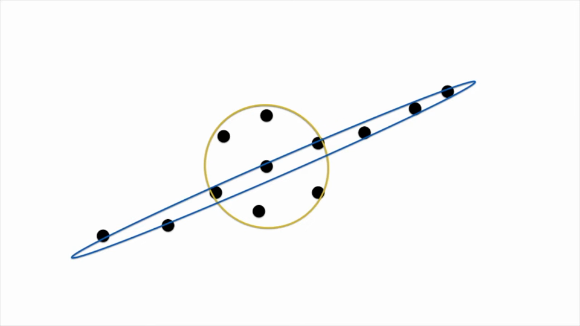
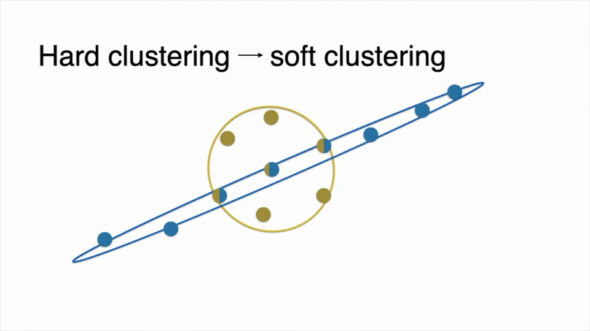
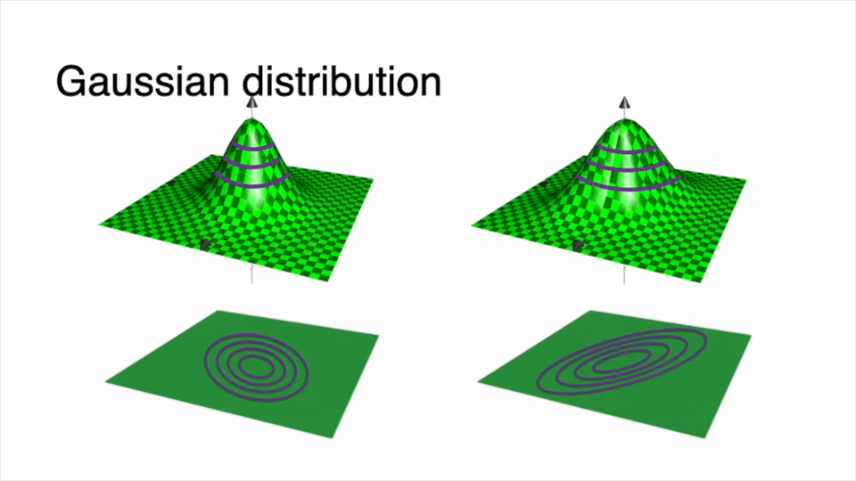
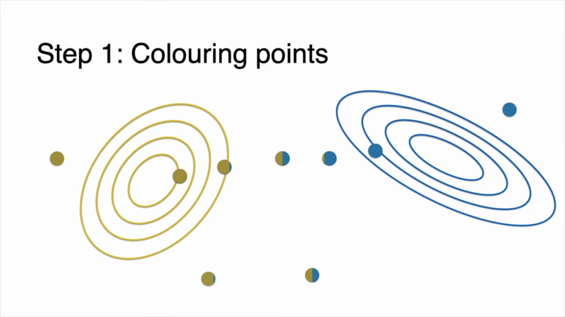
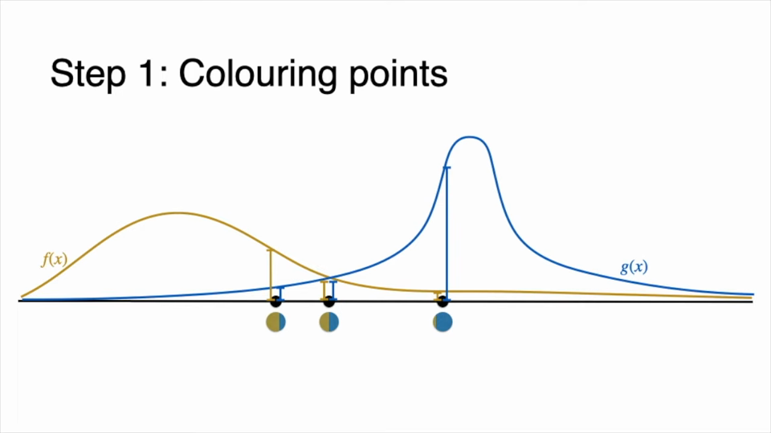
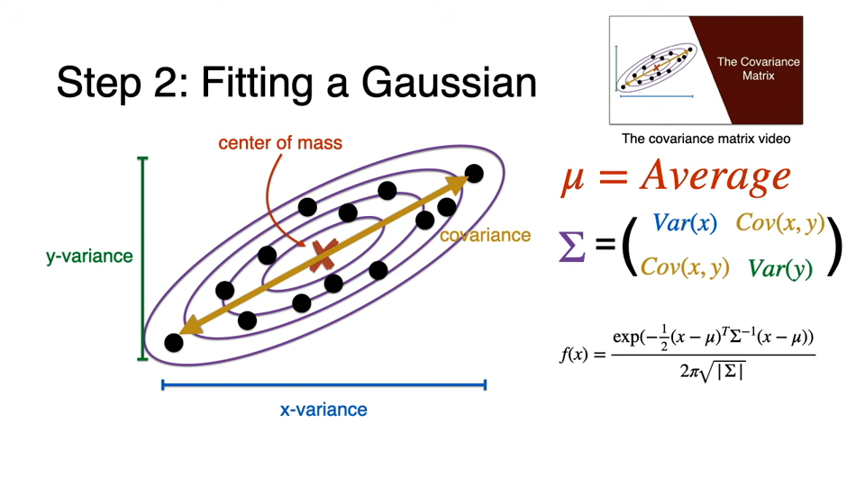
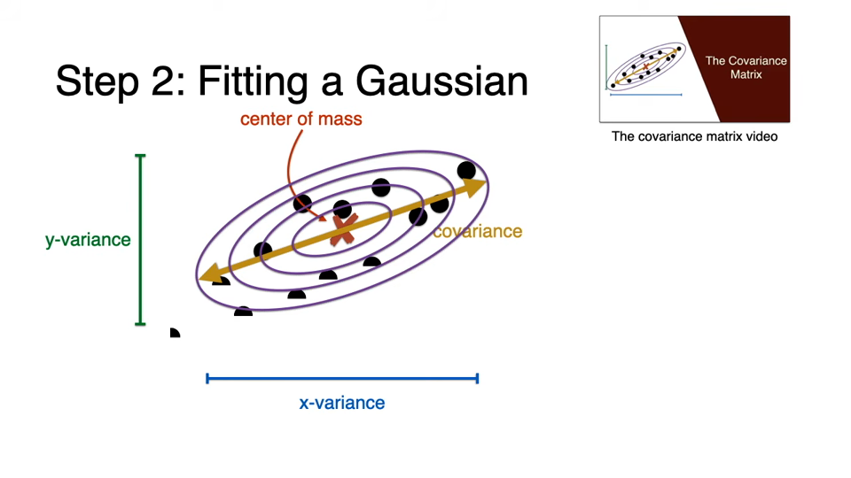
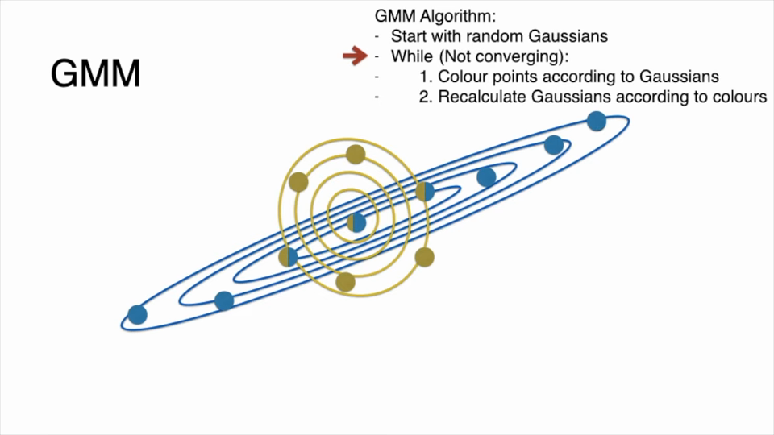
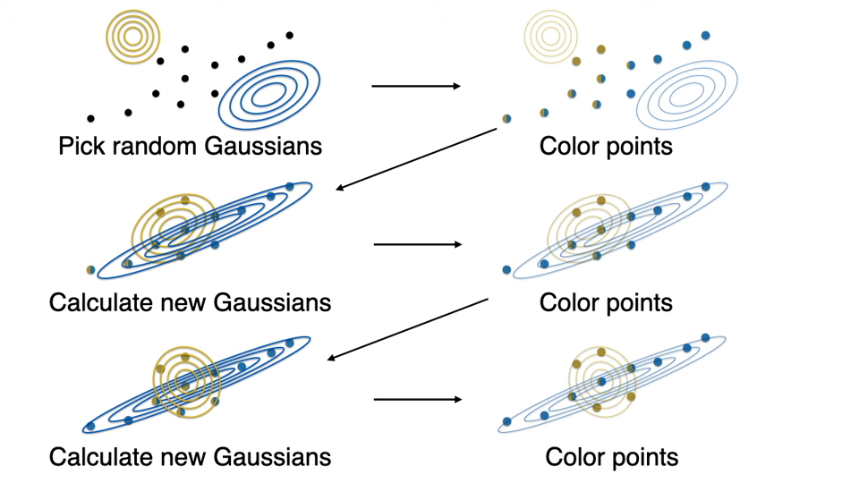

# Gaussian Mixture Models — Luis Serrano 영상 정리

- **영상**: [Gaussian Mixture Models (Luis Serrano)](https://www.youtube.com/watch?v=q71Niz856KE), 17분 27초
- **위치**: Lecture07_Density_Estimation_Part1.pdf 3쪽 **Warm-Up** 지정 영상 → 슬라이드 날짜 1111
- **정리 방식**: 6초 간격으로 뽑은 프레임 174장을 직접 보고, 같은 영상의 전사본([STT/Gaussian_Mixture_Models.md](../../../../STT/Gaussian_Mixture_Models.md))과 맞춰 정리했습니다. 타임스탬프는 6초 단위의 근삿값입니다.
- **전사 모델**: gemini-2.5-flash (Vertex AI API)

> **한 줄 요약**
> GMM은 **"점을 Gaussian 기준으로 색칠한다(Step 1)"**와 **"색깔대로 Gaussian을 다시 맞춘다(Step 2)"**를 수렴할 때까지 반복하는 알고리즘입니다. 이 두 단계가 수업에서 배우는 EM 알고리즘의 **E-step**과 **M-step**입니다.

---

## 1. 왜 클러스터링인가 (0:00–1:24)

| 시각 | 화면 | 내용 |
|---|---|---|
| 0:06 | 제목 슬라이드 *Gaussian Mixture Models (GMM)* | GMM은 아주 쓸모 있는 **클러스터링 모델**이라고 소개 |
| 0:12–0:42 | *Clustering applications*: 악기 아이콘, 문서 아이콘, 동물 아이콘이 차례로 나타남 | 응용 예시 3가지<br>① **Audio classification**: 노래 속 악기 구분, 음성비서가 내 목소리와 배경 소음 구분<br>② **Document classification**: 스포츠·과학·정치 문서를 주제별로 분리<br>③ **Image segmentation**: 사진 속 물체 분리 |
| 0:48–1:12 | *Clustering*: 파란 점들이 초록·파랑·빨강 세 무리로 칠해지고 원으로 묶임. 오른쪽 위에 "K-means and Hierarchical Clustering" 영상 썸네일 | 잘 떨어진 데이터는 K-means 같은 기존 방법으로도 충분히 묶을 수 있음 |
| 1:18 | 회색 점들이 흩어져 세 원 사이를 채움 | 하지만 실제 데이터는 이렇게 깔끔하지 않음 |

## 2. Hard clustering → Soft clustering (1:24–2:36)



- **화면 (1:24–1:54)**: 검은 점 13개. 왼쪽 아래에서 오른쪽 위로 뻗은 **가늘고 긴 파란 타원**이 있고, 그 가운데를 **노란 원**이 감싸고 있습니다. 몇몇 점은 두 도형이 겹친 곳에 있습니다.
- **문제 제기**: 겹친 곳의 점은 어느 클러스터에 속할까요? 한쪽으로 딱 정하기 어렵습니다.



- **화면 (1:54–2:30, 제목 *Hard clustering → soft clustering*)**: 타원 위의 점은 **파랑**, 원 위의 점은 **노랑**으로 칠해집니다. 겹친 곳의 점은 **반은 파랑, 반은 노랑**으로 쪼개져 칠해집니다.
- **핵심**
  - **Hard clustering**: 점 하나는 클러스터 하나에만 속합니다.
  - **Soft clustering**: 점 하나가 "이 클러스터 10%, 저 클러스터 25%…"처럼 **비율로 여러 클러스터에 걸쳐** 속할 수 있습니다.
- 2:30에 같은 그림 위로 제목이 *Gaussian Mixture Models (GMM)*로 바뀝니다. 이 soft clustering을 해 주는 것이 GMM이라는 뜻입니다.

## 3. Gaussian 분포 = 산(mountain) (2:36–3:24)



- **화면**: 초록 체크무늬 평면 위로 솟은 **3D 종 모양 산** 2개. 아래에 각 산을 위에서 본 **등고선**이 함께 나옵니다.
  - 왼쪽 산: 동그란 등고선 (모든 방향으로 고르게 퍼짐)
  - 오른쪽 산: 비스듬한 **타원** 등고선 (한 방향으로 길게 퍼짐)
- **비유**: Gaussian은 "평면 위에 덮은 담요 한가운데를 들어 올린 산"입니다. 산이 높은 곳에 점이 몰려 있습니다. 앞으로 나오는 동그라미·타원 그림은 모두 **이 산의 등고선**입니다.
- 3:24에 *Gaussian mixture model — Two steps* 슬라이드가 나오면서 본론이 시작됩니다.

## 4. Step 1: Colouring points according to a Gaussian (3:30–5:54)

### 4-1. 2차원 그림 (3:36–4:36)



- **화면**: 왼쪽에 **노란 Gaussian**(약간 기운 타원 등고선), 오른쪽에 **파란 Gaussian**(반대 방향으로 기운 타원 등고선)이 있습니다. 그 사이에 검은 점들이 하나씩 칠해집니다.
  - 노란 산 가까운 점 → 거의 **노랑**
  - 파란 산 가까운 점 → 거의 **파랑**
  - 가운데 점 → **반반**(왼쪽 반 노랑, 오른쪽 반 파랑)
  - 이어서 평면 아무 곳의 점(예: 맨 왼쪽, 아래쪽 점)도 같은 규칙으로 칠할 수 있다는 것을 보여 줍니다.

### 4-2. 1차원으로 보면 (4:36–5:54): 비율을 정확히 정하는 법



- **화면**: 산을 **옆에서 본 모습**입니다. 넓고 낮은 노란 곡선 $f(x)$와 좁고 높은 파란 곡선 $g(x)$가 그려지고, 축 위에 점 3개가 놓입니다. 각 점에서 **곡선까지 세로 막대(높이)**를 그어 비교합니다.

| 점 | 노란 높이 $f(x)$ | 파란 높이 $g(x)$ | 영상의 예시 색 |
|---|---|---|---|
| 왼쪽 점 | 큼 | 작음 | 노랑 75%, 파랑 25% |
| 가운데 점 | 두 곡선이 만나는 곳 → 같음 | 같음 | 50 / 50 |
| 오른쪽 점 | 거의 0 | 매우 큼 | 파랑 95%, 노랑 5% |

- **규칙**: 각 점의 노랑 비율 $= \dfrac{f(x)}{f(x)+g(x)}$, 파랑 비율 $= \dfrac{g(x)}{f(x)+g(x)}$
  - 영상은 "곡선까지의 거리"라고 말하지만, 그림에서 재는 것은 **그 점에서 곡선의 높이(확률밀도 값)**입니다.
  - 75%·95% 같은 수치는 눈대중으로 정한 예시라고 영상에서 직접 밝힙니다.

## 5. Step 2: Fitting a Gaussian (5:54–10:24)

### 5-1. 점들에 딱 맞는 산 찾기 (6:12–8:00)



화면에 요소가 하나씩 추가되는 순서 그대로 정리했습니다.

| 시각 | 화면에 추가되는 요소 | 의미 |
|---|---|---|
| 6:18 | 산 위에 점이 얹힌 3D 그림 | 목표: 점들을 **가장 높이 들어 올리는 산**을 찾기 |
| 6:54 | 빨간 ✕ + "center of mass", **$\mu = \text{Average}$** | 무게중심 = 평균. x좌표 평균과 y좌표 평균이 $\mu$의 두 성분 |
| 7:18 | 아래쪽 파란 막대 **x-variance** | 가로로 퍼진 정도 |
| 7:24 | 왼쪽 초록 막대 **y-variance** | 세로로 퍼진 정도 |
| 7:36 | 데이터를 가로지르는 금색 양방향 화살표 **covariance** | 데이터가 **어느 방향으로 기울었는지**. 분산만으로는 원·타원·직선을 구분할 수 없음 |
| 7:48 | 보라색 타원 등고선 | 이 세 값으로 정해진 Gaussian |
| 8:00–8:12 | $\Sigma = \begin{pmatrix} Var(x) & Cov(x,y) \\ Cov(x,y) & Var(y)\end{pmatrix}$ | **공분산 행렬**. 대각선은 분산, 비대각선은 공분산이고 대칭 행렬. 100차원 데이터면 100×100 |

**8:18 화면의 공식 (2차원 Gaussian)**

$$
f(x) = \frac{\exp\!\left(-\tfrac12 (x-\mu)^\top \Sigma^{-1} (x-\mu)\right)}{2\pi\sqrt{|\Sigma|}}
$$

**8:54 화면의 공식 (1차원 버전)**

$$
f(x) = \frac{1}{\sqrt{2\pi}\,\sigma}\, e^{-\frac12\left(\frac{x-\mu}{\sigma}\right)^2}
$$

- 영상 설명: 공식을 외울 필요는 없습니다. $\mu$와 $\Sigma$를 넣고 점 $x$를 넣으면 **그 점에서 산의 높이**가 나온다는 것만 알면 됩니다.
- 공분산 행렬을 자세히 다루는 별도 영상("The Covariance Matrix")이 오른쪽 위 썸네일로 안내됩니다.

### 5-2. "조각난 점"으로도 맞출 수 있다 (9:18–10:24)



- **화면**: 같은 점 배치인데 **아래쪽 점 몇 개는 반쪽(½), 왼쪽 끝 점은 ¼ 조각**만 그려져 있습니다.
- **달라지는 점**: 무게중심 ✕가 **온전한 점이 몰린 오른쪽 위로 끌려갑니다**. 그에 맞춰 x/y-variance 막대와 covariance 화살표, 타원도 다시 그려집니다.
- **결론 (영상의 "moral of the story")**: 점이 **비율(가중치)로 주어져도** 평균·분산·공분산을 계산해 가장 잘 맞는 Gaussian을 만들 수 있습니다. → Step 1에서 얻은 "70% 노랑 점"을 Step 2에서 그대로 쓸 수 있는 이유입니다.

## 6. GMM 알고리즘 전체 (10:24–15:12)

10:48부터 오른쪽 위에 다음 의사코드가 계속 떠 있고, 빨간 화살표가 현재 줄을 가리킵니다.

```text
GMM Algorithm:
- Start with random Gaussians
- While (?????):            ← 14:18에 "While (Not converging):"으로 바뀜
    1. Colour points according to Gaussians
    2. Recalculate Gaussians according to colours
```

| 시각 | 화살표 위치 | 화면 변화 |
|---|---|---|
| 10:54 | Start | 원래 데이터 위에 **엉뚱한 무작위 Gaussian 2개**: 왼쪽 위 노란 동심원, 오른쪽 아래 파란 타원 |
| 11:12 | 1. Colour | 노란 쪽 가까운 점은 노랑, 오른쪽 위 점은 파랑, 나머지는 노랑·파랑 섞임 |
| 12:06 | 2. Recalculate | 노란 비율만으로 **새 노란 Gaussian**(가운데로 이동), 파란 비율만으로 **새 파란 Gaussian**(대각선으로 길쭉해짐) |
| 12:24 | 1. Colour | 새 Gaussian 기준으로 다시 색칠. 대각선 양 끝 점은 파랑, 가운데 무리는 노랑 쪽으로 기움 |
| 13:00 | 2. Recalculate | 다시 맞춤. 노란 원은 가운데 무리에, 파란 타원은 대각선에 더 잘 맞음 |
| 13:30–14:12 | 1 → 2 반복 | 색과 Gaussian이 **거의 변하지 않음** |
| 14:18 | While | 조건이 **"Not converging"**으로 채워짐. 변화가 거의 없으면(수렴하면) 멈춤 |



- **최종 결과**: 처음 2장에서 기대한 그대로, **노란 원(가운데 무리)과 파란 긴 타원(대각선)**을 찾아냈습니다.
- **주의할 점 (영상이 직접 언급)**
  - 이 알고리즘은 **항상 정답을 보장하지 않습니다**. 이번 예시는 초기값과 데이터가 운 좋게 맞았던 경우입니다.
  - 개선 휴리스틱
    - ① **여러 번 돌려서** 가장 좋은 결과를 고르기
    - ② 초기 Gaussian의 평균·분산·공분산에 **적당한 제약**을 두기

## 7. 요약 다이어그램 (15:12–16:12)



화면에 흐름도가 한 단계씩 그려집니다.

```text
Pick random Gaussians ──→ Color points
          ┌─────────────────────┘
Calculate new Gaussians ──→ Color points
          ┌─────────────────────┘
Calculate new Gaussians ──→ Color points ...
```

16:18 이후는 저자 책(*Grokking Machine Learning*) 광고와 채널 안내입니다.

---

## 8. 수업 내용과 연결하기 (Lecture07 용어로 바꾸면)

| 영상 표현 | 수업 용어 | 수식 |
|---|---|---|
| 점의 색 비율 (노랑 70%) | **responsibility** $r_{nk}$ (soft assignment) | $r_{nk} = \dfrac{\pi_k\,\mathcal N(x_n \mid \mu_k, \Sigma_k)}{\sum_j \pi_j\,\mathcal N(x_n \mid \mu_j, \Sigma_j)}$ |
| Step 1: Colour points | **E-step** | 위 식으로 모든 $r_{nk}$ 계산 |
| Step 2: Fit Gaussian to colours | **M-step** | $N_k=\sum_n r_{nk}$, $\ \mu_k = \frac{1}{N_k}\sum_n r_{nk}x_n$, $\ \Sigma_k = \frac{1}{N_k}\sum_n r_{nk}(x_n-\mu_k)(x_n-\mu_k)^\top$ |
| "조각난 점"의 무게중심 | 가중 평균 | 위 $\mu_k$ 식이 바로 그것 |
| While (Not converging) | 수렴 판정 | 로그우도 $\sum_n \log \sum_k \pi_k \mathcal N(x_n\mid\mu_k,\Sigma_k)$의 변화가 작아지면 정지 |
| Random Gaussians | 초기화 | 국소 최적에 빠질 수 있으므로 여러 번 초기화 |

**영상에서 빠진 것 (수업에서 보충됨)**

1. **혼합 가중치 $\pi_k$**: 영상의 1차원 예시는 $\dfrac{f(x)}{f(x)+g(x)}$로, 두 Gaussian의 비중을 **같다고(π=½) 가정**한 것입니다. 실제 GMM은 클러스터 크기 차이를 반영하는 $\pi_k$를 곱하고, M-step에서 $\pi_k = N_k / N$으로 갱신합니다.
2. **왜 이 반복이 맞는가**: 영상은 직관만 보여 줍니다. 이 두 단계가 **로그우도를 한 번도 줄이지 않는다(단조 증가)**는 것, 즉 MLE를 푸는 방법이라는 것은 수업의 *Parameter Learning: MLE → General Framework → EM* 부분에서 다룹니다.
3. **Hard 버전과의 관계**: $r_{nk}$를 0/1로만 두면(가장 높은 쪽에 100%) K-means와 같은 구조가 됩니다. 영상 1장에서 K-means를 먼저 언급한 이유입니다.
