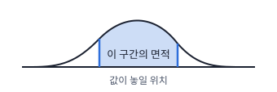
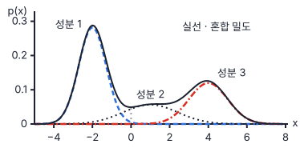
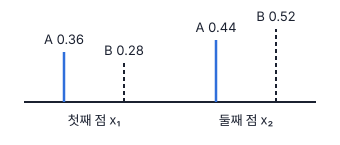
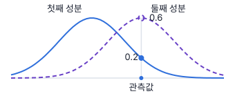

# 가우시안 혼합 모델과 책임도

정방철 교수님 머신러닝기초 · 11월 11일 · MML 6장 및 11장

> [HTML 원본](../정리노트_1111_Gaussian_Mixture_Models.html)과 같은 내용을 담았어요. 그림은 `figures_1111/` 폴더의 SVG, 위젯은 대표 설정의 정적 그림으로 바꿨어요. 수식은 `$…$` / `$$…$$`라서 GitHub, Obsidian, Typora에서 보여요.

**목차**

- [밀도와 혼합](#s0)
  - [여러 봉우리에서 하나의 밀도로](#s0-learning-map)
  - [확률밀도를 읽는 법](#s0-pdf)
  - [확률을 가중치로 쓰는 이유](#s0-convex)
- [가우시안 혼합 모델](#s1)
  - [한 성분의 위치와 모양](#s1-gaussian)
  - [여러 가우시안을 섞는 법](#s1-mixture)
  - [모델을 정하는 파라미터](#s1-parameters)
- [우도와 책임도](#s2)
  - [표본의 혼합밀도에서 로그우도로](#s2-likelihood)
  - [어느 성분에서 왔을 확률인가](#s2-responsibility)
  - [책임도 표를 읽는 법](#s2-matrix)
- [요약 · 예고](#s3)
  - [핵심 식 정리](#s3-cheatsheet)
  - [다음 수업](#s3-next)
  - [관련 자료](#s3-links)

## 밀도와 혼합

### 여러 봉우리에서 하나의 밀도로

**먼저 큰 그림**

관측값이 서로 떨어진 곳에 모여 있으면 각 영역을 함께 설명하는 확률밀도가 필요해요. 오늘은 가우시안 여러 개로 그 밀도를 만드는 방법을 배워요.

평균과 공분산으로 가우시안 하나의 위치와 모양을 정해요. 여러 성분을 쓸 때는 성분마다 그 값을 정하고, 전체에서 각 성분이 차지하는 비중도 정해요.

| 질문 | 구하는 것 |
|---|---|
| 이 모델에서 관측값 주변은 얼마나 조밀한가? | 한 점에서의 혼합 밀도 $p(\mathbf{x}\mid\boldsymbol{\theta})$ |
| 어떤 설정이 관측값 전체에 높은 우도를 주는가? | 파라미터를 비교할 로그우도 $\ell(\boldsymbol{\theta})$ |
| 주어진 모델에서 이 관측값은 어느 성분에서 나왔을까? | 성분별 사후확률인 책임도 $r_{nk}$ |

모델을 하나 정하면 모든 점의 혼합 밀도를 계산할 수 있어요. 모델을 비교할 때는 관측값 전체를 사용하고, 책임도를 구할 때는 모델과 관측값 하나를 고정해요.

각 성분의 밀도에 혼합비를 곱해 더하면 혼합 밀도가 돼요. 독립 표본의 밀도를 곱하고 로그를 취하면 로그우도가 돼요. 한 성분의 가중 밀도를 그 점의 혼합 밀도로 나누면 책임도를 얻어요.

혼합비는 관측값을 보기 전의 성분 선택 확률이에요. 책임도에는 관측한 위치에서 각 성분이 주는 밀도도 반영돼요.

**페이지 요약**

성분을 섞어 밀도를 만들고, 표본 전체로 모델을 비교하고, 관측값 하나의 책임도를 구해요.

*용어*

- **혼합비** — 관측 전의 성분 선택 확률이에요.
- **책임도** — 모델과 관측값이 주어졌을 때의 성분별 사후확률이에요.

---

### 확률밀도를 읽는 법

*1111 수업*

**쉽게 말하면**

어떤 범위에 값이 들어올 가능성은 그 범위의 곡선 아래 면적으로 읽어요. 한 점에는 너비가 없어서 면적도 없어요.

*색칠된 면적만큼 이 구간에 값이 들어올 가능성이 있어요.*

**정확히 말하면**

연속형 값 $X$가 어느 구간에 들어갈 확률은 그 구간에서 확률밀도함수(probability density function, PDF) $f_X$를 적분한 면적이에요. 한 점만 놓고 보면 면적이 없어서 $P(X=x)=0$이에요.

$$
P(a\le X\le b)=\int_a^b f_X(x)\,dx.
$$

확률을 면적으로 읽으려면 밀도는 모든 점에서 음이 아니고, 전체 면적은 1이어야 해요. 폭이 좁은 구간에 확률이 집중되면 밀도의 높이는 1을 넘을 수 있어요.

교과서 계산 예로 $0\le x\le 1$에서 $f_X(x)=3x^2$이고 그 밖에서 0이면, $0\le t\le 1$에서 누적확률은 $F_X(t)=P(X\le t)=\int_0^t3x^2\,dx=t^3$이에요. 이 곡선의 높이 $f_X(1)=3$과 누적확률 $F_X(1)=1$은 서로 다른 값을 읽어요.

**페이지 요약**

밀도는 음이 아니고 전체 적분은 1이에요. 높이가 1보다 큰 점도 있을 수 있고, 한 점의 확률은 0이에요.

*핵심 식*

- 구간 확률

  $$
  P(a\le X\le b)=\int_a^b f_X(x)\,dx.
  $$

---

### 확률을 가중치로 쓰는 이유

*1111 수업*

**정확히 말하면**

면적이 1인 두 밀도를 한 곡선으로 합치면 전체 면적은 어떻게 될까요? 같은 두 곡선의 높이를 그대로 더하면 면적은 $1+1=2$예요. 첫째 높이의 75%, 둘째 높이의 25%만 더하면 각 곡선의 면적도 같은 비율로 줄어요.

$$
0.75\cdot1+0.25\cdot1=1.
$$

면적이 1인 성분을 몇 개 섞더라도, 각 성분에 곱하는 혼합비 $\pi_k$가 음이 아니고 합이 1이면 새 밀도가 돼요. 같은 공간의 $K$개 밀도 $p_1,\ldots,p_K$를 이렇게 섞는 것을 볼록 결합(convex combination)이라고 해요.

$$
p(\mathbf{x})=\sum_{k=1}^{K}\pi_k p_k(\mathbf{x}).
$$

$$
\pi_k\ge0,\qquad \sum_{k=1}^{K}\pi_k=1.
$$

비음수끼리 곱해 더하므로 $p(\mathbf{x})\ge0$이에요. 또 적분을 항별로 하면 각 성분의 면적 1이 남아, 전체 면적은 혼합비의 합이 돼요.

$$
\int p(\mathbf{x})\,d\mathbf{x}=\sum_{k=1}^K\pi_k\int p_k(\mathbf{x})\,d\mathbf{x}
$$

$$
=\sum_{k=1}^K\pi_k=1.
$$

같은 식을 표본을 만드는 순서로 읽을 수 있어요. 먼저 이산 변수 $Z$로 성분 $k$를 확률 $P(Z=k)=\pi_k$에 따라 고르고, 그 성분의 밀도 $p_k$에서 표본을 뽑아요. 성분 번호를 보지 못하면 가능한 모든 $k$의 가중 밀도를 더해요.

이산 기댓값 $\mathbb{E}[g(Z)]=\sum_k\pi_k g(k)$를 떠올려요. 한 위치 $\mathbf{x}$를 고정하고 $g(k)=p_k(\mathbf{x})$를 대입하면 혼합 밀도는 성분별 밀도 높이의 가중평균이에요.

**페이지 요약**

비음수 가중치의 합을 1로 두면 성분들을 섞은 함수도 확률밀도가 돼요.

*용어*

- **볼록 결합(convex combination)** — 가중치가 비음수이며 합이 1인 가중합이에요.
- **혼합비 $\pi_k$** — 관측 전 성분 $k$를 선택할 확률이에요.

---

## 가우시안 혼합 모델

### 한 성분의 위치와 모양

*1111 수업 · MML §6.5 · §11.1*

**쉽게 말하면**

점들이 한 곳에 모여 있다고 생각해요. 모인 곳의 한가운데를 옮기거나, 점들이 어느 쪽으로 더 멀리 흩어지는지 바꿀 수 있어요.

*점은 두 모양의 공통 중심이고, 테두리는 퍼지는 방향을 보여 줘요.*

**정확히 말하면**

가우시안 성분 하나는 관측값이 한 중심 주변에 얼마나 퍼지는지 나타내요. $k$번째 성분의 평균 열벡터 $\boldsymbol{\mu}_k\in\mathbb R^{D}$가 중심이고, 공분산 행렬 $\Sigma_k\in\mathbb R^{D\times D}$가 방향별 퍼짐을 정해요.

이 성분에서 확률벡터 $\mathbf{X}$의 좌표를 $X_i$라고 쓰면, $\Sigma_k$의 $(i,j)$ 칸은 $\operatorname{Cov}(X_i,X_j)$예요. 예를 들어 $(1,2)$와 $(2,1)$은 두 좌표의 평균을 뺀 뒤 곱하고 평균 내는 같은 계산이에요. 그래서 $\Sigma_k$는 대칭이에요. 대각선에서는 같은 좌표를 두 번 써서 $\operatorname{Var}(X_i)$가 나와요.

한 관측 열벡터 $\mathbf{x}\in\mathbb R^{D}$를 넣을 때, 중심에서의 편차를 각 방향의 퍼짐에 맞춰 재요. 그 제곱 거리를 잠깐 $d_k^2(\mathbf{x})$로 적어요.

$$
d_k^2(\mathbf{x})=(\mathbf{x}-\boldsymbol{\mu}_k)^\top\Sigma_k^{-1}(\mathbf{x}-\boldsymbol{\mu}_k)
$$

같은 편차가 행과 열로 들어가므로 $(1\times D)(D\times D)(D\times1)$ 곱의 결과는 숫자 하나예요. 예를 들어 $\Sigma_k=\operatorname{diag}(4,1)$이면 역행렬은 $\operatorname{diag}(1/4,1)$이에요. 편차가 $(1,1)^\top$일 때 행렬을 열에 곱해 $(1/4,1)^\top$를 얻고, 왼쪽의 $(1,1)$과 곱하면 $d_k^2=1/4+1$이에요. 같은 길이의 편차라도 더 넓게 퍼진 첫 좌표에서 더 작게 반영돼요.

이 밀도에는 양의 정부호인 $\Sigma_k$를 사용해요. 그러면 역행렬과 양의 행렬식 $|\Sigma_k|$가 존재하고, 중심을 벗어났을 때 $d_k^2$가 양수예요. 아래의 $c_k$는 전체 적분을 1로 맞추는 정규화 상수예요.

$$
c_k=(2\pi)^{-D/2}|\Sigma_k|^{-1/2}
$$

$$
\mathcal{N}(\mathbf{x}\mid\boldsymbol{\mu}_k,\Sigma_k)=c_k\exp(-d_k^2(\mathbf{x})/2)
$$

중심 $\mathbf{x}=\boldsymbol{\mu}_k$에서 제곱 거리는 0이에요. 중심을 벗어나면 거리 제곱이 양수여서 지수항이 작아져요. 따라서 한 가우시안의 봉우리는 평균 위치 하나에 생겨요. 1차원에서는 $\Sigma_k$ 자리에 분산 $\sigma_k^2\gt0$이 들어가요. 여러 곳에 높은 밀도를 주려면 서로 다른 중심과 퍼짐을 가진 성분을 조합할 수 있어요.

**페이지 요약**

가우시안 하나의 봉우리는 평균에 있어요. 양의 정부호인 공분산은 방향별 퍼짐과 정규화에 쓰여요.

*용어*

- **공분산 행렬 (covariance matrix)** — 대각에는 각 좌표의 분산, 대각 밖에는 두 좌표의 공분산을 담는 대칭 행렬이에요.
- **정규화 상수 (normalization constant)** — $c_k=(2\pi)^{-D/2}|\Sigma_k|^{-1/2}$로, 전체 적분을 1로 맞춰요.

*핵심 식*

- 편차의 제곱 거리

  $$
  d_k^2(\mathbf{x})=(\mathbf{x}-\boldsymbol{\mu}_k)^\top\Sigma_k^{-1}(\mathbf{x}-\boldsymbol{\mu}_k)
  $$
- 가우시안 밀도

  $$
  \mathcal{N}(\mathbf{x}\mid\boldsymbol{\mu}_k,\Sigma_k)=c_k\exp(-d_k^2(\mathbf{x})/2)
  $$

---

### 여러 가우시안을 섞는 법

*1111 수업 · MML §11.1 · 그림 11.2*

**쉽게 말하면**

서로 다른 곳에 점이 모이면 무리마다 하나의 곡선을 그려요. 자주 뽑히는 무리의 곡선은 더 많이 반영하고, 같은 위치의 높이를 합쳐요.

*점선은 각 무리가 보탠 높이예요. 한 위치의 점선 높이를 모두 더하면 실선의 높이가 돼요.*

**정확히 말하면**

관측이 여러 곳에 모일 때 각 성분에 중심과 퍼짐을 따로 줄 수 있어요. [확률을 가중치로 쓰는 이유](#s0-convex)에서 만든 볼록 결합에 가우시안 밀도를 넣으면 가우시안 혼합 모델(GMM)이 돼요. $K$는 성분 개수, $\boldsymbol{\theta}$는 모든 성분의 평균·공분산·가중치를 모은 파라미터예요.

$$
p(\mathbf{x}\mid\boldsymbol{\theta})=\sum_{k=1}^{K}\pi_k\mathcal{N}(\mathbf{x}\mid\boldsymbol{\mu}_k,\Sigma_k)
$$

$\pi_k\ge0$이고 $\sum_{k=1}^K\pi_k=1$이면 이 혼합 밀도 역시 음이 아닌 함수이고 전체 적분이 1이에요. 생성 과정을 생각하면 먼저 확률 $\pi_k$로 성분 번호 $k$를 뽑고, 그 가우시안에서 관측값을 뽑아요. 성분 번호를 모르는 상태에서 관측의 밀도를 구할 때 가능한 모든 번호의 기여를 더해요.

MML 그림 11.2에서는 평균·분산이 각각 $(-2,1/2)$, $(1,2)$, $(4,1)$인 1차원 성분에 $0.5$, $0.2$, $0.3$을 곱해요.

$$
p(x\mid\boldsymbol{\theta})=0.5\mathcal{N}(x\mid-2,1/2)
$$

$$
\phantom{p(x\mid\boldsymbol{\theta})={}}+0.2\mathcal{N}(x\mid1,2)
$$

$$
\phantom{p(x\mid\boldsymbol{\theta})={}}+0.3\mathcal{N}(x\mid4,1)
$$

예를 들어 $x=0$에서 가중 성분의 높이는 차례대로 약 $0.00517$, $0.04394$, $0.00004$예요. 셋을 더하면 혼합 밀도는 약 $0.04915$예요. 이 위치에서는 가중치가 $0.2$인 성분 2의 기여가 가장 커요. 기여는 가중치와 해당 위치의 밀도를 함께 봐야 읽을 수 있어요.

성분이 겹치면 여러 성분이 같은 봉우리에 기여할 수 있어요. 예제 6.4처럼 2차원에서 봉우리가 두 개여도 한 좌표만 남기면 하나로 겹칠 수 있어요. 예제 6.4의 가운데 그림에서는 높은 밀도 쪽으로 모여드는 등고선 한 묶음을 봉우리 하나로 읽어요. 주변 밀도에서는 곡선이 솟았다 내려가는 지점마다 봉우리를 하나 세어요.

**페이지 요약**

같은 위치에서 가우시안별 밀도에 선택 확률을 곱해 더해요. 가중치가 음이 아니고 합이 1이면 혼합 밀도도 전체 적분이 1이에요.

*용어*

- **혼합 가중치 (mixture weight)** — 관측을 뽑기 전에 성분을 선택할 확률이에요.
- **가중 성분 (weighted component)** — 가중치와 해당 위치에서의 가우시안 밀도를 곱한 값이에요. 곡선이 겹치는 곳에서 여러 성분이 같은 봉우리에 기여해요.
- **주변 밀도의 봉우리** — 한 좌표만 남기면 결합 밀도와 봉우리 수가 달라질 수 있어요.

*핵심 식*

- 가우시안 혼합 밀도

  $$
  p(\mathbf{x}\mid\boldsymbol{\theta})=\sum_{k=1}^{K}\pi_k\mathcal{N}(\mathbf{x}\mid\boldsymbol{\mu}_k,\Sigma_k)
  $$

---

### 모델을 정하는 파라미터

*1111 수업 · MML §11.1*

**정확히 말하면**

성분 개수 $K$를 먼저 정하고, 각 성분의 중심·모양·선택 확률을 맞춰요. 좌표가 $D$개라면 성분당 평균은 $D$개의 값이 필요해요. 공분산은 대칭이므로 대각선의 $D$개와 위쪽 삼각형의 $D(D-1)/2$개를 고르면 아래쪽이 정해져요.

$$
D+\frac{D(D-1)}{2}=\frac{D(D+1)}{2}
$$

가중치는 $K$개를 적어요. 그중 $K-1$개를 정하면 마지막 값은 $\pi_K=1-\sum_{k=1}^{K-1}\pi_k$로 결정돼요. 앞서 고른 값들은 모두 음이 아니고 그 합이 1 이하여야 해요. 공분산도 각 성분이 밀도를 갖도록 양의 정부호여야 해요.

| 세는 기준 | 일반식 | $D=2,\ K=3$ |
|---|---|---|
| 기입하는 값 | $K\bigl(D+\frac{D(D+1)}{2}\bigr)+K$ | $3(2+3)+3=18$ |
| 독립 파라미터 수 | $K\bigl(D+\frac{D(D+1)}{2}\bigr)+(K-1)$ | $3(2+3)+2=17$ |

이 값을 모은 $\boldsymbol{\theta}$를 [표본 전체의 로그우도](#s2-likelihood)에 넣어 관측을 얼마나 잘 설명하는지 평가해요.

**페이지 요약**

성분마다 평균 $D$개와 대칭 공분산의 서로 다른 원소를 세고, 합이 1인 가중치에서는 자유롭게 정할 수 있는 $K-1$개를 더해요.

*핵심 식*

- 독립 파라미터 수

  $$
  K\bigl(D+\frac{D(D+1)}{2}\bigr)+(K-1)
  $$

---

## 우도와 책임도

### 표본의 혼합밀도에서 로그우도로

*1111 수업 · MML §11.2*

**쉽게 말하면**

같은 두 점을 두고 두 모형을 비교해요. 두 곡선은 그대로 두고, 첫째 곡선을 섞는 비율만 A에서는 60%, B에서는 80%로 바꿨어요. 한 점씩 보면 두 모형 중 어느 쪽의 높이가 더 클까요?

*첫째 점에서는 A가, 둘째 점에서는 B가 높아요. 점별로 이긴 횟수는 1대 1이에요.*

**정확히 말하면**

이 예시는 계산을 위해 두 점의 위치를 골랐어요. 성분별 높이는 $x_1$에서 첫째 0.2, 둘째 0.6이고 $x_2$에서는 반대로 첫째 0.6, 둘째 0.2예요. 예를 들어 A가 $x_1$에 주는 높이는 두 성분의 가중 밀도를 합한 $0.6\cdot0.2+0.4\cdot0.6=0.36$이에요.

#### 1 / 2 표본별 밀도의 곱

두 관측을 묶어 $\mathcal{X}=(x_1,x_2)$로 적어요. 같은 모델에서 독립적으로 뽑았다고 가정하면, 그림에서 읽은 밀도를 모델별로 곱해요.

$$
p(\mathcal{X}\mid\boldsymbol{\theta}_A)=0.36\cdot0.44=0.1584
$$

$$
p(\mathcal{X}\mid\boldsymbol{\theta}_B)=0.28\cdot0.52=0.1456
$$

두 점의 결합 밀도는 A에서 더 커요. 이처럼 데이터 $\mathcal{X}$를 고정하고 어떤 후보 파라미터 $\boldsymbol{\theta}$가 더 큰 결합 밀도를 주는지 비교할 때, 그 값을 $\boldsymbol{\theta}$의 함수인 **우도**로 읽어요.

$n$번째 관측 열벡터 $\mathbf{x}_n$에서 $K$개 성분의 가중 밀도를 더해요. $\pi_k$는 성분 $k$의 가중치이고, $\boldsymbol{\mu}_k$와 $\Sigma_k$는 그 성분의 평균 벡터와 공분산 행렬이에요.

$$
p(\mathbf{x}_n\mid\boldsymbol{\theta})=\sum_{k=1}^K\pi_k\mathcal{N}(\mathbf{x}_n\mid\boldsymbol{\mu}_k,\Sigma_k)
$$

관측치가 같은 혼합 모델에서 독립적으로 뽑혔다고 가정해요(i.i.d.). 그러면 데이터 $\mathcal{X}=(\mathbf{x}_1,\ldots,\mathbf{x}_N)$의 결합 밀도는 개별 밀도의 곱이에요.

$$
p(\mathcal{X}\mid\boldsymbol{\theta})=\prod_{n=1}^N p(\mathbf{x}_n\mid\boldsymbol{\theta})
$$

#### 2 / 2 표본별 로그의 합

두 점의 높이가 각각 500번씩 곱에 들어간다면 어떻게 될까요? 일반적인 64비트 부동소수점 계산에서는 $0.1584^{500}$과 $0.1456^{500}$이 모두 0으로 반올림돼요.

곱을 만들기 전에 각 높이에 자연로그를 취해 더하면 두 값을 구별할 수 있어요. A에서는 $500(\log 0.36+\log 0.44)\approx-921.3$이에요. B에서는 $500(\log 0.28+\log 0.52)\approx-963.4$예요. 로그는 증가함수라서 정확한 곱에서 더 컸던 A가 로그값에서도 앞서요.

파란색은 바로 윗줄에서 바뀐 부분이에요.

$$
\ell(\boldsymbol{\theta})=\log p(\mathcal{X}\mid\boldsymbol{\theta})
$$

↳ 우도가 양수라 로그를 취해도 순위가 같아요

자세히

최대우도 추정(MLE)은 우도를 최대화하는 파라미터를 찾는 일이에요. 로그우도 $\ell(\boldsymbol{\theta})$를 최대화하거나 $-\ell(\boldsymbol{\theta})$를 최소화해도 목적은 같아요.

$$
\hphantom{\ell(\boldsymbol{\theta})}=\textcolor{#3182f6}{\sum_{n=1}^N\log} p(\mathbf{x}_n\mid\boldsymbol{\theta})
$$

↳ 곱의 로그는 로그의 합

$$
\ell(\boldsymbol{\theta})=\sum_{n=1}^N\log\textcolor{#3182f6}{\left(\sum_{k=1}^K\pi_k p_k(\mathbf{x}_n)\right)}
$$

↳ 한 표본의 혼합 밀도 대입, $p_k$는 성분 $k$의 밀도

자세히

$p_k(\mathbf{x}_n)=\mathcal{N}(\mathbf{x}_n\mid\boldsymbol{\mu}_k,\Sigma_k)$는 성분 $k$가 관측 $n$에서 주는 밀도예요. 안쪽 $k$ 합은 같은 관측치에 대한 성분별 높이를 묶고, 바깥 $n$ 합은 관측치별 로그를 모아요.

**로그 안에 한 표본의 성분 합이 남아요.** 곱의 로그를 합으로 바꾸는 규칙은 표본별 밀도의 곱에 적용해요. 성분별 밀도는 더하므로 그 합은 로그 안에 둬요.

한 성분만 있으면 로그가 가우시안의 지수항을 풀어 주지만, 혼합 모델에서는 로그 안에 성분 합이 남아 성분별 파라미터를 따로 맞추기 어려워요.

**복원 순서.** 한 관측의 가중 밀도를 더해요. 독립인 관측들의 로그우도를 계산할 때는 그 합에 각각 로그를 취한 뒤 모든 관측에 걸쳐 더해요.

모형 A가 첫째 점에 준 높이 0.36은 두 성분이 보탠 값의 합이에요. 이 점을 보고 어느 성분에서 왔을지 판단하려면 두 기여를 어떻게 읽어야 할까요?

**페이지 요약**

같은 두 점에서 혼합비가 다른 모형 A와 B를 비교해요. 점별 높이에서 이긴 횟수가 같을 때 두 점을 함께 보면 어떤 모형이 앞설까요?

*핵심 식*

- 데이터 우도

  $$
  p(\mathcal{X}\mid\boldsymbol{\theta})=\prod_{n=1}^N p(\mathbf{x}_n\mid\boldsymbol{\theta})
  $$
- 로그우도

  $$
  \ell(\boldsymbol{\theta})=\sum_{n=1}^N\log p(\mathbf{x}_n\mid\boldsymbol{\theta})
  $$

로그 안에 한 표본의 성분 합이 남아요. 바깥 합은 독립인 여러 표본을 모아요. 최대우도 추정은 로그우도를 최대화해도 돼요.

---

### 어느 성분에서 왔을 확률인가

*1111 수업 · MML §11.2.1, §11.4.3*

**쉽게 말하면**

[모형을 비교했던 두 점](#s2-likelihood) 가운데 첫째 점을 다시 볼게요. 여기서 둘째 곡선은 첫째보다 세 배 높아요. 첫째 성분이 더 자주 뽑힌다면, 어느 쪽이 이 점을 만들었을 가능성이 더 클까요?

*같은 관측값에서 읽은 밀도는 첫째 0.2, 둘째 0.6이에요. 관측값과 두 곡선은 고정해요.*

#### 직접 해 보기: 혼합비만 바꾸기 *(정적 스냅샷 — 직접 조작은 HTML 버전)*

혼합비는 점을 보기 전에 각 성분을 뽑을 확률이에요. 첫째가 60%일 때부터 시작해서 두 성분이 언제 같은 몫이 되는지 찾아보세요.

| 첫째 혼합비 | 가중 밀도 첫째 / 둘째 | 책임도 첫째 / 둘째 |
|---|---|---|
| 60% | 0.12 / 0.24 | 1/3 / 2/3 |
| 75% | 0.15 / 0.15 | 1/2 / 1/2 |
| 80% | 0.16 / 0.12 | 4/7 / 3/7 |

**왜 75%에서 반반일까요?** 이 점에서 둘째의 밀도가 세 배 높죠. 첫째가 관측 전에 둘째보다 세 배 자주 뽑히면 두 효과가 균형을 이뤄요. 혼합비를 75%와 25%로 나누면 두 가중 밀도가 각각 $0.75\cdot0.2=0.15$, $0.25\cdot0.6=0.15$예요. 이 점의 전체 혼합 밀도 $0.30$을 두 성분이 절반씩 차지해요.

이렇게 **이 점을 본 뒤** 각 성분에 돌아가는 몫을 책임도라고 해요. 이제 방금 곱한 값과 더한 값이 베이즈 식에서 어디에 들어가는지 볼게요.

**정확히 말하면**

위 실험에서는 혼합비를 바꿀 때마다 다른 모델을 비교했어요. 책임도를 한 번 계산할 때는 그중 한 모델 $\boldsymbol{\theta}$와 관측값 $\mathbf{x}_n$을 고정해요. 어느 성분에서 뽑혔는지 나타내는 번호 $Z_n\in\{1,\ldots,K\}$는 관측되지 않았어요. 이 번호가 $k$일 사후확률을 $r_{nk}$라고 써요.

#### 1 / 2 베이즈 식의 분자와 분모

75% 설정에서 읽은 첫째의 가중 밀도 $0.15$를 분자에 놓고, 두 가중 밀도를 더해 분모에 놓아요.

$$
r_{n1}=\frac{0.15}{0.15+0.15}=\frac{0.15}{0.30}=\frac12.
$$

베이즈 정리로 성분이 $K$개인 경우에도 같은 계산이 나와요.

파란색은 바로 윗줄에서 바뀐 부분이에요.

베이즈 정리의 $P(A\mid B)=P(B\mid A)P(A)/P(B)$에서 $A$의 자리는 ‘성분 $k$가 선택됨’이에요. 연속 관측값 $\mathbf{x}_n$에 조건을 걸 때는 $B$가 들어가는 두 자리에서 그 점의 밀도를 써요.

$$
r_{nk}=P(Z_n=k\mid\mathbf{x}_n,\boldsymbol{\theta})
$$

↳ 책임도는 관측 후 성분 번호의 확률

$$
\hphantom{r_{nk}}=\frac{p(\mathbf{x}_n\mid Z_n=k,\boldsymbol{\theta})P(Z_n=k\mid\boldsymbol{\theta})}{p(\mathbf{x}_n\mid\boldsymbol{\theta})}
$$

↳ 베이즈 정리, $B$ 자리에는 $\mathbf x_n$의 밀도

$$
r_{nk}=\frac{\textcolor{#3182f6}{\pi_k\mathcal{N}(\mathbf{x}_n\mid\boldsymbol{\mu}_k,\Sigma_k)}}{\textcolor{#3182f6}{\sum_{j=1}^K\pi_j\mathcal{N}(\mathbf{x}_n\mid\boldsymbol{\mu}_j,\Sigma_j)}}
$$

↳ 분자는 성분 $k$의 가중 밀도, 분모는 모든 성분의 가중 밀도를 더한 전체 혼합 밀도

자세히

$P(A)$의 자리에는 관측 전 선택 확률 $\pi_k$, $P(B\mid A)$의 자리에는 성분 밀도 $\mathcal{N}(\mathbf{x}_n\mid\boldsymbol{\mu}_k,\Sigma_k)$가 들어가요. 분모는 성분 번호를 모를 때의 전체 밀도라 [표본별 혼합 밀도](#s2-likelihood)를 그대로 넣어요. 합의 인덱스 $j$는 분자에서 선택한 $k$를 포함해 모든 성분을 훑어요.

**각각 $0\le r_{nk}\le1$이고 $\sum_{k=1}^K r_{nk}=1$이에요.** 같은 관측치에 대해 분모가 양수이면, 각 분자는 비음수이고 분자들의 합이 분모와 같기 때문이에요.

#### 2 / 2 책임도 계산과 해석

혼합비가 60%였던 자리로 돌아가 두 책임도를 베이즈 식으로 계산해 봐요.

실험에서 읽은 가중 밀도 $0.12$와 $0.24$를 각각 분자에 넣어요. 분모는 두 성분에 공통으로 $0.12+0.24=0.36$이에요.

$$
r_{n1}=\frac{0.12}{0.36}=\frac13,\qquad r_{n2}=\frac{0.24}{0.36}=\frac23
$$

관측 전에는 첫째가 앞섰지만 이 점을 본 뒤에는 둘째가 앞서요. 두 성분의 확률을 함께 남기는 방식이 **소프트 할당**(soft assignment)이에요.

이 점의 책임도는 $(1/3, 2/3)$ 한 줄로 적을 수 있어요. 다른 점들의 책임도까지 구하면 표에는 어떻게 모을까요?

**페이지 요약**

점과 두 곡선을 고정하고 혼합비를 바꿔요. 이 점에서 두 성분이 보탠 밀도가 언제 같은지 비교해요.

*핵심 식*

- 책임도

  $$
  r_{nk}=P(Z_n=k\mid\mathbf{x}_n,\boldsymbol{\theta})
  $$
- 한 관측의 합

  $$
  \sum_{k=1}^K r_{nk}=1
  $$

관측 전의 $\pi_k$에 해당 관측에서의 성분 밀도를 곱해요. 전체 밀도가 양수일 때 그 값으로 나눠요.

---

### 책임도 표를 읽는 법

*1111 수업 · MML Example 11.2*

**정확히 말하면**

[한 관측의 책임도](#s2-responsibility)를 $K\times1$ 열벡터 $\mathbf{r}_n=(r_{n1},\ldots,r_{nK})^\top$로 모아요. $N$개의 관측치를 한 표에 넣을 때는 각 $\mathbf{r}_n$을 전치해 가로 한 줄로 적어요. 이렇게 만든 행렬 $\mathbf{R}=[r_{nk}]\in\mathbb{R}^{N\times K}$의 $n$행 $k$열은 관측 $n$에 대한 성분 $k$의 사후확률이에요.

[같은 두 점](#s2-likelihood)에 모형 A를 고정해요. 첫째 점의 책임도는 실험의 60% 설정에서 얻은 $(1/3,2/3)$예요. 둘째 점에서는 두 가중 밀도가 $0.6\cdot0.6=0.36$과 $0.4\cdot0.2=0.08$이에요. 각각을 합 $0.44$로 나누면 둘째 행의 $(9/11,2/11)$이 돼요.

| 관측치 | 성분 1 | 성분 2 |
|---|---|---|
| $\mathbf{x}_1$ | $1/3$ | $2/3$ |
| $\mathbf{x}_2$ | $9/11$ | $2/11$ |

**행을 읽을 때** 관측 번호를 고정해요. 첫째 행은 $\mathbf{x}_1$의 두 확률을 담고, 그 합은 $1/3+2/3=1$이에요. 성분 2가 더 그럴듯해요.

**열을 읽을 때** 성분 번호를 고정하고 여러 관측치의 책임도를 더해요. 성분 1의 열 합 $1/3+9/11=38/33$은 이 성분에 확률로 배정한 관측 수예요. 여러 점의 몫을 합치므로 열 합은 1보다 클 수 있어요.

다음에는 이 표를 써서 성분의 위치와 모양, 혼합비를 새로 맞춰요. 그러면 책임도도 어떻게 달라질까요?

**페이지 요약**

책임도 행렬의 행은 관측치 하나에 대해, 열은 성분 하나에 대해 읽어요.

*용어*

- **행** — 한 관측의 성분별 사후확률이며 합은 1이에요.
- **열** — 같은 성분에 대한 여러 관측의 책임도예요. 교과서의 열 합은 그 성분에 확률로 배정한 관측 수예요.

---

## 요약 · 예고

### 핵심 식 정리

| 구할 것 | 계산과 조건 |
|---|---|
| [한 점의 혼합 밀도](#s1-mixture) | 성분 $k$의 가우시안 밀도 $p_k(\mathbf{x})$에 혼합비 $\pi_k$를 곱해 더해요. $\pi_k\ge0$, $\sum_k\pi_k=1$이에요. |
| [데이터 전체의 로그우도](#s2-likelihood) | 독립 표본이면 $\ell(\boldsymbol{\theta})=\sum_n\log p(\mathbf{x}_n\mid\boldsymbol{\theta})$예요. 각 표본에서 성분을 섞은 뒤 로그를 취해요. |
| [한 관측값의 책임도](#s2-responsibility) | 성분의 가중 밀도를 그 관측의 혼합 밀도로 나눠요. 분모가 양수일 때 $r_{nk}=\pi_k p_k(\mathbf{x}_n)/p(\mathbf{x}_n\mid\boldsymbol{\theta})$예요. |

---

### 다음 수업

- EM 알고리즘의 E-step과 M-step
- 평균·공분산·혼합비 갱신 유도

---

### 관련 자료

- [11월 11일 복습문제](복습문제_1111_Gaussian_Mixture_Models.md)
- [11월 11일 문제설명](../문제설명_1111_Gaussian_Mixture_Models.html)
- [통계적 추론 1](../../../강의노트/추가%20강의/eli5_lecture10_statistical_inference_part1.html)
- [통계적 추론 2](../../../강의노트/추가%20강의/eli5_lecture11_statistical_inference_part2.html)
- [통계적 추론 3](../../../강의노트/추가%20강의/eli5_lecture12_statistical_inference_part3.html)

복습문제 8문항

- [문제지 PDF](../복습문제_1111_Gaussian_Mixture_Models-문제.pdf)
- [해설지 PDF](../복습문제_1111_Gaussian_Mixture_Models-답안.pdf)

---

자료 · 정방철 교수님 머신러닝기초 11월 11일 수업 전사 · Deisenroth, Faisal, Ong, *Mathematics for Machine Learning* 6장 및 11장.
