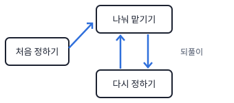
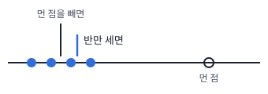
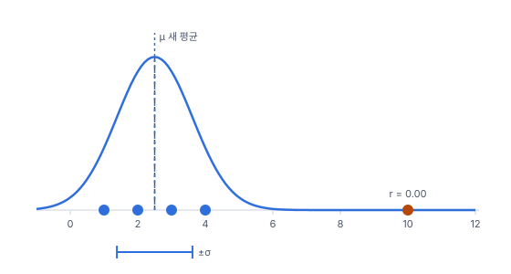
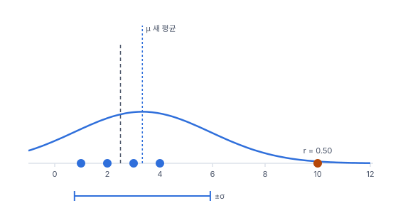
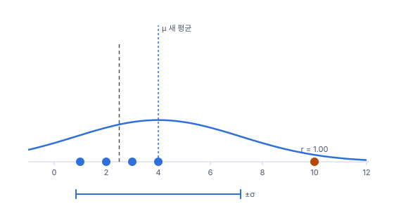
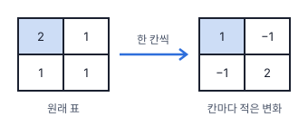

# EM 알고리즘과 GMM 갱신식 — 5살도 이해하는 정리노트

정방철 교수님 머신러닝기초 · 1116 수업 (Lecture07 Density Estimation Part1, MML 11장)

> `정리노트_1116_EM_Algorithm.html`를 마크다운으로 옮겼어요. 그림은 `figures_1116/` 폴더의 SVG, 위젯은 대표 설정의 정적 그림으로 바꿨어요. 수식은 `$…$` / `$$…$$`라서 GitHub, Obsidian, Typora에서 보여요.

**목차**

- [0. 왜 반복해서 맞추나](#s0)
  - [책임도로 평균·공분산·가중치를 고치는 반복](#s0-learning-map)
  - [미분을 0으로 놓아도 바로 풀리지 않는 이유](#s0-why-iterate)
- [1. EM 알고리즘](#s1)
  - [E-step과 M-step의 순서](#s1-em-steps)
  - [갱신식은 책임도로 가중한 평균·공분산·비율](#s1-update-meaning)
  - [반복하면서 밀도가 데이터에 맞춰지는 모습](#s1-em-example)
- [2. 평균 갱신식 유도](#s2)
  - [기울기를 0으로: 무엇을 무엇으로 미분하나](#s2-zero-gradient)
  - [가우시안 밀도를 평균으로 미분하기](#s2-log-gauss)
  - [이차형식 미분 공식 확인](#s2-quadform)
  - [책임도가 나타나고 평균 갱신식이 나오기까지](#s2-mu-proof)
- [3. 공분산 갱신식 유도](#s3)
  - [스칼라를 행렬로 미분한다는 뜻](#s3-matrix-deriv)
  - [공분산 갱신식을 손으로 정리하기](#s3-sigma-proof)
- [4. 요약 · 예고](#s4)
  - [핵심 식 정리](#s4-cheatsheet)
  - [다음 수업](#s4-next)
  - [관련 자료](#s4-links)

## 0. 왜 반복해서 맞추나

### 책임도로 평균·공분산·가중치를 고치는 반복

*1116 수업 · L07 s12*

**먼저 큰 그림**

지난 수업에서 가우시안 혼합 모델(GMM)의 로그우도 $\mathcal{L}(\boldsymbol{\theta})$와 책임도 $r_{nk}$를 정의했어요. 오늘의 질문은 로그우도를 가장 크게 만드는 파라미터 ${\boldsymbol{\theta}=\{\pi_k,\boldsymbol{\mu}_k,\Sigma_k\}}$를 어떻게 찾느냐예요. 답은 책임도를 고정하고 파라미터를 고치는 일을 번갈아 되풀이하는 EM(Expectation-Maximization) 알고리즘이에요. 기울기를 0으로 놓은 식을 한 번에 풀 수 없는 까닭은 [미분을 0으로 놓아도 바로 풀리지 않는 이유](#s0-why-iterate)에서 다뤄요.

책임도 $r_{nk}$는 지난 수업과 같은 양이에요. 현재 모델에서 점 $\mathbf{x}_n$이 성분 $k$에서 나왔을 사후확률이고, 한 점의 책임도를 모든 성분에 대해 더하면 1이에요. 오늘 달라지는 것은 이 값을 가중치로 쓴다는 점이에요. 성분 $k$의 평균·공분산·가중치를 다시 계산할 때 각 점은 $r_{nk}$만큼만 기여해요. 성분이 하나뿐이라 모든 가중치가 1이면, 이 계산은 가우시안 하나의 최대우도 추정값인 표본평균과 $1/N$ 표본공분산으로 돌아가요.

| 단계 | 고정하는 것 | 새로 계산하는 것 | 결과의 모양 |
|---|---|---|---|
| E-step | 현재 파라미터 값 $\pi_k$, $\boldsymbol{\mu}_k$, $\Sigma_k$ 전부 | 책임도 $r_{nk}$와 총 책임도 $N_k=\sum_{n}r_{nk}$ | $r_{nk}$는 $N\times K$ 숫자 표(각 칸 0~1, 한 점의 행 합 1), $N_k$는 성분마다 실수 하나(열 합) |
| M-step: 평균 | E-step에서 구한 $r_{nk}$, $N_k$ | $\boldsymbol{\mu}_k^{\text{new}}$: $r_{nk}$로 가중한 데이터 평균 | 성분마다 $D\times1$ 벡터 값 |
| M-step: 공분산 | $r_{nk}$, $N_k$와 방금 구한 $\boldsymbol{\mu}_k^{\text{new}}$ | $\Sigma_k^{\text{new}}$: $r_{nk}$로 가중한 외적 $(\mathbf{x}_n-\boldsymbol{\mu}_k^{\text{new}})(\mathbf{x}_n-\boldsymbol{\mu}_k^{\text{new}})^\top$의 평균 | 성분마다 $D\times D$ 대칭 행렬 값 |
| M-step: 가중치 | $N_k$와 데이터 수 $N$ | $\pi_k^{\text{new}}=N_k/N$: 전체 기여량 중 성분 $k$의 몫 | 성분마다 스칼라 값, $K$개의 합이 1 |

EM이 내놓는 것은 분포가 아니라 파라미터 값이에요. 한 번 돌 때마다 새 추정값 $\pi_k^{\text{new}}$, $\boldsymbol{\mu}_k^{\text{new}}$, $\Sigma_k^{\text{new}}$를 얻고, 이 값을 넣은 혼합 밀도가 그 회차의 모델이에요. M-step의 결과는 다음 E-step에서 고정하는 값이 돼요. 가중치 갱신식 $\pi_k^{\text{new}}=N_k/N$은 오늘 알고리즘 식과 '기여 비율'이라는 뜻만 다루고, 유도는 다음 수업에서 해요.

M-step 식은 로그우도의 기울기를 0으로 놓는 조건에서 나와요. 2절과 3절은 ${\partial\mathcal{L}/\partial\boldsymbol{\mu}_k=\mathbf{0}^\top}$과 ${\partial\mathcal{L}/\partial\Sigma_k=\mathbf{0}}$을 풀면 책임도가 저절로 나타나 위 표의 갱신식이 된다는 것을 확인하는 계산이에요. 계산에 앞서 [갱신식은 책임도로 가중한 평균·공분산·비율](#s1-update-meaning)에서 각 식이 무엇을 평균하는지 먼저 읽어요.

갱신식은 한 번 대입하면 끝나는 닫힌 해가 아니에요. 오른쪽의 $r_{nk}$가 모든 성분의 $\pi_j$, $\boldsymbol{\mu}_j$, $\Sigma_j$로 계산되므로, 새 값을 넣으면 책임도도 바뀌어요. 그래서 E-step과 M-step을 되풀이해요. 또 한 점의 $r_{nk}$는 0과 1 사이지만, $N_k$는 여러 점의 확률을 더한 값이라 1보다 클 수 있어요.

**페이지 요약**

책임도를 고정해 파라미터 값을 고치고, 새 값으로 책임도를 다시 구하는 일을 되풀이해요.

*핵심 식*

- 총 책임도

  $$
  N_k=\sum_{n}r_{nk}
  $$
- 가중치 갱신

  $$
  \pi_k^{\text{new}}=N_k/N
  $$

*용어*

- **E-step** — 현재 $\pi_k$, $\boldsymbol{\mu}_k$, $\Sigma_k$를 고정하고 $r_{nk}$와 $N_k$를 계산해요.
- **M-step** — $r_{nk}$를 고정하고 평균·공분산·가중치 값을 다시 계산해요.
- **책임도(responsibility)** — 점 $\mathbf{x}_n$이 성분 $k$에서 나왔을 사후확률 $r_{nk}$예요. 한 점의 행 합은 1이에요.
- **결과의 종류** — 분포가 아니라 파라미터 값이에요. 새 값을 넣으면 책임도가 바뀌어 반복해요.

---

### 미분을 0으로 놓아도 바로 풀리지 않는 이유

*1116 수업 · L07 s7, s10, s14 · MML §11.2*

**쉽게 말하면**

무리의 중심을 알아야 점마다 어느 무리가 얼마나 맡을지 나눌 수 있고, 그 몫을 알아야 중심을 정할 수 있어요. 그래서 몫을 잠깐 나눠 두고 중심을 옮긴 뒤, 다시 몫을 나누는 일을 되풀이해요.

*두 일을 번갈아 하면서 중심과 몫을 함께 맞춰 가요.*

**정확히 말하면**

로그우도를 최대로 만드는 파라미터는 보통 기울기를 0으로 놓아 찾아요. 가우시안 하나라면 그 식이 데이터만으로 바로 풀려요. 혼합 모델에서는 로그 안에 성분 합이 있어서 기울기 식마다 책임도 $r_{nk}$가 나타나고, $r_{nk}$는 모든 파라미터에 의존해요. 그래서 closed form(닫힌 해)이 없고, 책임도를 고정한 채 파라미터를 고치는 반복으로 가요.

#### 1 / 4 로그우도와 필요조건

무엇을 최대로 만들고, 그 점이 어떤 조건을 만족해야 하는지 정해요.

파란색은 바로 윗줄에서 바뀐 부분이에요.

관측 데이터 ${\mathcal{X}=\{\mathbf{x}_1,\ldots,\mathbf{x}_N\}}$($\mathbf{x}_n\in\mathbb{R}^{D}$)이 같은 혼합 모델에서 독립적으로 뽑혔다고(i.i.d.) 가정해요. 한 단계씩 전개한 과정은 [1111 정리노트의 ‘표본의 혼합밀도에서 로그우도로’](../../1111/정리노트_1111_Gaussian_Mixture_Models.html#s2-likelihood)에 있어요.

$$
p(\mathcal{X}\mid\boldsymbol{\theta})=\prod_{n=1}^{N}p(\mathbf{x}_n\mid\boldsymbol{\theta})
$$

↳ i.i.d.라서 점별 밀도의 곱

$$
\mathcal{L}(\boldsymbol{\theta})=\log p(\mathcal{X}\mid\boldsymbol{\theta})
$$

↳ 로그우도는 데이터 우도의 로그

$$
\hphantom{\mathcal{L}(\boldsymbol{\theta})}=\textcolor{#3182f6}{\sum_{n=1}^{N}\log}\,p(\mathbf{x}_n\mid\boldsymbol{\theta})
$$

↳ 곱의 로그는 로그의 합

자세히

로그는 증가함수라서 우도를 최대로 만드는 $\boldsymbol{\theta}$와 로그우도를 최대로 만드는 $\boldsymbol{\theta}$가 같아요. 수업에서 밑을 생략한 $\log$는 자연로그예요.

$$
\mathcal{L}(\boldsymbol{\theta})=\sum_{n=1}^{N}\log\textcolor{#3182f6}{\sum_{k=1}^{K}\pi_k\mathcal{N}(\mathbf{x}_n\mid\boldsymbol{\mu}_k,\Sigma_k)}
$$

↳ 점마다 혼합 밀도를 대입, 로그 안에 성분 합이 남아요

##### 최대점이 만족해야 할 조건

$\boldsymbol{\theta}_{\text{ML}}$은 $\mathcal{L}(\boldsymbol{\theta})$를 최대로, 곧 $-\mathcal{L}(\boldsymbol{\theta})$를 최소로 만드는 값이에요. 그런 점에서는 각 파라미터에 대한 기울기가 0이어야 해요(MML 식 11.12–11.13).

$$
\boldsymbol{\theta}_{\text{ML}}=\arg\min_{\boldsymbol{\theta}}\big(-\mathcal{L}(\boldsymbol{\theta})\big)
$$

↳ 로그우도 최대화는 음의 로그우도 최소화

$$
\frac{\partial\mathcal{L}}{\partial\boldsymbol{\mu}_k}=\mathbf{0}^\top
$$

↳ $\boldsymbol{\mu}_k$가 $D\times1$이라 기울기는 $1\times D$ 행벡터예요

$$
\frac{\partial\mathcal{L}}{\partial\Sigma_k}=\mathbf{0}
$$

↳ $\Sigma_k$와 같은 $D\times D$ 모양, 우변은 영행렬

가중치 $\pi_k$는 모두 더해 1이어야 한다는 제약이 함께 있어서 조건을 세우는 방법이 달라요. $\pi_k$의 유도는 다음 수업에서 해요.

**기울기 0은 필요조건이에요.** 최대점이면 기울기가 0이지만, 기울기가 0인 점은 최적이 아닐 수도 있고, 최적이어도 국소 최적(local optimum)일 수 있어요. 볼록하지 않은(non-convex) 문제에서는 조건을 만족하는 점이 여럿일 수 있어요. 그러면 이 조건식을 풀면 될까요? 가우시안 하나에서 먼저 확인해요.

#### 2 / 4 가우시안 하나면 바로 풀려요

성분이 하나($K=1$, $\pi_1=1$)일 때 기울기 0 식이 데이터만으로 풀리는지 확인해요.

성분 합 $\sum_k$가 사라지므로 로그가 가우시안에 바로 닿아 지수를 벗겨 내요(MML 식 11.11). 평균 $\boldsymbol{\mu}$는 $D\times1$, 공분산 $\Sigma$는 $D\times D$ 대칭·양의 정부호 행렬이에요.

$$
\log\mathcal{N}(\mathbf{x}_n\mid\boldsymbol{\mu},\Sigma)=-\frac{D}{2}\log(2\pi)-\frac12\log|\Sigma|-\frac12(\mathbf{x}_n-\boldsymbol{\mu})^\top\Sigma^{-1}(\mathbf{x}_n-\boldsymbol{\mu})
$$

↳ 로그가 지수를 벗겨 $\boldsymbol{\mu}$의 이차식만 남아요

$$
\sum_{n=1}^{N}(\mathbf{x}_n-\boldsymbol{\mu})^\top\Sigma^{-1}=\mathbf{0}^\top
$$

↳ $\partial\mathcal{L}/\partial\boldsymbol{\mu}$($1\times D$ 행벡터)를 0으로, 미분은 [가우시안 밀도를 평균으로 미분하기](#s2-log-gauss)

$$
\boldsymbol{\mu}_{\text{ML}}=\frac{1}{N}\sum_{n=1}^{N}\mathbf{x}_n
$$

↳ 오른쪽에서 $\Sigma$ 곱하고 양변 전치, $\sum_n\boldsymbol{\mu}=N\boldsymbol{\mu}$라 $N$으로 나눠요

**오른쪽에 데이터만 남아 한 번에 계산돼요.** 구하려는 값을 주어진 양만으로 바로 쓴 해가 closed form이에요. 공분산도 같은 방식으로 $1/N$ 표본공분산이 닫힌 해로 나와요(MML 8장). 혼합에서 같은 계산을 하면 무엇이 달라질까요?

#### 3 / 4 혼합이면 책임도가 끼어들어요

같은 기울기 0 조건을 혼합 로그우도에 적용하고, 어디서 막히는지 찾아요.

이번에는 로그 안에 성분 합이 있어서 로그가 가우시안의 지수에 바로 닿지 못해요. log 안의 합 때문에 $1/p(\mathbf{x}_n\mid\boldsymbol{\theta})$가 남고, 이것이 $\pi_k\mathcal{N}(\mathbf{x}_n\mid\boldsymbol{\mu}_k,\Sigma_k)$와 묶여 책임도가 돼요(MML 식 11.15).

$$
\frac{\partial\mathcal{L}}{\partial\boldsymbol{\mu}_k}=\sum_{n=1}^{N}r_{nk}(\mathbf{x}_n-\boldsymbol{\mu}_k)^\top\Sigma_k^{-1}
$$

↳ $1/p$와 $\pi_k\mathcal{N}$이 묶여 $r_{nk}$, 유도는 [책임도가 나타나고 평균 갱신식이 나오기까지](#s2-mu-proof)

$$
\boldsymbol{\mu}_k=\frac{\sum_{n=1}^{N}r_{nk}\mathbf{x}_n}{\sum_{n=1}^{N}r_{nk}}
$$

↳ 0으로 놓고 2단계와 같은 연산(오른쪽 $\Sigma_k$ 곱·양변 전치), $r_{nk}$는 스칼라

##### 왜 이것이 닫힌 해가 아닌가

2단계의 결과와 비교하면 달라진 것은 가중치 $r_{nk}$ 하나예요. 모든 $r_{nk}$가 1이면 표본평균으로 돌아가요. 그런데 가중치를 정의대로 쓰면 다음과 같아요.

$$
r_{nk}=\frac{\pi_k\mathcal{N}(\mathbf{x}_n\mid\boldsymbol{\mu}_k,\Sigma_k)}{\sum_{j=1}^{K}\pi_j\mathcal{N}(\mathbf{x}_n\mid\boldsymbol{\mu}_j,\Sigma_j)}
$$

분자에는 구하려는 $\boldsymbol{\mu}_k$가 다시 들어 있고, 분모에는 모든 성분의 $\pi_j$, $\boldsymbol{\mu}_j$, $\Sigma_j$가 들어 있어요. 그래서 위 식은 $\boldsymbol{\mu}_k$를 데이터만으로 나타낸 해가 아니라 양변에 $\boldsymbol{\mu}_k$가 있는 방정식이에요. $\Sigma_k$와 $\pi_k$의 조건도 똑같이 $r_{nk}$로 표현되어, 모든 파라미터가 책임도를 통해 서로 얽혀요(MML 정리 11.1 뒤 설명).

**막히는 곳은 로그 안의 합이에요.** 합 때문에 기울기 식에 책임도가 나타나고, 책임도가 모든 파라미터에 의존해 식을 한 번에 풀 수 없어요. 그러면 책임도를 잠시 고정하면 어떨까요?

#### 4 / 4 책임도를 고정하고 번갈아 고쳐요

얽힌 고리를 끊으려고 책임도를 현재 값으로 고정해요.

$r_{nk}$를 현재 $\boldsymbol{\theta}$에서 계산한 숫자로 고정하면, 3단계 마지막 식의 오른쪽에는 데이터와 고정된 숫자만 남아요. 그러면 $\boldsymbol{\mu}_k$는 가중 평균으로 바로 계산돼요. 새 값을 넣으면 책임도가 달라지므로, 책임도를 다시 계산하고 또 고쳐요. 책임도를 계산하는 단계가 E-step이고, 고정한 책임도로 파라미터를 고치는 단계가 M-step이에요. 한쪽을 고정하고 다른 쪽을 고치는 이런 방식을 교대 최적화(alternating optimization)라고도 불러요.

##### 작은 예: 점 세 개, 성분 두 개

1차원 점 $x_1=0$, $x_2=1$, $x_3=5$에 성분 두 개를 맞춰요. 1차원이라 평균은 스칼라 $\mu_1$, $\mu_2$예요. 예를 짧게 하려고 두 성분의 분산은 1, 가중치는 $\pi_1=\pi_2=1/2$로 고정하고 평균만 고쳐요. 처음 평균은 $\mu_1=0$, $\mu_2=4$예요.

| 값 | 1회차 | 2회차 |
|---|---|---|
| 고정한 평균 $(\mu_1,\mu_2)$ | $(0,\ 4)$ | $(0.496,\ 4.928)$ |
| 성분 1의 책임도 $r_{11}$, $r_{21}$, $r_{31}$ | $1.000$, $0.982$, $0.000$ | $1.000$, $0.9995$, $0.000$ |
| 새 평균 $\mu_1^{\text{new}}$, $\mu_2^{\text{new}}$ | $0.496$, $4.928$ | $0.500$, $4.998$ |

1회차의 새 평균은 3단계 마지막 식에 고정한 책임도를 넣은 값이에요.

$$
\mu_1^{\text{new}}=\frac{1.000\cdot0+0.982\cdot1+0.000\cdot5}{1.000+0.982+0.000}=\frac{0.982}{1.982}\approx0.496
$$

이 값은 $\mu_1=0$일 때의 책임도로 계산했어요. $\mu_1=0.496$을 넣으면 $r_{21}$이 $0.982$에서 $0.9995$로 바뀌므로 다시 계산해야 해요. 이 예에서 2회차의 변화는 1회차보다 훨씬 작아요.

**복원 순서.** 로그우도의 기울기를 0으로 놓아요. 가우시안 하나면 데이터만으로 풀려요. 혼합이면 로그 안의 합 때문에 책임도가 끼어들고, 책임도가 모든 파라미터에 의존해 한 번에 풀리지 않아요. 책임도를 고정하면 풀리므로 E-step과 M-step을 번갈아 반복해요.

**교수님 말씀**

> “말이 러닝이지 사실 최적화”

파라미터를 정하는 일을 학습이라고 부르지만, 실제로 하는 일은 로그우도를 최적화하는 것이라는 뜻이에요.

> “단번에 미분을 해서 0이 되는 점을 클로즈드 폼으로 … 찾는 거는 거의 불가능하다.”

그래서 부분부분 미분해 0이 되는 점을 찾아 업데이트하고, 이를 반복하는 EM 알고리즘을 쓴다고 설명하셨어요.

> “그 알고리즘에서 가장 중요한 역할을 하는 것 중의 하나가 리스폰서빌리티라는 거다.”

**페이지 요약**

가우시안 하나면 기울기 0 식이 바로 풀리지만, 혼합은 로그 안의 합 때문에 책임도가 끼어들어 반복으로 풀어요.

*핵심 식*

- 혼합 로그우도

  $$
  \mathcal{L}(\boldsymbol{\theta})=\sum_{n=1}^{N}\log\sum_{k=1}^{K}\pi_k\mathcal{N}(\mathbf{x}_n\mid\boldsymbol{\mu}_k,\Sigma_k)
  $$
- 필요조건

  $$
  \frac{\partial\mathcal{L}}{\partial\boldsymbol{\mu}_k}=\mathbf{0}^\top
  $$
- 혼합의 평균 기울기

  $$
  \frac{\partial\mathcal{L}}{\partial\boldsymbol{\mu}_k}=\sum_{n=1}^{N}r_{nk}(\mathbf{x}_n-\boldsymbol{\mu}_k)^\top\Sigma_k^{-1}
  $$
- 가우시안 하나

  $$
  \boldsymbol{\mu}_{\text{ML}}=\frac{1}{N}\sum_{n=1}^{N}\mathbf{x}_n
  $$
- 혼합의 평균 조건

  $$
  \boldsymbol{\mu}_k=\frac{\sum_{n=1}^{N}r_{nk}\mathbf{x}_n}{\sum_{n=1}^{N}r_{nk}}
  $$

$r_{nk}$ 안에 $\boldsymbol{\mu}_k$와 모든 성분의 $\pi_j$, $\boldsymbol{\mu}_j$, $\Sigma_j$가 들어 있어 혼합의 평균 조건은 닫힌 해가 아니에요.

*용어*

- **필요조건(necessary condition)** — 최대점이면 기울기가 0이에요. 기울기가 0인 점은 최적이 아닐 수도 있어요.
- **closed form(닫힌 해)** — 구하려는 값을 주어진 양만으로 바로 쓴 해예요.
- **국소 최적(local optimum)** — 기울기가 0인 점이 최적이어도 국소 최적일 수 있어요.
- **교대 최적화(alternating optimization)** — 책임도를 고정하고 파라미터를 고친 뒤 다시 책임도를 구해요.

---

## 1. EM 알고리즘

### E-step과 M-step의 순서

*1116 수업 · L07 s12 · MML §11.3*

**쉽게 말하면**

먼저 점마다 어느 무리가 얼마나 맡을지 나누고, 그 몫대로 무리의 자리와 크기를 다시 정해요.

이 두 일을 더 바뀌지 않을 때까지 번갈아 되풀이해요.

*맡을 몫이 바뀌면 자리가 바뀌고, 자리가 바뀌면 맡을 몫도 다시 바뀌어요.*

**정확히 말하면**

로그우도 $\mathcal{L}(\boldsymbol{\theta})$를 키우는 ${\boldsymbol{\theta}=\{\pi_k,\boldsymbol{\mu}_k,\Sigma_k\}}$는 어떤 순서로 계산할까요? 두 단계를 번갈아 되풀이해요. **E-step**은 파라미터를 고정하고 책임도 $r_{nk}$를 계산해요. **M-step**은 그 책임도를 고정하고 $\boldsymbol{\mu}_k$, $\Sigma_k$, $\pi_k$를 다시 계산해요. 이 둘을 묶은 절차가 EM(Expectation-Maximization) 알고리즘이에요.

한 번에 끝나지 않는 이유는 M-step 식 안의 $r_{nk}$가 다시 모든 $\pi_j$, $\boldsymbol{\mu}_j$, $\Sigma_j$로 계산되기 때문이에요. 새 파라미터를 얻으면 책임도도 달라져요([미분을 0으로 놓아도 바로 풀리지 않는 이유](#s0-why-iterate)).

1. **S1 초기화.** $\pi_k$, $\boldsymbol{\mu}_k$, $\Sigma_k$를 임의로 정해요. 평균은 영벡터, 모든 원소가 1인 벡터처럼 아무 곳에나 흩어 둬요. 가우시안 밀도를 계산할 수 있도록 $\Sigma_k$는 대칭·양의 정부호 행렬로, $\pi_k$는 합이 1이 되게 둬요.
2. **S2 E-step.** 현재 파라미터로 모든 $n=1,\ldots,N$과 $k=1,\ldots,K$에 대해 책임도를 계산하고, 성분마다 데이터 방향으로 더한 총 책임도 $N_k$를 구해요.

   $$
   r_{nk}=\frac{\pi_k\mathcal{N}(\mathbf{x}_n\mid\boldsymbol{\mu}_k,\Sigma_k)}{\sum_{j=1}^K\pi_j\mathcal{N}(\mathbf{x}_n\mid\boldsymbol{\mu}_j,\Sigma_j)}
   $$

   $$
   N_k=\sum_{n=1}^N r_{nk}
   $$
3. **S3 M-step.** 방금 구한 $r_{nk}$를 고정하고 세 파라미터를 다시 계산해요. 평균을 먼저 구하고, 공분산에는 그 새 평균을 넣어요.

   $$
   \boldsymbol{\mu}_k^{\text{new}}=\frac{1}{N_k}\sum_{n=1}^N r_{nk}\mathbf{x}_n
   $$

   $$
   \Sigma_k^{\text{new}}=\frac{1}{N_k}\sum_{n=1}^N r_{nk}(\mathbf{x}_n-\boldsymbol{\mu}_k^{\text{new}})(\mathbf{x}_n-\boldsymbol{\mu}_k^{\text{new}})^\top
   $$

   $$
   \pi_k^{\text{new}}=\frac{N_k}{N}
   $$

   그다음 새 값을 들고 S2로 돌아가요. 로그우도나 파라미터가 거의 변하지 않으면 멈춰요.

책임도는 관측치 $\mathbf{x}_n$을 현재 모델이 만들었다고 할 때 성분 $k$가 맡는 몫이에요. 정의와 베이즈 해석은 [1111 정리노트의 책임도 설명](../../1111/정리노트_1111_Gaussian_Mixture_Models.html#s2-responsibility)에 있어요. 여기서는 E-step이 만든 숫자들이 어떤 모양이고 M-step에 무엇을 넘기는지 봐요.

##### E-step의 결과는 N×K 책임도 표예요

$r_{nk}$를 행 $n$(관측치), 열 $k$(성분)에 놓으면 $N\times K$ 표가 돼요. 관측치 4개, 성분 2개인 작은 예로 읽어 봐요.

| 관측치 | $r_{n1}$ | $r_{n2}$ | 행 합 |
|---|---|---|---|
| $\mathbf{x}_1$ | 0.9 | 0.1 | 1 |
| $\mathbf{x}_2$ | 0.7 | 0.3 | 1 |
| $\mathbf{x}_3$ | 0.2 | 0.8 | 1 |
| $\mathbf{x}_4$ | 0.1 | 0.9 | 1 |
| 열 합 | $N_1=1.9$ | $N_2=2.1$ | $N=4$ |

- **행 합은 1이에요.** 한 관측치의 $r_{n1},\ldots,r_{nK}$는 그 점이 어느 성분에서 왔는지에 대한 확률분포라서 $\sum_{k=1}^K r_{nk}=1$이에요.
- **열 합은 $N_k$예요.** 성분 $k$가 데이터 전체에서 맡은 양이에요. 확률을 여러 개 더한 값이라 1보다 클 수 있고 정수일 필요도 없어요. 위 표의 $N_1=1.9$는 "관측치 약 1.9개 분량"으로 읽어요.
- **전체 합은 $N$이에요.** 표의 모든 칸을 행부터 더하든 열부터 더하든 같아요.

$$
\sum_{k=1}^K N_k=\sum_{k=1}^K\sum_{n=1}^N r_{nk}
$$

↳ $N_k$의 정의를 넣어요

$$
\hphantom{\sum_{k=1}^K N_k}=\sum_{n=1}^N\sum_{k=1}^K r_{nk}
$$

↳ 유한합이라 더하는 순서를 바꿔도 돼요

$$
\sum_{k=1}^K N_k=\sum_{n=1}^N 1=N
$$

↳ 각 행의 합이 1이에요

##### M-step은 표를 고정한 채 세 값을 계산해요

M-step의 세 식은 모두 이 표의 열 $k$ 하나만 써요. 평균은 열 $k$를 가중치로 점들을 평균하고, 공분산은 같은 가중치로 편차를 평균하고, 비율은 열 합을 전체로 나눠요. 각 식의 뜻은 [갱신식은 책임도로 가중한 평균·공분산·비율](#s1-update-meaning)에서 하나씩 풀어요.

**공분산에는 새 평균을 써요.** 슬라이드 L07 s12는 공분산 식의 편차를 $\mathbf{x}_n-\boldsymbol{\mu}_k$로 적었어요. MML 11.3절은 (11.54)에서 갱신한 평균을 (11.55)의 공분산 갱신에 쓴다고 밝혀요. 그래서 이 식의 $\boldsymbol{\mu}_k$는 같은 M-step에서 방금 구한 $\boldsymbol{\mu}_k^{\text{new}}$예요. 공분산은 "같은 가중치로 본 중심에서 얼마나 퍼졌나"를 재므로, 그 중심도 같은 가중치로 구한 평균이어야 앞뒤가 맞아요.

**비율은 전체 몫 중 성분 $k$의 몫이에요.** 모든 관측치의 책임도를 더한 전체 기여량은 $N$이고, 그중 성분 $k$의 몫이 $N_k$예요. 그래서 $\pi_k^{\text{new}}=\frac{N_k}{N}$이에요. 위 표에서는 $\pi_1^{\text{new}}=1.9/4=0.475$, $\pi_2^{\text{new}}=2.1/4=0.525$이고 합은 1이에요. 이 식을 로그우도에서 유도하는 과정은 다음 수업에서 다뤄요.

**복원 요령.** E-step은 "파라미터 고정, $N\times K$ 표 채우기"예요. 행 합은 1, 열 합은 $N_k$예요. M-step은 "표 고정, 열 $k$로 평균 먼저, 그 평균으로 공분산, 열 합으로 비율"이에요.

**페이지 요약**

파라미터를 고정해 책임도 표를 채우는 E-step과, 표를 고정해 파라미터를 다시 계산하는 M-step을 번갈아 되풀이해요.

*핵심 식*

- E-step: 책임도

  $$
  r_{nk}=\frac{\pi_k\mathcal{N}(\mathbf{x}_n\mid\boldsymbol{\mu}_k,\Sigma_k)}{\sum_{j=1}^K\pi_j\mathcal{N}(\mathbf{x}_n\mid\boldsymbol{\mu}_j,\Sigma_j)}
  $$
- E-step: 총 책임도(열 합)

  $$
  N_k=\sum_{n=1}^N r_{nk}
  $$
- M-step: 평균

  $$
  \boldsymbol{\mu}_k^{\text{new}}=\frac{1}{N_k}\sum_{n=1}^N r_{nk}\mathbf{x}_n
  $$
- M-step: 공분산(새 평균 사용)

  $$
  \Sigma_k^{\text{new}}=\frac{1}{N_k}\sum_{n=1}^N r_{nk}(\mathbf{x}_n-\boldsymbol{\mu}_k^{\text{new}})(\mathbf{x}_n-\boldsymbol{\mu}_k^{\text{new}})^\top
  $$
- M-step: 비율

  $$
  \pi_k^{\text{new}}=\frac{N_k}{N}
  $$
- 표의 전체 합

  $$
  \sum_{k=1}^K N_k=\sum_{n=1}^N 1=N
  $$

*용어*

- **E-step** — 현재 파라미터로 $r_{nk}$와 $N_k$를 계산하는 단계
- **M-step** — 책임도를 고정하고 $\boldsymbol{\mu}_k$, $\Sigma_k$, $\pi_k$를 다시 계산하는 단계
- **총 책임도 $N_k$** — 책임도 표의 열 합. 1보다 클 수 있는 실수

---

### 갱신식은 책임도로 가중한 평균·공분산·비율

*1116 수업 · L07 s15 · L07 s18 · L07 s21 · MML §11.2.2–11.2.4*

**쉽게 말하면**

새 중심은 점들의 평균인데, 이 무리가 맡은 몫만큼만 세어서 내요.

*멀리 있는 점(테두리 원)을 더 많이 맡을수록 중심이 그쪽으로 끌려가고, 퍼진 폭도 넓어져요.*

**정확히 말하면**

세 갱신식은 각각 무엇을 계산할까요? 책임도를 가중치로 쓴 평균, 그 평균 주위의 퍼짐(공분산), 맡은 몫의 비율이에요. 책임도가 모두 1이면 익숙한 표본평균·표본공분산이 그대로 나와요. 그래서 갱신식은 새 공식이 아니라 "점마다 맡은 몫만큼만 센" 표본 통계량이에요.

계속 쓸 예를 하나 정해요. 1차원($D=1$) 관측치 다섯 개 $x_n=1,2,3,4,10$과 성분 하나 $k$를 봐요. 앞 네 점의 책임도는 $1$로 고정하고, 멀리 있는 $x_5=10$의 책임도만 $r$로 둬요. 1차원이라 $x_n$과 $\mu_k$는 스칼라이고, 공분산은 분산 $\sigma_k^2$ 하나예요. 이 예에서 $N_k=4+r$이에요.

#### 1 / 3 평균: 합이 1인 가중치로 낸 평균

평균 갱신식에서 각 점이 받는 가중치를 꺼내 보고, 그 합이 1인지 확인해요.

파란색은 바로 윗줄에서 바뀐 부분이에요.

$$
\boldsymbol{\mu}_k^{\text{new}}=\frac{1}{N_k}\sum_{n=1}^N r_{nk}\mathbf{x}_n
$$

↳ M-step의 평균 갱신식

$$
\hphantom{\boldsymbol{\mu}_k^{\text{new}}}=\sum_{n=1}^N\textcolor{#3182f6}{\frac{r_{nk}}{N_k}}\mathbf{x}_n
$$

↳ $1/N_k$는 $n$과 무관해서 합 안으로 넣어요

$$
\sum_{n=1}^N\frac{r_{nk}}{N_k}=\frac{N_k}{N_k}=1
$$

↳ 가중치 $r_{nk}/N_k$는 0 이상이고 합이 1

**$\boldsymbol{\mu}_k^{\text{new}}$는 가중치 $r_{nk}/N_k$로 낸 가중 평균이에요.** 성분 $k$가 많이 맡은 점일수록 평균을 그쪽으로 세게 끌어당겨요(MML 그림 11.4).

**왜 $N$이 아니라 $N_k$로 나누나요?** $N$으로 나누면 가중치 합이 $N_k/N$이 되어 1보다 작아요. 예를 들어 모든 점의 책임도가 0.5인 성분이라면 평균이 실제 점들의 평균의 절반으로 줄어 원점 쪽으로 쏠려요. $N_k$로 나눠야 가중치 합이 1이라 결과가 점들 사이에 놓여요.

**책임도가 모두 1이면** $N_k=N$, 가중치는 모두 $1/N$이라 ${\boldsymbol{\mu}_k^{\text{new}}=\frac{1}{N}\sum_{n=1}^N\mathbf{x}_n}$, 곧 보통의 표본평균이에요.

예: $r=0$이면 먼 점을 빼고 $(1+2+3+4)/4=2.5$예요. $r=0.5$이면 $N_k=4.5$이고 ${(1+2+3+4+0.5\cdot10)/4.5=15/4.5\approx3.33}$이에요. 먼 점의 가중치는 $0.5/4.5\approx0.11$이에요. $r=1$이면 $20/5=4$로, 다섯 점의 보통 평균이에요.

#### 2 / 3 공분산: 같은 가중치로 낸 편차 외적의 평균

평균을 구했으니, 같은 가중치로 그 평균 주위의 퍼짐을 재요.

##### 1차원에서는 가중 분산이에요

1차원이면 공분산 갱신식은 편차 제곱의 가중 평균이에요. 가중치는 평균 때와 같은 $r_{nk}/N_k$이고, 편차는 방금 구한 새 평균에서 재요.

$$
(\sigma_k^{\text{new}})^2=\frac{1}{N_k}\sum_{n=1}^N r_{nk}(x_n-\mu_k^{\text{new}})^2
$$

예: $r=0.5$이면 $\mu_k^{\text{new}}=10/3$이에요. 앞 네 점의 편차 제곱은 $49/9$, $16/9$, $1/9$, $4/9$로 합이 $70/9\approx7.78$이에요. 먼 점은 $0.5\cdot(20/3)^2=200/9\approx22.22$를 보태요. 합 $30$을 $N_k=4.5$로 나누면 $(\sigma_k^{\text{new}})^2\approx6.67$이에요. 먼 점은 가중치가 작아도 편차가 커서 제곱하면 분산을 크게 키워요. $r=0$이면 $1.25$, $r=1$이면 $10$이에요.

##### D차원에서는 제곱 대신 외적을 평균해요

$D$차원에서 한 점의 편차를 ${\mathbf{d}_n=\mathbf{x}_n-\boldsymbol{\mu}_k^{\text{new}}}$($D\times1$)라고 임시로 이름 붙여요. 1차원의 "편차 제곱" 자리에 들어가는 것은 편차의 외적 $\mathbf{d}_n\mathbf{d}_n^\top$이에요. 크기는 $(D\times1)(1\times D)=D\times D$라서 $\Sigma_k$와 같아요. 2차원 편차 하나로 칸을 펼쳐 봐요.

$$
{\mathbf{d}=\begin{bmatrix}2\\-1\end{bmatrix}},\qquad{\mathbf{d}\mathbf{d}^\top=\begin{bmatrix}2\cdot2&2\cdot(-1)\\(-1)\cdot2&(-1)\cdot(-1)\end{bmatrix}=\begin{bmatrix}4&-2\\-2&1\end{bmatrix}}
$$

$(i,j)$ 칸은 $i$번째 좌표 편차와 $j$번째 좌표 편차의 곱 $d_id_j$예요. 대각선 $(1,1)$, $(2,2)$는 각 좌표의 편차 제곱이에요. 대각선 밖 $-2$는 첫 좌표는 평균보다 크고 둘째 좌표는 작다는, 두 좌표가 엇갈려 움직인 정도예요. 일반적으로 외적 $\mathbf{u}\mathbf{v}^\top$의 $(i,j)$ 칸은 첫 인수의 $i$번째 성분 × 둘째 인수의 $j$번째 성분이에요. 서로 다른 벡터의 외적 $\mathbf{u}\mathbf{v}^\top$는 일반적으로 대칭이 아니고, $\mathbf{d}\mathbf{d}^\top$는 같은 벡터의 외적이라 $d_id_j=d_jd_i$가 되어 대칭이에요.

행렬들의 가중 평균은 칸마다 따로 낸 가중 평균이에요. 그래서 갱신된 공분산의 칸은 이렇게 읽혀요.

$$
[\Sigma_k^{\text{new}}]_{ij}=\frac{1}{N_k}\sum_{n=1}^N r_{nk}\,d_{ni}\,d_{nj}
$$

$i=j$이면 바로 위 1차원 가중 분산을 좌표 $i$에 적용한 값이에요. $i\neq j$이면 두 좌표가 함께 움직인 정도의 가중 평균, 곧 가중 공분산이에요. 이 칸들을 $D\times D$로 모은 식이 공분산 갱신식이에요.

$$
\Sigma_k^{\text{new}}=\frac{1}{N_k}\sum_{n=1}^N r_{nk}(\mathbf{x}_n-\boldsymbol{\mu}_k^{\text{new}})(\mathbf{x}_n-\boldsymbol{\mu}_k^{\text{new}})^\top
$$

**$\Sigma_k^{\text{new}}$는 책임도로 가중한 표본 공분산이에요.** 슬라이드 L07 s18의 "중심화한 데이터의 제곱의 책임도 가중 기댓값"에서 "제곱"이 외적이에요.

**왜 내적 $\mathbf{d}_n^\top\mathbf{d}_n$이 아닌가요?** 내적은 $1\times1$이라 $d_1^2+d_2^2$처럼 대각선 칸의 합 하나만 남아요. 두 좌표가 함께 움직이는 방향 정보를 잃고, 가우시안에 넣을 $D\times D$ 행렬도 되지 않아요.

**책임도가 모두 1이면** $N_k=N$이고 $\frac{1}{N}\sum_{n=1}^N(\mathbf{x}_n-\bar{\mathbf{x}})(\mathbf{x}_n-\bar{\mathbf{x}})^\top$, 곧 $N$으로 나누는 보통의 표본공분산이에요. 여기서 $\bar{\mathbf{x}}$는 표본평균이에요. 행렬 미분으로 이 식이 나오는 과정은 [공분산 갱신식을 손으로 정리하기](#s3-sigma-proof)에서 봐요.

#### 3 / 3 비율: 전체 몫 중 성분 k의 몫

평균과 퍼짐을 정했으니, 이 성분을 얼마나 자주 고를지 정해요.

$$
\pi_k^{\text{new}}=\frac{N_k}{N}=\frac{1}{N}\sum_{n=1}^N r_{nk}
$$

모든 점의 책임도를 더한 전체 기여량은 $N$이고, 그중 성분 $k$가 맡은 몫이 $N_k$예요. 바꿔 말하면 열 $k$의 책임도를 점마다 같은 가중치 $1/N$로 평균한 값이에요. $\sum_k N_k=N$이라 $\sum_k\pi_k^{\text{new}}=1$이 저절로 맞아요.

예: 다섯 점에서 $N_k=4+r$이므로 $r=0.5$이면 $\pi_k^{\text{new}}=4.5/5=0.9$예요. 남은 $0.5$만큼의 몫은 다른 성분이 맡아요.

이 식을 로그우도에서 유도하는 과정은 다음 수업에서 다뤄요.

**복원 요령.** 세 식 모두 "맡은 몫만큼만 센" 값이에요. 평균은 $r_{nk}/N_k$로 점을, 공분산은 같은 가중치로 새 평균 기준 편차의 외적을, 비율은 $1/N$로 책임도를 평균해요. 책임도를 모두 1로 놓으면 표본평균·표본공분산으로 돌아가는지 확인하면 식을 다시 만들 수 있어요.

#### 직접 해 보기: 먼 점을 얼마나 맡으면 평균과 분산이 어떻게 바뀔까 *(정적 스냅샷 — 직접 조작은 HTML 버전)*

먼 점 $x_5=10$의 책임도 $r$을 움직이면, 새 평균이 그 점 쪽으로 끌려가고 가우시안 곡선과 ±σ 막대가 넓어져요. 앞 네 점의 책임도는 1로 고정이에요.

$N_k$ = **4.50**, $\mu_k^{\text{new}}$ = **3.33**, $(\sigma_k^{\text{new}})^2$ = **6.67**, 먼 점의 가중치 $r/N_k$ = **0.11**

범례: 책임도 1로 고정한 네 점 · 책임도 r을 바꾸는 점 · 새 평균·분산의 가우시안 곡선과 평균선 · ±σ 막대 · 먼 점을 뺀 평균 2.5

*$r=0.00$: 먼 점을 뺀 네 점의 보통 평균·분산*

*$r=0.50$: 평균이 먼 점 쪽으로 끌리고 분산이 커져요*

*$r=1.00$: 다섯 점의 보통 표본평균·표본분산*

| 먼 점의 책임도 $r$ | $N_k$ | $\mu_k^{\text{new}}$ | $(\sigma_k^{\text{new}})^2$ | 먼 점의 가중치 |
|---|---|---|---|---|
| $0.00$ | $4.00$ | $2.50$ | $1.25$ | $0.00$ |
| $0.50$ | $4.50$ | $3.33$ | $6.67$ | $0.11$ |
| $1.00$ | $5.00$ | $4.00$ | $10.00$ | $0.20$ |

**교수님 말씀**

교수님은 갱신식을 증명하기 전에 식이 무엇을 하는지부터 설명했어요.

> "이 증명보다 이 수식을 팔짱을 딱 끼고 이해하는 게 훨씬 더 중요하다고 생각하는"

평균 갱신식은 각 데이터에서 그 성분이 기여한 양만큼만 $\mathbf{x}_n$을 더하고 $N_k$로 정규화한 것이라서 평균이 그쪽으로 옮겨 간다고 했어요. 이를 사후확률에 대한 평균(conditional expectation)이라고도 불렀어요. 점 하나의 책임도가 50%, 25%, 25%라면 그 몫대로 세 성분에 나눠 넣고, 성분마다 자기 몫끼리 가중 평균을 낸다는 예도 들었어요. 공분산은 $r_{nk}$가 없으면 그냥 샘플 공분산이고, 각 샘플에 $r_{nk}$만큼 가중치를 준 것만 다르다고 했어요.

> "데이터를 가장 잘 설명할 수 있는 곳으로 가는 게 중요하겠죠?"

**페이지 요약**

세 갱신식은 책임도로 가중한 평균, 같은 가중치의 표본 공분산, 맡은 몫의 비율이에요. 책임도가 모두 1이면 보통의 표본평균·표본공분산이에요.

*핵심 식*

- 가중 평균

  $$
  \boldsymbol{\mu}_k^{\text{new}}=\frac{1}{N_k}\sum_{n=1}^N r_{nk}\mathbf{x}_n
  $$
- 가중치 합

  $$
  \sum_{n=1}^N\frac{r_{nk}}{N_k}=\frac{N_k}{N_k}=1
  $$
- 1차원 가중 분산

  $$
  (\sigma_k^{\text{new}})^2=\frac{1}{N_k}\sum_{n=1}^N r_{nk}(x_n-\mu_k^{\text{new}})^2
  $$
- 공분산의 한 칸

  $$
  [\Sigma_k^{\text{new}}]_{ij}=\frac{1}{N_k}\sum_{n=1}^N r_{nk}\,d_{ni}\,d_{nj}
  $$
- 가중 표본 공분산

  $$
  \Sigma_k^{\text{new}}=\frac{1}{N_k}\sum_{n=1}^N r_{nk}(\mathbf{x}_n-\boldsymbol{\mu}_k^{\text{new}})(\mathbf{x}_n-\boldsymbol{\mu}_k^{\text{new}})^\top
  $$
- 비율

  $$
  \pi_k^{\text{new}}=\frac{N_k}{N}=\frac{1}{N}\sum_{n=1}^N r_{nk}
  $$

*용어*

- **가중 평균(weighted average)** — 합이 1인 가중치 $r_{nk}/N_k$로 낸 평균. 많이 맡은 점일수록 평균을 세게 끌어요
- **편차의 외적 $\mathbf{d}_n\mathbf{d}_n^\top$** — $(D\times1)(1\times D)=D\times D$. $(i,j)$ 칸은 첫 인수의 $i$번째 성분 × 둘째 인수의 $j$번째 성분이라 $d_{ni}d_{nj}$. 같은 벡터의 외적이라 대칭이고, 서로 다른 벡터의 외적 $\mathbf{u}\mathbf{v}^\top$는 일반적으로 대칭이 아니에요
- **가중 표본 공분산** — 새 평균 기준 편차 외적을 같은 가중치로 평균한 값

---

### 반복하면서 밀도가 데이터에 맞춰지는 모습

*1116 수업 · L07 s13*

**정확히 말하면**

EM을 실제 2차원 데이터에 돌리면 무엇이 보일까요? 처음에 아무렇게나 둔 가우시안 세 개가 반복할수록 데이터 덩어리 쪽으로 옮겨 가고 모양을 바꿔요. 62회 반복 뒤에는 데이터를 거의 그대로 설명하는 혼합 밀도가 돼요.

##### 무엇을 사람이 정하고, 무엇을 EM이 정하나

슬라이드 L07 s13의 데이터는 교수님이 하트 모양이라고 부른 2차원($D=2$) 점들이에요. 성분 개수 $K=3$은 데이터를 보고 사람이 정한 **하이퍼파라미터**(hyperparameter)예요. EM은 $K$를 바꾸지 않고, $K$가 정해진 뒤의 ${\boldsymbol{\theta}=\{\pi_k,\boldsymbol{\mu}_k,\Sigma_k\}}$만 계산해요.

그때 계산할 실수의 개수는 성분마다 $\pi_k$ 1개, $\boldsymbol{\mu}_k$의 $D$개, $\Sigma_k$의 $D\times D$ 칸 $D^2$개예요. 성분이 $K$개이므로 모두 $K(1+D+D^2)$개예요.

$$
K(1+D+D^2)=3\,(1+2+4)=21
$$

수업에서는 $\Sigma_k$의 칸을 모두 셌어요. $\Sigma_k$가 대칭이고 $\pi_k$의 합이 1이라 실제로 따로 정해야 하는 값은 이보다 적어요. 그래도 이 정도 개수를 미분이 0인 조건에서 한꺼번에 푸는 대신, EM은 E-step과 M-step을 되풀이해 조금씩 맞춰 가요.

##### 반복 횟수에 따라 달라지는 모습

| 시점 | 슬라이드 그림에서 보이는 것 |
|---|---|
| 초기화 | 가우시안 세 개가 데이터 왼쪽 가운데 한곳에 겹쳐 있어요. 데이터 대부분을 설명하지 못해요. |
| 1회 반복 뒤 | 왼쪽에 등고선 하나가 따로 서고, 오른쪽 큰 덩어리를 두 성분이 함께 덮어요. |
| 10회 반복 뒤 | 왼쪽 하나는 따로, 오른쪽 두 성분이 나뉘기 시작해요. |
| 62회 반복 뒤 | 세 성분이 각자 데이터 덩어리 하나씩을 맡은 최종 분포예요. |

각 반복은 [E-step과 M-step의 순서](#s1-em-steps)대로 진행돼요. 책임도가 바뀌면 평균이 그 점들 쪽으로 끌려가고 공분산이 그 점들의 퍼짐에 맞춰지므로, 반복할수록 등고선이 덩어리 위로 옮겨 가요. 교수님은 최종 결과가 원래 분포와 거의 비슷하다고 했어요.

##### 한 번 반복에서 무거운 계산은 밀도값이에요

가장 무거운 계산은 ${N\times K}$개의 가우시안 밀도값 $\mathcal{N}(\mathbf{x}_n\mid\boldsymbol{\mu}_k,\Sigma_k)$이고, M-step은 고정한 $r_{nk}$로 가중해 더하는 계산이라 가벼워요.

**교수님 말씀**

$K=3$을 고른 이유를 데이터 모양에서 찾았어요.

> "동그라미가 세 개 정도 있으면 될 것 같아서"

가장 복잡한 계산은 가우시안 값 자체를 구하는 것 하나이고, 그것도 테이블 룩업으로 처리할 수 있다고 했어요. 그래서 EM이 빠르고 밀도추정에서 널리 쓰인다고 설명했어요.

**페이지 요약**

사람이 정한 $K=3$ 아래에서 EM이 21개 값을 되풀이해 고치면, 세 가우시안이 데이터 덩어리 하나씩을 맡게 돼요.

*핵심 식*

- 파라미터 개수(Σ 칸 모두 셈)

  $$
  K(1+D+D^2)=3\,(1+2+4)=21
  $$

*용어*

- **하이퍼파라미터(hyperparameter)** — EM이 학습하지 않고 사람이 미리 정하는 값. 여기서는 성분 개수 $K$
- **반복 1·10·62회** — 겹쳐 있던 성분이 갈라져 덩어리를 하나씩 맡아 가는 과정
- **계산 비용** — 가장 무거운 것은 $N\times K$개의 가우시안 밀도값, M-step은 고정한 $r_{nk}$로 가중해 더하는 가벼운 계산

---

## 2. 평균 갱신식 유도

### 기울기를 0으로: 무엇을 무엇으로 미분하나

*1116 수업 · L07 s14 · s16*

**정확히 말하면**

M-step 식은 왜 그 모양일까요? 평균과 공분산의 식은 로그우도를 그 파라미터로 미분해 0으로 놓고 풀면 나와요. 이 섹션은 평균 $\boldsymbol{\mu}_k$ 쪽을 끝까지 풀어서 [갱신식은 책임도로 가중한 평균·공분산·비율](#s1-update-meaning)의 $\boldsymbol{\mu}_k^{\text{new}}$가 나오는지 확인해요.

출발식은 1111에서 세운 GMM 로그우도예요. $\mathcal{L}(\boldsymbol{\theta})$는 숫자 하나(스칼라)이고, 혼합 합의 첨자는 미분할 성분 $k$와 구별하려고 $j$로 써요.

$$
\mathcal{L}(\boldsymbol{\theta})=\sum_{n=1}^N\log p(\mathbf{x}_n\mid\boldsymbol{\theta}),\qquad p(\mathbf{x}_n\mid\boldsymbol{\theta})=\sum_{j=1}^K\pi_j\mathcal{N}(\mathbf{x}_n\mid\boldsymbol{\mu}_j,\Sigma_j)
$$

최댓값에서는 기울기가 0이어야 해요. 이것은 필요조건이라서, 기울기가 0인 점은 최적이 아닐 수도 있고, 최적이어도 국소 최적일 수 있어요. 평균과 공분산은 다른 파라미터에 묶이지 않으니 기울기를 그대로 0으로 놓아요.

$$
\frac{\partial\mathcal{L}}{\partial\boldsymbol{\mu}_k}=\mathbf{0}^\top,\qquad \frac{\partial\mathcal{L}}{\partial\Sigma_k}=\mathbf{0}_{D\times D}
$$

혼합 가중치는 그대로 0으로 놓을 수 없어요. $\pi_k$는 모두 더해 1이어야 하는 제약이 있고, $\partial\mathcal{L}/\partial\pi_k$를 직접 계산하면 항상 양수예요.

$$
\frac{\partial\mathcal{L}}{\partial\pi_k}=\sum_{n=1}^N\frac{\mathcal{N}(\mathbf{x}_n\mid\boldsymbol{\mu}_k,\Sigma_k)}{p(\mathbf{x}_n\mid\boldsymbol{\theta})}=\frac{1}{\pi_k}\sum_{n=1}^N r_{nk}=\frac{N_k}{\pi_k}\gt 0
$$

그래서 합이 1이라는 제약을 함께 넣은 조건으로 바꿔 풀어요. 슬라이드의 $\partial\mathcal{L}/\partial\pi_k=0$은 이 제약까지 포함한 약식 표기이고, 그 방법은 다음 수업에서 다뤄요.

세 조건의 모양이 다른 이유는 미분하는 대상의 모양이 다르기 때문이에요.

| 조건 | 미분하는 대상 | 미분 결과와 0의 모양 |
|---|---|---|
| 평균 | $\boldsymbol{\mu}_k\in\mathbb{R}^{D\times1}$ (열벡터) | $1\times D$ 행벡터, 영 행벡터 $\mathbf{0}^\top$ |
| 공분산 | $\Sigma_k\in\mathbb{R}^{D\times D}$ | $D\times D$ 행렬, 영행렬 $\mathbf{0}_{D\times D}$ |
| 혼합 가중치 | $\pi_k$ (스칼라, 합이 1인 제약) | 스칼라 $N_k/\pi_k\gt 0$, 단독으로는 0이 안 돼서 제약과 함께 풀어요(다음 수업) |

평균 쪽이 행벡터인 이유는 이 과목의 미분 관례 때문이에요. 스칼라 $\mathcal{L}$을 $\boldsymbol{\mu}_k$의 성분 $\mu_{k1},\ldots,\mu_{kD}$로 하나씩 편미분해 가로로 놓아요. $\boldsymbol{\mu}_k$ 자체는 여전히 열벡터예요.

$$
\frac{\partial\mathcal{L}}{\partial\boldsymbol{\mu}_k}=\begin{bmatrix}\dfrac{\partial\mathcal{L}}{\partial\mu_{k1}}&\cdots&\dfrac{\partial\mathcal{L}}{\partial\mu_{kD}}\end{bmatrix}\in\mathbb{R}^{1\times D}
$$

공분산 쪽은 원소마다 미분해 같은 자리에 놓은 행렬이고, [스칼라를 행렬로 미분한다는 뜻](#s3-matrix-deriv)에서 다뤄요.

#### 1 / 2 로그 벗기기

로그 안에 혼합 합이 있어 로그를 합 안으로 넣을 수 없어요. 그래서 연쇄법칙으로 바깥의 로그부터 벗겨요.

파란색은 바로 윗줄에서 바뀐 부분이에요.

$$
\frac{\partial\mathcal{L}}{\partial\boldsymbol{\mu}_k}=\sum_{n=1}^N\frac{\partial\log p(\mathbf{x}_n\mid\boldsymbol{\theta})}{\partial\boldsymbol{\mu}_k}
$$

↳ 합의 미분은 항별 미분의 합이에요

$$
\hphantom{\frac{\partial\mathcal{L}}{\partial\boldsymbol{\mu}_k}}=\sum_{n=1}^N\textcolor{#3182f6}{\frac{1}{p(\mathbf{x}_n\mid\boldsymbol{\theta})}}\frac{\partial p(\mathbf{x}_n\mid\boldsymbol{\theta})}{\partial\boldsymbol{\mu}_k}
$$

↳ 로그의 연쇄법칙 $\partial\log f=\frac{1}{f}\,\partial f$

자세히

1변수의 $(\log f)'=f'/f$와 같은 규칙이에요. $p(\mathbf{x}_n\mid\boldsymbol{\theta})$는 양수인 스칼라라서 $1/p$는 배율일 뿐이고, $1\times D$ 행벡터 $\partial p/\partial\boldsymbol{\mu}_k$에 곱해도 모양이 그대로예요.

**로그가 벗겨지고 배율 $1/p$가 남아요.** 이제 남은 질문은 혼합 밀도 $p(\mathbf{x}_n\mid\boldsymbol{\theta})$ 하나를 $\boldsymbol{\mu}_k$로 미분하면 무엇이 되느냐예요.

#### 2 / 2 k번째 항만 남기기

혼합 합의 $K$개 항 가운데 $\boldsymbol{\mu}_k$에 실제로 의존하는 항을 골라요.

$$
\frac{\partial p(\mathbf{x}_n\mid\boldsymbol{\theta})}{\partial\boldsymbol{\mu}_k}=\sum_{j=1}^K\pi_j\frac{\partial\mathcal{N}(\mathbf{x}_n\mid\boldsymbol{\mu}_j,\Sigma_j)}{\partial\boldsymbol{\mu}_k}
$$

↳ $\pi_j$는 $\boldsymbol{\mu}_k$와 무관한 상수라 앞에 둬요

$$
\hphantom{\frac{\partial p(\mathbf{x}_n\mid\boldsymbol{\theta})}{\partial\boldsymbol{\mu}_k}}=\textcolor{#3182f6}{\pi_k}\frac{\partial\mathcal{N}(\mathbf{x}_n\mid\boldsymbol{\mu}_k,\Sigma_k)}{\partial\boldsymbol{\mu}_k}
$$

↳ $j\neq k$ 항에는 $\boldsymbol{\mu}_k$가 없어 미분이 $\mathbf{0}^\top$이에요

$K=2$, $k=1$이면 ${\pi_1\mathcal{N}(\mathbf{x}_n\mid\boldsymbol{\mu}_1,\Sigma_1)+\pi_2\mathcal{N}(\mathbf{x}_n\mid\boldsymbol{\mu}_2,\Sigma_2)}$에서 뒤 항은 $\boldsymbol{\mu}_2$만의 식이에요. 그래서 $\boldsymbol{\mu}_1$로 미분하면 앞 항만 남아요.

**남은 일은 가우시안 밀도 하나를 평균으로 미분하는 거예요.** 그 계산은 [가우시안 밀도를 평균으로 미분하기](#s2-log-gauss)에서 하고, 두 결과를 합치는 일은 [책임도가 나타나고 평균 갱신식이 나오기까지](#s2-mu-proof)에서 해요.

**꼭 기억해요**

> “복잡하기는 하지만 어렵지 않아요.”

벡터 미분이라 식이 길어 보여도, 쓰는 규칙은 로그의 연쇄법칙과 상수 처리, 그리고 공식 하나예요.

> “여러분 손으로 꼭 한번 해보세요, 별로 어려운 거 아니니까.”

$\boldsymbol{\mu}_k$ 갱신식 유도를 종이에 처음부터 직접 써 보라는 당부예요.

**페이지 요약**

평균·공분산의 M-step 식은 로그우도의 기울기를 0으로 놓은 필요조건을 풀어서 나와요. 평균에 대한 기울기는 1×D 행벡터라 0도 영 행벡터예요. 혼합 가중치는 합이 1인 제약 때문에 기울기 자체가 0이 되지 않아, 제약과 함께 푸는 방법을 다음 수업에서 다뤄요.

*핵심 식*

- 평균·공분산의 필요조건

  $$
  \frac{\partial\mathcal{L}}{\partial\boldsymbol{\mu}_k}=\mathbf{0}^\top,\qquad \frac{\partial\mathcal{L}}{\partial\Sigma_k}=\mathbf{0}_{D\times D}
  $$
- 혼합 가중치의 미분은 0이 아님

  $$
  \frac{\partial\mathcal{L}}{\partial\pi_k}=\sum_{n=1}^N\frac{\mathcal{N}(\mathbf{x}_n\mid\boldsymbol{\mu}_k,\Sigma_k)}{p(\mathbf{x}_n\mid\boldsymbol{\theta})}=\frac{1}{\pi_k}\sum_{n=1}^N r_{nk}=\frac{N_k}{\pi_k}\gt 0
  $$
- 로그 벗기기

  $$
  \frac{\partial\mathcal{L}}{\partial\boldsymbol{\mu}_k}=\sum_{n=1}^N\frac{1}{p(\mathbf{x}_n\mid\boldsymbol{\theta})}\frac{\partial p(\mathbf{x}_n\mid\boldsymbol{\theta})}{\partial\boldsymbol{\mu}_k}
  $$
- k번째 항만 남음

  $$
  \frac{\partial p(\mathbf{x}_n\mid\boldsymbol{\theta})}{\partial\boldsymbol{\mu}_k}=\pi_k\frac{\partial\mathcal{N}(\mathbf{x}_n\mid\boldsymbol{\mu}_k,\Sigma_k)}{\partial\boldsymbol{\mu}_k}
  $$

*용어*

- **필요조건(necessary condition)** — 최적점이면 기울기가 0이에요. 기울기가 0인 점은 최적이 아닐 수도 있고, 최적이어도 국소 최적일 수 있어요.
- **합이 1인 제약** — $\pi_k$는 따로 움직일 수 없어 $\partial\mathcal{L}/\partial\pi_k=0$을 그대로 풀지 않아요. 슬라이드의 $=0$은 제약을 포함한 약식 표기예요.
- **행벡터 미분** — 스칼라를 열벡터 $\boldsymbol{\mu}_k$로 미분하면 편미분을 가로로 놓은 $1\times D$ 행벡터예요.

---

### 가우시안 밀도를 평균으로 미분하기

*1116 수업 · L07 s17*

**정확히 말하면**

가우시안 밀도 $\mathcal{N}(\mathbf{x}_n\mid\boldsymbol{\mu}_k,\Sigma_k)$를 평균 $\boldsymbol{\mu}_k$로 미분하면 무엇이 될까요? 밀도 자신에 $1\times D$ 행벡터 $(\mathbf{x}_n-\boldsymbol{\mu}_k)^\top\Sigma_k^{-1}$를 곱한 것이에요. 이 값이 [기울기를 0으로: 무엇을 무엇으로 미분하나](#s2-zero-gradient)에서 남긴 $\partial\mathcal{N}/\partial\boldsymbol{\mu}_k$ 자리에 들어가요.

밀도를 바로 미분하지 않고 로그를 먼저 미분해요. $\boldsymbol{\mu}_k$는 지수 안의 이차식에만 들어 있어서, 로그로 지수를 벗기면 그 이차식만 미분하면 되기 때문이에요. 마지막에 같은 로그의 연쇄법칙을 거꾸로 써서 밀도를 다시 곱해요.

#### 1 / 3 로그 전개

로그를 취해 $\boldsymbol{\mu}_k$에 의존하는 항만 골라내요.

$\mathbf{x}_n$과 $\boldsymbol{\mu}_k$는 $D\times1$ 열벡터, $\Sigma_k$는 $D\times D$ 대칭·양의 정부호 행렬, $|\Sigma_k|$는 그 행렬식이에요.

파란색은 바로 윗줄에서 바뀐 부분이에요.

$$
\mathcal{N}(\mathbf{x}_n\mid\boldsymbol{\mu}_k,\Sigma_k)=\frac{1}{(2\pi)^{D/2}|\Sigma_k|^{1/2}}\exp\!\Big(-\frac12(\mathbf{x}_n-\boldsymbol{\mu}_k)^\top\Sigma_k^{-1}(\mathbf{x}_n-\boldsymbol{\mu}_k)\Big)
$$

↳ $D$차원 가우시안 밀도

$$
\log\mathcal{N}(\mathbf{x}_n\mid\boldsymbol{\mu}_k,\Sigma_k)=\textcolor{#3182f6}{-\frac D2\log(2\pi)-\frac12\log|\Sigma_k|}-\frac12(\mathbf{x}_n-\boldsymbol{\mu}_k)^\top\Sigma_k^{-1}(\mathbf{x}_n-\boldsymbol{\mu}_k)
$$

↳ 분모의 상수는 로그에서 빼기, $\log\exp$는 지수만 남겨요

**마지막 이차식 항만 미분하면 돼요.** 앞의 두 항에는 $\boldsymbol{\mu}_k$가 없어서 미분하면 $\mathbf{0}^\top$이에요. 이차식은 $(1\times D)(D\times D)(D\times1)$이라 스칼라예요.

#### 2 / 3 이차식 미분

이차식 항을 $\boldsymbol{\mu}_k$로 미분해요. 이차형식 미분 공식 하나와 연쇄법칙 하나를 써요.

이 토픽 안에서만 임시 이름 $\mathbf{a}=\mathbf{x}_n-\boldsymbol{\mu}_k$ ($D\times1$)와 $\mathbf{A}=\Sigma_k^{-1}$ ($D\times D$)를 써요. $\Sigma_k$가 대칭이므로 ${(\Sigma_k^{-1})^\top=(\Sigma_k^\top)^{-1}=\Sigma_k^{-1}}$이고, $\mathbf{A}$도 대칭이에요. 구조는 [연쇄법칙으로 손실을 파라미터로 미분하기](../../0928/정리노트_0928_Linear_Regression.html#s1-chain)와 같아요. 거기서 ${\mathbf{e}=\mathbf{y}-\boldsymbol{\Phi}\boldsymbol{\theta}}$의 미분이 $-\boldsymbol{\Phi}$였듯, 여기서는 $\mathbf{a}=\mathbf{x}_n-\boldsymbol{\mu}_k$의 미분이 $-\mathbf{I}$예요.

$$
\frac{\partial}{\partial\boldsymbol{\mu}_k}\Big(-\frac12\mathbf{a}^\top\mathbf{A}\mathbf{a}\Big)=-\frac12\,\frac{\partial(\mathbf{a}^\top\mathbf{A}\mathbf{a})}{\partial\mathbf{a}}\,\frac{\partial\mathbf{a}}{\partial\boldsymbol{\mu}_k}
$$

↳ 연쇄법칙: $(1\times D)(D\times D)=1\times D$

$$
\hphantom{\frac{\partial}{\partial\boldsymbol{\mu}_k}\Big(-\frac12\mathbf{a}^\top\mathbf{A}\mathbf{a}\Big)}=-\frac12\,\textcolor{#3182f6}{\mathbf{a}^\top(\mathbf{A}+\mathbf{A}^\top)}\,\frac{\partial\mathbf{a}}{\partial\boldsymbol{\mu}_k}
$$

↳ 이차형식 미분 공식(수업에서 받아들인 공식)

자세히

2차원 성분으로 펼쳐 확인하는 과정은 [이차형식 미분 공식 확인](#s2-quadform)에 있어요. MML 5.5절 식 (5.107)에도 같은 형태로 실려 있어요.

$$
\hphantom{\frac{\partial}{\partial\boldsymbol{\mu}_k}\Big(-\frac12\mathbf{a}^\top\mathbf{A}\mathbf{a}\Big)}=-\frac12\,\textcolor{#3182f6}{2\mathbf{a}^\top\mathbf{A}}\,\frac{\partial\mathbf{a}}{\partial\boldsymbol{\mu}_k}
$$

↳ $\mathbf{A}$가 대칭이라 $\mathbf{A}+\mathbf{A}^\top=2\mathbf{A}$

$$
\hphantom{\frac{\partial}{\partial\boldsymbol{\mu}_k}\Big(-\frac12\mathbf{a}^\top\mathbf{A}\mathbf{a}\Big)}=-\frac12\cdot2\mathbf{a}^\top\mathbf{A}\,\textcolor{#3182f6}{(-\mathbf{I})}
$$

↳ $\mathbf{x}_n$은 상수라 $\partial\mathbf{a}/\partial\boldsymbol{\mu}_k=-\mathbf{I}$ ($D\times D$)

자세히

$\mathbf{a}$의 $d$번째 성분 $x_{nd}-\mu_{kd}$를 $\mu_{kd}$로 미분하면 $-1$, 다른 성분 $\mu_{ke}$로 미분하면 $0$이에요. 그래서 이 야코비안(출력×입력)은 대각선이 $-1$인 $D\times D$ 행렬이에요.

$$
\hphantom{\frac{\partial}{\partial\boldsymbol{\mu}_k}\Big(-\frac12\mathbf{a}^\top\mathbf{A}\mathbf{a}\Big)}=\textcolor{#3182f6}{\mathbf{a}^\top\mathbf{A}}
$$

↳ $(-\frac12)\cdot2\cdot(-1)=+1$, 마이너스가 사라져요

$$
\frac{\partial\log\mathcal{N}(\mathbf{x}_n\mid\boldsymbol{\mu}_k,\Sigma_k)}{\partial\boldsymbol{\mu}_k}=(\mathbf{x}_n-\boldsymbol{\mu}_k)^\top\Sigma_k^{-1}
$$

↳ 임시 이름을 되돌리고 상수 항의 $\mathbf{0}^\top$을 더해요

**결과는 $1\times D$ 행벡터예요.** 스칼라 $\log\mathcal{N}$을 $D\times1$ 열벡터 $\boldsymbol{\mu}_k$로 미분했으니 행벡터이고, 실제로 $\mathbf{a}^\top$($1\times D$)에 $\mathbf{A}$($D\times D$)를 곱한 모양이에요.

1차원($D=1$, $\Sigma_k=\sigma_k^2$)에서는 이차식 항이 $-(x_n-\mu_k)^2/(2\sigma_k^2)$이고, $\mu_k$로 미분하면 $(x_n-\mu_k)/\sigma_k^2$예요. 예를 들어 $x_n=3$, $\mu_k=1$, $\sigma_k^2=2$이면 $1$이에요. 양수이므로 평균을 $x_n$ 쪽으로 옮기면 그 점의 로그 밀도가 커져요.

#### 3 / 3 밀도로 되돌리기

필요한 것은 $\log\mathcal{N}$이 아니라 $\mathcal{N}$의 미분이에요. 로그의 연쇄법칙을 거꾸로 써요.

이 단계의 $\mathcal{N}$은 밀도 값 $\mathcal{N}(\mathbf{x}_n\mid\boldsymbol{\mu}_k,\Sigma_k)$의 줄임이고, 양수인 스칼라예요.

$$
\frac{\partial\log\mathcal{N}}{\partial\boldsymbol{\mu}_k}=\frac{1}{\mathcal{N}}\,\frac{\partial\mathcal{N}}{\partial\boldsymbol{\mu}_k}
$$

↳ 로그의 연쇄법칙

$$
\frac{\partial\mathcal{N}}{\partial\boldsymbol{\mu}_k}=\textcolor{#3182f6}{\mathcal{N}}\cdot\frac{\partial\log\mathcal{N}}{\partial\boldsymbol{\mu}_k}
$$

↳ 양변에 스칼라 $\mathcal{N}$을 곱해요

$$
\frac{\partial\mathcal{N}(\mathbf{x}_n\mid\boldsymbol{\mu}_k,\Sigma_k)}{\partial\boldsymbol{\mu}_k}=\textcolor{#3182f6}{(\mathbf{x}_n-\boldsymbol{\mu}_k)^\top\Sigma_k^{-1}}\,\mathcal{N}(\mathbf{x}_n\mid\boldsymbol{\mu}_k,\Sigma_k)
$$

↳ 앞 단계 결과 대입, 스칼라 $\mathcal{N}$은 뒤에 써도 같아요

**밀도의 미분은 밀도 × 로그 밀도의 미분이에요.** 이 $1\times D$ 행벡터에 $\pi_k$를 곱한 것이 혼합 밀도의 미분 $\partial p(\mathbf{x}_n\mid\boldsymbol{\theta})/\partial\boldsymbol{\mu}_k$이고, [책임도가 나타나고 평균 갱신식이 나오기까지](#s2-mu-proof)에서 로그우도의 기울기에 대입해요.

밀도를 바로 미분해도 지수함수의 미분이 자기 자신을 다시 내놓아 같은 결과가 나와요. 로그를 먼저 쓰면 정규화 상수와 지수를 한 번에 떼어 놓을 수 있어요.

**교수님 말씀**

> “이거 벡터 캘큘러스에서 배우는 건데 이거는 그냥 받아들이세요, 이렇게 될 거라고.”

이차형식 미분 공식은 증명 없이 썼어요. 2차원 성분 확인은 [이차형식 미분 공식 확인](#s2-quadform)에 있어요.

> “어, 교수님 그런데 이게 마이너스 어디 갔어요?”

교수님이 학생 질문처럼 던지고 직접 답했어요. $\boldsymbol{\mu}_k$로 미분할 때 곱해지는 $-1$이 $-\frac12\cdot2$의 마이너스를 지워요.

**페이지 요약**

로그를 먼저 미분하면 이차식만 남고, 밀도를 다시 곱하면 가우시안의 평균 미분이 나와요.

*핵심 식*

- 로그 가우시안

  $$
  \log\mathcal{N}(\mathbf{x}_n\mid\boldsymbol{\mu}_k,\Sigma_k)=-\frac D2\log(2\pi)-\frac12\log|\Sigma_k|-\frac12(\mathbf{x}_n-\boldsymbol{\mu}_k)^\top\Sigma_k^{-1}(\mathbf{x}_n-\boldsymbol{\mu}_k)
  $$
- 부호 정리

  $$
  -\frac12\cdot2\mathbf{a}^\top\mathbf{A}\,(-\mathbf{I})=\mathbf{a}^\top\mathbf{A}
  $$
- 로그 밀도의 미분 (1×D)

  $$
  \frac{\partial\log\mathcal{N}(\mathbf{x}_n\mid\boldsymbol{\mu}_k,\Sigma_k)}{\partial\boldsymbol{\mu}_k}=(\mathbf{x}_n-\boldsymbol{\mu}_k)^\top\Sigma_k^{-1}
  $$
- 밀도의 미분

  $$
  \frac{\partial\mathcal{N}(\mathbf{x}_n\mid\boldsymbol{\mu}_k,\Sigma_k)}{\partial\boldsymbol{\mu}_k}=(\mathbf{x}_n-\boldsymbol{\mu}_k)^\top\Sigma_k^{-1}\,\mathcal{N}(\mathbf{x}_n\mid\boldsymbol{\mu}_k,\Sigma_k)
  $$

*용어*

- **임시 이름 $\mathbf{a}$, $\mathbf{A}$** — $\mathbf{a}=\mathbf{x}_n-\boldsymbol{\mu}_k$, $\mathbf{A}=\Sigma_k^{-1}$(대칭). 이 미분 안에서만 써요.
- **안쪽 미분 $-\mathbf{I}$** — $\mathbf{x}_n$은 상수라 $\partial\mathbf{a}/\partial\boldsymbol{\mu}_k=-\mathbf{I}$이고, 이 마이너스가 $-\frac12$의 부호를 지워요.

---

### 이차형식 미분 공식 확인

*1116 수업 · L07 s17 · MML §5.5*

**정확히 말하면**

왜 $\partial(\mathbf{a}^\top\mathbf{A}\mathbf{a})/\partial\mathbf{a}=\mathbf{a}^\top(\mathbf{A}+\mathbf{A}^\top)$일까요? 이차형식을 성분으로 펼쳐 각 성분으로 편미분하고, 그 값을 가로로 모으면 바로 이 행벡터가 돼요. 수업에서는 이 공식을 증명 없이 받아들였어요.

$$
\frac{\partial(\mathbf{a}^\top\mathbf{A}\mathbf{a})}{\partial\mathbf{a}}=\mathbf{a}^\top(\mathbf{A}+\mathbf{A}^\top)\in\mathbb{R}^{1\times D},\qquad \mathbf{A}=\mathbf{A}^\top\ \Rightarrow\ 2\mathbf{a}^\top\mathbf{A}
$$

풀이에 필요한 것은 두 가지예요. 결과는 $1\times D$ 행벡터이고, $\mathbf{A}$가 대칭이면 $2\mathbf{a}^\top\mathbf{A}$예요. 평균 미분에서는 $\mathbf{A}=\Sigma_k^{-1}$가 대칭이라 두 번째 형태를 써요([가우시안 밀도를 평균으로 미분하기](#s2-log-gauss)).

**보충 · 수업에서 유도하진 않았어요**

2차원에서 확인해요. ${\mathbf{a}=\begin{bmatrix}a_1\\ a_2\end{bmatrix}}$, ${\mathbf{A}=\begin{bmatrix}p&q\\ s&t\end{bmatrix}}$로 두고, 대칭이 아닐 수도 있게 $q$와 $s$를 따로 써요.

파란색은 바로 윗줄에서 바뀐 부분이에요.

$$
\mathbf{a}^\top\mathbf{A}\mathbf{a}=\begin{bmatrix}a_1&a_2\end{bmatrix}\begin{bmatrix}pa_1+qa_2\\ sa_1+ta_2\end{bmatrix}
$$

↳ 먼저 $\mathbf{A}\mathbf{a}$ ($2\times1$)를 계산해요

$$
\hphantom{\mathbf{a}^\top\mathbf{A}\mathbf{a}}=pa_1^2+\textcolor{#3182f6}{(q+s)a_1a_2}+ta_2^2
$$

↳ 내적을 펼치고 $a_1a_2$ 항을 모아요

$$
\frac{\partial(\mathbf{a}^\top\mathbf{A}\mathbf{a})}{\partial a_1}=2pa_1+(q+s)a_2,\qquad \frac{\partial(\mathbf{a}^\top\mathbf{A}\mathbf{a})}{\partial a_2}=(q+s)a_1+2ta_2
$$

↳ 성분별 편미분

$$
\frac{\partial(\mathbf{a}^\top\mathbf{A}\mathbf{a})}{\partial\mathbf{a}}=\begin{bmatrix}2pa_1+(q+s)a_2&(q+s)a_1+2ta_2\end{bmatrix}
$$

↳ 두 편미분을 가로로 놓아요 ($1\times2$)

$$
\hphantom{\frac{\partial(\mathbf{a}^\top\mathbf{A}\mathbf{a})}{\partial\mathbf{a}}}=\begin{bmatrix}a_1&a_2\end{bmatrix}\textcolor{#3182f6}{\begin{bmatrix}2p&q+s\\ q+s&2t\end{bmatrix}}
$$

↳ 행벡터 × 행렬로 다시 묶어요

$$
\hphantom{\frac{\partial(\mathbf{a}^\top\mathbf{A}\mathbf{a})}{\partial\mathbf{a}}}=\mathbf{a}^\top\textcolor{#3182f6}{(\mathbf{A}+\mathbf{A}^\top)}
$$

↳ 가운데 행렬이 $\mathbf{A}+\mathbf{A}^\top$이에요

**대칭이면 $2\mathbf{a}^\top\mathbf{A}$예요.** $q=s$이면 가운데 행렬이 $2\mathbf{A}$가 돼요.

미분을 세로로 세우는 열벡터 관례의 책에서는 같은 내용이 $(\mathbf{A}+\mathbf{A}^\top)\mathbf{a}$로 적혀요. 위 행벡터를 전치한 것이고, 이 과목은 행벡터로 써요.

**페이지 요약**

이차형식을 성분으로 펼쳐 편미분을 가로로 모으면 $\mathbf{a}^\top(\mathbf{A}+\mathbf{A}^\top)$이고, 대칭이면 $2\mathbf{a}^\top\mathbf{A}$예요. 수업에서는 받아들인 공식이에요.

*핵심 식*

- 이차형식 미분 (1×D)

  $$
  \frac{\partial(\mathbf{a}^\top\mathbf{A}\mathbf{a})}{\partial\mathbf{a}}=\mathbf{a}^\top(\mathbf{A}+\mathbf{A}^\top)\in\mathbb{R}^{1\times D},\qquad \mathbf{A}=\mathbf{A}^\top\ \Rightarrow\ 2\mathbf{a}^\top\mathbf{A}
  $$
- 2차원 성분 전개

  $$
  \mathbf{a}^\top\mathbf{A}\mathbf{a}=pa_1^2+(q+s)a_1a_2+ta_2^2
  $$

열벡터 관례의 $(\mathbf{A}+\mathbf{A}^\top)\mathbf{a}$는 이 행벡터의 전치예요.

---

### 책임도가 나타나고 평균 갱신식이 나오기까지

*1116 수업 · L07 s16*

**정확히 말하면**

$\partial\mathcal{L}/\partial\boldsymbol{\mu}_k=\mathbf{0}^\top$을 풀면 왜 ${\boldsymbol{\mu}_k^{\text{new}}=\frac{1}{N_k}\sum_{n=1}^N r_{nk}\mathbf{x}_n}$이 될까요? 앞에서 구한 두 결과를 대입하면 책임도 $r_{nk}$가 저절로 묶여 나와요. 그다음 0으로 놓은 행벡터 식에서 역행렬을 지우고, 양변 전치로 열벡터 식으로 바꾸고, $\boldsymbol{\mu}_k$를 꺼내면 돼요.

이 토픽에서 $\mathcal{N}$은 가우시안 밀도, $N$은 데이터 개수, ${N_k=\sum_{n=1}^N r_{nk}}$는 성분 $k$의 총 책임도예요. 세 기호는 서로 달라요.

#### 1 / 3 책임도가 나타나요

로그우도의 기울기에 두 결과를 대입해, 기울기를 책임도로 다시 써요.

출발식은 [기울기를 0으로: 무엇을 무엇으로 미분하나](#s2-zero-gradient)의 로그 벗기기와 $k$번째 항만 남기기, 그리고 [가우시안 밀도를 평균으로 미분하기](#s2-log-gauss)의 마지막 식이에요.

파란색은 바로 윗줄에서 바뀐 부분이에요.

$$
\frac{\partial\mathcal{L}}{\partial\boldsymbol{\mu}_k}=\sum_{n=1}^N\frac{1}{p(\mathbf{x}_n\mid\boldsymbol{\theta})}\frac{\partial p(\mathbf{x}_n\mid\boldsymbol{\theta})}{\partial\boldsymbol{\mu}_k}
$$

↳ 로그의 연쇄법칙까지 온 식

$$
\hphantom{\frac{\partial\mathcal{L}}{\partial\boldsymbol{\mu}_k}}=\sum_{n=1}^N\frac{1}{p(\mathbf{x}_n\mid\boldsymbol{\theta})}\,\textcolor{#3182f6}{\pi_k(\mathbf{x}_n-\boldsymbol{\mu}_k)^\top\Sigma_k^{-1}\mathcal{N}(\mathbf{x}_n\mid\boldsymbol{\mu}_k,\Sigma_k)}
$$

↳ $k$번째 항만 남긴 식에 가우시안 미분을 대입

$$
\hphantom{\frac{\partial\mathcal{L}}{\partial\boldsymbol{\mu}_k}}=\sum_{n=1}^N\textcolor{#3182f6}{\frac{\pi_k\mathcal{N}(\mathbf{x}_n\mid\boldsymbol{\mu}_k,\Sigma_k)}{\sum_{j=1}^K\pi_j\mathcal{N}(\mathbf{x}_n\mid\boldsymbol{\mu}_j,\Sigma_j)}}(\mathbf{x}_n-\boldsymbol{\mu}_k)^\top\Sigma_k^{-1}
$$

↳ 스칼라 $\pi_k\mathcal{N}$을 $1/p$와 묶고, $p$에 혼합 합 대입

자세히

$\pi_k$와 $\mathcal{N}(\mathbf{x}_n\mid\boldsymbol{\mu}_k,\Sigma_k)$는 스칼라라서 행벡터 앞으로 옮겨도 값이 같아요. 분모는 ${p(\mathbf{x}_n\mid\boldsymbol{\theta})=\sum_{j=1}^K\pi_j\mathcal{N}(\mathbf{x}_n\mid\boldsymbol{\mu}_j,\Sigma_j)}$를 그대로 쓴 거예요.

$$
\frac{\partial\mathcal{L}}{\partial\boldsymbol{\mu}_k}=\sum_{n=1}^N r_{nk}(\mathbf{x}_n-\boldsymbol{\mu}_k)^\top\Sigma_k^{-1}
$$

↳ 파란 분수가 정확히 책임도 $r_{nk}$의 정의예요

자세히

책임도는 점 $\mathbf{x}_n$의 혼합 밀도 가운데 성분 $k$의 가중 밀도가 차지하는 비율이에요. E-step에서 계산하는 바로 그 값이고, 정의는 [E-step과 M-step의 순서](#s1-em-steps)에 있어요.

**기울기는 책임도로 가중한 $(\mathbf{x}_n-\boldsymbol{\mu}_k)^\top\Sigma_k^{-1}$의 합이에요.** 각 항이 $1\times D$ 행벡터라 합도 $1\times D$예요. 이제 이 행벡터를 $\mathbf{0}^\top$으로 놓고 풀면 돼요.

#### 2 / 3 영 행벡터에서 열벡터 식으로

역행렬 $\Sigma_k^{-1}$을 지우고, 행벡터 식을 열벡터 $\boldsymbol{\mu}_k$에 대한 식으로 바꿔요.

책임도 $r_{nk}$를 현재 값(E-step에서 계산한 값)으로 고정하면 이 식의 해가 하나로 정해지고, 그 해를 새 평균 $\boldsymbol{\mu}_k^{\text{new}}$로 둬요. 실제 로그우도의 기울기가 0이 되는 것은 반복이 수렴해 책임도가 더 바뀌지 않을 때예요.

$$
\sum_{n=1}^N r_{nk}(\mathbf{x}_n-\boldsymbol{\mu}_k^{\text{new}})^\top\Sigma_k^{-1}=\mathbf{0}^\top
$$

↳ $r_{nk}$를 고정한 기울기 식을 영 행벡터($1\times D$)로 놓아요

$$
\textcolor{#3182f6}{\Big(}\sum_{n=1}^N r_{nk}(\mathbf{x}_n-\boldsymbol{\mu}_k^{\text{new}})^\top\textcolor{#3182f6}{\Big)}\Sigma_k^{-1}=\mathbf{0}^\top
$$

↳ $\Sigma_k^{-1}$은 $n$과 무관해 합 밖으로 묶어요

$$
\Big(\sum_{n=1}^N r_{nk}(\mathbf{x}_n-\boldsymbol{\mu}_k^{\text{new}})^\top\Big)\Sigma_k^{-1}\textcolor{#3182f6}{\Sigma_k}=\mathbf{0}^\top\textcolor{#3182f6}{\Sigma_k}
$$

↳ 양변 오른쪽에 $\Sigma_k$를 곱해요

자세히

$\Sigma_k^{-1}$이 행벡터의 오른쪽 끝에 있으니 그 바로 오른쪽에 $\Sigma_k$를 붙여야 $\Sigma_k^{-1}\Sigma_k=\mathbf{I}$가 돼요. $1\times D$ 행벡터의 왼쪽에 $D\times D$ 행렬을 곱하는 것은 크기가 맞지 않아요. $\Sigma_k$는 양의 정부호라 역행렬이 있어요.

$$
\sum_{n=1}^N r_{nk}(\mathbf{x}_n-\boldsymbol{\mu}_k^{\text{new}})^\top=\mathbf{0}^\top
$$

↳ $\Sigma_k^{-1}\Sigma_k=\mathbf{I}$이고 $\mathbf{0}^\top\Sigma_k=\mathbf{0}^\top$

$$
\sum_{n=1}^N r_{nk}(\mathbf{x}_n-\boldsymbol{\mu}_k^{\text{new}})=\mathbf{0}
$$

↳ 양변 전치: $r_{nk}$는 스칼라라 그대로, 결과는 $D\times1$

자세히

합의 전치는 전치의 합이고, $(\mathbf{v}^\top)^\top=\mathbf{v}$예요. 스칼라 $r_{nk}$는 전치해도 같아요. 오른쪽의 $\mathbf{0}^\top$($1\times D$)은 영벡터 $\mathbf{0}$($D\times1$)이 돼요.

**열벡터 방정식 하나가 남아요.** 책임도로 가중한 차이 $\mathbf{x}_n-\boldsymbol{\mu}_k^{\text{new}}$의 합이 영벡터예요. 남은 질문은 이 식에서 $\boldsymbol{\mu}_k^{\text{new}}$를 어떻게 꺼내느냐예요.

#### 3 / 3 평균 꺼내기

$\boldsymbol{\mu}_k^{\text{new}}$가 $n$과 무관하다는 점을 써서 합 밖으로 꺼내요.

$$
\sum_{n=1}^N r_{nk}\mathbf{x}_n-\sum_{n=1}^N r_{nk}\boldsymbol{\mu}_k^{\text{new}}=\mathbf{0}
$$

↳ 괄호를 풀어 합을 둘로 나눠요

$$
\sum_{n=1}^N r_{nk}\mathbf{x}_n=\textcolor{#3182f6}{\Big(\sum_{n=1}^N r_{nk}\Big)}\boldsymbol{\mu}_k^{\text{new}}
$$

↳ $\boldsymbol{\mu}_k^{\text{new}}$는 $n$과 무관해 합 밖으로, 오른쪽으로 이항

$$
\hphantom{\sum_{n=1}^N r_{nk}\mathbf{x}_n}=\textcolor{#3182f6}{N_k}\,\boldsymbol{\mu}_k^{\text{new}}
$$

↳ 총 책임도 $N_k=\sum_n r_{nk}$

$$
\boldsymbol{\mu}_k^{\text{new}}=\frac{1}{N_k}\sum_{n=1}^N r_{nk}\mathbf{x}_n
$$

↳ 스칼라 $N_k\gt 0$으로 양변을 나눠요

**새 평균은 책임도로 가중한 평균이에요.** 가중치 $r_{nk}/N_k$의 합이 1이에요.

1차원 점 $0, 2, 6$의 책임도가 $1, 1, 0.5$이면 $N_k=2.5$이고, ${\mu_k^{\text{new}}=(0+2+3)/2.5=2}$예요. $r_{nk}$가 모두 1이면 $N_k=N$이고 보통의 표본평균 ${\frac1N\sum_{n=1}^N\mathbf{x}_n}$이 돼요.

오른쪽의 $r_{nk}$ 자체가 $\boldsymbol{\mu}_k$를 포함한 모든 파라미터에 의존하므로, 이 식은 한 번에 끝나는 닫힌 해가 아니에요. 새 평균으로 책임도를 다시 계산하고 갱신하는 일을 반복해요([미분을 0으로 놓아도 바로 풀리지 않는 이유](#s0-why-iterate)).

**복원 요령.** 로그의 연쇄법칙으로 $1/p$를 꺼내요. 혼합 합에서 $k$번째 항만 남겨요. 가우시안은 로그를 먼저 미분해 $(\mathbf{x}_n-\boldsymbol{\mu}_k)^\top\Sigma_k^{-1}$을 얻고 밀도를 다시 곱해요. $1/p$와 $\pi_k\mathcal{N}$을 묶으면 $r_{nk}$예요. $r_{nk}$를 고정한 채 $\mathbf{0}^\top$으로 놓고 오른쪽에 $\Sigma_k$를 곱하고, 양변 전치하고, $\boldsymbol{\mu}_k^{\text{new}}$를 꺼내 $N_k$로 나눠요.

**교수님 말씀**

> “어우 소름.”

$1/p$와 $\pi_k\mathcal{N}$을 묶자 책임도가 그대로 나타나는 순간의 반응이에요. E-step의 $r_{nk}$가 M-step 식에 들어가는 이유가 여기서 보여요.

> “그냥 곱해도 돼요. 왜냐면 summation하고 상관이 없잖아.”

$\Sigma_k$가 $n$과 무관해서 합 밖에서 오른쪽에 곱해도 된다는 설명이에요.

**페이지 요약**

두 미분 결과를 대입하면 책임도가 나타나요. 책임도를 현재 값으로 고정하고 $\mathbf{0}^\top$으로 놓은 행벡터 식을 오른쪽 $\Sigma_k$ 곱, 양변 전치, 평균 꺼내기로 풀면 책임도 가중 평균이 나와요.

*핵심 식*

- 평균에 대한 기울기 (1×D)

  $$
  \frac{\partial\mathcal{L}}{\partial\boldsymbol{\mu}_k}=\sum_{n=1}^N r_{nk}(\mathbf{x}_n-\boldsymbol{\mu}_k)^\top\Sigma_k^{-1}
  $$
- 오른쪽에 $\Sigma_k$를 곱한 뒤

  $$
  \sum_{n=1}^N r_{nk}(\mathbf{x}_n-\boldsymbol{\mu}_k^{\text{new}})^\top=\mathbf{0}^\top
  $$
- 양변 전치 (D×1)

  $$
  \sum_{n=1}^N r_{nk}(\mathbf{x}_n-\boldsymbol{\mu}_k^{\text{new}})=\mathbf{0}
  $$
- 평균 갱신식

  $$
  \boldsymbol{\mu}_k^{\text{new}}=\frac{1}{N_k}\sum_{n=1}^N r_{nk}\mathbf{x}_n
  $$

*용어*

- **책임도 $r_{nk}$** — $1/p$와 $\pi_k\mathcal{N}$을 묶은 비율이에요. E-step에서 계산해 고정해요.
- **총 책임도 $N_k$** — ${N_k=\sum_{n=1}^N r_{nk}}$. 데이터 개수 $N$, 밀도 $\mathcal{N}$과 다른 기호예요.
- **닫힌 해가 아님** — $r_{nk}$가 모든 파라미터에 의존해요. $r_{nk}$를 고정해 새 평균을 구하고 E-step과 번갈아 반복하며, 수렴해 책임도가 더 바뀌지 않을 때 실제 기울기가 0이 돼요.

---

## 3. 공분산 갱신식 유도

### 스칼라를 행렬로 미분한다는 뜻

*1116 수업 · L07 s19*

**쉽게 말하면**

숫자 네 개가 든 표에서 한 칸만 살짝 바꾸고, 결과가 얼마나 변하는지 그 칸 자리에 적어요.

*색칠된 칸을 바꿀 때의 변화를 오른쪽 같은 자리에 적고, 네 칸을 모두 채우면 크기가 같은 표가 돼요.*

**정확히 말하면**

공분산 갱신식을 얻으려면 로그우도 $\mathcal{L}(\boldsymbol{\theta})$를 $D\times D$ 행렬 $\Sigma_k$로 미분해 0으로 놓아야 해요. 그러면 스칼라를 행렬로 미분한 결과는 무엇일까요? 답은 **$\Sigma_k$의 칸마다 편미분해서 그 칸과 같은 자리에 놓은 $D\times D$ 행렬**이에요. 수업에서 정한 정의예요.

#### 1 / 3 칸마다 미분하는 정의

행렬로 미분한 결과가 어떤 모양인지 2×2 행렬로 직접 만들어 봐요.

수업에서는 ${\Sigma=\left[\begin{matrix}a\\c\end{matrix}\;\;\begin{matrix}b\\d\end{matrix}\right]}$로 두고, 스칼라 함수 $f$를 $a,b,c,d$로 각각 미분해 같은 자리에 놓았어요. 일반적으로 쓰면 $i$행 $j$열 칸의 값이 그 칸에 대한 편미분이에요.

$$
\left[\frac{\partial f}{\partial\Sigma_k}\right]_{ij}=\frac{\partial f}{\partial[\Sigma_k]_{ij}},\qquad \frac{\partial f}{\partial\Sigma_k}\in\mathbb{R}^{D\times D}
$$

열벡터 $\boldsymbol{\mu}_k$($D\times1$)로 미분했을 때는 수업 관례대로 $1\times D$ 행벡터를 얻었어요([가우시안 밀도를 평균으로 미분하기](#s2-log-gauss)). 행렬로 미분할 때는 이 정의대로 $\Sigma_k$와 같은 $D\times D$ 모양이 나와요. 그래서 기울기를 0으로 놓을 때도 행벡터 $\mathbf{0}^\top$ 대신 $D\times D$ 영행렬 $\mathbf{0}$을 써요. 칸이 $D^2$개이니 식도 $D^2$개를 한꺼번에 세우는 셈이에요.

정의를 확인하려고 $D=2$에서 $f(\Sigma)=\log|\Sigma|$를 칸마다 미분해 봐요. 수업에서 받아들인 식을 정의로 확인해 보는 재구성이에요. 이 함수가 바로 다음 단계의 첫 항등식에 나와요. $|\Sigma|$는 행렬식이에요.

파란색은 바로 윗줄에서 바뀐 부분이에요.

$$
f=\log|\Sigma|=\log(ad-bc)
$$

↳ 2×2 행렬식을 칸으로 펼쳐요

$$
\frac{\partial f}{\partial a}=\frac{d}{ad-bc},\qquad \frac{\partial f}{\partial b}=\frac{-c}{ad-bc}
$$

↳ 로그 미분: 안쪽의 미분 ÷ 안쪽

자세히

$a$로 미분할 때는 $b,c,d$를 상수로 봐요. $ad-bc$를 $a$로 미분하면 $d$, $b$로 미분하면 $-c$예요.

$$
\frac{\partial f}{\partial c}=\frac{-b}{ad-bc},\qquad \frac{\partial f}{\partial d}=\frac{a}{ad-bc}
$$

↳ 나머지 두 칸도 같은 방법이에요

$$
\frac{\partial f}{\partial\Sigma}=\frac{1}{ad-bc}\left[\begin{matrix}\textcolor{#3182f6}{d}\\\textcolor{#3182f6}{-b}\end{matrix}\;\;\begin{matrix}\textcolor{#3182f6}{-c}\\\textcolor{#3182f6}{a}\end{matrix}\right]
$$

↳ $a,b,c,d$ 자리에 각 편미분을 놓아요

$$
\frac{\partial\log|\Sigma|}{\partial\Sigma}=\left(\Sigma^{-1}\right)^\top
$$

↳ ${\Sigma^{-1}=\frac{1}{ad-bc}\left[\begin{matrix}d\\-c\end{matrix}\;\;\begin{matrix}-b\\a\end{matrix}\right]}$의 전치예요

**일반 행렬이면 역행렬의 전치가 나와요.** $b$와 $c$를 따로 움직일 수 있는 칸으로 보고 미분했기 때문이에요. 이렇게 칸들을 서로 독립인 변수로 보는 것이 슬라이드의 '$\Sigma_k$를 일반 행렬로 취급'이라는 말의 뜻이에요.

공분산처럼 $b=c$인 ${\Sigma=\left[\begin{matrix}2\\1\end{matrix}\;\;\begin{matrix}1\\1\end{matrix}\right]}$이면 $|\Sigma|=1$이고, 결과는 ${\left[\begin{matrix}1\\-1\end{matrix}\;\;\begin{matrix}-1\\2\end{matrix}\right]}$예요. 이 행렬은 대칭이라 전치해도 같으니 $\Sigma^{-1}$ 그대로예요.

#### 2 / 3 받아들인 항등식 두 개

2×2에서 본 전치가 왜 슬라이드 식에는 없는지, 항등식 두 개의 성립 조건으로 정리해요.

수업에서는 다음 두 식을 증명 없이 받아들였어요. 둘째 식의 $(\mathbf{x}_n-\boldsymbol{\mu}_k)^\top\Sigma_k^{-1}(\mathbf{x}_n-\boldsymbol{\mu}_k)$는 가우시안 지수에 있는 이차형식이고, 값은 스칼라예요.

$$
\frac{\partial\log|\Sigma_k|}{\partial\Sigma_k}=\Sigma_k^{-1}
$$

$$
\frac{\partial}{\partial\Sigma_k}\left[(\mathbf{x}_n-\boldsymbol{\mu}_k)^\top\Sigma_k^{-1}(\mathbf{x}_n-\boldsymbol{\mu}_k)\right]=-\Sigma_k^{-1}(\mathbf{x}_n-\boldsymbol{\mu}_k)(\mathbf{x}_n-\boldsymbol{\mu}_k)^\top\Sigma_k^{-1}
$$

칸마다 같은 자리에 놓는 정의로 **일반 정방행렬** $X$를 미분하면, 두 식에는 전치가 붙어요. 첫 식은 MML 5.5절의 행렬식 미분(식 5.101)에서 나오고, 위 2×2 계산이 그 확인이에요. 둘째 식은 MML 식 5.103에 $\mathbf{a}=\mathbf{b}=\mathbf{x}_n-\boldsymbol{\mu}_k$를 넣은 경우예요.

$$
\frac{\partial\log|X|}{\partial X}=\left(X^{-1}\right)^\top,\qquad \frac{\partial\,\mathbf{a}^\top X^{-1}\mathbf{b}}{\partial X}=-\left(X^{-1}\right)^\top\mathbf{a}\mathbf{b}^\top\left(X^{-1}\right)^\top
$$

$\Sigma_k$는 공분산이라 대칭($\Sigma_k^\top=\Sigma_k$)이에요. 그러면 역행렬도 대칭이에요.

$$
\left(\Sigma_k^{-1}\right)^\top=\left(\Sigma_k^\top\right)^{-1}=\Sigma_k^{-1}
$$

그래서 두 식의 전치가 모두 사라져 슬라이드의 모양이 돼요. 정리하면 "일반 행렬로 미분하고, 결과에만 대칭을 쓴다"는 순서예요. 또 $\Sigma_k$는 양의 정부호라서 $|\Sigma_k|\gt0$이므로 $\log|\Sigma_k|$가 정의되고 역행렬도 있어요.

**둘째 식의 모양도 확인해요.** 가운데 $(\mathbf{x}_n-\boldsymbol{\mu}_k)(\mathbf{x}_n-\boldsymbol{\mu}_k)^\top$는 $D\times1$과 $1\times D$를 곱한 외적이라 $D\times D$예요. 앞뒤에 $D\times D$인 $\Sigma_k^{-1}$이 붙어도 결과는 $\Sigma_k$와 같은 $D\times D$로 정의와 맞아요. 이 증명은 싣지 않아요. 갱신식 유도에는 결과만 쓰기 때문이에요.

#### 3 / 3 로그 가우시안에 넣기

평균 때 쓴 로그 가우시안 전개식을 이번에는 $\Sigma_k$로 미분해요.

[가우시안 밀도를 평균으로 미분하기](#s2-log-gauss)에서 쓴 전개식에서 출발해요.

$$
\log\mathcal{N}(\mathbf{x}_n\mid\boldsymbol{\mu}_k,\Sigma_k)=-\frac{D}{2}\log(2\pi)-\frac{1}{2}\log|\Sigma_k|-\frac{1}{2}(\mathbf{x}_n-\boldsymbol{\mu}_k)^\top\Sigma_k^{-1}(\mathbf{x}_n-\boldsymbol{\mu}_k)
$$

$\boldsymbol{\mu}_k$로 미분할 때는 이차형식 항만 남았어요. $\Sigma_k$로 미분하면 $\log|\Sigma_k|$ 항과 이차형식 항이 모두 남아요. 첫 항만 상수예요.

$$
\frac{\partial\log\mathcal{N}}{\partial\Sigma_k}=-\frac{1}{2}\frac{\partial\log|\Sigma_k|}{\partial\Sigma_k}-\frac{1}{2}\frac{\partial}{\partial\Sigma_k}\left[(\mathbf{x}_n-\boldsymbol{\mu}_k)^\top\Sigma_k^{-1}(\mathbf{x}_n-\boldsymbol{\mu}_k)\right]
$$

↳ 항마다 미분, 상수항은 0

$$
\hphantom{\frac{\partial\log\mathcal{N}}{\partial\Sigma_k}}=-\frac{1}{2}\textcolor{#3182f6}{\Sigma_k^{-1}}-\frac{1}{2}\textcolor{#3182f6}{\left(-\Sigma_k^{-1}(\mathbf{x}_n-\boldsymbol{\mu}_k)(\mathbf{x}_n-\boldsymbol{\mu}_k)^\top\Sigma_k^{-1}\right)}
$$

↳ 항등식 두 개를 대입해요

$$
\frac{\partial\log\mathcal{N}(\mathbf{x}_n\mid\boldsymbol{\mu}_k,\Sigma_k)}{\partial\Sigma_k}=-\frac{1}{2}\Sigma_k^{-1}+\frac{1}{2}\Sigma_k^{-1}(\mathbf{x}_n-\boldsymbol{\mu}_k)(\mathbf{x}_n-\boldsymbol{\mu}_k)^\top\Sigma_k^{-1}
$$

↳ 마이너스 두 개가 만나 플러스예요

**두 항 모두 $D\times D$ 행렬이에요.** 이 결과를 로그우도의 미분에 넣어 [공분산 갱신식을 손으로 정리하기](#s3-sigma-proof)로 이어가요.

**교수님 말씀**

칸마다 미분해 같은 자리에 놓는 방식은 "수학자들이 그냥 저렇게 정의한 것"이라고 했어요. 두 항등식은 증명하지 않고 받아들인 뒤 바로 $\Sigma_k$ 갱신식 유도에 썼어요.

> "자 이거는 그냥 받아들이세요. 이거는 수학자들이 잘 만들어 놓은 공식이니까"

> "이거는 수학자들이 열심히 해놓은 거니까 그냥 받아들입시다."

**페이지 요약**

스칼라를 행렬로 미분하면 칸마다 편미분해 같은 자리에 놓은, $\Sigma_k$와 같은 $D\times D$ 행렬이 돼요.

*핵심 식*

- 정의

  $$
  \left[\frac{\partial f}{\partial\Sigma_k}\right]_{ij}=\frac{\partial f}{\partial[\Sigma_k]_{ij}}
  $$
- 일반 행렬일 때

  $$
  \frac{\partial\log|X|}{\partial X}=\left(X^{-1}\right)^\top
  $$
- 항등식 1 (대칭 $\Sigma_k$)

  $$
  \frac{\partial\log|\Sigma_k|}{\partial\Sigma_k}=\Sigma_k^{-1}
  $$
- 항등식 2 (대칭 $\Sigma_k$)

  $$
  \frac{\partial}{\partial\Sigma_k}\left[(\mathbf{x}_n-\boldsymbol{\mu}_k)^\top\Sigma_k^{-1}(\mathbf{x}_n-\boldsymbol{\mu}_k)\right]=-\Sigma_k^{-1}(\mathbf{x}_n-\boldsymbol{\mu}_k)(\mathbf{x}_n-\boldsymbol{\mu}_k)^\top\Sigma_k^{-1}
  $$
- 로그 가우시안의 미분

  $$
  \frac{\partial\log\mathcal{N}(\mathbf{x}_n\mid\boldsymbol{\mu}_k,\Sigma_k)}{\partial\Sigma_k}=-\frac{1}{2}\Sigma_k^{-1}+\frac{1}{2}\Sigma_k^{-1}(\mathbf{x}_n-\boldsymbol{\mu}_k)(\mathbf{x}_n-\boldsymbol{\mu}_k)^\top\Sigma_k^{-1}
  $$

*용어*

- **일반 행렬로 취급** — 칸들을 서로 독립인 변수로 보고 미분해요. 그러면 역행렬의 전치가 나오고, $\Sigma_k$가 대칭이라 $\left(\Sigma_k^{-1}\right)^\top=\Sigma_k^{-1}$로 전치가 사라져요.
- **영행렬** — 행렬로 미분한 기울기는 $D\times D$라서 행벡터 $\mathbf{0}^\top$ 대신 $D\times D$ 영행렬 $\mathbf{0}$으로 놓아요.

---

### 공분산 갱신식을 손으로 정리하기

*1116 수업 · L07 s19–s20*

**정확히 말하면**

로그우도의 $\Sigma_k$ 기울기를 영행렬로 놓고 풀면 무엇이 나올까요? 답은 각 점의 외적을 책임도로 가중해 평균한 행렬, 즉 가중 공분산이에요.

$$
\Sigma_k^{\text{new}}=\frac{1}{N_k}\sum_{n=1}^N r_{nk}(\mathbf{x}_n-\boldsymbol{\mu}_k)(\mathbf{x}_n-\boldsymbol{\mu}_k)^\top
$$

여기서 $r_{nk}$는 점 $\mathbf{x}_n$에 대한 성분 $k$의 책임도이고, $N_k=\sum_{n=1}^N r_{nk}$는 성분 $k$의 총 책임도예요. 아래 단계로 이 답을 확인해요. 마지막 정리는 수업에서 손으로 해 보라고 남긴 부분이라 한 줄씩 보여요.

#### 1 / 3 로그우도의 기울기

평균 때와 같은 단계로 $\partial\mathcal{L}/\partial\Sigma_k$를 구해요.

[책임도가 나타나고 평균 갱신식이 나오기까지](#s2-mu-proof)와 같은 연산이고, 미분하는 변수만 $\Sigma_k$로 바뀌어요. 출발식은 로그우도예요.

$$
\mathcal{L}(\boldsymbol{\theta})=\sum_{n=1}^N\log p(\mathbf{x}_n\mid\boldsymbol{\theta}),\qquad p(\mathbf{x}_n\mid\boldsymbol{\theta})=\sum_{j=1}^K\pi_j\mathcal{N}(\mathbf{x}_n\mid\boldsymbol{\mu}_j,\Sigma_j)
$$

파란색은 바로 윗줄에서 바뀐 부분이에요.

$$
\frac{\partial\mathcal{L}}{\partial\Sigma_k}=\sum_{n=1}^N\frac{\partial\log p(\mathbf{x}_n\mid\boldsymbol{\theta})}{\partial\Sigma_k}
$$

↳ 표본별 로그를 하나씩 미분해요

$$
\hphantom{\frac{\partial\mathcal{L}}{\partial\Sigma_k}}=\sum_{n=1}^N\textcolor{#3182f6}{r_{nk}}\,\frac{\partial\log\mathcal{N}(\mathbf{x}_n\mid\boldsymbol{\mu}_k,\Sigma_k)}{\partial\Sigma_k}
$$

↳ [평균 때](#s2-mu-proof)와 같은 세 연산이에요: 로그 연쇄법칙, $k$번째 항만 남기기, ${\partial\mathcal{N}/\partial\Sigma_k=\mathcal{N}\cdot\partial\log\mathcal{N}/\partial\Sigma_k}$ 그러면 $1/p(\mathbf{x}_n\mid\boldsymbol{\theta})$와 $\pi_k\mathcal{N}(\mathbf{x}_n\mid\boldsymbol{\mu}_k,\Sigma_k)$가 묶여 책임도 $r_{nk}$가 돼요

자세히

중간식은 ${\sum_n\frac{\pi_k\mathcal{N}(\mathbf{x}_n\mid\boldsymbol{\mu}_k,\Sigma_k)}{p(\mathbf{x}_n\mid\boldsymbol{\theta})}\frac{\partial\log\mathcal{N}}{\partial\Sigma_k}}$예요. 혼합 합 $p(\mathbf{x}_n\mid\boldsymbol{\theta})$에서 $\Sigma_k$가 든 항은 $k$번째뿐이고, 지수가 있는 $\mathcal{N}$보다 $\log\mathcal{N}$이 미분하기 쉬워서 로그를 거쳐요.

$$
\frac{\partial\mathcal{L}}{\partial\Sigma_k}=\frac{1}{2}\sum_{n=1}^N r_{nk}\left(-\Sigma_k^{-1}+\Sigma_k^{-1}S_n\Sigma_k^{-1}\right)
$$

↳ [스칼라를 행렬로 미분한다는 뜻](#s3-matrix-deriv)의 결과를 넣고 $\frac{1}{2}$을 묶어요

**책임도가 다시 저절로 나타나요.** 마지막 줄의 $S_n$은 이 유도에서만 쓰는 임시 이름이에요. 점 하나의 편차 외적을 뜻해요.

$$
S_n=(\mathbf{x}_n-\boldsymbol{\mu}_k)(\mathbf{x}_n-\boldsymbol{\mu}_k)^\top\in\mathbb{R}^{D\times D}
$$

차원을 확인해요. $(\mathbf{x}_n-\boldsymbol{\mu}_k)$는 $D\times1$, 그 전치는 $1\times D$라서 $S_n$은 $D\times D$예요. 괄호 안 두 항이 모두 $D\times D$이고 $r_{nk}$는 스칼라라서, 기울기 전체도 $\Sigma_k$와 같은 $D\times D$예요.

#### 2 / 3 영행렬로 놓고 묶기

기울기를 영행렬로 놓고, 합을 두 덩어리로 나눠 $\Sigma_k^{-1}$이 어디에 붙어 있는지 드러내요.

책임도를 현재 값으로 고정하면 이 식의 해가 정해지고, 그 해를 새 공분산 $\Sigma_k^{\text{new}}$로 둬요. 실제 로그우도의 기울기가 0이 되는 것은 반복이 수렴해 책임도가 더 바뀌지 않을 때예요. 영행렬 $\mathbf{0}$은 $D\times D$이고, 평균 때와 달리 기울기가 이미 $\Sigma_k$와 같은 모양이라 전치는 필요 없어요.

$$
\frac{1}{2}\sum_{n=1}^N r_{nk}\left(-\Sigma_k^{-1}+\Sigma_k^{-1}S_n\Sigma_k^{-1}\right)=\mathbf{0}
$$

↳ 기울기를 $D\times D$ 영행렬로 놓아요

$$
\sum_{n=1}^N r_{nk}\left(-\Sigma_k^{-1}+\Sigma_k^{-1}S_n\Sigma_k^{-1}\right)=\mathbf{0}
$$

↳ 양변에 2를 곱해 $\frac{1}{2}$을 지워요

$$
-\textcolor{#3182f6}{\left(\sum_{n=1}^N r_{nk}\right)}\Sigma_k^{-1}+\Sigma_k^{-1}\textcolor{#3182f6}{\left(\sum_{n=1}^N r_{nk}S_n\right)}\Sigma_k^{-1}=\mathbf{0}
$$

↳ 합을 두 항으로 나누고, $n$과 무관한 $\Sigma_k^{-1}$을 합 밖으로

자세히

$\Sigma_k^{-1}$은 모든 $n$에서 같은 행렬이에요. 둘째 항은 $\sum_n r_{nk}\Sigma_k^{-1}S_n\Sigma_k^{-1}$에서 왼쪽 $\Sigma_k^{-1}$은 왼쪽으로, 오른쪽 $\Sigma_k^{-1}$은 오른쪽으로 꺼내요. 행렬 곱은 순서를 바꿀 수 없어서 꺼낸 쪽을 지켜요.

$$
-N_k\Sigma_k^{-1}+\Sigma_k^{-1}\left(\sum_{n=1}^N r_{nk}S_n\right)\Sigma_k^{-1}=\mathbf{0}
$$

↳ $\sum_n r_{nk}=N_k$ (총 책임도)

**첫 항은 $\Sigma_k^{-1}$ 하나, 둘째 항은 양쪽에 $\Sigma_k^{-1}$이 붙어 있어요.** 그렇다면 이 역행렬들은 어떻게 지울까요? 행렬은 나눌 수 없으니 곱해서 지워요.

#### 3 / 3 역행렬 지우고 풀기

양변의 오른쪽, 이어서 왼쪽에 $\Sigma_k$를 곱해 $\Sigma_k^{-1}$을 모두 지우고 $\Sigma_k$에 대해 풀어요.

같은 두 행렬에 같은 행렬을 같은 쪽에서 곱해도 등식은 유지돼요. $\Sigma_k$는 역행렬이 있으므로 이 곱은 정보를 잃지 않아요. 오른쪽에서 곱하면 각 항의 맨 오른쪽 $\Sigma_k^{-1}$이, 왼쪽에서 곱하면 맨 왼쪽 $\Sigma_k^{-1}$이 지워져요. $\mathbf{I}$는 $D\times D$ 단위행렬이에요.

$$
-N_k\Sigma_k^{-1}\textcolor{#3182f6}{\Sigma_k}+\Sigma_k^{-1}\left(\sum_{n=1}^N r_{nk}S_n\right)\Sigma_k^{-1}\textcolor{#3182f6}{\Sigma_k}=\mathbf{0}\,\textcolor{#3182f6}{\Sigma_k}
$$

↳ 양변의 오른쪽에 $\Sigma_k$를 곱해요

$$
-N_k\textcolor{#3182f6}{\mathbf{I}}+\Sigma_k^{-1}\left(\sum_{n=1}^N r_{nk}S_n\right)=\mathbf{0}
$$

↳ $\Sigma_k^{-1}\Sigma_k=\mathbf{I}$, $\mathbf{0}\Sigma_k=\mathbf{0}$

자세히

둘째 항은 $(\cdots)\mathbf{I}=(\cdots)$이라 오른쪽 역행렬이 사라졌어요. MML 식 (11.37b)는 왼쪽부터 곱해 ${N_k\mathbf{I}=\left(\sum_n r_{nk}S_n\right)\Sigma_k^{-1}}$을 먼저 얻어요. 곱하는 순서만 다르고 결과는 같아요.

$$
\textcolor{#3182f6}{\Sigma_k}\left(-N_k\mathbf{I}\right)+\textcolor{#3182f6}{\Sigma_k}\Sigma_k^{-1}\left(\sum_{n=1}^N r_{nk}S_n\right)=\textcolor{#3182f6}{\Sigma_k}\,\mathbf{0}
$$

↳ 양변의 왼쪽에 $\Sigma_k$를 곱해요

$$
-N_k\textcolor{#3182f6}{\Sigma_k}+\sum_{n=1}^N r_{nk}S_n=\mathbf{0}
$$

↳ $\Sigma_k\mathbf{I}=\Sigma_k$, $\Sigma_k\Sigma_k^{-1}=\mathbf{I}$

$$
N_k\Sigma_k^{\text{new}}=\sum_{n=1}^N r_{nk}S_n
$$

↳ 첫 항을 옮기고, 이 해를 새 공분산으로 둬요

$$
\Sigma_k^{\text{new}}=\textcolor{#3182f6}{\frac{1}{N_k}}\sum_{n=1}^N r_{nk}S_n
$$

↳ 스칼라 $N_k\gt0$으로 양변을 나눠요

$$
\Sigma_k^{\text{new}}=\frac{1}{N_k}\sum_{n=1}^N r_{nk}(\mathbf{x}_n-\boldsymbol{\mu}_k)(\mathbf{x}_n-\boldsymbol{\mu}_k)^\top
$$

↳ 임시 이름 $S_n$을 원래 외적으로 되돌려요

**각 항에서 남은 것.** 첫 항은 양쪽 곱을 합치면 ${\Sigma_k\Sigma_k^{-1}\Sigma_k=\Sigma_k}$라서 $\Sigma_k$ 하나가 남아요. 둘째 항은 양쪽 $\Sigma_k^{-1}$이 모두 지워져 $\sum_n r_{nk}S_n$만 남아요. 오른쪽과 왼쪽 중 어느 쪽을 먼저 곱해도 결과는 같아요.

식의 $\boldsymbol{\mu}_k$ 자리에는 방금 갱신한 평균 $\boldsymbol{\mu}_k^{\text{new}}$를 넣어요. 책임도를 고정하고 세운 두 식 $\partial\mathcal{L}/\partial\boldsymbol{\mu}_k=\mathbf{0}^\top$과 $\partial\mathcal{L}/\partial\Sigma_k=\mathbf{0}$을 함께 만족하는 값을 찾아요. 평균 조건의 해는 $\Sigma_k$와 무관하므로([책임도가 나타나고 평균 갱신식이 나오기까지](#s2-mu-proof)에서 $\Sigma_k^{-1}$이 지워졌어요) 평균을 먼저 구해 공분산 식에 대입해요. MML 11.3절의 알고리즘도 이 순서로 써요.

얻은 식은 [갱신식은 책임도로 가중한 평균·공분산·비율](#s1-update-meaning)에서 읽은 가중 표본 공분산이에요. $D=1$이면 $S_n=(x_n-\mu_k)^2$라 가중 분산이 돼요.

$$
(\sigma_k^{\text{new}})^2=\frac{1}{N_k}\sum_{n=1}^N r_{nk}(x_n-\mu_k)^2
$$

**복원 요령.** 기울기 ${\frac{1}{2}\sum_n r_{nk}\left(-\Sigma_k^{-1}+\Sigma_k^{-1}S_n\Sigma_k^{-1}\right)}$ 하나만 기억해요. 영행렬로 놓고 2를 곱한 뒤, 오른쪽과 왼쪽에서 $\Sigma_k$를 곱해요. 그러면 $N_k\Sigma_k=\sum_n r_{nk}S_n$이 되고 $N_k$로 나눠요. 마지막에 $D=1$로 놓아 가중 분산 모양인지 검산해요.

**꼭 기억해요**

수업에서는 마지막 정리를 학생 몫으로 남기며 직접 손으로 해 보라고 거듭 당부했어요.

> "요거 여러분 손으로 한번 해 보세요. 이거 어렵지 않습니다."

> "그리고 두 번째, 여러분 손으로 이거 꼭 해봐야 됩니다."

> "팔짱 딱 끼고 '어어 이렇게 하면 되겠네' … 그건 여러분 게 아니에요, 내 거지."

손으로 할 때 $\Sigma_k^{-1}$을 '나눠서' 없애지 않아요. 행렬 곱은 순서를 바꿀 수 없으니 지우려는 역행렬이 있는 쪽(오른쪽 또는 왼쪽)에서 $\Sigma_k$를 곱해요.

**페이지 요약**

기울기를 영행렬로 놓고 $\Sigma_k$를 오른쪽·왼쪽에서 곱해 역행렬을 지우면, 책임도로 가중한 외적의 평균이 새 공분산이에요.

*핵심 식*

- 로그우도의 기울기

  $$
  \frac{\partial\mathcal{L}}{\partial\Sigma_k}=\frac{1}{2}\sum_{n=1}^N r_{nk}\left(-\Sigma_k^{-1}+\Sigma_k^{-1}S_n\Sigma_k^{-1}\right)
  $$
- 임시 이름 (외적)

  $$
  S_n=(\mathbf{x}_n-\boldsymbol{\mu}_k)(\mathbf{x}_n-\boldsymbol{\mu}_k)^\top\in\mathbb{R}^{D\times D}
  $$
- 역행렬을 지운 뒤

  $$
  N_k\Sigma_k^{\text{new}}=\sum_{n=1}^N r_{nk}S_n
  $$
- 공분산 갱신식

  $$
  \Sigma_k^{\text{new}}=\frac{1}{N_k}\sum_{n=1}^N r_{nk}(\mathbf{x}_n-\boldsymbol{\mu}_k)(\mathbf{x}_n-\boldsymbol{\mu}_k)^\top
  $$
- 1차원이면 가중 분산

  $$
  (\sigma_k^{\text{new}})^2=\frac{1}{N_k}\sum_{n=1}^N r_{nk}(x_n-\mu_k)^2
  $$

책임도를 현재 값으로 고정해 이 식의 해를 새 공분산으로 둬요. 실제 로그우도의 기울기가 0이 되는 것은 반복이 수렴해 책임도가 더 바뀌지 않을 때예요. 오른쪽에서 곱한 $\Sigma_k$는 맨 오른쪽 $\Sigma_k^{-1}$을, 왼쪽에서 곱한 $\Sigma_k$는 맨 왼쪽 $\Sigma_k^{-1}$을 지워요. 식의 $\boldsymbol{\mu}_k$ 자리에는 방금 갱신한 $\boldsymbol{\mu}_k^{\text{new}}$를 넣어요.

*용어*

- **외적 $S_n$** — 이 유도에서만 쓰는 임시 이름이에요. $D\times1$ 편차와 $1\times D$ 전치의 곱이라 $D\times D$예요.
- **가중 공분산** — 각 점의 외적을 책임도로 가중해 평균한 행렬이에요. $D=1$이면 가중 분산이에요.

---

## 4. 요약 · 예고

### 핵심 식 정리

| 구할 것 | 계산과 조건 |
|---|---|
| [E-step: 책임도 $r_{nk}$와 $N_k$](#s1-em-steps) | 현재 $\boldsymbol{\theta}$를 고정하고 모든 점 $\mathbf{x}_n$과 성분 $k$에 대해 계산해요. $r_{nk}=\frac{\pi_k\mathcal{N}(\mathbf{x}_n\mid\boldsymbol{\mu}_k,\Sigma_k)}{\sum_{j=1}^K\pi_j\mathcal{N}(\mathbf{x}_n\mid\boldsymbol{\mu}_j,\Sigma_j)}$ 한 점의 책임도는 성분에 대해 더하면 $\sum_{k=1}^K r_{nk}=1$이에요. 한 성분의 열을 더한 $N_k=\sum_{n=1}^N r_{nk}$는 확률들의 합이라 1보다 클 수 있고, 모두 더하면 $\sum_{k=1}^K N_k=N$이에요. |
| [M-step: 평균 갱신](#s2-mu-proof) | 책임도를 고정하고, 성분 $k$에 대한 책임도로 가중한 평균을 구해요. 결과는 $D\times1$ 열벡터예요. $\boldsymbol{\mu}_k^{\text{new}}=\frac{1}{N_k}\sum_{n=1}^N r_{nk}\mathbf{x}_n$ 가중치 $r_{nk}/N_k$를 $n$에 대해 더하면 1이라서 가중 평균이에요. 모든 $r_{nk}$가 1이면 보통의 표본평균이 돼요. |
| [M-step: 공분산 갱신](#s3-sigma-proof) | 같은 가중치로 각 점의 외적 $(\mathbf{x}_n-\boldsymbol{\mu}_k)(\mathbf{x}_n-\boldsymbol{\mu}_k)^\top$($D\times D$)을 평균해요. $\Sigma_k^{\text{new}}=\frac{1}{N_k}\sum_{n=1}^N r_{nk}(\mathbf{x}_n-\boldsymbol{\mu}_k)(\mathbf{x}_n-\boldsymbol{\mu}_k)^\top$ 여기서 $\boldsymbol{\mu}_k$ 자리에는 방금 구한 새 평균 $\boldsymbol{\mu}_k^{\text{new}}$를 넣어요. 모든 $r_{nk}$가 1이면 $N$으로 나눈 표본 공분산이 돼요. |
| [M-step: 가중치 갱신](#s1-em-steps) | $\pi_k^{\text{new}}=\frac{N_k}{N}$ 전체 기여량 $N$ 중에서 성분 $k$가 맡은 몫 $N_k$의 비율이에요. $\sum_{k=1}^K N_k=N$이라서 새 가중치의 합도 1이에요. 이 식이 나오는 과정은 [다음 수업](#s4-next)에서 다뤄요. |
| [평균의 미분을 0으로 놓고 풀기](#s2-mu-proof) | 스칼라 $\mathcal{L}(\boldsymbol{\theta})$를 열벡터 $\boldsymbol{\mu}_k$($D\times1$)로 미분하면 $1\times D$ 행벡터예요. $\frac{\partial\mathcal{L}}{\partial\boldsymbol{\mu}_k}=\sum_{n=1}^N r_{nk}(\mathbf{x}_n-\boldsymbol{\mu}_k)^\top\Sigma_k^{-1}$ 이것을 ${\frac{\partial\mathcal{L}}{\partial\boldsymbol{\mu}_k}=\mathbf{0}^\top}$로 놓아요. 오른쪽에서 $\Sigma_k$를 곱하면 $\Sigma_k^{-1}$이 지워지고 $\mathbf{0}^\top\Sigma_k=\mathbf{0}^\top$이에요. 이어서 양변 전치하면 ($r_{nk}$는 스칼라) 열벡터 식이 돼요. $\sum_{n=1}^N r_{nk}(\mathbf{x}_n-\boldsymbol{\mu}_k)=\mathbf{0}$ $\boldsymbol{\mu}_k$는 $n$과 무관하므로 ${\sum_{n=1}^N r_{nk}\boldsymbol{\mu}_k=N_k\boldsymbol{\mu}_k}$로 묶이고, $N_k$로 나누면 평균 갱신식이에요. |

---

### 다음 수업

- $\pi_k$ 갱신식 유도: 라그랑주 승수(L07 s22)
- 잠재변수 관점과 Q 함수(L08)
- ELBO와 KL 발산, EM이 로그우도를 줄이지 않는 이유(L08)
- GMM과 일반 EM 틀의 비교, 실무에서의 문제(L08)

---

### 관련 자료

- [11월 16일 복습문제](복습문제_1116_EM_Algorithm-문제.pdf)
- [11월 11일 정리노트: GMM과 책임도](../../1111/정리노트_1111_Gaussian_Mixture_Models.html)
- [통계적 추론 1](../../../강의노트/추가%20강의/eli5_lecture10_statistical_inference_part1.html)
- [통계적 추론 2](../../../강의노트/추가%20강의/eli5_lecture11_statistical_inference_part2.html)

복습문제 8문항

- [문제지 PDF](복습문제_1116_EM_Algorithm-문제.pdf)
- [해설지 PDF](복습문제_1116_EM_Algorithm-답안.pdf)

---

출처: 정방철 교수님 강의자료(Lecture07) · 수업 녹음 전사(1116) · Deisenroth, Faisal, Ong, *Mathematics for Machine Learning* (2020) 5장·11장.
