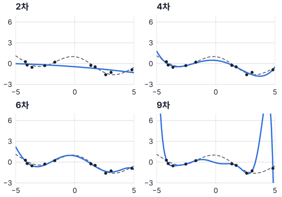
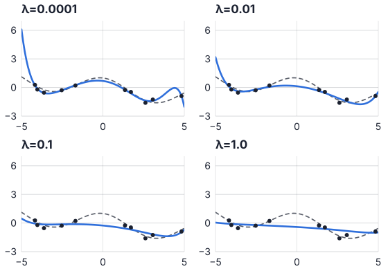
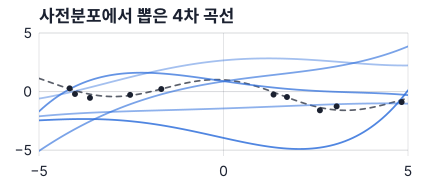
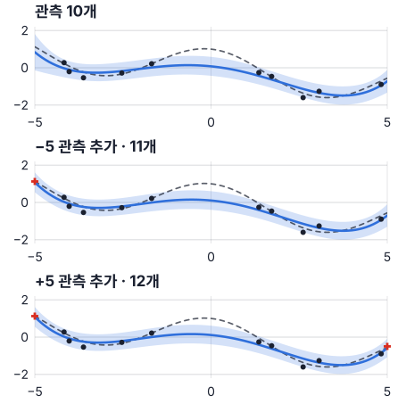

# 선형회귀 실습으로 다시 보는 중간고사

2026년 11월 23일 · 조교 실습 1 · 최대우도, MAP, 베이지안 선형회귀

[정리노트 HTML](../정리노트_1123_Linear_Regression_Practice.html)

**목차**

- [1. 최대우도와 과적합](#s0)
  - [같은 데이터로 어떤 예측을 만들 수 있을까요?](#s0-learning-map)
  - [직선 하나를 데이터에 맞추기](#s0-line)
  - [차수를 올리면 왜 새 점에서 빗나갈까요?](#s0-degree)
- [2. MAP과 정규화](#s1)
  - [계수의 크기에 비용을 붙이기](#s1-ridge)
  - [차수는 그대로 두고 정규화 강도만 바꾸기](#s1-lambda)
- [3. 베이지안 선형회귀](#s2)
  - [관측값으로 계수의 분포 갱신하기](#s2-posterior)
  - [예측평균은 같은데 구간은 어디서 올까요?](#s2-prediction)
  - [실제 관측값을 하나씩 더하면](#s2-update)
- [4. 요약 · 예고](#s3)
  - [중간고사 풀이를 다시 꺼내는 순서](#s3-cheatsheet)
  - [다음 실습 예고](#s3-next)
  - [실습 자료와 다시 볼 정리노트](#s3-links)

<a id="s0"></a>

## 1. 최대우도와 과적합

<a id="s0-learning-map"></a>

### 같은 데이터로 어떤 예측을 만들 수 있을까요?

*1123 조교 실습 · 실습자료 7–20쪽*

**먼저 큰 그림**

관측점 10개로 곡선을 맞추면, 아직 보지 않은 입력에서 무엇을 말할 수 있을까요? 이번 실습은 중간고사에서 푼 계산을 실제 곡선과 예측구간으로 확인해요.

출발점은 직선의 절편과 기울기예요. 다항식으로 넓혀도 관측값과 비교해 계수를 정하고, 정해진 계수로 새 입력을 계산한다는 흐름은 같아요.

| 중간고사에서 한 계산 | 실습에서 읽는 결과 |
|---|---|
| 6번 · 최대우도(ML)와 최대사후(MAP) | 데이터를 잘 맞추는 계수 한 벌을 골라 곡선을 그려요. MAP에서는 사전분포도 선택에 반영해요. |
| 9번 · 계수의 사후분포 | 데이터를 보고 계수의 평균과 공분산을 계산해요. 평균으로 대표 곡선을 그리고 공분산을 예측에 넘겨요. |
| 10번 · 새 입력의 예측분포 | 계수의 불확실성을 새 함수값에 옮겨요. 새 관측값을 예측할 때는 관측 잡음까지 더해 예측구간을 그려요. |

6번의 답은 계수 한 벌, 9번의 답은 계수의 분포, 10번의 답은 새 입력에서 출력의 분포예요.

설계행렬은 10개 입력에서 계산한 특징을 한 줄씩 모아, 계수와 예측값을 연결해요. 먼저 이 행렬로 직선을 구하고, 이어서 사전분포와 새 관측을 더해 봐요.

관측점 10개를 모두 통과하는 곡선도 새 입력에서 크게 빗나갈 수 있어요. 우선 같은 10개 점에 대해 어느 직선이 더 잘 맞는지 숫자로 비교할 수 있을까요?

**페이지 요약**

같은 관측으로 계수 한 벌을 고르고, 계수의 분포를 구하고, 새 입력의 예측분포까지 만들어요.

*용어*

- **최대우도(ML)** — 관측된 데이터의 우도를 가장 크게 하는 계수를 골라요.
- **최대사후(MAP)** — 사전분포를 반영해 사후밀도를 가장 크게 하는 계수를 골라요.
- **예측분포(predictive distribution)** — 새 입력에서 함수값이나 관측값이 얼마나 퍼지는지 보여 줘요.

---

<a id="s0-line"></a>

### 직선 하나를 데이터에 맞추기

*1123 조교 실습 · 실습자료 7–10쪽 · 중간고사 6번*

**정확히 말하면**

직선이 관측점에 더 잘 맞았는지 어떻게 비교할까요? 실습의 관측점 10개에 임의 직선과 최대우도 직선을 각각 넣어 보니, 잔차제곱합이 25.62에서 1.62로 줄었어요. 수치는 실습과 같은 난수 시드 19로 다시 계산했어요. 입력은 $[-5,5]$에서 균등하게 뽑아요. 각 입력의 함수값에 가우시안 잡음을 더해 관측값을 만들어요.

<a id="s0-line-design"></a>

#### 1 / 2 한 점의 잔차를 10개로 모으기

첫 관측점 $(-4.170,0.275)$을 임의 직선에 넣어 잔차제곱합의 한 항이 어떻게 생기는지 확인해요.

절편을 $b$, 기울기를 $a$라고 하면 입력 $x_n$의 직선 예측값은 $b+ax_n$이에요. 각 $y_n$에서 예측값을 뺀 잔차를 제곱해 더한 값을 잔차제곱합(RSS)이라고 해요. 첫 점의 항에는 $y_1\approx 0.275$와 $x_1\approx -4.170$이 들어가요.

$$
Q(b,a)=\sum_{n=1}^{N}\bigl(y_n-(b+ax_n)\bigr)^2
$$

계산 확인

임의 직선 $b=0.7$, $a=0.2$에서 첫 점의 항은 $(0.275-(0.7+0.2(-4.170)))^2=0.409^2$예요. 이 항에 나머지 9개 항을 더하면 약 25.62예요.

같은 계산을 한 번에 쓰려면 관측마다 $(1,x_n)$을 한 행으로 쌓아요. 이 설계행렬 $\Phi$는 $10\times2$이고 계수 $\boldsymbol{\theta}=(b,a)^\top$는 $2\times1$이에요. 첫 행을 곱하면 $1\cdot b+(-4.170)\cdot a$가 되고, 전체 예측값 $\Phi\boldsymbol{\theta}$는 $10\times1$ 열벡터예요. 관측값을 모은 열벡터를 $\mathbf y$라고 하면 같은 잔차제곱합을 이렇게 써요.

$$
Q(\boldsymbol{\theta})=\|\mathbf y-\Phi\boldsymbol{\theta}\|^2
$$

이제 잔차의 크기를 비교할 수 있어요. 가우시안 잡음 가정에서는 왜 이 값을 가장 작게 하는 직선이 최대우도 해일까요?

<a id="s0-line-optimum"></a>

#### 2 / 2 가우시안 우도에서 직선의 계수 구하기

같은 10개 점에서 모형의 가정을 이용해, 잔차제곱합이 가장 작은 계수를 구해요.

잡음 $\varepsilon_n$은 서로 독립이고 평균 0, 공통 분산 $\sigma^2$인 가우시안으로 가정해요. 실습에서 잡음의 표준편차는 $\sigma=0.2$예요. 이 가정에서 직선이 주는 관측 모형을 $\mathbf y=\Phi\boldsymbol{\theta}+\boldsymbol{\varepsilon}$로 쓰면, $\boldsymbol{\varepsilon}$는 잡음 $N$개를 모은 열벡터예요.

$$
p(\mathbf y\mid\Phi,\boldsymbol{\theta})=(2\pi\sigma^2)^{-N/2}\exp\!\left(-\frac{Q(\boldsymbol{\theta})}{2\sigma^2}\right)
$$

독립인 관측의 밀도를 곱하면 이 우도가 나와요. 음의 로그를 취하면 $Q(\boldsymbol{\theta})/(2\sigma^2)$에 계수와 무관한 상수만 더해져요. 그래서 우도 최대화는 $Q$를 최소화하는 최소제곱(least squares) 문제와 같아요.

$$
\frac{\partial Q}{\partial\boldsymbol{\theta}}=-2(\mathbf y-\Phi\boldsymbol{\theta})^\top\Phi
$$

↳ 잔차의 제곱을 미분하면 $1\times2$ 행벡터가 돼요.

$$
\boldsymbol{\theta}^\top\Phi^\top\Phi=\mathbf y^\top\Phi
$$

↳ 그 행벡터를 0으로 놓고 계수 항을 모아요.

$$
\Phi^\top\Phi\boldsymbol{\theta}=\Phi^\top\mathbf y
$$

↳ 양변을 전치해 열벡터 형태의 정규방정식을 얻어요.

$$
\hat{\boldsymbol{\theta}}_{\mathrm{ML}}=(\Phi^\top\Phi)^{-1}\Phi^\top\mathbf y
$$

↳ $\Phi$의 두 열이 독립이면 역행렬을 곱해 해를 구해요.

실습의 $x_n$ 중 서로 다른 값이 있으므로 $1$로 채운 열과 $x_n$을 모은 열이 독립이에요. 해는 $(\hat b,\hat a)\approx(-0.5324,-0.1281)$이고, 이 직선의 잔차제곱합이 약 1.62예요. `np.column_stack((np.ones(N), x))`는 두 열을 이 순서로 놓아요. `np.polyfit(x, y, 1)`도 같은 최소제곱 직선을 구하며, 출력은 높은 차수부터 $[a,b]$ 순서예요. `np.polyval`은 이 순서로 주어진 계수를 새 입력에 대입해요.

중간고사 6(a)도 같은 순서로 풀어요. 그 문항에서는 $N=3$, $\sigma^2=1$을 우도에 넣어요. 세 점으로 만든 $\Phi^\top\Phi$의 대각선은 $(3,2)$이고 나머지 원소는 0이에요. 우변이 $(4,3)^\top$이라 최대우도 해는 $(4/3,3/2)^\top$이에요. 여기의 행 미분을 전치하면 시험에서 지정한 미분 방향과 같아요. [중간고사 6번 풀이](../../../%EC%8B%9C%ED%97%98%EA%B2%B0%EA%B3%BC/%EC%A4%91%EA%B0%84%EA%B3%A0%EC%82%AC/%EC%A4%91%EA%B0%84%EA%B3%A0%EC%82%AC_1021_%EB%AC%B8%EC%A0%9C%EC%84%A4%EB%AA%85_Midterm.html#p6)

직선을 가장 잘 골랐는데도 점들의 굽은 흐름까지 따라가기는 어려워요. 같은 점에 다항식의 차수를 높여 맞추면 어떻게 될까요?

**페이지 요약**

같은 10개 점에 직선을 맞추면 잔차제곱합이 25.62에서 1.62로 줄어요. 독립인 공통 분산 가우시안 잡음에서 최대우도 직선은 최소제곱 직선이에요.

*용어*

- **설계행렬(design matrix)** — 관측마다 $(1,x_n)$을 한 행에 담아요. 계수 $(b,a)^\top$를 곱하면 직선 예측값들이 나와요.
- **최소제곱(least squares)** — 관측값과 예측값의 차이를 제곱해 더한 값을 최소화해요.
- **정규방정식(normal equation)** — 잔차제곱합의 행 미분을 0으로 놓고 양변을 전치해 얻어요.

*핵심 식*

- 잔차제곱합

  $$
  Q(\boldsymbol{\theta})=\|\mathbf y-\Phi\boldsymbol{\theta}\|^2
  $$
- 정규방정식

  $$
  \Phi^\top\Phi\boldsymbol{\theta}=\Phi^\top\mathbf y
  $$

---

<a id="s0-degree"></a>

### 차수를 올리면 왜 새 점에서 빗나갈까요?

*1123 조교 실습 · 실습자료 11쪽*

**정확히 말하면**

같은 관측점 10개에 차수만 바꿔 맞추면 어떤 일이 생길까요? 9차 곡선의 학습 잔차제곱합은 거의 0이에요. 그런데 학습에 쓰이지 않은 $x=-5$에서는 21.61을 예측해요. 잡음 없는 생성 함수의 값 1.13과 크게 벌어져요.



*점은 관측값, 점선은 생성 함수, 실선은 ML 곡선이에요. 네 그림의 눈금은 같고 9차 곡선의 두 끝은 표시 범위를 벗어나요.*

| 차수 $M$ | 학습점 10개의 잔차제곱합 | $x=-5$에서의 예측값 |
|---|---|---|
| 2 | 1.586 | −0.011 |
| 4 | 0.320 | 1.808 |
| 6 | 0.184 | 2.210 |
| 9 | 거의 0 | 21.61 |

9차의 21.61은 직선의 $(1,x)$를 $(1,x,\ldots,x^9)$로 늘리고, 학습한 10개 계수 $\hat\theta_0,\ldots,\hat\theta_9$에 $x=-5$를 대입한 값이에요. 절편은 $\hat\theta_0$이고 뒤의 각 계수가 대응하는 거듭제곱에 곱해져요.

$$
\hat f_9(-5)=\sum_{k=0}^{9}\hat\theta_k(-5)^k\approx 21.61
$$

실습에서는 관측을 만들 때 쓴 잡음 없는 함수 $g(x)=-\sin(x/5)+\cos(x)$를 알고 있어요. 그래서 같은 입력에서 $g(-5)\approx1.13$과 바로 비교할 수 있어요. 학습에 쓴 $y_n$에는 잡음이 섞여 있으므로, $g$에 가까운지와 학습점의 $y_n$에 가까운지는 다른 기준이에요.

일반적으로 차수 $M$은 가장 높은 거듭제곱이고, 설계행렬의 각 행은 $(1,x_n,\ldots,x_n^M)$이 돼요. 직선에 쓴 것과 같은 최소제곱으로 $M+1$개 계수를 골라요. 새 계수를 0으로 놓으면 낮은 차수도 그대로 표현할 수 있어서, 차수를 늘려 구한 최소 학습 오차는 커지지 않아요.

서로 다른 입력 10개에 9차를 쓰면 계수 10개로 학습점 모두를 통과하는 다항식을 만들 수 있어요. 이번에는 관측에 섞인 잡음까지 따라가면서 관측 범위 끝에서 곡선이 크게 흔들렸어요. 학습 데이터의 오차는 작지만 새 입력에 잘 일반화되지 않는 현상이 과적합(overfitting)이에요.

9차로 표현할 수 있는 곡선은 그대로 두고, 계수를 고르는 기준을 바꾸어 끝에서 크게 흔들리는 곡선을 덜 선호하게 만들 수 있을까요?

**페이지 요약**

같은 10개 점에서 9차의 학습 오차는 거의 0이지만, 새 입력 $x=-5$에서 21.61을 내놓아 생성 함수의 1.13과 크게 벌어져요.

*용어*

- **다항식 차수(degree)** — 가장 높은 거듭제곱의 지수예요. $M$차에서는 절편을 포함해 계수 $M+1$개를 맞춰요.
- **과적합(overfitting)** — 학습점은 잘 맞추지만 새 입력에 잘 일반화되지 않는 현상이에요.

*핵심 식*

- 9차 곡선의 끝점 예측

  $$
  \hat f_9(-5)=\sum_{k=0}^{9}\hat\theta_k(-5)^k\approx 21.61
  $$

---

<a id="s1"></a>

## 2. MAP과 정규화

<a id="s1-ridge"></a>

### 계수의 크기에 비용을 붙이기

*1123 실습 · TA 실습 12–13쪽 · MML §9.2*

**정확히 말하면**

같은 점 10개에 같은 9차 모델을 쓰면서, 왼쪽 끝에서 튀는 예측을 줄일 수 있을까요? 계수 크기에도 비용을 매기면, 훈련 오차를 조금 허용하는 대신 큰 계수에 기대는 해를 피할 수 있어요.

실습 데이터를 다시 계산하면, $x=-5$에서 기준 함수의 값은 1.13이에요. 9차 ML의 예측은 21.61이고, 같은 9차 모델에 정규화 강도 $\lambda=0.01$을 적용한 MAP의 예측은 3.19예요. 두 계산 모두 $z=x/5$를 써요. $x=-5$이면 $z=-1$이므로, 두 곡선의 예측값을 읽는 연산은 같아요.

$$
f_{\boldsymbol{\theta}}(-5)=\sum_{k=0}^{9}\theta_k(-1)^k
$$

달라진 것은 계수 열벡터 $\boldsymbol{\theta}=(\theta_0,\ldots,\theta_9)^\top$를 고르는 기준이에요. 관측값을 모은 $\mathbf y$와 예측값 $\Phi\boldsymbol{\theta}$의 차이만 제곱해 더하던 ML 목적함수에 계수 제곱합 $\sum_{k=0}^{9}\theta_k^2$의 비용을 더해요. $\Phi$의 한 행은 한 입력 $z_n$에서의 $(1,z_n,\ldots,z_n^9)$예요.

$$
J_\lambda(\boldsymbol{\theta})=\|\mathbf y-\Phi\boldsymbol{\theta}\|^2+\lambda\|\boldsymbol{\theta}\|^2
$$

같은 기준 $J_{0.01}$으로 두 해를 비교해 볼게요. ML 해는 훈련 잔차제곱합(RSS)이 거의 0이지만, $0.01$을 곱한 계수 비용은 약 3,589.46이에요. MAP 해는 $0.346+0.01\cdot21.962\approx0.566$이에요. 앞 항만 보면 ML 해의 값이 작고, 두 항을 더하면 MAP 해의 값이 훨씬 작아져요.

계산 확인

| 계수를 구할 때의 $\lambda$ | 훈련 RSS | 계수 제곱합 | $x=-5$ 예측 |
|---|---|---|---|
| 0 | ≈0 | 358945.908 | 21.61 |
| 0.01 | 0.346 | 21.962 | 3.19 |

두 해를 평가할 때는 같은 $\lambda=0.01$을 사용했어요. 첫 행은 $0+0.01\cdot358945.908\approx3589.459$, 둘째 행은 $0.346+0.01\cdot21.962\approx0.566$이에요.

<a id="s1-ridge-objective"></a>

#### 1 / 2 가우시안 사전분포에서 비용 읽기

왜 계수를 제곱하고 $\lambda$를 곱할까요? 관측 우도와 사전밀도가 사후밀도에 각각 어떤 항을 보태는지 확인해요.

관측한 입력·출력 쌍을 모아 $\mathcal D$라고 써요. 독립 가우시안 잡음의 표준편차가 $\sigma$이면, 잔차제곱합이 커질수록 관측 우도가 낮아져요. 계수의 사전분포를 $\mathcal N(\mathbf 0,\gamma^2 I)$로 두면 각 계수의 사전 표준편차가 $\gamma$예요. 계수가 0에서 멀수록 사전밀도가 낮아지고, 그 감소가 $\|\boldsymbol{\theta}\|^2/(2\gamma^2)$에 들어가요.

$$
p(\boldsymbol{\theta}\mid\mathcal D)\propto p(\mathbf y\mid\Phi,\boldsymbol{\theta})\,p(\boldsymbol{\theta})
$$

↳ 관측의 우도에 계수의 사전밀도를 곱해요.

$$
\frac{\|\mathbf y-\Phi\boldsymbol{\theta}\|^2}{2\sigma^2}+\frac{\|\boldsymbol{\theta}\|^2}{2\gamma^2}
$$

↳ 음의 로그를 취해 곱을 더하기로 바꾸고, 계수와 무관한 상수를 빼요.

$$
J_\lambda(\boldsymbol{\theta})=\|\mathbf y-\Phi\boldsymbol{\theta}\|^2+\lambda\|\boldsymbol{\theta}\|^2
$$

↳ 양수 $2\sigma^2$를 곱해도 최소점은 같아요. $\lambda=\sigma^2/\gamma^2$예요.

같은 잡음에서 $\gamma$를 작게 두면 사전분포가 0에 더 모이고, $\lambda$가 커져 큰 계수에 더 큰 비용이 붙어요. 이제 이 비용이 정규방정식에서 어느 자리에 들어가는지 구해요.

<a id="s1-ridge-equation"></a>

#### 2 / 2 미분해 MAP 계수 구하기

훈련 자료와 $\lambda$를 고정하고, 스칼라 비용이 최소가 되는 계수 열벡터를 찾아요. 먼저 계수에 대한 행벡터 미분을 0으로 놓아요.

$$
\frac{1}{2}\frac{\partial J_\lambda}{\partial\boldsymbol{\theta}}=(\Phi\boldsymbol{\theta}-\mathbf y)^\top\Phi+\lambda\boldsymbol{\theta}^\top
$$

↳ 두 제곱합을 미분하고 공통인 2로 나눠요. 결과는 $1\times10$이에요.

$$
0_{1\times10}=(\Phi\boldsymbol{\theta}-\mathbf y)^\top\Phi+\lambda\boldsymbol{\theta}^\top
$$

↳ 최소점에서 행 미분을 0으로 놓아요.

$$
0_{1\times10}=\boldsymbol{\theta}^\top\Phi^\top\Phi-\mathbf y^\top\Phi+\lambda\boldsymbol{\theta}^\top
$$

↳ 잔차 항을 계수 항과 관측값 항으로 펼쳐요.

$$
\boldsymbol{\theta}^\top\Phi^\top\Phi+\lambda\boldsymbol{\theta}^\top=\mathbf y^\top\Phi
$$

↳ 관측값이 들어간 항을 오른쪽으로 옮겨요.

$$
\Phi^\top\Phi\boldsymbol{\theta}+\lambda\boldsymbol{\theta}=\Phi^\top\mathbf y
$$

↳ 양변을 전치해 $10\times1$ 열벡터 방정식을 얻어요.

$$
(\Phi^\top\Phi+\lambda I)\boldsymbol{\theta}=\Phi^\top\mathbf y
$$

↳ $I=I_{10}$을 써서 두 항의 공통 열벡터를 묶어요.

$$
\widehat{\boldsymbol{\theta}}_{\mathrm{MAP}}=(\Phi^\top\Phi+\lambda I)^{-1}\Phi^\top\mathbf y
$$

↳ $\lambda\gt0$이면 왼쪽 행렬은 양의 정부호라 유일한 최소점을 구할 수 있어요.

어떤 0이 아닌 열벡터 $\mathbf u$로 확인해도 이 행렬의 이차식은 $\|\Phi\mathbf u\|^2+\lambda\|\mathbf u\|^2\gt0$이에요. 이 실습의 $\lambda I$는 $\theta_0$에도 비용을 붙여요. $\|\boldsymbol{\theta}\|^2$의 합이 $k=0$에서 시작하고, $I$의 첫 대각 원소도 1이기 때문이에요.

계산 확인

$\sigma^2=1$인 중간고사 6(b)는 사전공분산이 $I_2$라 $\gamma^2=1$이에요. 그래서 $\lambda=1$이에요. 6(a)에서 구한 $\Phi^\top\Phi$에 $I_2$를 더해 대각선이 $(4,3)$이 돼요. 같은 우변 $(4,3)^\top$을 쓰면 MAP 해는 $(1,1)^\top$이에요.

입력 스케일링과 정규화의 역할도 나눠서 기억해요. $z=x/5$는 거듭제곱 열의 숫자 크기를 줄여 계산을 다루기 쉽게 해요. $x^k$의 계수에 $5^k$를 곱하면 같은 곡선을 $z^k$로 표현할 수 있어요. 정규화는 그 $z$ 기저에서 계수가 작도록 해를 골라요. 따라서 $x$ 기저에 같은 $\lambda$를 쓰면 같은 곡선에 매기는 비용이 달라질 수 있어요.

그럼 같은 설계행렬에서 [정규화 강도만 바꾸면](#s1-lambda), 계수 크기와 훈련 오차가 어떻게 움직일까요?

**페이지 요약**

같은 9차 모델에서 $\lambda=0.01$을 쓰면 $x=-5$ 예측이 21.61에서 3.19로 바뀌어요. 훈련 오차를 조금 허용해 큰 계수의 비용을 줄인 결과예요.

*용어*

- **최대 사후 추정(MAP)** — 관측 우도와 사전밀도의 곱을 최대화하는 계수 벡터 하나를 골라요.
- **정규화(regularization)** — 이 실습에서는 상수항을 포함한 계수의 제곱합에 비용을 붙여요.

*핵심 식*

- MAP 비용

  $$
  J_\lambda(\boldsymbol{\theta})=\|\mathbf y-\Phi\boldsymbol{\theta}\|^2+\lambda\|\boldsymbol{\theta}\|^2
  $$
- 정규화 강도

  $$
  \lambda=\sigma^2/\gamma^2
  $$
- MAP 정규방정식

  $$
  (\Phi^\top\Phi+\lambda I)\boldsymbol{\theta}=\Phi^\top\mathbf y
  $$

---

<a id="s1-lambda"></a>

### 차수는 그대로 두고 정규화 강도만 바꾸기

*1123 실습 · TA 실습 14쪽*

**정확히 말하면**

계수에 더 큰 비용을 매기면 어디까지 도움이 될까요? 점 10개와 9차식, $z=x/5$를 고정하고 $\lambda$만 0.0001, 0.01, 0.1, 1로 바꿔요.



*점은 관측값, 점선은 생성 함수, 실선은 MAP 곡선이에요. 같은 눈금에서 λ만 바꿨어요.*

가장 약한 $\lambda=0.0001$에서 $x=-5$ 예측은 6.09예요. 알려진 기준 함수의 1.13보다 높아요. 0.01과 0.1에서는 양 끝의 큰 이탈이 완화돼요. $\lambda=1$에서는 왼쪽 예측이 0.05까지 낮아지고 그래프가 필요한 굽힘도 놓쳐요. 이렇게 수축이 지나쳐 구조를 놓치면 과소적합(underfitting)이 생길 수 있어요.

왼쪽 끝에서 읽은 값은 $f_{\boldsymbol{\theta}}(-5)=\sum_{k=0}^{9}\theta_k(-1)^k$에 각 $\lambda$로 구한 계수를 넣은 결과예요. 예컨대 $\lambda=0.1$에서 이 합은 약 0.48이고, 그 계수의 목적함수 값은 $J_{0.1}\approx0.917+0.1\cdot3.147$이에요. 두 항을 따로 읽으면 어떤 적합을 내주고 계수 크기를 줄였는지 보여요.

계산 확인

| $\lambda$ | 훈련 RSS | 계수 제곱합 | $x=-5$ 예측 | $x=5$ 예측 |
|---|---|---|---|---|
| 0.0001 | 0.110 | 445.010 | 6.09 | −2.02 |
| 0.01 | 0.346 | 21.962 | 3.19 | −0.47 |
| 0.1 | 0.917 | 3.147 | 0.48 | −0.71 |
| 1 | 1.580 | 0.514 | 0.05 | −0.99 |

같은 데이터에서 오른쪽 끝 기준값은 −0.56이에요. 네 경우 중 왼쪽 끝에서는 0.1이 기준값에 더 가깝고, 오른쪽 끝에서는 0.01이 더 가까워요.

표에서는 $\lambda$가 커질수록 계수 제곱합이 작아지는 대신 훈련 RSS가 커져요. 어느 $\lambda$가 좋은지는 새 입력에서 무엇을 기준으로 평가할지에 달렸어요. 이 실습은 합성 데이터라 알려진 기준 함수와 비교할 수 있어요.

코드에서는 `np.vander`로 한 행씩 $1,z,\ldots,z^9$를 만들어요. `np.linalg.solve`에는 정규방정식의 왼쪽 행렬과 오른쪽 벡터를 넣어요. 평가 입력도 학습 입력처럼 5로 나눠요.

```python
lam = 0.1
Phi = np.vander(x / 5, 10, increasing=True)
lhs = Phi.T @ Phi + lam * np.eye(10)
rhs = Phi.T @ y
theta = np.linalg.solve(lhs, rhs)
x_plot = np.linspace(-5, 5, 300)
Phi_plot = np.vander(x_plot / 5, 10, increasing=True)
y_fit = Phi_plot @ theta
```

MAP은 이 절차로 계수 벡터 하나를 골라요. 같은 가우시안 가정을 쓰면서 [계수의 분포도 가지고 있으면](#s2-posterior) 어떤 예측을 할 수 있을까요?

**페이지 요약**

같은 9차 모델에서도 $\lambda$가 커지면 계수 제곱합이 내려가고 훈련 RSS는 올라가요. 새 입력에서의 결과는 평가 위치에 따라 달라져요.

*용어*

- **과소적합(underfitting)** — 정규화가 지나치면 데이터의 구조를 따라갈 굽힘도 약해질 수 있어요.
- **반데르몽드 행렬(Vandermonde matrix)** — 입력 하나의 $1,z,\ldots,z^9$를 한 행에 담아요.

*핵심 식*

- 왼쪽 끝의 예측

  $$
  f_{\boldsymbol{\theta}}(-5)=\sum_{k=0}^{9}\theta_k(-1)^k
  $$

---

<a id="s2"></a>

## 3. 베이지안 선형회귀

<a id="s2-posterior"></a>

### 관측값으로 계수의 분포 갱신하기

*1123 실습 · 조교 실습자료 15–16쪽*

**정확히 말하면**

관측 10개를 보기 전과 본 뒤에 어떤 계수가 그럴듯할까요? 베이지안 선형회귀는 계수의 사전분포(prior)를 출발점으로 삼고, 관측값의 우도를 반영해 계수의 사후분포(posterior)를 계산해요.

실습은 차수를 $M=4$로 바꾸고 같은 관측 10개를 써요. 입력 $x$를 $z=x/5$로 놓으면 특성 열벡터는 $\boldsymbol{\phi}(x)=(1,z,z^2,z^3,z^4)^\top$예요. 계수 열벡터 $\boldsymbol{\theta}=(\theta_0,\theta_1,\theta_2,\theta_3,\theta_4)^\top$를 한 번 뽑으면, 각 $x$에서 $\boldsymbol{\phi}(x)^\top\boldsymbol{\theta}=\theta_0+z\theta_1+z^2\theta_2+z^3\theta_3+z^4\theta_4$를 계산해 곡선 하나를 얻어요. 실습에서는 사전분포 $\mathcal N(\mathbf 0,\gamma^2 I_5)$에서 $\gamma=2$로 계수 벡터를 다섯 번 뽑아요. 계수는 사전분포에서만 뽑아요. 관측점은 그린 곡선을 비교할 때 써요.



*실선 다섯 개는 사전분포에서 뽑은 곡선이에요. 점과 점선은 비교용 관측값과 생성 함수예요.*

<a id="s2-posterior-fit"></a>

#### 1 / 2 관측값의 우도와 사전분포 곱하기

실제 관측값을 계산에 넣으면 계수 분포의 중심과 퍼짐이 어떻게 바뀔까요?

관측 집합을 $\mathcal D_N=\{(x_n,y_n)\}_{n=1}^N$으로 써요. 설계행렬 $\Phi$의 $n$번째 행에 $\boldsymbol{\phi}(x_n)^\top$를 넣고, $\mathbf y$에는 관측값 $y_n$을 같은 순서로 넣어요. 실습의 $\Phi$는 $10\times5$이고 $\mathbf y$는 $10\times1$이에요. $\boldsymbol{\varepsilon}$은 계수와 독립인 잡음 열벡터이고, 각 관측의 잡음은 서로 독립인 $\mathcal N(0,\sigma^2)$를 따라요. 실습에서 $\sigma=0.2$이므로 분산 $\sigma^2=0.04$예요.

모형 $\mathbf y=\Phi\boldsymbol{\theta}+\boldsymbol{\varepsilon}$의 가우시안 우도와 사전밀도 $\mathcal N(\mathbf m_0,S_0)$를 곱해 정규화하면 가우시안 사후분포를 얻어요. $\mathbf m_0$는 사전평균이며 $S_0$는 양의 정부호인 사전공분산이에요. 실습에서는 $\mathbf m_0=\mathbf 0$, $S_0=4I_5$를 써요.

먼저 사후공분산 $S_N$을 구해요. 역공분산을 정밀도(precision)라고 불러요. 사전 정밀도 $S_0^{-1}$에 설계행렬에서 온 $\sigma^{-2}\Phi^\top\Phi$를 더하고 역행렬을 취해요.

$$
S_N=(S_0^{-1}+\sigma^{-2}\Phi^\top\Phi)^{-1}
$$

계수의 중심은 사전평균과 실제 관측값을 반영해 정해져요. 사전평균에 사전 정밀도를 곱한 값과, 관측값을 특성 방향으로 합산한 $\sigma^{-2}\Phi^\top\mathbf y$를 더한 뒤 $S_N$을 곱해요.

$$
\mathbf m_N=S_N(S_0^{-1}\mathbf m_0+\sigma^{-2}\Phi^\top\mathbf y)
$$

$S_N$은 계수 다섯 개에 대한 $5\times5$ 행렬이고, $\mathbf m_N$은 다섯 계수의 평균을 모은 열벡터예요. $\mathcal N(\mathbf m_N,S_N)$의 중심으로 그린 곡선은 MAP으로 그린 곡선과 왜 겹칠까요?

<a id="s2-posterior-map"></a>

#### 2 / 2 같은 모형에서 MAP 복원하기

4차 특성과 관측 10개를 고정하면 두 곡선은 $x=0$에서 같은 높이 약 $0.078$을 보여요. 두 계산에 들어간 계수부터 비교해요.

$$
\mathbf m_N=S_N\,\sigma^{-2}\Phi^\top\mathbf y
$$

↳ $\mathbf m_0=\mathbf 0$을 대입해요.

$$
S_N=\bigl(\gamma^{-2}I_5+\sigma^{-2}\Phi^\top\Phi\bigr)^{-1}
$$

↳ $S_0=\gamma^2 I_5$를 대입해요.

$$
S_N=\Bigl[\sigma^{-2}\bigl(\Phi^\top\Phi+\tfrac{\sigma^2}{\gamma^2}I_5\bigr)\Bigr]^{-1}
$$

↳ 괄호 안에서 $\sigma^{-2}$를 묶어요.

$$
S_N=\sigma^2\bigl(\Phi^\top\Phi+\tfrac{\sigma^2}{\gamma^2}I_5\bigr)^{-1}
$$

↳ 역행렬을 취할 때 배율은 역수가 돼요.

$$
\mathbf m_N=\sigma^2(\Phi^\top\Phi+\lambda I_5)^{-1}\,\sigma^{-2}\Phi^\top\mathbf y
$$

↳ 평균 식에 $S_N$을 넣어요. $\lambda=\sigma^2/\gamma^2=0.01$이에요.

$$
\mathbf m_N=(\Phi^\top\Phi+\lambda I_5)^{-1}\Phi^\top\mathbf y
$$

↳ $\sigma^2$와 $\sigma^{-2}$가 상쇄돼요.

마지막 식은 같은 특성·관측·사전분포를 쓴 $\hat{\boldsymbol{\theta}}_{\mathrm{MAP}}$의 식이에요. 가우시안 사후분포의 평균은 밀도가 가장 높은 최빈값(mode)이므로, 일반적인 가우시안 사전 $\mathcal N(\mathbf m_0,S_0)$를 써도 같은 모형의 MAP과 사후평균이 일치해요. 위 식의 $\lambda I_5$ 형태는 이번 실습의 $\mathbf m_0=\mathbf 0$, $S_0=\gamma^2I_5$를 적용한 결과예요.

계산 확인

[중간고사 9번](../../../%EC%8B%9C%ED%97%98%EA%B2%B0%EA%B3%BC/%EC%A4%91%EA%B0%84%EA%B3%A0%EC%82%AC/%EC%A4%91%EA%B0%84%EA%B3%A0%EC%82%AC_1021_%EB%AC%B8%EC%A0%9C%EC%84%A4%EB%AA%85_Midterm.html#p9)은 점 두 개 $(-1,1)$, $(1,3)$로 이 계산을 줄여 보여 줘요. 특성 행 $(1,-1)$, $(1,1)$을 쌓으면 $\Phi^\top\Phi=2I_2$와 $\Phi^\top\mathbf y=(4,2)^\top$를 얻어요. 시험 조건 $S_0=I_2$, $\mathbf m_0=\mathbf 0$, $\sigma^2=1$을 넣으면 $S_N=(I_2+2I_2)^{-1}=I_2/3$, $\mathbf m_N=(I_2/3)(4,2)^\top=(4/3,2/3)^\top$예요.

평균 계수로는 곡선의 중심을 그릴 수 있어요. 새 입력에서 그 주변의 범위를 알려면 $S_N$이 출력에 만드는 퍼짐도 계산해야 해요.

**페이지 요약**

관측값으로 계수의 사전분포를 갱신해요. 같은 가우시안 모형에서 사후평균으로 그린 곡선은 MAP 곡선과 겹쳐요.

*용어*

- **사후공분산(posterior covariance)** — 관측을 반영한 계수 간 공분산을 모은 $S_N$이에요.
- **최빈값(mode)** — 사후밀도가 가장 큰 계수예요. 가우시안 사후분포에서는 평균과 같아요.

*핵심 식*

- 사후공분산

  $$
  S_N=(S_0^{-1}+\sigma^{-2}\Phi^\top\Phi)^{-1}
  $$
- 사후평균

  $$
  \mathbf m_N=S_N(S_0^{-1}\mathbf m_0+\sigma^{-2}\Phi^\top\mathbf y)
  $$

---

<a id="s2-prediction"></a>

### 예측평균은 같은데 구간은 어디서 올까요?

*1123 실습 · 조교 실습자료 17쪽*

**정확히 말하면**

관측 10개를 유지하고 $x_*=0$에서 곡선의 함수값 $f_*$와 새 관측값 $y_*$를 비교해요. 실습을 재현하면 두 평균은 약 $0.078$이에요. $f_*$의 분산은 약 $0.027$이고, $y_*$의 분산은 새 잡음의 분산 $0.04$가 더해져 약 $0.067$이에요.

$\boldsymbol{\phi}_*=\boldsymbol{\phi}(x_*)$는 새 입력을 고정했을 때 계수에 곱하는 가중치 열벡터예요. $f_*=\boldsymbol{\phi}_*^\top\boldsymbol{\theta}$에서 $\boldsymbol{\theta}$는 $\mathcal N(\mathbf m_N,S_N)$를 따르므로, 고정 가중치로 더한 $f_*$도 가우시안이에요. 평균은 계수 평균의 가중합이에요.

$$
\mu_*=\boldsymbol{\phi}_*^\top\mathbf m_N
$$

스칼라의 분산 $\operatorname{Var}(aX)=a^2\operatorname{Var}(X)$에서는 같은 계수 $a$가 두 번 곱해져요. 계수가 여러 개면 두 가중치의 곱 $\phi_{*,i}\phi_{*,j}$가 계수쌍의 공분산 $(S_N)_{ij}$마다 붙어요. 이를 행렬곱으로 모으면 $(1\times5)(5\times5)(5\times1)$이 되어 스칼라 분산이 나와요.

$$
v_f=\sum_{i,j=0}^4\phi_{*,i}\phi_{*,j}(S_N)_{ij}
$$

$$
v_f=\boldsymbol{\phi}_*^\top S_N\boldsymbol{\phi}_*
$$

$x_*=0$에서는 $\boldsymbol{\phi}_*=(1,0,0,0,0)^\top$라서 $f_*=\theta_0$예요. 이 입력에서 $\mu_*$는 $\mathbf m_N$의 첫 성분인 약 $0.078$이에요. $v_f$에 남는 항은 $S_N$의 첫 대각 원소, 약 $0.027$이에요. 새로 측정할 값은 $y_*=f_*+\varepsilon_*$예요. 새 잡음 $\varepsilon_*\sim\mathcal N(0,\sigma^2)$는 계수 및 기존 잡음과 독립이므로 평균에는 $0$, 분산에는 $\sigma^2=0.04$가 더해져요.

$$
f_*\mid x_*,\mathcal D_N\sim\mathcal N(\mu_*,v_f)
$$

$$
y_*\mid x_*,\mathcal D_N\sim\mathcal N(\mu_*,v_f+\sigma^2)
$$

독립 잡음을 더하는 계산은 계수 후보별 관측 우도를 사후밀도로 가중해 평균 내는 것과 같아요. 이를 계수에 대한 주변화(marginalization)라고 해요.

$$
p(y_*\mid x_*,\mathcal D_N)=\int p(y_*\mid x_*,\boldsymbol{\theta})\,p(\boldsymbol{\theta}\mid\mathcal D_N)\,d\boldsymbol{\theta}
$$

계산 확인

정규분포의 중앙 약 95%를 잡으려면 표준편차의 $1.96$배를 평균의 양옆에 놓아요. $s_*=\sqrt{v_f+\sigma^2}$일 때 예측구간은 $\mu_*\pm1.96s_*$예요. 실습의 $x_*=0$에 넣으면 $0.078\pm1.96\sqrt{0.027+0.04}$, 약 $[-0.429,0.585]$예요.

[중간고사 10번](../../../%EC%8B%9C%ED%97%98%EA%B2%B0%EA%B3%BC/%EC%A4%91%EA%B0%84%EA%B3%A0%EC%82%AC/%EC%A4%91%EA%B0%84%EA%B3%A0%EC%82%AC_1021_%EB%AC%B8%EC%A0%9C%EC%84%A4%EB%AA%85_Midterm.html#p10)은 9번에서 구한 2계수 사후분포를 이어 써요. $x_*=2$에서 특성이 $(1,2)^\top$이므로 평균은 $4/3+2(2/3)=8/3$이에요. $S_N=I_2/3$이라 함수값의 분산은 $1^2/3+2^2/3=5/3$이고, 관측값의 분산은 새 잡음 분산 $1$을 더한 $8/3$이에요.

여기서는 새 입력을 지정해 분포를 읽었어요. 같은 입력에서 $y_*$까지 실제로 얻어 학습에 포함하면 계수의 사후분포부터 바뀌어요.

**페이지 요약**

관측 10개를 고정하고 $x_*=0$에서 보면 함수값과 새 관측값의 평균은 같아요. 분산은 계수에서 온 약 $0.027$에 새 잡음의 $0.04$가 더해져요.

*용어*

- **예측구간(predictive interval)** — 고정한 입력에서 새 관측값을 정해진 확률로 포함하는 범위예요.
- **주변화(marginalization)** — 계수 후보별 관측 우도를 계수의 사후밀도로 가중해 적분해요.

*핵심 식*

- 함수값의 분산

  $$
  v_f=\boldsymbol{\phi}_*^\top S_N\boldsymbol{\phi}_*
  $$
- 새 관측값의 분포

  $$
  y_*\mid x_*,\mathcal D_N\sim\mathcal N(\mu_*,v_f+\sigma^2)
  $$
- 중앙 약 95% 예측구간

  $$
  \mu_*\pm1.96s_*
  $$

---

<a id="s2-update"></a>

### 실제 관측값을 하나씩 더하면

*1123 실습 · 조교 실습자료 18–20쪽*

**정확히 말하면**

실제 관측을 더하면 새 관측값의 예측구간은 어디에서 얼마나 좁아질까요? 차수, 사전분포 설정, 잡음 분산은 고정하고 처음 10개 점에 실습에서 생성한 $(-5,1.12538)$와 $(5,-0.49806)$을 차례로 추가해요.



*실선은 예측평균, 띠는 새 관측값의 95% 예측구간, 점선은 생성 함수예요. +는 처음 10개에 이어 추가한 관측값이에요.*

실습을 재현한 값으로 보면 $x=-5$에서 관측한 뒤, 같은 위치의 다음 관측값에 대한 95% 예측구간 전체 폭은 약 $1.95$에서 $1.06$으로 줄어요. 이후 $x=5$에서 관측하자 오른쪽 끝의 폭도 약 $1.20$에서 $0.98$로 줄어요.

| 사용한 관측 | $x_*=-5$ 구간 폭 | $x_*=5$ 구간 폭 |
|---|---|---|
| 처음 10개 | 1.95 | 1.21 |
| 11개 · $x=-5$ 관측 추가 | 1.06 | 1.20 |
| 12개 · $x=5$ 관측 추가 | 1.06 | 0.98 |

폭을 계산할 때는 평균의 양옆에 표준편차의 $1.96$배씩 두므로 $3.92\sqrt{v_f+\sigma^2}$가 돼요. $x_*=-5$에서 점 하나를 추가하기 전후로 함수값의 분산 $v_f$가 약 $0.2073$에서 $0.0335$로 바뀌어요.

$$
3.92\sqrt{0.2073+0.04}\approx1.95
$$

$$
3.92\sqrt{0.0335+0.04}\approx1.06
$$

이 차이는 학습에 넣는 관측 쌍 $(x_{\mathrm{new}},y_{\mathrm{new}})$에서 시작해요. 실습에서는 $\Phi$에 새 특성 행 $\boldsymbol{\phi}(x_{\mathrm{new}})^\top$를, $\mathbf y$에는 $y_{\mathrm{new}}$를 추가해 $S_{N+1}$과 $\mathbf m_{N+1}$을 다시 계산해요. $\Phi^\top\Phi$에 추가되는 항은 $\boldsymbol{\phi}(x_{\mathrm{new}})\boldsymbol{\phi}(x_{\mathrm{new}})^\top$라서, 어떤 입력에서 관측했는지가 다음 예측구간의 폭에 영향을 줘요. 관측값 $y_{\mathrm{new}}$는 $\Phi^\top\mathbf y$에 들어가 평균을 갱신해요.

같은 갱신을 순차적으로 표현하면 기존 사후분포가 새 사전분포 역할을 해요. 실습 모형에서는 계수와 입력이 주어졌을 때 새 관측이 앞선 관측과 독립이므로, 새 관측 하나의 우도에 기존 사후밀도를 곱하고 정규화해요.

$$
p(\boldsymbol{\theta}\mid\mathcal D_{N+1})\propto p(y_{\mathrm{new}}\mid x_{\mathrm{new}},\boldsymbol{\theta})\,p(\boldsymbol{\theta}\mid\mathcal D_N)
$$

계수의 사후분포를 더 좁게 갱신해도 앞으로 측정할 때마다 잡음 분산 $0.04$는 그대로 더해져요. 입력만 주어지면 현재 사후분포로 예측하고, 입력과 관측값을 함께 얻으면 사후분포를 갱신한 뒤 다시 예측해요.

**페이지 요약**

처음 10개 점에 $x=-5$의 관측값을 더하자, 같은 입력에서 다음 관측의 95% 예측구간 폭이 약 $1.95$에서 $1.06$으로 줄어요.

*용어*

- **순차 갱신(sequential update)** — 직전 사후분포를 새 사전분포로 써서 다음 관측 하나를 반영해요.
- **새 관측의 잡음 분산** — 계수의 사후분포를 갱신해도 새 관측값에는 $\sigma^2$가 더해져요.

*핵심 식*

- 순차 갱신

  $$
  p(\boldsymbol{\theta}\mid\mathcal D_{N+1})\propto p(y_{\mathrm{new}}\mid x_{\mathrm{new}},\boldsymbol{\theta})\,p(\boldsymbol{\theta}\mid\mathcal D_N)
  $$
- 95% 구간의 전체 폭

  $$
  3.92\sqrt{v_f+\sigma^2}
  $$

---

<a id="s3"></a>

## 4. 요약 · 예고

<a id="s3-cheatsheet"></a>

### 중간고사 풀이를 다시 꺼내는 순서

| 문항과 답의 대상 | 계산을 복원하는 순서 |
|---|---|
| 6번 · 계수 벡터 | 입력마다 특징 행을 만들어요. 분산이 같은 독립 가우시안 잡음이면 최대우도는 잔차제곱합을 줄여요. 평균이 0이고 공분산이 $\gamma^2 I$인 사전을 쓰는 MAP에서는 정규방정식의 왼쪽에 $\lambda I$가 붙어요. |
| 9번 · 계수의 분포 | $\Phi^\top\Phi$의 잡음 분산 역수 배와 사전 정밀도를 더해 역행렬을 취하면 $S_N$이에요. $\Phi^\top\mathbf y$와 사전평균을 반영해 $\mathbf m_N$을 구해요. |
| 10번 · 출력의 분포 | 새 특징 벡터를 $\mathbf m_N$과 $S_N$에 각각 넣어요. 새 관측값을 예측할 때는 함수값의 분산에 독립 잡음 분산 $\sigma^2$을 더해요. |

실습에서는 차수, 정규화 강도, 관측 수를 차례로 바꿨어요. 9차 ML은 학습점 사이와 구간 끝에서 크게 휘었고, 4차 베이지안 회귀에서는 양 끝의 관측을 추가하자 그 위치의 예측구간이 좁아졌어요.

---

<a id="s3-next"></a>

### 다음 실습 예고

- 주성분분석(PCA)
- EM 알고리즘

---

<a id="s3-links"></a>

### 실습 자료와 다시 볼 정리노트

- [이영석 조교 실습자료 · Linear Regression](../../../%EA%B0%95%EC%9D%98%EB%85%B8%ED%8A%B8/TA_Lecture_Introduction_to_Machine_Learning_Practice_1.pdf)
- [교과서 · MML 9장 선형회귀](../../../%EA%B5%90%EA%B3%BC%EC%84%9C/Mathematics_for_Machine_Learning.pdf#page=297)
- [기존 정리노트 · 최대우도 정규방정식 (0928)](../../0928/%EC%A0%95%EB%A6%AC%EB%85%B8%ED%8A%B8_0928_Linear_Regression.html#s1-theta-ml)
- [기존 정리노트 · 함수값과 새 관측값의 불확실성 (1014)](../../1014/%EC%A0%95%EB%A6%AC%EB%85%B8%ED%8A%B8_1014_Bayesian_Posterior_Prediction.html#s2-uncertainty)

---

이영석 조교 실습자료 7–20쪽, 머신러닝기초 중간고사 6·9·10번, *Mathematics for Machine Learning* 9장.
