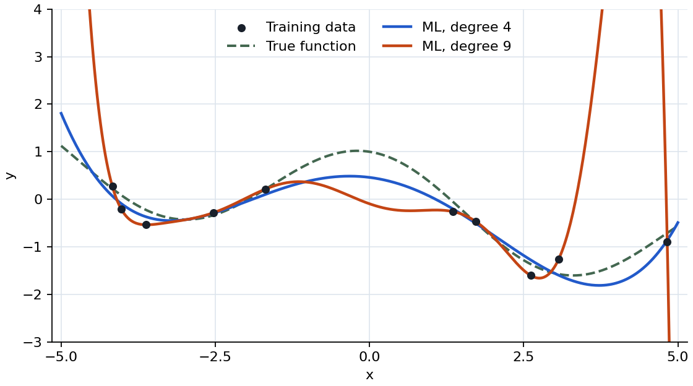
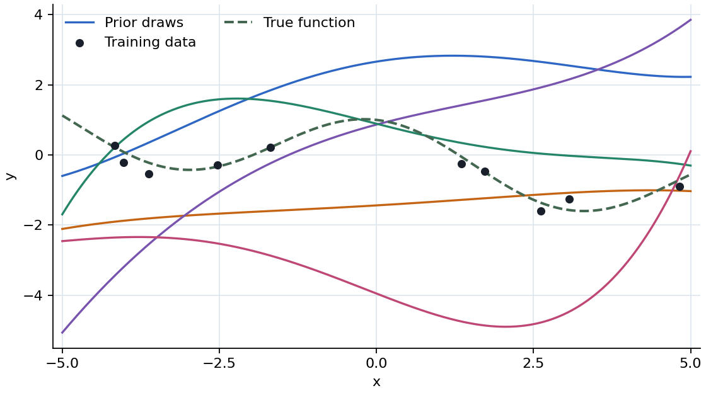
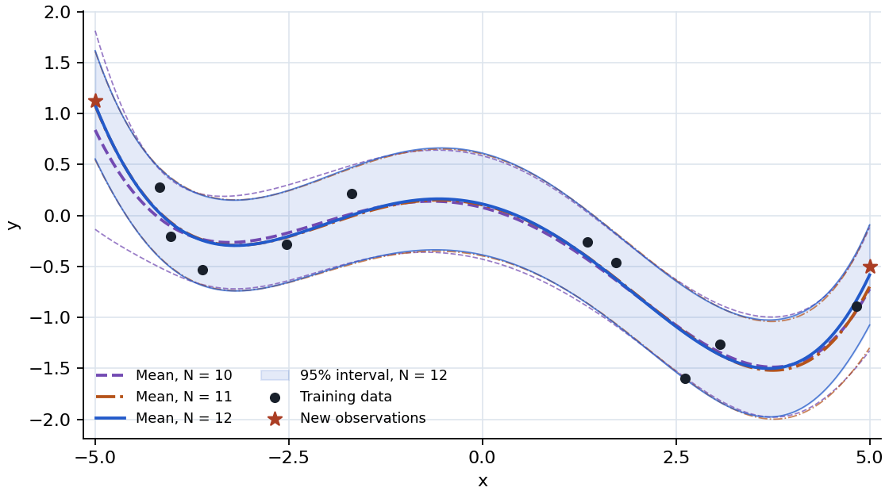

# 선형회귀 실습으로 다시 보는 중간고사

머신러닝기초 · 2026년 11월 23일 조교 실습

**목차**

- [실습과 중간고사](#s0)
  - [같은 회귀에서 무엇을 구하는지부터 구분해요](#s0-learning-map)
- [다항 회귀와 과적합](#s1)
  - [손으로 그린 직선을 설계행렬로 맞춰요](#s1-design)
  - [훈련점 열 개를 통과하면 새 입력에서도 잘 맞을까요?](#s1-overfit)
- [MAP와 정규화](#s2)
  - [같은 9차 곡선에서 계수에 벌점을 줘요](#s2-map)
- [베이지안 회귀](#s3)
  - [사후 정밀도를 먼저 구하고 역행렬로 공분산을 얻어요](#s3-posterior)
  - [새 입력 하나의 예측은 평균과 분산이 모두 스칼라예요](#s3-predict)
  - [새 점을 볼 때 방금 구한 사후를 다음 사전으로 써요](#s3-update)
- [요약과 자료](#s4)
  - [문제에서 요구한 결과부터 적어요](#s4-cheatsheet)
  - [식 가리고 다시 말해 보기](#s4-recall)
  - [실습 자료와 중간고사 해설](#s4-links)

<a id="s0"></a>

## 실습과 중간고사

<a id="s0-learning-map"></a>

### 같은 회귀에서 무엇을 구하는지부터 구분해요

*1123 조교 실습*

**먼저 큰 그림**

흩어진 점 10개로 곡선을 그린 뒤, 새 점에서 예측이 얼마나 불확실한지까지 알아봐요.

중간고사 6번의 직선도, 이번 실습의 고차 곡선도 입력마다 특징을 뽑아 계수의 가중합으로 예측해요. 같은 설계행렬 $\Phi$를 바탕으로 무엇을 남기는지에 따라 다음 계산이 달라져요.

| 방법 | 계산하는 것 | 중간고사 다시 보기 |
|---|---|---|
| 최대우도(ML) | 관측과의 제곱오차를 가장 작게 하는 계수 | [6(a) 최소제곱](../../../시험결과/중간고사/중간고사_1021_문제설명_Midterm.html#p6) |
| 최대사후(MAP) | 관측과 사전분포를 반영한 사후밀도의 최빈 계수 | [6(b) 가우시안 사전분포](../../../시험결과/중간고사/중간고사_1021_문제설명_Midterm.html#p6) |
| 베이지안 선형회귀 | 계수의 사후분포와 새 입력의 예측분포 | [9번 사후](../../../시험결과/중간고사/중간고사_1021_문제설명_Midterm.html#p9) · [10번 예측](../../../시험결과/중간고사/중간고사_1021_문제설명_Midterm.html#p10) |

이번 실습에서 본 결과는 세 가지예요. 9차 곡선은 훈련점을 거의 정확히 통과해도 점 사이와 양 끝에서 크게 흔들릴 수 있어요. 정규화는 같은 9차 모형의 계수를 줄여요. 베이지안 예측은 곡선에 예측구간을 붙이고 새 점을 관측할 때 그 구간을 갱신해요.

계수 $\boldsymbol{\theta}$를 구할 때는 전체 관측을 모은 $\Phi$를 써요. 새 입력에 대해서는 그 점의 특징 열벡터 $\phi_*$를 만들어 사후평균과 사후공분산을 스칼라 평균과 분산으로 옮겨요.

가우시안 사후에서는 MAP 곡선과 베이지안 예측평균이 겹쳐요. 베이지안 예측구간을 계산하려면 계수의 사후공분산과 새 관측의 잡음 분산도 필요해요.

**페이지 요약**

ML과 MAP은 대표 계수를 구해요. 베이지안 예측은 계수의 사후분포를 새 입력에 옮겨 평균과 분산을 함께 구해요.

---

<a id="s1"></a>

## 다항 회귀와 과적합

<a id="s1-design"></a>

### 손으로 그린 직선을 설계행렬로 맞춰요

*조교 실습 7–10쪽*

**정확히 말하면**

기울기 $a$와 절편 $b$를 손으로 정하면 직선 $\hat y=b+ax$가 하나 생겨요. 실습은 그 다음에 동일한 점들에 대해 관측과 직선 사이 세로 거리의 제곱합이 최소인 $a,b$를 구했어요.

$x_n$은 $[-5,5]$의 균등분포에서 뽑은 입력이에요. 참함수 $g(x)=-\sin(x/5)+\cos x$에 평균 0, 표준편차 $0.2$인 독립 가우시안 잡음을 더해 $y_n$을 만들어요. 아래 코드는 실습의 10개 훈련점을 생성해요.

```python
import numpy as np

np.random.seed(19)
sigma = 0.2
x = np.sort(np.random.uniform(-5, 5, 10))
y = -np.sin(x / 5) + np.cos(x) + np.random.normal(0, sigma, x.size)
```

직선의 특징 열벡터는 $\phi(x)=(1,x)^\top$, 계수 열벡터는 $\boldsymbol{\theta}=(b,a)^\top$예요. 특징을 한 입력씩 행으로 쌓으면 $\Phi\in\mathbb R^{N\times2}$가 돼요. 첫 행과 계수의 곱은 $1\cdot b+x_1\cdot a$이고, 이 계산을 모든 행에 적용한 결과가 훈련 예측 벡터 $\Phi\boldsymbol{\theta}$예요.

모형의 관측 잡음을 독립이고 분산이 같은 가우시안으로 두면, 음의 로그우도에서 계수에 따라 변하는 부분은 제곱오차에 비례해요. 중간고사 6(a)와 같은 최소제곱 문제예요.

$$
\boldsymbol{\theta}_{\mathrm{ML}}=\Phi^+\mathbf y
$$

두 열이 독립이면 유사역행렬 $\Phi^+$를 $(\Phi^\top\Phi)^{-1}\Phi^\top$로 쓸 수 있어요. 열이 종속이면 유사역행렬은 최소제곱 해 중 노름이 가장 작은 해를 골라요.

```python
Phi = np.column_stack((np.ones(x.size), x))
b, a = np.linalg.pinv(Phi) @ y
a_fit, b_fit = np.polyfit(x, y, 1)
assert np.allclose([b, a], [b_fit, a_fit])
y_fit = np.polyval([a_fit, b_fit], x)
```

`pinv`의 계수 순서는 $\Phi$의 열 순서인 $[b,a]$예요. `np.polyfit`은 최고차항부터 $[a,b]$를 반환하며 `np.polyval`도 그 순서를 사용해요. 순서를 맞추면 두 방법 모두 절편 약 $-0.532$, 기울기 약 $-0.128$을 얻어요.

**페이지 요약**

독립이고 등분산인 가우시안 잡음 모형에서 최대우도는 최소제곱과 같아요. `polyfit`의 계수는 높은 차수부터 읽어요.

*용어*

- **설계행렬(design matrix)** — 입력마다 특징을 한 행에 모은 행렬이에요.
- **유사역행렬(pseudoinverse)** — 최소제곱 해 중 노름이 가장 작은 해를 구하는 데 쓰여요.

*핵심 식*

- ML 계수

  $$
  \boldsymbol{\theta}_{\mathrm{ML}}=\Phi^+\mathbf y
  $$

---

<a id="s1-overfit"></a>

### 훈련점 열 개를 통과하면 새 입력에서도 잘 맞을까요?

*조교 실습 11–12쪽*

**정확히 말하면**

훈련점은 그대로 두고 다항식의 차수만 바꿔 봐요. 9차 곡선은 검은 점을 거의 모두 통과하지만, 데이터가 드문 곳에서 4차 곡선보다 참함수에서 더 멀어져요.



*실습 표본으로 재현한 그림이에요. 9차 곡선의 일부는 세로축 표시 범위를 벗어나요.*

참함수와 비교할 수 있는 모의실험이어서, $[-5,5]$를 균등하게 나눈 501개 위치에서 참함수와의 RMSE(평균제곱근오차)도 구했어요. 9차의 훈련 RMSE는 수치 오차 수준으로 작고, 구간 RMSE는 $4.016$이에요.

| 차수 $M$ | 훈련점 10개의 RMSE | 격자에서 참함수와의 RMSE |
|---|---|---|
| 2 | 0.398 | 0.730 |
| 4 | 0.179 | 0.277 |
| 6 | 0.136 | 0.230 |
| 9 | 약 0 | 4.016 |

9차에서 왜 훈련 오차가 거의 0이 될까요? [직선의 설계행렬](#s1-design)에 제곱, 세제곱부터 9제곱까지 열을 더하면 가중치도 10개가 돼요. 실습처럼 입력 10개가 서로 다르면 $10\times10$ 방데르몽드 행렬이 가역이어서 $\Phi\boldsymbol{\theta}=\mathbf y$를 풀 수 있어요. 잡음까지 포함한 $y_n$을 통과한 결과예요. 9차에서 훈련 오차는 작아지고 참함수와의 오차는 커진 것이 이 실습의 과적합이에요.

실습에서는 $z=x/5$로 바꿔 $|z|\le 1$인 범위에서 거듭제곱을 만들어요. $M$차의 특징과 곡선은 다음과 같아요.

$$
\phi(x)=(1,z,z^2,\ldots,z^M)^\top
$$

$$
f_{\boldsymbol{\theta}}(x)=\phi(x)^\top\boldsymbol{\theta}
$$

입력에 따라 곡선이 그려져도 계수에 대해서는 선형이에요. 입력 스케일링은 거듭제곱의 크기를 제어해 수치 안정성을 돕고, 예측에 넣는 새 입력에도 같은 변환을 적용해요. 차수별로 비교한 최소제곱의 다항식 공간은 이 스케일링으로 그대로 유지돼요.

```python
M = 9
x_plot = np.linspace(-5, 5, 501)
coef_ml = np.polyfit(x / 5, y, M)
y_ml = np.polyval(coef_ml, x_plot / 5)
```

**페이지 요약**

서로 다른 훈련점 10개를 9차식으로 보간할 수 있어요. 훈련 오차와 새 입력의 오차를 함께 봐야 과적합을 판단할 수 있어요.

*용어*

- **과적합(overfitting)** — 훈련점의 잡음까지 따라가 새 입력의 예측이 나빠지는 현상이에요.

*핵심 식*

- 스케일링한 특징

  $$
  \phi(x)=(1,z,z^2,\ldots,z^M)^\top
  $$
- 입력에 대한 곡선, 계수의 가중합

  $$
  f_{\boldsymbol{\theta}}(x)=\phi(x)^\top\boldsymbol{\theta}
  $$

---

<a id="s2"></a>

## MAP와 정규화

<a id="s2-map"></a>

### 같은 9차 곡선에서 계수에 벌점을 줘요

*조교 실습 12–14쪽 · 중간고사 6번*

**정확히 말하면**

실습의 훈련점과 9차 특징은 고정하고 정규화 세기 $\lambda$만 바꿔요. $\lambda$를 키우면 계수의 노름이 줄어요. 이 표본에서 참함수와 가장 가까웠던 값은 비교한 네 값 중 $\lambda=0.01$이에요.

| $\lambda$ | 계수 노름 | 격자에서 참함수와의 RMSE |
|---|---|---|
| 0.0001 | 21.095 | 0.765 |
| 0.01 | 4.686 | 0.475 |
| 0.1 | 1.774 | 0.598 |
| 1.0 | 0.717 | 0.723 |

$\lambda=0.01$일 때 크기 $4.686$인 것은 아래 목적함수에서 제곱해 벌점을 매기는 $\|\boldsymbol{\theta}\|$예요. $\lambda$가 작으면 계수에 대한 제약이 약하고, 너무 크면 필요한 굴곡까지 억제해 과소적합이 생길 수 있어요.

<a id="map-loss"></a>

#### 1 / 2 가우시안 사전분포를 벌점으로 읽어요

최소제곱에 더할 항을 사전분포에서 가져와요.

잡음 분산은 $\sigma^2$이고 사전분포는 $\boldsymbol{\theta}\sim\mathcal N(\mathbf 0,\gamma^2 I)$예요. 이 사전분포는 절편을 포함한 계수가 0에 가까울수록 높은 밀도를 줘요. 사후밀도는 우도와 사전밀도의 곱에 비례해요. 음의 로그를 취하면 두 항의 합이 돼요.

$$
\frac{\|\mathbf y-\Phi\boldsymbol{\theta}\|^2}{2\sigma^2}+\frac{\|\boldsymbol{\theta}\|^2}{2\gamma^2}
$$

계수와 무관한 상수는 최솟값의 위치에 영향을 주지 않아요. 위 식에 양수 $2\sigma^2$를 곱해도 같은 계수가 최소로 만들어요.

$$
J(\boldsymbol{\theta})=\|\mathbf y-\Phi\boldsymbol{\theta}\|^2+\lambda\|\boldsymbol{\theta}\|^2
$$

$$
\lambda=\sigma^2/\gamma^2
$$

잡음 크기가 같을 때 사전분산 $\gamma^2$가 작을수록 큰 계수에 더 강한 벌점을 줘요.

<a id="map-equation"></a>

#### 2 / 2 정규방정식의 대각선에 $\lambda$를 더해요

미분을 0으로 놓고 절편을 포함한 계수 열벡터를 구해요.

노트에서는 계수는 $(M+1)\times1$ 열벡터, 스칼라 손실의 미분은 $1\times(M+1)$ 행벡터로 써요. 실제 중간고사 문제를 풀 때는 시험지의 열 그래디언트 지시를 적용해요.

$$
\nabla_{\boldsymbol{\theta}}J=2(\Phi\boldsymbol{\theta}-\mathbf y)^\top\Phi+2\lambda\boldsymbol{\theta}^\top
$$

↳ 제곱오차와 벌점을 각각 미분해요.

$$
\boldsymbol{\theta}^\top(\Phi^\top\Phi+\lambda I)=\mathbf y^\top\Phi
$$

↳ 미분을 0으로 두고 행벡터 식을 정리해요.

$$
(\Phi^\top\Phi+\lambda I)\boldsymbol{\theta}=\Phi^\top\mathbf y
$$

↳ 양변을 전치해 열벡터 방정식을 얻어요.

$\lambda\gt0$이면 $\Phi^\top\Phi+\lambda I$는 양의 정부호여서 해가 하나예요. 식으로는 역행렬을 왼쪽에서 곱하고, 코드는 `solve`로 방정식을 직접 풀어요.

`np.vander`는 입력마다 $z^0$부터 $z^M$까지 한 행으로 만들어요. 예를 들어 $z=-1$에서 2차의 행은 $(1,-1,1)$이에요. 차수 $M$에 1을 더하는 이유는 상수항 $z^0=1$도 열 하나를 차지하기 때문이에요.

```python
M = 9
lam = 0.01
Phi = np.vander(x / 5, M + 1, increasing=True)
Phi_plot = np.vander(x_plot / 5, M + 1, increasing=True)
theta_map = np.linalg.solve(Phi.T @ Phi + lam * np.eye(M + 1), Phi.T @ y)
y_map = Phi_plot @ theta_map
```

중간고사 6(a)·6(b) 계산 확인

훈련점 $(-1,0),(0,1),(1,3)$을 직선 특징에 넣으면 $\Phi^\top\Phi=\operatorname{diag}(3,2)$, $\Phi^\top\mathbf y=(4,3)^\top$예요. 예를 들어 두 번째 성분 $3$은 $(-1)\cdot0+0\cdot1+1\cdot3$이에요.

세 관측의 잡음 분산이 각각 1이에요. 독립 정규밀도 세 개를 곱한 우도는 $L(\boldsymbol{\theta})=(2\pi)^{-3/2}\exp[-\|\mathbf y-\Phi\boldsymbol{\theta}\|^2/2]$예요.

ML은 분모가 $(3,2)$여서 $(4/3,3/2)^\top$을 얻어요. MAP은 $\sigma^2=\gamma^2=1$이므로 $\lambda=1$이고, 두 대각선이 $(4,3)$으로 바뀌어 $(1,1)^\top$을 얻어요. 절편에도 벌점이 적용돼요.

**페이지 요약**

독립 가우시안 잡음과 평균 0의 등방 가우시안 사전분포를 쓰면 MAP은 제곱오차와 모든 계수의 제곱합에 대한 벌점을 함께 줄여요.

*용어*

- **L2 정규화** — 목적함수에 계수 노름의 제곱을 벌점으로 넣어요.

*핵심 식*

- 정규화 강도

  $$
  \lambda=\sigma^2/\gamma^2
  $$
- MAP 정규방정식

  $$
  (\Phi^\top\Phi+\lambda I)\boldsymbol{\theta}=\Phi^\top\mathbf y
  $$

---

<a id="s3"></a>

## 베이지안 회귀

<a id="s3-posterior"></a>

### 사후 정밀도를 먼저 구하고 역행렬로 공분산을 얻어요

*조교 실습 15–16쪽 · 중간고사 9번*

**정확히 말하면**

실습의 3번째 과제에서는 4차 모형을 쓰고, 계수의 사전 표준편차를 $\gamma=2$로 둬요. 사전분포 $\mathcal N(\mathbf 0,4I)$에서 계수 열벡터를 하나 뽑고 모든 입력에서 $\phi(x)^\top\boldsymbol{\theta}$를 계산하면 곡선 하나가 생겨요. 계수를 다섯 번 뽑으면 훈련점을 보기 전에 가능하다고 둔 곡선 다섯 개가 나와요.



*실습 설정에서 얻은 사전 곡선이에요. 검은 점은 비교용으로 표시한 훈련 관측이에요.*

관측을 반영하려면 일반 가우시안 사전분포 $\mathcal N(\mathbf m_0,S_0)$를 써요. 관측 잡음은 서로 독립이고 계수 벡터와도 독립인 가우시안이에요. 사후분포는 $\mathcal N(\mathbf m_N,S_N)$이고, 평균은 $(M+1)\times1$, 공분산은 $(M+1)\times(M+1)$이에요.

$$
S_N^{-1}=S_0^{-1}+\sigma^{-2}\Phi^\top\Phi
$$

가우시안 사후밀도의 음의 로그에서 이차항은 $\tfrac12\boldsymbol{\theta}^\top S_N^{-1}\boldsymbol{\theta}$예요. 두 계수 벡터 사이에 있는 $S_N^{-1}$이 정밀도예요. 사전의 이차항에서 $S_0^{-1}$이, 관측의 제곱오차 이차항에서 $\sigma^{-2}\Phi^\top\Phi$가 와요. 이 두 항을 더한 뒤 역행렬을 취하면 공분산 $S_N$이에요.

$$
\mathbf m_N=S_N(S_0^{-1}\mathbf m_0+\sigma^{-2}\Phi^\top\mathbf y)
$$

괄호 안의 열벡터는 음의 로그사후를 이차식으로 펼쳤을 때, 계수 벡터에 곱해 빼는 열벡터예요. 평균을 중심으로 완전제곱하면 그 계수가 $S_N^{-1}\mathbf m_N$이므로 왼쪽에서 $S_N$을 곱해 평균을 구해요.

중간고사 9(a)·9(b) 계산 확인

훈련점 $(-1,1),(1,3)$의 특징은 $(1,-1)^\top,(1,1)^\top$이에요. 두 특징 열벡터를 각각 전치해 $\Phi$의 두 행에 쌓고, $\mathbf y=(1,3)^\top$를 세워요.

$$
\Phi=\begin{bmatrix}1&-1\\1&1\end{bmatrix}
$$

그러면 $\Phi^\top\Phi=2I$이고 $\Phi^\top\mathbf y=(4,2)^\top$예요.

$S_0=I$, $\sigma^2=1$을 넣으면 정밀도는 $I+2I=3I$예요. 역행렬을 취해 $S_N=\tfrac13I$를 얻고, $\mathbf m_0=\mathbf0$과 함께 평균 식에 대입하면 $\mathbf m_N=(\tfrac43,\tfrac23)^\top$이에요. 답에는 이 평균과 공분산을 함께 넣어 $\mathcal N((\tfrac43,\tfrac23)^\top,\tfrac13 I)$까지 써요.

**왜 MAP 곡선과 평균 곡선이 겹칠까요?** 가우시안 사후밀도의 최빈점이 곧 평균이어서 $\mathbf m_N=\boldsymbol{\theta}_{\mathrm{MAP}}$이에요. 위 사후평균 공식에 $\mathbf m_0=\mathbf0$, $S_0=\gamma^2I$를 넣고 정규방정식을 $\sigma^2$배 하면 [앞서 구한 MAP 식](#s2-map)이 나와요. 실습의 4차 모형에서는 $\sigma=0.2$, $\gamma=2$이므로 $\lambda=0.01$이에요. 곡선이 겹치려면 두 방법에서 같은 데이터, 특징, 사전분포를 사용해야 해요.

**페이지 요약**

사전 정밀도와 관측의 정보량을 더한 값은 사후 정밀도예요. 역행렬을 취해야 공분산이 돼요. 가우시안 사후의 최빈값과 평균은 같아요.

*용어*

- **정밀도(precision)** — 공분산 행렬의 역행렬이에요.
- **사전 곡선** — 관측을 반영하기 전에 뽑은 계수 하나를 모든 입력에 적용해 그려요.

*핵심 식*

- 사후 정밀도

  $$
  S_N^{-1}=S_0^{-1}+\sigma^{-2}\Phi^\top\Phi
  $$
- 사후평균

  $$
  \mathbf m_N=S_N(S_0^{-1}\mathbf m_0+\sigma^{-2}\Phi^\top\mathbf y)
  $$

---

<a id="s3-predict"></a>

### 새 입력 하나의 예측은 평균과 분산이 모두 스칼라예요

*조교 실습 17쪽 · 중간고사 5(b)·10번*

**정확히 말하면**

중간고사 10번에서 $x_*=2$를 넣으면 $f_*$와 $y_*$의 평균은 둘 다 $\tfrac83$이에요. 분산은 함수값 $f_*$가 $\tfrac53$, 새 관측값 $y_*$가 $\tfrac83$이에요. 두 값의 차이 $1$은 새 관측의 독립 잡음 분산이에요.

먼저 잡음 없는 함수값 $f_*=\phi_*^\top\boldsymbol{\theta}$를 구해요. $\phi_*=\phi(x_*)$는 새 입력에서 만든 고정된 특징 열벡터예요. 10번에서는 $\phi_*=(1,2)^\top$라서 $f_*=\theta_0+2\theta_1$이에요. 가우시안 계수 벡터의 고정된 가중합이므로 $f_*$도 가우시안이에요. 이 토픽의 평균과 분산은 입력과 관측 데이터를 고정한 조건부 값이에요.

$$
\mu_*=\phi_*^\top\mathbf m_N
$$

$$
\operatorname{Var}(f_*)=\phi_*^\top S_N\phi_*
$$

평균에는 9번에서 얻은 $\mathbf m_N$을 넣어 $1\cdot\tfrac43+2\cdot\tfrac23=\tfrac83$을 얻어요. 분산에서는 각 계수의 분산과 공분산을 가중합에 옮겨요. 10번에서는 $S_N=\tfrac13 I$여서 공분산이 0이고, $\phi_*^\top S_N\phi_*=\tfrac13(1^2+2^2)=\tfrac53$이에요. 공분산이 0이 아닌 경우에는 교차항 $2\cdot 1\cdot 2\operatorname{Cov}(\theta_0,\theta_1\mid\mathcal D)$도 더해요.

분산 곱의 차원은 $(1\times d)(d\times d)(d\times1)$이고, $d=M+1$이에요. 시험에서 밀도까지 요구하면 $\mathcal N(\tfrac83,\tfrac53)$을 $p(f_*\mid x_*,\mathcal D)=\sqrt{\tfrac{3}{10\pi}}\exp[-\tfrac3{10}(f_*-\tfrac83)^2]$로 펴 써요.

다음으로 $y_*=f_*+\varepsilon_*$를 구해요. 새 잡음은 평균이 0이고, 학습 데이터와 계수로부터 독립이에요. 평균은 그대로이고 독립인 두 항의 분산을 더해요.

$$
s_*^2=\phi_*^\top S_N\phi_*+\sigma^2
$$

10번에서는 $\sigma^2=1$이어서 $y_*\mid x_*,\mathcal D\sim\mathcal N(\tfrac83,\tfrac83)$이에요. 실습 그래프에서 색으로 표시한 것은 새 관측값의 입력별 95% 예측구간 $\mu_*\pm1.96\sqrt{s_*^2}$예요. 두 끝점에는 분산의 제곱근인 표준편차를 써요.

**실습에서 입력 $x_*=0$만 주어진 경우.** 관측 10개로 이미 구한 사후분포를 그대로 사용해요. $\phi(0)=(1,0,0,0,0)^\top$이므로 예측평균에는 절편의 사후평균만 들어가요. 예측분산은 절편의 사후분산에 잡음 분산 $0.04$를 더해요. 실습 표본에서 새 관측 $y_*$의 예측평균은 약 $0.078$, 95% 예측구간은 약 $[-0.429,0.585]$예요.

**중간고사 5(b)와 같은 주변화.** 5(b)는 새 패킷의 성공확률을 계수 후보마다 계산하고 사후확률로 가중했어요. 값은 $\tfrac13\cdot\tfrac13+\tfrac23\cdot\tfrac23=\tfrac59$이고, 최빈 계수 $\tfrac23$ 하나를 대입한 MAP 예측값은 $\tfrac23$이에요. 10(b)에서는 연속인 계수 전체에 대해 같은 가중 평균을 적분으로 써요.

$$
p(y_*\mid x_*,\mathcal D)=\int p(y_*\mid x_*,\boldsymbol{\theta})\,p(\boldsymbol{\theta}\mid\mathcal D)\,d\boldsymbol{\theta}
$$

**페이지 요약**

고정된 새 특징 $\phi_*$로 사후 평균과 공분산을 스칼라로 옮겨요. 새 관측값에는 독립 잡음의 분산이 더 들어가요.

*용어*

- **주변화(marginalization)** — 가능한 계수의 예측을 사후확률 또는 사후밀도로 가중해 합하거나 적분해요.
- **예측구간(predictive interval)** — 새 관측 분포의 중앙 95%를 입력별로 표시해요.

*핵심 식*

- 새 입력의 평균

  $$
  \mu_*=\phi_*^\top\mathbf m_N
  $$
- 새 관측의 분산

  $$
  s_*^2=\phi_*^\top S_N\phi_*+\sigma^2
  $$

---

<a id="s3-update"></a>

### 새 점을 볼 때 방금 구한 사후를 다음 사전으로 써요

*조교 실습 18–20쪽*

**정확히 말하면**

이번에는 입력과 관측값의 쌍 $(x_{\mathrm{new}},y_{\mathrm{new}})$을 받아요. $\Phi$에 새 특징 행을, $\mathbf y$에 새 관측값을 붙이므로 사후평균과 공분산을 둘 다 다시 계산해요. 같은 4차 모형, 잡음 분산, 초기 사전분포를 사용하고 $x=-5$, $x=5$ 순으로 관측을 추가해요. 첫 관측을 넣자 왼쪽 끝의 예측구간이 크게 좁아지고, 두 번째 관측을 넣자 오른쪽 끝에서도 좁아져요.



*굵은 선은 예측평균, 위아래 가는 선은 95% 예측구간의 경계예요. 파란 영역은 관측 12개를 반영한 구간이에요.*

아래 숫자는 [예측분산](#s3-predict)을 구한 뒤 $1.96\sqrt{s_*^2}$로 계산한 구간 반폭이에요. 예를 들어 첫 관측 뒤 $x_*=-5$의 구간은 평균 양쪽으로 각각 약 $0.531$만큼 뻗어요.

| 관측 | $x_*=-5$ 반폭 | $x_*=5$ 반폭 |
|---|---|---|
| 기존 10개 | 0.975 | 0.606 |
| $x=-5$ 추가 | 0.531 | 0.601 |
| $x=5$도 추가 | 0.531 | 0.492 |

기존 사후분포에는 앞서 본 10개 관측의 우도가 이미 들어 있어요. 계수가 주어졌을 때 각 관측의 잡음이 독립이므로, 그 사후분포에 새 관측 하나의 우도를 곱하고 정규화하면 11개를 한 번에 처리한 사후분포와 같아요.

$$
p(\boldsymbol{\theta}\mid\mathcal D_{N+1})\propto p(y_{N+1}\mid x_{N+1},\boldsymbol{\theta})\,p(\boldsymbol{\theta}\mid\mathcal D_N)
$$

공분산이 왜 줄어들까요? 새 특징을 $\phi_{N+1}$로 놓으면 기존 사후 정밀도에 양의 준정부호 행렬 $\sigma^{-2}\phi_{N+1}\phi_{N+1}^\top$이 더해져요. 이 항은 $\Phi^\top\Phi$를 행별 외적의 합으로 볼 때 새 행 하나가 보태는 몫이에요.

$$
S_{N+1}^{-1}=S_N^{-1}+\sigma^{-2}\phi_{N+1}\phi_{N+1}^\top
$$

사전을 고정한 이 모형에서는 새 관측을 보태면 계수 불확실성이 커지지 않아요. 평균 갱신에는 새 관측값 $y_{N+1}$도 들어가요. 예측분산에는 새 관측의 잡음 $\sigma^2$가 계속 남아서, 이 설정에서 예측구간의 반폭은 $1.96\sigma=0.392$ 이상이에요.

**Colab에서 확인해요.** 처음에 생성한 `x`, `y`, `sigma`를 사용해요. `variance`는 입력마다 새 관측의 분산 하나를 계산해요. 마지막 줄은 관측 10개, 11개, 12개에서 양 끝의 반폭을 차례대로 출력해요.

```python
def predict(x_train, y_train, x_test):
    Phi = np.vander(np.asarray(x_train) / 5, 5, increasing=True)
    Phi_test = np.vander(np.asarray(x_test) / 5, 5, increasing=True)
    I = np.eye(5)
    precision = I / 4 + (Phi.T @ Phi) / sigma**2
    cov = np.linalg.solve(precision, I)
    mean = np.linalg.solve(precision, (Phi.T @ y_train) / sigma**2)
    variance = np.sum((Phi_test @ cov) * Phi_test, axis=1) + sigma**2
    return Phi_test @ mean, 1.96 * np.sqrt(variance)

x_new = np.array([-5.0, 5.0])
rng = np.random.default_rng(7)
y_new = -np.sin(x_new / 5) + np.cos(x_new) + rng.normal(0, sigma, 2)
before = predict(x, y, x_new)
after_one = predict(np.r_[x, x_new[:1]], np.r_[y, y_new[:1]], x_new)
after_two = predict(np.r_[x, x_new], np.r_[y, y_new], x_new)
print(before[1].round(3), after_one[1].round(3), after_two[1].round(3))
```

**페이지 요약**

같은 선형 가우시안 모형에서는 이전 사후에 새 우도만 곱해 갱신해요. 새 특징을 통해 계수의 불확실성은 줄 수 있고, 새 관측의 잡음 분산은 그대로 남아요.

*용어*

- **순차 갱신(sequential update)** — 앞선 관측을 반영한 사후분포를 다음 관측의 사전분포로 사용해요.

*핵심 식*

- 새 관측의 정밀도 기여

  $$
  S_{N+1}^{-1}=S_N^{-1}+\sigma^{-2}\phi_{N+1}\phi_{N+1}^\top
  $$

---

<a id="s4"></a>

## 요약과 자료

<a id="s4-cheatsheet"></a>

### 문제에서 요구한 결과부터 적어요

중간고사와 같은 모형이 나오면 먼저 계수를 구하는 문제인지, 사후분포를 구하는지, 새 입력의 예측을 구하는지 구분해요.

| 구할 것 | 어디에서 출발해요? | 답안 마지막 줄 |
|---|---|---|
| [ML 계수](#s1-design) | 모든 훈련점의 $\Phi$와 $\mathbf y$ | $\boldsymbol{\theta}_{\mathrm{ML}}=\Phi^+\mathbf y$ |
| [MAP 계수](#s2-map) | 평균 0, 공분산 $\gamma^2 I$인 사전분포 | 정규방정식에 $\lambda I$를 더한 뒤 구한 계수 열벡터 |
| [계수의 사후분포](#s3-posterior) | 사전 정밀도와 $\sigma^{-2}\Phi^\top\Phi$의 합 | 역행렬 $S_N$, 평균 $\mathbf m_N$, 분포 $\mathcal N(\mathbf m_N,S_N)$ |
| [함수값 $f_*$의 분포](#s3-predict) | 새 입력의 특징 열벡터 $\phi_*$ | 가우시안, 평균 $\phi_*^\top\mathbf m_N$, 분산 $\phi_*^\top S_N\phi_*$ |
| [새 관측 $y_*$의 분포](#s3-predict) | 함수값의 예측분포와 독립 잡음 | 같은 평균, 분산 $\phi_*^\top S_N\phi_*+\sigma^2$ |

---

<a id="s4-recall"></a>

### 식 가리고 다시 말해 보기

1. 실습에서 왜 9차는 훈련점 10개를 통과할 수 있었나요? 어느 오차를 봐야 과적합을 판단할 수 있나요? [차수별 비교](#s1-overfit)
2. 중간고사 6번에서 $\operatorname{diag}(3,2)$에 무엇을 더해야 했나요? 절편까지 영향을 받는 근거는 어디에 있나요? [MAP 계산](#s2-map)
3. 9번에서 $3I$를 얻었어요. 이 값의 이름은 무엇이고, 어떤 값을 평균 식에 대입해야 하나요? [사후분포 계산](#s3-posterior)
4. $x_*=0$만 주어졌을 때 무엇을 계산하나요? $(x_{\mathrm{new}},y_{\mathrm{new}})$까지 관측했다면 $\Phi$와 사후분포는 어떻게 바뀌나요? [새 입력에서 예측](#s3-predict) · [새 관측으로 갱신](#s3-update)
5. 10번에서 $\phi_*=(1,2)^\top$를 적고 함수값과 새 관측값의 두 분포를 써 봐요. 분산 차이의 원인을 한 문장으로 설명해요. [예측분포 계산](#s3-predict)

---

<a id="s4-links"></a>

### 실습 자료와 중간고사 해설

- 손으로 그린 직선, 다항식, MAP 비교, 베이지안 예측을 순서대로 실습해요. [11월 23일 조교 실습 슬라이드](../../../강의노트/TA_Lecture_Introduction_to_Machine_Learning_Practice_1.pdf#page=7) · [11월 23일 전사본](../../../STT/1123%20머러기.md) · [Google Colab](https://colab.research.google.com/)
- 우도에서 정규방정식을 만드는 과정을 다시 풀어 봐요. [중간고사 6번](../../../시험결과/중간고사/중간고사_1021_문제설명_Midterm.html#p6) · [9월 28일 ML·MAP 노트](../../0928/정리노트_0928_Linear_Regression.html#s4-ml-vs-map)
- 이미 본 관측을 반영한 사후로 예측을 가중해요. [중간고사 5번](../../../시험결과/중간고사/중간고사_1021_문제설명_Midterm.html#p5) · [통계적 추론 추가 강의](../../../강의노트/추가%20강의/eli5_lecture12_statistical_inference_part3.html)
- 9번의 평균과 공분산을 10번의 새 입력에 사용해요. [중간고사 9번](../../../시험결과/중간고사/중간고사_1021_문제설명_Midterm.html#p9) · [중간고사 10번](../../../시험결과/중간고사/중간고사_1021_문제설명_Midterm.html#p10)
- 사후분포 공식의 유도와 분산의 두 기여를 복습해요. [10월 14일 사후분포](../../1014/정리노트_1014_Bayesian_Posterior_Prediction.html#s1-match) · [10월 19일 예측분포](../../1019/정리노트_1019_Prediction_and_Projection.html#s0-predictive)
- 교과서에서 최소제곱, MAP, 베이지안 회귀를 이어 읽어요. [Mathematics for Machine Learning 9장 2–3절](../../../교과서/Mathematics_for_Machine_Learning.pdf#page=298)

---

이영석 조교, *Practice: Linear Regression* · 11월 23일 실습 전사 · 머신러닝기초 중간고사 (2026년 10월 21일) · *Mathematics for Machine Learning* 9장
