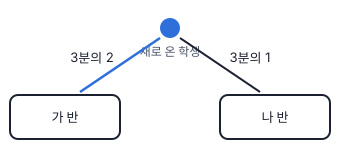
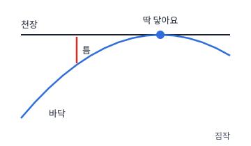
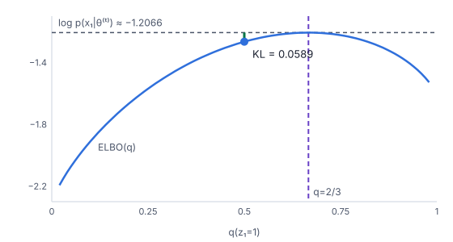
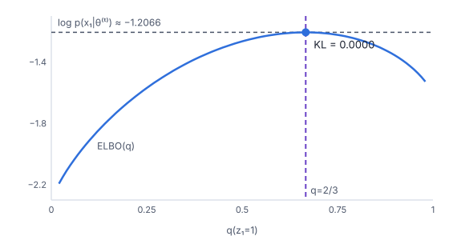
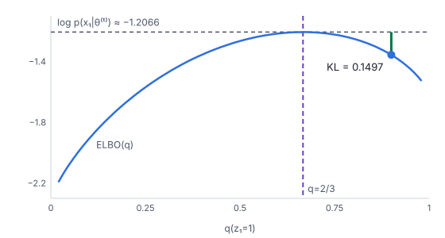
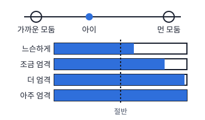

# Q 함수와 ELBO로 보는 EM — 5살도 이해하는 정리노트

정방철 교수님 머신러닝기초 · 1125 수업 (Lecture08, MML 11장)

> `정리노트_1125_EM_ELBO.html`를 마크다운으로 옮겼어요. 그림은 `figures_1125/` 폴더의 SVG, 위젯은 대표 설정의 정적 그림으로 바꿨어요. 수식은 `$…$` / `$$…$$`라서 GitHub, Obsidian, Typora에서 보여요.

**목차**

- [시작](#s0)
  - [성분을 모르는데 어떻게 로그우도를 올리나요?](#s0-learning-map)
- [1. Q 함수](#s1)
  - [모르는 성분을 사후확률로 평균 내기](#s1-why-q)
  - [Q 함수의 두 θ](#s1-q-function)
  - [GMM의 Q에서 책임도가 나오고 갱신식이 분리돼요](#s1-gmm-q)
- [2. ELBO와 단조 증가](#s2)
  - [로그우도 = ELBO + KL](#s2-elbo-identity)
  - [q를 바꾸면 ELBO와 KL이 어떻게 나뉘나요?](#s2-kl-gap)
  - [E-step과 M-step이 로그우도를 올리는 이유](#s2-monotone)
- [3. 일반 EM과 확장](#s3)
  - [GMM의 EM과 일반 EM은 어떻게 대응하나요?](#s3-general-em)
  - [분산을 0으로 보내면 K-means가 돼요](#s3-kmeans)
- [4. 요약 · 예고](#s4)
  - [Q 함수 · ELBO · 단조 증가 한눈에](#s4-cheatsheet)
  - [다음 수업에서 이어질 내용](#s4-next)
  - [확인문제와 관련 자료](#s4-links)

## 시작

### 성분을 모르는데 어떻게 로그우도를 올리나요?

*1125 수업 · L08 s7–14*

**먼저 큰 그림**

관측 $x$만 보고 로그우도 $\log p(x\mid\boldsymbol{\theta})$를 키우는 파라미터 $\boldsymbol{\theta}$를 찾고 싶어요. 그런데 점마다 로그 안에 성분 합 $\sum_k\pi_k\phi_{nk}$가 들어 있어서(${\phi_{nk}=\mathcal{N}(x_n\mid\boldsymbol{\mu}_k,\boldsymbol{\Sigma}_k)}$는 점 $x_n$에서 본 성분 $k$의 밀도), 미분하면 모든 성분의 파라미터가 한 분모에 얽혀요. 오늘의 답은 다루기 쉬운 대리 목표인 Q 함수와 ELBO를 올리면 원래 로그우도도 줄지 않는다는 거예요.

1118에서는 성분 번호 $z_n$을 안다고 가정하면 완전 데이터 로그우도 ${\log p(x_n,z_n\mid\boldsymbol{\theta})=\log(\pi_{z_n}\phi_{n,z_n})}$에서 로그 안의 합이 사라진다는 것을 봤어요. 오늘은 $z_n$을 모르므로 값 하나를 고르지 않고, 각 $k$의 완전 데이터 로그우도를 사후분포 ${p(z_n=k\mid x_n,\boldsymbol{\theta}^{(t)})}$, 곧 책임도 $r_{nk}^{(t)}$로 평균 내요. 1116에서 배운 EM 갱신식은 그대로이고, 그 반복이 왜 로그우도를 올리는지를 새로 증명해요.

| 무엇을 바꾸나 | $z$를 아는 경우(완전 데이터) | $z$를 모르는 경우(1125) |
|---|---|---|
| 목표 함수 | $\log p(x,z\mid\boldsymbol{\theta})$: 로그 안에 합이 없어요 | $Q(\boldsymbol{\theta}\mid\boldsymbol{\theta}^{(t)})$: 사후분포로 평균 낸 $\log p(x,z\mid\boldsymbol{\theta})$ |
| $z$의 역할 | 관측값 | 사후분포 $p(z\mid x,\boldsymbol{\theta}^{(t)})$, 곧 책임도 $r_{nk}^{(t)}$ |
| 올라간다는 보장 | 직접 MLE로 바로 최대화해요 | 로그우도 = ELBO + KL, $D_{\mathrm{KL}}\ge 0$이라 단조 증가(전역 최대는 보장 없음) |

한 번 반복해서 얻는 것은 새 파라미터 값 $\boldsymbol{\theta}^{(t+1)}$과, 그 값에서 로그우도가 줄지 않는다는 부등식 보장이에요. E-step에서 정한 분포 $q(z)$는 그 계산의 가중치로 쓰여요. 1118 노트의 두 성분 예를 이어 가면 혼합비가 $(1/2,1/2)$에서 $(7/12,5/12)$로 바뀌고, 두 점의 로그우도가 $\log(19/18)\approx0.054$만큼 올라가요.

식은 이 순서로 나와요. 먼저 Q 함수를 사후분포로 평균 낸 완전 데이터 로그우도로 정의하고(E-step), GMM에서는 그것이 책임도 가중합이 되어 파라미터별로 나뉘는 것을 봐요(M-step). 이어서 아무 분포 $q(z)$에서나 성립하는 항등식을 만들어요.

$$
\log p(x\mid\boldsymbol{\theta})=\mathrm{ELBO}(q,\boldsymbol{\theta})+D_{\mathrm{KL}}\big(q(z)\,\|\,p(z\mid x,\boldsymbol{\theta})\big)
$$

ELBO(evidence lower bound)는 로그우도의 하한이고, 0 이상인 KL 발산(KL divergence)이 그 차이를 채워요. 마지막으로 이 항등식으로 E-step과 M-step을 잇는 부등식 사슬을 세워요.

단조 증가는 로그우도가 반복마다 줄지 않는다는 뜻이지, 전역 최대(MLE)에 닿는다는 보장이 아니에요. 로그우도에 봉우리가 여러 개 있을 수 있어서(non-convex) 국소 최댓값에서 멈출 수 있어요. 또 Q 함수 안의 $\boldsymbol{\theta}^{(t)}$는 사후분포를 계산하는 데만 쓰는 고정된 현재 값이고, $\boldsymbol{\theta}$는 최대화할 자유 변수예요.

성분 번호를 모를 때 완전 데이터 로그우도의 어느 항을 써야 할지, [모르는 성분을 사후확률로 평균 내기](#s1-why-q)에서 이어서 따져 봐요.

**페이지 요약**

성분 번호를 모르면 완전 데이터 로그우도를 사후분포(책임도)로 평균 낸 Q 함수를 올리고, 로그우도 = ELBO + KL 항등식으로 로그우도가 줄지 않음을 보여요. 전역 최대는 보장하지 않아요.

*용어*

- **Q 함수(Q function)** — 사후분포 $p(z\mid x,\boldsymbol{\theta}^{(t)})$로 평균 낸 $\log p(x,z\mid\boldsymbol{\theta})$
- **ELBO(evidence lower bound)** — 로그우도의 하한
- **KL 발산(KL divergence)** — 로그우도와 ELBO의 차이, $D_{\mathrm{KL}}\ge 0$

*핵심 식*

- 로그우도 = ELBO + KL

  $$
  \log p(x\mid\boldsymbol{\theta})=\mathrm{ELBO}(q,\boldsymbol{\theta})+D_{\mathrm{KL}}\big(q(z)\,\|\,p(z\mid x,\boldsymbol{\theta})\big)
  $$

---

## 1. Q 함수

### 모르는 성분을 사후확률로 평균 내기

*1125 수업 · L08 s7–9*

**쉽게 말하면**

어느 반에서 온 학생인지 모를 때는, 그 반일 가능성만큼 점수를 나눠 매겨요.

*가 반일 가능성이 더 크니 그쪽에 더 많이 나눠 줘요.*

**정확히 말하면**

성분 번호 $z_n$을 알면 완전 데이터 로그우도 $\log p(x_n,z_n\mid\boldsymbol{\theta})$ 하나로 파라미터를 평가하면 돼요. 그런데 실제로는 $z_n$이 숨어 있으니 어느 성분의 항을 써야 할까요? 같은 점 하나를 두고 "성분 1이라고 가정", "성분 2라고 가정", "두 가정을 가능성만큼 섞기"의 세 가지를 비교해 봐요.

먼저 왜 $z_n$을 끌어들였는지 짧게 상기해요. $\boldsymbol{\theta}$는 혼합비·평균·공분산을 모은 파라미터이고, $\phi_{nk}=\mathcal{N}(x_n\mid\boldsymbol{\mu}_k,\boldsymbol{\Sigma}_k)$는 성분 $k$의 밀도를 $x_n$에서 읽은 값이에요. 성분을 모르면 [두 성분의 기여를 모두 더한 밀도](../../1118/정리노트_1118_Latent_Variable_EM.html#s2-marginal)에 로그를 씌워야 해요.

$$
\log p(x_n\mid\boldsymbol{\theta})=\log\sum_{k=1}^{K}\pi_k\phi_{nk}
$$

이 식을 $\pi_1$로 편미분하면 $\phi_{n1}/\sum_j\pi_j\phi_{nj}$가 나와요. 분모의 합 때문에 $\pi_1$의 조건식에 다른 성분의 $\pi_2$, $\boldsymbol{\mu}_2$, $\boldsymbol{\Sigma}_2$가 함께 섞여 들어가요. 반면 $z_n=k$로 주어지면 로그 안에는 곱 $\pi_k\phi_{nk}$ 하나만 남아 이 얽힘이 사라져요.

설명을 위해 만든 예로 1118 노트의 예를 그대로 이어 써요. 두 성분은 평균이 모두 $0$이고 분산이 각각 $1$, $4$예요. $\boldsymbol{\theta}^{(t)}$는 $t$번째 반복에서 가진 현재 추정값이고, 여기서는 혼합비가 $\pi_1^{(t)}=\pi_2^{(t)}=\frac12$예요. 이 섹션에서는 평균과 분산을 고정하고 혼합비만 바꿔요. 관측은 $x_1=0$과, 두 성분의 밀도가 같아지는 $x_2\approx1.36$ 두 개예요. $c=\sqrt{2\pi}$로 두고 우선 $x_1=0$ 하나만 봐요. 이 노트의 $\log$는 자연로그예요. 숫자로 비교하려고 지금은 로그 안에도 현재 값 $\boldsymbol{\theta}^{(t)}$를 넣어요.

| $z_1$에 대한 태도 | 로그 안에 넣는 값 | 로그 값 |
|---|---|---|
| $z_1=1$이라고 가정 | $\pi_1^{(t)}\phi_{11}=\frac12\cdot\frac1c=\frac1{2c}$ | $\approx-1.612$ |
| $z_1=2$라고 가정 | $\pi_2^{(t)}\phi_{12}=\frac12\cdot\frac1{2c}=\frac1{4c}$ | $\approx-2.305$ |
| 사후확률로 가중평균 | 두 로그 값에 바로 아래에서 구할 사후확률 $\frac23$, $\frac13$을 곱해 더함 | $\approx-1.843$ |

두 가정의 로그 값은 $0.693$만큼 달라서, 어느 쪽을 믿느냐에 따라 평가가 바뀌어요. $x_1$만 보고는 성분을 확정할 수 없지만, $x_1$을 본 뒤 각 성분이었을 확률은 구할 수 있어요. 이것이 $z_1$의 **사후분포**(posterior distribution)이고, 1118에서 구한 책임도와 같은 값이에요. 결합 밀도를 두 기여의 합 $\frac1{2c}+\frac1{4c}=\frac3{4c}$로 나눠요.

$$
p(z_1=1\mid x_1,\boldsymbol{\theta}^{(t)})=\frac{p(x_1,z_1=1\mid\boldsymbol{\theta}^{(t)})}{p(x_1\mid\boldsymbol{\theta}^{(t)})}
$$

$$
=\frac{1/(2c)}{3/(4c)}=\frac23
$$

같은 방식으로 $p(z_1=2\mid x_1,\boldsymbol{\theta}^{(t)})=\frac13$이에요. 표의 셋째 줄은 두 가정의 로그 값을 이 사후확률로 가중평균한 거예요. 로그 안을 아직 정하지 않은 $\boldsymbol{\theta}$로 남겨 두면 다음 식이 돼요.

$$
\sum_{k=1}^{2}p(z_1=k\mid x_1,\boldsymbol{\theta}^{(t)})\log p(x_1,z_1=k\mid\boldsymbol{\theta})
$$

이 식에서 성분에 대한 합은 **로그 바깥**에 있어요. 각 항의 로그 안에는 곱 $\pi_k\phi_{1k}$ 하나뿐이라, 성분 번호를 알 때처럼 로그를 쪼갤 수 있어요. 결국 "$z_n$을 안다"는 가정을 "$z_n$의 사후분포로 각 경우를 평균 낸다"로 바꾼 셈이에요.

계산 확인

$\frac23\times(-1.612)\approx-1.075$, $\frac13\times(-2.305)\approx-0.768$이고, 더하면 $-1.843$이에요. 두 가정의 차이는 $-1.612-(-2.305)=0.693$이에요.

같은 점의 관측 로그우도는 $\log\frac3{4c}\approx-1.207$로, 가중평균 $-1.843$과 같은 값이 아니에요. 차이는 가중치 $q=(\frac23,\frac13)$의 엔트로피 $-\mathbb{E}_q[\log q]=-\frac23\log\frac23-\frac13\log\frac13\approx0.6365$이고, $-1.8431+0.6365=-1.2066$이에요. 이 관계는 [로그우도 = ELBO + KL](#s2-elbo-identity)의 항등식으로 설명돼요.

가장 그럴듯한 성분 하나만 고르면 어떨까요? $z_1=1$로 정하면 $-1.612$만 쓰고, 성분 2였을 가능성 $\frac13$을 버려요. 확률을 $0$과 $1$로만 나누는 배정의 한 예가 [분산을 0으로 보내면 K-means가 돼요](#s3-kmeans)의 극한이에요. EM은 $\frac13$의 가능성도 가중치로 남겨 둬요.

가중치 속에는 $\boldsymbol{\theta}^{(t)}$를, 로그 속에는 $\boldsymbol{\theta}$를 썼는데, [이 두 θ는 각각 무슨 역할일까요?](#s1-q-function)

**교수님 말씀**

> “이게 바로 EM 알고리즘에 숨겨져 있는 철학이라는 거예요.”

$z$를 주어진 값으로 놓고 계산한 뒤, 그 값이 나올 사후확률을 곱해 $z$에 대해 평균 낸다(average out)는 설명에 붙인 말씀이에요.

> “한꺼번에 최적화하기 어려우니 왔다 갔다 하면서”

교수님은 이 방식을 coordinate descent에 비유하셨어요. 파라미터가 많아 한꺼번에 최적화하기 어려우면 일부를 고정하고 나머지를 최적화해요. GMM의 EM도 "이 점이 어느 봉우리에서 왔을지에 대한 믿음"인 사후확률을 고정해 두고 파라미터를 갱신해요.

칠판 예: $\log(a+b)$를 $a$로 미분하면 $\frac1{a+b}$가 앞에 붙어서 $a$의 조건에 $b$가 남아요. $\log a+\log b$ 꼴이면 $a$로 미분할 때 $\log b$는 상관이 없어요.

**페이지 요약**

같은 $x_1=0$에서 두 가정의 로그 값 $-1.612$, $-2.305$를 사후확률 $\frac23$, $\frac13$으로 가중평균하면 $-1.843$이에요. 성분에 대한 합이 로그 바깥에 있어요.

*용어*

- **사후분포(posterior distribution)** — $x_n$을 본 뒤 $z_n$이 각 성분이었을 확률이에요. 1118의 책임도와 같아요.
- **완전 데이터 로그우도** — 성분 번호까지 안다고 가정한 로그우도 $\log p(x_n,z_n\mid\boldsymbol{\theta})$예요. 로그 안에 곱 하나만 있어요.

*핵심 식*

- 관측 로그우도(로그 안의 합)

  $$
  \log p(x_n\mid\boldsymbol{\theta})=\log\sum_{k=1}^{K}\pi_k\phi_{nk}
  $$
- 사후확률(주 예시)

  $$
  p(z_1=1\mid x_1,\boldsymbol{\theta}^{(t)})=\frac{p(x_1,z_1=1\mid\boldsymbol{\theta}^{(t)})}{p(x_1\mid\boldsymbol{\theta}^{(t)})}
  $$
- 점 하나의 가중평균

  $$
  \sum_{k=1}^{2}p(z_1=k\mid x_1,\boldsymbol{\theta}^{(t)})\log p(x_1,z_1=k\mid\boldsymbol{\theta})
  $$

---

### Q 함수의 두 θ

*1125 수업 · L08 s9*

**정확히 말하면**

Q 함수 $Q(\boldsymbol{\theta}\mid\boldsymbol{\theta}^{(t)})$에는 θ가 두 번 나와요. 각각 무슨 역할일까요? 가중치를 만드는 $\boldsymbol{\theta}^{(t)}$는 이미 숫자로 정해진 현재 추정값이고, 로그 안의 $\boldsymbol{\theta}$는 이제부터 고를 미지수예요.

[모르는 성분을 사후확률로 평균 내기](#s1-why-q)에서 만든 점 하나의 가중평균부터 다시 봐요. 점 $x_1$ 하나만 쓴 Q라는 뜻으로 임시로 $Q_1$이라고 부를게요.

$$
Q_1(\boldsymbol{\theta}\mid\boldsymbol{\theta}^{(t)})=\sum_{k=1}^{2}p(z_1=k\mid x_1,\boldsymbol{\theta}^{(t)})\log p(x_1,z_1=k\mid\boldsymbol{\theta})
$$

주 예시에서는 평균과 분산을 고정했으니 $\phi_{11}=\frac1c$, $\phi_{12}=\frac1{2c}$는 그대로이고, 로그 안에서 움직이는 것은 혼합비뿐이에요.

$$
Q_1=\frac23\log\frac{\pi_1}{c}+\frac13\log\frac{\pi_2}{2c}
$$

가중치 $\frac23$, $\frac13$은 $\boldsymbol{\theta}^{(t)}$로 계산을 끝낸 숫자예요. 로그 안의 $\pi_1$, $\pi_2$는 아직 정하지 않은 값이라, 이를 바꿔도 가중치 $\frac23$, $\frac13$은 그대로예요. $\pi_1=\pi_2=\frac12$을 넣으면 앞 토픽의 $-1.843$이 다시 나와요.

| 자리 | 들어 있는 θ | 역할 | 주 예시 |
|---|---|---|---|
| 가중치 $p(z\mid x,\boldsymbol{\theta}^{(t)})$ | $\boldsymbol{\theta}^{(t)}$ | 사후분포 계산에만 쓰는 고정된 현재 추정값 | $\frac23$, $\frac13$ |
| 로그 안 $\log p(x,z\mid\boldsymbol{\theta})$ | $\boldsymbol{\theta}$ | 최적화 대상인 자유 변수 | $\pi_1$, $\pi_2$ |

이제 모든 관측을 $x$, 모든 잠재변수를 $z$로 묶어 써요. **Q 함수**는 완전 데이터 로그우도를, 관측 $x$와 현재 추정값 $\boldsymbol{\theta}^{(t)}$가 주어졌을 때의 $z$의 사후분포로 평균 낸 조건부 기댓값이에요. 그래서 기대 완전 데이터 로그우도(expected complete-data log-likelihood)라고도 불러요.

$$
Q(\boldsymbol{\theta}\mid\boldsymbol{\theta}^{(t)})=\mathbb{E}_{z\mid x,\boldsymbol{\theta}^{(t)}}\big[\log p(x,z\mid\boldsymbol{\theta})\big]
$$

$$
=\int\log p(x,z\mid\boldsymbol{\theta})\,p(z\mid x,\boldsymbol{\theta}^{(t)})\,dz
$$

아래첨자 $z\mid x,\boldsymbol{\theta}^{(t)}$는 "이 분포로 $z$를 평균 낸다"는 표시예요. $z$가 연속이면 적분이고, GMM의 성분 번호처럼 이산이면 적분이 합으로 바뀌어요.

$$
Q(\boldsymbol{\theta}\mid\boldsymbol{\theta}^{(t)})=\sum_{z}p(z\mid x,\boldsymbol{\theta}^{(t)})\log p(x,z\mid\boldsymbol{\theta})
$$

관측이 $x_1$ 하나이고 $z=z_1\in\{1,2\}$이면 이 합은 $Q_1$과 같아요. Q의 값은 확률이 아니라 로그우도들의 가중평균이에요. 가중치, 곧 사후분포를 $\boldsymbol{\theta}^{(t)}$로 계산하는 일이 E-step이고, Q를 $\boldsymbol{\theta}$에 대해 최대로 만드는 일이 M-step이에요.

$$
\boldsymbol{\theta}^{(t+1)}=\arg\max_{\boldsymbol{\theta}}Q(\boldsymbol{\theta}\mid\boldsymbol{\theta}^{(t)})
$$

다음 반복에서는 방금 구한 $\boldsymbol{\theta}^{(t+1)}$이 가중치 쪽으로 옮겨 가 새 고정값이 돼요. 한 반복 안에서 가중치와 로그 안의 θ를 섞으면 "고정한 것"과 "고를 것"이 뒤섞이므로, 두 자리를 늘 구별해요.

가중치로 사전분포 $p(z\mid\boldsymbol{\theta}^{(t)})$가 아니라 사후분포를 쓰는 이유는, $x$를 이미 관측했는데 사전분포만 쓰면 그 정보를 버리기 때문이에요. 주 예시에서 사전분포는 혼합비 $(\frac12,\frac12)$라 $x_1=0$에서 성분 1의 밀도가 성분 2의 두 배라는 사실이 가중치에 들어가지 않아요. 사후분포 $(\frac23,\frac13)$은 이 사실을 반영해요. 또 사후분포로 평균 낼 때만 뒤에서 만들 하한이 $\boldsymbol{\theta}^{(t)}$에서 로그우도와 딱 맞닿는데, 이는 [q를 바꾸면 ELBO와 KL이 어떻게 나뉘나요?](#s2-kl-gap)에서 수치로 확인해요.

GMM의 점 $N$개 전체로 이 Q를 펼치면 가중치와 로그 안은 각각 무엇이 될까요? [GMM의 Q에서 책임도가 나오고 갱신식이 분리돼요](#s1-gmm-q)로 이어가요.

**교수님 말씀**

> “그냥 내가 나중에 이거 써먹기 좋으라고 정의한 거예요.”

Q 함수의 정의 자체에 깊은 이유를 찾을 필요는 없고, 뒤의 증명과 계산에 쓰기 좋게 정의했다는 뜻이에요.

> “진짜 주인공은 θ”

Q는 로그를 취한 우도의 평균이고, 최적화로 찾는 대상은 로그 안의 θ라는 말씀이에요. 왜 사후확률로 기댓값을 취하느냐는 질문에는 데이터를 무시하지 않기 위해서라고 답하셨어요.

**꼭 기억해요**

> “여기 이 θ^t … 요놈들은요, 일단 fixed예요, fixed.”

가중치 안의 $\boldsymbol{\theta}^{(t)}$는 이전 반복에서 정해진 고정값이고, 최적화 대상은 로그 안의 $\boldsymbol{\theta}$라는 뜻이에요.

**페이지 요약**

Q 함수는 완전 데이터 로그우도를 사후분포로 평균 낸 값이에요. 가중치 속 $\boldsymbol{\theta}^{(t)}$는 고정된 현재 추정값이고, 로그 속 $\boldsymbol{\theta}$는 최적화 대상이에요.

*용어*

- **Q 함수(expected complete-data log-likelihood)** — $z$의 사후분포로 평균 낸 완전 데이터 로그우도예요. 확률이 아니라 로그우도들의 가중평균이에요.
- **$\boldsymbol{\theta}^{(t)}$** — 사후분포 계산에만 쓰는 고정된 현재 추정값이에요.
- **$\boldsymbol{\theta}$** — 로그 안에 있는 자유 변수로, M-step에서 고르는 대상이에요.
- **사전분포 대신 사후분포** — 이미 관측한 $x$의 정보를 가중치에 반영하기 위해서예요.

*핵심 식*

- Q 함수

  $$
  Q(\boldsymbol{\theta}\mid\boldsymbol{\theta}^{(t)})=\mathbb{E}_{z\mid x,\boldsymbol{\theta}^{(t)}}\big[\log p(x,z\mid\boldsymbol{\theta})\big]
  $$
- 이산 z일 때

  $$
  Q(\boldsymbol{\theta}\mid\boldsymbol{\theta}^{(t)})=\sum_{z}p(z\mid x,\boldsymbol{\theta}^{(t)})\log p(x,z\mid\boldsymbol{\theta})
  $$
- 주 예시의 점 하나

  $$
  Q_1=\frac23\log\frac{\pi_1}{c}+\frac13\log\frac{\pi_2}{2c}
  $$
- M-step

  $$
  \boldsymbol{\theta}^{(t+1)}=\arg\max_{\boldsymbol{\theta}}Q(\boldsymbol{\theta}\mid\boldsymbol{\theta}^{(t)})
  $$

---

### GMM의 Q에서 책임도가 나오고 갱신식이 분리돼요

*1125 수업 · L08 s10–11*

**정확히 말하면**

GMM에서 Q를 쓰면 왜 미분이 쉬워지고, 갱신식은 어떻게 나올까요? Q의 가중치는 고정된 책임도 $r_{nk}^{(t)}$이고, 로그 안에는 곱 $\pi_k\mathcal{N}(x_n\mid\boldsymbol{\mu}_k,\boldsymbol{\Sigma}_k)$ 하나만 있어요. 그래서 로그를 합으로 쪼개면 혼합비만 든 묶음과 평균·공분산만 든 묶음이 따로 떨어지고, 묶음마다 최대화하면 1116에서 본 갱신식이 그대로 나와요.

#### 1 / 3가중치가 책임도임을 확인하기

[Q 함수의 두 θ](#s1-q-function)의 정의를 GMM의 점 $N$개에 적용하면 가중치가 무엇인지 확인해요.

점들이 독립이면 완전 데이터 로그우도는 점별 항의 합 $\sum_n\log p(x_n,z_n\mid\boldsymbol{\theta})$예요. 기댓값은 합의 각 항에 나눠 들어가고, $n$번째 항은 $z_n$만 포함하므로 $z_n$의 사후분포로만 평균 내면 돼요. 점들이 독립이라 이 사후분포는 $x_n$만으로 정해지고, 이산인 $z_n$의 평균은 $k$에 대한 합이에요. 로그 안은 결합 밀도 $p(x_n,z_n=k\mid\boldsymbol{\theta})=\pi_k\mathcal{N}(x_n\mid\boldsymbol{\mu}_k,\boldsymbol{\Sigma}_k)$예요. 1118에서 $\pi_k\phi_{nk}$로 쓴 값인데, 여기서는 $\boldsymbol{\mu}_k$, $\boldsymbol{\Sigma}_k$도 자유 변수라 숫자 $\phi_{nk}$ 대신 $\mathcal{N}$을 그대로 써요.

$$
Q(\boldsymbol{\theta}\mid\boldsymbol{\theta}^{(t)})=\sum_{n=1}^{N}\sum_{k=1}^{K}p(z_n=k\mid x_n,\boldsymbol{\theta}^{(t)})\log\big(\pi_k\mathcal{N}(x_n\mid\boldsymbol{\mu}_k,\boldsymbol{\Sigma}_k)\big)
$$

가중치를 베이즈 정리로 풀어 보면 1118에서 정의한 책임도가 나와요.

$$
p(z_n=k\mid x_n,\boldsymbol{\theta}^{(t)})=\frac{p(x_n,z_n=k\mid\boldsymbol{\theta}^{(t)})}{p(x_n\mid\boldsymbol{\theta}^{(t)})}
$$

↳ 조건부확률의 정의(베이즈 정리)예요.

$$
\hphantom{p(z_n=k\mid x_n,\boldsymbol{\theta}^{(t)})}=\frac{\pi_k^{(t)}\mathcal{N}(x_n\mid\boldsymbol{\mu}_k^{(t)},\boldsymbol{\Sigma}_k^{(t)})}{p(x_n\mid\boldsymbol{\theta}^{(t)})}
$$

↳ 분자에 결합 밀도를 대입해요.

$$
\hphantom{p(z_n=k\mid x_n,\boldsymbol{\theta}^{(t)})}=\frac{\pi_k^{(t)}\mathcal{N}(x_n\mid\boldsymbol{\mu}_k^{(t)},\boldsymbol{\Sigma}_k^{(t)})}{\sum_{j=1}^{K}\pi_j^{(t)}\mathcal{N}(x_n\mid\boldsymbol{\mu}_j^{(t)},\boldsymbol{\Sigma}_j^{(t)})}
$$

↳ 분모를 주변화로 펼쳐요.

$$
\hphantom{p(z_n=k\mid x_n,\boldsymbol{\theta}^{(t)})}=r_{nk}^{(t)}
$$

↳ 1118의 책임도와 같은 식이에요.

**가중치는 책임도 그 자체예요.** $\boldsymbol{\theta}^{(t)}$만으로 계산하므로 M-step에서는 상수이고, 모든 $n$, $k$의 $r_{nk}^{(t)}$를 계산하는 일이 GMM의 E-step이에요.

주 예시: $r_{11}^{(t)}=\frac23$, $r_{12}^{(t)}=\frac13$이에요. $x_2$에서는 두 성분의 밀도가 같아서 $r_{21}^{(t)}=r_{22}^{(t)}=\frac12$예요.

$$
Q(\boldsymbol{\theta}\mid\boldsymbol{\theta}^{(t)})=\sum_{n=1}^{N}\sum_{k=1}^{K}r_{nk}^{(t)}\log\big(\pi_k\mathcal{N}(x_n\mid\boldsymbol{\mu}_k,\boldsymbol{\Sigma}_k)\big)
$$

로그 안의 곱을 어떻게 다루면 파라미터들이 서로 떨어질까요?

#### 2 / 3곱의 로그를 쪼개 파라미터를 분리하기

로그 안의 곱을 로그의 합으로 바꿔, 혼합비 묶음과 평균·공분산 묶음을 나눠요.

파란색은 바로 윗줄에서 바뀐 부분이에요.

$$
Q(\boldsymbol{\theta}\mid\boldsymbol{\theta}^{(t)})=\sum_{n=1}^{N}\sum_{k=1}^{K}r_{nk}^{(t)}\log\big(\pi_k\mathcal{N}(x_n\mid\boldsymbol{\mu}_k,\boldsymbol{\Sigma}_k)\big)
$$

↳ 1단계에서 얻은 GMM의 Q예요.

$$
\hphantom{Q(\boldsymbol{\theta}\mid\boldsymbol{\theta}^{(t)})}=\sum_{n=1}^{N}\sum_{k=1}^{K}r_{nk}^{(t)}\big[\textcolor{#3182f6}{\log\pi_k+\log\mathcal{N}(x_n\mid\boldsymbol{\mu}_k,\boldsymbol{\Sigma}_k)}\big]
$$

↳ 곱의 로그는 로그의 합이에요.

$$
\hphantom{Q(\boldsymbol{\theta}\mid\boldsymbol{\theta}^{(t)})}=\textcolor{#3182f6}{\sum_{n,k}r_{nk}^{(t)}\log\pi_k}+\sum_{n,k}r_{nk}^{(t)}\log\mathcal{N}(x_n\mid\boldsymbol{\mu}_k,\boldsymbol{\Sigma}_k)
$$

↳ 분배법칙으로 두 합으로 나눠요.

자세히

$\sum_{n,k}$는 $\sum_{n=1}^{N}\sum_{k=1}^{K}$를 짧게 쓴 거예요.

$$
\hphantom{Q(\boldsymbol{\theta}\mid\boldsymbol{\theta}^{(t)})}=\textcolor{#3182f6}{\sum_{k=1}^{K}N_k\log\pi_k}+\sum_{n,k}r_{nk}^{(t)}\log\mathcal{N}(x_n\mid\boldsymbol{\mu}_k,\boldsymbol{\Sigma}_k)
$$

↳ 첫 합에서 $n$을 먼저 더해 $N_k$로 묶어요.

자세히

$\log\pi_k$는 $n$과 무관하므로 합 밖으로 나오고, 남은 $\sum_n r_{nk}^{(t)}$가 성분 $k$의 유효 관측 수 $N_k$예요.

**첫 묶음에는 혼합비만, 둘째 묶음에는 평균·공분산만 들어 있어요.** 둘째 묶음도 $k$마다 $\boldsymbol{\mu}_k$, $\boldsymbol{\Sigma}_k$만 든 항으로 나뉘어서, $\boldsymbol{\mu}_1$로 미분하면 $\boldsymbol{\mu}_1$이 든 항 외에는 모두 사라져요.

여기서 $N_k=\sum_{n=1}^{N}r_{nk}^{(t)}$는 1118의 유효 관측 수와 같아요. 주 예시에서는 $N_1=\frac23+\frac12=\frac76$, $N_2=\frac13+\frac12=\frac56$이에요. 혼합비 부분만 놓고 직접 로그우도와 비교하면 차이가 보여요.

| 목표 함수 | $x_1=0$과 관련한 혼합비 부분 | $\pi_1$, $\pi_2$의 관계 |
|---|---|---|
| 관측 로그우도 | $\log\big(\frac{\pi_1}{c}+\frac{\pi_2}{2c}\big)$ | 한 로그 안에 섞여 있어요 |
| Q의 첫 묶음(두 점 모두) | $\frac76\log\pi_1+\frac56\log\pi_2$ | 항마다 하나씩 따로 있어요 |

관측 로그우도의 $x_2$ 항은 두 성분 밀도가 같아서 $\pi_1+\pi_2=1$이면 혼합비와 무관하므로, 혼합비에 관한 비교는 $x_1$ 항만 보면 돼요. 이렇게 떨어진 묶음을 각각 최대화하면 갱신식은 어떤 모양일까요?

#### 3 / 3묶음마다 최대화해 갱신식 얻기

분리된 두 묶음을 따로 최대화해 M-step의 갱신식을 얻어요.

혼합비 묶음 $\sum_kN_k\log\pi_k$는 혼합비의 합이 $1$이라는 제약 아래 최대화해요. 제약 항 $\lambda(\sum_k\pi_k-1)$을 붙여 $\pi_k$로 편미분하면 $N_k/\pi_k+\lambda=0$이고, 양변에 $\pi_k$를 곱하면 1118의 성분식 $N_k+\lambda\pi_k=0$이 바로 나와요. 그 뒤는 [혼합비의 합을 1로 맞춰 갱신하기](../../1118/정리노트_1118_Latent_Variable_EM.html#s1-weight-constraint)와 같은 계산이에요.

$$
N_k+\lambda\pi_k=0
$$

↳ 성분 $k$의 식이에요.

$$
\sum_kN_k+\lambda\sum_k\pi_k=0
$$

↳ 모든 성분의 식을 $k$에 대해 더해요.

$$
N+\lambda=0
$$

↳ 점마다 책임도 합이 $1$이라 $\sum_kN_k=N$, 그리고 $\sum_k\pi_k=1$이에요.

$$
\pi_k=\frac{N_k}{N}
$$

↳ $\lambda=-N$을 성분식에 넣고 $\pi_k$를 풀어요.

1118에서는 관측 로그우도에서 출발해 $N_k$ 안에 미지 혼합비가 남았기 때문에, 이전 값으로 책임도를 고정하는 단계를 따로 둬야 했어요. Q에서는 가중치 $r_{nk}^{(t)}$가 처음부터 고정된 숫자라 그 고정이 정의 안에 들어 있어요.

주 예시의 혼합비 묶음과 제약은 다음과 같아요.

$$
\frac76\log\pi_1+\frac56\log\pi_2,\qquad\pi_1+\pi_2=1
$$

주 예시에서는 $N_1+N_2=\frac76+\frac56=2=N$이에요. 그래서 각 $N_k$를 $N=2$로 나누면 새 혼합비가 나와요.

$$
\pi_1^{(t+1)}=\frac{7/6}{2}=\frac7{12},\qquad\pi_2^{(t+1)}=\frac{5/6}{2}=\frac5{12}
$$

계산 확인

혼합비 묶음의 값은 $(\frac12,\frac12)$에서 $\frac76\log\frac12+\frac56\log\frac12=2\log\frac12\approx-1.3863$이에요. $(\frac7{12},\frac5{12})$에서는 $\approx-1.3584$로 $0.0279$만큼 커요. 평균과 분산은 고정했으니 Q 전체도 $0.0279$만큼 올라요.

평균·공분산 묶음은 $k$번째 항을 $\boldsymbol{\mu}_k$, $\boldsymbol{\Sigma}_k$로 미분해 0으로 놓아 풀어요. 결과는 1116에서 관측 로그우도를 직접 미분해 얻은 갱신식(그때 new로 표시한 식)과 같아요. 직접 미분할 때는 $r_{nk}$ 안에도 미지 파라미터가 들어 있었는데, Q에서는 $r_{nk}^{(t)}$를 상수로 두고 미분하므로 유도가 훨씬 깔끔해요. $x_n$이 $D$차원 벡터일 때도 같은 식이며, 그때는 $x_n$을 $\mathbf{x}_n$으로 읽어요.

$$
\boldsymbol{\mu}_k^{(t+1)}=\frac{1}{N_k}\sum_{n=1}^{N}r_{nk}^{(t)}x_n
$$

↳ 책임도로 가중한 평균이에요.

$$
\boldsymbol{\Sigma}_k^{(t+1)}=\frac{1}{N_k}\sum_{n=1}^{N}r_{nk}^{(t)}(x_n-\boldsymbol{\mu}_k^{(t+1)})(x_n-\boldsymbol{\mu}_k^{(t+1)})^\top
$$

↳ 책임도로 가중한 공분산이에요.

$$
\pi_k^{(t+1)}=\frac{N_k}{N},\qquad N_k=\sum_{n=1}^{N}r_{nk}^{(t)}
$$

↳ 유효 관측 수를 전체 관측 수로 나눠요.

**세 식 모두 E-step에서 고정한 $r_{nk}^{(t)}$와 $N_k$만으로 바로 계산돼요.** 주 예시는 평균과 분산을 고정했으므로 혼합비만 $\frac7{12}$, $\frac5{12}$로 바뀌어요.

Q를 $0.0279$만큼 올렸는데, 이것이 왜 원래 관측 로그우도 $\log p(x\mid\boldsymbol{\theta})$도 올린다는 보장이 될까요? [로그우도 = ELBO + KL](#s2-elbo-identity)에서 답해요.

**교수님 말씀**

칠판 예: 점 하나($N=1$), 성분 셋($K=3$)으로 첨자 $n$을 생략하고 Q를 여섯 항으로 펼치셨어요.

$$
r_1^{(t)}\log\pi_1+r_2^{(t)}\log\pi_2+r_3^{(t)}\log\pi_3
$$

$$
+\,r_1^{(t)}\log\mathcal{N}(x\mid\boldsymbol{\mu}_1,\boldsymbol{\Sigma}_1)+r_2^{(t)}\log\mathcal{N}(x\mid\boldsymbol{\mu}_2,\boldsymbol{\Sigma}_2)+r_3^{(t)}\log\mathcal{N}(x\mid\boldsymbol{\mu}_3,\boldsymbol{\Sigma}_3)
$$

$\boldsymbol{\mu}_1$로 미분하면 $\boldsymbol{\mu}_1$이 든 항만 남고, $\boldsymbol{\Sigma}_2$로 미분하면 해당 항 외에는 모두 0이라고 짚으셨어요.

> “그게 지금 현실적으로 드러난 거예요.”

로그 안의 합이 사라져 파라미터별로 미분이 쉬워진다는 점이 식에 그대로 보인다는 뜻이에요. 교수님은 이런 Q를 최적화하기 "아주 예쁜" 대리 함수(surrogate function)라고 부르셨어요.

> “사실 있는데 교수님이 손으로 써준 거예요.”

지난 시간에 정의로 둔 책임도가 사실은 사후확률을 계산하면 나오는 식이라는 말씀이에요.

**페이지 요약**

GMM의 Q에서 가중치는 고정된 책임도 $r_{nk}^{(t)}$이고, 곱의 로그를 합으로 쪼개면 혼합비 묶음과 평균·공분산 묶음이 분리돼요. 주 예시의 혼합비는 $\frac7{12}$, $\frac5{12}$로 갱신돼요.

*용어*

- **책임도(responsibility)** — $\boldsymbol{\theta}^{(t)}$로 계산한 $z_n$의 사후확률 $r_{nk}^{(t)}$예요. M-step에서는 상수예요.
- **유효 관측 수 $N_k$** — 성분 $k$가 모든 점에서 받은 책임도의 합이에요.
- **M-step** — 분리된 묶음마다 Q를 최대화해 $\boldsymbol{\theta}^{(t+1)}$을 정해요. 결과는 1116의 갱신식과 같아요.

*핵심 식*

- GMM의 Q

  $$
  Q(\boldsymbol{\theta}\mid\boldsymbol{\theta}^{(t)})=\sum_{n=1}^{N}\sum_{k=1}^{K}r_{nk}^{(t)}\log\big(\pi_k\mathcal{N}(x_n\mid\boldsymbol{\mu}_k,\boldsymbol{\Sigma}_k)\big)
  $$
- 책임도

  $$
  r_{nk}^{(t)}=\frac{\pi_k^{(t)}\mathcal{N}(x_n\mid\boldsymbol{\mu}_k^{(t)},\boldsymbol{\Sigma}_k^{(t)})}{\sum_{j=1}^{K}\pi_j^{(t)}\mathcal{N}(x_n\mid\boldsymbol{\mu}_j^{(t)},\boldsymbol{\Sigma}_j^{(t)})}
  $$
- 분리된 Q

  $$
  Q(\boldsymbol{\theta}\mid\boldsymbol{\theta}^{(t)})=\sum_{k=1}^{K}N_k\log\pi_k+\sum_{n,k}r_{nk}^{(t)}\log\mathcal{N}(x_n\mid\boldsymbol{\mu}_k,\boldsymbol{\Sigma}_k)
  $$
- 평균 갱신

  $$
  \boldsymbol{\mu}_k^{(t+1)}=\frac{1}{N_k}\sum_{n=1}^{N}r_{nk}^{(t)}x_n
  $$
- 공분산 갱신

  $$
  \boldsymbol{\Sigma}_k^{(t+1)}=\frac{1}{N_k}\sum_{n=1}^{N}r_{nk}^{(t)}(x_n-\boldsymbol{\mu}_k^{(t+1)})(x_n-\boldsymbol{\mu}_k^{(t+1)})^\top
  $$
- 혼합비 갱신

  $$
  \pi_k^{(t+1)}=\frac{N_k}{N},\qquad N_k=\sum_{n=1}^{N}r_{nk}^{(t)}
  $$

---

## 2. ELBO와 단조 증가

### 로그우도 = ELBO + KL

*1125 수업 · L08 s13–14*

**정확히 말하면**

EM은 원래 목표인 로그우도 $\log p(x\mid\boldsymbol{\theta})$ 대신 Q 함수를 최대화해요([Q 함수의 두 θ](#s1-q-function)). 그런데 Q를 키우면 왜 로그우도가 올라갈까요? 답하려면 먼저 둘을 잇는 정확한 등식이 필요해요. 그 등식은 $z$에 대한 아무 분포 $q(z)$를 골라도 로그우도가 ELBO와 KL 발산의 합으로 정확히 나뉜다는 거예요.

$$
\log p(x\mid\boldsymbol{\theta})=\mathrm{ELBO}(q,\boldsymbol{\theta})+D_{\mathrm{KL}}\big(q(z)\,\|\,p(z\mid x,\boldsymbol{\theta})\big)
$$

여기서 $x$는 관측, $z$는 숨은 성분 번호예요. $q(z)$는 $z$가 각 값일 확률을 우리가 직접 정한 분포예요. 값마다 0 이상이고 합이 1이기만 하면 되고, 진짜 사후분포 $p(z\mid x,\boldsymbol{\theta})$일 필요는 없어요. $q$로 평균 낸다는 것은 $\mathbb E_q[f(z)]=\sum_z q(z)f(z)$를 뜻해요($z$가 연속이면 합 대신 적분). 두 항은 다음처럼 정의해요.

$$
\mathrm{ELBO}(q,\boldsymbol{\theta}):=\mathbb E_q[\log p(x,z\mid\boldsymbol{\theta})]-\mathbb E_q[\log q(z)]
$$

$$
\mathrm{ELBO}(q,\boldsymbol{\theta})=\mathbb E_q\Big[\log\frac{p(x,z\mid\boldsymbol{\theta})}{q(z)}\Big]
$$

$$
D_{\mathrm{KL}}\big(q(z)\,\|\,p(z\mid x,\boldsymbol{\theta})\big):=\mathbb E_q\Big[\log\frac{q(z)}{p(z\mid x,\boldsymbol{\theta})}\Big]
$$

ELBO는 evidence lower bound의 줄임말이고, evidence는 로그우도 $\log p(x\mid\boldsymbol{\theta})$를 가리켜요. KL 발산(KL divergence)은 우리가 고른 $q(z)$가 진짜 사후분포와 얼마나 다른지를 재요. 왜 '하한'이라는 이름이 붙는지는 KL의 부호를 봐야 알 수 있어요.

등식을 세우는 데 필요한 사실은 두 가지예요. 첫째, $\log p(x\mid\boldsymbol{\theta})$에는 $z$가 없어서 $q$로 평균 내도 그대로예요. 상수에 합이 1인 가중치를 곱해 더하는 셈이니까요. 둘째, 곱셈 규칙 ${p(x,z\mid\boldsymbol{\theta})=p(z\mid x,\boldsymbol{\theta})\,p(x\mid\boldsymbol{\theta})}$에 로그를 취하면 모든 $z$에서 다음이 성립해요.

$$
\log p(x\mid\boldsymbol{\theta})=\log p(x,z\mid\boldsymbol{\theta})-\log p(z\mid x,\boldsymbol{\theta})
$$

이 두 사실에서 출발해 한 줄에 연산 하나씩 진행해요.

파란색은 바로 윗줄에서 바뀐 부분이에요.

$$
\log p(x\mid\boldsymbol{\theta})=\mathbb E_q[\log p(x\mid\boldsymbol{\theta})]
$$

↳ 첫째 사실: $z$와 무관한 값은 평균 내도 그대로예요.

$$
\hphantom{\log p(x\mid\boldsymbol{\theta})}=\mathbb E_q[\textcolor{#3182f6}{\log p(x,z\mid\boldsymbol{\theta})-\log p(z\mid x,\boldsymbol{\theta})}]
$$

↳ 둘째 사실로 괄호 안을 바꿔요.

자세히

둘째 사실은 모든 $z$에서 성립하는 등식이라, 평균 안의 값을 $z$마다 바꿔 넣어도 평균은 같아요.

$$
\hphantom{\log p(x\mid\boldsymbol{\theta})}=\mathbb E_q[\log p(x,z\mid\boldsymbol{\theta})]\textcolor{#3182f6}{-\mathbb E_q[\log p(z\mid x,\boldsymbol{\theta})]}
$$

↳ 차의 평균은 평균의 차예요.

$$
\hphantom{\log p(x\mid\boldsymbol{\theta})}=\mathbb E_q[\log p(x,z\mid\boldsymbol{\theta})]\textcolor{#3182f6}{-\mathbb E_q[\log q(z)]+\mathbb E_q[\log q(z)]}-\mathbb E_q[\log p(z\mid x,\boldsymbol{\theta})]
$$

↳ 같은 양을 빼고 더해요(합은 0).

자세히

log q 트릭이라고 불러요. 두 묶음을 모두 $q(z)$와 비교하는 꼴로 만들려는 목적이에요. $q(z)=0$인 $z$는 평균에 기여하지 않으니 $q(z)\gt0$인 $z$만 더한다고 보면 돼요.

$$
\hphantom{\log p(x\mid\boldsymbol{\theta})}=\textcolor{#3182f6}{\mathbb E_q\Big[\log\frac{p(x,z\mid\boldsymbol{\theta})}{q(z)}\Big]}+\textcolor{#3182f6}{\mathbb E_q\Big[\log\frac{q(z)}{p(z\mid x,\boldsymbol{\theta})}\Big]}
$$

↳ 앞 두 항, 뒤 두 항을 로그의 나눗셈으로 묶어요.

$$
\log p(x\mid\boldsymbol{\theta})=\mathrm{ELBO}(q,\boldsymbol{\theta})+D_{\mathrm{KL}}\big(q(z)\,\|\,p(z\mid x,\boldsymbol{\theta})\big)
$$

↳ 두 묶음이 각각 ELBO와 KL의 정의예요.

**근사가 아닌 정확한 등식이에요.** $q$와 $\boldsymbol{\theta}$를 무엇으로 골라도 성립하고, $q$를 바꾸면 달라지는 것은 로그우도가 두 항으로 나뉘는 몫뿐이에요.

이 등식이 Q 함수와 로그우도를 잇는 다리예요. $q$를 현재 사후분포 $p(z\mid x,\boldsymbol{\theta}^{(t)})$로 고르면, ELBO의 첫 항 $\mathbb E_q[\log p(x,z\mid\boldsymbol{\theta})]$가 바로 $Q(\boldsymbol{\theta}\mid\boldsymbol{\theta}^{(t)})$의 정의와 같아져요.

1118부터 써 온 같은 두 성분 예로 등식을 확인해요. 성분은 $\mathcal{N}(x\mid0,1)$과 $\mathcal{N}(x\mid0,4)$이고 현재 혼합비는 $\pi^{(t)}=(1/2,1/2)$, 관측은 $x_1=0$ 하나예요. log는 앞에서처럼 자연로그예요. $q$를 혼합비 그대로 ${q(z_1=1)=q(z_1=2)=1/2}$로 고르면 두 항의 합이 로그우도와 맞아요.

계산 확인

| $k$ | ${p(x_1,z_1=k\mid\boldsymbol{\theta}^{(t)})=\pi_k\phi_{1k}}$ | 사후분포 ${p(z_1=k\mid x_1,\boldsymbol{\theta}^{(t)})}$ | $q(z_1=k)$ |
|---|---|---|---|
| 1 | $\tfrac12\times0.39894=0.19947$ | $2/3$ | $1/2$ |
| 2 | $\tfrac12\times0.19947=0.09974$ | $1/3$ | $1/2$ |

로그우도는 두 결합 밀도의 합의 로그예요.

$$
\log p(x_1\mid\boldsymbol{\theta}^{(t)})=\log(0.19947+0.09974)=\log0.29921\approx-1.2066
$$

ELBO는 결합 밀도를 $q=1/2$로 나눈 값의 로그를 평균 내요.

$$
\mathrm{ELBO}=\tfrac12\log\frac{0.19947}{1/2}+\tfrac12\log\frac{0.09974}{1/2}=-0.4595-0.8060=-1.2655
$$

ELBO는 로그우도보다 작고, 그 차이가 항등식의 KL 자리를 채워요. KL의 정확한 값은 [q를 바꾸면 ELBO와 KL이 어떻게 나뉘나요?](#s2-kl-gap)에서 정의로 구해요.

$$
D_{\mathrm{KL}}=-1.2066-(-1.2655)=0.0589
$$

$q$를 사후분포 $(2/3,1/3)$로 고르면 이번에는 KL이 0이라 ELBO가 로그우도와 같아져요. 두 항을 따로 계산해 확인해요.

$$
\mathbb E_q[\log p(x_1,z_1\mid\boldsymbol{\theta}^{(t)})]=\tfrac23\log0.19947+\tfrac13\log0.09974=-1.8431
$$

$$
-\mathbb E_q[\log q(z_1)]=-\big(\tfrac23\log\tfrac23+\tfrac13\log\tfrac13\big)=0.6365
$$

$$
\mathrm{ELBO}=-1.8431+0.6365=-1.2066=\log p(x_1\mid\boldsymbol{\theta}^{(t)})
$$

첫 줄의 $-1.8431$은 [모르는 성분을 사후확률로 평균 내기](#s1-why-q)에서 구한 가중평균 $-1.843$이에요. 가중평균만으로는 로그우도보다 작고, $q$의 엔트로피 항 $0.6365$를 더해야 로그우도와 같아져요.

등식은 어떤 $q$에서도 맞지만, $q$를 바꾸면 ELBO와 KL의 몫은 달라져요. 어떤 $q$를 골라야 ELBO가 로그우도와 같아질까요([q를 바꾸면 ELBO와 KL이 어떻게 나뉘나요?](#s2-kl-gap))?

**교수님 말씀**

교수님은 이 등식을 칠판에서 두 사실로 유도했어요. 첫째 사실의 직관은 상수를 평균 내도 그대로라는 점이에요.

> "constant 3을 uniform random variable에 대해서 expectation 취하면 … 3이지."

$\mathbb E_q[\log q(z)]$를 빼고 다시 더하는 단계는 값을 바꾸지 않는 "하나마나 한 짓"이라고 불렀어요. 기댓값을 두 항으로 나눈 셋째 줄은 별표를 쳐 두고 뒤에서 다시 썼어요.

> "자 이 별표 기억해 놓으세요."

**페이지 요약**

아무 분포 $q(z)$를 골라도 로그우도는 ELBO와 KL 발산의 합으로 정확히 나뉘어요. 근사가 아니라 언제나 성립하는 등식이에요.

*용어*

- **$q(z)$** — $z$에 대한 아무 분포(값마다 0 이상, 합 1)예요. 사후분포일 필요는 없어요.
- **ELBO(evidence lower bound)** — $q$로 평균 낸 $\log$(결합 밀도 / $q$)예요. evidence는 로그우도예요.
- **KL 발산(KL divergence)** — $q(z)$가 사후분포 $p(z\mid x,\boldsymbol{\theta})$와 얼마나 다른지 재는 양이에요.

*핵심 식*

- 로그우도 = ELBO + KL

  $$
  \log p(x\mid\boldsymbol{\theta})=\mathrm{ELBO}(q,\boldsymbol{\theta})+D_{\mathrm{KL}}\big(q(z)\,\|\,p(z\mid x,\boldsymbol{\theta})\big)
  $$
- ELBO 정의

  $$
  \mathrm{ELBO}(q,\boldsymbol{\theta})=\mathbb E_q\Big[\log\frac{p(x,z\mid\boldsymbol{\theta})}{q(z)}\Big]
  $$
- KL 정의

  $$
  D_{\mathrm{KL}}\big(q(z)\,\|\,p(z\mid x,\boldsymbol{\theta})\big):=\mathbb E_q\Big[\log\frac{q(z)}{p(z\mid x,\boldsymbol{\theta})}\Big]
  $$
- 출발점(모든 $z$에서)

  $$
  \log p(x\mid\boldsymbol{\theta})=\log p(x,z\mid\boldsymbol{\theta})-\log p(z\mid x,\boldsymbol{\theta})
  $$

---

### q를 바꾸면 ELBO와 KL이 어떻게 나뉘나요?

*1125 수업 · L08 s12–14*

**쉽게 말하면**

짐작이 진짜 답에서 멀수록 바닥과 천장 사이의 틈이 커져요.

*짐작을 바꾸면 바닥만 오르내리고, 짐작이 진짜 답과 같을 때만 바닥이 천장에 닿아요.*

**정확히 말하면**

[로그우도 = ELBO + KL](#s2-elbo-identity)은 어떤 $q$에서도 성립해요. 그러면 $q$를 바꿀 때 로그우도, ELBO, KL은 각각 어떻게 움직이고, 어떤 $q$에서 ELBO가 로그우도와 같아질까요? 같은 예에서 관측 $x_1=0$과 현재 파라미터 $\boldsymbol{\theta}^{(t)}$(혼합비 1/2씩, 분산 1과 4)를 고정하고, $z_1=1$에 줄 확률 $q(z_1=1)$만 바꿔 봐요. $z_1$은 값이 두 개뿐이라 ${q(z_1=2)=1-q(z_1=1)}$이에요.

#### 직접 해 보기: q를 바꾸면 갈라지는 ELBO와 KL *(정적 스냅샷 — 직접 조작은 HTML 버전)*

q(z₁=1)을 움직이면 ELBO 곡선 위의 점이 움직이고, 그 점에서 로그우도 점선까지의 세로 간격이 KL이에요.

ELBO = **−1.2655** · KL = **0.0589** · 합 = **−1.2066**

범례: 로그우도 log p(x₁|θ⁽ᵗ⁾) · ELBO(q) · KL 간격 · 사후분포 q=2/3

세 설정 모두 $x_1=0$과 $\boldsymbol{\theta}^{(t)}$는 같고 $q(z_1=1)$만 달라요. 읽을 값은 ELBO 점과 로그우도 점선 사이의 세로 간격(KL)이에요.

*q(z₁=1)=0.50 (혼합비 그대로)*

*q(z₁=1)=0.67 (=2/3, 사후분포)*

*q(z₁=1)=0.90*

| q(z₁=1) | ELBO | KL | ELBO + KL | 읽을 점 |
|---|---|---|---|---|
| 0.50 (혼합비 그대로) | −1.2655 | 0.0589 | −1.2066 | 본문 첫 식에 쓰는 값 |
| 0.67 (=2/3, 사후분포) | −1.2066 | 0.0000 | −1.2066 | ELBO가 로그우도에 닿아요 |
| 0.90 | −1.3563 | 0.1497 | −1.2066 | 사후분포에서 멀어질수록 KL이 커져요 |

세 지점을 비교해요. $q(z_1=1)=0.50$이면 ELBO는 $-1.2655$로 수평선보다 $0.0589$ 아래에 있어요. $q(z_1=1)=0.90$이면 $-1.3563$으로 $0.1497$ 아래예요. $q(z_1=1)=2/3$일 때만 ELBO가 $-1.2066$이 되어 수평선에 닿아요. 수평선 ${\log p(x_1\mid\boldsymbol{\theta}^{(t)})\approx-1.2066}$은 어느 경우에도 움직이지 않아요. 로그우도에는 $q$가 들어 있지 않으니까요. 닿는 지점 2/3은 [모르는 성분을 사후확률로 평균 내기](#s1-why-q)에서 구한 책임도 $r_{11}^{(t)}$, 곧 사후분포 ${p(z_1=1\mid x_1,\boldsymbol{\theta}^{(t)})}$예요.

세로 간격이 바로 KL이에요. $q(z_1=1)=0.50$에서 읽은 세 값을 항등식의 자리에 놓으면 다음과 같아요.

$$
\log p(x_1\mid\boldsymbol{\theta}^{(t)})=\mathrm{ELBO}(q,\boldsymbol{\theta}^{(t)})+D_{\mathrm{KL}}\big(q(z_1)\,\|\,p(z_1\mid x_1,\boldsymbol{\theta}^{(t)})\big)
$$

$$
-1.2066=-1.2655+0.0589
$$

간격 0.0589는 KL 정의에 $q=(1/2,1/2)$와 사후분포 $(2/3,1/3)$을 넣은 값이에요. 정확한 값으로 적으면 왜 0이 아닌지 보여요.

파란색은 바로 윗줄에서 바뀐 부분이에요.

$$
D_{\mathrm{KL}}=\sum_{k=1}^{2}q(z_1=k)\log\frac{q(z_1=k)}{p(z_1=k\mid x_1,\boldsymbol{\theta}^{(t)})}
$$

↳ KL 정의를 두 값의 합으로 써요.

$$
\hphantom{D_{\mathrm{KL}}}=\textcolor{#3182f6}{\tfrac12\log\frac{1/2}{2/3}+\tfrac12\log\frac{1/2}{1/3}}
$$

↳ $q=1/2$, 사후분포 $2/3$, $1/3$을 넣어요.

$$
\hphantom{D_{\mathrm{KL}}}=\tfrac12\log\tfrac34+\tfrac12\log\tfrac32
$$

↳ 분수를 정리해요.

$$
D_{\mathrm{KL}}=\tfrac12\log\tfrac98\approx0.0589
$$

↳ 로그의 합은 곱의 로그예요.

$q=(1/2,1/2)$은 혼합비 그대로, 곧 $x_1$을 보기 전의 사전분포 $p(z_1\mid\boldsymbol{\theta}^{(t)})$예요. $x_1=0$이 좁은 성분 1에서 더 잘 설명된다는 정보를 반영하지 않은 만큼 $\tfrac12\log\tfrac98$이 틈으로 남아요. 반대로 $q=(2/3,1/3)$을 넣으면 두 로그가 모두 $\log1=0$이라 KL이 0이고, ELBO가 로그우도와 같아져요.

이 관찰은 예에만 해당하지 않아요. 어떤 분포 $q$에서도 KL 발산은 0 이상이고, 0이 되는 것은 모든 $z$에서 $q(z)=p(z\mid x,\boldsymbol{\theta})$일 때뿐이에요(증명은 보충). 이 성질을 항등식에 넣으면 ELBO가 로그우도의 하한(lower bound)이라는 결론이 나와요.

$$
D_{\mathrm{KL}}\big(q(z)\,\|\,p(z\mid x,\boldsymbol{\theta})\big)\ge0
$$

$$
\mathrm{ELBO}(q,\boldsymbol{\theta})\le\log p(x\mid\boldsymbol{\theta})
$$

여기서 보장과 선택을 구별해 둬요. KL이 0 이상이라는 것과 사후분포에서만 0이 된다는 것은 증명되는 성질이라, $q$를 무엇으로 골라도 바뀌지 않는 보장이에요. 반면 $q$를 무엇으로 고를지는 우리의 선택이에요. E-step은 $q$를 현재 사후분포 $p(z\mid x,\boldsymbol{\theta}^{(t)})$로 골라 틈을 0으로 만들어요. 이때 하한이 $\boldsymbol{\theta}^{(t)}$에서 로그우도에 딱 붙는다(tight)고 말해요.

E-step으로 틈을 0으로 만든 뒤 M-step에서 $\boldsymbol{\theta}$를 바꾸면, 로그우도도 따라 올라갈까요([E-step과 M-step이 로그우도를 올리는 이유](#s2-monotone))?

**교수님 말씀**

교수님은 KL 발산을 동전으로 설명했어요. 참 확률이 앞면 0.5, 뒷면 0.5인데 짧은 지식으로 0.6, 0.4라고 믿으면, 분포를 잘못 믿어서 생기는 비효율이 KL이에요. 수학과 통신·신호처리에서는 상대 엔트로피(relative entropy)라고 부른다고 했어요.

하한의 뜻은 $x=y+2$로 설명했어요. 양수를 더해야 $x$가 되니 $y$는 $x$의 하한이에요. 로그우도 = ELBO + (0 이상인 양)이라서, ELBO를 끌어올리면 로그우도도 함께 끌려 올라간다는 그림이에요.

> "큰 그림은 이거예요. 스토리텔링은 이거예요."

KL 발산의 정의와 자세한 성질은 다음 학기 인공지능수학 과목으로 미뤘어요.

**보충 · 수업에서 유도하진 않았어요**

KL 발산이 0 이상이라는 사실은 부등식 하나로 보일 수 있어요. 양수 $u$에 대해 다음이 성립하고, 등호는 $u=1$일 때뿐이에요. 여기서 $\ln$은 본문의 $\log$와 같은 자연로그예요.

$$
\ln u\le u-1\qquad(u\gt0)
$$

$g(u)=u-1-\ln u$로 두면 $g'(u)=1-1/u$라서 $g$는 $u\lt1$에서 줄고 $u\gt1$에서 늘어요. 최솟값이 $g(1)=0$이므로 $g(u)\ge0$이고, 0이 되는 곳은 $u=1$뿐이에요. 그래프로 보면 $\ln u$ 곡선이 $u=1$에서 그은 접선 $u-1$ 아래에 있다는 뜻이에요.

이제 $u=p(z\mid x,\boldsymbol{\theta})/q(z)$로 놓아요. 합은 $q(z)\gt0$인 $z$에 대해서만 해요. 사후분포가 0인 $z$에 $q$가 확률을 주면 KL이 무한대라 부등식이 저절로 성립하므로, 아래에서는 그런 $z$가 없다고 둬요. GMM에서는 가우시안 밀도가 늘 양수이므로, 혼합비가 모두 양수이면 사후분포도 늘 양수예요. $z$가 연속이면 합을 적분으로 바꿔 같은 순서로 보이면 돼요.

$$
-D_{\mathrm{KL}}=\sum_z q(z)\ln\frac{p(z\mid x,\boldsymbol{\theta})}{q(z)}
$$

↳ KL 정의의 분수를 뒤집어 부호를 바꿔요.

$$
\hphantom{-D_{\mathrm{KL}}}\le\sum_z q(z)\Big(\frac{p(z\mid x,\boldsymbol{\theta})}{q(z)}-1\Big)
$$

↳ 항마다 $\ln u\le u-1$, 양수 $q(z)$를 곱해도 방향 유지예요.

$$
\hphantom{-D_{\mathrm{KL}}}=\sum_z p(z\mid x,\boldsymbol{\theta})-\sum_z q(z)
$$

↳ $q(z)$를 괄호 안에 곱해요.

$$
\hphantom{-D_{\mathrm{KL}}}\le1-1=0
$$

↳ 앞 합은 사후분포의 일부라 1 이하, 뒤 합은 1이에요.

$$
D_{\mathrm{KL}}\big(q(z)\,\|\,p(z\mid x,\boldsymbol{\theta})\big)\ge0
$$

↳ $-1$을 곱하면 부등호가 뒤집혀요.

**등호 조건도 같은 줄에서 읽어요.** 둘째 줄이 등호이려면 $q(z)\gt0$인 모든 $z$에서 $u=1$, 곧 $q(z)=p(z\mid x,\boldsymbol{\theta})$여야 해요. 넷째 줄이 등호이려면 사후분포의 확률이 모두 $q(z)\gt0$인 $z$에 있어야 해요. 두 조건을 합치면 모든 $z$에서 두 분포가 같을 때만 KL이 0이에요.

**페이지 요약**

$x_1=0$과 $\boldsymbol{\theta}^{(t)}$를 고정하고 $q(z_1=1)$만 바꾸면 로그우도 $-1.2066$은 그대로이고, ELBO는 사후분포 2/3에서만 로그우도에 닿고 나머지에서는 KL만큼 아래예요.

*용어*

- **하한(lower bound)** — 언제나 그 값 이하인 양이에요. ELBO는 어떤 $q$에서도 로그우도의 하한이에요.
- **tight** — $q$를 사후분포로 골라 하한이 로그우도와 같아진 상태예요. E-step이 만드는 상태예요.
- **상대 엔트로피(relative entropy)** — KL 발산의 다른 이름이에요.

*핵심 식*

- $q(z_1=1)=0.50$에서 로그우도 = ELBO + KL

  $$
  -1.2066=-1.2655+0.0589
  $$
- 그 간격의 정확한 값

  $$
  D_{\mathrm{KL}}=\tfrac12\log\tfrac98\approx0.0589
  $$
- KL이 0 이상(등호는 사후분포일 때만)이라 ELBO는 하한

  $$
  \mathrm{ELBO}(q,\boldsymbol{\theta})\le\log p(x\mid\boldsymbol{\theta})
  $$
- 보충의 부등식

  $$
  \ln u\le u-1\qquad(u\gt0)
  $$

---

### E-step과 M-step이 로그우도를 올리는 이유

*1125 수업 · L08 s12*

**정확히 말하면**

E-step은 $q$를 사후분포로 골라 ELBO와 로그우도 사이의 틈을 0으로 만들고, M-step은 Q 함수를 최대화해요. 이 한 바퀴 뒤에 로그우도가 줄지 않는다는 것을 어떻게 보일까요? 같은 예에 관측을 하나 더해 실제로 한 바퀴 돌린 뒤, 네 값의 크기를 비교해 봐요.

두 번째 관측은 $x_2=\sqrt{8\log2/3}\approx1.36$이에요. 두 성분의 밀도가 같아지는 점이라 책임도가 $(1/2,1/2)$이에요. 이제 $x$는 관측 전체 $(x_1,x_2)$, $z$는 $(z_1,z_2)$를 뜻해요. E-step에서 정한 $q^{(t)}$는 점별 책임도로, $x_1$은 $(2/3,1/3)$, $x_2$는 $(1/2,1/2)$이에요. 평균·분산은 고정하고 혼합비만 갱신하면 $N_1=7/6$, $N_2=5/6$에서 $\pi^{(t+1)}=(7/12,5/12)$가 나와요([GMM의 Q에서 책임도가 나오고 갱신식이 분리돼요](#s1-gmm-q)). $q^{(t)}$는 그대로 두고 $\boldsymbol{\theta}$만 $\boldsymbol{\theta}^{(t)}$에서 $\boldsymbol{\theta}^{(t+1)}$로 바꿔 계산해요. 출발 로그우도 ${L_0=\log p(x\mid\boldsymbol{\theta}^{(t)})\approx-3.0498}$을 기준으로 적으면 다음과 같아요.

| 값 | 크기 | 어느 단계 뒤 |
|---|---|---|
| $\log p(x\mid\boldsymbol{\theta}^{(t)})$ | $L_0$ | 출발 |
| $\mathrm{ELBO}(q^{(t)},\boldsymbol{\theta}^{(t)})$ | $L_0$ | E-step |
| $\mathrm{ELBO}(q^{(t)},\boldsymbol{\theta}^{(t+1)})$ | $L_0+0.0279$ | M-step |
| $\log p(x\mid\boldsymbol{\theta}^{(t+1)})$ | $L_0+0.0541\approx-2.9957$ | 한 바퀴 끝 |

위에서 아래로 값이 줄지 않아요. 이 순서를 등호와 부등호로 이으면 사슬 하나가 돼요.

$$
\underbrace{\log p(x\mid\boldsymbol{\theta}^{(t)})}_{L_0}=\underbrace{\mathrm{ELBO}(q^{(t)},\boldsymbol{\theta}^{(t)})}_{L_0}\le\underbrace{\mathrm{ELBO}(q^{(t)},\boldsymbol{\theta}^{(t+1)})}_{L_0+0.0279}\le\underbrace{\log p(x\mid\boldsymbol{\theta}^{(t+1)})}_{L_0+0.0541}
$$

이 사슬이 예에서만이 아니라 언제나 맞는 이유를 고리 하나씩 확인해요. 가운데 부등호에는 M-step이 최대화하는 Q와 ELBO의 관계가 필요해요. ${q^{(t)}(z)=p(z\mid x,\boldsymbol{\theta}^{(t)})}$로 고정하고 ELBO를 $\boldsymbol{\theta}$의 함수로 보면 이래요.

$$
\mathrm{ELBO}(q^{(t)},\boldsymbol{\theta})=\mathbb E_{q^{(t)}}[\log p(x,z\mid\boldsymbol{\theta})]-\mathbb E_{q^{(t)}}[\log q^{(t)}(z)]
$$

↳ ELBO 정의에 $q=q^{(t)}$를 넣어요.

$$
\mathrm{ELBO}(q^{(t)},\boldsymbol{\theta})=Q(\boldsymbol{\theta}\mid\boldsymbol{\theta}^{(t)})-\mathbb E_{q^{(t)}}[\log q^{(t)}(z)]
$$

↳ 첫 항은 사후분포로 평균 낸 완전 데이터 로그우도, 곧 Q예요.

둘째 항에는 $\boldsymbol{\theta}^{(t)}$로 이미 계산한 $q^{(t)}$만 들어 있어서, 자유 변수 $\boldsymbol{\theta}$를 바꿔도 변하지 않는 숫자예요. 그래서 ELBO를 최대화하는 $\boldsymbol{\theta}$와 Q를 최대화하는 $\boldsymbol{\theta}$가 같아요.

$$
\boldsymbol{\theta}^{(t+1)}=\arg\max_{\boldsymbol{\theta}}Q(\boldsymbol{\theta}\mid\boldsymbol{\theta}^{(t)})=\arg\max_{\boldsymbol{\theta}}\mathrm{ELBO}(q^{(t)},\boldsymbol{\theta})
$$

이제 사슬을 한 고리씩 세워요.

파란색은 바로 윗줄에서 바뀐 부분이에요.

$$
\log p(x\mid\boldsymbol{\theta}^{(t)})=\mathrm{ELBO}(q^{(t)},\boldsymbol{\theta}^{(t)})+D_{\mathrm{KL}}\big(q^{(t)}\,\|\,p(z\mid x,\boldsymbol{\theta}^{(t)})\big)
$$

↳ 항등식을 $\boldsymbol{\theta}^{(t)}$에서 써요.

$$
\hphantom{\log p(x\mid\boldsymbol{\theta}^{(t)})}=\mathrm{ELBO}(q^{(t)},\boldsymbol{\theta}^{(t)})
$$

↳ E-step: $q^{(t)}$가 그 사후분포라 KL이 0이에요.

$$
\hphantom{\log p(x\mid\boldsymbol{\theta}^{(t)})}\le\mathrm{ELBO}(q^{(t)},\textcolor{#3182f6}{\boldsymbol{\theta}^{(t+1)}})
$$

↳ M-step: $\boldsymbol{\theta}^{(t+1)}$이 최대점이고 $\boldsymbol{\theta}^{(t)}$도 후보예요.

자세히

최댓값은 후보 중 어느 값보다도 작지 않아요. 옛 값 $\boldsymbol{\theta}^{(t)}$도 후보 중 하나라서, 그 자리의 ELBO보다 새 값의 ELBO가 작을 수 없어요.

$$
\hphantom{\log p(x\mid\boldsymbol{\theta}^{(t)})}\le\mathrm{ELBO}(q^{(t)},\boldsymbol{\theta}^{(t+1)})\textcolor{#3182f6}{+D_{\mathrm{KL}}\big(q^{(t)}\,\|\,p(z\mid x,\boldsymbol{\theta}^{(t+1)})\big)}
$$

↳ 0 이상인 KL을 더해도 줄지 않아요.

$$
\hphantom{\log p(x\mid\boldsymbol{\theta}^{(t)})}=\textcolor{#3182f6}{\log p(x\mid\boldsymbol{\theta}^{(t+1)})}
$$

↳ 같은 $q^{(t)}$로 항등식을 $\boldsymbol{\theta}^{(t+1)}$에서 써요.

$$
{\log p(x\mid\boldsymbol{\theta}^{(t)})\le\log p(x\mid\boldsymbol{\theta}^{(t+1)})}
$$

↳ 처음과 끝만 남겨요.

**세 고리의 근거가 서로 달라요.** 등호는 E-step의 선택에서, 첫 부등호는 M-step의 최대화에서, 둘째 부등호는 KL이 0 이상이라는 성질에서 나와요.

예의 두 간격도 이 고리로 읽을 수 있어요. 첫 간격 0.0279는 M-step이 Q를 올린 만큼이에요. 빼는 항이 그대로라 ELBO도 같은 만큼 올라요. 둘째 간격 0.0262는 새 $\boldsymbol{\theta}^{(t+1)}$에서 생긴 KL이에요. $q^{(t)}$는 옛 $\boldsymbol{\theta}^{(t)}$의 사후분포라서, $\boldsymbol{\theta}$가 바뀌면 새 사후분포와 더 이상 같지 않아요. $x_1$의 새 사후분포는 $(14/19,5/19)$인데 $q^{(t)}$는 여전히 $(2/3,1/3)$이에요. 로그우도는 두 간격을 합친 0.0541만큼 올라가고, 다음 E-step이 $q$를 새 사후분포로 바꾸면 이 틈은 다시 0이 돼요.

계산 확인

첫 간격: Q에서 평균·분산 항은 그대로이고 혼합비 부분 $N_1\log\pi_1+N_2\log\pi_2$만 바뀌어요.

$$
\Delta Q=\tfrac76\log\frac{7/12}{1/2}+\tfrac56\log\frac{5/12}{1/2}=\tfrac76\log\tfrac76+\tfrac56\log\tfrac56=0.1798-0.1519=0.0279
$$

로그우도 증가: $x_2$에서는 두 성분 밀도가 같은 값 $b$라 ${p(x_2\mid\boldsymbol{\theta})=\pi_1b+\pi_2b=b}$로 혼합비와 무관해요. 증가는 $x_1$ 항에서만 나와요. $x_1=0$에서는 $\phi_{11}=2\phi_{12}$이므로 ${p(x_1\mid\boldsymbol{\theta})=(2\pi_1+\pi_2)\phi_{12}}$예요.

$$
\frac{p(x_1\mid\boldsymbol{\theta}^{(t+1)})}{p(x_1\mid\boldsymbol{\theta}^{(t)})}=\frac{14/12+5/12}{1+1/2}=\frac{19/12}{18/12}=\frac{19}{18},\qquad\log\tfrac{19}{18}\approx0.0541
$$

둘째 간격: 점마다 $z$가 독립이라 KL도 점별 합이에요. $\boldsymbol{\theta}^{(t+1)}$에서 $x_1$의 두 가중 밀도 비는 ${\tfrac{7}{12}\cdot2:\tfrac{5}{12}\cdot1=14:5}$라 사후분포가 $(14/19,5/19)$이고, $x_2$의 사후분포는 혼합비 그대로 $(7/12,5/12)$예요.

$$
x_1:\ \tfrac23\log\frac{2/3}{14/19}+\tfrac13\log\frac{1/3}{5/19}=\tfrac23\log\tfrac{19}{21}+\tfrac13\log\tfrac{19}{15}=-0.0667+0.0788=0.0121
$$

$$
x_2:\ \tfrac12\log\frac{1/2}{7/12}+\tfrac12\log\frac{1/2}{5/12}=\tfrac12\log\tfrac{36}{35}\approx0.0141
$$

$$
0.0121+0.0141=0.0262=0.0541-0.0279
$$

사슬이 보장하는 것은 로그우도가 반복마다 줄지 않는다는 것까지예요. Q의 최대점이 이미 $\boldsymbol{\theta}^{(t)}$이면 두 부등호가 모두 등호가 되어 더 움직이지 않아요. 그 멈춘 점이 전역 최대, 곧 MLE라는 보장은 없어요. 목적함수가 볼록하지 않아(non-convex) 봉우리가 여러 개일 수 있고, 출발점에 따라 국소 최댓값(local maximum)에서 멈출 수 있어요.

이 증명은 항등식, KL이 0 이상이라는 성질, M-step이 Q를 최대화한다는 사실만 썼고 가우시안 모양은 어디에도 쓰지 않았어요. 그렇다면 GMM이 아닌 다른 잠재변수 모델에서도 같은 E-step과 M-step을 그대로 쓸 수 있을까요([GMM의 EM과 일반 EM은 어떻게 대응하나요?](#s3-general-em))?

**교수님 말씀**

교수님은 칠판에 다루기 어려운 원함수 $A(\boldsymbol{\theta})$와, 늘 그 아래에 있는 다루기 쉬운 함수 $A'(\boldsymbol{\theta})$를 그렸어요. $A'$을 올리면 그 위의 $A$도 함께 올라간다는 그림이에요. 둘 사이의 틈은 남으니 진짜 최적은 아니지만 "꽤 좋은 옵티멀"이라고 했어요.

> "log-likelihood를 maximize 하는 것 대신에 ELBO 함수를 maximize 해도 상관이 없다"

부등식 사슬을 마친 뒤에는 오늘의 결론을 이렇게 정리했어요.

> "내가 업데이트한 세타(θ)에서 x가 더 말이 될 수밖에 없다"

**꼭 기억해요**

> "improve 된다고 해서 꼭 이 값이 이 값과 같다는 보장은 없다. 그래서 이제 그거는 좀 구별해야 돼요."

로그우도가 줄지 않는 것(단조 증가)과 MLE에 수렴하는 것은 달라요. 교수님은 봉우리가 여러 개인 그림으로, 목적함수가 non-convex라 EM이 국소 최댓값에 멈출 수 있다고 강조했어요.

**페이지 요약**

E-step이 KL을 0으로 만들고, M-step이 ELBO(Q에서 $\boldsymbol{\theta}$와 무관한 항을 뺀 것)를 올리고, KL이 0 이상이라서 한 바퀴 뒤 로그우도는 줄지 않아요. 전역 최대(MLE)는 보장하지 않고 국소 최댓값에 멈출 수 있어요.

*용어*

- **단조 증가(monotone improvement)** — 반복마다 로그우도가 줄지 않는 성질이에요.
- **국소 최댓값(local maximum)** — 주변보다는 높지만 전체에서 가장 높지는 않을 수 있는 봉우리예요.

*핵심 식*

- M-step에서 ELBO와 Q

  $$
  \mathrm{ELBO}(q^{(t)},\boldsymbol{\theta})=Q(\boldsymbol{\theta}\mid\boldsymbol{\theta}^{(t)})-\mathbb E_{q^{(t)}}[\log q^{(t)}(z)]
  $$
- 같은 최대점

  $$
  \boldsymbol{\theta}^{(t+1)}=\arg\max_{\boldsymbol{\theta}}Q(\boldsymbol{\theta}\mid\boldsymbol{\theta}^{(t)})=\arg\max_{\boldsymbol{\theta}}\mathrm{ELBO}(q^{(t)},\boldsymbol{\theta})
  $$
- 결론

  $$
  {\log p(x\mid\boldsymbol{\theta}^{(t)})\le\log p(x\mid\boldsymbol{\theta}^{(t+1)})}
  $$

---

## 3. 일반 EM과 확장

### GMM의 EM과 일반 EM은 어떻게 대응하나요?

*1125 수업 · L08 s16–17*

**정확히 말하면**

GMM에서 쓴 EM은 GMM만의 방법이 아니에요. EM의 두 단계는 숨은 변수의 사후분포로 완전 데이터 로그우도를 평균 내 $Q$를 만들고(E-step), 그 $Q$를 $\boldsymbol{\theta}$에 대해 최대화하는(M-step) 일반 틀이에요. GMM은 이 틀의 숨은 변수 자리에 성분 번호를 넣은 한 사례예요. 관측 뒤에 숨은 변수 $z$를 함께 두는 확률모델을 **잠재변수 모델**(latent variable model)이라고 하는데, 잠재변수 모델이면 같은 두 단계를 쓸 수 있어요.

일반 틀에서 $x$는 관측 전체, $z$는 숨은 변수 전체예요. E-step은 현재 추정값 $\boldsymbol{\theta}^{(t)}$로 사후분포 $p(z\mid x,\boldsymbol{\theta}^{(t)})$를 구해 $Q$를 만들고, M-step은 그 $Q$를 가장 크게 하는 $\boldsymbol{\theta}$를 다음 추정값으로 삼아요.

$$
Q(\boldsymbol{\theta}\mid\boldsymbol{\theta}^{(t)})=\mathbb{E}_{z\mid x,\boldsymbol{\theta}^{(t)}}\big[\log p(x,z\mid\boldsymbol{\theta})\big]=\int\log p(x,z\mid\boldsymbol{\theta})\,p(z\mid x,\boldsymbol{\theta}^{(t)})\,dz
$$

$$
\boldsymbol{\theta}^{(t+1)}=\arg\max_{\boldsymbol{\theta}}Q(\boldsymbol{\theta}\mid\boldsymbol{\theta}^{(t)})
$$

GMM에서는 $z=(z_1,\dots,z_N)$이고 $z_n\in\{1,\dots,K\}$는 $x_n$을 만든 성분 번호예요. $z_n$이 이산값이라 적분이 $k$에 대한 합으로 바뀌어요. 점들이 독립이라 완전 데이터 로그우도는 점별 합으로 갈라지고, 각 항은 그 점의 사후분포 ${p(z_n=k\mid x_n,\boldsymbol{\theta}^{(t)})}$로만 평균 내요. 이 사후분포가 책임도 $r_{nk}^{(t)}$예요([GMM의 Q에서 책임도가 나오고 갱신식이 분리돼요](#s1-gmm-q)).

$$
Q(\boldsymbol{\theta}\mid\boldsymbol{\theta}^{(t)})=\sum_{n=1}^{N}\sum_{k=1}^{K}r_{nk}^{(t)}\log\big(\pi_k\,\mathcal{N}(x_n\mid\boldsymbol{\mu}_k,\boldsymbol{\Sigma}_k)\big)
$$

두 틀을 단계별로 나란히 놓으면 이렇게 대응해요.

| 단계 | 일반 EM | GMM의 EM |
|---|---|---|
| 숨은 변수 | 관측 $x$ 뒤의 아무 변수 $z$(이산이면 합, 연속이면 적분) | 성분 번호 $z_n\in\{1,\dots,K\}$ |
| E-step | 사후분포 ${q^{(t)}(z)=p(z\mid x,\boldsymbol{\theta}^{(t)})}$로 $Q$를 만들어요 | 책임도 ${r_{nk}^{(t)}=p(z_n=k\mid x_n,\boldsymbol{\theta}^{(t)})}$와 ${N_k=\sum_n r_{nk}^{(t)}}$를 계산해요 |
| M-step | ${\boldsymbol{\theta}^{(t+1)}=\arg\max_{\boldsymbol{\theta}}Q(\boldsymbol{\theta}\mid\boldsymbol{\theta}^{(t)})}$ | $\boldsymbol{\mu}_k$, $\boldsymbol{\Sigma}_k$, $\pi_k=N_k/N$을 닫힌 식으로 갱신해요 |
| 보장 | 로그우도가 줄지 않아요(전역 최대는 보장 안 됨) | 같아요 |

1118 노트에서 이어 온 주 예시에서는 책임도 $2/3$·$1/3$이 일반 E-step의 사후분포이고, 혼합비 $1/2\to7/12$ 갱신이 일반 M-step의 $\arg\max$예요.

그러면 어디까지가 공통이고 어디부터 GMM 전용일까요? [E-step과 M-step이 로그우도를 올리는 이유](#s2-monotone)에서 쓴 근거는 아무 $q$에서나 성립하는 $\log p=\mathrm{ELBO}+\mathrm{KL}$ 항등식과 $\mathrm{KL}\ge0$뿐이고, 가우시안 모양은 쓰지 않았어요. 그래서 로그우도가 줄지 않는다는 보장도, 국소 최댓값에 멈출 수 있다는 한계도 모든 잠재변수 모델에 그대로 적용돼요. 사후분포를 베이즈 정리로 바로 적어 책임도로 얻는 것과 $Q$가 $\pi_k$ 부분과 성분 파라미터 부분으로 갈라지는 것은, 성분 수가 유한하고 결합밀도가 $\pi_k\times$(성분 $k$의 밀도)인 혼합모델이면 성분 밀도가 무엇이든 성립해요. 그중 $\boldsymbol{\mu}_k,\boldsymbol{\Sigma}_k$가 닫힌 식으로 풀리는 것이 가우시안 성분 덕분이에요. 일반 틀에서는 사후분포가 확률밀도여도 되고, 성분이 가우시안일 필요도 없어요.

EM이 정하지 않는 값도 하나 있어요. 성분 수 $K$는 $\boldsymbol{\theta}$에 들어 있는 파라미터의 개수 자체를 정하므로, $Q$를 최대화해도 $K$는 바뀌지 않아요. 수업에서는 $K=3,5,7$처럼 여러 $K$로 EM을 각각 돌려 보고 데이터를 더 잘 설명하는 쪽을 고른다고 했어요. '더 잘'을 재는 기준은 이번 수업에서 다루지 않았어요.

슬라이드는 EM을 쓰는 잠재변수 모델의 예로 HMM(hidden Markov model), factor analysis, 결측 데이터(missing data) 문제, VAE(variational autoencoder)를 이름만 들었어요.

GMM 쪽에 남은 공분산 $\boldsymbol{\Sigma}_k$를 모든 성분에서 같은 아주 작은 값으로 만들면 책임도는 어떻게 바뀔까요? [분산을 0으로 보내면 K-means가 돼요](#s3-kmeans)에서 이어 봐요.

**교수님 말씀**

> “일반적인 어떤 믹스처 모델이나 … 임의의 … density에 대해서도 EM 알고리즘은 적용할 수 있다.”

GMM으로 EM을 설명하는 이유는 가우시안으로 파라미터를 나타내면 계산이 쉽기 때문일 뿐이고, 일반형은 GMM을 가정할 필요가 없다고 하셨어요. 동시에 본인도 EM을 GMM에서만 써 봤다며, 실제로는 GMM에서 쓰는 경우가 많다고 덧붙이셨어요.

> “K가 3일 때도 해 보고 5일 때도 해 보고 7일 때도 해 보고”

$K$도 EM 바깥에서 따로 정해야 하는 값이라는 뜻이에요.

> “하나 알고 있으면 여러 가지의 그 툴을 장착한 거예요”

**페이지 요약**

EM은 숨은 변수의 사후분포로 $Q$를 만들고(E-step) $Q$를 최대화하는(M-step) 잠재변수 모델의 일반 틀이고, GMM은 사후분포가 책임도이고 M-step이 닫힌 식인 한 사례예요. 책임도와 $Q$의 분리는 유한 혼합모델이면 성립하고, $\boldsymbol{\mu}_k,\boldsymbol{\Sigma}_k$의 닫힌 식은 가우시안 성분 덕분이에요. 단조 증가 보장은 가우시안을 쓰지 않아 모든 잠재변수 모델에 적용되고, $K$는 EM 바깥에서 여러 값을 시도해 골라요.

*용어*

- **잠재변수 모델(latent variable model)** — 관측 뒤에 숨은 변수 $z$를 함께 두는 확률모델이에요.
- **E-step** — ${q^{(t)}(z)=p(z\mid x,\boldsymbol{\theta}^{(t)})}$로 $Q$를 만들어요. GMM에서는 책임도 계산이에요.
- **M-step** — $Q$를 최대화하는 $\boldsymbol{\theta}$로 갱신해요. GMM에서는 닫힌 식이에요.
- **성분 수 $K$** — EM이 바꾸지 않는 값이라 여러 $K$로 돌려 보고 비교해요.

*핵심 식*

- 일반 E-step

  $$
  Q(\boldsymbol{\theta}\mid\boldsymbol{\theta}^{(t)})=\mathbb{E}_{z\mid x,\boldsymbol{\theta}^{(t)}}\big[\log p(x,z\mid\boldsymbol{\theta})\big]=\int\log p(x,z\mid\boldsymbol{\theta})\,p(z\mid x,\boldsymbol{\theta}^{(t)})\,dz
  $$
- 일반 M-step

  $$
  \boldsymbol{\theta}^{(t+1)}=\arg\max_{\boldsymbol{\theta}}Q(\boldsymbol{\theta}\mid\boldsymbol{\theta}^{(t)})
  $$
- GMM의 Q

  $$
  Q(\boldsymbol{\theta}\mid\boldsymbol{\theta}^{(t)})=\sum_{n=1}^{N}\sum_{k=1}^{K}r_{nk}^{(t)}\log\big(\pi_k\,\mathcal{N}(x_n\mid\boldsymbol{\mu}_k,\boldsymbol{\Sigma}_k)\big)
  $$

---

### 분산을 0으로 보내면 K-means가 돼요

*1125 수업 · L08 s17*

**쉽게 말하면**

두 모둠 사이에 선 아이를, 기준이 느슨할 때는 두 모둠에 나눠서 세어요.

기준을 엄격하게 할수록 조금이라도 더 가까운 모둠에 통째로 넣어요.

*아래 막대일수록 기준이 엄격하고, 색칠된 부분이 가까운 모둠에 넣는 몫이에요.*

**정확히 말하면**

모든 성분의 공분산을 같은 $\boldsymbol{\Sigma}_k=\sigma^2\mathbf{I}$로 두고 $\sigma^2$만 줄여 가면 책임도는 어떻게 될까요? $\sigma^2\mathbf{I}$는 모든 방향의 분산이 $\sigma^2$로 같은 둥근 가우시안이고, 여기서는 모든 성분이 같은 $\sigma^2$를 써요. 평균과 혼합비는 그대로 두고 $\sigma^2$만 1, 0.25, 0.1, 0.01로 줄이며 한 점의 책임도를 비교해요.

이 현상은 주 예시로는 볼 수 없어요. 주 예시의 두 성분은 평균이 모두 0이라 어느 점이든 두 평균까지의 거리가 같아서, '가까운 평균'이 정해지지 않아요. 그래서 이 토픽에서만 평균이 다른 보조 예시를 써요. 1차원에서 평균 $\mu_1=0$, $\mu_2=2$, 혼합비 $\pi_1=\pi_2=1/2$, 관측 $x=0.8$이고, 1차원이라 $\sigma^2\mathbf{I}$는 분산 $\sigma^2$ 하나예요. 이것도 설명을 위해 만든 예예요. 점이 하나뿐이라 $n$ 첨자를 빼고 이 점의 책임도를 $r_1$, $r_2$로 써요. 두 평균까지의 거리는 $d_1=\lvert x-\mu_1\rvert=0.8$, $d_2=\lvert x-\mu_2\rvert=1.2$라 성분 1이 더 가까워요.

책임도 공식으로 계산하면 이렇게 나와요.

| $\sigma^2$ | 1 | 0.25 | 0.1 | 0.01 |
|---|---|---|---|---|
| $r_1$ | 0.599 | 0.832 | 0.982 | 1.000 |
| $r_2$ | 0.401 | 0.168 | 0.018 | 0.000 |

$\sigma^2=1$에서는 가까운 성분 1도 0.599만 가져가지만, $\sigma^2=0.01$에서는 사실상 전부 가져가요. 왜 분산이 작을수록 1에 다가갈까요? 책임도를 두 거리로 다시 써 보면 알 수 있어요.

파란색은 바로 윗줄에서 바뀐 부분이에요.

1차원 가우시안 밀도는 ${\mathcal{N}(x\mid\mu,\sigma^2)=\frac{1}{\sqrt{2\pi\sigma^2}}\exp\!\left(-\frac{(x-\mu)^2}{2\sigma^2}\right)}$이고, 지수 안의 $(x-\mu_k)^2$이 $d_k^2$예요.

$$
r_1=\frac{\pi_1\mathcal{N}(x\mid\mu_1,\sigma^2)}{\pi_1\mathcal{N}(x\mid\mu_1,\sigma^2)+\pi_2\mathcal{N}(x\mid\mu_2,\sigma^2)}
$$

↳ 점 하나, 성분 둘의 책임도 정의예요.

$$
\hphantom{r_1}=\textcolor{#3182f6}{\frac{e^{-d_1^2/(2\sigma^2)}}{e^{-d_1^2/(2\sigma^2)}+e^{-d_2^2/(2\sigma^2)}}}
$$

↳ $\pi_1=\pi_2$와 앞 상수 $1/\sqrt{2\pi\sigma^2}$가 모든 항에 같아 약분해요.

자세히

앞 상수가 같은 것은 두 성분이 같은 $\sigma^2$를 쓰기 때문이에요. 분산이 성분마다 다르면 이 상수가 남아요.

$$
r_1=\frac{1}{1+e^{-(d_2^2-d_1^2)/(2\sigma^2)}}
$$

↳ 분자·분모를 분자 $e^{-d_1^2/(2\sigma^2)}$로 나눠요.

$d_1^2=0.64$, $d_2^2=1.44$라 $d_2^2-d_1^2=0.8$이에요.

표의 첫 값을 이 식에 놓아 봐요. $\sigma^2=1$이면 지수가 $-0.8/2=-0.4$라서

$$
r_1=\frac{1}{1+e^{-0.4}}\approx\frac{1}{1.670}\approx0.599
$$

이고, 표의 0.599와 같아요. 나머지 $\sigma^2$도 지수만 바꿔 같은 식에 넣어요.

계산 확인

| $\sigma^2$ | $(d_2^2-d_1^2)/(2\sigma^2)$ | $e^{-(d_2^2-d_1^2)/(2\sigma^2)}$ | $r_1$ |
|---|---|---|---|
| 1 | 0.4 | 0.6703 | $1/1.6703\approx0.5987$ |
| 0.25 | 1.6 | 0.2019 | $1/1.2019\approx0.8320$ |
| 0.1 | 4 | 0.0183 | $1/1.0183\approx0.9820$ |
| 0.01 | 40 | $\approx4.2\times10^{-18}$ | $\approx1.0000$ |

식에서 $\sigma^2$가 들어가는 곳은 지수의 분모 하나뿐이에요. $x$가 성분 1에 더 가까우면 $d_2^2-d_1^2\gt0$이라, $\sigma^2\to0$일 때 지수 $-(d_2^2-d_1^2)/(2\sigma^2)$가 $-\infty$로 가고 $e^{\cdots}\to0$이 되어 $r_1\to1$, $r_2\to0$이에요. 반대로 성분 2가 더 가까우면 지수가 $+\infty$로 가서 $r_1\to0$이에요. 두 거리가 정확히 같은 점($x=1$)에서는 지수가 0이고 두 혼합비도 같아서, $\sigma^2$와 상관없이 $r_1=1/2$에 머물러요.

성분이 $K$개이고 관측이 $D$차원 벡터 $\mathbf{x}_n$이어도 같아요. $\boldsymbol{\Sigma}_k=\sigma^2\mathbf{I}$이면 역행렬이 $\mathbf{I}/\sigma^2$이라 지수 안 이차식이 $\lVert \mathbf{x}_n-\boldsymbol{\mu}_k\rVert^2/\sigma^2$이 되고, 행렬식에서 나오는 앞 상수 $(2\pi\sigma^2)^{-D/2}$는 모든 성분에서 같아 약분돼요(반복 번호 $(t)$는 생략해요).

$$
r_{nk}=\frac{\pi_k\,e^{-\lVert \mathbf{x}_n-\boldsymbol{\mu}_k\rVert^2/(2\sigma^2)}}{\sum_{j=1}^{K}\pi_j\,e^{-\lVert \mathbf{x}_n-\boldsymbol{\mu}_j\rVert^2/(2\sigma^2)}}
$$

평균이 가장 가까운 성분이 하나뿐이라 하고 그 성분을 $k^\ast$라 해요. 분자·분모를 그 항으로 나누면, 다른 성분 $j$의 항마다 $(\pi_j/\pi_{k^\ast})\,e^{-(\lVert \mathbf{x}_n-\boldsymbol{\mu}_j\rVert^2-\lVert \mathbf{x}_n-\boldsymbol{\mu}_{k^\ast}\rVert^2)/(2\sigma^2)}$가 남아요. 괄호 안 거리 차이가 양수라 $\sigma^2\to0$이면 지수 부분이 0으로 가요. 모든 혼합비가 $\pi_k\gt0$이면 혼합비의 비 $\pi_j/\pi_{k^\ast}$는 고정된 유한 상수라서 0으로 가는 지수를 막지 못해요. 그래서 이 두 조건에서는 혼합비 크기와 상관없이 $r_{nk^\ast}\to1$, 나머지 $r_{nk}\to0$이에요. 가장 가까운 평균과 거리가 같은 성분이 여럿이면(그 모음을 $S$라 해요), 그 성분들의 지수 항은 같은 속도로 줄어 서로 약분되므로 극한은 혼합비의 비로 정해져요. $k\in S$이면 ${r_{nk}\to\pi_k/\sum_{j\in S}\pi_j}$이고, $S$ 밖의 성분은 0으로 가요.

이렇게 책임도가 0과 1로 굳어 한 점을 한 성분에 통째로 주는 배정을 **하드** 배정(hard assignment)이라고 해요. 책임도가 0과 1뿐이면 M-step도 단순해져요. [GMM의 Q에서 책임도가 나오고 갱신식이 분리돼요](#s1-gmm-q)의 평균 갱신식 ${\boldsymbol{\mu}_k=\frac{1}{N_k}\sum_n r_{nk}\mathbf{x}_n}$에서 $r_{nk}$가 1인 점만 더해지므로, $N_k$는 성분 $k$에 배정된 점의 개수이고 $\boldsymbol{\mu}_k$는 그 점들의 산술평균이에요. 공분산은 $\sigma^2\mathbf{I}$로 정해 둔 극한이라 갱신하지 않아요. 결국 '각 점을 가장 가까운 평균에 배정한다'(E-step)와 '배정된 점들의 평균으로 중심을 옮긴다'(M-step)를 되풀이하는데, 이것이 K-means예요.

보조 예시의 $\sigma^2=1$에서 GMM은 $x=0.8$을 성분 1에 0.599, 성분 2에 0.401로 나눠 결정을 미뤄요. 이런 배정을 소프트 클러스터링(soft clustering)이라고 해요. K-means는 같은 점을 성분 1에 1, 성분 2에 0으로 정하는 하드 클러스터링(hard clustering)이에요.

지금까지 본 Q 함수, ELBO, 단조 증가, 일반 EM과 K-means를 식 몇 개로 다시 만들려면 무엇을 기억하면 될까요? [Q 함수 · ELBO · 단조 증가 한눈에](#s4-cheatsheet)에서 한 표로 모아요.

**교수님 말씀**

> “K-means 알고리즘이 우리 스페셜 케이스로 시그마가 0인 케이스거든요.”

점이 어느 봉우리에 속할지를 K-means는 아예 결정해 버린다는 뜻으로 설명하셨어요. 공분산을 $\sigma^2\mathbf{I}$로 두고 $\sigma^2$를 0으로 보내는 극한이에요.

> “그 점 하나가 30%는 이쪽, 50%는 이쪽, 20%는 이쪽”

GMM은 한 점을 여러 성분에 이렇게 나눠 준다는 예예요.

> “K-means 알고리즘은 하드 클러스터링이고, GMM 알고리즘은 소프트 클러스터링이에요. 결정을 유보하기 때문에.”

**페이지 요약**

평균 0과 2, 관측 $x=0.8$에서 $\sigma^2$를 1, 0.25, 0.1, 0.01로 줄이면 $r_1$이 0.599, 0.832, 0.982, 1.000으로 굳어요. 모든 성분이 같은 $\boldsymbol{\Sigma}_k=\sigma^2\mathbf{I}$에서 $\sigma^2\to0$이면, 평균이 가장 가까운 성분이 하나뿐이고 모든 $\pi_k\gt0$일 때 혼합비 크기와 상관없이 그 성분에 하드 배정되고, 배정된 점들의 평균으로 중심을 옮기는 K-means가 돼요. 거리가 같은 성분이 여럿이면 극한은 그 성분들의 혼합비 비로 나뉘어요.

*용어*

- **소프트 클러스터링(soft clustering)** — 책임도로 한 점을 여러 성분에 나눠 배정해요. GMM의 방식이에요.
- **하드 클러스터링(hard clustering)** — 한 점을 한 성분에 통째로(1, 나머지 0) 배정해요. K-means의 방식이에요.
- **K-means** — 가장 가까운 평균에 배정하기와 배정된 점들의 평균으로 중심 옮기기를 되풀이해요.

*핵심 식*

- 두 성분, 같은 분산·혼합비의 책임도

  $$
  r_1=\frac{1}{1+e^{-(d_2^2-d_1^2)/(2\sigma^2)}}
  $$
- 같은 $\sigma^2\mathbf{I}$의 책임도

  $$
  r_{nk}=\frac{\pi_k\,e^{-\lVert \mathbf{x}_n-\boldsymbol{\mu}_k\rVert^2/(2\sigma^2)}}{\sum_{j=1}^{K}\pi_j\,e^{-\lVert \mathbf{x}_n-\boldsymbol{\mu}_j\rVert^2/(2\sigma^2)}}
  $$

---

## 4. 요약 · 예고

### Q 함수 · ELBO · 단조 증가 한눈에

| 상황 | 쓸 식 | 확인할 조건 |
|---|---|---|
| E-step에서 만들 목표(Q 함수) | $Q(\boldsymbol{\theta}\mid\boldsymbol{\theta}^{(t)})=\mathbb{E}_{z\mid x,\boldsymbol{\theta}^{(t)}}\bigl[\log p(x,z\mid\boldsymbol{\theta})\bigr]$ $=\sum_{z}p(z\mid x,\boldsymbol{\theta}^{(t)})\log p(x,z\mid\boldsymbol{\theta})$ | $\boldsymbol{\theta}^{(t)}$는 사후분포를 계산하는 데만 쓰는 고정된 숫자이고, $\boldsymbol{\theta}$는 M-step에서 최적화할 자유 변수예요. $z$가 연속이면 합 대신 적분을 써요. |
| GMM의 Q(책임도 가중합) | $r_{nk}^{(t)}=\dfrac{\pi_k^{(t)}\mathcal{N}(x_n\mid\boldsymbol{\mu}_k^{(t)},\boldsymbol{\Sigma}_k^{(t)})}{\sum_{j}\pi_j^{(t)}\mathcal{N}(x_n\mid\boldsymbol{\mu}_j^{(t)},\boldsymbol{\Sigma}_j^{(t)})}$ $Q(\boldsymbol{\theta}\mid\boldsymbol{\theta}^{(t)})=\sum_{n=1}^{N}\sum_{k=1}^{K}r_{nk}^{(t)}\log\bigl(\pi_k\,\mathcal{N}(x_n\mid\boldsymbol{\mu}_k,\boldsymbol{\Sigma}_k)\bigr)$ | 책임도는 $z_n$의 사후분포 $p(z_n=k\mid x_n,\boldsymbol{\theta}^{(t)})$이고 숫자로 고정돼요. 책임도 공식과 아래 분리는 성분이 유한 개인 혼합이면 성립해요. 합이 로그 밖에 있어서 $\log\pi_k$ 묶음과 $\log\mathcal{N}$ 묶음이 서로 다른 파라미터에만 의존해요. |
| M-step 갱신식 | $N_k=\sum_{n=1}^{N}r_{nk}^{(t)}$ $\boldsymbol{\mu}_k^{(t+1)}=\dfrac{1}{N_k}\sum_{n=1}^{N}r_{nk}^{(t)}x_n$ $\boldsymbol{\Sigma}_k^{(t+1)}=\dfrac{1}{N_k}\sum_{n=1}^{N}r_{nk}^{(t)}(x_n-\boldsymbol{\mu}_k^{(t+1)})(x_n-\boldsymbol{\mu}_k^{(t+1)})^\top$ $\pi_k^{(t+1)}=N_k/N$ | Q를 최대화한 결과이고, 1116에서 구한 갱신식과 같아요. $\boldsymbol{\mu}_k$, $\boldsymbol{\Sigma}_k$가 이렇게 닫힌 해로 나오는 것은 성분이 가우시안이기 때문이에요. $\boldsymbol{\Sigma}_k$에는 방금 구한 새 평균을 넣어요. 혼합비는 합이 1이라는 제약 아래에서 최대화해요. |
| ELBO와 KL의 항등식 | $\log p(x\mid\boldsymbol{\theta})=\mathrm{ELBO}(q,\boldsymbol{\theta})+D_{\mathrm{KL}}\bigl(q(z)\,\Vert \,p(z\mid x,\boldsymbol{\theta})\bigr)$ $\mathrm{ELBO}(q,\boldsymbol{\theta})=\mathbb{E}_{q}\Bigl[\log\dfrac{p(x,z\mid\boldsymbol{\theta})}{q(z)}\Bigr]$ $D_{\mathrm{KL}}\bigl(q(z)\,\Vert \,p(z\mid x,\boldsymbol{\theta})\bigr)=\mathbb{E}_{q}\Bigl[\log\dfrac{q(z)}{p(z\mid x,\boldsymbol{\theta})}\Bigr]$ | $q(z)$는 $z$에 대한 아무 분포(음이 아니고 합이 1)예요. 근사가 아닌 정확한 등식이라 어떤 $q$, 어떤 $\boldsymbol{\theta}$에서도 성립해요. |
| KL이 음이 아님과 등호 조건 | $D_{\mathrm{KL}}\bigl(q(z)\,\Vert \,p(z\mid x,\boldsymbol{\theta})\bigr)\ge 0$ 등호 $\iff$ 모든 $z$에서 $q(z)=p(z\mid x,\boldsymbol{\theta})$ | 그래서 ELBO는 로그우도의 하한이고, $q$가 사후분포일 때만 로그우도와 같아져요. 증명은 $\ln u\le u-1$($u\gt 0$, 등호는 $u=1$)을 $u=p(z\mid x,\boldsymbol{\theta})/q(z)$에 적용해요. 이 증명은 [q를 바꾸면 ELBO와 KL이 어떻게 나뉘나요?](#s2-kl-gap)의 보충에 있어요. |
| 한 번 반복의 부등식 사슬 | $q^{(t)}(z)=p(z\mid x,\boldsymbol{\theta}^{(t)})$ $\mathrm{ELBO}(q^{(t)},\boldsymbol{\theta})=Q(\boldsymbol{\theta}\mid\boldsymbol{\theta}^{(t)})-\mathbb{E}_{q^{(t)}}\bigl[\log q^{(t)}(z)\bigr]$ $\log p(x\mid\boldsymbol{\theta}^{(t)})=\mathrm{ELBO}(q^{(t)},\boldsymbol{\theta}^{(t)})$ $\le\mathrm{ELBO}(q^{(t)},\boldsymbol{\theta}^{(t+1)})$ $\le\log p(x\mid\boldsymbol{\theta}^{(t+1)})$ | 등호는 E-step에서 KL이 0이 되기 때문이에요. 첫 부등호는 M-step이 Q를 최대화하고, 빼는 항이 $\boldsymbol{\theta}$와 무관하기 때문이에요. 둘째 부등호는 KL이 음이 아니기 때문이에요. 로그우도가 줄지 않는다는 것만 보장되고, 전역 최대(MLE) 보장은 없어요. 로그우도가 볼록하지 않아 국소 최댓값에서 멈출 수 있어요. |
| 주 예시 숫자(설명을 위해 만든 예) | $x_1=0$, $x_2\approx1.36$, 성분 $\mathcal{N}(x\mid0,1)$, $\mathcal{N}(x\mid0,4)$ $r_{1k}^{(t)}=(2/3,\,1/3)$, $r_{2k}^{(t)}=(1/2,\,1/2)$, $N_1=7/6$, $N_2=5/6$ $\pi^{(t)}=(1/2,\,1/2)\to\pi^{(t+1)}=(7/12,\,5/12)$ $x_1$, $q=1/2$: $-1.2655+0.0589=-1.2066=\log p(x_1\mid\boldsymbol{\theta}^{(t)})$ 로그우도 $-3.0498\to-2.9957$, 증가 $\log(19/18)\approx0.054$ | 평균·분산은 고정하고 혼합비만 갱신해요. $x_2$에서는 두 성분 밀도가 같아 그 항이 혼합비와 무관하므로, 증가분은 모두 $x_1$ 항에서 나와요. 증가분 중 ELBO가 오른 몫은 약 $0.0279$이고, 나머지 약 $0.0262$는 새 $\boldsymbol{\theta}^{(t+1)}$에서의 KL이에요. |
| K-means 극한 | $\boldsymbol{\Sigma}_k=\sigma^2\mathbf{I}$, $\sigma^2\to0$ $\Rightarrow\ r_{nk}\in\{0,1\}$ | 모든 성분이 같은 구형 공분산을 쓰고 분산을 0으로 보낼 때, 가장 가까운 평균이 하나뿐이고 모든 $\pi_k\gt 0$이면 책임도가 그 평균 하나에 1을 주는 하드 배정이 돼요. 이 배정과 평균 갱신을 번갈아 하면 K-means예요. 보조 예시(평균 0과 2, $x=0.8$)에서 $r_1$은 $\sigma^2=1,\,0.25,\,0.1,\,0.01$일 때 $0.599\to0.832\to0.982\to1.000$이에요. |

표의 위 세 줄은 한 번 반복에서 계산할 절차이고, 가운데 세 줄(항등식, KL이 음이 아님, 부등식 사슬)은 그 절차가 관측 로그우도를 줄이지 않는 이유예요. 복원할 때는 $\log p(x\mid\boldsymbol{\theta})=\mathrm{ELBO}+D_{\mathrm{KL}}$ 하나에서 출발해 E-step은 KL을 0으로, M-step은 ELBO를 위로 올린다고 기억하면 사슬을 다시 쓸 수 있어요.

이 사슬은 $z$의 사후분포를 계산할 수 있는 잠재변수 모델이면 GMM이 아니어도 그대로 쓰여요. 그러면 다음 수업은 어디로 넘어갈까요?

---

### 다음 수업에서 이어질 내용

- 이번 수업으로 EM과 GMM을 마무리했어요. 다음 주에는 SVM(서포트 벡터 머신)을 배워요.
- 밀도추정에는 분포의 모양을 정해 두지 않는 비모수 방법도 있어요. 히스토그램 추정과 커널 밀도추정(KDE)은 이름만 소개됐고, 자세한 내용은 나중으로 미뤘어요.
- 공지: 시험 범위는 12월 2일 수업까지예요.

---

### 확인문제와 관련 자료

- [1125 확인문제](../확인문제_1125_EM_ELBO.html)
- [1118 정리노트 · 완전 데이터 로그우도](../../1118/정리노트_1118_Latent_Variable_EM.html#s2-complete-data)
- [1116 정리노트 · E-step과 M-step](../../1116/정리노트_1116_EM_Algorithm.html#s1-em-steps)
- [1116 인터렉티브 · 로그우도 지형과 EM 발자국](../../1116/인터렉티브_01_로그우도_지형과_EM_발자국.html)
- [추가 강의 · 통계적 추론 1](../../../강의노트/추가%20강의/eli5_lecture10_statistical_inference_part1.html)

이번 범위는 교과서에서 새로 낼 문제가 없어 복습문제를 만들지 않았어요.

---

출처: 정방철 교수님 강의자료(Lecture08) · 수업 녹음 전사(1125) · Deisenroth, Faisal, Ong, *Mathematics for Machine Learning* (2020) 11장.
