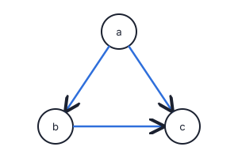
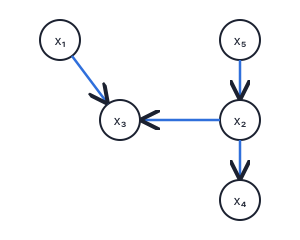

# 복습문제 7선 — 0921~0923 수업 범위

수업 범위(MML 8.4–8.6, 9.1–9.2)는 Part II라 연습문제가 없어서, **본문 예제(Example 6.11, 8.7, 8.8, 9.2, 9.3)를 문제로 바꾼 5문항**과 **수업 내용으로 풀 수 있는 5·6장 연습문제 2문항**을 골랐습니다. 먼저 스스로 풀고, 막히면 💡 힌트, 그다음 ✅ 풀이를 여세요.

> 이 문서는 `복습문제_0921-0923_Linear_Regression.html`의 마크다운 버전입니다. 📖 원문 · 💡 힌트 · ✅ 풀이는 접혀 있으니 먼저 스스로 풀어 본 뒤 펼치세요.

**목차**

- [A. 교과서 본문 예제 (MML 6·8·9장)](#partA)
  - [P1. factorization에서 화살표 읽기](#p1)
  - [P2. 그래프에서 joint 읽기](#p2)
  - [P3. 한 동전으로 ML · MAP · Fully Bayesian 비교](#p3)
  - [P4. 다항 feature vector 계산하기](#p4)
  - [P5. 원점을 지나는 직선을 ML로 맞추기](#p5)
- [B. 교과서 연습문제](#partB)
  - [P6. 가우시안 모양 함수의 도함수](#p6)
  - [P7. Iterated expectations를 "하나 마나 한 짓"으로 증명하기](#p7)

## A. 교과서 본문 예제 (MML 6·8·9장)

### P1. factorization에서 화살표 읽기

**MML Example 8.7 변형 · ★ · 📅 0921**

세 확률변수 $a, b, c$의 joint distribution이 다음처럼 factorization되어 있다(식 (8.29)).

$$
p(a, b, c) = p(c \mid a, b)\, p(b \mid a)\, p(a)
$$

- (a) 이 식에 해당하는 방향 그래프(directed graphical model)의 화살표를 모두 쓰고 그래프를 그리시오.
- (b) 각 변수가 어떤 변수에 직접 의존하는지 한 줄씩 쓰시오.

📖 교과서 원문

"For each conditional distribution, we add a directed link (arrow) … from the nodes … on which the distribution is conditioned." — Example 8.7 직후 절차

💡 힌트

조건부 분포 하나마다, 세로줄 오른쪽(조건)에 있는 변수에서 왼쪽 변수로 화살표를 하나씩 긋는다.

✅ 풀이

1. 확률변수마다 노드를 하나씩 만든다: $a, b, c$.
2. $p(a)$에는 조건이 없다. 그래서 $a$로 들어오는 화살표는 없다.
3. $p(b \mid a)$에서 $a \to b$를 얻는다.
4. $p(c \mid a, b)$에서 $a \to c$와 $b \to c$를 얻는다.
5. 그래프는 아래와 같은 삼각형이다(Figure 8.9(a), 모든 쌍이 연결된 fully connected 그래프).

   

   *식의 조건 세 개(b의 조건 a, c의 조건 a와 b)가 화살표 세 개가 된다.*
6. (b) $c$는 $a$와 $b$에 직접 의존한다. $b$는 $a$에 직접 의존한다. $a$는 $b$에도 $c$에도 의존하지 않는다.
7. 수업과의 연결: 0921 수업의 가족 그래프와 같은 식이다. 아버지 $a$는 말만 하고($p(a)$), 엄마 $b$는 아버지에게 잔소리를 듣고($p(b \mid a)$), 막내딸 $c$는 양쪽에서 잔소리를 듣는다($p(c \mid a, b)$).

**✅ 정답:** (a) $a \to b$, $a \to c$, $b \to c$ (모두 3개) (b) $c$는 $a, b$에, $b$는 $a$에 직접 의존하고, $a$는 아무것에도 의존하지 않는다.

🔗 수업과 연결: [화살표로 읽는 factorization](정리노트_0921-0923_Linear_Regression.md#s2-factorization) — 수업의 3노드 가족 그래프를 "식 → 그래프" 방향으로 직접 그려 본다.

- [ ] 풀었음

---

### P2. 그래프에서 joint 읽기

**MML Example 8.8 변형 · ★ · 📅 0921**

다섯 확률변수 $x_1, \dots, x_5$의 방향 그래프가 아래와 같다(Figure 8.9(b), 화살표: $x_5 \to x_2$, $x_1 \to x_3$, $x_2 \to x_3$, $x_2 \to x_4$).

*P2의 그래프. 화살표는 parent에서 child로 향한다.*

- (a) joint $p(x_1, x_2, x_3, x_4, x_5)$의 factorization을 쓰시오.
- (b) 그 식에는 분포가 몇 개 곱해져 있는가?

📖 교과서 원문

"Each conditional depends only on the parents of the corresponding node in the graph. For example, x4 will be conditioned on x2." — Example 8.8

💡 힌트

노드 하나에 분포 하나. 각 분포의 조건에는 그 노드로 화살표를 보내는 parent만 넣는다.

✅ 풀이

1. 일반식: $p(x_1, \dots, x_K) = \prod_{k=1}^{K} p(x_k \mid \mathrm{Pa}_k)$.
2. 노드별 parent: $x_1$은 없음, $x_5$는 없음, $x_2$는 $x_5$, $x_3$는 $x_1, x_2$, $x_4$는 $x_2$.
3. 그래서 분포는 $p(x_1)$, $p(x_5)$, $p(x_2 \mid x_5)$, $p(x_3 \mid x_1, x_2)$, $p(x_4 \mid x_2)$이다.
4. 모두 곱하면 $p(x_1, x_2, x_3, x_4, x_5) = p(x_1)\, p(x_5)\, p(x_2 \mid x_5)\, p(x_3 \mid x_1, x_2)\, p(x_4 \mid x_2)$이다.
5. 곱셈 규칙만 쓰면 등호가 성립하는 식을 여러 개 쓸 수 있다. 하지만 이 그래프 구조에 맞는 것은 위의 식 하나다.
6. 수업과의 연결: 0921 수업에서 바로 이 5노드 그래프를 다뤘다. parent가 없는 $x_1$과 $x_5$를 "천상천하 유아독존"이라고 불렀다.

**✅ 정답:** (a) $p(x_1, x_2, x_3, x_4, x_5) = p(x_1)\, p(x_5)\, p(x_2 \mid x_5)\, p(x_3 \mid x_1, x_2)\, p(x_4 \mid x_2)$ (b) 노드 수와 같은 5개

🔗 수업과 연결: [화살표로 읽는 factorization](정리노트_0921-0923_Linear_Regression.md#s2-factorization) — P1과 반대 방향(그래프 → 식)을 연습한다.

- [ ] 풀었음

---

### P3. 한 동전으로 ML · MAP · Fully Bayesian 비교

**MML Example 6.11 변형 · ★★ · 📅 0921**

앞면 확률이 $\mu$인 동전을 5번 던져 H, T, T, T, H를 얻었다(데이터 $X$, 앞면 2번). 각 던지기는 $\mu$가 주어지면 서로 독립이고, $\mu$에 prior $\mu \sim \mathrm{Beta}(2, 2)$를 둔다.

- (a) posterior $p(\mu \mid X)$는 어떤 Beta 분포인가?
- (b) $\mu_{\text{ML}}$과 $\mu_{\text{MAP}}$을 구하시오.
- (c) 다음 던지기 $A$가 앞면일 확률을 Fully Bayesian으로, 즉 $P(A \mid X) = \int P(A \mid \mu)\, p(\mu \mid X)\, d\mu$로 구하시오.
- (d) 세 값의 크기를 비교하고 왜 다른지 한 줄로 설명하시오.

📖 교과서 원문

"we compute the posterior distribution on µ as" $p(\mu \mid x = h, N, \alpha, \beta) \propto \mu^{h+\alpha-1}(1-\mu)^{(N-h)+\beta-1}$ (6.104c) — Example 6.11

💡 힌트

$\mathrm{Beta}(\alpha, \beta)$의 최빈값은 $\frac{\alpha - 1}{\alpha + \beta - 2}$, 평균은 $\frac{\alpha}{\alpha + \beta}$이다. 또 $P(A \mid \mu) = \mu$이다.

✅ 풀이

1. likelihood: H는 $\mu$, T는 $1-\mu$를 주므로 $p(X \mid \mu) = \mu \cdot (1-\mu)^3 \cdot \mu = \mu^2 (1 - \mu)^3$이다. prior는 $p(\mu) \propto \mu^{1}(1-\mu)^{1}$이다.
2. 둘을 곱하면 $p(\mu \mid X) \propto \mu^{3}(1-\mu)^{4}$이다. 이것은 $\mathrm{Beta}(4, 5)$의 모양이다(prior와 같은 Beta 꼴).
3. $\mu_{\text{ML}}$은 prior 없이 likelihood만 최대화한다. $\log p = 2\log\mu + 3\log(1-\mu)$를 미분해 0으로 두면 $\frac{2}{\mu} = \frac{3}{1-\mu}$, 곧 $\mu_{\text{ML}} = \frac{2}{5}$이다.
4. $\mu_{\text{MAP}}$은 posterior의 최빈값이다: $\frac{4-1}{4+5-2} = \frac{3}{7}$.
5. Fully Bayesian: $P(A \mid X) = \int_0^1 \mu\, p(\mu \mid X)\, d\mu = \mathbb{E}_{\mu \mid X}[\mu] = \frac{4}{4+5} = \frac{4}{9}$ (posterior 평균).
6. 비교: $\frac{2}{5} = 0.4 \lt \frac{3}{7} \approx 0.429 \lt \frac{4}{9} \approx 0.444$. $\mathrm{Beta}(2, 2)$는 $\frac{1}{2}$ 근처를 믿는 prior라서 MAP를 ML보다 $\frac{1}{2}$ 쪽으로 당긴다. Fully Bayesian은 봉우리 한 점이 아니라 posterior 전체를 가중 평균하므로 또 다른 값이 된다.
7. 수업과의 연결: 0921 수업에서 ML과 MAP는 posterior를 $\delta(\theta - \hat{\theta})$로 보고 한 점에 "몰빵"한다고 했다. 세 값이 서로 다르다는 것이 바로 그 물결표(≈)가 생기는 이유다. 같은 수업(14:49–15:03)에서 이 H, T, T, T, H 데이터로 θ를 "5분의 3"이라고 말했는데, 앞면은 2번이므로 ML 추정값은 $\frac{2}{5}$가 맞다(3/5는 뒷면 비율).

**✅ 정답:** (a) $\mathrm{Beta}(4, 5)$ (b) $\mu_{\text{ML}} = \frac{2}{5}$, $\mu_{\text{MAP}} = \frac{3}{7}$ (c) $P(A \mid X) = \frac{4}{9}$ (d) ML $\lt$ MAP $\lt$ Fully Bayesian

🔗 수업과 연결: [Fully Bayesian은 가중 평균, ML·MAP는 델타 함수](정리노트_0921-0923_Linear_Regression.md#s1-delta) — 델타 함수 근사와 가중 평균의 차이를 숫자로 확인한다.

- [ ] 풀었음

---

### P4. 다항 feature vector 계산하기

**MML Example 9.3 변형 · ★ · 📅 0923**

$K = 4$인 다항 feature vector $\boldsymbol{\phi}(x) = [1, x, x^2, x^3]^\top$와 모델 $y = \boldsymbol{\phi}^\top(x)\boldsymbol{\theta} + \epsilon$을 생각하자.

- (a) $x = 0.3$에서 $\boldsymbol{\phi}(0.3)$을 계산하시오.
- (b) 이 모델은 $x$에 대해 3차식인데도 왜 "선형"회귀라고 부르는가?

📖 교과서 원문

"we 'lift' the original one-dimensional input space into a K-dimensional feature space consisting of all monomials" — Example 9.3

💡 힌트

$x$를 넣은 뒤의 $\boldsymbol{\phi}$는 그냥 숫자 벡터다. 그 다음 식이 $\boldsymbol{\theta}$에 대해 어떤 꼴인지 보자.

✅ 풀이

1. $\phi_0 = 1$, $\phi_1 = 0.3$, $\phi_2 = 0.3^2 = 0.09$, $\phi_3 = 0.3^3 = 0.027$.
2. 그래서 $\boldsymbol{\phi}(0.3) = [1, 0.3, 0.09, 0.027]^\top$이다.
3. 평균은 $\boldsymbol{\phi}^\top(x)\boldsymbol{\theta} = \theta_0 + \theta_1 x + \theta_2 x^2 + \theta_3 x^3$이다.
4. $x$가 정해지면 $1, x, x^2, x^3$은 상수다. 따라서 이 식은 $\theta_0, \dots, \theta_3$의 가중합, 즉 $\boldsymbol{\theta}$에 대해 1차식이다. "선형회귀"의 선형은 파라미터에 대해 linear in이라는 뜻이다.
5. 그래서 입력을 $\boldsymbol{\phi}$로 바꾼 뒤에도 가우시안 likelihood와 ML 추정을 그대로 쓸 수 있다.
6. 수업과의 연결: 0923 수업(41:07)에서도 $x_1 = 0.3$을 예로 들었다. 이때 $0.3^3$을 0.0027이라고 했지만 0.027이 맞다. 수업의 $[x_1, x_1^2, x_1^3]^\top$ 앞에 교과서는 상수 1을 하나 더 붙였다.

**✅ 정답:** (a) $\boldsymbol{\phi}(0.3) = [1, 0.3, 0.09, 0.027]^\top$ (b) $x$에는 비선형이지만 $\boldsymbol{\theta}$에 대해 linear in이기 때문이다.

🔗 수업과 연결: [x에 비선형이어도 선형회귀: feature vector](정리노트_0921-0923_Linear_Regression.md#s4-features) — 수업의 0.3 예를 직접 계산하고 0.027을 확인한다.

- [ ] 풀었음

---

### P5. 원점을 지나는 직선을 ML로 맞추기

**MML Example 9.2 변형 · ★★ · 📅 0923**

모델 $y = \theta x + \epsilon$, $\epsilon \sim \mathcal{N}(0, \sigma^2)$로 데이터 $(1, 2), (2, 3), (3, 7)$을 맞춘다. $\mathbf{X} = [1, 2, 3]^\top$, $\mathbf{y} = [2, 3, 7]^\top$으로 둔다.

- (a) $\mathbf{X}^\top \mathbf{X}$와 $\mathbf{X}^\top \mathbf{y}$를 계산하시오.
- (b) $\boldsymbol{\theta}_{\text{ML}} = (\mathbf{X}^\top \mathbf{X})^{-1} \mathbf{X}^\top \mathbf{y}$로 기울기 $\theta_{\text{ML}}$을 구하시오.
- (c) 이 값이 최소화하는 양은 무엇인가?

📖 교과서 원문

"we aim to fit a straight line $f(x) = \theta x$, where θ is an unknown slope, to a dataset using maximum likelihood estimation." — Example 9.2

💡 힌트

$\mathbf{X}$가 열벡터 하나뿐이면 $\mathbf{X}^\top \mathbf{X}$는 스칼라이고, 역행렬은 그냥 역수다.

✅ 풀이

1. $\mathbf{X}^\top \mathbf{X} = 1^2 + 2^2 + 3^2$, 즉 $\mathbf{X}^\top \mathbf{X} = 14$이다.
2. $\mathbf{X}^\top \mathbf{y} = 1 \cdot 2 + 2 \cdot 3 + 3 \cdot 7 = 29$.
3. $\theta_{\text{ML}} = \frac{1}{14} \cdot 29 = \frac{29}{14} \approx 2.07$.
4. (c) 가우시안 노이즈에서 음의 로그우도는 상수를 빼면 $\frac{1}{2\sigma^2} \|\mathbf{y} - \mathbf{X}\boldsymbol{\theta}\|^2 = \frac{1}{2\sigma^2}\sum_{n=1}^{3}(y_n - \theta x_n)^2$이다. 그래서 $\theta_{\text{ML}}$은 제곱오차 합을 최소화한다.
5. 검산(스칼라 미분): $\frac{d}{d\theta}\sum_n (y_n - \theta x_n)^2 = -2\sum_n x_n (y_n - \theta x_n) = 0 \Rightarrow \theta \sum_n x_n^2 = \sum_n x_n y_n$이다. 즉 $14\theta = 29$로 같은 답이 나온다.
6. 수업과의 연결: 0923 수업(67:19)에서 "미분값이 0이 되는 점을 찾는 게 선형회귀의 처음부터 끝"이라고 했다. 수업에서는 벡터 미분 과정 없이 결과식만 받았다. 파라미터가 하나면 위처럼 스칼라 미분만으로 같은 식을 확인할 수 있다.

**✅ 정답:** (a) $\mathbf{X}^\top \mathbf{X} = 14$, $\mathbf{X}^\top \mathbf{y} = 29$ (b) $\theta_{\text{ML}} = \frac{29}{14} \approx 2.07$ (c) 제곱오차 합 $\sum_n (y_n - \theta x_n)^2$

🔗 수업과 연결: [미분해서 0: 정규방정식과 의사역행렬](정리노트_0921-0923_Linear_Regression.md#s5-normal-eq) — 정규방정식을 가장 작은 크기의 데이터로 직접 계산한다.

- [ ] 풀었음

---

## B. 교과서 연습문제

### P6. 가우시안 모양 함수의 도함수

**MML Exercise 5.3 · ★ · 📅 0923**

다음 함수의 도함수 $f'(x)$를 구하시오. 여기서 $\mu, \sigma \in \mathbb{R}$은 상수다.

$$
f(x) = \exp\!\Big(-\frac{1}{2\sigma^2}(x-\mu)^2\Big)
$$

📖 교과서 원문

"Compute the derivative $f'(x)$ of the function $f(x) = \exp(-\frac{1}{2\sigma^2}(x-\mu)^2)$, where $\mu, \sigma \in \mathbb{R}$ are constants." — Exercise 5.3

💡 힌트

연쇄법칙을 쓴다. 바깥 함수는 exp, 안쪽 함수는 $g(x) = -\frac{1}{2\sigma^2}(x-\mu)^2$이다.

✅ 풀이

1. $f(x) = \exp(g(x))$이므로 $f'(x) = \exp(g(x)) \cdot g'(x)$이다.
2. $g'(x) = -\frac{1}{2\sigma^2} \cdot 2(x-\mu) = -\frac{x - \mu}{\sigma^2}$.
3. 따라서 $f'(x) = -\frac{x - \mu}{\sigma^2} \exp\!\Big(-\frac{(x-\mu)^2}{2\sigma^2}\Big)$이다.
4. 확인: $x = \mu$에서 $f'(x) = 0$으로 꼭대기다. $x \gt \mu$이면 음수(내리막), $x \lt \mu$이면 양수(오르막)다. 종(bell) 모양과 맞는다.
5. 수업과의 연결: 0923 수업에서 칠판에 쓴 가우시안 PDF $\frac{1}{\sqrt{2\pi\sigma^2}}\exp\!\Big(-\frac{(x-\mu)^2}{2\sigma^2}\Big)$에서 상수 계수만 뺀 함수다. 꼭대기가 평균 $\mu$에 있다는 점이 "노이즈는 평균 근처에 몰려 있다"는 설명의 근거다.

**✅ 정답:** $f'(x) = -\frac{x - \mu}{\sigma^2} \exp\!\Big(-\frac{(x-\mu)^2}{2\sigma^2}\Big)$

🔗 수업과 연결: [가우시안 노이즈 가정](정리노트_0921-0923_Linear_Regression.md#s4-gaussian-noise) — 가우시안 bell의 꼭대기가 평균에 있다는 것을 미분으로 확인한다.

- [ ] 풀었음

---

### P7. Iterated expectations를 "하나 마나 한 짓"으로 증명하기

**MML Exercise 6.11 · ★★★ 도전 · 📅 0921**

joint distribution $p(x, y)$를 갖는 두 확률변수 $x, y$를 생각하자(연속형으로 가정한다). 다음을 보이시오.

$$
\mathbb{E}_X[x] = \mathbb{E}_Y\big[\mathbb{E}_X[x \mid y]\big]
$$

여기서 $\mathbb{E}_X[x \mid y]$는 조건부 분포 $p(x \mid y)$ 아래에서의 $x$의 기댓값이다.

📖 교과서 원문

"Consider two random variables x, y with joint distribution p(x, y). Show that $\mathbb{E}_X[x] = \mathbb{E}_Y[\mathbb{E}_X[x \mid y]]$." — Exercise 6.11

💡 힌트

오른쪽에서 출발한다. 두 기댓값을 적분으로 풀어 쓰고, 곱셈 규칙과 marginalization을 차례로 쓴다.

✅ 풀이

1. 안쪽 기댓값은 $y$의 함수다: $\mathbb{E}_X[x \mid y] = \int x\, p(x \mid y)\, dx$.
2. 바깥 기댓값을 적분으로 쓴다: $\mathbb{E}_Y\big[\mathbb{E}_X[x \mid y]\big] = \int \Big(\int x\, p(x \mid y)\, dx\Big)\, p(y)\, dy$.
3. $p(y)$는 $x$와 무관하므로 안쪽 적분 안으로 넣는다: $= \int\!\!\int x\, p(x \mid y)\, p(y)\, dx\, dy$.
4. 곱셈 규칙 $p(x, y) = p(x \mid y)\, p(y)$를 쓴다: $= \int\!\!\int x\, p(x, y)\, dx\, dy$.
5. 적분 순서를 바꾼다: $= \int x \Big(\int p(x, y)\, dy\Big)\, dx$.
6. marginalization $\int p(x, y)\, dy = p(x)$를 쓴다: $= \int x\, p(x)\, dx = \mathbb{E}_X[x]$. ∎
7. 수업과의 연결: 0921 수업의 posterior predictive 유도에서 쓴 두 가지 "하나 마나 한 짓"(marginalization, 곱셈 규칙)이 그대로 쓰인다. $P(A \mid X) = \mathbb{E}_{\theta \mid X}[P(A \mid \theta)]$도 조건부 기댓값을 한 번 더 평균하는 같은 구조다.

**✅ 정답:** $\mathbb{E}_Y\big[\mathbb{E}_X[x \mid y]\big] = \int\!\!\int x\, p(x \mid y)\, p(y)\, dx\, dy = \int\!\!\int x\, p(x, y)\, dx\, dy = \int x\, p(x)\, dx = \mathbb{E}_X[x]$

🔗 수업과 연결: [posterior predictive 유도: 하나 마나 한 짓과 조건부 독립](정리노트_0921-0923_Linear_Regression.md#s1-predictive) — 수업에서 익힌 항등식 끼워 넣기로 교과서 증명 문제를 푼다.

- [ ] 풀었음

---

출처: Deisenroth, Faisal, Ong, *Mathematics for Machine Learning* (Cambridge University Press, 2020). 풀이는 자체 작성이며 수치는 Python으로 검증했습니다.
