# Graphical Model · Model Selection · Linear Regression — 5살도 이해하는 정리노트

정방철 교수님 머신러닝기초 · 0921 · 0923 수업 (Lecture02 후반 ~ Lecture03 s11, MML 8.4–8.6 · 9.1–9.2)

범례: 🧸 쉬운 비유 · 📐 정식 버전 · 🎙️ 교수님 한마디 · ⚠️ 강조 포인트 · 📎 보충 · 수업 미유도

> 이 문서는 `정리노트_0921-0923_Linear_Regression.html`의 마크다운 버전입니다. 그림은 `figures_0921-0923/` 폴더의 SVG로, 인터랙티브 위젯은 정적 스냅샷으로 옮겼습니다. 수식은 `$…$` / `$$…$$` (GitHub, Obsidian, Typora 등에서 렌더링) 입니다.

**목차**

- [1. 베이지안 예측 다시 보기](#s1)
  - [SI 문제와 ML·MAP의 물결표(≈)](#s1-si-problem)
  - [posterior predictive 유도: 하나 마나 한 짓과 조건부 독립](#s1-predictive)
  - [Fully Bayesian은 가중 평균, ML·MAP는 델타 함수](#s1-delta)
  - [베이지안 추론이 어려운 이유와 근사 기법](#s1-hardness)
- [2. 그래피컬 모델](#s2)
  - [그래피컬 모델이 필요한 이유](#s2-why)
  - [화살표로 읽는 factorization](#s2-factorization)
  - [동전 N번 던지기 그래프와 hyperprior](#s2-coin-plate)
  - [헬스케어 예시(LUCAS)와 생일 미신으로 본 ML vs MAP](#s2-lucas)
- [3. 모델 선택](#s3)
  - [train · validation · test와 cross-validation](#s3-cv)
  - [Bayesian model selection](#s3-bayes-ms)
  - [Bayes factor로 두 모델 비교하기](#s3-bayes-factor)
- [4. 선형회귀: 문제 정식화](#s4)
  - [회귀 문제: 목표는 일반화](#s4-regression)
  - [가우시안 노이즈 가정](#s4-gaussian-noise)
  - [선형회귀는 가정이다: likelihood와 순환논증](#s4-assumption)
  - [x에 비선형이어도 선형회귀: feature vector](#s4-features)
- [5. 선형회귀의 ML 추정](#s5)
  - [데이터 행렬과 i.i.d. 우도의 곱](#s5-iid)
  - [음의 로그우도 = 최소제곱 = ERM](#s5-nll-ls)
  - [미분해서 0: 정규방정식과 의사역행렬](#s5-normal-eq)
- [6. 요약 · 예고](#s6)
  - [한 장 치트시트](#s6-cheatsheet)
  - [다음 시간 예고](#s6-next)
  - [함께 보면 좋은 자료](#s6-links)

## 1. 베이지안 예측 다시 보기

### SI 문제와 ML·MAP의 물결표(≈)

*📅 0921 · L02 s5–s6*

**🧸 쉽게 말하면**

첫 번째 방법은 모은 기록을 공장에 넣어 숫자 하나로 줄인 다음, 그 숫자만 보고 답해요.

한 번 더 옮겨 적으니 실수가 끼어들 수 있어서 "딱 같다"가 아니라 "거의 같다"예요. 두 번째 방법은 기록을 통째로 들고 답해서 더 정확하지만, 매번 전부 다시 봐야 해서 힘들어요.

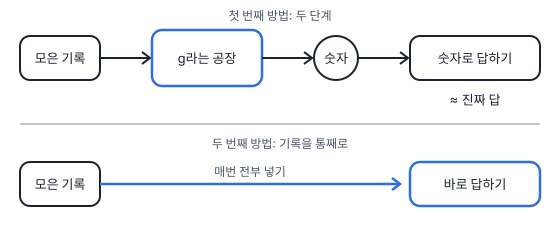

*위쪽은 중간에 한 번 더 들르고, 아래쪽은 곧장 가지만 짐이 무거워요.*

**📐 정식 버전**

**통계적 추론(statistical inference, SI) 문제의 출발점**: 먼저 "내 손에 쥔 것"(데이터 $X$)과 "궁금한 것"(사건 $A$)을 나눈다. 그다음 문제를 조건부 확률(pdf/pmf) $P(A \mid X)$ 를 계산하는 일로 바꾼다. 앞으로 어떤 추론 문제를 만나도 이 식 하나에서 시작한다.

**모델과 파라미터**: 모델은 "데이터가 이렇게 만들어졌을 것이다"라는 가정이다. 예) $y = \theta^\top x + \epsilon$ (선형 관계 + 노이즈). 모델을 정하면 그 모양은 파라미터 $\theta$ 가 결정하므로, 최적화할 대상은 $\theta$ 다. 여기서 $\theta$ 는 데이터 뒤에 숨은 latent(hidden) parameter다.

**ML과 MAP은 $\theta$ 를 먼저 하나로 정한다**(정의는 지난 노트에서 다뤘다):

- ML: $\theta_{\text{ML}} = \arg\max_\theta P(X \mid \theta)$ — prior 없이 데이터만 믿는다.
- MAP: $\theta_{\text{MAP}} = \arg\max_\theta P(\theta \mid X)$ — "모름지기 θ는 이럴 것이다"라는 prior까지 반영한다.

**"g라는 공장"과 두 단계 추론**: 두 방법 모두 추정 함수 $\hat{\theta} = g(X)$ 에 raw data를 넣어 $\hat{\theta}$ 를 뽑는다. 그 뒤로는 raw data를 버리고 $\hat{\theta}$ 로만 $A$ 를 추정한다.

$$
P(A \mid X) \approx P(A \mid \theta_{\text{ML}}), \qquad P(A \mid X) \approx P(A \mid \theta_{\text{MAP}})
$$

1. 1단계: $X \to \hat{\theta}$. 여기서 이미 추정 오차가 생길 수 있다.
2. 2단계: $\hat{\theta} \to A$. 1단계의 $\hat{\theta}$ 가 틀리면 $A$ 에 대한 추론도 함께 빗나간다.
3. 그래서 등호(=)가 아니라 물결표 $\approx$ 다.
4. 🧸의 "첫 번째 방법"이 ML·MAP(점 추정 $\hat{\theta}$ 를 거침), "두 번째 방법"이 raw data $X$ 를 그대로 쓰는 Fully Bayesian이다.

**Fully Bayesian**은 $\theta$ 를 하나로 정하지 않고 raw data $X$ 를 그대로 써서 $P(A \mid X)$ 를 계산한다. 그렇다고 완벽한 것은 아니다. 머신러닝은 귀납적 학문이라 숨은 모델과 $\theta$ 를 정확히 아는 방법은 없다("nobody knows"). 다만 ML·MAP는 $\theta$ 라는 중간 단계를 한 번 더 거치므로 오류가 조금 더 생길 수 있다.

**무엇을 고를까**: 고를 수 있다면 성능은 Fully Bayesian이 낫다. 하지만 예측할 때마다 raw data를 전부 넣어야 해서 복잡하고, 비싸고, 오래 걸린다. 그래서 실제로는 데이터로 $\hat{\theta}$ 를 한 번 만들어 두고 계속 재사용하는데, 이 과정이 **pre-training**(데이터 학습)이다. 성능과 계산 비용 사이의 trade-off다.

**🎙️ 교수님 한마디**

**신승훈의 〈보이지 않는 사랑〉**: 지난 시간부터 이어진 비유로, "데이터는 이렇게 만들어졌을 것"이라는 보이지 않는 가정, 곧 모델을 가리켜요. (0921 02:26)

**g라는 공장**: 데이터를 넣으면 $\theta_{\text{ML}}$ 이나 $\theta_{\text{MAP}}$ 가 찍혀 나오는 추정 함수를 이렇게 불렀어요. (0921 05:14)

**"There is no free lunch"**: Fully Bayesian의 성능과 계산 비용을 한꺼번에 가질 수는 없다는 뜻이에요. (0921 07:37)

교수님이 스스로 가상 질문을 던지고 답했어요. "이거 equal이 아니라 approximation인가요?"(01:20) → "그럼 이거는 완벽한 건가요?"(06:31) → "둘 중에 뭘 선택해야 되나요?"(07:30)

> 이런 문제를 풀 때 … 기억해야 될 수식은 딱 이거 하나예요. (0921 00:23)

> 궁금해하고 있는 거를 given condition에 대해서 확률을 계산하는 문제로 생각해야 돼요, 항상. (0921 00:37)

MLE와 MAP의 차이 유도는 따로 올린 강의노트와 강의 동영상을 보라고 했어요. (0921 03:52)

---

### posterior predictive 유도: 하나 마나 한 짓과 조건부 독립

*📅 0921 · L02 s6*

**🧸 쉽게 말하면**

동전이 앞면 나올 확률을 정확히 안다면, 지난번에 뭐가 나왔는지는 다음 던지기를 맞히는 데 아무 도움이 안 돼요.

식을 바꿀 때 지난 기록을 슬쩍 지웠는데, 그건 바로 이 성질 덕분이에요. 이걸 말없이 쓰면 반칙이라 꼭 "이렇게 가정했다"고 밝혀야 해요.

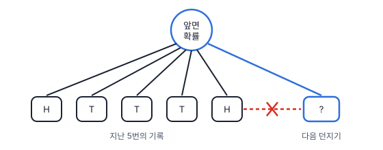

*앞면 확률을 알면 지난 기록에서 다음 던지기로 가는 길(점선)은 필요 없어요.*

**📐 정식 버전**

L02 s6의 Fully Bayesian 식 $P(A \mid X) = \int P(A \mid \theta)\, P(\theta \mid X)\, d\theta$ 가 어디서 나오는지 칠판에서 단계별로 유도했다(지난 시간에 시간이 없어 넘어간 부분).

1. **첫 번째 하나 마나 한 짓 — marginalization**: 새 변수 $\theta$ 를 끼워 넣고 $\theta$ 에 대해 적분해서 다시 없앤다.

   $$
   P(A \mid X) = \int P(A, \theta \mid X)\, d\theta
   $$
2. marginalization에는 두 방향이 있다.

   - 방향 ①: joint → marginal. $f_Y(y) = \int_{-\infty}^{\infty} f_{X,Y}(x, y)\, dx$ — 확률 수업에서 익숙한 방향.
   - 방향 ②: marginal → joint의 적분. 위 1단계가 이 방향이다. 수업에서는 잘 안 하지만 연구할 때 많이 쓰며, 이 문제를 해석하는 열쇠다.
3. **두 번째 하나 마나 한 짓 — 곱셈 규칙(multiplication rule)**: $\theta$ 를 조건 쪽으로 넘긴다.

   $$
   P(A, \theta \mid X) = P(A \mid \theta, X)\, P(\theta \mid X)
   $$

   근거: $P(a, b, c) = P(a \mid b, c)\, P(b, c) = P(a, b \mid c)\, P(c)$. 양쪽 방향을 모두 자유롭게 오갈 수 있어야 한다.
4. 두 단계를 합치면 $P(A \mid X) = \int P(A \mid \theta, X)\, P(\theta \mid X)\, d\theta$ 이다. 여기까지는 항상 성립하는 항등식이다.
5. **"장난질" — 숨은 가정**: $P(A \mid \theta, X) \to P(A \mid \theta)$ 로 넘어가면서 $X$ 가 사라진다. 이 둘은 일반적으로 같지 않다. 등호가 성립하려면 **조건부 독립** $A \perp X \mid \theta$ (θ가 주어지면 A와 X는 독립)를 가정해야 한다.

   $$
   P(A \mid X) = \int P(A \mid \theta)\, P(\theta \mid X)\, d\theta
   $$
6. 슬라이드의 답: 이 가정을 식으로 쓰면 $P(x_1, \dots, x_N, A \mid \theta) = \prod_{i=1}^{N} P(x_i \mid \theta) \cdot P(A \mid \theta)$ 다.

**조건부 독립이 자연스러운 예 — 동전**: 동전을 5번 던져 H, T, T, T, H가 나왔다. 이것이 $X$ 이고 다음 던지기가 $A$ 다. 동전은 Bernoulli 확률변수라서 앞면 확률 $\theta$ 하나만 알면 분포가 완전히 정해진다. $\theta$ 가 정해지는 순간 과거 데이터 5개는 "있어도 되고 없어도 되는" 정보가 된다. 이 데이터의 ML 추정은 앞면 2번이므로 $\hat{\theta} = 2/5$ 이다.

(수업 중 "θ를 5분의 3이라고 결정"이라고 말했다가 정정: 앞면이 2번이므로 $\hat{\theta} = 2/5$ 가 맞다. 0921 14:49)

**조건부 기댓값으로 다시 읽기**. 확률 수업의 기댓값 공식을 떠올린다.

- $E[X] = \int x\, f(x)\, dx$
- $E[g(X)] = \int g(x)\, f(x)\, dx$
- $E[g(X) \mid Y = y] = \int g(x)\, f(x \mid y)\, dx$

유도한 식과 짝을 맞추면: 적분 변수는 $\theta$, 가중 pdf $f(x \mid y)$ 자리에는 conditional pdf $P(\theta \mid X)$ (데이터가 주어졌을 때 θ에 대한 나의 belief를 요약한 함수), $g(\cdot)$ 자리에는 $P(A \mid \theta)$ 가 들어간다.

$$
P(A \mid X) = \mathbb{E}_{\theta \mid X}\big[ P(A \mid \theta) \big]
$$

해석: unseen data $A$ 에 대해 "θ가 주어졌을 때의 확률" $P(A \mid \theta)$ 를, 데이터로 구한 θ의 posterior로 평균한 값이다. 이론적으로는 앞으로 이 값을 구하려고 노력하게 된다.

**🎙️ 교수님 한마디**

**"수학을 잘하려면 하나 마나 한 짓을 잘해야 한다"**: 교수님이 "수학을 잘하려면 뭘 잘해야 돼?"라고 묻자 한 학생이 "하나 마나 한…"이라고 답했고, 교수님은 "이 친구 에이스네요"라고 했어요. 항등식을 끼워 넣는 기법(marginalization, 곱셈 규칙)을 가리켜요. (0921 09:16–09:27)

**영화 〈타짜〉의 "첫 판부터 장난질이냐"**: 식을 전개하다가 조건부 독립 가정을 몰래 끼워 넣은 것을 "장난질"에 빗댔어요. "왼쪽하고 오른쪽하고 뭐가 달라?"라는 질문에 학생이 "X가 사라졌다"고 짚었고, 이어서 "그냥 사라지게 하면 돼, 안 돼?"라고 다시 물었어요. (0921 13:02–13:39)

**⚠️ 강조 포인트**

> 요 수식이 왜 이 수식이 되는지가 사실은 정확하지가 않아요. … 일반적으로 같지 않습니다. (0921 08:25)

> 좋은 엔지니어들은 1번도 잘해야 되지만 2번을 할 줄 알아야 돼요. (0921 10:53)

> 요 수식을 이렇게 바꾸는 2번이 사실 이 문제를 해석하는 키가 되거든. (0921 11:11)

> 왔다 갔다 왔다 갔다 다 할 줄 알아야지. (0921 12:46)

> 마음대로 이렇게 하면 안 돼. … 이퀄리티가 성립하려면 어떤 조건이 필요해요. (0921 13:39)

> 이런 거 하려고 여러분 확률 배운 거예요, 사실. (0921 16:43)

시험 포인트: $P(A \mid \theta, X) = P(A \mid \theta)$ 는 공짜가 아니다. "θ가 주어지면 A와 X는 조건부 독립"이라는 가정을 반드시 밝힌다. 여기서 θ는 latent parameter이고, θ의 prior를 정하는 hyperparameter와는 다르다(수업 중 두 말을 섞어 썼다).

---

### Fully Bayesian은 가중 평균, ML·MAP는 델타 함수

*📅 0921 · L02 s6*

**🧸 쉽게 말하면**

한 방법은 모든 후보의 의견을 믿는 만큼 무게를 달아 평균을 내고, 다른 방법은 가장 믿음직한 후보 한 명에게 표를 몽땅 몰아줘요.

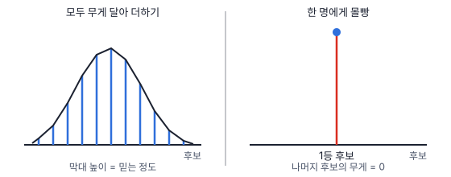

*왼쪽은 모든 막대를 빠짐없이 더하고, 오른쪽은 가장 높은 곳 하나만 남겨요.*

**📐 정식 버전**

**적분을 합으로 보기(Riemann sum)**: $\theta$ 를 $\theta_1, \theta_2, \dots$ 로 잘게 나누면

$$
P(A \mid X) = \int P(A \mid \theta)\, P(\theta \mid X)\, d\theta \approx \sum_i P(A \mid \theta_i)\, P(\theta_i \mid X)\, \Delta\theta
$$

- $P(\theta_i \mid X)$: "데이터 $X$ 로 미루어 본 $\theta_i$ 의 확신 정도" = 가중치.
- $P(A \mid \theta_i)$: "θ가 $\theta_i$ 라면 A가 일어날 확률" = 각 후보의 예측.
- Fully Bayesian = 이 예측들을 하나도 빠뜨리지 않고 가중치로 가중 평균한 값이다.

**ML·MAP는 무엇을 버리는가**: 여러 $\theta_i$ 가운데 가장 그럴듯한 하나 $\hat{\theta}$ 만 고르고(MAP는 posterior의 봉우리, ML은 likelihood의 봉우리), 적분 없이 그 값을 대입한다.

**신호및시스템 관점 — 델타 함수**: 이것은 posterior를 델타 함수로 가정한 것과 같다.

1. 가정: $P(\theta \mid X) \approx \delta(\theta - \hat{\theta})$ — 믿음 전체를 $\hat{\theta}$ 한 점에 모은다.
2. 대입: $P(A \mid X) \approx \int P(A \mid \theta)\, \delta(\theta - \hat{\theta})\, d\theta$
3. 델타 함수의 sifting 성질 $\int g(\theta)\, \delta(\theta - \hat{\theta})\, d\theta = g(\hat{\theta})$ 에 의해 $P(A \mid X) \approx P(A \mid \hat{\theta})$
4. $\hat{\theta} = \theta_{\text{ML}}$ 또는 $\theta_{\text{MAP}}$ 로 두면 앞 토픽의 두 근사식이 그대로 나온다.

그래서 posterior가 한 점 근처에 뾰족하게 모여 있을수록 ML·MAP 근사가 정확하고, 넓게 퍼져 있거나 봉우리가 여럿일수록 버려지는 정보가 많다.

**🎙️ 교수님 한마디**

> 교수님이 가능하다면 MLE나 MAP보다도 fully Bayesian을 써라라고 했는지 느낌만 알아봅시다. (0921 18:53)

**델타 함수 비유**: 신호및시스템에서 배운 델타 함수로 보면 ML·MAP는 믿음을 한 점에 "몰빵"한 것이에요. 적분을 "합"으로 생각하면 Fully Bayesian이 왜 하나도 놓치지 않는 방법인지 느낌이 온다고 했어요. (0921 19:00–22:46)

---

### 베이지안 추론이 어려운 이유와 근사 기법

*📅 0921 · L02 s7*

**🧸 쉽게 말하면**

모든 후보를 다 따지는 방법은 좋지만 공짜가 아니에요.

나눗셈의 아래쪽에 "모든 경우를 하나도 빠짐없이 더하기"가 들어 있어서 계산이 너무 어려워요. 그래서 컴퓨터로 흉내를 잔뜩 내 본 다음, 그 모양에 곡선을 맞춰서 대충 맞혀요.

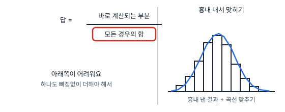

*아래쪽을 정확히 계산하기 어려우니, 흉내 낸 결과의 모양에 곡선을 맞춰요.*

**📐 정식 버전**

**posterior가 필요하다**: Fully Bayesian 예측 $\mathbb{E}_{\theta \mid X}[P(A \mid \theta)]$ 를 계산하려면 posterior 분포 전체가 있어야 한다. 데이터 $X$, prior $P(\theta)$, likelihood $P(X \mid \theta)$ 가 주어지면

$$
P(\theta \mid X) = \frac{P(X \mid \theta)\, P(\theta)}{P(X)}, \qquad P(X) = \int P(X \mid \theta)\, P(\theta)\, d\theta
$$

**Implementation hardness**:

1. 분자 $P(X \mid \theta)\, P(\theta)$ 는 모델과 prior만 있으면 바로 계산된다.
2. 분모 $P(X)$ 는 모든 $\theta$ 에 대한 적분이다. 이 적분과 normalization 때문에 구현이 매우 어렵다.
3. 코드로 구현하면 값이 0.0000002처럼 극단적으로 작아지는 등 수치적으로 까다로운 문제가 생긴다.
4. posterior를 구한 뒤에도 predictive를 얻으려면 적분을 한 번 더 해야 한다.

**근사 기법(approximation techniques)** — 슬라이드가 꼽은 네 가지:

- **MCMC**(Markov Chain Monte Carlo): 가장 유명한 방법. 시뮬레이션으로 표본(데이터)을 실제로 만든 뒤, 그 표본의 분포를 원래 분포로 가정한다. **수업에서는 MCMC 설명 중에** "가장 많이 나오는 봉우리를 라플라스나 가우시안으로 피팅해서 PDF 자체를 근사한다"고 말했다(0921 23:29).
- **Laplace approximation**: 수업에서 따로 설명하지 않았다. **교과서적으로는** 위 "봉우리를 가우시안으로 피팅"이 바로 이 방법의 아이디어다. posterior의 봉우리(mode) 근처를 가우시안으로 근사한다. 표본을 뽑는 MCMC와는 다른 기법이다.
- **variational inference**
- **expectation propagation**

수업에서는 MCMC(와 그 설명 속 봉우리 피팅)만 말로 설명했고, Laplace approximation, variational inference와 expectation propagation은 이름만 소개했다. 슬라이드의 "conjugate prior를 고르지 않으면 적분이 analytically intractable"이라는 문장은 말로 다루지 않았다.

**🎙️ 교수님 한마디**

**몬테카를로**: "진짜 시뮬레이션을 해서 데이터를 만든 다음, 그 분포를 원래 분포로 가정"하는 방법이라고 설명했어요. (0921 23:29)

**수식을 왜 배우나**: 가상 질문 "교수님 저는 파이썬 코드를 잘 못 짜는데요?"(24:36)에 대한 답. 파이썬 코드 번역은 이제 GPT가 3초 만에 해요. 사람이 할 일은 설계이고, 설계 철학을 이해하려면 수식을 이해해야 해요. RL, supervised, unsupervised, CNN, DNN 무엇을 하든 펀더멘털은 바뀌지 않아요.

> 결국 펀더멘털은 바뀌지 않고, 그 펀더멘털을 이해하려면 수학을 해야 된다. (0921 25:20)

> 확률이 그만큼 중요해서 지금 복습을 하고 있는 거지 (0921 25:55)

수강생 게시글 "확률 및 랜덤 변수 2야?"에 대한 답이었어요.

---

## 2. 그래피컬 모델

### 그래피컬 모델이 필요한 이유

*📅 0921 · L02 s9*

**🧸 쉽게 말하면**

친구 다섯 명이 서로 다 영향을 준다고 하면 따질 게 너무 많아요.

누가 누구 말을 듣는지만 화살표로 그리고 영향이 아주 작은 줄은 지우면 훨씬 쉬워져요.

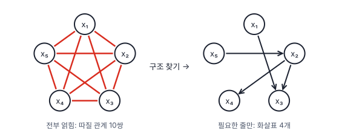

*왼쪽은 전부 얽힌 그림, 오른쪽은 꼭 필요한 화살표만 남긴 그림이에요.*

**📐 정식 버전**

확률 모델에서 가장 궁금한 양은 결합 분포(joint distribution)다. 두 확률변수 $X, Y$의 행동을 정확히 모델링하려면 joint PDF $p(x, y)$를 아는 것이 최선(optimal)이다. 이것을 알면 다 아는 셈이다.

문제는 변수가 많아질수록 joint PDF를 만들기가 매우 까다롭다는 점이다. 그래서 **structural property**(구조적 특성)가 필요하다.

1. 독립(independence): $P(A) = P(A \mid B)$이면 사건 $A$와 $B$는 통계적으로 독립이다. $B$가 주어지든 말든 $A$의 확률이 변하지 않는다.
2. 독립인 것들은 서로 연관이 없으므로 따로따로 처리해도 된다. 이것이 독립을 배우는 이유다.
3. **조건부 독립**(conditional independence): 어떤 변수가 주어졌을 때 나머지 둘이 서로 독립이 되는 관계다. 이런 관계가 있으면 복잡한 joint 분포를 더 작은 조각으로 나눌 수 있다.
4. 연관이 아주 작으면, 엄밀히는 독립이 아니어도 독립이라고 가정하기도 한다. 식이 지나치게 복잡해지는 것을 막기 위해서다.

**(Probabilistic) graphical model**: 대략 말해 확률변수들을 노드로 삼고, 누가 누구에게 영향을 주는지를 화살표로 이은 그래프다. 세 가지 이점이 있다(L02 s9).

- 모델의 구조를 간단하게 시각화한다.
- 조건부 독립 같은 구조적 성질을 한눈에 보여 준다.
- inference와 learning에 필요한 계산을 그래프 조작(graphical manipulation)으로 표현할 수 있다.

그래프로 "연관이 큰 것, 작은 것, 없는 것"을 표현하고, 그 구조에서 joint PDF를 쉽게 계산하도록 하는 의미 체계를 **graph semantics**라고 부른다(graphical representation이라고도 한다).

**🎙️ 교수님 한마디**

"확률 및 랜덤 변수 2 아니냐"는 반응이 있다는 걸 아시고, 확률이 그만큼 중요해서 복습하는 것이라고 하셨어요. 실제 러닝에서는 그중 일부 기법만 많이 쓴다고 해요. (0921 25:42–26:03)

> 여러분 그래피컬 모델이라는 게 요즘 되게 많이 쓰여요. (0921 26:03)

연관성이 "쥐꼬리만큼"뿐인데 그것까지 다 따지면 수식이 너무 복잡해져요. 그럴 땐 "독립이라고 합시다, 좀!" 하고 넘어가요. 그래피컬 모델은 복잡도를 쥐꼬리만큼이라도 줄이려는 도구예요. (0921 27:28–28:06)

---

### 화살표로 읽는 factorization

*📅 0921 · L02 s10*

**🧸 쉽게 말하면**

화살표는 잔소리가 가는 방향이라서, 아버지는 말만 하고 엄마는 듣고 말하고 막내딸은 듣기만 해요.

각자의 기분은 자기에게 잔소리한 사람한테만 달려 있으니, 온 가족의 확률은 각자 확률을 곱하면 돼요.

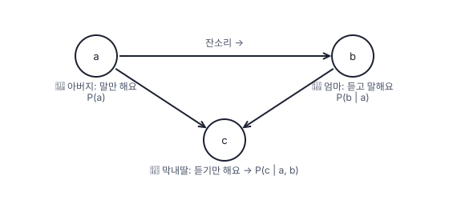

*받는 화살표가 없는 아버지는 자기 마음대로예요.*

**📐 정식 버전**

**그래프 읽는 법**(L02 s10)

- 노드(node): 확률변수.
- 방향 edge $a \to b$: $b$가 $a$에 직접 의존한다(direct dependence).
- 그래프 배치(layout): joint 분포의 factorization을 나타낸다.

화살표를 보내는 노드가 **parent**, 받는 노드가 **child**다. 아래 5노드 그림에서 $x_1, x_2$는 $x_3$의 parent이고, $x_3$는 $x_1, x_2$의 child다.

**3노드 예** ($a \to b$, $a \to c$, $b \to c$)

1. 곱셈 규칙(multiplication rule)만 쓰면 등호가 성립하는 표현을 여러 개 쓸 수 있다. 예: $P(a, b, c) = P(a \mid b, c)\, P(b, c)$, $P(a, b, c) = P(a \mid b, c)\, P(b \mid c)\, P(c)$.
2. 그런데 그래프 구조를 알고 있으면, 그 구조에 맞는 표현 하나만 의미를 가진다.
3. $a$는 parent가 없으므로 $P(a)$다.
4. $b$의 parent는 $a$뿐이므로 $P(b \mid a)$다.
5. $c$의 parent는 $a, b$이므로 $P(c \mid a, b)$다.
6. 셋을 곱한다.

$$
P(a, b, c) = P(c \mid a, b)\, P(b \mid a)\, P(a)
$$

**5노드 예**

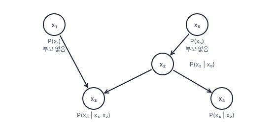

*$x_1$과 $x_5$는 parent가 없다. $x_2$는 $x_5$에만, $x_3$는 $x_1, x_2$에, $x_4$는 $x_2$에만 의존한다.*

$$
P(x_1, \dots, x_5) = P(x_1)\, P(x_5)\, P(x_2 \mid x_5)\, P(x_3 \mid x_1, x_2)\, P(x_4 \mid x_2)
$$

곱셈 규칙만으로는 이 joint 확률을 무수히 많은 방식으로 쓸 수 있다. 구조를 알면 전체 계산이 쉬운 조건부 확률(conditional probability)과 주변 확률(marginal probability)의 곱으로 정리된다.

**일반식 (factorization)**: 노드가 $K$개인 방향 그래프에서 $\mathrm{Pa}_k$를 $x_k$의 parent 노드 집합이라 하면

$$
P(x_1, \dots, x_K) = \prod_{k=1}^{K} P(x_k \mid \mathrm{Pa}_k)
$$

즉 각 노드의 확률을 "parent가 주어졌을 때의 조건부 확률"로 쓰고 모두 곱한다. parent가 없는 노드는 그냥 $P(x_k)$다.

**🎙️ 교수님 한마디**

가족 그래프 비유예요. 아버지는 엄마 말을 안 듣고 말만 해요. 막내딸은 아버지한테도 엄마한테도 잔소리를 들어요. 엄마는 아버지한테 잔소리를 들은 다음 딸한테 잔소리해요. (0921 28:49–29:25)

> 천상천하 유아독존, 아버지는 자기 확률에 의해서만 그냥 결정돼. (0921 29:49)

가상의 질문 "교수님 이거 multiplication rule로 쓰면 안 돼요?"에 대해, 그렇게 써도 등호는 다 성립하지만 구조를 알면 그 구조에 맞는 식만 의미가 있다고 답하셨어요. (0921 30:50–31:45)

parent는 "나한테 잔소리를 하는" 노드, 곧 화살표로 바로 이어진 위 노드예요. 세부 내용은 나중에 다룬다고 하셨어요. (0921 33:09–33:26)

---

### 동전 N번 던지기 그래프와 hyperprior

*📅 0921 · L02 s11*

**🧸 쉽게 말하면**

엄마 한 명 아래에 아이가 N명 매달린 문어발 모양이고, 아이끼리는 선이 없어요.

앞면이 나올 확률 μ만 정해지면 어제 던진 것도 내일 던질 것도 모두 μ만 보고 결과가 나와요.

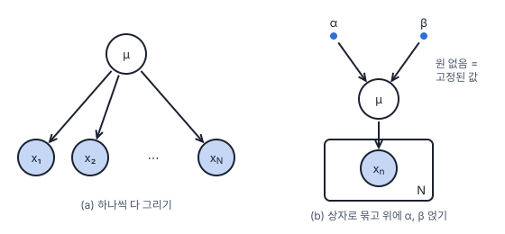

*똑같은 아이를 N번 그리는 대신 오른쪽처럼 상자 하나로 묶고, 칠한 원은 우리가 실제로 본 결과예요.*

**📐 정식 버전**

설정(L02 s11): 동전을 $N$번 던진 결과 $x_1, \dots, x_N$이 관측값(observable)이다. $\mu$는 앞면이 나올 확률로, 값을 모르는 (latent) 확률변수다. 앞에서 동전 던지기의 파라미터를 $\theta$라고 불렀는데, $\mu$가 바로 그 $\theta$다.

1. 그래프: parent는 $\mu$ 하나이고, $x_1, \dots, x_N$은 모두 $\mu$의 child인 leaf node다.
2. child끼리는 edge가 없다. 따라서 $\mu$가 주어지면 $x_n$들은 서로 조건부 독립이다.
3. factorization 일반식에서 각 $x_n$의 parent는 $\{\mu\}$뿐이다.
4. 따라서 $\mu$가 주어졌을 때의 joint 분포는 다음과 같다.

$$
P(x_1, \dots, x_N \mid \mu) = \prod_{n=1}^{N} P(x_n \mid \mu)
$$

이것은 posterior predictive를 유도할 때 쓴 조건부 독립 가정("θ가 정해지면 과거·현재·미래의 던지기는 θ에만 좌우된다")을 그래프로 그린 것이다.

**plate 표기**: 위 그림의 (a)처럼 같은 모양의 노드 $x_1, \dots, x_N$을 일일이 그리는 대신, (b)처럼 $x_n$ 하나를 상자(plate)로 감싸고 모서리에 $N$을 적는다. "상자 안의 내용이 $n = 1, \dots, N$에 대해 반복된다"는 뜻이다.

**hyperprior**: $\mu$의 prior $p(\mu \mid \alpha, \beta)$는 파라미터 $\alpha, \beta$로 정해진다. 이처럼 prior의 파라미터를 hyperparameter라 하고, 그 hyperparameter($\alpha, \beta$)에 다시 두는 두 번째 층의 prior를 hyperprior라고 한다(MML 8.5). 수업에서는 "$\mu$가 또 다른 hidden parameter $\alpha, \beta$의 영향을 받는 구조도 이렇게 그릴 수 있다"는 정도로 설명했다. 슬라이드 그림에서는 $\alpha, \beta$를 고정된(deterministic) 값으로 보고 원을 생략해 그린다(그림 (b)).

※ 용어 정리: 수업 중 $\theta$를 "하이퍼 파라미터"라고 부른 대목이 있었다(0921 02:07, 10:41). $\theta$(= $\mu$)는 latent(hidden) parameter이고, hyperparameter는 그 prior를 정하는 $\alpha, \beta$다. 슬라이드 텍스트 추출본에 "ω and ε"로 보이는 것도 추출 오류이고 $\alpha, \beta$가 맞다.

※ 음영 노드가 관측값이라는 점은 슬라이드에만 있고 수업에서 말로 설명하지는 않았다.

**🎙️ 교수님 한마디**

"엄마가 한 명 있고 자식이 n명 있는" 그림이라고 설명하셨어요. 자식과 자식 사이에는 선이 없으니, 모두 μ에 의해서만 영향을 받는다는 뜻이에요. (0921 33:51–34:07)

> 부모가 하나가 있고, 그 밑에 문어발처럼 … 리프 노드라고 부르기도 하거든요. (0921 34:10)

데이터가 앞면·앞면·뒷면·… 이렇게 주어져도, 이것들은 모두 θ에 의해서만 영향을 받는다고 그래프로 표현할 수 있다고 하셨어요. 이 표기는 어떤 것이 조건이고 어떤 것이 결과인지, 곧 조건부 joint 확률의 구조를 설명할 때 많이 쓴다고 해요. (0921 34:42–35:18)

---

### 헬스케어 예시(LUCAS)와 생일 미신으로 본 ML vs MAP

*📅 0921 · L02 s14–s15*

**🧸 쉽게 말하면**

병의 원인과 증상을 화살표로 이어 놓은 지도예요.

기침은 폐암 때문일 수도, 알레르기 때문일 수도 있어요.

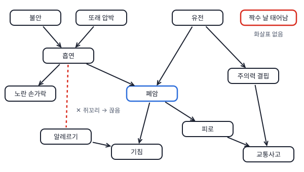

*"짝수 날 태어남"은 확인할 방법이 없어서 어디에도 이어지지 않아요.*

**📐 정식 버전**

**LUCAS**(LUng CAncer Simple set, L02 s14)는 폐암을 둘러싼 원인과 결과를 방향 그래프로 그린 예제다. 수업에서 따라간 화살표는 다음과 같다.

- 유전(Genetics) → 폐암(Lung cancer), 유전 → 주의력 결핍(Attention disorder)
- 폐암 → 피로(Fatigue), 피로와 주의력 결핍 → 교통사고(Car accident)
- 폐암 → 기침(Coughing), 알레르기(Allergy) → 기침. 기침한다고 폐암이라고 단정하지 않는 이유다.
- 흡연(Smoking) → 폐암, 흡연 → 노란 손가락(Yellow fingers)
- 불안(Anxiety) → 흡연, 또래 압박(Peer pressure) → 흡연

그래프를 그릴 때의 두 원칙이 이 예에서 나왔다.

1. 연관이 아주 작으면 독립으로 보고 edge를 없앤다. 흡연과 알레르기 사이가 그 예다(그림의 점선).
2. 데이터로 검증할 수 없는 관계에는 화살표를 넣지 않는다. "짝수 날 태어남(Born an even day)"이 어느 노드와도 연결되지 않는 이유다.

**생일 예로 본 ML vs MAP** (슬라이드 밖 예시)

1. 데이터: 주의력 결핍이 있는 50명 중 짝수 날 생일이 40명이다.
2. ML: 데이터만 믿는다. $\theta_{\text{ML}} = \arg\max_\theta P(X \mid \theta)$이므로 연관 확률을 $40/50 = 0.8$로 본다.
3. MAP: $\theta_{\text{MAP}} = \arg\max_\theta P(\theta \mid X) = \arg\max_\theta P(X \mid \theta)\, P(\theta)$. 여기서 $P(\theta)$가 prior다.
4. prior는 "생일과 증상은 관계없다, 홀짝은 반반이다"라는 경험이다. 이것이 추정값을 0.5 쪽으로 끌어당겨 약 0.55가 된다.
5. 데이터가 적으면 전체 현상을 대변하지 못한다. 이것을 바로잡는 조정이 regularization이 필요한 이유다.

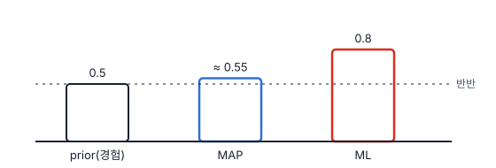

*ML은 데이터 그대로 0.8, MAP는 prior(반반)에 끌려 약 0.55. 숫자 0.55는 교수님이 예로 든 값이다.*

**directed graphical model**: Bayesian 접근은 확률로 관계를 설명하므로, 연관성만 따지지 않고 방향이 있는 그래프를 주로 쓴다(Bayesian network라고도 한다). 슬라이드 s15에는 그래피컬 모델의 다른 종류도 적혀 있지만 수업에서는 이것만 언급했다.

※ 조건부 독립을 그래프에서 읽어 내는 규칙(L02 s12–s13)은 수업에서 건너뛰었다. 나중에 그래피컬 모델을 더 설명할 때 다시 다룬다고 하셨다(0921 35:40, 58:44).

**🎙️ 교수님 한마디**

흡연이 알레르기를 바꿀 수 있지 않냐는 가상 질문에는, 학술적으로 쥐꼬리만큼의 확률은 있을지 몰라도 보통은 독립으로 보고 선을 없앤다고 답하셨어요. (0921 37:20–37:35)

"교수님, 미신은 과학입니다"라는 가상 반론도 나왔어요. 답은 이랬어요. (0921 37:57)

> 보통의 데이터로 검증할 수 없는 것들은 화살표를 넣지 않습니다. (0921 38:05)

교수님이 "야, 아무리 그래도 이게 말이 되냐?" 하고 80%를 55% 정도로 낮추는 것, 연관성을 쥐꼬리만큼만 주는 것이 MAP예요. 전문가의 식견·경험·선호처럼 데이터로 설명할 수 없는 의지를 반영한 것이 prior probability예요. (0921 39:10–40:28)

> 교수를 오늘만 하는 게 아닐 거 아니야. … 홀수, 짝수가 다 반반이었어. (0921 40:28)

그런 경험이 있다면 ML 결정은 하지 않을 거라고 하셨어요. 첫 수업이 아니니까요. (0921 40:41–40:53)

---

## 3. 모델 선택

### train · validation · test와 cross-validation

*📅 0921 · L02 s17*

**🧸 쉽게 말하면**

문제집을 공부용, 공부법을 고르는 모의고사용, 마지막 실력을 재는 시험용으로 나눠요.

모의고사 묶음은 공부용 묶음과 자리를 바꿔 가며 여러 번 다시 쓸 수도 있어요.

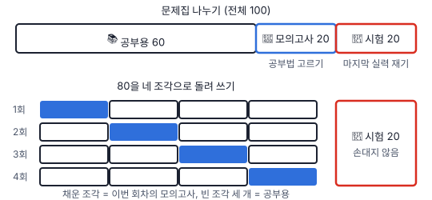

*시험 묶음은 끝까지 아껴 두고, 모의고사 자리만 돌아가며 바꿔요.*

**📐 정식 버전**

모델은 "데이터가 이런 과정으로 만들어졌을 것"이라는 **가정**이다. 그래서 모델은 옳고 그름이나 좋고 나쁨의 문제가 아니라 **선택의 문제**이고, 선택에는 validation이 필요하다.

(🧸의 공부용 · 모의고사용 · 시험용 = train set · validation set · test set. 모의고사 자리를 돌려 쓰는 것이 아래의 cross-validation이다.) supervised learning에서 labeled data를 나누는 두 방식:

1. **단순한 방식**: 80%로 파라미터를 학습하고, 남은 20%를 unseen data인 test set으로 두어 성능을 보고한다. 모델(예: linear)은 처음부터 하나로 정해 둔다.
2. **보통의 방식**: 전체 100 = test 20 + (train 60 + validation 20).
3. train set으로 후보 모델 각각의 파라미터를 학습한다. 후보는 linear, polynomial, DNN, CNN, Transformer, RNN 등이다.
4. **validation set**으로 후보들을 비교해 best model을 고른다(choose the best model).
5. **test set**으로 고른 모델의 generalization 성능을 추정한다(estimate the generalization performance).

model selection은 **model complexity**와 data fit 사이의 trade-off다.

- 너무 복잡하면 overfitting → train에는 잘 맞지만 validation 성능이 나쁘다.
- 너무 단순하면 underfitting → train에도 validation에도 잘 맞지 않는다.
- 그 사이에서 validation이 잘 되는 적당한 복잡도를 찾는다.

**cross-validation (CV)**: validation 20을 고정하지 않는다.

1. train과 validation을 합친 80을 20씩 네 조각으로 나눈다.
2. 세 조각으로 학습하고 남은 한 조각으로 검증한다.
3. 검증 조각을 바꿔 가며 네 번 반복한다. 같은 데이터를 train에도 validation에도 reuse하는 셈이다.

나누는 비율 60:20은 관례일 뿐이다. 파라미터 튜닝에 데이터를 더 쓰는 편이 좋아서 보통 train을 크게 잡는다. 영상처럼 모으는 데 돈이 많이 드는 데이터는 stitch하거나 randomize해 섞어서 쓰기도 한다.

**🎙️ 교수님 한마디**

신승훈의 〈보이지 않는 사랑〉을 다시 꺼내셨어요. 노래 속 사람이 겉으로 보이는 모습의 이유를 "~일 거야"라고 **짐작**하듯, 모델도 데이터가 어떻게 만들어졌을지에 대한 짐작이에요. 그러니 정답을 맞히는 게 아니라 고르는 거예요. (0921 41:19–41:57)

"부모님이 신승훈 씨와 동갑일 가능성이 높다"며 부모님께 노래를 물어봤는지 확인하셨어요.

**⚠️ 강조 포인트**

> 그래서 모델 셀렉션은 항상 밸리데이션(Validation)이 필요하다. (0921 42:07)

> 꼭 60 대 20이 정답은 아니에요. 30 대 50, 50 대 30 … 상관없어. (0921 45:18)

---

### Bayesian model selection

*📅 0921 · L02 s18*

**🧸 쉽게 말하면**

누가 이 요리를 만들었을지 맞히려면, 요리사마다 "이런 맛을 낼 만한가" 점수를 매겨 가장 높은 사람을 골라요.

좋아하는 요리사가 따로 없으면 모두에게 같은 기본 점수를 주니까, 맛 점수만으로 결정돼요.

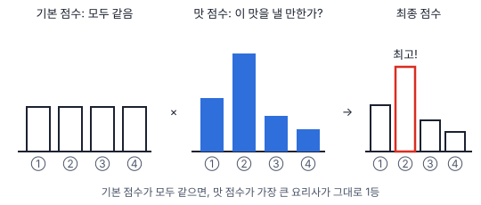

*기본 점수 × 맛 점수 = 최종 점수. 가장 높은 요리사를 골라요.*

**📐 정식 버전**

모델 집합 $\mathcal{M} = \{M_1, \dots, M_K\}$. 예: RNN $= M_1$, Transformer $= M_2$, CNN $= M_3$, DNN $= M_4$, Linear $= M_5$, Polynomial $= M_6$. 각 $M_k$는 학습으로 정해지는 파라미터 $\theta_k$를 가진다(같은 linear 모델도 입력 벡터 $\mathbf{x}$의 크기에 따라 파라미터 개수가 달라진다).

(🧸의 요리사 = 모델 $M_k$, 기본 점수 = model prior $P(M_k)$, 맛 점수 = model evidence $P(D \mid M_k)$, 최종 점수 = posterior $P(M_k \mid D)$.)

**생성 과정**:

$$
M_k \sim P(M), \quad \theta_k \sim P(\theta \mid M_k), \quad D \sim P(D \mid \theta_k)
$$

model prior $P(M)$은 $\sum_k P(M_k) = 1$만 지키면 설계자가 정한다(예: $P(M_1) = 0.2$, $P(M_2) = 0.3$). 선호가 없으면 uniform prior $P(M_k) = 1/K$로 둔다.

**칠판 유도** — 목표는 "손에 든 데이터 $D$로 볼 때 어떤 모델이 가장 그럴듯한가"이다.

1. 구할 것: $P(M_k \mid D)$.
2. 조건부 확률의 정의: $P(M_k \mid D) = \dfrac{P(M_k, D)}{P(D)}$.
3. 분모 $P(D)$는 $k$와 무관하므로 무시하고 비례식으로 바꾼다.
4. 분자에 multiplication rule $P(M_k, D) = P(D \mid M_k)\, P(M_k)$를 쓴다.
5. 결과: $P(M_k \mid D) \propto P(D \mid M_k)\, P(M_k)$.

$P(M_k)$는 미리 정해 둔 prior이므로, 새로 계산할 것은 $P(D \mid M_k)$뿐이다. 이것을 **model evidence** 또는 **marginal likelihood**라 한다. 모델 이름만으로는 흐릿하므로 모델이 만든 파라미터 $\theta_k$로 풀어 쓴다:

$$
P(D \mid M_k) = \int P(D \mid \theta_k)\, P(\theta_k \mid M_k)\, d\theta_k = \mathbb{E}_{\theta_k \mid M_k}\big[P(D \mid \theta_k)\big]
$$

곧 모델 $M_k$ 아래에서 나올 수 있는 $\theta_k$들이 데이터를 얼마나 잘 설명하는지의 **평균**이다. 이 적분을 슬라이드에서는 (***)로 표시했다.

**모델에 대한 MAP**: $M^{*} = \arg\max_{k} P(M_k \mid D) = \arg\max_{k} P(D \mid M_k)\, P(M_k)$.

uniform model prior $P(M_k) = 1/K$이면 $P(M_k)$가 모든 $k$에서 같아 사라지므로, MAP 모델 선택은 model evidence 최대화, 곧 ML과 같아진다: $M^{*} = \arg\max_{k} P(D \mid M_k)$.

모델은 Bayesian으로 고르고, 고른 모델 안의 $\theta$는 다시 Bayesian·MAP·ML 중 하나로 정할 수 있다.

**복잡도까지 따질 때**: 예컨대 $P(M_1 \mid D) = 0.25$, $P(M_2 \mid D) = 0.23$으로 차이가 작은데 $M_1$이 훨씬 복잡하다면 $M_2$가 더 좋은 선택일 수 있다. 이런 판단에는 모든 모델의 posterior를 알려 주는 Fully Bayesian이 필요하다. MAP는 결정 하나만 알려 준다.

※ 수업 중 "conditional expectation을 maximize하는 θ를 만드는 모델"로 말했다가 정정: evidence는 θ를 적분(평균)한 값이고, 최대화는 모델 번호 $k$에 대해 한다 (0921 51:31).

**🎙️ 교수님 한마디**

"아유, 지겹네요 베이지안 또." 모델 고르기까지 또 베이지안 틀이 나온다며 웃으셨어요. (0921 46:40)

가상의 학생: "교수님, 이 prior를 어떻게 만들어요? 저는 아무 선호가 없어요." → 그러면 그냥 전부 $1/K$, 곧 uniform으로 주면 된다. (0921 48:30)

"베이지안으로 안 되는 게 없네"라는 결론과 함께, 머신러닝은 가장 그럴듯한 답을 만드는 일이고 "그럴듯하다"는 말 자체가 확률 개념이라고 정리하셨어요.

**⚠️ 강조 포인트**

> 내 손 안에 뭐가 있는지 … 뭐를 판단하려고 하는지를 컨디셔널 프로바빌리티로 만드는 게 제일 중요하다. (0921 49:34)

> 중요한 건 어떤 모델 k가 주어졌을 때 이 데이터를 그 모델이 얼마나 잘 설명하느냐 (0921 50:25)

> 이 확률을 모르고서는 절대 머신러닝을 이해하기 힘들다. (0921 52:17)

> fully Bayesian이 그만큼 스트롱하다, 좋은 기법이다 (0921 53:46)

---

### Bayes factor로 두 모델 비교하기

*📅 0921 · L02 s19*

**🧸 쉽게 말하면**

후보가 딱 둘이면 순위표 없이 "누가 몇 배 더 그럴듯한가"만 나눗셈으로 보면 돼요.

나눈 값이 1보다 크면 첫째를, 1 이하면 둘째를 골라요.

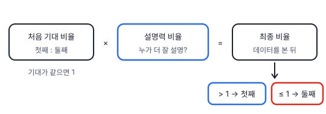

*처음 기대가 둘 다 같으면, 설명력 비율 하나로 결정돼요.*

**📐 정식 버전**

(🧸의 처음 기대 비율 = prior odds, 설명력 비율 = Bayes factor, 최종 비율 = posterior odds.) 모델이 $M_1$, $M_2$ 두 개뿐이면 $\arg\max$로 순서를 매길 필요 없이 **posterior odds**(두 posterior의 비)만 계산하면 된다.

1. posterior odds: $\dfrac{P(M_1 \mid D)}{P(M_2 \mid D)}$.
2. 분자·분모에 Bayes rule을 쓴다: $\dfrac{P(D \mid M_1)\, P(M_1) / P(D)}{P(D \mid M_2)\, P(M_2) / P(D)}$.
3. 공통 분모 $P(D)$가 약분된다.
4. 두 비로 묶는다:

$$
\frac{P(M_1 \mid D)}{P(M_2 \mid D)} = \underbrace{\frac{P(M_1)}{P(M_2)}}_{\text{prior odds}} \; \underbrace{\frac{P(D \mid M_1)}{P(D \mid M_2)}}_{\text{Bayes factor}}
$$

$P(D \mid M_k)$는 앞 토픽의 model evidence로, 모델 $M_k$가 데이터를 얼마나 잘 예측(설명)하는지를 나타낸다.

- uniform model prior이면 prior odds $= 1$이 되어 사라진다.
- 그러면 Bayes factor $\gt 1$이면 $M_1$, Bayes factor $\le 1$이면 $M_2$를 고른다.
- 이는 두 가설의 likelihood ratio(또는 log-likelihood ratio)를 계산해 어느 쪽이 큰지 보는 것과 같다.

Bayes factor를 계산하려면 evidence 적분(***)이 필요하다. 데이터가 커질수록 이 적분은 매우 복잡해지므로 MCMC(Markov Chain Monte Carlo) 같은 근사에 의존한다. MCMC는 기말고사 무렵에 설명할 기회가 있을 것이라고 하셨다.

**🎙️ 교수님 한마디**

**디지털통신** 수업과 같은 이야기예요. 받은 신호 $y$가 비트 1에서 왔는지 0에서 왔는지 판정할 때 원래 MAP가 항상 optimal이에요. 그런데 1과 0이 나올 확률이 같으면 prior가 uniform인 것이라서, "1을 보냈다면 이 $y$가 도착할 확률"만 비교하는 ML 판정과 같아져요. (0921 56:55–57:09)

> 원래 MAP가 항상 optimal인데 … 1이 나올 확률과 0이 나올 확률이 다 동일하면 (0921 56:55)

"실제로 많이 쓰는 ratio 기법"이라고 소개하셨어요. (0921 54:51)

---

## 4. 선형회귀: 문제 정식화

### 회귀 문제: 목표는 일반화

*📅 0923 · L03 s2–s5*

**🧸 쉽게 말하면**

"다음 학기 학점이 몇 점일까?"처럼 눈금 위의 숫자 하나를 맞히는 게 회귀이고, "A+, A0, B+ 중에 뭘까?"처럼 정해진 칸에서 고르는 건 분류예요.

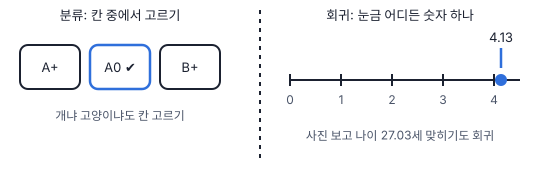

*고르는 칸이 정해져 있으면 분류, 연속된 눈금 위의 값을 맞히면 회귀.*

잴 때마다 조금씩 흔들려서 점들은 선 주변에 흩어지는데, 우리가 원하는 건 이 점들을 외우는 게 아니라 **처음 보는 x에서도 잘 맞히는 선**이에요.

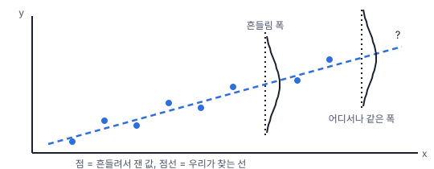

*선만 찾을 수도 있고, 선 위에 흔들림의 폭(옆으로 누운 종)까지 얹을 수도 있어요. 흔들림 폭은 어느 x에서나 똑같다고 봐요.*

**📐 정식 버전**

**회귀(regression)**: 실수값 하나를 추정(estimate)하는 문제. 추정하는 규칙을 estimator라고 불러도 된다. 예: 학점을 4.13, 3.87처럼 실수로 예측, 사진으로 나이(27.03세)를 추정. **분류(classification)**: A+/A0/B+, 개/고양이처럼 정해진 몇 개 중 하나를 고르는 문제.

**이 장의 목표** (L03 s2 Targets): linear regression 모델을 **formulation(문제 정식화)**하고, Gaussian noise 아래에서 ML 추정이 최소제곱(Least Squares) 문제가 됨을 유도한다. 선형회귀를 흔히 "LS 문제"라고 부르는 이유가 여기 있다.

**로드맵** (s3–s4, Part 1): (1) Problem Formulation → (2) Parameter Estimation: ML → (3) Parameter Estimation: MAP. 0923에는 (1)과 ML의 절반까지 했고, 이어서 ML 마무리 → MAP → Bayesian linear regression 순으로 약 2주가 걸린다.

#### 회귀 문제 (s5)

1. 입력 $x_n$에서 **noisy observation**을 얻는다:

   $$
   y_n = f(x_n) + \epsilon
   $$

   $\epsilon$은 perturbation, 곧 노이즈다. 입력이 벡터면 $\mathbf{x}_n \in \mathbb{R}^D$로 쓴다.
2. 함수 $f$는 모른다. 연역적 학문은 모델이 먼저 주어진다(전류를 미분하면 전압). 머신러닝은 이를 뒤집어 **데이터가 먼저** 주어지고 $x$와 $y$ 사이의 관계를 추론(inference)한다.
3. **deterministic model**: 선(함수 $f$) 자체를 찾는다. **probabilistic model**: 그 선 위에 확률밀도함수(PDF)를 입힌다.
4. 결정론적 모델은 PDF가 델타 함수인 확률적 모델의 특수한 경우다. 그래서 이번 학기에는 주로 확률적 모델을 다룬다.
5. 노이즈의 분산이 아주 작으면 PDF가 날카로워지고, 불확실성을 고려하지 않는 결정론적 모델로 돌아간다. 고해상도 사진, 깨끗한 음질처럼 정제된 데이터가 그런 경우다.
6. 모델 선택(선형, 고차 다항식, 로그 함수 …)으로 꼴을 정하면, 남은 일은 파라미터 $\boldsymbol{\theta}$를 최적화해 데이터를 가장 잘 설명하게 만드는 것이다. 이것이 $f$를 inference하는 과정이다.

**표기 약속**: 이번 학기에 $f$는 함수, 곧 **모델**이고, $p(\cdot)$는 PDF다. 확률 및 랜덤변수 과목에서 PDF를 소문자 $f$로 쓰던 것과 구별한다.

**Goal** (s5): 가진 데이터를 잘 설명하는 것이 아니라, **새 입력에서의 함수값을 잘 예측하도록(generalize well)** $f$를 추론하는 것.

| 응용 (s5) | 무엇을 예측하나 |
|---|---|
| time-series analysis | 과거 학점으로 이번 학기 학점 |
| control · robotics | 지금까지의 관절 움직임으로 다음 동작 |
| image recognition | 사진으로 나이(개/고양이 구분이면 분류) |

#### 확률적 모델이 더 주는 것: 분산

결정론적 모델($\epsilon$의 분산이 0)은 예측값 하나만 낸다. 확률적 모델은 평균 예측은 같지만, 그 예측이 얼마나 확실한지, 틀릴 가능성이 얼마인지를 **분산** $\sigma^2$으로 함께 준다.

**🎙️ 교수님 한마디**

GPT, Claude 같은 AI는 "내 옆에 있는 나보다 똑똑한 조수"예요. 그런데 전 세계 누구나 이 조수를 갖게 되어 무한 경쟁이 됐어요. 그러니 엔지니어에게 남는 경쟁력은 **문제를 잘 만들고 그 의미와 풀이법을 고민하는 포뮬레이션**이에요. 논리적이고 수학을 잘하는 사람이 포뮬레이션을 잘한다고 하셨어요. (0923 01:20–03:25)

전날 삼성미래기술육성재단 과제 발표를 심사하신 이야기: 휴대폰 사용자의 위치·방향·속도·경로를 추론해 기지국 안테나 틸팅을 미리 준비하는 연구도 회귀예요. A/B/C 중에 고르는 게 아니라 "흰 캔버스 위에 그림을 그리듯" 연속값을 추론하니까요. (0923 11:15)

"노이즈가 없는 환경도 있지 않나요?" → 있어요, 정제된 데이터면 무시해도 돼요. "그럼 결정론적 모델로 돌아가나요?" → 빙고. (교수님이 학생 역할로 묻고 답하심)

장군님은 값 하나(요점)만 궁금해하지만, **엔지니어는 그 값이 얼마나 불확실한지(분산)까지 보고해야** 해요. 추석 인사를 온 대위 계급 박사과정생 이야기에서 나온 비유예요. (0923 30:54–32:31)

**⚠️ 강조 포인트**

> 리니어 리그레션 … 가장 중요한 건 포뮬레이션이에요. (0923 01:20)

> 포뮬레이션을 잘해야 돼요, 포뮬레이션. (0923 02:24)

목표는 기존 데이터 설명이 아니라 앞으로 들어올 데이터를 추론하는 것:

> 이 후자에 방점이 있죠, 사실. 후자예요. (0923 10:23)

---

### 가우시안 노이즈 가정

*📅 0923 · L03 s6*

**🧸 쉽게 말하면**

흔들림은 대부분 아주 조금이고, 크게 흔들리는 일은 드물어요. 그래서 흔들림의 모양을 그리면 종처럼 생겼어요.

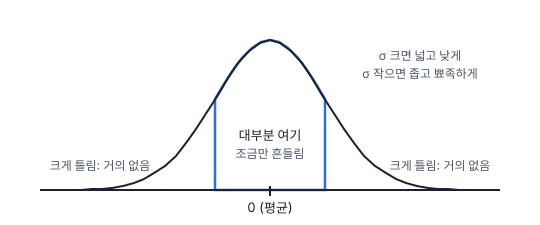

*흔들림의 크기를 그린 종 모양. 가운데로 갈수록 흔한 흔들림이에요.*

**📐 정식 버전**

**가정** (s6 "Assume: linear regression, Gaussian noise"):

$$
y = f(\mathbf{x}) + \epsilon, \quad \epsilon \sim \mathcal{N}(0, \sigma^2)
$$

1. 평균 0, 분산 $\sigma^2$인 가우시안 PDF (칠판):

   $$
   p_X(x) = \frac{1}{\sqrt{2\pi\sigma^2}} \exp\left(-\frac{(x - 0)^2}{2\sigma^2}\right)
   $$
2. 평균을 $\mu$로 일반화:

   $$
   p_X(x) = \frac{1}{\sqrt{2\pi\sigma^2}} \exp\left(-\frac{(x - \mu)^2}{2\sigma^2}\right)
   $$
3. 앞으로 PDF는 모두 $p$로 쓴다.

**bell-shaped function(종 모양)의 의미**

- 노이즈는 대부분 평균 근처에 몰려 있다. 평균 근처 구간을 적분하면 확률이 크다.
- 평균에서 멀어지면 밀도가 처음에는 천천히, 그다음 급격히 0으로 떨어진다. 평균에서 크게 벗어난 극단적 사건의 확률은 매우 작다.
- $\sigma^2$가 작을수록 곡선이 좁고 뾰족해진다.

**노이즈는 항상 가우시안인가?** 대부분(약 99%) 그렇다. 도메인에 따라 shot noise나 Laplace 분포 꼴의 노이즈도 있다.

**왜 가우시안인가**: 전기적으로 생기는 노이즈가 가우시안을 따르는 이유는 central limit theorem(중심극한정리) 등으로 수학적으로 증명할 수 있다. 증명은 통신 과목으로 넘겼다.

이 "평균 근처에 몰린다"는 모양은 뒤에서 ML 추정이 최소제곱과 같아지는 이유로 다시 쓰인다.

**🎙️ 교수님 한마디**

노이즈는 99% 정도는 가우시안이라고 보면 된다고 하셨어요. 가우시안이 되는 근거는 central limit theorem으로 보일 수 있지만, 증명은 통신 과목 몫이라며 넘어가셨어요. (0923 14:10–14:27)

가우시안 PDF의 모양을 먼저 자세히 보여 준 데는 이유가 있다고 하셨어요. 노이즈가 평균(0) 근처에 몰려 있어서 "관측값을 그대로 믿는 것"이 가장 합리적이게 되는데, 이것이 뒤에서 최소제곱과 연결돼요. (0923 60:23–66:10)

---

### 선형회귀는 가정이다: likelihood와 순환논증

*📅 0923 · L03 s6*

**🧸 쉽게 말하면**

이 방법은 "아마 곱해서 더하는 규칙일 거야"라고 먼저 짐작하고 시작해요. 잘 맞아도 "그런 규칙일 수도 있겠다"까지만 말할 수 있어요.

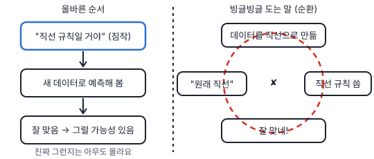

*짐작이 맞았다는 증거를, 짐작대로 만든 데이터로 대면 제자리를 도는 말이 돼요.*

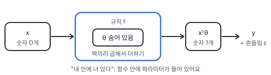

*규칙 상자 안에 숨은 θ가 x를 맞아 짝끼리 곱해 더하고, 숫자 하나를 내놓아요.*

**📐 정식 버전**

선형회귀 = "$y$는 입력 벡터 $\mathbf{x}$의 선형 함수에 노이즈 $\epsilon$이 더해져 내 손에 쥐어진 것일 거야"라고 **assume(= suppose)**하는 것. 곧 $f(\mathbf{x})$가 선형이라고 **가정**하는 모델이다.

1. **likelihood**(그럴듯함)라는 말이 나오면 확률 또는 PDF를 떠올린다. 데이터 $\mathbf{x} = [x_1, \dots, x_D]^\top$가 주어졌을 때 $y$의 조건부 PDF가 likelihood function이다.
2. $f: \mathbb{R}^D \to \mathbb{R}$. 길이 $D$인 벡터를 받아 실수 하나를 낸다($\mathbb{R}^D$는 정의역, $\mathbb{R}$은 공역).
3. $f$가 정해지면 $y$는 평균 $f(\mathbf{x})$, 분산 $\sigma^2$인 가우시안이다:

   $$
   p(y \mid \mathbf{x}) = \mathcal{N}(y \mid f(\mathbf{x}), \sigma^2)
   $$

   그 이유는 **그렇다고 가정했기 때문**이다. $f(\mathbf{x})$가 주어졌다고 보면 불확실성은 $\epsilon$에서만 생긴다.
4. 선형회귀는 $f$를 선형 꼴로 둔다:

   $$
   f_{\boldsymbol{\theta}}(\mathbf{x}) = \mathbf{x}^\top \boldsymbol{\theta}, \quad \boldsymbol{\theta} = [\theta_1, \dots, \theta_D]^\top \in \mathbb{R}^D
   $$

   아래첨자 $\boldsymbol{\theta}$는 입력은 여전히 $\mathbf{x}$이지만 함수 안에 파라미터 벡터 $\boldsymbol{\theta}$가 들어 있다는 뜻이다.
5. 따라서

   $$
   p(y \mid \mathbf{x}) = \mathcal{N}(y \mid \mathbf{x}^\top \boldsymbol{\theta}, \sigma^2)
   $$

   $$
   \iff y = \mathbf{x}^\top \boldsymbol{\theta} + \epsilon, \quad \epsilon \sim \mathcal{N}(0, \sigma^2)
   $$
6. $\mathbf{x}^\top \boldsymbol{\theta} = \boldsymbol{\theta}^\top \mathbf{x} = \sum_{i=1}^{D} x_i \theta_i$는 크기가 같은 두 벡터의 내적이므로 **스칼라**다(내적은 교환법칙이 성립). 그래서 $y$는 평균이 스칼라 $\mathbf{x}^\top \boldsymbol{\theta}$인 가우시안 랜덤 변수다.

**순환논증 경계**

- ✘ "데이터가 원래 선형으로 만들어졌으니 선형회귀를 쓴다", 또는 데이터를 선형으로 만들어 놓고 "선형회귀가 잘 된다"고 주장하기 → 순환논증.
- ✔ 선형회귀로 예측해 봤더니 잘 맞는다 → 데이터가 선형 패턴으로 생성되었을 **개연성**이 있을 뿐이다. 진짜 그런지는 "nobody knows in the world".
- 머신러닝은 이유를 몰라도 특징(feature)이 드러나면 그것을 잡아내 잘 맞히는(guess) 시스템이다.

**🎙️ 교수님 한마디**

신승훈의 「보이지 않는 사랑」에 빗대어, 머신러닝은 "보이지 않는 패턴"을 만드는 일이라고 하셨어요. 노래의 "~일 거야" 같은 추측형 말투가 바로 assume/suppose의 뉘앙스래요. (0923 17:45–18:17)

교수님도 대학원 시절 LG전자 과제에서 이 순환논증 실수를 해서 지도교수님께 45분간 혼나셨대요.

넷플릭스에서 범죄도시 1·2·3을 보면 "액션과 마동석을 좋아한다"고 추론해요. 내가 왜 그 영화가 좋은지(오늘 왜 짬뽕이 당기는지) 나도 모르지만, 특징이 드러나면 머신러닝은 그걸 잡아내요.

드라마 「파리의 연인」의 "내 안에 너 있다": 함수 안에 $\boldsymbol{\theta}$가 들어 있다가, 입력이 들어오면 "어서 오십시오 손님" 하고 $\mathbf{x}$와 내적해서 $y$를 만들어요. 교수님은 $\boldsymbol{\theta}$를 latent variable이라고도 부르셨어요. (0923 28:49)

"$\mathbf{x}^\top \boldsymbol{\theta}$는 벡터냐 스칼라냐?"라는 질문에 학생이 "스칼라"라고 답했고, 교수님이 같은 크기 벡터끼리 내적하면 스칼라라고 확인하셨어요.

**⚠️ 강조 포인트**

선형회귀를 "가정"으로 읽는 대목을 시작하며 "여러분, 잘 보세요."(0923 17:45)

> 그렇게 말하는 순간 순환논증에 빠지는 거라니까. (0923 19:22)

> 단언컨대 대학원 1학년 때 이런 실수 한 번씩 합니다. (0923 19:41)

> 라이클리후드라는 말이 나왔다 … probability 또는 PDF를 생각해라. (0923 23:37)

---

### x에 비선형이어도 선형회귀: feature vector

*📅 0923 · L03 s6 · s12*

**🧸 쉽게 말하면**

재료 x를 x, x×x, x×x×x로 미리 손질해서 늘어놓으면, 그다음은 여전히 "곱해서 더하기"만 하면 돼요. 그래서 구불구불한 곡선도 같은 방법으로 그릴 수 있어요.

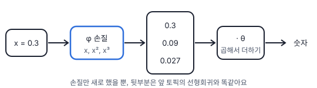

*x 하나를 세 숫자로 늘려 놓는 손질이에요.*

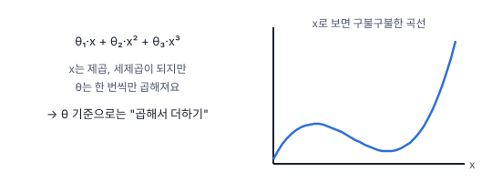

*x에 대해서는 곡선이지만, 맞춰야 할 θ에 대해서는 여전히 선형이에요.*

**📐 정식 버전**

"선형"은 직선만 뜻하지 않는다. **최적화하려는 파라미터와의 관계가 선형**이라는 뜻이지, 입력(재료) 자체가 선형이라는 뜻이 아니다. 선형회귀는 parameters에 대해 **linear in** $\boldsymbol{\theta}$이면 된다.

1. 기본형: $\mathbf{x} = [x_1, x_2, x_3]^\top$, $\boldsymbol{\theta} = [\theta_1, \theta_2, \theta_3]^\top$이면 $\mathbf{x}^\top \boldsymbol{\theta} = \sum_{i=1}^{3} x_i \theta_i$. 대부분의 교재는 여기까지만 선형회귀로 설명한다.
2. 확장 (s6 "Non-linear in x"): 스칼라 입력 $x$에 대해 $y$가 $x, x^2, x^3$에 영향을 받는 것 같다면 3차 다항식 모델을 쓴다:

   $$
   f_{\boldsymbol{\theta}}(x) = \theta_1 x + \theta_2 x^2 + \theta_3 x^3
   $$
3. $\tilde{\mathbf{x}} = [x, x^2, x^3]^\top$로 두면

   $$
   f_{\boldsymbol{\theta}}(x) = \tilde{\mathbf{x}}^\top \boldsymbol{\theta}
   $$

   이것도 **선형회귀**다. $\boldsymbol{\theta}$를 제곱하지 않았으므로 $\boldsymbol{\theta}$에 대해 선형이고, 가우시안의 평균만 바뀔 뿐 PDF의 꼴은 같다.
4. 원래 데이터로 만든 함수들의 벡터를 **feature vector** $\boldsymbol{\phi}(x)$라 하고, 만드는 과정을 feature extraction(예: PCA)이라 한다. 피처는 $y$에 영향을 주는 핵심 성분을 뽑은 것이다:

   $$
   f_{\boldsymbol{\theta}}(x) = \boldsymbol{\phi}^\top(x) \boldsymbol{\theta}
   $$
5. 우도는 앞 토픽과 같은 꼴이다:

   $$
   p(y \mid x) = \mathcal{N}(y \mid \boldsymbol{\phi}^\top(x) \boldsymbol{\theta}, \sigma^2) \iff y = \boldsymbol{\phi}^\top(x) \boldsymbol{\theta} + \epsilon, \quad \epsilon \sim \mathcal{N}(0, \sigma^2)
   $$

   s6의 두 경우("Linear in x", "Non-linear in x") 모두 **linear in** $\boldsymbol{\theta}$다.
6. 수치 예: $x = 0.3$이면

   $$
   \boldsymbol{\phi}(0.3) = [0.3,\ 0.09,\ 0.027]^\top
   $$

   ($0.3^2 = 0.09$, $0.3^3 = 0.027$). $y$는 이 벡터와 $\boldsymbol{\theta}$의 내적을 평균으로 하는 가우시안이다.

**슬라이드 s12 표기**: $\boldsymbol{\phi}: \mathbb{R}^D \to \mathbb{R}^K$, $\boldsymbol{\theta} \in \mathbb{R}^K$일 때 $y = \boldsymbol{\phi}^\top(\mathbf{x}) \boldsymbol{\theta} + \epsilon = \sum_{k=0}^{K-1} \theta_k \phi_k(\mathbf{x}) + \epsilon$. 1차원 입력을 단항식 $x^k$로 $K$차원 feature space에 올리는(lift) 예가 $\boldsymbol{\phi}(x) = [1, x, \dots, x^{K-1}]^\top$이다. 첫 성분 $1$이 상수항 역할을 한다. (0923에는 3차 예로 개념만 칠판에서 다뤘다.)

이렇게 선형회귀를 **function space**로 확장한다. Transformer의 **embedding**도 수학적으로는 이 식 하나이고, 피처를 만드는 함수 $\boldsymbol{\phi}$로 뉴럴넷을 쓸 뿐이다.

**🎙️ 교수님 한마디**

여기서부터 "약간 어드밴스드된 기법"이라며 별표를 치라고 하셨어요. 대부분의 교재는 $\sum x_i \theta_i$까지만 선형회귀로 설명하는데, 피처를 쓰면 같은 틀로 훨씬 넓은 문제를 풀 수 있어요. (0923 32:31)

Transformer의 embedding도 결국 이 식 하나이고, 피처 만드는 함수로 뉴럴넷을 쓸 뿐이라고 하셨어요. (0923 40:00) function space 확장은 "나중에 이그잼플로 또 나올 거예요"라며 넘어가셨어요. (0923 41:44)

(수업 중 말로는 $0.3^3$을 0.0027이라고 하셨는데, 정확한 값은 0.027이에요. $0.3^2 = 0.09$는 맞아요.)

**⚠️ 강조 포인트**

"선형 = 직선"이라는 오해에 대해 미리 예고하시며:

> 아, 꼭 그것만 얘기하는 건 아니에요. 좀 이따 보세요. (0923 23:09)

> 여러분, 이거 별표 한번 쳐놓으세요. (0923 32:31)

> 웬만한 문제는 리니어 리그레션이 진짜 잘 푼다고. (0923 34:03)

---

## 5. 선형회귀의 ML 추정

### 데이터 행렬과 i.i.d. 우도의 곱

*📅 0923 · L03 s7*

**🧸 쉽게 말하면**

친구 세 명이 각자 따로 주사위를 던져 모두 6이 나올 확률은, 한 명씩의 확률을 곱하면 돼요.

데이터들도 서로 모르는 사이라고 약속하면, "이 데이터가 다 같이 나올 그럴듯함"은 하나하나의 그럴듯함을 곱해서 구해요.

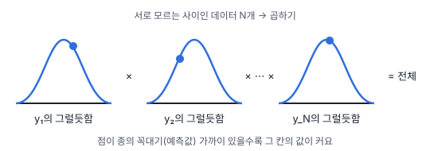

*데이터마다 "예측값 근처에 떨어졌나"를 종 모양 곡선으로 재고, 그 값들을 모두 곱한 것이 전체 그럴듯함이에요.*

**📐 정식 버전**

**훈련 집합 (training set)**: 지도학습(supervised learning)의 짝지은 데이터(paired data)다.

$$
\mathcal{D} = \{(\mathbf{x}_1, y_1), \dots, (\mathbf{x}_N, y_N)\}, \qquad \mathbf{x}_n \in \mathbb{R}^D, \quad y_n \in \mathbb{R}
$$

**데이터 행렬 만들기 (칠판)**

1. 열벡터 $\mathbf{x}_1, \dots, \mathbf{x}_N$ 을 옆으로 나란히 세우면 $D \times N$ 행렬이 된다.
2. 이것을 전치하면 행 하나가 데이터 하나 $\mathbf{x}_n^\top$ 인 $N \times D$ 행렬이 된다. 이것을 굵은 $\mathbf{X}$ 로 쓴다:

   $$
   \mathbf{X} := [\mathbf{x}_1, \dots, \mathbf{x}_N]^\top, \qquad \mathbf{X} \in \mathbb{R}^{N \times D}
   $$
3. 라벨과 노이즈도 세로로 모은다: $\mathbf{y} := [y_1, \dots, y_N]^\top$, $\boldsymbol{\epsilon} := [\epsilon_1, \dots, \epsilon_N]^\top$.
4. 데이터마다의 모델 $y_n = \mathbf{x}_n^\top \boldsymbol{\theta} + \epsilon_n$ 을 N줄 쌓으면 한 줄로 쓸 수 있다:

   $$
   \mathbf{y} = \mathbf{X}\boldsymbol{\theta} + \boldsymbol{\epsilon}
   $$

※ 수업 중 칠판에 $\mathbf{X}^\top\boldsymbol{\theta}$ 로 적었다가 강의노트 정의($N \times D$, 행이 $\mathbf{x}_n^\top$)에 맞춰 $\mathbf{X}\boldsymbol{\theta}$ 로 정정했다 (0923 58:33–58:59).

**그래피컬 표현 복습 (L02 s10–11)**: $\mathbf{x}_n$ 이 들어와 $y_n$ 이 만들어지고, 여기에 $\boldsymbol{\theta}$ 와 $\sigma$ 가 영향을 준다. plate는 $n = 1, \dots, N$ 이다. $\boldsymbol{\theta}$ 는 학습할 파라미터, $\sigma$ 는 노이즈의 표준편차다.

**i.i.d. 가정**: 데이터끼리 서로 연관이 없다고 보고 independent and identically distributed(독립이고 같은 분포)로 가정한다. 데이터 하나의 우도는

$$
p(y_n \mid \mathbf{x}_n, \boldsymbol{\theta}) = \mathcal{N}(y_n \mid \mathbf{x}_n^\top \boldsymbol{\theta}, \sigma^2)
$$

**우도의 곱 (칠판 전개, 0923 50:16)**

1. 첫 데이터: 가우시안 PDF의 평균 자리에 $\mathbf{x}_1^\top \boldsymbol{\theta}$ 를 넣는다.

   $$
   p(y_1 \mid \mathbf{x}_1, \boldsymbol{\theta}) = \frac{1}{\sqrt{2\pi\sigma^2}} \exp\left(-\frac{(y_1 - \mathbf{x}_1^\top \boldsymbol{\theta})^2}{2\sigma^2}\right)
   $$
2. 첨자 1을 $n$ 으로 바꾸면 $n$ 번째 marginal PDF가 된다.
3. $Y_1, \dots, Y_N$ 은 서로 독립이므로 joint PDF는 marginal PDF의 곱이다:

   $$
   p(\mathbf{y} \mid \mathbf{X}, \boldsymbol{\theta}) = \prod_{n=1}^{N} p(y_n \mid \mathbf{x}_n, \boldsymbol{\theta}) = \prod_{n=1}^{N} \mathcal{N}(y_n \mid \mathbf{x}_n^\top \boldsymbol{\theta}, \sigma^2)
   $$
4. $n$ 과 무관한 계수는 $N$ 제곱이 되고, 지수함수끼리의 곱은 지수의 합이 된다:

   $$
   p(\mathbf{y} \mid \mathbf{X}, \boldsymbol{\theta}) = \left(\frac{1}{\sqrt{2\pi\sigma^2}}\right)^{N} \exp\left(-\frac{1}{2\sigma^2} \sum_{n=1}^{N} (y_n - \mathbf{x}_n^\top \boldsymbol{\theta})^2\right)
   $$

$\mathbf{X}, \mathbf{y}$ 는 주어져(given) 있으므로 이제 튜닝할 것은 $\boldsymbol{\theta}$ 뿐이다. 이 우도를 최대화하는 $\boldsymbol{\theta}$ 를 구하는 방법이 ML과 MAP이고, 이번 시간에는 ML만 했다(MAP는 다음 시간).

**🎙️ 교수님 한마디**

이 전개는 꼭 기억해 두라고 했어요. 가우시안 분포가 이제 본격적으로 등장하기 시작했기 때문이에요.

> 이제 가우시안 분포가 이제 본격적으로 처음 나오기 시작했으니까. (0923 50:00)

그래피컬 표현은 지난 시간에 배운 그림 그대로예요. 데이터끼리 연관이 없으면 plate 하나로 묶고 i.i.d.로 가정하면 돼요. (0923 44:18–45:03)

---

### 음의 로그우도 = 최소제곱 = ERM

*📅 0923 · L03 s9–10*

**🧸 쉽게 말하면**

"가장 그럴듯한 선 찾기"와 "틀린 만큼 제곱해서 더한 게 가장 작은 선 찾기"는, 오차가 종 모양일 때 똑같은 선을 골라요.

종 모양 오차는 대부분 0 근처에 모여 있어서 "측정값을 거의 그대로 믿자"는 생각과 같아지고, 두 길이 한 곳에서 만나요.

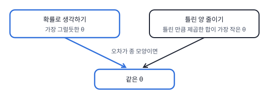

*출발점은 달라도, 오차가 종 모양이면 두 길이 같은 답에 도착해요.*

**📐 정식 버전**

**ML 추정**: log는 단조증가이므로 우도 최대화는 음의 로그우도(negative log-likelihood) 최소화와 같다.

$$
\boldsymbol{\theta}_{\text{ML}} = \arg\max_{\boldsymbol{\theta}} p(\mathbf{y} \mid \mathbf{X}, \boldsymbol{\theta}) = \arg\min_{\boldsymbol{\theta}} \big(-\log p(\mathbf{y} \mid \mathbf{X}, \boldsymbol{\theta})\big)
$$

**칠판 유도 (0923 56:19–57:34)** — [앞 토픽의 곱](#s5-iid)에서 지수 안을 $\star := \frac{1}{2\sigma^2} \sum_{n=1}^{N} (y_n - \mathbf{x}_n^\top \boldsymbol{\theta})^2$ 로 둔다.

1. $\log ab = \log a + \log b$ 로 둘로 나눈다:

   $$
   -\log\left[\left(\frac{1}{\sqrt{2\pi\sigma^2}}\right)^{N} \exp(-\star)\right] = -\log\left(\frac{1}{\sqrt{2\pi\sigma^2}}\right)^{N} - \log \exp(-\star)
   $$
2. 첫 항은 $\boldsymbol{\theta}$ 와 무관한 상수이므로 argmin에 영향이 없다. const로 둔다.
3. 둘째 항은 log와 exp가 상쇄되고 부호가 $- \cdot - = +$ 가 되어 $+\star$ 가 된다. 곧 $\star$ 를 최소화하는 문제다.
4. 벡터 $\mathbf{y} - \mathbf{X}\boldsymbol{\theta}$ 의 $n$ 번째 원소가 $y_n - \mathbf{x}_n^\top \boldsymbol{\theta}$ 이므로 합이 노름 제곱으로 말린다:

   $$
   -\log p(\mathbf{y} \mid \mathbf{X}, \boldsymbol{\theta}) = \frac{1}{2\sigma^2} \|\mathbf{y} - \mathbf{X}\boldsymbol{\theta}\|^2 + \text{const}
   $$

**차원 확인 (0923 58:02–59:20)**: $\mathbf{X} \in \mathbb{R}^{N \times D}$, $\boldsymbol{\theta} \in \mathbb{R}^{D \times 1}$ 이므로 $\mathbf{X}\boldsymbol{\theta} \in \mathbb{R}^{N \times 1}$ 이고 $\mathbf{y}$ 와 길이가 같아 뺄셈이 된다.

**Least Squares problem**: $\mathbf{X}\boldsymbol{\theta}$ 는 선형회귀로 예측한 값이므로 $\hat{\mathbf{y}} := \mathbf{X}\boldsymbol{\theta}$ 로 둔다. 실측값 $\mathbf{y}$ 와 예측값 $\hat{\mathbf{y}}$ 사이 오차의 노름 제곱을 최소화하는 문제, 곧 최소제곱(LS) 문제가 된다.

**손실 함수 (L03 s10)**: $\mathbf{y}, \mathbf{X}$ 는 훈련 데이터로 주어져 있고 바꾸는 것은 $\boldsymbol{\theta}$ 뿐이다.

$$
L(\boldsymbol{\theta}) = \frac{1}{2\sigma^2} \|\mathbf{y} - \mathbf{X}\boldsymbol{\theta}\|^2, \qquad \boldsymbol{\theta}_{\text{ML}} = \arg\min_{\boldsymbol{\theta}} L(\boldsymbol{\theta})
$$

**ML = ERM**: 가우시안 노이즈이면 $\boldsymbol{\theta}_{\text{ML}}$ 은 노이즈를 무시한 결정론적 모델로 squared loss의 empirical risk $\frac{1}{N}\|\mathbf{y} - \mathbf{X}\boldsymbol{\theta}\|^2$ 를 최소화한 해와 같다. $L(\boldsymbol{\theta})$ 는 empirical risk에 양수 $\frac{N}{2\sigma^2}$ 을 곱한 것뿐이라 argmin이 같기 때문이다. 슬라이드는 이를 "Models as functions = Models as probabilistic models"로 적었다.

**왜 같아지나** [슬라이드 외 설명]: 가우시안 노이즈는 평균 근처에 가장 몰려 있고, 여기서 평균은 0이다. 그래서 노이즈가 0이었다고 보는 것, 곧 관측 데이터를 그대로 믿는 것이 가장 합리적이다. 이 때문에 확률적 모델의 우도 최적화와 결정론적 리스크 최소화의 해가 같아진다.

**반례 (교수님이 "정확한 예는 아니"라고 단서를 달았다)**: 노이즈 PDF가 양수 $\lambda$ 근처에 몰려 있다면, 받은 $y$ 에서 $\lambda$ 만큼 뺀 곳에 원래 값이 있었다고 보는 것이 합리적이다. 관측을 그대로 믿지 않고 시프트된 것으로 봐야 하므로 단순 최소제곱과 달라진다.

**🎙️ 교수님 한마디**

확률적 모델의 우도 최적화와 결정론적 리스크 최소화가 "우연찮게" 같아지는 거예요. 가우시안 PDF 모양을 수업 앞부분에서 먼저 보여준 이유가 바로 이것이에요. (0923 60:23–66:10)

종 모양은 가운데(평균)에 몰려 있으니, 노이즈가 없었다고 보고 받은 데이터를 믿는 게 가장 그럴듯하다는 거예요.

**⚠️ 강조 포인트**

> 결국 얘를 미니마이즈하는 문제와 동일한 문제가 된다, 수학적으로. (0923 57:34)

우도 최대화 = 음의 로그우도 최소화 = $\frac{1}{2\sigma^2} \|\mathbf{y} - \mathbf{X}\boldsymbol{\theta}\|^2$ 최소화. 이 등식 사슬을 외워 두자.

---

### 미분해서 0: 정규방정식과 의사역행렬

*📅 0923 · L03 s11*

**🧸 쉽게 말하면**

오차를 그릇 모양으로 그리면, 구슬이 멈추는 그릇 바닥이 정답이에요.

바닥은 기울기가 0인 곳이라서, 기울기가 0인 곳을 계산하면 가장 좋은 θ가 한 번에 나와요.

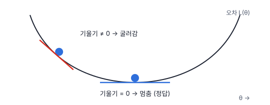

*오차 그릇의 바닥은 기울기가 0인 한 점이고, 그 점의 θ가 선형회귀의 답이에요.*

**📐 정식 버전**

$L : \mathbb{R}^D \to \mathbb{R}$ 이다. 벡터의 차에 노름을 취했으므로 $L$ 은 스칼라다. 스칼라 $L$ 을 벡터 $\boldsymbol{\theta}$ 로 미분해 0이 되는 점을 찾는다:

$$
\frac{dL}{d\boldsymbol{\theta}} = 0
$$

**슬라이드 유도 (L03 s11)**: 수업에서는 "이렇게 이렇게 풀고 나면"으로 미분 과정을 넘기고(아래 📎 보충), 이항 → 역행렬 → 전치 순서만 설명했다.

$$
\frac{dL}{d\boldsymbol{\theta}} = \frac{1}{2\sigma^2}\left(-2(\mathbf{y} - \mathbf{X}\boldsymbol{\theta})^\top \mathbf{X}\right) = \frac{1}{\sigma^2}\left(-\mathbf{y}^\top \mathbf{X} + \boldsymbol{\theta}^\top \mathbf{X}^\top \mathbf{X}\right) = 0
$$

1. 이항한다(정규방정식):

   $$
   \boldsymbol{\theta}_{\text{ML}}^\top \mathbf{X}^\top \mathbf{X} = \mathbf{y}^\top \mathbf{X}
   $$
2. 양변 오른쪽에 $(\mathbf{X}^\top \mathbf{X})^{-1}$ 을 곱한다:

   $$
   \boldsymbol{\theta}_{\text{ML}}^\top = \mathbf{y}^\top \mathbf{X} (\mathbf{X}^\top \mathbf{X})^{-1}
   $$
3. 양변을 전치한다. $\mathbf{X}^\top \mathbf{X}$ 는 대칭이라 그 역행렬도 대칭이다:

   $$
   \boldsymbol{\theta}_{\text{ML}} = (\mathbf{X}^\top \mathbf{X})^{-1} \mathbf{X}^\top \mathbf{y}
   $$

※ 역행렬이 있을 조건은 슬라이드에만 있다: $\mathrm{rk}(\mathbf{X}) = D$ 이면 $\mathbf{X}^\top \mathbf{X}$ 가 positive definite이므로 역행렬이 존재한다. 수업에서는 언급하지 않았다.

**의사역행렬 (pseudo-inverse)**: $\mathbf{X}$ 는 $N \times D$ 라 보통 정사각행렬이 아니어서 역행렬이 없다. 대신 $(\mathbf{X}^\top \mathbf{X})^{-1} \mathbf{X}^\top$ 를 $\mathbf{X}$ 의 의사역행렬이라 한다. 곧 Least Squares 문제의 해는 ($\mathrm{rk}(\mathbf{X}) = D$ 이면) 항상 데이터 행렬 $\mathbf{X}$ 의 의사역행렬 $(\mathbf{X}^\top \mathbf{X})^{-1} \mathbf{X}^\top$ 에 $\mathbf{y}$ 를 곱한 것으로 주어진다. 이것이 선형회귀의 결론이다.

※ 수업 중 "X라는 벡터의 슈도 인버스"라고 말했지만 $\mathbf{X}$ 는 **행렬**이다 (0923 68:14).

**수업 후 질의: 절편(affine) 항** (0923 71:22): 상수항을 넣어 affine으로 만들려면 차원이 하나 더 필요하니 $D + 1$ 이 되어야 하지 않느냐는 질문에 "그렇게 접근하면 된다"고 답했다. 지금까지는 상수항이 없다고 가정한 것이다.

**직접 해보기 (아래 위젯)**: 원점을 지나는 직선 $f(x) = \theta x$ ($D = 1$) 를 데이터 $(1, 2), (2, 3), (3, 7)$ 에 맞춘다. $\|\mathbf{y} - \mathbf{X}\theta\|^2$ 는 $\theta$ 에 대한 아래로 볼록한 2차식이고, 기울기가 0인 바닥이 정규방정식의 해 $\theta_{\text{ML}} = 29/14 \approx 2.071$ 이다. 이 값을 정규방정식으로 직접 구하는 것은 복습문제 P6이다.

#### 🎛️ 직접 해보기: 제곱오차 합이 가장 작은 기울기 찾기 *(정적 스냅샷 — 직접 조작은 HTML 버전)*

θ 슬라이더로 직선 f(x) = θx의 기울기를 바꾸면 왼쪽의 잔차(세로 선분)와 오른쪽 곡선 위의 점이 함께 움직여요. 곡선의 바닥, 곧 제곱오차 합이 가장 작은 곳이 θ_ML = 29/14 ≈ 2.071이에요.

제곱오차 합 ‖y − Xθ‖² = **18.000** · 최솟값 27/14 ≈ 1.929 (θ = 29/14 ≈ 2.071에서)

범례: 직선 f(x) = θx · 데이터 점 · 세로 선분 = 잔차 yₙ − θxₙ · 제곱오차 합 곡선 · 현재 θ

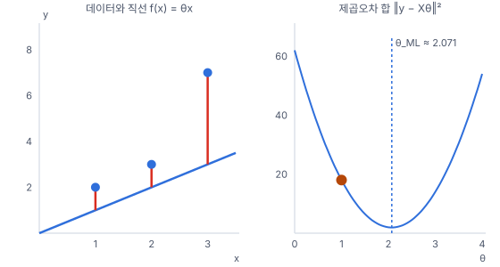

*대표 설정 1: θ = 1.000*

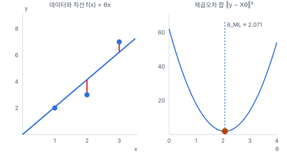

*대표 설정 2: θ = 2.071*

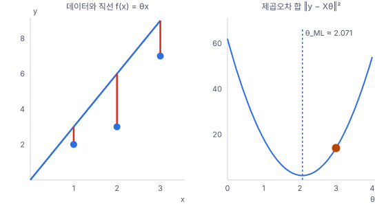

*대표 설정 3: θ = 3.000*

| 설정 | 잔차 (y₁ − θ, y₂ − 2θ, y₃ − 3θ) | 제곱오차 합 |
|---|---|---|
| θ = 1 | 1, 1, 4 | 18.000 |
| θ = 29/14 ≈ 2.071 (θ_ML) | −0.071, −1.143, 0.786 | 27/14 ≈ 1.929 (최소) |
| θ = 3 | −1, −3, −2 | 14.000 |

**🎙️ 교수님 한마디**

여기서 교수님이 여러분 속마음을 맞혀 봤어요: "교수님만 신났네." 그리고 학생 입장의 질문을 흉내 냈어요. "스칼라를 벡터로 미분이 가능한가요? 벡터를 벡터로? 행렬을 스칼라로?" (0923 68:58–69:13)

그 답(벡터 미분, gradient)은 추석 뒤 다음 주 보충 강의에서 다뤄요. 인공지능 수학 강의 자료를 업데이트해 올리고, 조교가 강의할 수도 있어요. (0923 69:13–70:49)

**⚠️ 강조 포인트**

> 이 미분값이 0이 되는 점을 찾게 만드는 세타를 찾는 게 linear regression의 처음부터 끝이에요. (0923 67:19)

> Least Squares problem의 솔루션은 항상 X라는 매트릭스 데이터의 pseudo-inverse로 주어지게 된다. (0923 68:14)

> linear regression의 솔루션은 뭘로 주어진다? pseudo-inverse로 주어진다. (0923 70:39)

**📎 보충 · 수업 미유도**

**스칼라를 벡터로 미분하기**: 수업에서는 $\frac{dL}{d\boldsymbol{\theta}}$ 계산을 건너뛰고 추석 뒤 보충 강의로 미뤘다(보충 강의 예정, 0923 69:13–70:49). 아래는 MML 5장의 표기(분자 기준, $\frac{dL}{d\boldsymbol{\theta}} \in \mathbb{R}^{1 \times D}$ 는 행벡터)를 따른 풀이다.

1. 노름 제곱을 내적으로 풀어 전개한다. $\boldsymbol{\theta}^\top \mathbf{X}^\top \mathbf{y}$ 는 스칼라라 전치해도 같으므로 $\mathbf{y}^\top \mathbf{X} \boldsymbol{\theta}$ 와 같다:

   $$
   L(\boldsymbol{\theta}) = \frac{1}{2\sigma^2}(\mathbf{y} - \mathbf{X}\boldsymbol{\theta})^\top(\mathbf{y} - \mathbf{X}\boldsymbol{\theta}) = \frac{1}{2\sigma^2}\left(\mathbf{y}^\top \mathbf{y} - 2\mathbf{y}^\top \mathbf{X}\boldsymbol{\theta} + \boldsymbol{\theta}^\top \mathbf{X}^\top \mathbf{X}\boldsymbol{\theta}\right)
   $$
2. 규칙 1 (선형항): $\mathbf{a}^\top \boldsymbol{\theta} = \sum_i a_i \theta_i$ 를 $\theta_d$ 로 편미분하면 $a_d$ 이므로 $\frac{d}{d\boldsymbol{\theta}}(\mathbf{a}^\top \boldsymbol{\theta}) = \mathbf{a}^\top$ 이다.
3. 규칙 2 (2차형식): $\boldsymbol{\theta}^\top \mathbf{A} \boldsymbol{\theta} = \sum_{i,j} \theta_i A_{ij} \theta_j$ 를 $\theta_d$ 로 편미분하면 $\sum_j A_{dj}\theta_j + \sum_i \theta_i A_{id}$ 이므로 $\frac{d}{d\boldsymbol{\theta}}(\boldsymbol{\theta}^\top \mathbf{A} \boldsymbol{\theta}) = \boldsymbol{\theta}^\top(\mathbf{A} + \mathbf{A}^\top)$ 이다. $\mathbf{A}$ 가 대칭이면 $2\boldsymbol{\theta}^\top \mathbf{A}$ 다.
4. 적용: $\mathbf{y}^\top \mathbf{y}$ 는 상수라 0, $\mathbf{a}^\top = \mathbf{y}^\top \mathbf{X}$, $\mathbf{A} = \mathbf{X}^\top \mathbf{X}$ (대칭):

   $$
   \frac{dL}{d\boldsymbol{\theta}} = \frac{1}{2\sigma^2}\left(-2\mathbf{y}^\top \mathbf{X} + 2\boldsymbol{\theta}^\top \mathbf{X}^\top \mathbf{X}\right) = \frac{1}{\sigma^2}\left(-\mathbf{y}^\top \mathbf{X} + \boldsymbol{\theta}^\top \mathbf{X}^\top \mathbf{X}\right)
   $$

   슬라이드의 오른쪽 식과 같다.
5. 연쇄법칙으로 보면 슬라이드의 가운데 식이 나온다. $\mathbf{e} := \mathbf{y} - \mathbf{X}\boldsymbol{\theta}$ 로 두면 $\frac{d\mathbf{e}}{d\boldsymbol{\theta}} = -\mathbf{X}$, $\frac{d}{d\mathbf{e}}(\mathbf{e}^\top \mathbf{e}) = 2\mathbf{e}^\top$ 이므로

   $$
   \frac{dL}{d\boldsymbol{\theta}} = \frac{1}{2\sigma^2} \cdot 2\mathbf{e}^\top \cdot (-\mathbf{X}) = \frac{1}{2\sigma^2}\left(-2(\mathbf{y} - \mathbf{X}\boldsymbol{\theta})^\top \mathbf{X}\right)
   $$
6. $D = 1$ 로 확인: 보통의 미분으로 $\frac{dL}{d\theta} = -\frac{1}{\sigma^2}\sum_{n=1}^{N} x_n (y_n - x_n \theta) = 0$ 을 풀면 $\theta_{\text{ML}} = \frac{\sum_n x_n y_n}{\sum_n x_n^2}$ 이다. 이것이 $(\mathbf{X}^\top \mathbf{X})^{-1} \mathbf{X}^\top \mathbf{y}$ 의 $D = 1$ 인 경우이고, 위젯 곡선의 바닥이다.
7. 0이 되는 점이 최대가 아니라 최소인 이유: $L$ 은 $\boldsymbol{\theta}$ 의 2차식이고 2차항 행렬 $\mathbf{X}^\top \mathbf{X}$ 가 positive definite이면 아래로 볼록한 그릇 모양이라, 기울기 0인 점이 유일한 최솟값이다.

---

## 6. 요약 · 예고

### 한 장 치트시트

*📅 0921 · 📅 0923 · L02 s6–19 · L03 s2–11*

시험 직전 한 장 치트시트: 1~5장에서 나온 핵심 식과 한 줄 의미만 모았다.

| 개념 | 식 / 한 줄 요약 |
|---|---|
| SI 문제 (Fully Bayesian) | $P(A \mid X) = \int P(A \mid \theta)\, P(\theta \mid X)\, d\theta = \mathbb{E}_{\theta \mid X}[P(A \mid \theta)]$ — posterior로 가중 평균한 예측 |
| ML · MAP 근사 | $P(\theta \mid X) \approx \delta(\theta - \hat{\theta})$ 이면 $P(A \mid X) \approx P(A \mid \hat{\theta})$ — 한 점에 몰빵 |
| 베이지안 추론이 어려운 이유 | $P(X) = \int P(X \mid \theta)\, P(\theta)\, d\theta$ 적분 → MCMC, Laplace approximation, variational inference, expectation propagation로 근사 |
| 그래프로 읽는 factorization | $P(x_1, \dots, x_K) = \prod_{k=1}^{K} P(x_k \mid \mathrm{Pa}_k)$ — 각 노드는 parent에만 조건부 |
| 동전 N번 (plate) | $P(x_1, \dots, x_N \mid \mu) = \prod_{n=1}^{N} P(x_n \mid \mu)$ — $\mu$가 주어지면 서로 독립 |
| 모델 선택 | train으로 학습, validation으로 고르고, test는 마지막에 한 번 — cross-validation으로 validation을 돌려 쓴다 |
| Bayesian model selection | $P(M_k \mid D) \propto P(D \mid M_k)\, P(M_k)$, $\;P(D \mid M_k) = \int P(D \mid \theta_k)\, P(\theta_k \mid M_k)\, d\theta_k$ (model evidence) |
| Bayes factor | $\frac{P(M_1 \mid D)}{P(M_2 \mid D)} = \frac{P(D \mid M_1)}{P(D \mid M_2)} \cdot \frac{P(M_1)}{P(M_2)}$ — posterior odds = Bayes factor × prior odds |
| 회귀 모델 (가우시안 노이즈) | $y_n = f(x_n) + \epsilon$, $\;\epsilon \sim \mathcal{N}(0, \sigma^2)$ |
| 선형회귀 likelihood | $p(y \mid \mathbf{x}) = \mathcal{N}(y \mid \mathbf{x}^\top \boldsymbol{\theta}, \sigma^2)$ — 선형이라고 가정한 것 |
| feature vector | $f(x) = \boldsymbol{\phi}^\top(x)\, \boldsymbol{\theta}$ — $x$에는 비선형이어도 $\boldsymbol{\theta}$에 linear in이면 선형회귀 |
| i.i.d. 우도 | $p(\mathbf{y} \mid \mathbf{X}, \boldsymbol{\theta}) = \prod_{n=1}^{N} \mathcal{N}(y_n \mid \mathbf{x}_n^\top \boldsymbol{\theta}, \sigma^2)$, $\;\mathbf{y} = \mathbf{X}\boldsymbol{\theta} + \boldsymbol{\epsilon}$ |
| NLL = Least Squares | $-\log p(\mathbf{y} \mid \mathbf{X}, \boldsymbol{\theta}) = \frac{1}{2\sigma^2} \Vert \mathbf{y} - \mathbf{X}\boldsymbol{\theta}\Vert ^2 + \text{const}$ — ML = 최소제곱 = empirical risk 최소화 |
| 정규방정식 (ML 해) | $\boldsymbol{\theta}_{\text{ML}} = (\mathbf{X}^\top \mathbf{X})^{-1} \mathbf{X}^\top \mathbf{y}$ — 의사역행렬(pseudo-inverse)이 답 |

---

### 다음 시간 예고

*📅 0921 · 📅 0923 · L02 s12–13 · L03 s13–21*

수업에서 아직 다루지 않았거나 예고만 한 내용이다(제목만).

- L02 s12–13 Conditional independence · d-separation — 그래피컬 모델을 더 설명할 때 다시 다루겠다고 함
- L03 s13 feature matrix $\boldsymbol{\Phi}$와 그것을 쓴 ML
- L03 s14–15 Polynomial fit · Overfitting
- L03 s16–20 MAP 추정 (Gaussian prior)
- L03 s21 MAP와 regularized least squares
- 보충 강의: 스칼라를 벡터로 미분하기 (정규방정식 유도)
- 10월 초 이론 + 실습 퀴즈
- 로드맵: Bayesian linear regression · orthogonal projection

---

### 함께 보면 좋은 자료

*📅 0921 · 📅 0923*

- [📝 복습문제 7선 풀러 가기](복습문제_0921-0923_Linear_Regression.md)
- [이전 정리노트(0909~0916) · Posterior predictive](정리노트_0909-0916_When_Models_Meet_Data.html#s4-predictive)
- [확률 및 랜덤변수 Lecture 10 · 통계적 추론 Part 1](../강의노트/추가%20강의/eli5_lecture10_statistical_inference_part1.html)
- [Lecture 11 · 통계적 추론 Part 2](../강의노트/추가%20강의/eli5_lecture11_statistical_inference_part2.html)

---

출처: 정방철 교수님 강의자료(Lecture02–03) · 수업 녹음 전사(0921 · 0923) · Deisenroth, Faisal, Ong, *Mathematics for Machine Learning* (2020) 8–9장.
