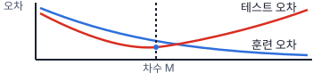

# Linear Regression Part 1 — 수업 전에 보는 예습노트

정방철 교수님 머신러닝기초 · Lecture03 Linear Regression Part 1 예습 (MML 9장, 5.2–5.3절)

> `예습노트_L03_Linear_Regression_Part1.html`를 마크다운으로 옮겼어요. 그림은 `figures_L03/` 폴더의 SVG예요. 수식은 `$…$` / `$$…$$`라서 GitHub, Obsidian, Typora에서 보여요.

**목차**

- [0. 미리 알아둘 것](#s0)
  - [가우시안 분포](#s0-gaussian)
  - [ML과 MAP 추정](#s0-mle-map)
- [1. 문제 설정](#s1)
  - [회귀 문제](#s1-regression)
  - [가우시안 노이즈와 선형 모델](#s1-formulation)
  - [iid 우도](#s1-likelihood)
- [2. ML 추정](#s2)
  - [음의 로그우도](#s2-nll)
  - [ML = 제곱 손실 최소화](#s2-erm)
  - [미분해서 닫힌 해 구하기](#s2-normal-eq)
- [3. 벡터 미분 복습](#s3)
  - [편미분과 그래디언트](#s3-gradient)
  - [야코비안](#s3-jacobian)
  - [연쇄법칙으로 손실 미분하기](#s3-chain)
- [4. 특징과 과적합](#s4)
  - [특징 함수와 다항 회귀](#s4-features)
  - [특징 행렬과 ML 해](#s4-feature-matrix)
  - [다항식 피팅과 과적합](#s4-overfit)
- [5. MAP 추정](#s5)
  - [사전분포를 더하는 MAP](#s5-map)
  - [가우시안 사전분포의 MAP 해](#s5-gauss-prior)
  - [일반 가우시안 사전분포](#s5-general-prior)
  - [MAP = 정규화 최소제곱](#s5-rls)
- [6. 한눈에 보기](#s6)
  - [치트시트](#s6-cheatsheet)
  - [함께 보면 좋은 자료](#s6-links)

## 0. 미리 알아둘 것

### 가우시안 분포

**쉽게 말하면**

가우시안 분포는 평균 근처에 값이 많이 모이고, 멀어질수록 확률이 빠르게 줄어드는 종 모양 분포예요.

**정확히 말하면**

평균 $\mu$, 분산 $\sigma^2$인 가우시안 분포는 $\mathcal{N}(\mu, \sigma^2)$로 써요. 이번 강의는 노이즈를 이 분포로 가정하고 우도(likelihood)를 만들어요. 자세한 내용은 [가우시안 노이즈와 종 모양 PDF](../../복습노트/0923/정리노트_0923_Linear_Regression.html#s1-gaussian)에서 다뤘어요.

- $\mu$ — 분포의 중심(평균)
- $\sigma^2$ — 퍼진 정도(분산)

**페이지 요약**

가우시안 분포는 평균과 분산 두 숫자로 정해지는 종 모양 분포예요.

*핵심 식*

- 가우시안

  $$
  \mathcal{N}(\mu, \sigma^2)
  $$

*용어*

- **평균(mean) $\mu$** — 분포의 중심
- **분산(variance) $\sigma^2$** — 퍼진 정도

#### 조건·구분

이번 강의에서는 가우시안 잡음을 가정해 우도를 만들어요.

---

### ML과 MAP 추정

**쉽게 말하면**

ML은 데이터만 보고 가장 그럴듯한 값을 고르고, MAP은 거기에 "이런 값일 것 같다"는 사전 믿음까지 더해서 골라요.

**정확히 말하면**

ML 추정치 $\boldsymbol{\theta}_{\text{ML}}$은 음의 로그우도를 최소화해서 구해요. MAP 추정치 $\boldsymbol{\theta}_{\text{MAP}}$은 여기에 사전분포(prior)의 $-\log p(\boldsymbol{\theta})$ 항을 더해서 구해요. 자세한 유도는 [가우시안 노이즈면 MLE = 최소제곱](../../복습노트/0914/정리노트_0914_ERM_and_MLE.html#s4-mle-ls)과 [MAP = MLE + log prior](../../복습노트/0916/정리노트_0916_MAP_and_Generative_Models.html#s1-map)에서 다뤘어요.

- $\boldsymbol{\theta}_{\text{ML}}$ — 우도만 최대화한 추정치
- $\boldsymbol{\theta}_{\text{MAP}}$ — 우도와 사전분포를 함께 반영한 추정치

**페이지 요약**

ML은 우도를 최대화하고, MAP은 우도와 사전분포의 곱에 비례하는 사후분포를 최대화해 파라미터를 추정해요.

*용어*

- **ML 추정치 $\boldsymbol{\theta}_{\text{ML}}$** — 우도(likelihood)만 최대화한 값
- **MAP 추정치 $\boldsymbol{\theta}_{\text{MAP}}$** — 우도와 사전분포(prior)를 함께 반영한 값

#### 조건·구분

ML은 음의 로그우도를 최소화하고, MAP은 여기에 $-\log p(\boldsymbol{\theta})$를 더해 최소화해요.

---

## 1. 문제 설정

### 회귀 문제

*L03 s5*

**쉽게 말하면**

입력값을 넣으면 진짜 답에 약간의 잡음이 섞인 값이 관찰돼요.

우리가 할 일은 이 잡음 뒤에 숨은 진짜 함수를 찾는 거예요.

**정확히 말하면**

$$
y_n = f(\mathbf{x}_n) + \epsilon
$$

- $\mathbf{x}_n$: $n$번째 입력값
- $f$: 우리가 추정하려는 진짜 함수
- $\epsilon$: 관측에 섞이는 잡음

목표는 새로운 입력에서도 잘 맞는 $f$를 찾는 거예요(일반화).

**들을 때 포인트**

- 시계열, 로봇 제어, 이미지 인식 예시가 나오면 각각 무엇이 $\mathbf{x}$이고 무엇이 $y$인지 짝지어 보세요
- "일반화"가 나오면 훈련 데이터가 아닌 새 입력에서 맞히는 것인지 확인해 보세요

**페이지 요약**

회귀는 잡음 섞인 관측에서 진짜 함수 $f$를 추정하는 문제예요.

*핵심 식*

- 관측 모델

  $$
  y_n = f(\mathbf{x}_n) + \epsilon
  $$

*용어*

- **일반화(generalization)** — 새 입력에도 잘 맞는 성질

---

### 가우시안 노이즈와 선형 모델

*L03 s6*

**쉽게 말하면**

잡음이 가운데가 볼록한 종 모양으로 흩어진다고 가정해요.

입력을 그대로 쓰든 다르게 변형해서 쓰든, 계산하는 방식은 똑같아요.

**정확히 말하면**

$$
\epsilon \sim \mathcal{N}(0, \sigma^2)
$$

입력을 그대로 쓰는 모델과 변형된 입력을 쓰는 모델 모두, 파라미터에 대해서는 선형이에요.

- $f(\mathbf{x}) = \mathbf{x}^\top\boldsymbol{\theta}$: 입력 $\mathbf{x}$를 그대로 쓰는 선형 모델
- $\boldsymbol{\phi}(\mathbf{x})$: 입력을 비선형으로 변형한 특징(feature)
- $\boldsymbol{\theta}$: 두 경우 모두에서 추정할 파라미터

**들을 때 포인트**

- "linear in $\boldsymbol{\theta}$"가 나오면 $\mathbf{x}$가 아니라 $\boldsymbol{\theta}$ 기준이라는 점에 주목해 보세요
- $\boldsymbol{\phi}(\mathbf{x})$가 앞으로 특징 함수로 계속 나와요

**페이지 요약**

잡음은 정규분포로 가정해요. 이 노트의 입력 기반·특징 기반 모델은 모두 파라미터 $\boldsymbol{\theta}$에 대해 선형이에요.

*핵심 식*

- 잡음

  $$
  \epsilon \sim \mathcal{N}(0, \sigma^2)
  $$
- 선형 모델

  $$
  f(\mathbf{x}) = \mathbf{x}^\top\boldsymbol{\theta}
  $$

*용어*

- **특징 함수 $\boldsymbol{\phi}(\mathbf{x})$(feature function)** — 입력을 비선형으로 변형하는 함수

#### 조건·구분

입력을 그대로 쓰거나 비선형 특징으로 변형해도, 여기의 모델은 파라미터 $\boldsymbol{\theta}$에 대해 선형이에요.

---

### iid 우도

*L03 s7*

**쉽게 말하면**

데이터가 서로 영향을 주지 않고 독립적으로 뽑혔다고 가정해요.

그러면 전체 확률은 각 데이터 확률의 곱이 돼요.

**정확히 말하면**

iid 가정에서 우도는 다음처럼 인수분해돼요.

$$
p(\mathcal{Y} \mid \mathcal{X}, \boldsymbol{\theta}) = \prod_{n=1}^{N} p(y_n \mid \mathbf{x}_n, \boldsymbol{\theta})
$$

- iid: 독립이고 같은 분포에서 나왔다는 가정
- $\mathcal{X}, \mathcal{Y}$: 전체 입력·출력 집합

**들을 때 포인트**

- 곱 기호 $\prod$가 나오면 iid 가정 덕분이라는 점을 떠올려 보세요
- 다음 슬라이드 ML·MAP로 이어져요

**페이지 요약**

iid 가정 덕분에 전체 우도는 각 데이터점 우도의 곱으로 쓸 수 있어요.

*핵심 식*

- iid 우도

  $$
  p(\mathcal{Y} \mid \mathcal{X}, \boldsymbol{\theta}) = \prod_{n=1}^{N} p(y_n \mid \mathbf{x}_n, \boldsymbol{\theta})
  $$

*용어*

- **iid** — 독립이고 동일한 분포에서 뽑힘

---

## 2. ML 추정

### 음의 로그우도

*L03 s9*

**쉽게 말하면**

우도가 클수록 좋으니까, 마이너스와 로그를 붙여서 최소화 문제로 바꿔요.

**정확히 말하면**

[iid 우도](#s1-likelihood)에 로그와 마이너스를 씌우면 다음 식이 나와요.

$$
-\log p(\mathcal{Y} \mid \mathcal{X}, \boldsymbol{\theta}) = \frac{1}{2\sigma^2}\|\mathbf{y} - \mathbf{X}\boldsymbol{\theta}\|^2 + \text{const}
$$

- $\mathbf{y}$: 정답 값들을 모은 벡터
- $\text{const}$: $\boldsymbol{\theta}$와 무관한 상수항

**들을 때 포인트**

- const가 나오면 $\boldsymbol{\theta}$와 무관해서 최솟값 위치를 바꾸지 않는다는 점을 확인해 보세요

**페이지 요약**

우도 최대화는 음의 로그우도 최소화와 같아요.

*핵심 식*

- 음의 로그우도

  $$
  \begin{aligned}&-\log p(\mathcal Y\mid\mathcal X,\boldsymbol\theta)\\&=\frac1{2\sigma^2}\|\mathbf y-\mathbf X\boldsymbol\theta\|^2\\&\quad+\text{const}\end{aligned}
  $$

*용어*

- **const** — $\boldsymbol{\theta}$와 무관한 상수항

---

### ML = 제곱 손실 최소화

*L03 s10*

**쉽게 말하면**

음의 로그우도를 최소화하는 것과, 예측이 틀린 정도를 제곱해서 더한 값을 최소화하는 것은 같은 문제예요.

**정확히 말하면**

[음의 로그우도](#s2-nll)에서 $\boldsymbol{\theta}$와 무관한 상수를 떼면 손실함수 $\mathcal{L}(\boldsymbol{\theta})$가 남아요.

$$
\boldsymbol{\theta}_{\text{ML}} = \arg\min_{\boldsymbol{\theta}} \mathcal{L}(\boldsymbol{\theta}), \quad \mathcal{L}(\boldsymbol{\theta}) = \frac{1}{2\sigma^2}\|\mathbf{y} - \mathbf{X}\boldsymbol{\theta}\|^2
$$

- $\mathcal{L}(\boldsymbol{\theta})$: 제곱 손실로 정의한 경험적 위험(empirical risk)

**들을 때 포인트**

- "Models as functions = Models as probabilistic models"가 나오면 두 관점이 같은 식에 도착한다는 점을 확인해 보세요

**페이지 요약**

가우시안 노이즈에서 ML 추정은 제곱 손실 최소화와 같아요.

*핵심 식*

- 경험적 위험

  $$
  \mathcal{L}(\boldsymbol{\theta}) = \frac{1}{2\sigma^2}\|\mathbf{y} - \mathbf{X}\boldsymbol{\theta}\|^2
  $$

*용어*

- **$\mathcal{L}(\boldsymbol{\theta})$** — 제곱 손실로 정의한 경험적 위험(empirical risk)

#### 조건·구분

최적화하는 변수는 $\boldsymbol{\theta}$이며, $\boldsymbol{\theta}$와 무관한 상수는 최소점 위치를 바꾸지 않아요.

---

### 미분해서 닫힌 해 구하기

*L03 s11*

**쉽게 말하면**

손실이 가장 작아지는 지점은 기울기가 0인 곳이니까, 미분해서 0으로 놓고 풀면 답이 한 번에 나와요.

**정확히 말하면**

[앞에서 정의한](#s2-erm) $\mathcal{L}(\boldsymbol{\theta})$를 $\boldsymbol{\theta}$로 미분해서 0으로 놓으면 다음 닫힌 해(closed-form solution)를 얻어요.

$$
\boldsymbol{\theta}_{\text{ML}} = (\mathbf{X}^\top\mathbf{X})^{-1}\mathbf{X}^\top\mathbf{y}
$$

- $\mathbf{X}^\top\mathbf{X}$: $\text{rk}(\mathbf{X}) = D$이면 역행렬이 존재해요

**들을 때 포인트**

- 미분 전개가 빠르게 지나가면 바로 뒤 벡터 미분 복습(s12–16)에서 다시 확인하면 돼요
- $\text{rk}(\mathbf{X}) = D$가 나오면 역행렬이 존재하려면 왜 필요한지 생각해 보세요

**페이지 요약**

손실을 미분해서 0으로 놓으면 ML 추정치의 닫힌 해가 나와요.

*핵심 식*

- ML 추정치

  $$
  \boldsymbol{\theta}_{\text{ML}} = (\mathbf{X}^\top\mathbf{X})^{-1}\mathbf{X}^\top\mathbf{y}
  $$

*용어*

- **랭크 조건(rank condition)** — $\mathbf{X}^\top\mathbf{X}$가 역행렬을 가지려면 필요한 조건

#### 조건·구분

본문의 역행렬 조건은 $\operatorname{rk}(\mathbf X)=D$예요.

---

## 3. 벡터 미분 복습

### 편미분과 그래디언트

*L03 s12–13*

**쉽게 말하면**

변수 하나만 살짝 움직이고 나머지는 그대로 둔 채 함수가 얼마나 변하는지 재는 게 편미분이에요.

이걸 변수마다 구해서 한 줄로 모으면 그래디언트가 돼요.

**정확히 말하면**

$f: \mathbb{R}^n \to \mathbb{R}$일 때 편미분 $\frac{\partial f}{\partial x_1}$은 $x_1$만 바꾸고 나머지는 고정한 순간변화율이에요. 이를 모두 모은 그래디언트 $\nabla_x f = \frac{df}{dx}$는 행벡터예요.

- $\frac{\partial f}{\partial x_1}$: $f$를 $x_1$로만 편미분한 값
- $\nabla_x f$: 모든 편미분을 모은 그래디언트
- $\mathbb{R}^{1 \times n}$: 그래디언트가 속하는 행벡터 공간

**들을 때 포인트**

- 그래디언트 크기 $\mathbb{R}^{1 \times n}$이 나오면 열벡터가 아니라 행벡터라는 점을 체크해 두세요
- $(x + 2y^3)^2$ 예제에서 바깥 제곱과 안쪽 식을 나눠 미분하는 흐름을 따라가 보세요

**페이지 요약**

함수를 변수마다 편미분해서 모으면 그래디언트가 돼요.

*핵심 식*

- 그래디언트

  $$
  \nabla_x f = \frac{df}{dx} = \begin{bmatrix} \frac{\partial f}{\partial x_1} & \cdots & \frac{\partial f}{\partial x_n} \end{bmatrix}
  $$

*용어*

- **편미분(partial derivative)** — 한 변수만 바꿀 때의 순간변화율
- **그래디언트(gradient)** — 모든 편미분을 모은 $\mathbb{R}^{1 \times n}$ 행벡터

---

### 야코비안

*L03 s14–15*

**쉽게 말하면**

함수가 출력을 여러 개 낼 때는 각 출력마다 편미분을 구해서 표처럼 늘어놓아요.

이 표가 바로 야코비안이에요.

**정확히 말하면**

$f: \mathbb{R}^n \to \mathbb{R}^m$이면 야코비안 $\mathbf{J} = \frac{df}{dx}$는 크기 $m \times n$인 행렬이고, 행마다 하나의 출력 $f_i$를 모든 입력으로 편미분한 값이 들어가요. 특히 $f(\mathbf{x}) = \mathbf{A}\mathbf{x}$이면 야코비안은 그대로 $\mathbf{A}$가 돼요.

- $\mathbf{J}$: 야코비안 행렬
- $m \times n$: 야코비안의 크기(출력 수 $\times$ 입력 수)
- $\mathbf{A}$: $f(\mathbf{x}) = \mathbf{A}\mathbf{x}$일 때 야코비안과 같아지는 행렬

**들을 때 포인트**

- $f(\mathbf{x}) = \mathbf{A}\mathbf{x}$ 예가 나오면 $\frac{\partial f_i}{\partial x_j} = A_{ij}$를 직접 확인해 보세요
- 야코비안 행렬이 나오면 행은 출력, 열은 입력이라는 점을 체크해 두세요

**페이지 요약**

벡터를 출력하는 함수의 편미분들을 모으면 $m \times n$ 야코비안이 돼요.

*핵심 식*

- 야코비안

  $$
  \mathbf{J} = \frac{d\mathbf{f}}{d\mathbf{x}}, \quad f(\mathbf{x}) = \mathbf{A}\mathbf{x} \Rightarrow \mathbf{J} = \mathbf{A}
  $$

*용어*

- **야코비안(Jacobian)** — 벡터 출력 함수의 편미분을 모은 $m \times n$ 행렬

#### 조건·구분

행은 출력 성분, 열은 입력 성분이에요.

---

### 연쇄법칙으로 손실 미분하기

*L03 s16*

**쉽게 말하면**

오차가 손실에 주는 영향과 파라미터가 오차에 주는 영향을 곱해서 이어 붙이면, 손실을 파라미터로 바로 미분할 수 있어요.

**정확히 말하면**

선형 모델 $\mathbf{y} = \boldsymbol{\Phi}\boldsymbol{\theta}$에서 오차는 $\mathbf{e} = \mathbf{y} - \boldsymbol{\Phi}\boldsymbol{\theta}$이고 손실은 $L(\mathbf{e}) = \|\mathbf{e}\|^2$이에요. $\boldsymbol{\theta}$가 $L$에 직접 안 보이니 연쇄법칙으로 나눠요.

- 1단계: $\frac{\partial L}{\partial \mathbf{e}} = 2\mathbf{e}^\top$
- 2단계: $\frac{\partial \mathbf{e}}{\partial \boldsymbol{\theta}} = -\boldsymbol{\Phi}$
- 3단계: $\frac{\partial L}{\partial \boldsymbol{\theta}} = \frac{\partial L}{\partial \mathbf{e}}\frac{\partial \mathbf{e}}{\partial \boldsymbol{\theta}} = -2\mathbf{e}^\top\boldsymbol{\Phi}$

**들을 때 포인트**

- 바로 앞에서 본 $\frac{d\mathcal{L}}{d\boldsymbol{\theta}}$ 계산이 여기 연쇄법칙 세 단계로 완성돼요
- $\frac{\partial \mathbf{e}}{\partial \boldsymbol{\theta}} = -\boldsymbol{\Phi}$가 나오면 야코비안의 $\mathbf{A}\mathbf{x}$ 규칙과 연결해 보세요

**페이지 요약**

오차 $\mathbf{e} = \mathbf{y} - \boldsymbol{\Phi}\boldsymbol{\theta}$를 통해 손실을 연쇄법칙으로 미분해요.

*핵심 식*

- 연쇄법칙

  $$
  \frac{\partial L}{\partial \boldsymbol{\theta}} = \frac{\partial L}{\partial \mathbf{e}}\frac{\partial \mathbf{e}}{\partial \boldsymbol{\theta}} = -2\mathbf{e}^\top\boldsymbol{\Phi}
  $$

*용어*

- **오차(error)** — $\mathbf{e} = \mathbf{y} - \boldsymbol{\Phi}\boldsymbol{\theta}$, 예측과 관측의 차이

#### 조건·구분

$L=\|\mathbf e\|^2$에서 $\partial L/\partial\mathbf e=2\mathbf e^\top$, $\partial\mathbf e/\partial\boldsymbol{\theta}=-\boldsymbol{\Phi}$를 순서대로 곱해요.

---

## 4. 특징과 과적합

### 특징 함수와 다항 회귀

*L03 s17*

**쉽게 말하면**

직선을 긋는 방법이라도 입력을 미리 바꿔서 넣으면 곡선도 맞출 수 있어요. 입력을 제곱하고 세제곱한 값을 함께 넣는 식이에요.

**정확히 말하면**

모델은 여전히 파라미터 $\boldsymbol{\theta}$에 대해 선형이라, $y = \boldsymbol{\phi}(\mathbf{x})^\top\boldsymbol{\theta} + \epsilon$ 형태예요. $\boldsymbol{\phi}(\mathbf{x})$ 자체가 비선형이어도 파라미터에 선형이면 여전히 선형회귀라고 불러요. 다항 회귀는 $\boldsymbol{\phi}(x) = [1, x, \dots, x^{K-1}]^\top$처럼 거듭제곱을 특징으로 쓰는 예예요.

- $\boldsymbol{\phi}(\mathbf{x})$ — 입력을 변형한 특징 벡터
- $K$ — 특징(=파라미터) 개수

**들을 때 포인트**

- 다항 회귀 예가 나오면 곡선을 그리지만 $\boldsymbol{\theta}$에는 여전히 선형이라는 점을 확인해 보세요

**페이지 요약**

다항 회귀는 입력의 거듭제곱을 특징으로 쓰는, 파라미터에는 여전히 선형인 모델이에요.

*핵심 식*

- 특징 기반 모델

  $$
  y = \boldsymbol{\phi}(\mathbf{x})^\top\boldsymbol{\theta} + \epsilon
  $$

*용어*

- **특징 함수(feature) $\boldsymbol{\phi}(\mathbf{x})$** — 입력을 변형한 벡터
- **다항 회귀(polynomial regression)** — 거듭제곱을 특징으로 쓰는 회귀

#### 조건·구분

다항 특징은 $\boldsymbol\phi(x)=[1,x,\dots,x^{K-1}]^\top$이며 $K$는 특징과 파라미터의 개수예요.

---

### 특징 행렬과 ML 해

*L03 s18*

**쉽게 말하면**

학습 데이터 전체의 특징을 한 번에 쌓아 행렬로 만들면, 모든 데이터의 예측을 행렬 곱 한 번으로 계산할 수 있어요.

**정확히 말하면**

특징 행렬은 $\boldsymbol{\Phi} \in \mathbb{R}^{N \times K}$이고, $i$번째 행이 $\boldsymbol{\phi}(\mathbf{x}_i)^\top$예요. 음의 로그우도는 $\frac{1}{2\sigma^2}\|\mathbf{y} - \boldsymbol{\Phi}\boldsymbol{\theta}\|^2$ 꼴로, 전에 본 $\mathbf{X}$ 자리에 $\boldsymbol{\Phi}$가 들어간 것과 같아요. ML 해도 같은 모양으로 $\boldsymbol{\theta}_{\text{ML}} = (\boldsymbol{\Phi}^\top\boldsymbol{\Phi})^{-1}\boldsymbol{\Phi}^\top\mathbf{y}$예요.

- $\boldsymbol{\Phi}$ — 특징 행렬, 각 행이 한 데이터의 특징 벡터
- $\Phi_{ij} = \phi_j(x_i)$ — $i$번째 데이터의 $j$번째 특징값

**들을 때 포인트**

- $\boldsymbol{\Phi}$가 나오면 앞의 $\mathbf{X}$ 자리에 들어간다는 점을 확인해 보세요. $\mathbf{X}$는 $\boldsymbol{\phi}(\mathbf{x}) = \mathbf{x}$인 특수한 경우예요

**페이지 요약**

데이터 전체의 특징을 쌓은 행렬 $\boldsymbol{\Phi}$로 ML 해를 한 번에 구해요.

*핵심 식*

- ML 해

  $$
  \boldsymbol{\theta}_{\text{ML}} = (\boldsymbol{\Phi}^\top\boldsymbol{\Phi})^{-1}\boldsymbol{\Phi}^\top\mathbf{y}
  $$

*용어*

- **특징 행렬(feature matrix) $\boldsymbol{\Phi} \in \mathbb{R}^{N \times K}$** — 각 행이 한 데이터의 특징 벡터

#### 조건·구분

$\Phi_{ij}=\phi_j(x_i)$이고, $\boldsymbol\phi(\mathbf x)=\mathbf x$이면 앞의 $\mathbf X$가 되는 특수한 경우예요.

---

### 다항식 피팅과 과적합

*L03 s19–20*

**쉽게 말하면**

곡선을 복잡하게 만들수록 연습 문제는 잘 맞히지만 새 문제는 오히려 틀려요. 이걸 과적합이라고 해요.

*파란 선(훈련 오차)은 계속 내려가고, 빨간 선(테스트 오차)은 점선을 지나면 다시 올라가요.*

**정확히 말하면**

s19는 $N=10$개 데이터에 4차 다항식을 ML로 맞추는 예예요. s20은 차수 $M$을 올리면 훈련 오차는 줄지만 테스트 오차는 어느 차수부터 다시 늘어난다는 그래프예요.

**들을 때 포인트**

- s20 그래프에서 테스트 오차가 다시 올라가기 시작하는 차수를 찾아보세요

**페이지 요약**

차수를 올릴수록 훈련 오차는 줄지만 테스트 오차는 어느 순간부터 늘어나는 것이 과적합이에요.

*용어*

- **과적합(overfitting)** — 훈련 데이터에만 맞춰 새 데이터 성능이 떨어지는 현상
- **테스트 오차(test error)** — 학습에 쓰지 않은 데이터에 대한 오차

#### 조건·구분

본문의 피팅 예는 $N=10$개 데이터에 4차 다항식을 ML로 맞추는 경우예요.

---

## 5. MAP 추정

### 사전분포를 더하는 MAP

*L03 s22*

**쉽게 말하면**

데이터만 보고 정하면 값이 지나치게 커지기 쉬워요. 그래서 "이 정도 값이 그럴듯해" 하는 믿음을 미리 하나 더해 줘요.

**정확히 말하면**

베이즈 정리로 사후분포 $p(\boldsymbol{\theta} \mid \mathcal{X}, \mathcal{Y})$를 쓰면 우도와 사전분포의 곱에 비례해요. 이를 최대화하는 대신 음의 로그를 최소화하면, 음의 로그우도에 사전분포 항 $-\log p(\boldsymbol{\theta})$가 더해진 형태가 돼요.

- $p(\boldsymbol{\theta} \mid \mathcal{X}, \mathcal{Y})$ — 데이터를 본 뒤 파라미터에 대한 믿음(사후분포)
- $-\log p(\boldsymbol{\theta})$ — 사전분포를 반영하는 벌점 항
- $\boldsymbol{\theta}_{\text{MAP}}$ — 이 벌점까지 더해 구한 추정치

**들을 때 포인트**

- "prior does not depend on the inputs" 가정이 나오면 $p(\boldsymbol{\theta} \mid \mathcal{X}) = p(\boldsymbol{\theta})$로 바뀐다는 점을 확인해 보세요

**페이지 요약**

MAP은 음의 로그우도에 사전분포의 $-\log p(\boldsymbol{\theta})$ 항을 더해 구해요.

*용어*

- **사후분포 $p(\boldsymbol{\theta} \mid \mathcal{X}, \mathcal{Y})$** — 데이터를 본 뒤 파라미터에 대한 믿음
- **MAP 추정치 $\boldsymbol{\theta}_{\text{MAP}}$** — 사전분포까지 반영해 구한 값

#### 조건·구분

사후분포는 우도와 사전분포의 곱에 비례해요. 본문의 입력 독립 가정은 $p(\boldsymbol\theta\mid\mathcal X)=p(\boldsymbol\theta)$예요.

---

### 가우시안 사전분포의 MAP 해

*L03 s23–24*

**쉽게 말하면**

파라미터가 0 근처에 모여 있을 거라는 가우시안 사전분포를 쓰면, 최소제곱 해에 파라미터를 작게 눌러주는 항이 하나 더 붙어요.

**정확히 말하면**

사전분포를 $\mathcal{N}(\mathbf{0}, b^2\mathbf{I})$로 두면 음의 로그사후분포는 우도 항과 $\frac{1}{2b^2}\boldsymbol{\theta}^\top\boldsymbol{\theta}$의 합이에요. 이를 최소화하면 다음 닫힌 해가 나와요.

$$
\boldsymbol{\theta}_{\text{MAP}} = \left(\boldsymbol{\Phi}^\top\boldsymbol{\Phi} + \frac{\sigma^2}{b^2}\mathbf{I}\right)^{-1}\boldsymbol{\Phi}^\top\mathbf{y}
$$

- $\mathcal{N}(\mathbf{0}, b^2\mathbf{I})$ — 평균 0, 분산 $b^2$인 사전분포
- $\frac{\sigma^2}{b^2}\mathbf{I}$ — ML 해에 더해지는 항, 행렬을 대칭·양의 정부호로 만들어 역행렬을 항상 존재하게 해요

**들을 때 포인트**

- "Role of regularizer"가 나오면 $\frac{\sigma^2}{b^2}\mathbf{I}$가 ML 해와의 유일한 차이라는 점을 확인해 보세요

**페이지 요약**

가우시안 사전분포를 쓴 MAP 해는 ML 해에 $\frac{\sigma^2}{b^2}\mathbf{I}$가 더해진 형태예요.

*핵심 식*

- MAP 해

  $$
  \boldsymbol{\theta}_{\text{MAP}} = \left(\boldsymbol{\Phi}^\top\boldsymbol{\Phi} + \frac{\sigma^2}{b^2}\mathbf{I}\right)^{-1}\boldsymbol{\Phi}^\top\mathbf{y}
  $$

*용어*

- **가우시안 사전분포 $\mathcal{N}(\mathbf{0}, b^2\mathbf{I})$** — 평균 0, 분산 $b^2$인 사전 믿음

#### 조건·구분

사전분포 $\mathcal N(\mathbf0,b^2\mathbf I)$는 음의 로그에 $\boldsymbol\theta^\top\boldsymbol\theta/(2b^2)$를 더해요. 본문에서 $\sigma^2\mathbf I/b^2$는 계수행렬을 대칭·양의 정부호로 만들어 역행렬을 보장하는 역할이에요.

---

### 일반 가우시안 사전분포

*L03 s25*

**쉽게 말하면**

사전분포의 평균이 꼭 0일 필요는 없고, 평균과 분산을 자유롭게 정한 가우시안도 쓸 수 있어요.

**정확히 말하면**

사전분포를 $\mathcal{N}(\mathbf{m}_0, \mathbf{S}_0)$로 두면 음의 로그사후분포에 $\frac{1}{2}(\boldsymbol{\theta} - \mathbf{m}_0)^\top\mathbf{S}_0^{-1}(\boldsymbol{\theta} - \mathbf{m}_0)$ 항이 더해져요. 이 형태는 나중에 베이지안 선형회귀의 파라미터 사후분포를 구할 때 다시 쓰여요.

- $\mathcal{N}(\mathbf{m}_0, \mathbf{S}_0)$ — 평균 $\mathbf{m}_0$, 공분산 $\mathbf{S}_0$인 사전분포

**페이지 요약**

사전분포의 평균과 공분산을 둔 일반 가우시안도 MAP에 쓸 수 있어요.

*용어*

- **일반 가우시안 사전분포 $\mathcal{N}(\mathbf{m}_0, \mathbf{S}_0)$** — 평균 $\mathbf{m}_0$, 공분산 $\mathbf{S}_0$인 사전분포

#### 조건·구분

음의 로그사후분포에는 $\tfrac12(\boldsymbol\theta-\mathbf m_0)^\top\mathbf S_0^{-1}(\boldsymbol\theta-\mathbf m_0)$가 더해져요.

---

### MAP = 정규화 최소제곱

*L03 s26*

**쉽게 말하면**

값이 커지지 않게 벌점을 직접 더하는 방법과, 앞에서 본 믿음을 더하는 방법은 사실 같은 계산이에요.

**정확히 말하면**

정규화 최소제곱(RLS)은 오차제곱합에 $\lambda\|\boldsymbol{\theta}\|^2$를 더해 최소화해요. 그래서 해도 $\boldsymbol{\theta}_{\text{RLS}} = (\boldsymbol{\Phi}^\top\boldsymbol{\Phi} + \lambda\mathbf{I})^{-1}\boldsymbol{\Phi}^\top\mathbf{y}$로 가우시안 사전분포의 MAP 해와 같은 모양이에요.

**들을 때 포인트**

- s26의 $\lambda = 1/2b^2$가 나오면 s24 식과 맞춰 $\sigma^2/b^2$와 비교해 보세요

**교과서 보충**

슬라이드는 $\lambda = 1/2b^2$라고 적지만, s24 식과 맞추려면 $\lambda = \sigma^2/b^2$가 맞아요(MML 9.2.4절, 스케일 상수 차이).

**페이지 요약**

정규화 최소제곱은 가우시안 사전분포를 쓴 MAP 추정과 같은 식이에요.

*용어*

- **정규화 항 $\lambda\|\boldsymbol{\theta}\|^2$** — 파라미터 크기를 누르는 벌점

#### 조건·구분

RLS는 오차제곱합에 $\lambda\|\boldsymbol\theta\|^2$를 더해 최소화해요. 교과서 보충(MML 9.2.4절)은 슬라이드의 $\lambda=1/(2b^2)$와 구별해 s24 식의 스케일에서는 $\lambda=\sigma^2/b^2$라고 설명해요.

---

## 6. 한눈에 보기

### 치트시트

| 무엇 | 식 | 슬라이드 |
|---|---|---|
| 모델 | $y = \boldsymbol{\phi}(\mathbf{x})^\top\boldsymbol{\theta} + \epsilon,\ \epsilon \sim \mathcal{N}(0, \sigma^2)$ | s6, s17 |
| 음의 로그우도 | $\frac{1}{2\sigma^2}\Vert \mathbf{y} - \boldsymbol{\Phi}\boldsymbol{\theta}\Vert ^2 + \text{const}$ | s9, s18 |
| ML 해 | $\boldsymbol{\theta}_{\text{ML}} = (\boldsymbol{\Phi}^\top\boldsymbol{\Phi})^{-1}\boldsymbol{\Phi}^\top\mathbf{y}$ | s11, s18 |
| MAP 해(가우시안 사전분포) | $\boldsymbol{\theta}_{\text{MAP}} = \left(\boldsymbol{\Phi}^\top\boldsymbol{\Phi} + \frac{\sigma^2}{b^2}\mathbf{I}\right)^{-1}\boldsymbol{\Phi}^\top\mathbf{y}$ | s24 |
| 정규화 최소제곱 | $\boldsymbol{\theta}_{\text{RLS}} = (\boldsymbol{\Phi}^\top\boldsymbol{\Phi} + \lambda\mathbf{I})^{-1}\boldsymbol{\Phi}^\top\mathbf{y}$ | s26 |

---

### 함께 보면 좋은 자료

- [MML 9.1절 문제 설정](../../교과서/Mathematics_for_Machine_Learning.pdf#page=297)
- [MML 9.2.3절 MAP 추정](../../교과서/Mathematics_for_Machine_Learning.pdf#page=306)
- [MML 5.2절 편미분과 그래디언트](../../교과서/Mathematics_for_Machine_Learning.pdf#page=152)
- [0923 복습노트: Linear Regression](../../복습노트/0923/정리노트_0923_Linear_Regression.html)
- [추가 강의: 통계적 추론 Part 1](../../강의노트/추가%20강의/eli5_lecture10_statistical_inference_part1.html)

---

출처: 정방철 교수님 강의자료(Lecture03) · Deisenroth, Faisal, Ong, *Mathematics for Machine Learning* (2020) 5장·9장. 수업 전에 만든 노트라 수업 내용과 다를 수 있어요.
